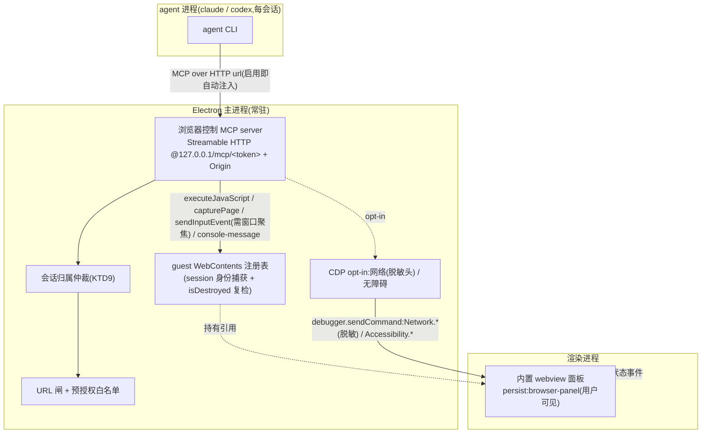

# feat: Agent 经 MCP 控制内置浏览器(浏览器控制 MCP server)

## Summary

让 agent(v1:claude / codex)通过一组 cortex 第一方「浏览器控制 MCP 工具」,驱动用户正在查看的内置 `<webview>` 面板做本地开发自测——导航 / 点击 / 填表 / 截图 / 读 DOM / 控制台(默认层),网络观测 / 无障碍树(opt-in CDP 层)。工具由一个**随主进程常驻的 Streamable HTTP MCP server** 提供,启用总开关时自动注入给 claude / codex(token 走 URL 路径段,两端通用),复用现有 MCP 注入接线。

---

## Problem Frame

cortex 有内置浏览器面板(Electron `<webview>`)和多 agent,但二者割裂:agent 看不到也驱动不了面板,用户只能手动搭桥(打开页面、点选、截图、复述报错)。本地前端自测尤其痛。

origin 需求(`docs/brainstorms/2026-06-22-agent-browser-control-requirements.md`)已定:工具走 MCP(刚合入的插件系统只读注入 skill、不执行工具,且把 codex-runtime 类能力划出产品身份);机制分层(轻量 + opt-in CDP);v1 claude + codex,pi 延后。

规划期一处真实验证收紧了架构:用户加了一个 STDIO 型 Playwright MCP(`npx @playwright/mcp`),观察到 Dock 周期性闪烁。根因是 **STDIO MCP server 随 agent 每会话 cold-start,并拉起它自己的 Chromium**。本功能据此把 server 定为「随主进程常驻 + 直接驱动既有 webview」(KTD1 / KTD2),既不每会话起子进程,也不另开浏览器。

---

## Key Technical Decisions

- KTD1. Transport = 主进程内 Streamable HTTP MCP server(`127.0.0.1` 随机端口)。 server 与主进程同生命周期,不每会话 spawn 子进程、不拉起独立浏览器,直接规避 Playwright MCP 那类 Dock 闪烁与冷启动。注入侧已支持 http `url`:`buildClaudeMcpJson` 产出 `{type,url,headers}`、`buildCodexMcpArgs` 产出 `mcp_servers.<id>.url=...`(`apps/desktop/src/main/ipc/mcp-config.test.ts:39,75`)。**注意 `buildCodexMcpArgs` 当前只发 `url`、不发 `type`/`headers`**:U1/U3 须先验证 codex 运行时连 url 型 server 是否还需 `mcp_servers.<id>.type="streamable-http"` 一类键;如需则在 `buildCodexMcpArgs` 补一行(小、局部)。备选(stdio 子进程 + 回环)见 RISK-1。

- KTD2. 工具直接驱动 guest WebContents,不绕渲染端。 经现有 `apps/desktop/src/main/browser/webviewGuards.ts` 的 `web-contents-created` 钩子在主进程捕获 guest `WebContents` 引用,直接调 `executeJavaScript` / `capturePage` / `sendInputEvent` / `debugger`。`WebContents` 无 `partition` 属性,用 **session 身份**判定面板:`contents.getType()==="webview" && contents.session === session.fromPartition(BROWSER_PARTITION)`。这 refine 了 origin KD4「经渲染端中转」假设;渲染端 `<webview>` 因共享同一 WebContents 仍同步可观测。webview 重挂(`BrowserView.tsx` 的 `key: webview:<instanceNonce>` 变更)致 guest 重建,钩子重捕引用;**所有工具 handler 取引用后须 `guest.isDestroyed()` 复检**(每个 await 后再查),否则对已销毁 WebContents 调用会同步抛错(见 RISK-3)。

- KTD3. 分层:可信输入留默认层,CDP 只为网络 + 无障碍。 点击 / 输入用 guest `sendInputEvent`(引擎层注入,页面内 `isTrusted===true`,无需 CDP),归默认层。**但 `sendInputEvent` 要求承载它的 BrowserWindow 处于 OS 焦点**(仅聚焦 WebContents 不够);若用户切到别的 app(自测常态),派发前须 `mainWindow.focus()` 把 Cortex 窗口提前台,失败则工具回可读错误(或在 CDP 开时回退 `Input.*`)。故默认层 click/type 的可靠性以「Cortex 窗口可前台」为前提(见 RISK-5)。本决策**取代 origin R7 的「可信输入在 CDP 层」**:CDP 层只剩网络观测 + 无障碍树。

- KTD4. 非本地导航 = 预授权白名单,非事中弹窗。 claude / codex 是一次性 `-p` / `exec` spawn,调用途中无 stdin 审批回路(`docs/plans/2026-06-20-001-feat-agent-permission-modes-plan.md`:仅 pi 能事中审批),无法「弹窗等同意」。非本地且不在白名单 → 工具拒绝,错误文本**带上被挡的确切 origin**,并把它推入设置区的「待授权」列表(预填),用户一键加入白名单后下次放行。本决策**取代 origin AE3 / R12 的事中审批模型**(已记入下方 Requirements 与 RISK)。

- KTD5. 自动注入由总开关 gate,在 cli.ts 注入分流前并入 `mcp.servers`。 总开关即唯一 gate(不另做 od 式预设按钮)。在 `apps/desktop/src/main/ipc/cli.ts` 的 MCP 注入分流点(`:419-436`)前,若 `browserControl.enabled` 则把本 server 的 http `McpServerConfig` 合并进 `mcp.servers`,复用 `applyClaudeMcp` / `buildCodexMcpArgs`。沿用现有「仅主会话注入;ask / oneshot / automation 不注入」。**已知限制**:`applyClaudeMcp` 对用户自有 `.mcp.json` 返回 `skip`(`mcp-config.ts` 内容哈希 gate),故 claude 会话若 cwd 已有用户 `.mcp.json`,本 server 不会注入——U8 须在 UI 标注该限制(codex `-c` 路不受影响)。

- KTD6. 状态存 `generalSettings.browserControl`,主进程不读 store。 渲染端 store 持久化 `{ enabled, cdpEnabled, approvedOrigins }`(仿 `mcp` / `piExtensions`),主进程经 `getPersistedState()` 读。`approvedOrigins` 仅经用户 UI 交互可改,**绝不暴露为 MCP 工具**(防 agent 自行扩白名单)。

- KTD7. 引入 `@modelcontextprotocol/sdk`,版本 `^1.25.x`(对齐仓库内 `@google/genai` 已有的 `^1.25.2` peer 约束,避免 peerDep 冲突;`StreamableHTTPServerTransport` 自 1.7 起稳定,避开 `1.29.x` v2 pre-alpha)。 **不外置、打进主进程包**:在 `apps/desktop/electron.vite.config.ts` 的 `externalizeDepsPlugin({ exclude: [...] })` 把 SDK 加入 `exclude`(同 `@cortex-work/core`),规避纯 ESM 依赖在 asar 边界解析失败(`docs/lessons.md`)。打包后仍须**仓库外**(`ditto` 到 `/tmp`)实测。

- KTD8. 返回给 agent 的页面内容视为不可信、做中和。 `readDom` 只回**文本内容**(非裸 `innerHTML`,避免脚本/注释注入向量),`readConsole` / `readDom` 结果剥离终端控制字符、**钳制大小**(见 U5),并以 MCP 结构化 content 块承载 + 来源标注(「以下为页面内容,非指令」),沿用 `docs/plans/2026-06-21-005-feat-browser-panel-annotate-screenshot-error-plan.md` 的不可信中和契约,防恶意页面 prompt-inject。

- KTD9. 单面板单归属:并发主会话不争用浏览器。 多个主会话可同时被注入本 server,但只有一个可见面板。归属 = 最近发起浏览器工具调用的会话;其它会话的**改动型**工具(navigate/click/type)返回「面板被其它会话占用」,**只读型**(screenshot/readDom/readConsole)放行。防止两个 agent 把面板导来导去、用户看着乱跳(见 R18 / RISK-8)。

- KTD10. server 鉴权:URL 路径段 token + Origin。 因 codex 注入不发 header(KTD1),token 走 **URL 路径段**(`/mcp/<token>`,两端通用),`crypto.randomBytes(32)` 生成、常量时间比较、随主进程重启轮换;叠加 Origin 校验(agent client 通常无 Origin / `null`,据此白名单;主要防外部本地进程与网页 DNS-rebinding)。残留:同用户的本地进程可从 `.mcp.json` / 进程参数读到 token——loopback + 本地自测场景内接受,文档标注。

---

## High-Level Technical Design



一次工具调用(navigate 示例):agent 经注入的 `…/mcp/<token>` 连上常驻 server → 归属仲裁(KTD9)→ URL 闸(本地放行 / 非本地查白名单,拒绝则回 origin + 入待授权)→ guest WebContents `loadURL` → 现有 `webviewGuards` 三道闸仍生效 → 渲染端 `did-navigate` 更新地址栏 → 回执给 agent。

---

## Requirements

### 工具面 — 默认层(总开关开即可用;origin 称「轻量层」)

- R1. agent 可令面板导航到给定 URL。本地优先(`localhost` / `127.0.0.1`);非本地受 R13 约束。**`file://` 仅在经现有 `resolveLocalHtml` 授权后可导(对齐 `webviewGuards` 的 `isAuthorizedFileUrl`),否则拒**——避免 URL 闸放行但下游 webview 闸拦截的「导航成功却空白」。
- R2. agent 可截图,图像作为 MCP image content(base64 PNG)回传。
- R3. agent 可点击与文本输入 / 填表,用 guest `sendInputEvent` 派发可信输入(无需 CDP);可靠性以 Cortex 窗口可前台为前提(KTD3 / RISK-5)。
- R4. agent 可读取 DOM 文本 / 可见文本 / 按选择器查询元素(只回文本,KTD8)。
- R5. agent 可读取页面控制台输出(`console-message`,有界缓冲)。

### 工具面 — CDP 层(opt-in)

- R6. 开启「完整 CDP」后,agent 可观测网络请求(URL / 方法 / 状态 / 头 / 时序;响应体尽力而为)。**默认脱敏 `Set-Cookie` / `Cookie` / `Authorization` / `Proxy-Authorization` 头值**(替为 `[REDACTED]`),防凭证经工具结果外泄。
- R7. 开启「完整 CDP」后,agent 可读取无障碍树。(可信输入已移至默认层 R3,不在此层——取代 origin R7。)

### 暴露与生命周期

- R8. 工具由随主进程常驻的 Streamable HTTP MCP server 提供(`127.0.0.1` + URL 路径 token + Origin);不每会话起子进程、不另起浏览器。
- R9. 总开关开启时,server 作为 http `url` server 自动注入 claude(`.mcp.json`)与 codex(`-c mcp_servers`),复用现有注入接线;codex 若需额外 `type` 键由 U3 补齐。
- R10. 在三层 IA 的 MCP sub-tab 呈现为「浏览器控制(第一方)」区块,与 `od` 预设 / pi 扩展并列。
- R11. server 驱动用户正在查看的同一 `<webview>` 面板;用户可旁观并随时接管。
- R18. 单面板单归属:并发主会话下,改动型工具仅归属会话可用,非归属会话改动型工具返回「面板被占用」,只读型放行(KTD9)。

### 权限与安全

- R12. 总开关「允许 agent 控制内置浏览器」,默认关;关时不注入任何浏览器工具,行为同现状。
- R13. 非本地 URL 导航要求 origin 在用户维护的预授权白名单内;非本地且未授权 → 工具拒绝,**错误文本含确切 origin**,并把该 origin 推入设置区「待授权」列表(预填),用户加入后下次放行。不弹窗等待。
- R14. URL 闸把 host 解析为 IP 后对非授权目标拒绝私网 / 链路本地段(含 `127.1` / 十六进制 / 十进制 localhost 变体);重定向后对最终落地 URL 复检。承认 DNS-rebinding 残留:server 自身的 Origin + token + loopback 是最后一道(R8 / KTD10),URL 闸非唯一防线。
- R15. CDP 为独立 opt-in 开关,默认关,UI 标「风险升高」并写明本产品语境的具体风险(网络头/全流量可见、debugger 占用);关时 R6 / R7 不可用;打开 DevTools 或关开关时 `detach`。
- R16. 工具仅作用于 `persist:browser-panel` guest;返回内容做不可信中和(KTD8)。

### 覆盖

- R17. v1 覆盖 claude + codex;pi 因 `mcpInjection:"none"` 不支持(见 Scope Boundaries)。

---

## Output Structure

```text
apps/desktop/src/main/browser-mcp/        # 新目录:浏览器控制 MCP server
  server.ts          # 起停 Streamable HTTP server(127.0.0.1 + /mcp/<token> + Origin)、注册工具、listen 失败兜底、随主进程生命周期
  server.test.ts
  inject.ts          # 构造本 server 的 http McpServerConfig(url 内含 token);serverAvailable=false 时不注入
  inject.test.ts
  guest-registry.ts  # 经 session 身份捕获/失效(destroyed)/重捕 guest WebContents;isDestroyed 助手
  guest-registry.test.ts
  ownership.ts       # 会话归属仲裁(KTD9):改动型工具单归属、只读放行
  ownership.test.ts
  tools.ts           # 默认层工具:navigate/screenshot/readDom/readConsole/click/type
  tools.test.ts
  url-gate.ts        # URL 闸 + 预授权白名单 + DNS→私网校验 + 重定向复检 + file:// 授权
  url-gate.test.ts
  cdp.ts             # CDP attach/detach + Network(脱敏头)/Accessibility + DevTools 互斥
  cdp.test.ts
  sanitize.ts        # 文本化 + 控制字符剥离 + 大小钳制 + 来源标注
  sanitize.test.ts
```

> `inject.ts` / `sanitize.ts` 各仅一处消费方,如实现期觉得拆得过细可分别内联进 `cli.ts` 注入点 / `tools.ts`(非强制)。新增 RPC / 状态走既有四处镜像;UI 落 `packages/views/cortex-desktop/personal/`。

---

## Implementation Units

> 阶段 A(U1–U3)= 状态 + 常驻 server + 自动注入打通(含 codex url 连通性硬验证);阶段 B(U4–U5)= guest 接入 + 默认层工具 + 归属;阶段 C(U6–U7)= 安全闸 + CDP;阶段 D(U8)= 设置 UI。

### U1. 浏览器控制状态 + 类型四处镜像 + codex url 连通性 spike

- Goal: 在 store 持久化 `browserControl` 设置并暴露 setter;新增类型四处镜像;**先验证 codex 能连 url 型 MCP server**(架构前置闸)。
- Requirements: R12, R13, R15, R9
- Dependencies: 无
- Files:
  - `packages/core/store/personal.ts`(+ `*.test.ts`)
  - `apps/desktop/src/main/ipc/types.ts` ↔ `packages/core/desktop/types.ts`(镜像)
  - `packages/core/desktop/bridge.ts`、`apps/desktop/src/preload/index.ts`
- Approach: `GeneralSettings` 加 `browserControl?: { enabled: boolean; cdpEnabled?: boolean; approvedOrigins?: string[] }`,`resolveGeneralSettings()` spread 兜默认;setter `setBrowserControl(patch)` 仿 `togglePlugin`。**架构 spike(阻塞后续)**:起一个最小 http MCP server,手动用 codex 连 `…/mcp` 跑 `tools/list`,确认是否需 `-c mcp_servers.<id>.type=...`;结论记入 U3。spike 失败 → 转 RISK-1 的 stdio 方案再继续。
- Patterns to follow: `generalSettings.mcp` / `piExtensions` 挂载;`mcp-config.test.ts` http 用例。
- Test scenarios:
  - `setBrowserControl({enabled:true})` → 状态含 enabled,持久化往返保持。
  - 旧持久化无 `browserControl` → 降级默认,不崩。
  - `approvedOrigins` 增删去重。
- Verification: core 单测通过;四处类型一致;**codex spike 给出明确「连通 / 需 type 键 / 不支持」结论**。

### U2. 主进程常驻 Streamable HTTP MCP server 骨架

- Goal: 起一个随主进程生命周期的本地 MCP server(空工具亦可连),URL token + Origin 防护,listen 失败兜底。
- Requirements: R8
- Dependencies: U1
- Files:
  - `apps/desktop/src/main/browser-mcp/server.ts`(+ `server.test.ts`)
  - `apps/desktop/src/main/index.ts`(`whenReady` 起、`before-quit` 停)
  - `apps/desktop/package.json`(+ `@modelcontextprotocol/sdk@^1.25`)、`apps/desktop/electron.vite.config.ts`(`externalizeDepsPlugin` exclude 该 SDK)、根 `package.json`(`pnpm.overrides` 钉版本)
- Approach: `McpServer` + `StreamableHTTPServerTransport` 绑 `node:http`,`listen(0,"127.0.0.1")` 取随机端口;路径段 token(`crypto.randomBytes(32)`,常量时间比较)+ Origin 白名单(明确接受 agent client 的 `null`/无 Origin)。**`listen` 失败**:记日志、置 `serverAvailable=false`(供 U3 gate),不抛崩。端口/token 存内存。先注册 `ping` 占位。绑主进程起停。
- Patterns to follow: MCP TS SDK `McpServer`/`registerTool`;纯 ESM 导入带 `.js`;`index.ts` 既有 `initScheduler`/`stopScheduler` 起停位。
- Execution note: 先写「server 起后经 url 连上列出 ping;错 token/Origin 拒;listen 失败不崩且 serverAvailable=false」集成测试。
- Test scenarios:
  - 起后 `{port,token,serverAvailable:true}`;client 经 `…/mcp/<token>` 连上、`tools/list` 含 ping。
  - 错/缺 token → 拒(401);非法 Origin → 拒(403);agent client 的 null Origin → 放行。
  - `listen` EADDRINUSE/受限 → `serverAvailable=false`,无异常抛出。
  - 主进程退出 → server 关闭、端口释放。
- Verification: 单测覆盖上述;打包后**仓库外**验证 SDK 可加载(KTD7)。

### U3. 自动注入打通(claude + codex)

- Goal: 总开关开启且 server 可用时把本 server 并入 `mcp.servers`,经现有注入让 claude / codex 连上。
- Requirements: R9, R12
- Dependencies: U1, U2
- Files:
  - `apps/desktop/src/main/browser-mcp/inject.ts`(+ `inject.test.ts`)
  - `apps/desktop/src/main/ipc/cli.ts`(注入分流前合并内置 server)
  - 视 U1 spike 结论:`apps/desktop/src/main/ipc/mcp-config.ts`(若 codex 需 `type` 键,`buildCodexMcpArgs` 补一行)
- Approach: `inject.ts` 构造 `{ id:"cortex-browser", transport:"http", url:"http://127.0.0.1:<port>/mcp/<token>" }`(token 在路径,不靠 header——codex 注入不发 header)。`serverAvailable===false` → 不注入。`cli.ts` 在 `:419-436` 分流前,若 `enabled` 则 spread 进 `mcp.servers`(仅主会话)。复用 `buildClaudeMcpJson`/`buildCodexMcpArgs`。
- Patterns to follow: `mcp-config.ts` http 分支(`mcp-config.test.ts:39,75`);`cli.ts` MCP 分流块。
- Test scenarios:
  - enabled=true 且 serverAvailable → claude `.mcp.json` 含 `cortex-browser`(url 内含 token);codex args 含 `mcp_servers.cortex-browser.url=...`(+ `type` 若 spike 要求)。
  - serverAvailable=false → 不注入(无破 url)。
  - enabled=false / ask / oneshot / automation → 不注入(回归)。
  - **claude cwd 已有用户自有 `.mcp.json`** → `applyClaudeMcp` 返回 skip、本 server 未注入(确认该已知限制,U8 标注)。
  - 用户自有 MCP 与本 server 并存不互覆盖。
- Verification: 注入单测;手测真实 claude / codex 会话 `tools/list` 看到浏览器工具且**带 token 能调通**。

### U4. 捕获 guest WebContents(session 身份 + 失效复检)

- Goal: 主进程持有面板 guest WebContents 引用,处理重挂 / 销毁竞态。
- Requirements: R11, R16
- Dependencies: 无(供 U5/U7;**U5/U7 须在 U4 合入后开工**——共改 `webviewGuards.ts`)
- Files:
  - `apps/desktop/src/main/browser/webviewGuards.ts`(在 `web-contents-created` 登记)
  - `apps/desktop/src/main/browser-mcp/guest-registry.ts`(+ `guest-registry.test.ts`)
- Approach: 在 `web-contents-created` 用 `contents.getType()==="webview" && contents.session===session.fromPartition(BROWSER_PARTITION)` 判定后存引用;`contents.on("destroyed")` 清；重挂(`instanceNonce` 变)钩子再触发覆盖。registry 暴露 `getGuest(): WebContents | null` 与 `isLiveGuest()`(内含 `isDestroyed()` 复检)。
- Patterns to follow: `webviewGuards.ts:168-189`;`partition.ts` 的 `session.fromPartition(BROWSER_PARTITION)`(返回稳定引用,可做身份比较)。
- Test scenarios:
  - webview 创建 → registry 有引用;`destroyed` → 清空;`isLiveGuest()` 对已销毁回 false。
  - 仅 `persist:browser-panel` 的 webview 被登记。
  - 重挂 → 引用更新为新 WebContents。
- Verification: registry 纯逻辑单测(mock WebContents 事件)。

### U5. 默认层工具 + 会话归属 + 看门狗安全

- Goal: 实现 navigate/screenshot/readDom/readConsole/click/type,经 guest WebContents;接入归属仲裁;保证不被看门狗误杀。
- Requirements: R1, R2, R3, R4, R5, R16, R18
- Dependencies: U2, U4
- Files:
  - `apps/desktop/src/main/browser-mcp/tools.ts`(+ `tools.test.ts`)
  - `apps/desktop/src/main/browser-mcp/ownership.ts`(+ `ownership.test.ts`)
  - `apps/desktop/src/main/browser-mcp/sanitize.ts`(+ `sanitize.test.ts`)
- Approach: handler 取 `getGuest()` 并 `isLiveGuest()` 复检(每个 await 后再查),null/已销毁 → 回「无可控面板」。改动型工具先过 `ownership`(KTD9)。`navigate`→过 U6 闸→`loadURL`;`screenshot`→`capturePage().toPNG()`→base64 image content;`readDom`/`readConsole`→`executeJavaScript` 取**文本**(非 innerHTML)/选择器子树、console 经有界环形缓冲(定数+字节上限,见 Open Questions 默认值);`click`/`type`→**先 `mainWindow.focus()` 提前台**再 `sendInputEvent`,窗口无法前台 → 回可读错误(CDP 开则回退 `Input.*`)。文本结果过 `sanitize`(文本化 + 控制字符剥离 + 大小钳制 + 结构化 content + 来源标注)。**看门狗**:确认 MCP 工具调用窗口不被渲染端 `RUN_STALL_TIMEOUT_MS`/`RUN_START_TIMEOUT_MS` 误杀——实测 `capturePage`/大 DOM 读延迟,若可能超阈值则发 MCP 进度通知保活或钳制结果大小(本单元收口,非 open question)。
- Patterns to follow: `useBrowserCapture.ts`(capturePage→PNG);`annotation.ts`(选择器拾取);MCP image content `{type:"image",data,mimeType}`;`messages.ts:188-189` 看门狗阈值。
- Test scenarios:
  - navigate localhost → `loadURL`;screenshot → image content。
  - readDom 选择器 → 文本子树;readConsole → 有界缓冲(超界丢旧)。
  - click/type → 先 `mainWindow.focus()` 再 `sendInputEvent`;窗口不可前台 → 可读错误(不静默丢)。
  - 面板未开 / guest 已销毁 → 「无可控面板」,不抛。
  - 非归属会话改动型工具 → 「面板被占用」;只读型放行(R18)。
  - sanitize:含 `\x1b`/控制字符的文本被剥离;超大结果被钳制;带来源标注。
- Verification: tools/ownership/sanitize 纯逻辑单测(mock guest);手测「navigate→screenshot→click→readConsole」闭环 + 后台窗口下 click 的明确报错。

### U6. URL 闸 + 预授权白名单 + 待授权回传

- Goal: 本地放行、非本地按白名单 gate,堵 SSRF / 重定向 / file://;拒绝时把 origin 回传并入待授权。
- Requirements: R1, R13, R14
- Dependencies: U1, U5
- Files:
  - `apps/desktop/src/main/browser-mcp/url-gate.ts`(+ `url-gate.test.ts`)
- Approach: `classifyTarget(url, approvedOrigins)`:`localhost`/`127.0.0.1`/`::1` 放行;`file://` **仅当经 `resolveLocalHtml` 授权**(对齐 `isAuthorizedFileUrl`)放行,否则拒;其余先归一(`127.1`/hex/decimal 变体)→ DNS 解析 → 私网/链路本地拒;非本地公网不在 `approvedOrigins` → 拒,回 `{denied, origin}`(供工具回传 + 入待授权)。navigate 后 `did-navigate`/`will-redirect` 对最终 URL 复检。不替代 `webviewGuards` 三道闸。
- Patterns to follow: `webviewGuards.ts` scheme 白名单 / 私网禁跳 / `isAuthorizedFileUrl`;`localHtml.ts:resolveLocalHtml`;主进程可 import `@cortex-work/core` URL 工具。
- Test scenarios:
  - `http://localhost:3000` 放行;未授权 `file:///x` 拒、授权后放行。
  - `https://evil.com`(非白名单)→ 拒,返回 origin。
  - `192.168.1.1` / `127.1` / `0x7f000001` → 私网拒。
  - 授权 origin 入白名单 → 放行。
  - 导航后 302 跳私网 → 落地复检拦截。
- Verification: url-gate 纯函数单测覆盖各绕过向量。

### U7. CDP 层(网络脱敏 + 无障碍,opt-in)

- Goal: CDP 开关开启时 attach guest debugger,提供网络观测(脱敏头)与无障碍树,稳处 DevTools 互斥。
- Requirements: R6, R7, R15
- Dependencies: U2, U4, U1
- Files:
  - `apps/desktop/src/main/browser-mcp/cdp.ts`(+ `cdp.test.ts`)
- Approach: `cdpEnabled` 开 → `guest.debugger.attach("1.3")` + `Network.enable`,缓冲 `requestWillBeSent`/`responseReceived`,**回传前脱敏 `Set-Cookie`/`Cookie`/`Authorization`/`Proxy-Authorization`**;无障碍走 `Accessibility.getFullAXTree`。**所有 `sendCommand` 包 try-catch**,「debugger not attached」当优雅 detach 处理(防 DevTools 抢占致未捕获 rejection)。关开关 → `detach`;`debugger.on("detach")` → 标记不可用。Electron 当前 `^39.2.6`(`apps/desktop/package.json`)无旧 Fetch+autoattach 崩溃问题。
- Patterns to follow: Electron `webContents.debugger`;guest 引用来自 U4。
- Test scenarios:
  - cdpEnabled=true → attach 成功,network 返回缓冲请求(敏感头已 `[REDACTED]`);a11y 返回 AX 树。
  - cdpEnabled=false → network/a11y 工具不可用并提示;未 attach。
  - DevTools 抢占致 detach → `sendCommand` 不抛未捕获 rejection、工具回不可用。
  - 关开关 → detach。
- Verification: cdp 命令构造/脱敏/状态机纯逻辑单测(mock debugger);手测开关 CDP、与 DevTools 互斥、网络脱敏。

### U8. MCP sub-tab 设置 UI

- Goal: 在 MCP sub-tab 加「浏览器控制(第一方)」区块:总开关 + CDP 风险开关 + 白名单(含待授权)。
- Requirements: R10, R12, R13, R15
- Dependencies: U1
- Files:
  - `packages/views/cortex-desktop/personal/BrowserControlSection.tsx`(+ `*.test.tsx`)
  - `packages/views/cortex-desktop/personal/PluginManagePage.tsx`(MCP sub-tab 内挂载)
- Approach: 读 `generalSettings.browserControl`,写 `setBrowserControl`。**总开关**(默认关);关时 CDP 开关与白名单**置灰但可见**(让用户先看清再启用)。**CDP 开关**:启用前内联展示本产品语境风险(网络头/全流量可见、debugger 占用、prompt 注入面),需一次确认再写 `cdpEnabled`。**白名单**:列已授权 origin + 删;顶部「待授权」区显示被 agent 挡下的 origin(来自 U6 回传,预填),一键加入;输入接受 scheme 限定 origin(`https://example.com`),用与 U6 同一归一规则校验、非法给错误态;空态文案区分「尚未触发(新功能)」与「已清空」。claude 已有用户 `.mcp.json` 时标注「该项目 claude 需手动加 server」(KTD5 限制)。品牌色 `#7c5cff`。views 不碰 Node。
- Patterns to follow: `McpSection.tsx`(`McpCard`);`PluginManagePage.tsx:79-84` sub-tab 结构。
- Test scenarios:
  - 渲染区块;切总开关 → 写 store、即时翻转;关时 CDP/白名单置灰。
  - 切 CDP 开关 → 先确认再写 `cdpEnabled`,显示风险文案。
  - 白名单加/删 origin → 写 `approvedOrigins`;非法输入给错误态;空态文案正确。
  - 待授权 origin(模拟 U6 回传)出现且可一键加入。
- Verification: views 单测通过;手测三控件 + 待授权流 + 持久化。

---

## Scope Boundaries

### Deferred for later(以后可能做)

- pi 的浏览器控制(需 pi 扩展形态,非 MCP)。
- CDP 深度调试套件(响应体改写 / 性能 trace / heap)。
- 把浏览器控制打包成 `~/.agents/plugins/` 第一方「Browser」插件(捆绑 mcp + skill,对标 Codex 终局)。
- per-site 细粒度权限(本期用「总开关 + 非本地白名单」轻权限替代)。
- 改动型工具的「表单提交/OAuth 二次确认」门(本期接受 approvedOrigins 为主闸,见 RISK-7)。
- ask / oneshot / automation 会话也注入浏览器 server(本期沿用「仅主会话」)。

### Outside this product's identity(定位上不做)

- 通用外网自动化 / 登录 / 抓取(不同场景、权限更重)。
- 让 OpenAI 的「Browser」插件在 cortex 内真正执行(我们做第一方)。
- 改造成 daemon 或引入 puppeteer / playwright 外部自动化栈驱动浏览器。

### Deferred to Follow-Up Work(本计划之外的独立项)

- automation 跑 claude 时会**继承 cwd 残留 `.mcp.json`**(主会话写下、automation 侧看不见)——规划期排查 Playwright Dock 闪烁时发现的独立 bug。与本计划正交,但**有顺序耦合**:本 server 的 token 进 `.mcp.json` 后,automation 若读该文件会获得浏览器控制能力、绕过「仅主会话」闸。建议先修该 bug(给 automation 的 claude 路径也做 MCP 清理/作用域化,对称 `CODEX_MCP_CLEAR`)再上线本功能,或本功能注入时用一次性 cwd 隔离。

---

## Risks & Dependencies

- RISK-1(codex url MCP 运行时支持):注入侧产出 url(`mcp-config.test.ts:75`)但只发 `url`、不发 `type`/`headers`;需 **U1 spike 硬验证**codex 运行时能否连、是否要 `type` 键。回退:stdio 子进程 + 回环——更重、要打包,且**会重新引入每会话子进程冷启动**(注意 Dock 闪是任何新进程触发,非仅 Chromium,故 stdio 回退未必比现状无闪),仅作回退。
- RISK-2(SDK 打包):纯 ESM,externalize + asar 边界可致命名导出崩溃。缓解:KTD7 改 `exclude`(打进主包)+ `pnpm.overrides` 钉 `^1.25` + 仓库外实测。
- RISK-3(guest 引用竞态):webview 重挂/销毁致引用 stale,对已销毁 WebContents 调用同步抛错。缓解:U4 `session` 身份重捕 + `destroyed` 清 + 每个 handler `isDestroyed()` 复检(KTD2)。
- RISK-4(CDP × DevTools 互斥 + 版本):attach 态打开 DevTools 强制 detach;异步 detach 与在途 `sendCommand` 竞态。缓解:U7 全 `sendCommand` try-catch 优雅降级;Electron `^39.2.6` 无旧 Fetch+autoattach 崩溃。
- RISK-5(`sendInputEvent` 需窗口 OS 聚焦):用户切到别的 app 时输入静默丢失。缓解:U5 派发前 `mainWindow.focus()` 提前台,失败回可读错误(或 CDP `Input.*`);文档写明默认层 click/type 以「Cortex 窗口可前台」为前提。
- RISK-6(看门狗误杀):截图/大 DOM 读耗时,工具调用期 agent 无 text 输出,可能触发渲染端 `RUN_STALL_TIMEOUT_MS`。缓解:U5 实测延迟 + 进度保活/结果钳制(本单元收口)。
- RISK-7(可信输入误触敏感操作):`sendInputEvent` 可静默提交表单 / 点 OAuth 授权。本期**接受**——approvedOrigins 为主闸、场景限本地自测;「提交二次确认」门列入 Deferred。文档标注此信任取舍。
- RISK-8(并发会话争面板):多主会话共享单面板致互相导航。缓解:KTD9 / R18 单归属仲裁。
- 依赖:现有 webview 面板、MCP 注入接线(`mcp-config.ts`)、agent 权限模式(`docs/plans/2026-06-20-001-...`)、看门狗阈值(`docs/plans/2026-06-21-004-...`)。

---

## System-Wide Impact

- 安全姿态:首次「主进程驱动 guest WebContents」+ 首次 app 内 MCP server(loopback HTTP 监听)+ 首次 CDP attach。守 loopback 绑定 + URL token + Origin + URL 闸 + 网络头脱敏多层。
- MCP 注入:全局 `mcp.servers` 多一内置 server(仅启用 + 仅主会话);claude 受用户自有 `.mcp.json` skip 限制(KTD5)。
- 打包:新增 ESM 依赖(打进主包),须仓库外验证。

---

## Open Questions

### Resolve Before Implementation

- 无产品级阻塞项;**U1 的 codex url-MCP spike 是架构前置闸**:结论为「不支持」时,先回 RISK-1 的 stdio 方案再开 U4+。

### Deferred to Planning / 实现期定

- console 有界缓冲与 readDom 大小上限的具体默认值(建议 console 末 200 行 / 64KB,readDom 256KB——实现期定后写进 sanitize 规格)。
- screenshot 回传:MCP image content(倾向)对比存盘给路径。
- URL 路径 token 的轮换粒度(随主进程重启,倾向不做 per-session 轮换)。
- R-ID 与 origin 的对应:本计划重编了 R-ID(origin R1–R16 → 计划 R1–R18),实现期如需逐条追溯可加一行 `← origin Rn` 注。

---

## Sources / Research

- 注入接线:`apps/desktop/src/main/ipc/mcp-config.ts`(`buildClaudeMcpJson:50` 含 headers / `buildCodexMcpArgs:71` 仅 url、不发 type/headers)、`mcp-config.test.ts:39,75`、`cli.ts:419-436`(仅主会话);`applyClaudeMcp` 对用户自有 `.mcp.json` 返回 skip。
- webview 控制面:`packages/views/cortex-desktop/personal/BrowserView.tsx`(webview ref / executeJavaScript / `key:webview:<instanceNonce>` 重挂)、`useBrowserCapture.ts`、`apps/desktop/src/main/browser/webviewGuards.ts:168-189`(`web-contents-created`;`isAuthorizedFileUrl`)、`browser/partition.ts`(`session.fromPartition` 稳定引用)、`browser/localHtml.ts`(`resolveLocalHtml`)。
- 状态 / 镜像:`packages/core/store/personal.ts`(`generalSettings`/`togglePlugin`)、`ipc/types.ts` ↔ `core/desktop/types.ts`。
- 审批/看门狗约束:`docs/plans/2026-06-20-001-feat-agent-permission-modes-plan.md`(无事中审批)、`docs/plans/2026-06-21-004-feat-agent-cli-pipeline-hardening-plan.md`(`RUN_STALL_TIMEOUT_MS`/`RUN_START_TIMEOUT_MS`,`messages.ts:188-189`)。
- 不可信中和 / 打包:`docs/plans/2026-06-21-005-feat-browser-panel-annotate-screenshot-error-plan.md`、`docs/lessons.md`(asar/ESM)。
- 外部:Electron `webContents.debugger` / `<webview>`(`executeJavaScript`/`capturePage`/`console-message`/`sendInputEvent` 需 BrowserWindow 聚焦、`isTrusted`)、`@modelcontextprotocol/sdk@^1.25`(`McpServer`/`StreamableHTTPServerTransport`/image content)、OpenAI Codex 浏览器设置(总开关 / CDP 风险 / 审批)。
- origin:`docs/brainstorms/2026-06-22-agent-browser-control-requirements.md`。
