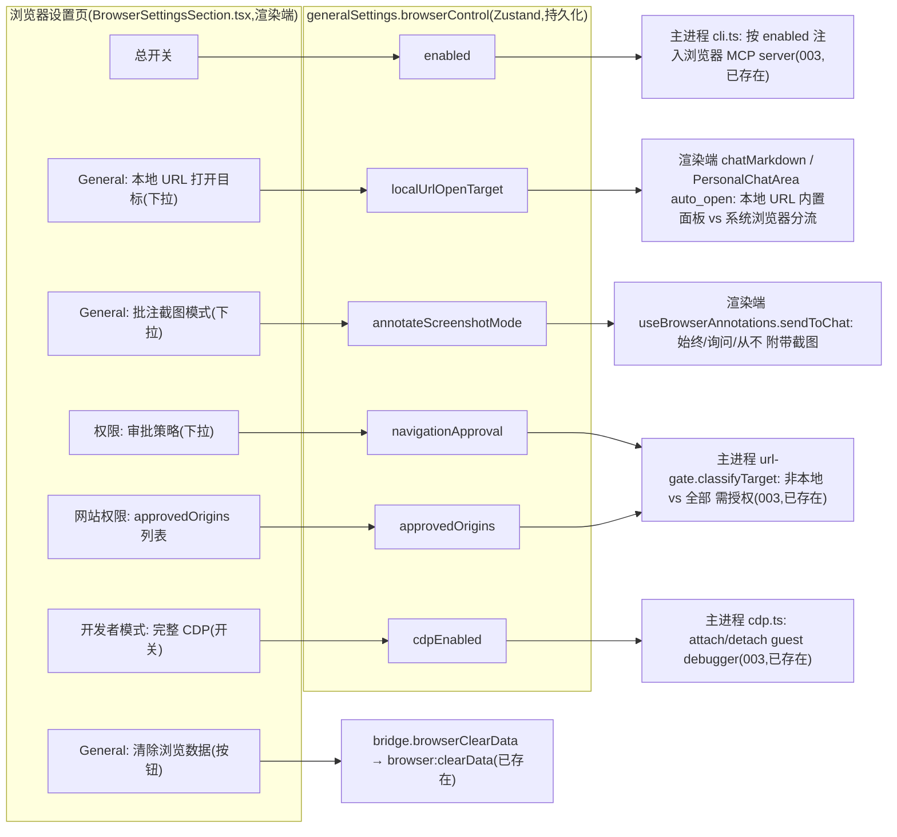

# feat: 浏览器设置页(对标 Codex 布局,诚实对齐 cortex 能力)

## Summary

把设置页「应用 → 浏览器」分区从当前 3 控件(总开关 / CDP / 非本地白名单)扩展为对标 Codex 浏览器设置截图的完整布局:**总开关 + General(默认本地 URL 打开目标 / 清除浏览数据 / 批注截图模式)+ 权限(审批策略)+ 网站权限(授权 origin 列表)+ 开发者模式(完整 CDP)**。复用既有 `BrowserControlSection` 逻辑与 `browser:clearData` IPC,新增字段走「四处镜像 + i18n 三处」既有约定。

定下的两条对齐基调:**诚实对齐 cortex 能力**——Codex 的「审批·事中弹窗」在 cortex 无法落地(claude/codex 一次性 spawn,无事中审批回路,见 origin 衍生计划 `docs/plans/2026-06-22-003-feat-agent-browser-control-mcp-plan.md` KTD4),故「审批」下拉**重构为预授权强度**;「网站权限」**复用既有 origin 级白名单 `approvedOrigins`**,不建 per-site 覆盖(该能力 003 计划已明确 deferred)。每个控件都真实可用,无占位假按钮。

---

## Problem Frame

最近合入的「设置菜单分组 + 应用/浏览器分区重组」(commit `8edf571`)已把「浏览器」提升为设置左栏顶层一等分区,并挂载了 `BrowserControlSection`(总开关 / CDP / 白名单三控件,来自 003 计划 U8,已 shipped)。但当前页面只是 agent 浏览器控制的最小开关集,与用户给的 Codex 浏览器设置页相比缺:General 区(打开目标 / 清除数据 / 批注截图)、独立「权限·审批」呈现、「网站权限」分区、「开发者模式」独立分区。

本计划在已 shipped 的分区与状态切片上**扩展 UI 与少量行为接线**,使该页面达到截图的功能完整度。它**不**重做 003 计划已覆盖的浏览器 MCP server 后端(server / tools / cdp / url-gate / 注入);那些是本页设置项的消费方与前置基建。

一处真实约束收紧了实现:`SettingsMenu.tsx` 已 **2104 行**,超过仓库 1200 行单文件上限,不能再往里内联新分区——本计划把浏览器设置页抽成独立组件(KTD4)。

---

## Key Technical Decisions

- **KTD1. 审批下拉重构为「预授权强度」,不复刻 Codex 事中审批。** Codex「审批 → 始终询问」依赖事中弹窗;cortex 的 claude/codex 是一次性 `-p`/`exec` spawn,调用途中无 stdin 审批回路(`docs/plans/2026-06-22-003-...md` KTD4 已据此把非本地导航定为「预授权白名单 + 拒绝回传」)。故本页下拉**重命名为「导航授权范围」**(避免「审批」误读为事中询问),语义是 **url-gate 的预授权严格度**:`仅外部网站需预授权 · localhost 自由访问`(默认,当前行为)/ `所有网站均需预授权 · 含 localhost`。UI 文案明确写明 cortex 用预授权白名单而非事中弹窗。

- **KTD2. 网站权限复用 `approvedOrigins`(origin 级允许列表),不建 per-site 覆盖。** Codex「网站权限」是 per-site 覆盖审批/CDP 默认值;003 计划已把 per-site 细粒度权限列入 Deferred,本期用「总开关 + 非本地白名单」轻权限替代。本页「网站权限」分区**直接呈现/增删既有 `approvedOrigins`**,口径与主进程 url-gate 的 `classifyTarget` 一致(`new URL().origin`),不新增数据结构、不改主进程 gate 模型。**口径一致须机械化保证**:渲染端输入校验与主进程 url-gate 比较共用 `packages/core` 下同一纯函数 `normalizeOrigin(url): string | null`(而非各处内联 `new URL().origin`),否则 trailing slash / scheme 大小写等差异会让白名单永久匹配不上(RISK-11)。

- **KTD3. 新增设置字段并入 `browserControl` 切片,单源不另起 slice。** 新增 `localUrlOpenTarget` / `annotateScreenshotMode` / `navigationApproval` 全部挂到既有 `BrowserControlSettings`,避免第二份「四处镜像 + 兜默认 + saveUrgency」开销。`localUrlOpenTarget` / `annotateScreenshotMode` 属浏览器面板 UX(非 agent 控制),挂在此 bag 语义略宽,但该页本身即「管理浏览器」的统一面,接受;在类型注释里标注分类。

- **KTD4. 浏览器设置页抽独立组件,不另造控件模块。** 新建 `BrowserSettingsSection.tsx` 承载整页;复用 `SettingsMenu.tsx` 既有设置原语(`SettingCard` / `SRow` / `SBlock` / `SwitchRow` / `BareSelect`)——把它们从 `SettingsMenu.tsx` 改为**具名导出**,新组件直接 import(这些控件当前仅 SettingsMenu 一处用,单消费方不值得再造 `settingsControls.tsx` 中间层;待第三个设置分区出现再抽)。`BrowserSection` 收敛为渲染 `<BrowserSettingsSection/>`;`BrowserControlSection.tsx` 逻辑(总开关 / CDP 二段确认 / 白名单增删)迁入新组件后,**连同其 `BrowserControlSection.test.tsx` 迁移用例后一并删除**,避免双份白名单 UI 与断测。**诚实说明:本次仅「逻辑迁出 + 不再内联新代码」,`SettingsMenu.tsx`(2104 行)不会因此降到 1200 行以下——其总量超限是既有历史债,拆分其它 section 不在本计划 scope。**

- **KTD5. 全页 i18n,清掉硬编码。** 现 `BrowserControlSection.tsx` 顶部 `eslint-disable i18next/no-literal-string`,文案硬编码。本页作为顶层一等分区,文案统一进 `settings.json` 的 `browser.*` 段(zh-Hans + en + `resources.d.ts` 三处),迁移时去掉 eslint-disable。**下拉/审批选项存原始枚举值、渲染时 `t()` 翻译**,严禁把 i18n key 落盘(`docs/i18n-migration-status.md` 的 `PROVIDER_PRESETS.name` 前车之鉴)。

- **KTD6. `browserControl` 已随 `generalSettings` 走紧急落盘(回归确认即可,无需新增代码)。** `usePersonalPersistence.ts:22` 的 `saveUrgency` 以 `generalSettings !== prev` 引用比较返回 `immediate`,`setBrowserControl` 每次产新 `generalSettings` 对象,故 `enabled` / `navigationApproval`(主进程即时读)天然紧急落盘。代价:低频偏好(`localUrlOpenTarget` / `annotateScreenshotMode`)也走紧急档——overhead 极小,本期接受;若 General 区后续大量加字段再考虑细粒度化 saveUrgency。

- **KTD7. 权限字段用户独占写入,agent 永不可改(安全不变量)。** `enabled` / `cdpEnabled` / `navigationApproval` / `approvedOrigins` 只经设置页用户交互写入,**绝不暴露为任何 MCP 工具**(沿用 origin 计划「approvedOrigins 不暴露为工具」不变量;本计划新增 `navigationApproval` 同受此约束)。U5 / U6 加负向测试守此不变量。

---

## High-Level Technical Design

各控件 → 状态字段 → 消费点 的映射(诚实对齐:每个控件都有真实消费方):

> 图为方向性设计,非实现规格。左列控件全部位于渲染端单一组件;中列字段共用 `browserControl` 一个持久化切片(KTD3);右列消费点中 `enabled`/`navigationApproval`/`cdpEnabled` 由主进程读(经 `getPersistedState`),其余由渲染端读。

---

## Requirements

> 本计划 R-ID 为本计划局部编号,**与 origin 需求文档 R-ID 不对应**(origin R8 = MCP sub-tab 呈现,本计划 R8 = 批注截图)。追溯 origin 时以语义而非编号匹配。

### 布局与基建

- R1. 「浏览器」分区呈现为对标截图的分区卡片:**总开关**(顶部独立)→ **General** → **权限** → **网站权限** → **开发者模式**;整页抽为独立组件,`SettingsMenu.tsx` 不再内联(KTD4)。
- R2. 全页文案 i18n(`settings:browser.*`,zh-Hans + en),下拉选项存枚举、渲染翻译(KTD5)。
- R3. 新增字段 `localUrlOpenTarget` / `annotateScreenshotMode` / `navigationApproval` 并入 `BrowserControlSettings`,过四处镜像 + `resolveGeneralSettings()` 兜默认 + saveUrgency 紧急档(KTD3 / KTD6)。

### 总开关与开发者模式(复用既有)

- R4. 总开关「允许 agent 控制内置浏览器」读写 `browserControl.enabled`;关闭时下方权限/CDP/网站权限区置灰但可见(`fieldset disabled`,沿用现有交互)。
- R5. 开发者模式「启用完整 CDP 访问权限」读写 `cdpEnabled`,保留启用前二段式风险确认与「风险升高」标注;CDP attach/detach 仍由主进程 `cdp.ts` 响应(已存在,本页只写 store)。

### General

- R6. 「清除浏览数据 → 清除所有浏览数据」按钮调 `bridge.browserClearData()`(复用 `browser:clearData`)。**破坏性操作须二次确认**(内联确认态,沿用 CDP 的 `SettingCard` 内联警告模式,文案注明「将清除历史 / Cookie / 缓存,不可撤销」);确认后进 loading 态(按钮 disabled + 文案「清除中…」,防重复点),IPC 返回出成功/失败 toast。Web 端(`bridge` 为 null)整区不渲染(见 R11)。
- R7. 「本地 URL(localhost)打开目标」下拉:`内置浏览器面板`(默认)/ `系统默认浏览器`。**仅作用于本地 / loopback URL**:选 `系统` 时,会话消息里点击 localhost/loopback 链接与 dev server auto_open 改走系统浏览器;**外链不受影响,始终在内置面板打开**(须 helper text 明示,消除「选系统则全部走系统」的预期差)。选 `内置` 维持现状(`requestBrowserUrl` + 内置面板)。
- R8. 「批注截图」下拉(**默认 `询问`,零行为变更**):`询问` = 维持当前手动(不自动附图);`始终包含` = 批注「发送到 Chat」时自动附带当前页截图;`从不` = 仅发标注文本。本期 `询问` 不弹窗(发送时弹窗选择留后续),UI 须以 helper text 或选项文案明示「本版本为手动选择附图」,避免「询问」字面误导。

### 权限与网站权限

- R9. 「权限 → 导航授权范围」下拉(对标截图「审批」,**重命名为自解释措辞**避免「审批=事中询问」误读):`仅外部网站需预授权 · localhost 自由访问`(默认,当前行为)/ `所有网站均需预授权 · 含 localhost`,写 `navigationApproval`,主进程 url-gate 据此判定 localhost 是否也需白名单(KTD1)。helper text 明示:cortex 用**下方网站权限的预授权白名单**(非事中弹窗),切到「含 localhost」后须先把 `http://localhost:3000` 加入白名单否则本地导航被拒。**注意:`含 localhost` 档收紧了 origin R12「本地免审批」,属对齐截图引入的额外严格档、默认关,与 origin 分歧记入 Risks(RISK-10)。**
- R10. 「网站权限」分区呈现 `approvedOrigins`:列表 + 移除 + 「添加」(scheme 限定 origin,**共享 `normalizeOrigin` 归一,口径同 url-gate**,KTD2)+ 重复提示 + 空态文案 + 待授权回传 callout;复用 `addApprovedOrigin` / `removeApprovedOrigin`。

### 平台边界

- R11. 渲染端组件不碰 Node;所有主进程能力(清除数据 / CDP / url-gate)经既有 bridge/IPC 与 store 间接驱动(`views` 硬边界)。**桌面专属:`bridge` 为 null(Web)时整个「浏览器」分区不渲染**(整区隐藏,不逐控件 null-check,避免半可见不一致)。
- R12. 权限字段(`enabled` / `cdpEnabled` / `navigationApproval` / `approvedOrigins`)是用户独占写入,**绝不暴露为任何 MCP 工具**,防 agent 自扩白名单 / 自降策略(安全不变量,KTD7)。

---

## Implementation Units

> 顺序:U1(状态)→ U2(组件骨架 + 共享控件 + 总开关/CDP 迁移 + i18n)是其余单元的宿主;U3–U6 在 U1+U2 之上各填一区,可并行。

### U1. 扩展 `browserControl` 状态 + 四处镜像 + setter + saveUrgency

- **Goal:** 在状态层新增三个字段并打通跨进程镜像,后续 UI 单元有可读写的真实状态。
- **Requirements:** R3
- **Dependencies:** 无
- **Files:**
  - `packages/core/desktop/types.ts`(扩展 `BrowserControlSettings` 与 `DEFAULT_BROWSER_CONTROL`)
  - `apps/desktop/src/main/ipc/types.ts`(镜像)
  - `packages/core/store/personal.ts`(+ `*.test.ts`;`resolveGeneralSettings` 兜默认、按需补 setter)
  - `packages/core`(新增共享纯函数 `normalizeOrigin(url): string|null` + `*.test.ts`,U5 url-gate 与 U6 输入校验共用,KTD2)
  - `packages/core/desktop/usePersonalPersistence.ts`(**仅回归确认** `browserControl` 已随 `generalSettings` 走 immediate,无需改;KTD6)
  - `packages/core/desktop/bridge.ts` / `apps/desktop/src/preload/index.ts`(新字段随 `generalSettings` 镜像通路即可,无需新方法)
- **Approach:** `BrowserControlSettings` 增 `localUrlOpenTarget?: "internal" | "system"`、`annotateScreenshotMode?: "always" | "ask" | "never"`、`navigationApproval?: "nonLocalOnly" | "all"`;`DEFAULT_BROWSER_CONTROL` 补默认(`internal` / `ask` / `nonLocalOnly`,均零行为变更)。沿用 `setBrowserControl(patch)` Partial-merge 写入(仿 `togglePlugin`),**不整体替换**对象。旧持久化无新字段 → `resolveGeneralSettings()` spread 兜默认,不崩。**新增共享 `normalizeOrigin`**(http(s) scheme 限定、归一 origin)。saveUrgency **已随 `generalSettings` 引用变化走 immediate**(`usePersonalPersistence.ts:22`),回归确认即可。
- **Patterns to follow:** `generalSettings.browserControl` 现有挂载与 `setBrowserControl`(`store/personal.ts:613`);`DEFAULT_BROWSER_CONTROL`(`types.ts:640`);四处镜像约定(003 计划 U1 / KTD6)。
- **Test scenarios:**
  - `setBrowserControl({ localUrlOpenTarget: "system" })` → 状态含该值,其余字段不被抹除,持久化往返保持。
  - 旧持久化(仅 `{enabled,cdpEnabled,approvedOrigins}`)→ 三新字段降级默认,不崩。
  - `setBrowserControl({ navigationApproval: "all" })` 标记紧急落盘(saveUrgency 返回紧急档)。
  - 四处类型镜像一致(`pnpm --filter @cortex-work/desktop typecheck` 通过)。
- **Verification:** core 单测通过;`pnpm typecheck` 全绿;saveUrgency 紧急档经测试或代码审查确认。

### U2. 抽出 `BrowserSettingsSection` 组件 + 共享控件 + 骨架(总开关 / CDP 迁移)+ 全页 i18n

- **Goal:** 建立整页骨架与分区卡片,迁移已 shipped 的总开关 / CDP / 白名单逻辑,完成文案 i18n;为 U3–U6 提供挂载位。
- **Requirements:** R1, R2, R4, R5, R10(**仅 UI 骨架与空态占位;增删 / 校验 / 待授权在 U6**), R11
- **Dependencies:** U1
- **Files:**
  - `packages/views/cortex-desktop/personal/BrowserSettingsSection.tsx`(新;承载整页)+ `*.test.tsx`(含从旧 `BrowserControlSection.test.tsx` 迁移来的总开关/CDP/白名单用例)
  - `packages/views/cortex-desktop/personal/SettingsMenu.tsx`(`SettingCard`/`SRow`/`SBlock`/`SwitchRow`/`BareSelect` 改**具名导出**供新组件 import;`BrowserSection` 收敛为渲染 `<BrowserSettingsSection/>`)
  - `packages/views/cortex-desktop/personal/BrowserControlSection.tsx` + `BrowserControlSection.test.tsx`(**删除**;逻辑与用例迁入新组件——删前先迁用例,否则断测)
  - `packages/core/i18n/resources/zh-Hans/settings.json`、`en/settings.json`、`packages/core/i18n/@types/resources.d.ts`(新增 `browser.*` 文案 + 类型)
- **Approach:** 新组件用 `SettingCard` + `SRow`/`SwitchRow`/`BareSelect` 搭五分区骨架:顶部总开关(`enabled`,关时下方 `fieldset disabled` 置灰可见,Tab 不可聚焦置灰控件 + `aria-describedby` 指向「启用后可配置」helper)、`General` / `权限` / `网站权限`(本单元放空态占位卡)/`开发者模式` 卡。迁移 `BrowserControlSection` 的总开关与 CDP 二段确认(保留 `pw-bc-risk` 标注)、白名单增删骨架。**右栏限宽**沿用既有 settings 限宽容器(避免全屏拉伸,见 `2026-06-16-004` 计划 KTD3)。控件改具名导出时保持签名不变,`SettingsMenu.tsx` 其它分区仅改 import 来源。文案逐条进 `settings:browser.*`,去掉 eslint-disable。品牌色 `#7c5cff`(由全局 `.pw-btn` 继承,勿内联写死)。
- **Patterns to follow:** `BrowserControlSection.tsx`(现总开关/CDP/白名单实现,迁移源);`SettingsMenu.tsx` 的 `SettingCard:364`/`SRow:384`/`SwitchRow:405`/`BareSelect:431`;`McpSection.tsx` 卡片排版;i18n `settings:tabs.browser`/`tabGroups.apps` 既有键。
- **Execution note:** 先迁移 + i18n 让现有三控件在新组件里行为不变(回归),再在 U3–U6 加新控件——避免一次性大改丢回归基线。
- **Test scenarios:**
  - 渲染五分区卡片;总开关切换写 `enabled` 并即时翻转;关闭时权限/CDP/网站权限区置灰仍可见。
  - CDP 开关:勾选先显风险确认文案、点「我已了解风险」才写 `cdpEnabled: true`;取消勾选直接写 false。
  - 控件改具名导出后,`SettingsMenu.tsx` 其余分区(profile/general 等)渲染与交互不回归(typecheck + 既有快照/单测);旧 `BrowserControlSection.test.tsx` 用例迁入新组件后全绿,无断测。
  - i18n:zh-Hans / en 两语言下文案键齐全,无裸 key 漏翻。
  - Web 端(`bridge` 为 null)整个浏览器分区不渲染。
- **Verification:** views 单测通过;`pnpm --filter @cortex-work/views test`;手测设置页「应用 → 浏览器」整页渲染、总开关/CDP 行为同迁移前;`SettingsMenu.tsx` 行数下降。

### U3. General:清除浏览数据按钮 + 本地 URL 打开目标(下拉 + 链接分流接线)

- **Goal:** General 区两控件可用:清除数据走既有 IPC;打开目标下拉真实改变本地 URL 的打开去向。
- **Requirements:** R6, R7, R11
- **Dependencies:** U1, U2
- **Files:**
  - `packages/views/cortex-desktop/personal/BrowserSettingsSection.tsx`(General 卡:清除按钮 + 打开目标下拉)
  - `packages/views/cortex-desktop/personal/chatMarkdown.tsx`(`openInInternalBrowser:170` 与 `<a>` onClick `:450` 按 `localUrlOpenTarget` 分流;`LinkPreviewCard` 打开方式菜单 `:297-322`;**`ChatMarkdownOptions` 接口须新增 `localUrlOpenTarget` 并由调用方串入**)
  - `packages/views/cortex-desktop/personal/PersonalChatArea.tsx`(auto_open `openPreview:159` 按偏好分流)
- **Approach:** 清除按钮:点击先内联二次确认(破坏性,文案「将清除历史/Cookie/缓存,不可撤销」),确认后 disabled+「清除中…」loading,调 `bridge.browserClearData?.()`,成功/失败经既有 `browser:clearData.ok/fail` 文案出 toast。打开目标:新增读 `browserControl.localUrlOpenTarget` 的小工具,**仅对本地/loopback URL 分流**(渲染端用 `isLoopback(url)` 判定):`internal` → 维持 `requestBrowserUrl` + `setRightOpen`;`system` → 走既有系统浏览器打开路径(`LinkPreviewCard` 的「系统浏览器」菜单项已有该调用,复用同一 bridge 方法,勿新建通道)。**外链不受影响**(维持「外链进内置」决策);下拉旁 helper text 明示作用范围「仅 localhost / 127.0.0.1,外链仍在内置浏览器打开」。
- **Patterns to follow:** `chatMarkdown.tsx` 的 `openInInternalBrowser` 与 `LinkPreviewCard` 的「打开方式」菜单(系统浏览器调用已存在);`BrowserView.tsx:370` 的 `browserClearData` 调用与 toast 文案。
- **Test scenarios:**
  - 点「清除所有浏览数据」→ 先二次确认;确认后按钮进 loading(disabled)、调 `browserClearData`、返回出成功 toast;清除中重复点不触发第二次 IPC。取消确认 → 不调 IPC。
  - `localUrlOpenTarget="system"` 时点击会话内 `http://localhost:3000` 链接 → 走系统浏览器路径,不打开内置面板。
  - `localUrlOpenTarget="internal"`(默认)时同链接 → 内置面板(回归)。
  - dev server auto_open 在 `system` 偏好下走系统浏览器;`internal` 下走内置面板。
  - 非本地 URL 不受打开目标下拉影响(仍按既有外链进内置规则)。
- **Verification:** views 单测覆盖分流;手测两档下点击本地链接的去向 + 清除数据 toast。

### U4. General:批注截图模式(偏好 + 发送路径附带截图)

- **Goal:** 「批注截图」下拉真实生效:`始终包含` 时批注发送到 Chat 自动附当前页截图。
- **Requirements:** R8, R11
- **Dependencies:** U1, U2
- **Files:**
  - `packages/views/cortex-desktop/personal/BrowserSettingsSection.tsx`(批注截图下拉)
  - `packages/views/cortex-desktop/personal/BrowserView.tsx`(`<BrowserAnnotator onSendChat=...>:538` 包装,按偏好先截图再发)
  - `packages/views/cortex-desktop/personal/useBrowserAnnotations.ts`(`sendToChat:119` 接受/读偏好,或由 BrowserView 包装层注入)
  - `packages/core/store/personal.ts`(`composerInsert` 加 `images?`、`insertToComposer(text, { images })`;`toPersistedState` 排除 images)
  - `packages/views/cortex-desktop/personal/ComposerShell.tsx`(消费 effect 把注入图 merge 进本地 `images:149`)
- **Approach:** 读 `browserControl.annotateScreenshotMode`。**架构决策(已定,非实现期再选):代码确认 `insertToComposer`/`composerInsert` 仅携文本、`ComposerShell.images` 为纯本地 state 无外部注入口——故 `always` 需先扩展 composer 图片通路**:给 `composerInsert` 加 `images?: PendingImage[]`、`insertToComposer(text, { images })`,`ComposerShell` 消费 effect 把注入图 merge 进本地 `images`,并在 `toPersistedState` **排除 images**(图片数据不落盘)。`always` → `sendToChat` 前 `webview.capturePage().toPNG()` 构造 `PendingImage` 随文本注入。`never` → 仅文本。`ask`(默认)→ 维持当前手动,零行为变更。截图失败 → 降级仅发文本 + 可读 toast,不静默丢。**不采用「复制剪贴板 + 手动粘贴」降级**(名不副实于「始终包含」,违「无假控件」基调)。须回归现有拖拽/选图与发送路径不破。
- **Patterns to follow:** `useBrowserCapture.ts`(`capturePage`→PNG);`useBrowserAnnotations.ts:119` `sendToChat` 与 `insertToComposer`;`ComposerShell.tsx` 的 `images` 本地 state 与 `fileToPendingImage`(构造 `PendingImage` 参照)。
- **Test scenarios:**
  - `annotateScreenshotMode="always"`:点「发送到 Chat」→ 标注文本 + 截图一并进 composer(或按既定附带方式)。
  - `"never"`:仅标注文本,无截图。
  - `"ask"`(默认):行为同当前手动(回归,不自动附)。
  - 截图失败(webview 不可用)→ 降级仅发文本 + 可读 toast,不抛。
- **Verification:** views 单测(mock capturePage/composer action);手测三档批注发送 + 截图失败降级。

### U5. 权限:审批策略下拉 + url-gate 消费

- **Goal:** 「审批」下拉重构为预授权强度并真实改变主进程 url-gate 对 localhost 的判定。
- **Requirements:** R9, R11
- **Dependencies:** U1, U2
- **Files:**
  - `packages/views/cortex-desktop/personal/BrowserSettingsSection.tsx`(审批下拉 + 说明文案)
  - `apps/desktop/src/main/capabilities/browser/url-gate.ts`(`classifyTarget:70`,读 `navigationApproval` 判定 localhost 是否也需白名单)+ `url-gate.test.ts`(~16 用例同步)+ 所有 `classifyTarget` 调用点
- **Approach:** 下拉两档 `nonLocalOnly`(默认)/`all`,写 `navigationApproval`。url-gate 现签名 `classifyTarget(rawUrl, approvedOrigins, isFileAuthorized)`(`:70`),**新参数加为第四参或改 options 对象,勿替换第三参 `isFileAuthorized`**,并同步全部调用点 + `url-gate.test.ts`。`isLoopbackHost` 当前无条件放行(`:86`),`all` 档在此插条件:localhost/127.0.0.1/`::1` 也需在 `approvedOrigins`,未授权则拒并把 origin 推入待授权回传(沿用既有拒绝回传)。`classifyTarget` **每次工具调用即时读**最新值(经 `getPersistedState`),即改即对下一次导航生效(含改宽对当前活动会话立即放行——属预期,helper text 注明)。UI 文案见 R9。**安全不变量(KTD7):MCP 工具不可写 `navigationApproval`/`approvedOrigins`,加负向测试。**
- **Patterns to follow:** url-gate 既有 `classifyTarget` / 私网判定 / 拒绝回传(003 计划 U6);主进程读 `browserControl`(`cli.ts` 读 `enabled` 的同款 `getPersistedState`)。
- **Test scenarios:**
  - `navigationApproval="nonLocalOnly"`:`http://localhost:3000` 放行;`https://evil.com` 未授权拒(回归)。
  - `navigationApproval="all"`:未授权的 `http://localhost:3000` → 拒并回传 origin;加入白名单后放行。
  - 下拉切换 → 写 `navigationApproval`,主进程下次 `classifyTarget` 调用即时生效。
  - **负向(KTD7):** 任何 MCP 工具调用均不能改写 `navigationApproval` / `approvedOrigins` / `cdpEnabled` / `enabled`(只经设置页写)。
- **Verification:** url-gate 纯函数单测覆盖两档 × 本地/非本地;手测 `all` 档下本地导航被拦 + 加白名单放行。

### U6. 网站权限:`approvedOrigins` 列表 / 添加 / 空态(复用)

- **Goal:** 「网站权限」分区完整呈现并管理既有 origin 白名单,对齐截图「添加 / 列表 / 空态」。
- **Requirements:** R10, R11
- **Dependencies:** U1, U2
- **Files:**
  - `packages/views/cortex-desktop/personal/BrowserSettingsSection.tsx`(网站权限卡:列表 + 移除 + 添加 + 空态 + 待授权回传预填)
- **Approach:** 复用 `addApprovedOrigin` / `removeApprovedOrigin`,**校验用共享 `normalizeOrigin`(同 url-gate,KTD2),非内联 `new URL().origin`**。卡片含:已授权 origin 列表 + 每行「移除」;顶部「添加」输入(非法给错误态;**重复 origin 给行内「已在列表中」提示、不清空**;成功写入后清空并聚焦)。空态文案区分「尚未触发(新功能)」与「已清空」。待授权 origin(主进程拒绝回传,经既有 IPC 推送、非轮询)以列表顶部 callout-card **逐条**呈现,每条「授权 / 忽略」,忽略后从回传队列清除。**不**新增 per-site 字段或主进程模型(KTD2)。
- **Patterns to follow:** `BrowserControlSection.tsx:99-127`(迁移来的白名单列表/添加/空态/校验,本单元在新组件里补全交互);`store/personal.ts` `addApprovedOrigin:620`/`removeApprovedOrigin:626`。
- **Test scenarios:**
  - 加合法 origin → 入列表、写 `approvedOrigins`、成功后清空输入并聚焦;非法输入 → 错误态、不写;重复 origin → 行内「已在列表中」、不清空、不重复写。
  - `normalizeOrigin` 校验口径与 url-gate 一致(`http://evil.com/` 与 `http://evil.com`、scheme 大小写归一为同值)。
  - 移除 origin → 从列表与 store 移除。
  - 空态文案正确;有授权项时列表渲染。
  - 待授权回传 origin(模拟主进程回传)出现且可一键加入。
- **Verification:** views 单测通过;手测加/删/空态/待授权流 + 持久化往返。

---

## Scope Boundaries

### Deferred for later(以后可能做)

- 真正的 per-site 覆盖(每站点单独覆盖审批/CDP 默认),对标 Codex「网站权限」全形态——本期复用 origin 级 `approvedOrigins`(KTD2)。
- 「批注截图」的 `询问` 档做成发送时弹窗选择(本期 `询问` = 维持当前手动不自动附;真正的发送时弹窗留后续)。
- 打开目标下拉扩展到非本地 URL 的内置/系统分流策略(本期仅作用于本地/loopback,避免破坏「外链进内置」既有决策)。

### Outside this product's identity(定位上不做)

- 浏览器 MCP server 后端能力(server / tools / cdp / 注入)——由 `docs/plans/2026-06-22-003-feat-agent-browser-control-mcp-plan.md` 覆盖,本计划只做其设置面与少量行为接线。
- 复刻 Codex 的事中弹窗审批模型(cortex 架构上不支持,KTD1)。

---

## Risks & Dependencies

- **RISK-1(批注截图附带的 composer 接线)— 已定方案:** 代码确认 `insertToComposer`/`composerInsert` 仅携文本、`ComposerShell.images` 为本地 state 无外部注入口(无可复用图片通路)。据此**确定走「扩展 `composerInsert` 加 `images` 字段 + 持久化排除图片」**(U4 Approach),不留实现期再选;剪贴板降级被排除(名不副实)。残留:扩展 composer 契约触及聊天主流程,U4 须回归现有拖拽/选图与发送路径不破。
- **RISK-2(url-gate 签名扩展)— 路径已确认:** `apps/desktop/src/main/capabilities/browser/url-gate.ts`,现签名 `classifyTarget(rawUrl, approvedOrigins, isFileAuthorized)`。`navigationApproval` 加为第四参/options(勿动第三参),须同步全部调用点 + `url-gate.test.ts` ~16 用例。
- **RISK-3(控件具名导出 + 删旧文件回归):** 把 `SettingCard` 等改具名导出供新组件 import(不新建模块);删除 `BrowserControlSection.tsx` 会断 `BrowserControlSection.test.tsx`(已确认 import 该文件)。缓解:U2 内迁移用例到 `BrowserSettingsSection.test.tsx` 后再删,保持组件签名不变,先跑既有 settings 单测确认零回归。
- **RISK-4(saveUrgency 时序)— 已确认覆盖:** `browserControl` 随 `generalSettings` 引用变化已走 `immediate`(`usePersonalPersistence.ts:22`),`navigationApproval`/`enabled` 改后即时落盘。U1 仅回归确认,无需新增代码(KTD6)。
- **RISK-9(`localUrlOpenTarget=system` 信任边界转移):** 本地 URL 走系统浏览器后,含一次性 token 的 dev server URL 可能进系统浏览器历史 / 云同步,越过 `persist:browser-panel` 隔离。缓解:helper text 提示「系统浏览器模式下访问记录可能被同步」;默认 `internal` 不触发。
- **RISK-10(`navigationApproval=all` 与 origin R12 分歧):** origin R12 定「本地免审批」,本计划新增 `all` 档收紧本地——属对齐截图的额外严格档、默认关。文档标注分歧;非默认行为。
- **RISK-11(共享 origin 校验漂移):** 渲染端与 url-gate 若各自内联 `new URL().origin`,大小写 / trailing slash 差异致白名单永久匹配不上。缓解:KTD2 强制共用 `normalizeOrigin`。
- 依赖:003 计划的浏览器 MCP 后端(url-gate / cdp / 注入)已 shipped 作为消费方;既有 `browser:clearData` IPC、composer 插入通路、`requestBrowserUrl` + 系统浏览器打开路径。

---

## System-Wide Impact

- 设置状态:`browserControl` 切片新增 3 字段,过四处镜像;紧急落盘档。
- 链接打开行为:本地/loopback URL 的打开去向新增用户可控分流(默认维持现状,无偏好则零行为变更)。
- 批注流程:新增「发送时自动附截图」路径(默认 `ask` = 不自动附,零行为变更)。
- 文件健康:逻辑迁出 `SettingsMenu.tsx` 并停止内联新代码;但其总量(2104 行)本期不会降到 1200 行以下(既有历史债,拆分其它 section 不在 scope)。新增组件文件小。
- composer 契约:`composerInsert` 加可选 `images` 字段(持久化排除),触及聊天主流程,U4 须回归既有图片/发送路径。

---

## Open Questions

### Resolve Before Implementation

- 无产品级阻塞。默认值**已定**(零行为变更优先):`annotateScreenshotMode=ask`、`localUrlOpenTarget=internal`、`navigationApproval=nonLocalOnly`(均在 `DEFAULT_BROWSER_CONTROL` 一处,后续如调仅改此处)。

### Deferred to Planning / 实现期定

- 「导航授权范围」下拉是否需第三档(如 `所有导航都免授权·危险`)——本期仅两档(`nonLocalOnly`/`all`),产品需要再加。
- U4 扩展 `composerInsert` 携图后,批注文本与截图是否作为一条消息发送(`submit:false` 维持人审)——倾向维持现状,实现期定。

---

## Sources / Research

- 设置页架构与控件:`packages/views/cortex-desktop/personal/SettingsMenu.tsx`(`PersonalSettingsView`、`NAV_GROUPS`/`TAB_META`、`BrowserSection:2004`、内联控件 `SettingCard:364`/`SRow:384`/`SwitchRow:405`/`BareSelect:431`);现 `BrowserControlSection.tsx`(总开关/CDP/白名单,待迁移删除)。
- 状态与镜像:`packages/core/desktop/types.ts`(`BrowserControlSettings:634`/`DEFAULT_BROWSER_CONTROL:640`/`GeneralSettings.browserControl:505`)、`packages/core/store/personal.ts`(`setBrowserControl:613`/`addApprovedOrigin:620`/`removeApprovedOrigin:626`)、`apps/desktop/src/main/ipc/types.ts`、`packages/core/desktop/usePersonalPersistence.ts`(saveUrgency)。
- 行为接线:`chatMarkdown.tsx`(`openInInternalBrowser:170`、`<a>` onClick `:450`、`LinkPreviewCard` 打开方式菜单 `:297-322`)、`PersonalChatArea.tsx`(auto_open `openPreview:159`)、`useBrowserAnnotations.ts`(`sendToChat:119`)、`useBrowserCapture.ts`、`BrowserView.tsx`(`browserClearData:370`、`<BrowserAnnotator onSendChat>:538`)。
- IPC/桥:`apps/desktop/src/main/ipc/browser.ts`(`browser:clearData`)、`packages/core/desktop/bridge.ts`(`browserClearData:135`)、`apps/desktop/src/preload/index.ts:129-134`。
- i18n:`packages/core/i18n/resources/{zh-Hans,en}/settings.json`(`browser.*`、`tabs.browser`、`tabGroups.apps`)、`packages/core/i18n/@types/resources.d.ts`、`docs/i18n-migration-status.md`(key 勿落盘)。
- 相关计划:`docs/plans/2026-06-22-003-feat-agent-browser-control-mcp-plan.md`(后端 + KTD4 无事中审批 / per-site deferred / url-gate / cdp / U8 已 shipped 的 BrowserControlSection)、`docs/plans/2026-06-23-002-feat-settings-menu-grouping-plan.md`(菜单分组、browser 顶层分区)、`docs/plans/2026-06-16-004-feat-personal-settings-full-page-plan.md`(全屏覆盖层 / 右栏限宽)。
- origin:`docs/brainstorms/2026-06-22-agent-browser-control-requirements.md`。
