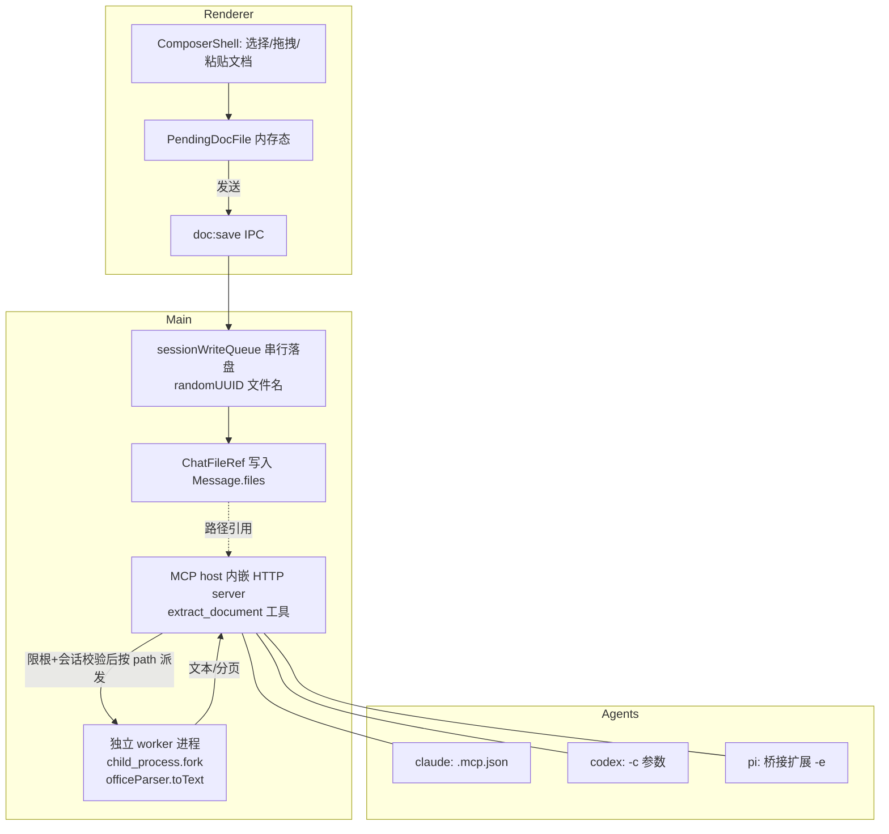

# feat: 聊天文档附件与 agent 工具抽取处理

## Summary

在两个聊天表面（Agent CLI 会话、团队/个人消息）支持发送 PDF / 现代 Office（.docx/.xlsx/.pptx）/ 纯文本（.csv/.txt/.md）文档附件。文档落盘后，agent 经一个文档抽取 MCP 工具按需读取其文本内容。v1 目标是"读懂"——供问答/总结/分析/参考；图片复用现有链路。抽取用单库 officeParser，跑在 `utilityProcess` worker 内做隔离；MCP 工具复用现有主进程 MCP host 与三端注入接线。

## Problem Frame

当前 composer 的图片附件已端到端打通，但文档类附件无可用通路：`.md`/`.txt` 拖拽走 `fs:readFile`，是 UTF-8 / 2MB 截断读取，PDF/Office 这类二进制丢进去只会乱码（`packages/views/cortex-desktop/personal/FilesView.tsx:65` 已标注"不可拖"）。三个 agent（claude/codex/pi）都没有原生读取 PDF/Office 的能力，仓库里也没有任何抽取库。结果是用户最常见的工作文档（合同 PDF、数据 Excel、汇报 PPT、文案 Word）进不了对话。本计划补上这道通路，让 agent 能基于这些文档工作。

详细动机、范围与决策见 origin：`docs/brainstorms/2026-06-24-chat-document-attachments-requirements.md`。

---

## Requirements

承接 origin 需求（R-ID 与 origin 对齐）。规划期定下 origin 留白/强化项：R14 阈值定为 50MB（origin 留 ce-plan）、R7 显式排除 OCR（origin 仅在 Deferred 列出 OCR），均为本计划决策、非 origin 既有。

**附件输入（Composer）**

- R1. Composer 支持选择、拖拽、粘贴 PDF、现代 Office（.docx/.xlsx/.pptx）、纯文本（.csv/.txt/.md）文档附件，与图片附件并列；旧二进制格式（.doc/.xls/.ppt）不支持。
- R2. 所有文档附件（含纯文本类）走新的附件链路，以原始文件形态落盘到 agent 可访问位置，不再使用旧的 UTF-8 `fs:readFile`（2MB 截断）通道。
- R3. `Message` 类型新增 `files?` 字段承载文档附件引用，区别于现有 `images?`。
- R4. 发送前可见已选文档列表并可移除，支持多文件。
- R14. 单文件设适中大小上限（默认 50MB，常量集中可调），超限时发送被拒绝并提示，不做静默截断。

**投递与 agent 抽取**

- R5. 文档内容由抽取工具按需提供给 agent（agent 调用工具读取），而非发送时全量注入上下文。
- R6. 抽取能力以 MCP 工具形态暴露，覆盖 claude、codex、pi；pi 经现有 MCP 桥接扩展机制接入。
- R7. v1 抽取产出为文本（含表格的纯文本），供问答/总结/分析/参考；不要求保真排版，不启用 OCR。
- R8. 图片附件复用现有 per-agent 图片投递链路，不纳入文档抽取工具。

**两个表面的行为**

- R9. Agent CLI 会话：文档附件落盘后，当前 agent 可经抽取工具读取其内容。
- R10. 团队/个人消息发给 bot/agent：行为与 Agent CLI 会话一致，抽取工具对该 agent 可用。
- R11. 团队/个人消息发给人：文档作为普通聊天附件，不触发抽取；v1 不保证跨端共享。

**体积与交付**

- R12. 抽取以随包内置、跑在独立 `utilityProcess` 的能力提供，即开即用、离线可用；抽取库不加载进主进程运行时。
- R13. 抽取层与工具接口设计为可被二期复用（处理/转换、产出新文件）。

---

## Key Technical Decisions

- KTD1. **抽取库用单库 officeParser**：一库覆盖 PDF + docx/xlsx/pptx + csv/md（`ast.toText()` 出纯文本），并明确面向 LLM/agent 管线维护。代价是 ~6.3MB 解包体积且内置 `pdfjs-dist` + `tesseract.js`（OCR 路径不启用，仅吃静态体积）。`.txt` 直接按 UTF-8 读取，不过 officeParser。规避 npm `xlsx`（2023 起冻结，供应链风险）。

- KTD2. **进程模型：MCP host 内嵌主进程 + 重解析放独立 worker 进程**。MCP 工具服务沿用现有主进程内嵌模式（见 `apps/desktop/src/main/capabilities/mcp-host/server.ts`），但真正吃 CPU、有崩溃风险的 officeParser 解析放进独立 worker 进程，兑现"内置独立进程/隔离"的诉求且不阻塞主进程。**worker 用 `child_process.fork`**（仓库已验证可用的子进程模式，崩溃/CPU 隔离等效）而非 `utilityProcess.fork`——后者在本仓库无生产先例，若坚持须额外补：worker 构建入口、主↔worker IPC 协议、asar 加载验证。注意：CLAUDE.md 中"pi 经 utilityProcess.fork"描述与现状不符——现有 agent 实为 `child_process.spawn`（`apps/desktop/src/main/ipc/cli.ts:151`），进程模型以实际代码为准。

- KTD2b. **MCP host 当前是硬单例，必须改造以容纳第二组工具**。`startMcpHost`（`mcp-host/server.ts`）有 `if (current) return current.handle` 早返回，且 `index.ts` 已用 `registerBrowserTools` 调用过一次——直接再调一次注册 doc-extract 会被忽略，`extract_document` 永远不会注册、调用必 404。改造为：在单一启动点组合多个 ToolRegistrar（browser + doc-extract），或加 `addToolRegistrar(fn)` 旁路。doc-extract 与 browser **共用同一 host / 端口 / token**（一个 `McpServer`）；把现有硬编码的 `name: "cortex-browser"` 改为中性的 `cortex-host`。

- KTD3. **MCP 注入复用三端既有接线**：claude 写 `cwd/.mcp.json`（`applyClaudeMcp`）、codex 出 `-c` 参数（`buildCodexMcpArgs`）、pi 经 `collectBridgeServers → writeMcpBridgeExtension → -e` 桥接扩展。仿 `buildBrowserMcpServerConfig`（`apps/desktop/src/main/capabilities/browser/inject.ts:13`）写 `buildDocExtractMcpServerConfig`，分别并入 `cli.ts` 注入分支与 `pi-session.ts` 的 `collectBridgeServers` 调用。Transport 用 Streamable HTTP（127.0.0.1 + URL token + Origin 白名单），复用浏览器 host 的鉴权模式，避免每会话冷启动的 Dock 闪烁。

- KTD4. **按需抽取，不在发送时注入**：MCP 工具按 `ChatFileRef.path` 读取并返回文本，让 agent 自行决定何时抽取，节省 context（R5）。v1 默认返回整篇文本（受 KTD9 输出上限约束、超限截断加提示）；**分块/分页仅在工具入参里留位、v1 不实现**（避免为二期预造无消费方的接口），待出现实际 context 压力再于二期实现。

- KTD5. **落盘安全沿用图片链路范式**：进入 `apps/desktop/src/main/ipc/sessionWriteQueue.ts` 按 sessionId 串行落盘；文件名用 `randomUUID()` + 服务端嗅探/校验扩展名，renderer 传入的原始文件名只用于显示、绝不参与路径构造；写用 `assertAllowed`、读用 `assertOpenable`；50MB 上限在 renderer 预检与主进程复核两处同源定义（R14）。

- KTD6. **持久化只存路径引用**：新增 `ChatFileRef`（path + name + mimeType + sizeBytes）仿 `ChatImageRef`，消息 JSON 只存引用不内联内容，避免撑爆存档。

- KTD7. **打包加固为一期正式工作**：officeParser 及其**完整传递依赖闭包**——`pdfjs-dist`、`tesseract.js`、`fflate`、`@xmldom/xmldom`，以及纯 ESM 链 `file-type`、`strtok3`、`token-types`、`uint8array-extras`、`@tokenizer/inflate`（这些是 `"type":"module"` 纯 ESM，被 `externalizeDepsPlugin` external 后会以 CJS `require` 触发 `ERR_REQUIRE_ESM` 崩溃）——与 `@modelcontextprotocol/sdk` 须一并进 `externalizeDepsPlugin({ exclude: [...] })` 打进主包、`pnpm.overrides` 钉版本、核查 `apps/desktop/electron-builder.yml` 的 `files` 排除黑名单（已知 `zod` 历史排除会牵连 MCP SDK），并以仓库外 `ditto → /tmp` 验证打包产物。依据 `docs/lessons.md:1-108`。

- KTD8. **OCR / 扫描件 PDF 不在 v1**：officeParser 默认走文本抽取，不启用其内置 tesseract OCR。文本型 PDF 正常；扫描件/图片型 PDF 抽不出文本——这是**库的自然行为**（无需自建扫描件检测逻辑），工具据"抽取结果为空"返回空文本并附"无可抽取文本，可能为扫描件"提示，由 agent 在对话中转述给用户（不在气泡加徽标）。

- KTD9. **抽取工具的文件访问必须严格限根 + 会话隔离**（安全）：`extract_document` 入参 path 由 agent 在调用时给出，若不限制等于任意文件读取（如 `~/.ssh/id_rsa`、凭据文件）。落盘到专用根 `chatDocsRoot()`（仿 `chatImagesRoot()`，**不**加入 `allowedRoots()`）；handler 读取前 `realpath` 解析 + 拒符号链接 + 校验落在 `chatDocsRoot()` 内，**不得**用 `assertOpenable`（其"任意真实文件即放行"的兜底会击穿限制）。并用既有 `X-Cortex-Session` 头把可读文件限定为本会话落盘的文件，同时关闭 automation 会话继承 `.mcp.json` 带来的越权读取面（见 Risks）。

---

## High-Level Technical Design

文档从 composer 到 agent 的数据流，以及三端 MCP 注入：

注入接线（KTD3）：`buildDocExtractMcpServerConfig` 产出指向内嵌 host 的 `McpServerConfig`，在 `cli.ts` 注入分支（claude/codex）与 `pi-session.ts` 的 `collectBridgeServers`（pi）分别并入——与浏览器控制完全同构。

---

## Implementation Units

### U1. 消息类型与跨包契约镜像

- **Goal**: 新增 `ChatFileRef` 与 `Message.text.files?`，并在三处契约镜像，作为整条链路的类型地基。
- **Requirements**: R3, R13
- **Dependencies**: 无
- **Files**:
  - `packages/core/types/index.ts`（新增 `ChatFileRef`，`Message` 的 `kind:"text"` 变体加 `files?: ChatFileRef[]`；`MessageAttachmentRef` 加 `"document"` kind）
  - `packages/core/desktop/types.ts`、`packages/core/desktop/bridge.ts`（镜像 doc 落盘契约）
  - `apps/desktop/src/main/ipc/types.ts`（镜像 `DocSaveRequest`/`DocSaveResult`）
  - `packages/core/types/index.test.ts`（若无则就近新建类型层测试）
- **Approach**: 仿 `ChatImageRef`（`packages/core/types/index.ts:91`）——只存 `path + name + mimeType + sizeBytes`，不内联内容（KTD6）。三处镜像必须逐字一致（IPC 契约约定）。
- **Patterns to follow**: `ChatImageRef` + `images?: ChatImageRef[]` 的既有镜像方式。
- **Test scenarios**:
  - `ChatFileRef` 结构与可选字段符合预期；`Message.text` 携 `files?` 时类型通过、不与 `images?` 冲突。
  - `MessageAttachmentRef` 新增 `"document"` kind 不破坏既有 `narrow`/序列化。
  - Test expectation: 以类型与纯函数断言为主，无运行时行为变更的部分标注 none。

### U2. 文档落盘 IPC（doc:save / doc:pick）

- **Goal**: 提供把文档二进制安全落盘、并打开系统文件选择框的主进程能力。
- **Requirements**: R2, R14
- **Dependencies**: U1
- **Files**:
  - `apps/desktop/src/main/ipc/doc.ts`（新增 `registerDocHandlers()`：`doc:save`、`doc:pick`）
  - `apps/desktop/src/main/ipc/register.ts`（注册 `registerDocHandlers`）
  - `apps/desktop/src/main/ipc/fs.ts`、`apps/desktop/src/main/paths.ts`（新增 `chatDocsRoot()`；`MAX_DOC_BYTES` 集中常量）
  - `apps/desktop/src/main/ipc/sessionWriteQueue.ts`（接入文档落盘）
  - `apps/desktop/src/preload/index.ts`、`packages/core/desktop/bridge.ts`（暴露 `desktopAPI.personal.saveDoc`/`pickDoc`）
  - `apps/desktop/src/main/ipc/doc.test.ts`
- **Approach**: **优先按路径落盘**——`doc:pick` 返回路径后，主进程直接从该路径读源文件拷贝进 `chatDocsRoot()/<sessionId>/`，避免把最大 50MB 的 `ArrayBuffer` 经 IPC 结构化克隆传输（会卡住 renderer）；仅粘贴/拖入的内存态数据才走 `ArrayBuffer` 通路（同样受上限约束）。`randomUUID()` 命名 + 服务端嗅探扩展名（KTD5），落盘进 `sessionWriteQueue` 按 sessionId 串行，避免删会话时孤儿文件。50MB 上限在主进程复核（与 renderer 预检同源常量）。落盘根用 `chatDocsRoot()`，与抽取读取端的限根校验（KTD9）配对。
- **Patterns to follow**: 既有 `image:save` handler（`packages/core/personal/messages.ts:2005` 一带）与 `fs.ts` 的白名单闸门。
- **Test scenarios**:
  - 正常 .docx/.pdf 落盘返回 `ChatFileRef`（path 为 UUID 文件名，name 为原始名）。
  - 超过 50MB → 拒绝并返回明确错误，不落盘（Covers AE 见下，R14）。
  - 原始文件名含路径穿越字符（`../`、绝对路径）→ 不参与落盘路径，落盘仍在受控目录内。
  - 并发多文件落盘经 `sessionWriteQueue` 串行，无相互覆盖。
  - 删除会话时在途落盘不留孤儿（与既有队列行为一致）。

### U3. Composer 文档附件输入与气泡回显

- **Goal**: 让用户能选择/拖拽/粘贴文档并发送，发送时落盘组装 `ChatFileRef`；消息气泡回显已发送文档。
- **Requirements**: R1, R4, R8, R11
- **Dependencies**: U2
- **Files**:
  - `packages/views/cortex-desktop/personal/ComposerShell.tsx`（新增 `PendingDocFile` state slot、文档选择按钮 `accept=".pdf,.docx,.xlsx,.pptx,.csv,.txt,.md"`、`onDrop` 按 MIME 分流、`onSend` 追加 `docFiles?` 参数）
  - **所有传入 `onSend` 的父组件**：实现前先 `rg "onSend=" packages/views` 枚举全部调用点，逐一接好新参数（否则 TS 编译报错挡构建）；或改用 ComposerShell 内部自持的 `docFiles` 而不穿 `onSend`，二选一在本单元定调。
  - `packages/core/personal/messages.ts`（发送路径：落盘 → 组装 `ChatFileRef` → 写入 `Message.files`）
  - 消息气泡渲染组件（回显文档名/类型/不可抽取提示）
  - 对应 `*.test.tsx`
- **Approach**: 文档走**独立 state slot**，不复用 `attachments` 的 `kind:"prompt"`/`bridge.readFile` 路径。移除旧通道前**先确认** `ComposerShell.tsx:496` 一带的 `readFile` 分支当前只服务文档类附件（不服务图片或其它 MIME/skill/todo 拖拽）；只对文档类 MIME 改道，避免误伤其它消费方（R2）。`onDrop` 在系统 `Files` 分支按 MIME 分流：`image/*` → 现有图片路径（R8 不混用）；文档类 → 新路径。发送返回"是否已消费"语义：pi 不可用、`/clear` 等非消费路径不清空待发文档列表。
- **交互状态（采纳评审收敛默认值，实现据此，无需再发明）**：
  - 待发文档项状态：写盘中（spinner）→ 就绪（中性图标 + 文件名 + 大小）→ 失败（红标 + 简短错因 + 移除）；视觉与现有 `PendingImage` 项对齐。
  - 不支持格式（.doc/.xls/.ppt）：file-picker 经 `accept` 在系统层即拦；拖拽/粘贴经 toast 提示并跳过该文件。
  - 多文件混入合法/非法：**部分接受**——合法项入列，非法项各出一条 toast（"已跳过 X：不支持该格式"）。
  - 超限（50MB）：renderer 预检直接不入列 + toast；主进程复核（极少触发）落在待发项的失败态。
  - 扫描件"无可抽取文本"提示：由 agent 在对话流转述，不在气泡加徽标（与 KTD8 一致）。
  - 抽取进行中：不加独立 UI 指示，由 agent 对话流自然呈现（"正在读取文档…"）。
  - 粘贴消歧：`DataTransfer` 按 `kind==="file"` + MIME 分流（image→图片路径、文档→新路径）；Excel 单元格区域粘贴（text/html）v1 不处理。
- **Patterns to follow**: 图片链路的 `addImageFiles`/`PendingImage`/消费清空（`ComposerShell.tsx:199`）。
- **Test scenarios**:
  - 选择/拖拽/粘贴 .pdf/.docx/.xlsx/.pptx/.csv/.txt/.md → 进入待发列表；.doc/.xls/.ppt 被拒绝并提示（R1）。
  - 同时附图片与文档 → 图片走图片路径、文档走文档路径，互不混入（Covers AE4，R8）。
  - 移除某个待发文档后再发送，只发送剩余项（R4）。
  - 发送成功后清空待发文档；pi 不可用/`/clear` 时不清空（消费语义）。
  - 发给人的会话：文档作为普通附件入消息、气泡可见、不触发任何抽取（Covers AE3，R11）。
  - 拖入文档不再经 `bridge.readFile`（旧 UTF-8 通道）（R2）。

### U4. 文档抽取 worker（独立 worker 进程 + officeParser）

- **Goal**: 在独立 worker 进程内把文档文件抽成文本，带超时与资源边界，不启用 OCR。
- **Requirements**: R7, R12
- **Dependencies**: U1
- **Files**:
  - `apps/desktop/src/main/capabilities/doc-extract/worker.ts`（`child_process.fork` worker 入口：收 path → officeParser → 文本）
  - `apps/desktop/src/main/capabilities/doc-extract/extract.ts`（纯函数：格式分派、`.txt` 直读、officeParser 调用、文本规整、输出截断）
  - `apps/desktop/src/main/capabilities/doc-extract/extract.test.ts`
- **Approach**: 抽取逻辑抽为纯函数便于单测（仿 `renderMcpBridgeExtension` 纯函数范式）；I/O 与 worker 生命周期分离。`.txt` 走 UTF-8 直读；其余走 `officeParser.parseOfficeAsync` → `toText`（KTD1）。worker 用 `child_process.fork`（KTD2）。**以命名常量定边界**（防恶意/超大文档拖垮进程，见 Risks 与 KTD9）：`EXTRACT_TIMEOUT_MS`（如 30s，超时返回错误）、`MAX_EXTRACT_TEXT_BYTES`（如 10MB，超出截断并附提示而非把无界文本回传 host）、worker 堆上限（`--max-old-space-size`）。Office 格式是 ZIP+XML，须防解压膨胀/XML 实体放大（`@xmldom/xmldom`）。超大/损坏文件 fail-soft 返回错误而非崩 worker。**不启用 OCR**（KTD8）。
- **Patterns to follow**: `apps/desktop/src/main/agents/pi-rpc.ts` 的子进程生命周期；`pi-mcp-bridge.ts` 的纯函数/副作用分离。
- **Test scenarios**:
  - .docx/.xlsx/.pptx/.pdf/.csv/.md 各出非空文本，表格以纯文本呈现（R7）。
  - .txt 走直读路径、不过 officeParser，内容完整。
  - 文本型 PDF 出文本；扫描件/图片型 PDF 返回空文本 + "可能为扫描件"提示，不启用 OCR（KTD8）。
  - 损坏/非目标格式文件 → fail-soft 错误对象，worker 不崩。
  - 超时文件 → 返回超时错误。
  - 分页/分块参数返回对应片段。

### U5. 文档抽取 MCP server 与三端注入

- **Goal**: 暴露 `extract_document` MCP 工具，按 path 调 U4 worker 返回文本，并接线到 claude/codex/pi。
- **Requirements**: R5, R6, R9, R10
- **Dependencies**: U4, U1
- **Files**:
  - `apps/desktop/src/main/capabilities/doc-extract/mcp.ts`（注册 `extract_document` 工具；`buildDocExtractMcpServerConfig(settings, sessionId)`）
  - `apps/desktop/src/main/capabilities/mcp-host/server.ts`（**改造单例以容纳多组工具注册**，`name` 改 `cortex-host`，见 KTD2b）
  - `apps/desktop/src/main/index.ts`（在单一 `startMcpHost` 启动点组合 browser + doc-extract 两个 registrar）
  - `apps/desktop/src/main/ipc/fs.ts`（`assertDocPath` 限根校验，供工具读取用）
  - `apps/desktop/src/main/ipc/cli.ts`（claude/codex 注入分支并入 doc-extract server，约 419-446）
  - `apps/desktop/src/main/ipc/pi-session.ts`（`collectBridgeServers` 调用处追加 doc-extract server，约 169-178）
  - `apps/desktop/src/main/capabilities/doc-extract/mcp.test.ts`、`inject` 相关测试
- **Approach**: 仿 `buildBrowserMcpServerConfig`（`capabilities/browser/inject.ts:13`）产出 Streamable HTTP `McpServerConfig`（KTD3），与 browser **共用** host/端口/token（KTD2b）。工具入参为文件 path（来自 `ChatFileRef.path`），**handler 第一步**先过 `assertDocPath`（`realpath` + 拒符号链接 + 限根 `chatDocsRoot()`）并按 `X-Cortex-Session` 头限定为本会话文件（KTD9），再派发给 U4 worker；越权/越根/跨会话 path 直接拒绝。pi 端经 `collectBridgeServers → writeMcpBridgeExtension`；桥接扩展内 HTTP 调用必须用 `node:http`/`node:https`，不得用全局 `fetch`（pi 在 Electron 进程内 undici 版本错配会崩，见 `pi-mcp-bridge.ts:159` 注释）。**实现注意**：U5 的类型/配置工作可与 U4 并行，但工具 handler 的集成测试须待 U4 worker 就绪。
- **Patterns to follow**: 浏览器控制 MCP server 的注册与三端接线（origin 关联 plan `docs/plans/2026-06-22-003-feat-agent-browser-control-mcp-plan.md`）。
- **Test scenarios**:
  - `buildDocExtractMcpServerConfig` 在能力开启时返回合法 `McpServerConfig`，关闭时返回 null。
  - claude 注入写入 `.mcp.json` 含 doc-extract server；codex 注入出对应 `-c` 参数。
  - pi 经 `collectBridgeServers` 纳入 doc-extract server 并生成桥接扩展（Covers AE2，R6）。
  - `extract_document` 按 path 返回 U4 文本结果；`chatDocsRoot()` 外的绝对路径、符号链接、他会话文件路径均被 `assertDocPath` 拒绝（KTD9）。
  - host 单例改造后，browser 与 doc-extract 工具**同时**可用、互不覆盖（验证 KTD2b：第二个 registrar 真正生效）。
  - Agent CLI 会话与 IM 发给 bot/agent 两条路径都能取到文本（Covers AE1，R9/R10）。

### U6. 打包加固与已知限制标注

- **Goal**: 确保新主进程依赖能跨 asar/ESM 边界正常运行，并在 UI 标注 claude `.mcp.json` 限制。
- **Requirements**: R12
- **Dependencies**: U5
- **Files**:
  - `apps/desktop/electron.vite.config.*`（`externalizeDepsPlugin({ exclude: [...] })` 纳入 officeParser 及传递依赖、`@modelcontextprotocol/sdk`）
  - `apps/desktop/electron-builder.yml`（核查并修正 `files` 排除黑名单，尤其 `zod`）
  - 根 `package.json`（`pnpm.overrides` 钉 MCP SDK 版本，对齐既有 `^1.25.x` 约束）
  - 浏览器/MCP 设置相关 UI（标注"该项目 claude 已有 .mcp.json 时抽取 server 不自动注入"）
- **Approach**: 按 `docs/lessons.md:1-108` 的三条打包教训执行（KTD7）；打包产物以仓库外 `ditto → /tmp` 验证，杜绝仓库内 dist 的"假通过"。claude 注入受 `applyClaudeMcp` 内容哈希 gate，项目已有 `.mcp.json` 时 skip——UI 须明示该限制（与浏览器控制同款）。
- **Patterns to follow**: 浏览器控制 MCP server 的同类打包处理与 UI 限制标注。
- **Test scenarios**:
  - 仓库外解包后 `extract_document` 与三端注入可用（手动/打包验证清单，非单测）。
  - asar 内含 officeParser 及其传递依赖、`@modelcontextprotocol/sdk`、`zod`（`@electron/asar` listPackage 计数 > 0）。
  - claude 项目已有 `.mcp.json` 时 UI 显示限制提示。
  - Test expectation: 以打包验证清单 + UI 渲染断言为主。

---

## Acceptance Examples

- AE1. **Covers R5, R9.** Given 用户在 Agent CLI 会话发送一个多页文本 PDF，When agent 需要其中内容回答问题，Then agent 经 `extract_document` 按需读取文本（非发送时全量注入）并据此作答。
- AE2. **Covers R6.** Given 当前 agent 是 pi，When 会话开启，Then 文档抽取 server 经 `collectBridgeServers → writeMcpBridgeExtension` 注入，pi 可像 claude/codex 一样调用 `extract_document`。
- AE3. **Covers R11.** Given 用户在团队消息中把一个 Excel 发给同事（人），When 消息送达，Then 文件以普通附件呈现，系统不进行任何抽取。
- AE4. **Covers R8.** Given 用户同时附带一张图片和一个 Word 文档，When 发送，Then 图片走现有图片投递链路、文档走抽取工具路径，两者互不混用。
- AE5. **Covers R14**（规划期新增，origin 无对应 AE）**.** Given 用户选择一个超过 50MB 的文件，When 发送，Then 主进程复核拒绝落盘并提示超限，不静默截断。

---

## Scope Boundaries

**Deferred for later（二期，接口预留）**

- 高保真抽取：保留表格结构、图表、PPT 页面语义。
- 产出/修改新文件：填 Excel、生成 Word/PPT、格式转换。
- OCR / 扫描件 PDF：officeParser 内置 tesseract，但 v1 不启用。
- 基于文件的复杂任务编排超出"读懂"的部分。
- 人对人文档附件的后端共享存储与跨端下载；v1 仅保证 agent 路径（Agent CLI + IM 发给 bot/agent）。

**Deferred to Follow-Up Work（实现期排序，另行处理）**

- automation 会话继承主会话 cwd 残留 `.mcp.json` 的已知 bug（浏览器控制规划已记录），doc-extract server 上线前评估其权限泄漏影响。

---

## Risks & Dependencies

- **打包 asar/ESM 边界（高）**：officeParser 传递依赖多（含纯 ESM 链 file-type/strtok3/token-types/uint8array-extras/@tokenizer/inflate）+ MCP SDK 依赖 zod，是历史崩溃高发区。缓解：KTD7 完整 exclude 闭包 + overrides + 黑名单核查 + 仓库外验证（U6）。
- **体积（修正）**：实际静态体积约 **47MB+**——officeParser ~6.3MB + 其内置 pdfjs-dist ~40.8MB + tesseract.js ~1.4MB + 其余传递依赖（先前 ~6.3MB 仅为 officeParser 自身）。为单库与离线即用付出，已与用户确认接受体积增长；U6 验证清单须含 pdfjs-dist 的 asar 加载。
- **不可信文档解析（安全，高）**：恶意 PDF/Office 可借解析器（pdfjs-dist 内存耗尽、@xmldom/xmldom 实体放大、ZIP 解压膨胀）攻击。缓解：worker 进程隔离 + 50MB 输入上限 + 输出截断上限 + 超时 + 堆上限（KTD2/KTD9/U4）。worker 仍以完整 Electron 进程权限运行、无 OS 沙箱——CVE 监控列入后续。
- **提示注入面扩大**：文档内容可含伪装成指令的文本，agent 自主调用 `extract_document` 无用户确认。属设计固有（R5），文档处理较图片显著放大该面；限根 + 会话隔离（KTD9）收敛可达文件范围。
- **claude `.mcp.json` skip 限制**：项目已有 `.mcp.json` 时抽取 server 不自动注入。缓解：UI 标注（U6）。
- **automation 会话 `.mcp.json` 继承（已决策）**：claude automation 在 cwd 继承主会话写下的 `.mcp.json`，会拿到 `extract_document`。**v1 缓解**：KTD9 的会话隔离（`X-Cortex-Session` 限定本会话文件）使越权读取即便工具可见也读不到他会话文件；automation 端 `.mcp.json` 清理沿用 codex `CODEX_MCP_CLEAR` 同款思路，列入 U5。
- **依赖现有 MCP 注入机制**：claude `.mcp.json`、codex `-c`、pi 桥接扩展三者均已存在并经浏览器控制验证。

---

## Sources / Research

代码位置（repo-relative）：

- Composer 状态/发送：`packages/views/cortex-desktop/personal/ComposerShell.tsx:125-129,148-149,199,487-503`
- 消息类型：`packages/core/types/index.ts:91-97,99-142`（`ChatImageRef`、`Message`）
- 落盘与队列：`packages/core/personal/messages.ts:2005-2046`、`apps/desktop/src/main/ipc/sessionWriteQueue.ts`
- 文件读取闸门：`apps/desktop/src/main/ipc/fs.ts:25,43-62,458-472`
- IPC 注册：`apps/desktop/src/main/ipc/register.ts:33-58`；类型契约 `apps/desktop/src/main/ipc/types.ts:161-172,325-361`
- Agent 注入：`apps/desktop/src/main/agents/{claude,codex,pi}.ts`、`apps/desktop/src/main/ipc/cli.ts:151,419-446`
- pi MCP 桥接：`apps/desktop/src/main/agents/pi-mcp-bridge.ts:43-83,159,299-305`、`apps/desktop/src/main/ipc/pi-session.ts:169-178`
- 内置 MCP host 先例：`apps/desktop/src/main/capabilities/mcp-host/server.ts`、`apps/desktop/src/main/capabilities/browser/inject.ts:13-29`
- 打包教训：`docs/lessons.md:1-108`
- 关联规划：浏览器控制 MCP `docs/plans/2026-06-22-003-feat-agent-browser-control-mcp-plan.md`；图片上传 `docs/plans/2026-06-18-001-feat-desktop-chat-image-upload-plan.md`
- 测试范例：`apps/desktop/src/main/agents/pi-mcp-bridge.test.ts`、`apps/desktop/src/main/capabilities/browser/inject.test.ts`、`apps/desktop/src/main/ipc/mcp-config.test.ts`

外部抽取方案对比（officeParser 选型依据，KTD1/KTD8）：

- officeParser（npm）— 单库覆盖 PDF/docx/xlsx/pptx/csv/md，AST `toText()`，面向 LLM 管线维护，~6.3MB，内置 pdfjs-dist + tesseract.js。
- 规避：npm `xlsx`（SheetJS 自 2023-07 起在 npm 冻结，供应链风险）；`pdf-parse`（`@napi-rs/canvas` 原生依赖，Electron 跨平台打包隐患）。
- 参考实现：`OfficeMCP`（GitHub mhackermsft/OfficeMCP）作为工具接口契约模板。
