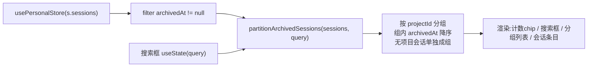

# feat: 设置页新增「已归档对话」分区

## 摘要

在 Desktop 个人工作区设置页（`PersonalSettingsView`）新增一个「已归档对话」分区，集中展示所有 `archivedAt != null` 的会话。分区按所属文件夹/项目分组，顶部提供搜索框与「N 个已归档」计数 chip，每条会话支持「取消归档」「永久删除」，点击会话标题则取消归档并跳转打开。

关键事实：**底层能力已全部就绪**——`SessionMeta.archivedAt` 字段、`archiveSession`/`unarchiveSession`/`removeSession`/`setActiveSession` 等 Zustand 动作、`bridge.deleteChat` IPC、就地二次确认删除模式均已存在。本计划是**纯 UI 消费层 + 一个可测试的分组/搜索纯函数 + relTime 粒度扩展**，**不新增任何 IPC，不新增持久化字段**。

---

## 问题陈述

当前已归档会话只能在侧边栏对应项目块内通过「显示已归档」切换零散查看，且**无项目的已归档会话在侧边栏没有任何入口**（`PersonalSidebar` 的 `noProjectSessions` 仅过滤 `archivedAt == null`）。用户缺少一个跨项目、可搜索、可批量管理（恢复/永久删除）的集中视图。

效果图给出了明确的目标形态：设置页内一张「已归档对话」卡片，含说明文案、搜索框、计数 chip、按文件夹分组的会话列表，以及每条的「取消归档」与删除操作。

---

## 需求

| ID | 需求 | 来源 |
|----|------|------|
| R1 | 设置页左栏菜单新增「已归档对话」入口，右栏渲染对应 Section | 效果图标题「已归档对话」 |
| R2 | Section 展示所有 `archivedAt != null` 的会话，按所属项目（文件夹）分组；无项目会话单独成组 | 效果图「Software-publications」分组 + 项目模型 |
| R3 | 顶部搜索框按会话标题实时过滤（大小写不敏感） | 效果图「搜索已归档对话」 |
| R4 | 顶部显示已归档总数 chip「N 个已归档」 | 效果图「1 个已归档」 |
| R5 | 每个分组头显示文件夹名 + 该组「N 个对话」 | 效果图「Software-publications · 1 个对话」 |
| R6 | 每条会话显示标题、相对时间、模型名（如「2周 · deepseek-v4-pro」） | 效果图会话条目 |
| R7 | 每条提供「取消归档」按钮，调用 `unarchiveSession` 恢复 | 效果图「取消归档」 |
| R8 | 每条提供「永久删除」操作，复用现有就地二次确认，执行 `removeSession` + `bridge.deleteChat` | 效果图删除图标 + 现有 `SessionRow` 模式 |
| R9 | 点击会话标题 = 打开会话详情：`setActiveSession`（关设置页并跳转），**保持归档态不变** | 用户决策（打开与恢复解耦；效果图描述「你可以在这里打开、恢复或永久删除」） |
| R10 | 空态：无任何已归档会话时展示友好空态文案 | 通用 UX |
| R11 | 相对时间支持「周/月」粒度（当前共享 `relTime` 最大只到「天」） | 效果图「2周」 |

---

## 关键技术决策

- **KTD1：复用既有数据模型与动作，零新增 IPC。** 归档/取消归档/删除/选中全部走已存在的 Zustand 动作，`archivedAt` 随 `sessions` 数组经既有 `store:save` 通路落盘。本计划不碰主进程，不加 `PersistedState` 字段。
  - 依据：`packages/core/store/personal.ts` 已实现 `archiveSession`/`unarchiveSession`/`removeSession`/`setActiveSession`；`packages/core/desktop/types.ts` 已定义 `archivedAt?: number`。

- **KTD2：点击标题 =「打开会话详情」= `setActiveSession(id)` 单步，**不**改归档状态。** `setActiveSession` 内部已置 `settingsOpen: false`（见 `personal.ts:747-760`），故点击标题即关设置页、跳转打开该会话详情；会话**仍保持归档态**（`archivedAt` 不变），在侧边栏归档子组内可见。
  - 取舍：用户明确选择「点击标题=打开详情(非破坏性)，取消归档仅走『取消归档』按钮」。打开与恢复**解耦**——避免误点标题导致条目静默离开归档列表、无 undo。归档会话被设为活跃是合法状态（`archiveSession` 会让出焦点，但反向设活跃无副作用），主面板照常渲染其消息。

- **KTD3：永久删除复用就地二次确认，不引入弹窗，并完整复用 `SessionRow` 的四步删除序列。** 沿用 `SessionRow` 既有模式（首点变红+✓「再点确认删除」、鼠标移开重置），第二次点击执行**与 `SessionRow.onDelete`（`PersonalSidebar.tsx:71-77`）完全一致的四步**：① `reapSessionRun(qc, id)`（回收 renderer run、停看门狗，防孤儿 interval）→ ② `removeSession(id)`（即时移除 UI + 落盘元数据）→ ③ `void bridge?.deleteChat?.(id)`（物理删磁盘消息/图片/文档）→ ④ `void closePiSession(bridge, id)`（终止该会话 pi 长驻进程，非 pi 会话 no-op）。可选 `onToast("已删除 …")` 反馈（视 Section 是否接入 toast）。
  - 依据：`PersonalSidebar.tsx:65-77` 即此四步。**只调 `removeSession` + `deleteChat` 是不完整的**——会漏掉看门狗 interval 回收与 pi 进程终止，删除归档的 pi 会话会留孤儿进程。`reapSessionRun`/`closePiSession`/`removeSession` 均已从 `@cortex-work/core` 导出（`index.ts:307/337/…`）。

- **KTD4：分组/搜索逻辑下沉为纯函数 `partitionArchivedSessions`。** 入参 `(sessions, query?)`，输出按项目分组、组内按 `archivedAt` 降序的结构，便于单测。镜像现有 `partitionProjects`（`personal.ts:941-959`）的稳定 tiebreak 写法（用原始下标 Map，不依赖 `Array.sort` 稳定性）。
  - 取舍：不进 Zustand（搜索词、展开态是 UI 瞬态，遵循设置页子分区「不持久化」约定，用组件内 `useState`）。

- **KTD5：`relTime` 扩展周/月粒度，全局生效。** 当前 `relTime`（定义于 `PersonalSidebar.tsx:23-31`，被多组件 re-export 复用）封顶「天」。扩展为 `< 7天 → N 天`、`< ~4周 → N 周`、否则 `N 个月`。侧边栏/搜索/任务等复用处一并受益，无回归风险（仅显示粒度变化）。

- **KTD6：组件单独成文件。** `SettingsMenu.tsx` 已 2017 行（超 1200 行上限），新 Section 必须新建独立文件 `ArchivedSessionsSection.tsx`，仅在 `SettingsMenu.tsx` 做菜单接线（4 处同步）。

---

## 高层技术设计

数据管线（render-time，纯读 + 纯函数，无副作用）：

会话条目三个动作到既有 store 动作的映射：

| UI 操作 | 触发的既有动作 | 副作用 |
|---------|---------------|--------|
| 点击标题（打开详情） | `setActiveSession(id)` | `setActiveSession` 内部置 `settingsOpen:false` 并跳转打开；**归档态不变**（条目仍在归档列表） |
| 「取消归档」按钮 | `unarchiveSession(id)` | 仅清 `archivedAt`，会话离开归档列表回到活跃列表，停留在设置页 |
| 删除（二次确认后） | `reapSessionRun(qc,id)` → `removeSession(id)` → `bridge?.deleteChat?.(id)` → `closePiSession(bridge,id)` | 回收看门狗 + 硬删元数据 + 物理删磁盘消息/图片/文档 + 终止 pi 进程（四步缺一留孤儿） |

> 上述为方向性设计，非实现规范；具体动作签名以实现时 `personal.ts` 为准。

---

## 实现单元

### U1. `partitionArchivedSessions` 分组/搜索纯函数

**Goal**：提供可测试的纯函数，从全量 `sessions` 计算出「按项目分组、组内 `archivedAt` 降序」的已归档分组结构，并支持按标题搜索过滤。

**Requirements**：R2、R3、R4、R5

**Dependencies**：无

**Files**：
- `packages/core/store/archivedSessions.ts`（新建，纯函数；放 `store/` 与 `partitionProjects` 同域）
- `packages/core/store/archivedSessions.test.ts`（新建）
- `packages/core/index.ts`（修改）——必须新增 `export { partitionArchivedSessions } from "./store/archivedSessions";`（紧邻既有 `partitionProjects` 导出，`index.ts:32`）。`packages/views` 只能从 `@cortex-work/core` 根导入，漏掉此导出会导致 U4 typecheck 失败。

**Approach**：
- 导出 `partitionArchivedSessions(sessions: SessionMeta[], query?: string)`，返回 `{ groups: Array<{ projectId?: string; sessions: SessionMeta[] }>, archivedTotal: number, filteredTotal: number }`。**两个计数分离**（避免单 `total` 字段语义二义）：`archivedTotal` = 全部 `archivedAt != null` 的会话数（**过滤前**，供「N 个已归档」chip）；`filteredTotal` = 应用 `query` 过滤后的会话数（供「搜索无结果」空态判断）。
- 先 `filter(x => x.archivedAt != null)`（得 `archivedTotal`）；若有 `query`，再按 `title.toLowerCase().includes(query.trim().toLowerCase())` 过滤（空白 query 视为不过滤；过滤后得 `filteredTotal`）。
- 按 `projectId` 分组，无 `projectId` 的会话归入 `projectId: undefined` 组（放末尾）。组内按 `archivedAt` 降序，用原始下标 Map 做稳定 tiebreak（镜像 `partitionProjects`）。
- **过滤后为空的分组必须从 `groups` 中剔除**（不返回只有组头、无会话的空组），与 U4「未命中分组隐藏」一致。
- 项目「文件夹名」由调用方（U4）用 `projectId` 关联 `ProjectMeta.name` 解析（本函数只按 id 分组，不依赖 ProjectMeta，保持纯粹）；orphan projectId（项目已删）的 fallback 由 U4 处理。

**Patterns to follow**：`packages/core/store/personal.ts:941-959` 的 `partitionProjects`（下标 tiebreak）；`packages/core/personal/taskArchive.ts` 的 `groupTaskFiles` 分组测试结构。

**Test scenarios**（`archivedSessions.test.ts`）：
- Covers R2. 多个会话分属 2 个项目 + 1 个无项目 → 返回 3 组，无项目组在末尾。
- Covers R2/R5. 同组内多个会话按 `archivedAt` 降序排列；`archivedAt` 相同时按原始下标稳定排序。
- 仅含未归档会话（全部 `archivedAt == null`）→ `archivedTotal === 0`、`filteredTotal === 0`，`groups` 为空。
- Covers R3. `query` 命中部分标题 → 仅返回匹配会话；大小写不敏感；首尾空白被 trim。
- Covers R3. `query` 命中 A 项目但不命中 B 项目 → 返回的 `groups` **不含** B 组（空组被剔除，非保留空组头）。
- Covers R3. `query` 为空字符串/纯空白 → 等价于不过滤，`filteredTotal === archivedTotal`。
- Covers R4. `archivedTotal` 始终反映过滤前归档总数（即便 `query` 把列表过滤到 0，`archivedTotal` 不变）。
- `filteredTotal` 反映过滤后会话数；搜索到 0 命中时 `filteredTotal === 0` 而 `archivedTotal > 0`。
- 边界：空 `sessions` 数组 → `{ groups: [], archivedTotal: 0, filteredTotal: 0 }`，不抛错。

---

### U2. `relTime` 扩展「周/月」粒度

**Goal**：让共享相对时间函数支持「N 周」「N 个月」，以匹配效果图「2周」。

**Requirements**：R6、R11

**Dependencies**：无

**Files**：
- `packages/views/cortex-desktop/personal/PersonalSidebar.tsx`（修改 `relTime`，约 23-31 行）
- `packages/views/cortex-desktop/personal/relTime.test.ts`（新建；若该目录无现成测试宿主则就近新建）

**Approach**：
- 在现有「天」分支之后追加：`天 < 7 → "N 天"`；`< ~30 天 → "N 周"`（`Math.floor(days/7)`）；否则 `"N 个月"`（`Math.floor(days/30)`）。保持中文与现有「刚刚/分钟/小时/天」文案风格一致（注意现有返回值不带「前」字）。
- 不改函数签名与导出方式，所有 re-export 处自动受益（KTD5）。
- 若 `relTime` 当前无独立测试文件，新建一个专测此函数；如已被其它测试间接覆盖，补齐周/月分支断言。

**Patterns to follow**：现有 `relTime` 的阈值分段风格。

**Test scenarios**（`relTime.test.ts`）：
- Covers R11. 14 天前 → 「2 周」；8 天前 → 「1 周」。
- 6 天前 → 仍「6 天」（未进周粒度）。
- 35 天前 → 「1 个月」；70 天前 → 「2 个月」。
- 既有粒度回归：30 秒「刚刚」、5 分钟「5 分钟」、3 小时「3 小时」、2 天「2 天」保持不变。
- 注：测试需注入/冻结「当前时间」基准（`relTime` 内部用 `Date.now()`），用 `vi.useFakeTimers()` 或注入参数，避免时钟漂移导致 flaky。

---

### U3. i18n 文案（zh-Hans / en / 类型声明）

**Goal**：为新分区补齐强类型 i18n key，避免 typecheck 报错。

**Requirements**：R1、R3、R4、R5、R7、R10

**Dependencies**：无（但 U4/U5 依赖本单元的 key 存在）

**Files**：
- `packages/core/i18n/resources/zh-Hans/settings.json`（修改）
- `packages/core/i18n/resources/en/settings.json`（修改）
- `packages/core/i18n/@types/resources.d.ts`（修改，同步类型）

**Approach**：
- 在 `tabs` 下加 `archivedSessions`（菜单标签，如「已归档对话」/「Archived」）。
- 新增 `archivedSessions` 文案块：卡片标题、子标题「归档对话历史」、说明文案、搜索占位符「搜索已归档对话」、计数 chip「{{count}} 个已归档」、组内计数「{{count}} 个对话」、按钮「取消归档」、整体空态「暂无已归档对话」、搜索空态「未找到匹配的对话」、orphan 组头 fallback「已删除项目」、无项目组头「无项目」、删除态「再点确认删除」（如复用既有则不必新增）。
- 三处**手写同步**，**严禁运行 `pnpm i18n:extract` 并提交全量输出**（会规范化十几个无关文件、注入 en 占位 stub）。CI i18n check 当前非阻断。

**Patterns to follow**：`settings.json` 现有 `tabs.*` 扁平结构与 `tabGroups.*`；插值用 `{{count}}` i18next 语法。

**Test expectation: none** —— 纯文案/类型资源，无行为；正确性由 typecheck（`resources.d.ts` 绑定）与 U4 组件渲染验证。

---

### U4. `ArchivedSessionsSection` 组件 + 样式

**Goal**：实现效果图所示的整个「已归档对话」分区 UI 与交互。

**Requirements**：R2–R11（R11 的「N 周」相对时间由 U2 提供，本单元消费）

**Dependencies**：U1、U2、U3

**Files**：
- `packages/views/cortex-desktop/personal/ArchivedSessionsSection.tsx`（新建）
- `packages/views/cortex-desktop/personal/ArchivedSessionsSection.test.tsx`（新建）
- `packages/views/cortex-desktop/cortex-desktop.css`（修改，样式限定 `.pw-settings-page` 作用域内）

**Approach**：
- 用 `settingsControls.tsx` 的 `SettingCard` 作外层卡片；卡片内：子标题 + 说明 → 搜索框（`Icon.Search` 前缀，参考 `SessionSearchDialog` 的 `.pw-search-input`）+ 右侧计数 chip（`Icon.Archive` + 「{archivedTotal} 个已归档」，**chip 用 `archivedTotal`（过滤前），搜索时不变**）→ 分组列表。
- 读 `usePersonalStore(s => s.sessions)` 与 `s.projects`，`query` 用组件内 `useState`。调 `partitionArchivedSessions(sessions, query)`（U1）；每组头用 `projects` 按 `projectId` 解析文件夹名（无项目组显示「无项目」i18n 文案）。
- **文件夹名 orphan fallback**：`projectId` 非空但在 `projects` 中查无对应 `ProjectMeta`（项目已被删除，`removeProject` 不会清会话上的 `projectId`）时，组头显示「已删除项目」i18n 文案，不可 `undefined.name` 崩溃或留空。
- 会话条目复用/参照 `SessionRow` 结构：标题、`relTime(updatedAt)`（U2）+ `· model`、「取消归档」按钮（`Icon.Reply`，调 `unarchiveSession`）、删除按钮（`Icon.Trash`/`Icon.Check` 就地二次确认）。删除走 KTD3 的**完整四步**（`reapSessionRun` → `removeSession` → `bridge.deleteChat` → `closePiSession`）；可复用 `SessionRow` 的 `onToast` 反馈。**标题点击 = 打开会话详情 → 仅 `setActiveSession(id)`（KTD2；内部已置 `settingsOpen:false` 并跳转），不改归档态**；标题加 `cursor:pointer` + hover 态以示可点击。「取消归档」与「打开」是两个独立动作:前者仅 `unarchiveSession(id)`（条目离开归档列表、停留设置页），后者仅打开详情。
- **两种空态须区分**：① `archivedTotal === 0` → 「暂无已归档对话」整体空态；② `archivedTotal > 0 且 filteredTotal === 0`（搜索无命中）→ 「未找到匹配的对话」搜索空态（可附「清除搜索」）。参考 `.pw-search-empty` / `.sb-empty`。
- 删除/取消归档/选中动作从 `usePersonalStore` 取；`reapSessionRun` 需 React Query `qc`（`useQueryClient`），`bridge`/`closePiSession` 从既有 desktop context 取（参照 `SessionRow`）。
- 样式：新增 `.pw-archived-*` 或复用 `.pw-search-*`/`.pw-session-*`，全部置于 `.pw-settings-page` 作用域内，**禁止内联写死品牌色**（按钮继承 `.pw-btn`，品牌色 `#7c5cff`）。长标题用单行 `text-overflow:ellipsis`（沿用 `.pw-session-title` 既有处理）；列表容器设 `max-height` + 滚动，避免分组过多撑高于视口。

**Patterns to follow**：`SessionSearchDialog.tsx`（搜索框 + 列表 + 空态 CSS）、`PersonalSidebar.tsx` 的 `SessionRow`（归档/删除按钮、二次确认）、`settingsControls.tsx` 的 `SettingCard`。

**Test scenarios**（`ArchivedSessionsSection.test.tsx`，Testing Library + jsdom）：
- Covers R2/R5. 给定跨 2 项目的归档会话，渲染出 2 个分组头（含文件夹名 + 「N 个对话」），会话归入正确分组。
- Covers R5. orphan projectId（`projects` 中无对应项目）→ 组头显示「已删除项目」fallback 文案，不崩溃。
- Covers R4. 计数 chip 显示 `archivedTotal`；**搜索过滤到更少结果时 chip 数值不变**（仍是过滤前总数）。
- Covers R3. 在搜索框输入文本 → 列表按标题过滤，未命中分组整组隐藏。
- Covers R6. 会话条目显示标题、相对时间（「N 周」）、模型名。
- Covers R7. 点击「取消归档」→ 调用 `unarchiveSession(id)`（mock store 动作断言被调用）。
- Covers R9. 点击会话标题 → 仅调用 `setActiveSession(id)`，**不调用** `unarchiveSession`（打开详情不改归档态）。
- Covers R7/R9. 「取消归档」按钮与标题打开互不耦合:点按钮只 `unarchiveSession`、点标题只 `setActiveSession`。
- Covers R8. 删除按钮首点不删（仅变确认态），再点 → 依次调用 `reapSessionRun`、`removeSession(id)`、`bridge.deleteChat(id)`、`closePiSession`（四步全部断言被调用）。
- Covers R10. `archivedTotal === 0` → 渲染整体空态文案，不渲染分组。
- 搜索无命中（`archivedTotal > 0 且 filteredTotal === 0`）→ 渲染「未找到匹配」搜索空态（与整体空态文案不同）。
- 集成：取消归档后该会话从列表消失（store 更新驱动重渲染）。

**Execution note**：组件交互较多，建议先为「删除二次确认」「打开=取消归档+选中」这两条关键行为写失败测试，再实现，避免动作误触/顺序错误。

---

### U5. `SettingsMenu` 菜单接线

**Goal**：把新分区挂进设置页左栏菜单与右栏渲染。

**Requirements**：R1

**Dependencies**：U3、U4

**Files**：
- `packages/views/cortex-desktop/personal/SettingsMenu.tsx`（修改，4 处同步）

**Approach**（严格四处同步，漏右栏 switch 会静默 fallthrough 到兜底 Section）：
1. `SettingsTab` 联合类型追加 `"archivedSessions"`。
2. `TAB_META` 注册：`icon: <Icon.Archive size={14} />` + `tabKey: "tabs.archivedSessions"`。
3. `NAV_GROUPS` 在「通用」组（`tabGroups.general`，含 `profile`/`general`）的 `items` 追加 `"archivedSessions"`（最贴近「对话/历史」语义；最终分组归属可按产品偏好微调）。
4. 右栏渲染分支追加 `tab === "archivedSessions" ? <ArchivedSessionsSection /> : ...`。
- ESC 守卫：新分区含搜索 `<input>`，确认设置页全局 ESC→closeSettings 在输入聚焦态不误关（沿用既有输入态守卫；若现有守卫已覆盖所有 `<input>` 则无需改动，仅验证）。

**Patterns to follow**：现有 `browser` tab 的接线（同样四步）。

**Test scenarios**：
- Covers R1. 渲染 `PersonalSettingsView`，左栏出现「已归档对话」菜单项；点击后右栏渲染 `ArchivedSessionsSection`（可与 U4 测试合并或在此做轻量接线断言）。
- 若组件级测试已覆盖渲染，此处仅需「菜单项存在 + 切换激活」最小断言。

---

## 范围边界

### 后续工作（Deferred to Follow-Up Work）
- 补齐侧边栏「无项目已归档会话无入口」的既有缺口（本计划新增的集中视图已能管理这些会话，侧边栏缺口单独处理）。
- 批量操作（多选取消归档/删除）、归档分组的折叠/展开记忆。
- 按时间/项目排序切换、归档时间显示（当前条目显示 `updatedAt` 相对时间，与侧边栏一致）。

### 非目标
- 归档功能本身的改造（归档入口、归档动作语义不变）。
- 团队工作区会话（本功能仅个人工作区 personal）。
- 会话内容预览/全文搜索（仅按标题搜索）。
- 新增任何后端 API 或 IPC handler。

---

## 风险与依赖

- **R-风险1：永久删除两步不一致留孤儿。** 必须先 `removeSession`（元数据）再 `bridge.deleteChat`（磁盘文件）。`deleteChat` 用 `{ force: true }`，无图片/文档目录不报错。缓解：复用 `SessionRow` 已验证的调用顺序，U4 测试断言两者均被调用。
- **R-风险2：i18n extract 误提交。** 手写三处即可，切勿提交 `i18n:extract` 全量输出（污染无关文件、注入 stub）。CI i18n 非阻断。
- **R-风险3：`relTime` 全局生效引发观感变化。** 扩展周/月后侧边栏等处显示从「天」变「周/月」。属预期改进，但需在 U2 回归测试中固定既有粒度行为，确认无意外。
- **依赖：** 全部依赖既有 Zustand 动作与 `DesktopBridge.deleteChat`，无外部依赖、无版本升级。

---

## 验证

- `pnpm --filter @cortex-work/core test`（U1）、`pnpm --filter @cortex-work/views test`（U2/U4/U5）全绿。
- `pnpm typecheck`：i18n key 强类型（U3）与组件接线（U5）无报错。
- `pnpm dev:desktop` 手动验证：设置页出现「已归档对话」分区；归档一条会话后在此可见、可搜索、可「取消归档」、可点击打开（自动恢复并跳转）、可二次确认永久删除（删除后侧边栏不再出现，重启不复现）。
- 效果图比对：分组头、计数 chip、条目「N周 · model」、两个动作按钮形态一致。

---

## 开放问题 / 待决策

文档审查(coherence/feasibility/design-lens/scope-guardian/adversarial 五人格)上浮的判断性分叉,无唯一正解,实现前宜定:

- **OQ1：点击标题的行为 —— 已决策(resolved 2026-06-24)。** 点击标题 = **打开会话详情**（仅 `setActiveSession`，不改归档态）；取消归档仅走「取消归档」按钮；删除走删除 icon。打开与恢复解耦,消解了 adversarial P1「误点静默取消归档、条目消失且无 undo」——打开为非破坏性,误点至多是跳去看详情、归档态不变。落地见 KTD2 / R9 / U4。标题仍加 `cursor:pointer` + hover 态以示可点击。
- **OQ2：`relTime` 全局扩展 vs 局部格式化(scope-guardian P2)。** KTD5 选择全局扩展周/月(3 行改动,侧边栏/搜索/任务/笔记一并受益)。质疑点:周/月粒度对 todos/笔记/任务文档等不同实体的时间语义是否都合适。备选:仅为本视图新增 `archivedRelTime` 局部 helper,其余消费方维持封顶「天」。**默认全局扩展**(改动小、各处均为合理改进);若担心其它视图观感再退局部。
- **OQ3:搜索框内 ESC 行为(design-lens P2)。** 设置页有全局 ESC→closeSettings。搜索 input 聚焦时按 ESC 应:先清空 query(非空时 `stopPropagation`)、再次 ESC 才关设置页?还是直接关?**默认:query 非空时 ESC 仅清空并阻止冒泡,空 query 时透传关闭。** 在 U4/U5 加对应测试。

---

## 来源与研究

- 代码库研究（ce-repo-research-analyst / ce-learnings-researcher / Explore）：确认 `SessionMeta.archivedAt`、`archiveSession`/`unarchiveSession`/`removeSession`/`setActiveSession` 已存在；`SettingsMenu.tsx` 四步接线模式；`SessionRow` 就地二次确认删除（`PersonalSidebar.tsx:67-97`）；`partitionProjects` 分组范式（`personal.ts:941-959`）；`relTime` 仅到「天」（`PersonalSidebar.tsx:23-31`）。
- i18n 坑：记忆 `i18n-extract-ci-gotcha` —— 手写 key、勿提交 extract 全量输出。
- 用户决策：点击条目 = 打开（自动取消归档 + 跳转）；永久删除复用就地二次确认。
