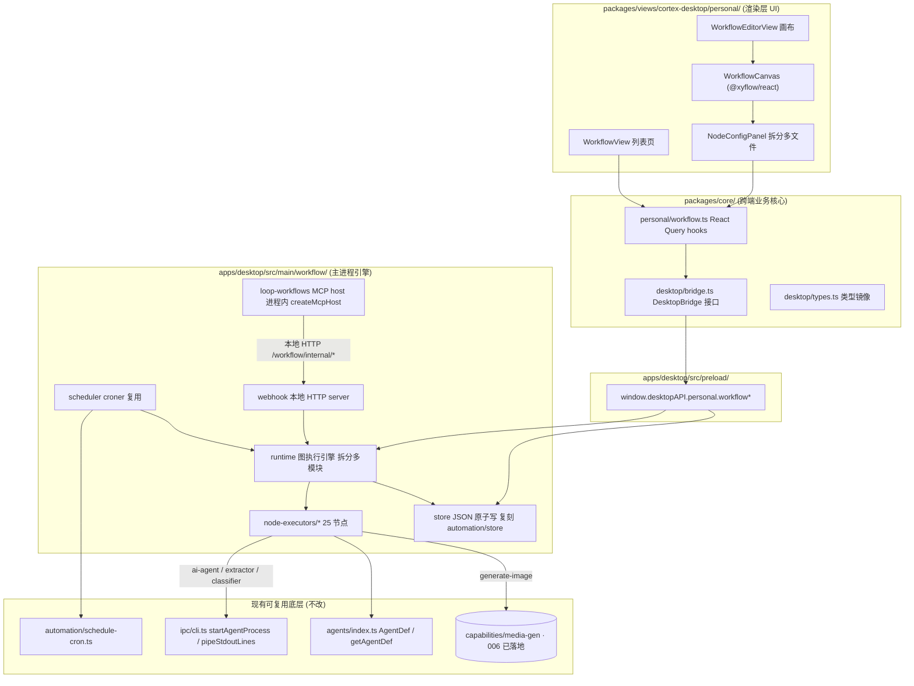
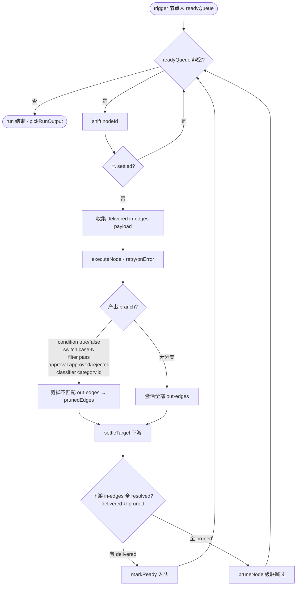
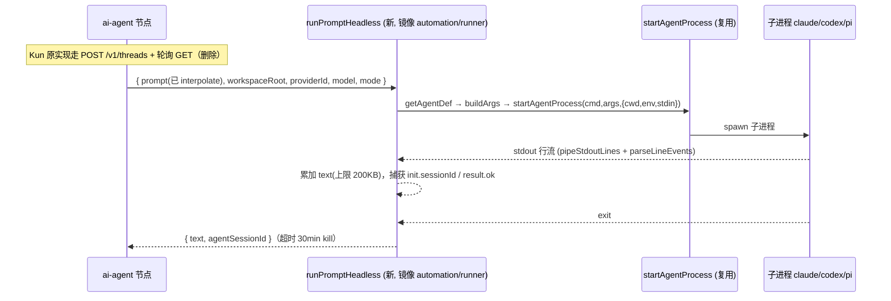

# feat: 复刻 Kun loop 节点式工作流到 Cortex Desktop

## Summary

把 Kun 的「loop / 节点式自动化工作流」功能 **1:1 复刻**进 `cortex-work`，落在「个人工作区」桌面端。用户用可视化画布把触发器、AI、流程控制、数据处理节点连成一条自动化流程，支持手动 / 定时 / Webhook 触发、`运行一次`、`启用`、`AI 可调用`（经 MCP 暴露给智能体调用）、导入导出。

实现策略（已与用户确认）：**新建独立的 loop 引擎，复用 cortex-work 现有底层** —— AI 节点复用 `apps/desktop/src/main/agents/` + `ipc/cli.ts` 的 agent CLI spawn 管线（而非 Kun 的 HTTP thread API），定时触发复用 `croner` 与 `schedule-cron.ts`，持久化复刻 `automation/store.ts` 的 JSON 原子写模式，事件广播 / DesktopBridge / React Query 照搬 automation 那一套。现有线性 `automation` 功能**保持不动**，loop 是与之并列的新功能。

覆盖 Kun 全部 25 种节点。`生成图片` 节点纳入首版，其底层图片生成能力已由 006 计划落地（`apps/desktop/src/main/capabilities/media-gen/`），本计划 U13 **直接消费已落地实现**（`generateImage` + `resolveMediaGenSettings`），无需另行定义契约或等待另一会话。

---

## Problem Frame

`cortex-work` 的桌面端已有 `automation`：croner 定时 + 单个 agent prompt 的**线性**无头执行，配套调度器、JSON 持久化、完成推送、React Query、完整表单 UI（List + Detail）。但它只有「一个触发源 → 一个动作」的形态，节点之间无法串联、无分支、无循环、无数据加工。

Kun 已经有一套成熟的**节点式工作流引擎**（核心约 1.2–1.4 万行）：`@xyflow/react` 画布、25 种节点、主进程图执行引擎（`runGraph` 数据流调度 + 分支剪枝 + merge 等待 + 子流程/循环递归）、模板变量系统、MCP 桥接、导入导出 DSL。用户希望把这套能力搬到 Cortex Desktop。

挑战在于 **Kun 与 cortex-work 的底层不同**：Kun 的 AI 节点走 Kun runtime 的 HTTP thread API（`POST /v1/threads`），而 cortex-work 没有这个 runtime，它是 spawn `claude`/`codex`/`pi` CLI 子进程并解析 stdout 流。因此「1:1 复刻」= 图执行引擎、节点语义、画布、持久化、MCP、DSL **逐项对齐 Kun**，但 AI 节点与图片节点的**底层调用接缝替换**为 cortex-work 的等价实现。

cortex-work 的硬边界（见 `CLAUDE.md` / `docs/floder.md`）必须遵守：`core` 不碰 `react-dom`/`localStorage`/`process.env`；`views` 不引 `next/*`/`react-router-dom`；`core`/`views` 永不直接触碰 `window.desktopAPI`，只经注入的 `DesktopBridge`；单文件 ≤1200 行（Kun 的 2305 行引擎与 2377 行配置面板必须拆分）。

---

## Scope Boundaries

### 本计划覆盖（In Scope）

- 全部 25 种节点：`manual-trigger`、`schedule-trigger`、`webhook-trigger`、`ai-agent`、`generate-image`、`condition`、`switch`、`filter`、`set-fields`、`code`、`sort`、`limit`、`aggregate`、`http-request`、`merge`、`subworkflow`、`loop`、`delay`、`template`、`json`、`output`、`parameter-extractor`、`question-classifier`、`human-approval`、`custom`。
- `@xyflow/react` 画布编辑器：左侧节点 palette（分组 触发器 / AI / 流程控制 / 数据处理）、中间画布拖拽连线、右侧 `配置 / 运行日志` 面板、顶部 `环境变量 / 保存 / 运行一次 / 已启用`。
- 列表页：`触发器`、`导入`、`新建loop`，每条 loop 的 `运行一次 / 编辑 / 导出 / 删除` + `启用` 与 `AI 可调用` 两个开关、最近结果摘要。
- 主进程图执行引擎、模板变量系统（`$nodes`/`$env`/`$run`/`$loop`/`$input`/`text`/`json`）、调度器（croner 复用）、Webhook 本地 HTTP server、human-approval 挂起/resolve。
- `AI 可调用`：MCP 桥接，把 `enabled && callableByAgent` 的 loop 暴露成 `list_workflows` / `run_workflow` 工具。
- 导入导出 DSL（含 secret 脱敏）、环境变量、节点 presets、自定义 module 系统。
- `生成图片` 节点（消费 006 已落地的 `capabilities/media-gen/generateImage` 实现）。

### 延后到后续工作（Deferred to Follow-Up Work）

- **图片生成 provider 底层实现**：已由 006 计划实现，不再是延后项。U13 直接 import `generateImage`（`capabilities/media-gen/client.ts`）与 `resolveMediaGenSettings`（`capabilities/media-gen/resolve.ts`）。用户未在设置中启用图片生成（`enabled=false`）时，节点检查后降级返回中文诊断错误，不发网络请求。
- **Web 端的 loop 编辑器**：首版仅桌面端（依赖主进程引擎）。Web 端按现有 `useAutomationsAvailable` 模式降级隐藏入口。
- **运行历史的整页可视化回放**（节点级时间线动画的高级视图）超出首版，先做基础运行日志面板。

### 非目标（Non-Goals）

- 不改动、不迁移现有线性 `automation` 功能，二者并存。
- 不引入 SQLite 或 electron-store；持久化沿用 JSON 原子写。
- 不在 `core`/`views` 层做任何 Node / Electron 直接调用。

---

## High-Level Technical Design

> 以下图示传达架构与数据流的整体形状，为方向性指引，非实现规格。Kun 路径指外部参考仓库。

### 分层架构（跨包落位 + 复用接缝）



### 图执行引擎数据流（`runGraph` 调度）


约束常量（对齐 Kun）：`MAX_NODE_EXECUTIONS=200`、`MAX_RUN_DURATION_MS=30min`、`MAX_SUBWORKFLOW_DEPTH=5`、JS 沙箱 `2s`、python/bash spawn `30s`、AI 节点 `30min`、`merge` 等所有上游 delivered∪pruned 后才执行。

### 关键适配：AI 节点底层从 thread API → CLI spawn


`parameter-extractor` / `question-classifier` 复用同一 `runPromptHeadless`，仅在调用前拼装结构化 prompt（字段 schema / 类别列表）、强制 `mode:'agent'`，返回后用 `extractJsonObject` / 数字匹配解析。

---

## Output Structure

新建目录的预期布局（per-unit `Files` 为权威，结构可在实现中微调）：

```
apps/desktop/src/main/workflow/
  index.ts                 # createWorkflowRuntime + sync 入口
  types.ts                 # 引擎内部类型（payload / scope / run 上下文）
  store.ts                 # workflows.json + workflow-runs/<id>.json（复刻 automation/store）
  ipc.ts                   # registerWorkflowHandlers（workflow:* handler）
  events.ts                # broadcastWorkflowChanged / broadcastWorkflowRunEvent
  scheduler.ts             # croner 调度（复用 schedule-cron）
  webhook-server.ts        # 127.0.0.1 本地 HTTP（webhook-trigger 路径触发）
  runtime/
    graph-executor.ts      # runGraph 数据流调度 + 分支剪枝 + merge 等待
    interp.ts              # InterpScope 模板变量解析
    run-context.ts         # 单次 run 的状态容器（nodeOutputs/runVars/pending）
  node-executors/
    index.ts               # executeNode 分发表（25 kind）
    triggers.ts            # manual / schedule / webhook
    flow-control.ts        # condition / switch / filter / merge / loop / subworkflow / human-approval / delay
    data.ts                # set-fields / sort / limit / aggregate / template / json / output
    code.ts                # code（vm + spawn）+ custom（module $fields）
    http.ts                # http-request
    ai.ts                  # ai-agent / parameter-extractor / question-classifier（runPromptHeadless）
    image.ts               # generate-image（消费 006 capabilities/media-gen 的 generateImage）
  run-prompt-headless.ts   # AI 节点的 CLI spawn 适配（镜像 automation/runner）

apps/desktop/src/main/capabilities/loop-workflows/   # U14 MCP（对照 capabilities/media-gen）
  server.ts                # createMcpHost + list/run_workflow + per-session Map + start/stop/buildXxxMcpServerConfig

packages/views/cortex-desktop/personal/
  WorkflowView.tsx                 # 列表页
  WorkflowEditorView.tsx           # 画布编辑器壳
  WorkflowCanvas.tsx               # @xyflow/react 画布
  WorkflowNodes.tsx                # 自定义节点组件
  WorkflowRunLogPanel.tsx          # 运行日志面板
  WorkflowHookTriggers.tsx         # 触发器面板
  ModuleManager.tsx                # 自定义模块管理
  node-config/                     # 配置面板按节点 kind 拆分（守 1200 行）
    NodeConfigPanel.tsx            # 容器分发
    AiNodeForm.tsx / FlowNodeForm.tsx / DataNodeForm.tsx / TriggerNodeForm.tsx ...
  workflow-flow.ts                 # toFlowNodes/toFlowEdges/flowToWorkflowGraph
  workflowFormat.ts                # 纯函数工具（状态/时间/摘要）

packages/core/personal/workflow.ts # React Query hooks（workflowKeys / hooks / events）
```

---

## Key Technical Decisions

### KTD1 — 独立 loop 引擎，复用 cortex-work 底层（不改 automation）
loop 引擎是与 `automation` 并列的新模块（`apps/desktop/src/main/workflow/`）。复用 `ipc/cli.ts` 的 spawn 管线、`croner` + `schedule-cron.ts`、`automation/store.ts` 的持久化模式、`automation/events.ts` 的广播模式、DesktopBridge + React Query 那一套约定。现有 `automation` 零改动。**理由**：用户明确选择此策略；避免动到已上线的 automation；最大化复用已验证的底层。

### KTD2 — 工作流存独立 JSON 文件，不进 settings
不照 Kun 把 workflow 塞进 `AppSettingsV1`。改用 `~/.cortex-desktop/workflows.json`（全量 + 内存缓存 + 串行 tmp+rename 原子写）与 `~/.cortex-desktop/workflow-runs/<id>.json`（每 workflow 一文件、保留近 N 条），完全复刻 `automation/store.ts` + `paths.ts` 模式。**理由**：对齐 cortex-work 既有约定，隔离写竞争，避免 settings 膨胀。

### KTD3 — AI 节点底层替换为 CLI spawn（最大适配点）
删除 Kun 的 `runPromptViaRuntime`（HTTP thread API），新建 `run-prompt-headless.ts`，镜像 `automation/runner.ts`：`getAgentDef → buildArgs → startAgentProcess → pipeStdoutLines + parseLineEvents`，累加 `text`、捕获 `init.sessionId`/`result`，30min 超时 kill。AI 三节点（ai-agent/parameter-extractor/question-classifier）共用之。**理由**：cortex-work 无 Kun runtime；这是「1:1 行为」与「适配底层」的边界。

### KTD4 — 引擎与配置面板按职责拆分以守 1200 行
Kun 的 `workflow-runtime.ts`（2305 行）拆为 `runtime/graph-executor.ts` + `runtime/interp.ts` + `node-executors/*`；`NodeConfigPanel.tsx`（2377 行）拆为 `node-config/` 下按节点组分文件。**理由**：项目 `max-lines:1200` 约束（`packages/eslint-config/rules.js`）。

### KTD5 — 类型契约双写镜像
workflow 全部类型（`WorkflowDef`/`WorkflowNode`/`WorkflowConnection`/`WorkflowRun`/`ScheduleSpec` 复用）在 `apps/desktop/src/main/ipc/types.ts` 与 `packages/core/desktop/types.ts` 逐字镜像，preload 与 core 共用。**理由**：沿用 CLAUDE.md 既定的跨进程契约约定；不镜像会编译过但运行期字段错位。

### KTD6 — 模板变量系统完整复刻
`runtime/interp.ts` 复刻 Kun 的 `InterpScope` + `resolveExpr`：`$nodes.<id>.json[.path]`/`.text`、`$input.<key>`、`$env.<key>`、`$run.<key>`、`$loop.index/item/total`、裸 `text`/`json[.path]`。节点 `inputs[]` 绑定在 executeNode 前解析（单 `{{expr}}` 保留原始类型）。**理由**：节点行为与 Kun 一致的前提。

### KTD7 — 代码节点沙箱与图片节点契约对齐 Kun
`code`/`custom` 节点：JS 走 `node:vm.runInNewContext`（2s），python/bash 走 `child_process.spawn`（30s，stdin 传 `{json,text}`、env 传 `WORKFLOW_*`）。`generate-image` 节点直接调用 006 已落地的两步接口：① `resolveMediaGenSettings('image', mediaGenSettings, providerSettings) → ResolvedMediaGenConfig`（`capabilities/media-gen/resolve.ts`）；② `generateImage({prompt, size}, resolvedConfig, {workspaceRoot, signal}) → GenerateMediaResult`（`capabilities/media-gen/client.ts`）。provider 解析顺序：节点 config（providerId/model）覆盖全局 `mediaGenSettings.image`，再经 `resolveMediaGenSettings` 统一解析；超时常量使用 `MAX_TIMEOUT_MS=290_000`（`resolve.ts` 导出，低于看门狗 300s）。产物落盘于 `{workspaceRoot}/.cortex/media/images/{ts}-{hex}.png`，返回 `GenerateMediaResult.files[0].{absolutePath, relativePath, mimeType, byteSize}`，不返回 Buffer。未启用（`enabled=false`）或配置缺失时 catch Error 透传中文诊断文案。**理由**：006 实现已完整落地，不再需要 `createImageGenClient` 工厂包装层或 `image-gen-contract.ts` 抽象层。

### KTD8 — UI 落位与导航沿用 automation 模式（无路由）
loop 视图放 `packages/views/cortex-desktop/personal/`，不在 views barrel 单独 export，由 `PersonalWorkspace` 内部按 store 状态 `workflowOpen` 渲染，`PersonalSidebar` 用 `bridge?.workflowList ?` 有值才渲染入口，web 端 bridge 为 null 自动降级隐藏。**理由**：照搬已验证的 automation 接入方式，避免引 router。

---

## Requirements

| ID | 需求 | 验证锚点 |
|----|------|---------|
| R1 | 列表页支持 新建 / 导入 / 运行一次 / 编辑 / 导出 / 删除，每条 loop 有 `启用` 与 `AI 可调用` 开关与最近结果摘要 | U5 |
| R2 | 画布编辑器：节点 palette 拖拽、连线、右侧配置/运行日志、顶部 环境变量/保存/运行一次/已启用 | U6, U7 |
| R3 | 25 种节点全部可配置且可执行，输出 handle 与分支语义对齐 Kun | U9, U10, U11, U12, U13 |
| R4 | 主进程图执行引擎：数据流调度、分支剪枝、merge 等待、loop/subworkflow 递归、执行上限/超时 | U8 |
| R5 | 模板变量系统完整可用（`$nodes/$env/$run/$loop/$input/text/json`） | U8 |
| R6 | 三种触发：手动 `运行一次`、定时（croner）、Webhook（本地 HTTP） | U9 |
| R7 | AI 节点经 cortex-work CLI spawn 管线执行，结果可回溯 sessionId | U12 |
| R8 | `生成图片` 节点按契约调用图片 provider，未配置时降级报错 | U13 |
| R9 | `AI 可调用`：MCP 暴露 `list_workflows`/`run_workflow`，仅 `enabled && callableByAgent` | U14 |
| R10 | 导入导出 DSL（secret 脱敏、enabled/callableByAgent 重置、runs 清空） | U15 |
| R11 | human-approval 节点挂起 + IPC resolve + 停止 workflow 时级联拒绝 | U10 |
| R12 | 持久化用独立 JSON 原子写，run 历史保留近 N 条；不动 automation | U2 |
| R13 | 全程遵守包硬边界与 1200 行/文件约束 | 全部 U |

---

## Implementation Units

> 分五个阶段（A 基础 → B 画布 UI → C 引擎与触发 → D 节点实现 → E 附加能力）。U-ID 稳定不重编号。

### 阶段 A — 基础设施

#### U1. 工作流类型契约与规范化器

- **Goal**: 定义 workflow 全套类型并镜像到 core，提供 normalize 默认值。
- **Requirements**: R3, R12, R13
- **Dependencies**: 无
- **Files**:
  - `apps/desktop/src/main/ipc/types.ts`（新增 workflow 段：`WorkflowDef`/`WorkflowNode`(24 kind discriminated union)/`WorkflowConnection`/`WorkflowRun`/`WorkflowNodeRunResult`/`WorkflowEnvVar`/`WorkflowScheduleSpec`/`WorkflowInputField`/各节点 config）
  - `packages/core/desktop/types.ts`（逐字镜像上述类型）
  - `apps/desktop/src/main/workflow/normalize.ts`（每种节点 config 的 normalize + 默认值，复刻 Kun `app-settings-workflow.ts`）
  - `apps/desktop/src/main/workflow/normalize.test.ts`
- **Approach**: 节点为 `type` 判别联合；base 字段 `id/type/name/position/disabled/onError?/retries?/retryDelayMs?/fallbackJson?/inputs?`。schedule 复用 cortex-work `ScheduleSpec`（含 cron/once），不照 Kun 的 `WorkflowScheduleV1` 另起一套（对齐 R6 复用 croner）。
- **Patterns to follow**: `apps/desktop/src/main/ipc/types.ts` automation 段（L758-855）；Kun `src/shared/app-settings-types.ts` L594-1064。
- **Test scenarios**:
  - 每种节点 kind 的 normalize：缺省 config → 填默认值（如 condition.caseSensitive=false、limit.count=10、loop.maxIterations=10）。
  - 非法值钳制：limit.count 越界、http timeout 越界 → 落回合法区间。
  - switch.rules / http.headers / classifier.categories 超上限（20/50/20）→ 截断。
  - 未知 kind / 损坏 node → 安全丢弃且不抛。

#### U2. 主进程持久化存储

- **Goal**: workflows.json + workflow-runs/<id>.json 的原子读写存储。
- **Requirements**: R12
- **Dependencies**: U1
- **Files**:
  - `apps/desktop/src/main/paths.ts`（新增 `workflowsStorePath()` / `workflowRunsDir()`）
  - `apps/desktop/src/main/workflow/store.ts`（`loadWorkflows/upsertWorkflow/patchWorkflow/deleteWorkflow/getWorkflow` + `appendRun/updateRun/deleteRun/loadRuns/markOrphanRunsKilled` + `newWorkflowId/newRunId`）
  - `apps/desktop/src/main/workflow/store.test.ts`
- **Approach**: 内存缓存 + `writeChain` 串行 + tmp+rename；runs 用 `runQueues: Map<id, Promise>` 每 workflow 独立串行队列；`SAFE_ID` 防路径穿越。
- **Patterns to follow**: `apps/desktop/src/main/automation/store.ts`（逐函数对照），`paths.ts` L70-82。
- **Test scenarios**:
  - upsert→load 往返；patch 部分字段不丢其它字段。
  - appendRun 超过 keepN 截断到近 N 条。
  - 并发 appendRun 同一 id 不丢失（串行队列）。
  - 非法 run 文件名 / 路径穿越被 SAFE_ID 拒绝。
  - Covers 持久化原子性（tmp+rename，写中断不产生半文件）。

#### U3. IPC handler + 广播 + preload + bridge 接口

- **Goal**: 把 workflow CRUD/run 经 IPC 暴露到渲染层，事件广播驱动缓存。
- **Requirements**: R1, R13
- **Dependencies**: U2
- **Files**:
  - `apps/desktop/src/main/workflow/ipc.ts`（`registerWorkflowHandlers`：`workflow:list/create/update/setEnabled/setCallableByAgent/delete/runNow/stop/listRuns/deleteRun/import/export/node:run/node:test/approval:resolve/validateCron`）
  - `apps/desktop/src/main/workflow/events.ts`（`broadcastWorkflowChanged` / `broadcastWorkflowRunEvent`）
  - `apps/desktop/src/main/ipc/register.ts`（追加 `registerWorkflowHandlers()` + 导出 `killAllWorkflows`）
  - `apps/desktop/src/preload/index.ts`（`personal` 对象追加 workflow* 透传 + `onWorkflowChanged`/`onWorkflowRunEvent`）
  - `packages/core/desktop/bridge.ts`（`DesktopBridge` 追加 workflow 可选方法，镜像 IPC）
- **Approach**: handler 命名/校验/返回模式照 `automation/ipc.ts`；广播照 `automation/events.ts`（窗口关时丢失无害）。
- **Patterns to follow**: `apps/desktop/src/main/automation/ipc.ts`、`events.ts`、`bridge.ts` L281-298、`preload/index.ts` L336-361。
- **Test scenarios**:
  - 每个 handler 入参校验失败 → throw 明确 error。
  - `Test expectation: 主要为契约接线`；handler 逻辑测试归各引擎单元（U9+）。preload 字段与 bridge 接口手工比对一致（typecheck 守护）。

#### U4. core React Query 数据层

- **Goal**: 渲染层经 hooks 读写 workflow，事件订阅幂等更新缓存。
- **Requirements**: R1, R13
- **Dependencies**: U3
- **Files**:
  - `packages/core/personal/workflow.ts`（`workflowKeys` + `useWorkflows/useWorkflowRuns/useWorkflowsAvailable` + `useCreate/Update/Delete/SetEnabled/SetCallableByAgent/RunNow/StopRun/Import/Export...` + `useWorkflowEvents`）
  - `packages/core/index.ts`（barrel re-export）
  - `packages/core/personal/workflow.test.ts`
- **Approach**: `workflowKeys.list=["personal","workflows"]`、`runs(id)=["personal","workflow-runs",id]`；事件用 `qc.setQueryData` 全量替换 / 幂等 upsert，`staleTime:Infinity` 不轮询；`useWorkflowsAvailable = !!bridge?.workflowList`。
- **Patterns to follow**: `packages/core/personal/automation.ts`（逐 hook 对照，L12-178）。
- **Test scenarios**:
  - `onWorkflowChanged` → list 缓存被替换。
  - `onWorkflowRunEvent` start/end → runs 缓存幂等 upsert（重复事件不产生重复行）。
  - bridge 为 null → `useWorkflowsAvailable()` 返回 false，写 hooks 不崩。
  - query key 含正确命名空间（切 workspace 不串场，对齐 CLAUDE.md 约定）。

### 阶段 B — 画布编辑器 UI

#### U5. 列表页 + Sidebar/Store 接入

- **Goal**: loop 列表页 + 桌面端入口接入。
- **Requirements**: R1, R12
- **Dependencies**: U4
- **Files**:
  - `packages/views/cortex-desktop/personal/WorkflowView.tsx`（列表 ↔ 编辑器本地切换容器）
  - `packages/views/cortex-desktop/personal/WorkflowList.tsx`
  - `packages/views/cortex-desktop/personal/workflowFormat.ts`（状态/时间/节点数摘要纯函数）
  - `packages/core/store/personal.ts`（`workflowOpen` + `openWorkflow()`，互斥清其它面板）
  - `packages/views/cortex-desktop/personal/PersonalSidebar.tsx`（`bridge?.workflowList ?` 渲染入口）
  - `packages/views/cortex-desktop/personal/PersonalWorkspace.tsx`（`workflowOpen ? <WorkflowView/>`）
  - `packages/views/cortex-desktop/personal/workflowFormat.test.ts`
- **Approach**: 每行展示名称/节点数/上次运行/最近结果摘要/失败 pill；行操作 运行一次/编辑/导出/删除（删除二次确认）；`启用` 与 `AI 可调用` 两个 toggle。顶部 触发器/导入/新建loop。
- **Patterns to follow**: `AutomationView.tsx`/`AutomationList.tsx`；store `automationOpen`/`openAutomation`；Kun `WorkflowView.tsx`。
- **Test scenarios**:
  - workflowFormat：节点数摘要、状态文案、相对时间格式。
  - 列表渲染：失败态显示 `失败` pill 与最近结果；空态显示引导。
  - 两个 toggle 调对应 mutation；删除走二次确认。
  - bridge 无 workflowList → 列表入口不渲染。

#### U6. 画布编辑器（@xyflow/react）

- **Goal**: 节点拖拽、连线、保存的可视化画布。
- **Requirements**: R2
- **Dependencies**: U5
- **Files**:
  - `packages/views/package.json`（新增 `@xyflow/react` 依赖）
  - `packages/views/cortex-desktop/personal/WorkflowEditorView.tsx`（编辑器壳：顶部 返回/环境变量/保存/运行一次/已启用）
  - `packages/views/cortex-desktop/personal/WorkflowCanvas.tsx`（`<ReactFlow>` + palette + DnD）
  - `packages/views/cortex-desktop/personal/WorkflowNodes.tsx`（按 kind 渲染的自定义节点组件 + handle）
  - `packages/views/cortex-desktop/personal/workflow-flow.ts`（`toFlowNodes/toFlowEdges/flowToWorkflowGraph/createWorkflowNode`）
  - `packages/views/cortex-desktop/personal/workflow-flow.test.ts`
- **Approach**: palette 分组 触发器/AI/流程控制/数据处理；DnD mime `application/x-workflow-node`；`toFlowEdges` 给 running 边加 `animated`；condition/switch/approval/classifier 节点渲染多 handle。保存把 flow 反向同步回 `WorkflowDef` 经 `workflowUpdate`。
- **Patterns to follow**: Kun `WorkflowEditorView.tsx` / `WorkflowNodes.tsx` / `workflow-types.ts`。
- **Test scenarios**:
  - `toFlowNodes/toFlowEdges` 往返：WorkflowDef → flow → `flowToWorkflowGraph` 无损（节点位置/连线/handle）。
  - 多 handle 节点（condition 2、switch case-N+fallback、approval 2）handle id 正确映射。
  - 新建节点 `createWorkflowNode(kind)` 带正确默认 config（接 U1 normalize）。
  - Covers R2 连线 sourceHandle 持久化为 `WorkflowConnection.sourceHandle`。

#### U7. 节点配置面板（按职责拆分）+ 运行日志面板

- **Goal**: 右侧 `配置 / 运行日志` 面板，覆盖 24 节点配置 UI，守 1200 行。
- **Requirements**: R2, R13
- **Dependencies**: U6
- **Files**:
  - `packages/views/cortex-desktop/personal/node-config/NodeConfigPanel.tsx`（容器按 kind 分发）
  - `node-config/TriggerNodeForm.tsx` / `AiNodeForm.tsx` / `FlowNodeForm.tsx` / `DataNodeForm.tsx` / `CodeNodeForm.tsx` / `ImageNodeForm.tsx` / `HttpNodeForm.tsx` / `ApprovalNodeForm.tsx`
  - `node-config/VariablePicker.tsx`（`{{$nodes...}}` 变量选择器）
  - `packages/views/cortex-desktop/personal/WorkflowRunLogPanel.tsx`
  - `node-config/NodeConfigPanel.test.tsx`
- **Approach**: 容器据选中节点 kind 渲染对应 form；每个 form ≤1200 行；变量选择器据上游节点输出描述符列出可插变量。运行日志面板订阅 `useWorkflowRuns` 展示每节点 input/output/error/threadId。
- **Patterns to follow**: Kun `NodeConfigPanel.tsx`（2377 行）拆分；`AutomationDialog.tsx`/`ScheduleEditor.tsx` 的表单风格。
- **Test scenarios**:
  - 切换节点 kind → 渲染对应 form 字段。
  - 编辑字段 → 节点 config 更新且经保存回写。
  - 每个 form 文件行数 < 1200（lint 守护）。
  - 运行日志面板按节点展示状态与错误，ai-agent 行可跳 sessionId。

### 阶段 C — 引擎核心与触发器

#### U8. 图执行引擎核心（runGraph + interp + run context）

- **Goal**: 主进程数据流图调度器，覆盖分支剪枝、merge 等待、模板变量、retry/onError。
- **Requirements**: R3, R4, R5
- **Dependencies**: U2
- **Files**:
  - `apps/desktop/src/main/workflow/runtime/graph-executor.ts`（`runGraph`：readyQueue/delivered/prunedEdges/settleTarget/pruneNode）
  - `apps/desktop/src/main/workflow/runtime/interp.ts`（`InterpScope` + `resolveExpr` + `interpolate` + `resolveNodeInputs`）
  - `apps/desktop/src/main/workflow/runtime/run-context.ts`（nodeOutputs/runVars/pendingApprovals 容器）
  - `apps/desktop/src/main/workflow/node-executors/index.ts`（`executeNode` 分发骨架 + retry/onError 包裹）
  - `apps/desktop/src/main/workflow/runtime/graph-executor.test.ts`
  - `apps/desktop/src/main/workflow/runtime/interp.test.ts`
- **Approach**: 复刻 Kun `runGraph`（L1550-1807）与 `InterpScope`（L234-289）；常量 `MAX_NODE_EXECUTIONS=200`/`MAX_RUN_DURATION_MS=30min`/`NO_BRANCH='__none__'`。`executeNode` 此单元只搭分发表 + 透传类节点（trigger 占位），具体节点逻辑在 U9-U13 填充。
- **Patterns to follow**: Kun `workflow-runtime.ts` runGraph/InterpScope。
- **Test scenarios**:
  - 线性链 A→B→C 依序执行，`$nodes.A.json` 在 B 可解析。
  - condition true 分支只走 true 边，false 边及其下游被剪。
  - merge 等待两条上游（一条 delivered 一条 pruned）后执行，只合并 delivered。
  - 钻石图：分支后汇合不重复执行汇合点。
  - `MAX_NODE_EXECUTIONS`/超时早退；cancel 中断。
  - interp：`$nodes/$env/$run/$loop/$input/text/json[.path]` 各命名空间解析；单 `{{expr}}` 保留原始类型，混排 interpolate 成字符串。
  - Covers R4 执行上限与 R5 模板变量。

#### U9. 触发器节点 + 调度器 + Webhook server

- **Goal**: 三种触发可用，`运行一次` 端到端跑通。
- **Requirements**: R6
- **Dependencies**: U8, U3
- **Files**:
  - `apps/desktop/src/main/workflow/node-executors/triggers.ts`（manual/schedule/webhook 透传初始 payload）
  - `apps/desktop/src/main/workflow/scheduler.ts`（每 enabled schedule-trigger 一个 Cron，复用 `schedule-cron.ts`；powerMonitor.resume 补漏；once；开机补漏；powerSaveBlocker）
  - `apps/desktop/src/main/workflow/webhook-server.ts`（`127.0.0.1:port` http server，路径匹配 webhook-trigger.config.path；hook-run 内部端点。注：`list/run_workflow` 不再走此内部端点，改由 U14 进程内 MCP host 直接驱动）
  - `apps/desktop/src/main/workflow/index.ts`（`createWorkflowRuntime` + `sync(settings)` 启停调度/webhook）
  - `apps/desktop/src/main/index.ts`（启动时 `workflowRuntime.sync(...)`，settings 变更后再 sync）
  - `apps/desktop/src/main/workflow/scheduler.test.ts`
- **Approach**: 运行一次 = `runNow` IPC → `runWorkflowInternal → runGraph`（fire-and-forget，返回 runId）；调度复用 croner；webhook server 仅本地监听。
- **Execution note**: 先写一个失败的 `运行一次` 端到端用例（manual-trigger → set-fields → output）再接线。
- **Patterns to follow**: `automation/scheduler.ts`、`schedule-cron.ts`、Kun `startScheduler/syncWebhookServer`。
- **Test scenarios**:
  - manual `运行一次` → run 落盘 running→success，最近结果回填列表。
  - schedule-trigger 到点触发；once 触发后置 enabled=false；开机补漏 lastRun 缺失场景。
  - webhook POST 匹配 path → 触发对应 workflow；未匹配 → 404。
  - 有 enabled 定时任务时 powerSaveBlocker 生效。

### 阶段 D — 节点实现

#### U10. 流程控制节点

- **Goal**: condition/switch/filter/merge/loop/subworkflow/human-approval/delay。
- **Requirements**: R3, R11
- **Dependencies**: U8
- **Files**:
  - `apps/desktop/src/main/workflow/node-executors/flow-control.ts`
  - `apps/desktop/src/main/workflow/runtime/conditions.ts`（`evaluateCondition` + 12 种 operator）
  - `apps/desktop/src/main/workflow/node-executors/flow-control.test.ts`
- **Approach**: condition→`branch:true|false`；switch 逐 rule→`case-N|fallback|__none__`；filter pass/`__none__`；merge array/object；loop foreach（`mapWithConcurrency` 并发 1-8）/condition（while + 每轮 runGraph，maxIterations）；subworkflow 递归（depth≤5）；human-approval 见下；delay 透传。
- **Test scenarios**:
  - 12 种 operator 真值表（含 caseSensitive）。
  - switch 命中第二条 → `case-1`；无命中 fallback=true→`fallback`，false→不路由。
  - merge array 收集多上游、object 浅合并。
  - loop foreach 顺序/并行结果保序；continueOnError 跳过失败项；condition 模式到 maxIterations 停。
  - subworkflow 递归输出回灌；超 depth=5 报错。
  - human-approval：resolve(approved)→走 approved 边；timeout→onTimeout 决策；stopWorkflow→pending 级联 rejected。
  - Covers R11。

#### U11. 数据处理节点 + 代码/自定义节点

- **Goal**: set-fields/sort/limit/aggregate/template/json/output + code/custom + http-request。
- **Requirements**: R3
- **Dependencies**: U8
- **Files**:
  - `apps/desktop/src/main/workflow/node-executors/data.ts`（set-fields/sort/limit/aggregate/template/json/output）
  - `apps/desktop/src/main/workflow/node-executors/code.ts`（code: vm + spawn；custom: module $fields）
  - `apps/desktop/src/main/workflow/node-executors/http.ts`（http-request）
  - `apps/desktop/src/main/workflow/modules.ts`（自定义 module 注册 + `coerceModuleFields`）
  - 对应 `*.test.ts`
- **Approach**: set-fields scope payload/run；output 作终态被 `pickRunOutput` 取为 canonical；code JS `vm.runInNewContext`(2s)/python·bash `spawn`(30s)；custom 注入 `$fields`；http `fetch` body≤5MB、可选 JSON parse。
- **Test scenarios**:
  - set-fields keepIncoming 合并 vs 替换；scope=run 写 `$run` 不改 payload。
  - sort numeric/字典序、asc/desc、dot-path 取键；limit first/last；aggregate count/sum/collect/join。
  - template text/json（json parse 失败 fallback）；json parse strict 抛错 vs 宽松。
  - output auto/text/json 三模式选取 run 输出。
  - code JS return 值成 payload；超 2s 中断；python stdin/env 注入、stdout 解析；非零退出报错。
  - custom 节点 `$fields` 按声明类型 coerce。
  - http GET/POST、header interpolate、超时、parseJson、>5MB 截断。

#### U12. AI 节点（CLI spawn 适配）

- **Goal**: ai-agent / parameter-extractor / question-classifier 经 cortex-work CLI 管线执行。
- **Requirements**: R7
- **Dependencies**: U8, U9
- **Files**:
  - `apps/desktop/src/main/workflow/run-prompt-headless.ts`（镜像 `automation/runner.ts` 的 spawn+聚合）
  - `apps/desktop/src/main/workflow/node-executors/ai.ts`
  - `apps/desktop/src/main/workflow/run-prompt-headless.test.ts`
  - `apps/desktop/src/main/workflow/node-executors/ai.test.ts`
- **Approach**: `runPromptHeadless({prompt,workspaceRoot,providerId,model,mode}) → {text,agentSessionId}`：`getAgentDef→buildArgs→startAgentProcess→pipeStdoutLines+parseLineEvents`，累加 text(200KB)、捕获 init.sessionId/result、30min kill；独立进程注册表（不进 cli.ts `running`，避免关窗误杀）。extractor 拼字段 schema prompt + `extractJsonObject`；classifier 拼类别 prompt → `branch:category.id`，强制 `mode:'agent'`。
- **Execution note**: 先写失败的 run-prompt-headless 契约测试（mock spawn 输出行流）。
- **Patterns to follow**: `automation/runner.ts` L103-271；Kun `schedule-runtime-helpers.ts`（仅取语义，HTTP 部分替换）。
- **Test scenarios**:
  - mock 子进程 stdout：init→text*N→result，聚合出完整 text 与 sessionId。
  - 超时 30min → kill 且标记 timeout。
  - text 超 200KB 截断。
  - extractor：mock 返回含 JSON → 解析出字段对象；非法 JSON → 错误处理。
  - classifier：mock 返回类别 → branch=对应 category.id；无匹配兜底。
  - 独立进程表：关窗 killAllCli 不杀 workflow AI 节点（隔离验证）。
  - Covers R7。

#### U13. 生成图片节点

- **Goal**: generate-image 节点按契约调用图片 provider，未配置降级。
- **Requirements**: R8
- **Dependencies**: U8
- **Files**:
  - `apps/desktop/src/main/workflow/node-executors/image.ts`（`resolveWorkflowImageGen` + 调 `resolveMediaGenSettings` + `generateImage` + 输出文件路径）
  - `apps/desktop/src/main/workflow/node-executors/image.test.ts`
  - ~~`apps/desktop/src/main/workflow/image-gen-contract.ts`~~（**不新建**：006 已有真实实现，直接 import `capabilities/media-gen/client.ts` 与 `resolve.ts`）
- **Approach**: 每次节点执行时从 `getPersistedState()` 读取最新 `mediaGenSettings`（不缓存，支持用户改设置后立即生效）。先检查 `mediaGenSettings?.image.enabled`，`false` 时直接返回中文错误文案，不发网络请求。再调 `resolveMediaGenSettings('image', mediaGenSettings, providerSettings)` 拿 `ResolvedMediaGenConfig`（含 `timeoutMs`，已 `Math.min(userValue, MAX_TIMEOUT_MS)` 钳制），再调 `generateImage({prompt, size}, resolvedConfig, {workspaceRoot, signal})` 执行生成。产物由 `generateImage` 内部落盘至 `{workspaceRoot}/.cortex/media/images/{ts}-{hex}.png`，节点从 `result.files[0]` 取 `{absolutePath, relativePath, mimeType, byteSize}` 作为输出（`json.imagePath=absolutePath`，`json.mimeType`，`text=relativePath`）；不在节点层另行写盘或拼路径。配置缺失时 catch Error 把 `e.message`（中文诊断）透传，不 hardcode 英文文案。节点层只传 `ctx.signal`，**不叠加外层超时**（generateImage 内部已有 AbortController+setTimeout 管理超时，避免双层超时产生脏文件）。import 路径：`import { generateImage } from '../../capabilities/media-gen/client'` 与 `import { resolveMediaGenSettings } from '../../capabilities/media-gen/resolve'`。
- **Approach 备注（与 006 的边界）**: 图片产物固定落于 `{workspaceRoot}/.cortex/media/images/`（006 的约定），不再用原计划的 `workflow-images/`；若工作流需把图片转存别处由后续节点处理，本节点不负责。`size` 为空/`auto` 时不传给 `generateImage`，由 provider 取默认。
- **Test scenarios**:
  - `vi.mock('../../capabilities/media-gen/client')` 让 `generateImage` 返回 `{files:[{relativePath:'.cortex/media/images/123-ab.png', absolutePath:'/ws/.cortex/media/images/123-ab.png', mimeType:'image/png', byteSize:1024}], model:'dall-e-3', durationMs:500}` + mock `resolveMediaGenSettings` 返回 `ResolvedMediaGenConfig` → 节点输出 `json.imagePath=absolutePath`、`json.mimeType='image/png'`、`text=relativePath` 正确。
  - `enabled=false` → 未调 `generateImage`，返回中文错误文案。
  - `resolveMediaGenSettings` 抛错（`[image] apiKey 未配置（unavailable）`）→ catch 后透传 `e.message`，不 hardcode 英文文案。
  - 节点 config 指定 `providerId/model` 覆盖全局 `mediaGenSettings.image` 后再传入 `resolveMediaGenSettings`；`size` 为空/`auto` 时不传给 `generateImage`。
  - 传入 `ctx.signal` 被透传到 `generateImage` 的 `ctx.signal`；节点层不另建 `setTimeout` 超时。
  - Covers R8。

### 阶段 E — 附加能力

#### U14. MCP 桥接（AI 可调用）

- **Goal**: 把 `enabled && callableByAgent` 的 loop 暴露成 agent 可调工具。
- **Requirements**: R9
- **Dependencies**: U9
- **Files**:
  - `apps/desktop/src/main/capabilities/loop-workflows/server.ts`（`createMcpHost` + 工具注册 + per-session Map + `startLoopWorkflowsHost`/`stopLoopWorkflowsHost`/`buildLoopWorkflowsMcpServerConfig`/`unregisterLoopWorkflowsSession`）
  - `apps/desktop/src/main/capabilities/loop-workflows/server.test.ts`（注入 gate + HTTP 端到端 + per-session 并发，对照 `media-gen/inject.test.ts`）
  - `apps/desktop/src/main/index.ts`（追加 `void startLoopWorkflowsHost()` 与 `stopLoopWorkflowsHost()`）
  - `apps/desktop/src/main/ipc/cli.ts`（`builtinServers` 追加 `buildLoopWorkflowsMcpServerConfig`，`onExit` 追加 `unregisterLoopWorkflowsSession`）
  - ~~`apps/desktop/src/main/workflow/mcp-config.ts`~~（**不新建**：进程内 HTTP 无需独立子进程配置）
- **Approach**: 进程内 Streamable HTTP 方案（对照 `capabilities/media-gen/server.ts`），**不用 stdio 子进程**：调 `createMcpHost('cortex-loop-workflows')` 得随机端口 + token；注册 `list_workflows`（无入参，返回 `enabled && callableByAgent` 的 `{id,name,description,inputSchema}`，inputSchema 取 `manual-trigger.config.inputSchema`）与 `run_workflow`（入参 `{workflow_id, inputs?}`，调 `runWorkflowForTool` 同步等完成）；两者硬检 `callableByAgent`；**工作区路径取自 per-session `Map<sessionId,{cwd,...}>`（即 `req.cwd`），不接受 `workspace_root` 覆盖参数**（自然消除原安全 OQ 的任意路径风险）；catalog 变更触发 `tools/list_changed`；`buildLoopWorkflowsMcpServerConfig(loopSettings, sessionId, cwd)` 参照 `buildMediaGenMcpServerConfig` 返回 `McpServerConfig | null`（全关返回 null 不注入）。
- **Patterns to follow**: `apps/desktop/src/main/capabilities/media-gen/server.ts`（per-session Map、register/unregister、`buildXxxMcpServerConfig`、tool handler 结构）；`capabilities/mcp-host/server.ts`（`createMcpHost` 工厂）；`apps/desktop/src/main/index.ts`（start/stop 生命周期接入）；`apps/desktop/src/main/ipc/cli.ts`（`builtinServers` 注入与 `onExit` unregister）。
- **Test scenarios**:
  - list 只返回 enabled+callableByAgent；inputSchema 来自 manual-trigger。
  - run_workflow 按 id 或 name(小写)匹配；非 callableByAgent → 拒绝。
  - input 为 JSON string / 纯文本 → coerce 成 payload。
  - catalog 变更触发 list_changed。
  - Covers R9。

#### U15. 导入导出 DSL + 环境变量 + Module 管理

- **Goal**: DSL 导入导出（脱敏）、env vars、自定义 module/presets 管理 UI。
- **Requirements**: R10
- **Dependencies**: U5, U11
- **Files**:
  - `apps/desktop/src/main/workflow/dsl.ts`（`exportWorkflowDsl`/`parseWorkflowDsl`）
  - `packages/views/cortex-desktop/personal/EnvVarEditor.tsx`（顶部 `环境变量` 弹窗）
  - `packages/views/cortex-desktop/personal/ModuleManager.tsx`（自定义 module 管理）
  - `apps/desktop/src/main/workflow/dsl.test.ts`
- **Approach**: DSL `{dsv:1,kind:'workflow',app:'Cortex Desktop',exportedAt,workflow}`；导出脱敏 secret env、重置 enabled/callableByAgent/runs；导入兼容 wrapped 与裸 workflow、`normalizeWorkflow`、分配新 id、处理重名。
- **Patterns to follow**: Kun `workflow-dsl.ts`、`ModuleManager.tsx`。
- **Test scenarios**:
  - 导出：secret env value 置空、enabled/callableByAgent=false、runs 清空。
  - 导入 wrapped / 裸 workflow 都成功 normalize；空 nodes → 报错。
  - 重名导入分配新 id 不覆盖原 workflow。
  - env var secret 在 UI 掩码显示。
  - Covers R10。

---

## Risks & Dependencies

| 风险 / 依赖 | 影响 | 缓解 |
|------------|------|------|
| ~~图片 provider 由另一会话提供~~ **（已解决）** | ~~U13 无法端到端跑通~~ | 006 计划已实现 `capabilities/media-gen/generateImage` + `resolveMediaGenSettings`，U13 直接导入消费；风险转为「用户未启用 `image.enabled`」时的降级逻辑，由节点层 `enabled` 检查覆盖 |
| AI 节点底层差异（thread API → CLI spawn） | ai-agent/extractor/classifier 行为可能偏离 Kun | U12 用 mock 子进程行流契约测试锁定；先写失败测试 |
| `@xyflow/react` 新依赖体积/版本 | 渲染层 bundle 增大 | 仅 views 引入；web 端降级不加载编辑器 |
| 引擎/配置面板拆分不当超 1200 行 | lint 失败、PR 受阻 | KTD4 预定义拆分边界；lint 守护 |
| 类型双写（ipc/types.ts ↔ core/desktop/types.ts）漂移 | 运行期字段错位 | typecheck + U3 接线测试；遵守 KTD5 |
| Webhook 本地 server 端口冲突 | 触发失效 | 端口可配 + 启动失败日志；仅 127.0.0.1 |
| code 节点 spawn / vm 安全 | 任意代码执行（用户本机自担） | 对齐 Kun：vm 2s、spawn 30s 超时隔离；不引入额外远程执行面 |
| run 历史无限增长 | 磁盘膨胀 | appendRun keepN 截断（复刻 automation 200 上限） |

### 外部依赖

- `@xyflow/react`（新增，packages/views）。
- `croner` ^10.0.1、`zod` ^4.4.3（已在 apps/desktop，复用）。
- 图片生成能力（006 已落地，`apps/desktop/src/main/capabilities/media-gen/`，`ImageGenProtocol` 支持 `openai-images` / `minimax-image` 两种协议）。

---

## Alternatives Considered

- **演进现有 automation 为节点图（被否）**：把 automation 数据模型/UI 直接升级成节点图，统一为一个功能。改动面更集中，但会动到刚上线的 automation（`docs/plans/2026-06-24-002/003`），回归风险高，且 automation 的「单 prompt」心智与节点图差异大。用户已选「新建独立引擎、复用底层」。
- **工作流存进 AppSettingsV1（照 Kun，被否）**：与 Kun 一致最省心，但会让 settings 文件膨胀、写竞争集中，且偏离 cortex-work 既有的「每功能独立 JSON 文件」约定（automation/notes 等）。改用独立 store（KTD2）。
- **AI 节点起一个本地 HTTP runtime 模拟 Kun thread API（被否）**：能最大程度照搬 Kun AI 代码，但等于在 cortex-work 内再造一个 runtime，维护成本高且与 cortex-work 的 CLI spawn 体系割裂。直接复用 CLI 管线（KTD3）。

---

## Open Questions（评审补强 · ce-work 前需消化）

7 个评审 persona 的结论。机械问题（U-ID 错位、节点数 24→25）已直接修入正文；以下是需要在实现前做决定或补规格的高价值项，按主题分组。

### 可行性 / 构建（必须在对应单元开工前解决）

- **MCP 构建入口约束（U14，P1，已解决）**：`electron.vite.config.ts` main 段注释明确禁止加多入口 `rollupOptions.input`。006（`capabilities/media-gen/server.ts`）已用**进程内 Streamable HTTP 方案**绕过此约束——通用工厂 `createMcpHost('<name>')`（`capabilities/mcp-host/server.ts`，随机端口 `http.Server` + Bearer token + Origin 校验），无额外构建入口、无子进程。**决定**：U14 复用同一范式，废弃原 stdio 子进程 / `pi-mcp-bridge` 动态生成方案。落点 `apps/desktop/src/main/capabilities/loop-workflows/server.ts`：调 `createMcpHost('cortex-loop-workflows')` 得独立 `port/token`，注册 `list_workflows`/`run_workflow`，维护 `per-session Map<sessionId,{cwd,enabledWorkflowIds}>`，导出 `startLoopWorkflowsHost`/`stopLoopWorkflowsHost`/`buildLoopWorkflowsMcpServerConfig`（对照 `buildMediaGenMcpServerConfig`）；`index.ts` `whenReady` 追加 `void startLoopWorkflowsHost()`，`ipc/cli.ts` 的 `builtinServers` 追加注入、`onExit` 追加 `unregisterLoopWorkflowsSession`。`makeSuccessResult`/`makeErrorResult` 复用 `media-gen/server.ts` 同名工具。
- **类型文件超 1200 行（U1，P1）**：`packages/core/desktop/types.ts` 现约 1105 有效行（接近上限），`ipc/types.ts` 约 768 行。逐字镜像全套 workflow 类型会双双超限。**决定**：新建 `packages/core/desktop/workflow-types.ts` 与 `apps/desktop/src/main/workflow/types.ts`（Output Structure 已含后者），types.ts 仅 re-export。更新 U1 Files。
- **`@xyflow/react` 的 Next.js SSR（U6，P2）**：views 同时被 web 端 Next.js 打包，`@xyflow/react` 初始化访问 `window`/`ResizeObserver`，静态 import 会在 SSR 崩。**决定**：照 `TerminalPanel.tsx`/`MonacoViewer.tsx` 的 `useEffect` 内动态 import（或 `dynamic(..., {ssr:false})`）。U6 Approach 补此约束。
- **类型双写漂移（KTD5，P2）**：workflow 类型规模是 automation 数倍，手工镜像漂移概率高，且 typecheck 对 optional 字段缺失不报错。**决定**：CI 加一个两文件内容 diff 校验脚本，或权威定义集中于 core、主进程 import 消费。

### 引擎语义（U8/U10/U12 实现规格，re-derive 自 Kun 摘要的高风险点）

- **子流程 / 循环体的查找机制未定（U10，P1）**：Kun 的 `runGraph` 靠 `settings.workflow.workflows` 同步数组查 subworkflow/loop body；但 KTD2 把 workflow 存独立 JSON，这条路断了。**决定**：在 `runWorkflowInternal` 入口 `await store.loadWorkflows()` 取一次性快照，作为 `allWorkflows` 参数传入 runGraph；明确快照语义（运行中编辑不影响在途 run）。
- **并发 foreach + AI 节点的进程注册表与 stop 语义未定（U12，P1）**：concurrency 1-8 时单 run 可并发 spawn 多个 CLI 子进程。`automation/runner.ts` 是 `Map<id, 单进程>` 模型，不适用。**决定**：注册表按「每次 spawn 一个 UUID key」，run-context 维护 `Set<spawnKey>`；`workflow:stop` 遍历 kill 全部并置 cancelToken。补「foreach 并发中 stop → 全部在途进程被 kill」测试。
- **cancel/stop 跨模块传播（U8，P2）**：runGraph 拆成模块函数后，`isCanceled()` 与 `pendingApprovals` 不再共享 class 实例态。**决定**：runGraph 接收可变 `cancelToken`，run-context 持有 `pendingApprovals`；stop handler 从 `activeRuns: Map<runId, RunContext>` 取出后置 cancel + resolve(rejected) 全部 pending。
- **runGraph 关键不变量（U8，P2）**：补进 Approach 防 re-derive 出错——(1) `settledNodes.add` 必须在 `executeNode` **前**（幂等防重入）；(2) `branch===undefined`（无分支节点）激活全部出边，而 `NO_BRANCH` sentinel 剪掉全部出边，两者不同；(3) 已 `delivered` 的边不可再被剪。
- **Schedule kind 缺口（U1/U15，P2）**：Kun 有 5 种 schedule（manual/interval/daily/at/cron），cortex-work `ScheduleSpec` 只有 daily/cron/once，缺 `interval`(每 N 分钟)和 `at`。导入含这两种的 Kun DSL 会 normalize 失败。**决定**：给 `ScheduleSpec` 补 `interval`，或在导入时归一化（interval→cron、at→once）并在 Risks 记为 DSL 兼容限制。

### 安全（本机信任边界 · 需在计划层有意识取舍）

- **`node:vm` 不是安全沙箱（U11/KTD7，P1）**：`node:vm.runInNewContext` 与主进程共享 V8 堆，可经原型链逃逸拿到 `process`、env 中的 API key、spawn 任意子进程。结合 DSL 导入(U15) + MCP 触发(U14)，存在「他处编写→本地执行」路径。**决定**：把风险表「用户本机自担」改为明确声明 vm 无隔离、code 节点以主进程全权运行；并决定是否（a）运行前 UI 警示、（b）改 `utilityProcess` 真隔离、（c）禁止 code 节点经 MCP 触发。
- **Webhook 路径无鉴权（U9，P1）**：secret 只护 `/workflow/internal/*`，公开 webhook-trigger 路径无校验，同机任意进程可 POST 触发任意 enabled workflow。**决定**：每 workflow 生成 URL 内嵌 token，POST 校验；补「无 token → 401」测试。或显式接受该风险并记录。
- **MCP `run_workflow` 的 `workspace_root` 覆盖（U14，P1，已由新范式消除）**：原 stdio 方案担心 agent 传任意路径作执行目录。改用 006 的进程内 MCP 范式后，工作区取自 per-session `Map` 的 `req.cwd`（注入时绑定），`run_workflow` **不暴露 `workspace_root` 参数**，路径覆盖面消失。**决定**：U14 沿用 session-cwd，不加该参数；补「无 workspace_root 入参、cwd 来自 session」测试。
- **次要安全项（P2）**：DSL 导入含 code/custom 节点时缺「含可执行代码」警示；secret env 在 `workflows.json` 明文存盘（决定 keychain vs 明文+声明）；spawn 子进程默认继承主进程全 env（应剥离为仅 `WORKFLOW_*`+PATH，补「bash 打印 env 不含 ANTHROPIC_API_KEY」测试）。

### 设计交互（画布 UX 决策 · 实现者无法自行发明而不产生不一致）

- **连线规则未定（U6，P0）**：handle 兼容性（全通 vs 按 kind 白名单，对齐 Kun `isValidConnection`）、画布级有向环是否拦截、悬空连线如何处理——须在 U6 定规则并补测试。
- **无效图反馈路径未定（U6/U7，P0）**：缺触发器/孤立节点/cron 非法时，保存期校验还是运行期报错？错误展示在哪（Toast/面板/节点角标）？节点错误如何回显到画布（红框）？
- **节点运行态视觉（U6，P1）**：running/success/error/pruned/idle 五态的节点视觉未定（仅定义了 running 边 animated），pruned 与未执行需可区分。对齐 Kun `WorkflowNodes.tsx`。
- **其余交互空白（P1-P2）**：空画布引导态；节点删除/undo-redo（首版是否做需明确）；PersonalSidebar 中 loop 与 automation 的入口文案/图标区分；`VariablePicker` 触发与插入形态；运行日志↔画布联动；human-approval 的审批 UI 入口；`node:run/node:test` 的单节点测试 UI 入口与结果展示。

### 范围归属（Output Structure 与单元 Files 不一致）

- **`WorkflowHookTriggers.tsx` 无单元认领（P1）**：Output Structure 列了但无单元 Files 含它，列表页顶部「触发器」按钮也因此无组件可接。**决定**：归入 U5 并说明渲染什么，或从结构中移除。
- **`node:run/node:test` handler 无实现单元（P1）**：U3 注册了 IPC，但无单元实现其 body。**决定**：把单节点执行逻辑（`runSingleNode`）归入 U8 或 U9 并补测试，否则配置面板测试按钮为空壳。
- **节点 presets 无文件（P2）**：In Scope 与 U15 Goal 提及但无文件/测试。**决定**：定义 preset（保存的节点配置）并补 U15 Files，或显式 Defer。
- **依赖修正（P2）**：U15 依赖应为 U1/U5（非 U11，DSL/Module 不依赖数据节点执行器）；`modules.ts` 宜从 U11 移到 U15 或独立单元；U12 对 U9 的依赖若仅为端到端测试接线需注明理由，否则去除。

### 产品（非阻断 · 团队需有意识接受）

- **两套自动化并存无收敛路径（P1）**：automation(线性) 与 loop(节点图) 永久并存，loop 是前者超集，侧边栏双入口易致「该用哪个」困惑。**问题**：automation 是否在 loop 稳定后退休？若并存需产品层差异化定位。
- **「行为对齐 Kun」在 CLI spawn 底层下不可保证（P1）**：extractor/classifier 依赖解析 CLI stdout 字符串，模型/输出格式变更会**静默**误路由。**决定**：解析失败须明确报错而非空 payload 继续；Risks 增「CLI 输出格式变更致结构化解析静默失败」并定监控。
- **引擎长期维护承诺（P2）**：1.2-1.4 万行引擎是平台级承诺；Risks 宜增「引擎长期维护」行，明确是否跟随 Kun 节点迭代、CLI 解析层维护责任人。

---

## Sources & Research

- **Kun 工作流实现（权威参考，外部仓库 `/Users/mike/source/ai/Kun`）**：`src/main/workflow-runtime.ts`（2305 行引擎）、`src/shared/app-settings-types.ts`（类型 L594-1273）、`src/shared/app-settings-workflow.ts`（normalize）、`src/renderer/src/components/workflow/*`（画布/配置面板）、`src/main/schedule-runtime-helpers.ts`（AI 节点底层）、`src/main/claw-schedule-mcp-*.ts`（MCP 桥接）、`src/shared/workflow-dsl.ts`（DSL）。
- **cortex-work 复用接缝**：`apps/desktop/src/main/ipc/cli.ts`（`startAgentProcess` L152 / `pipeStdoutLines` L126）、`agents/index.ts`（`AgentDef` L32 / `getAgentDef` L105）、`automation/runner.ts`（无头执行 L103-271）、`automation/store.ts`（持久化模式）、`paths.ts`（L70-82）、`automation/scheduler.ts` + `schedule-cron.ts`（croner）、`automation/ipc.ts`/`events.ts`（IPC + 广播）、`packages/core/desktop/bridge.ts`（L281-298）、`packages/core/personal/automation.ts`（React Query L12-178）、`packages/core/provider.tsx`（CoreProvider）、`packages/views/cortex-desktop/personal/*`（视图落位与 store 接入）。
- **约束**：`packages/eslint-config/rules.js`（max-lines 1200，L11-13）；`CLAUDE.md`/`docs/floder.md`（包硬边界、状态管理约定、IPC 契约约定）。
- **外部研究**：跳过——本任务为 1:1 复刻，Kun 源码即权威参考，React Flow v12 集成模式直接镜像 Kun 编辑器；无需网络检索。
