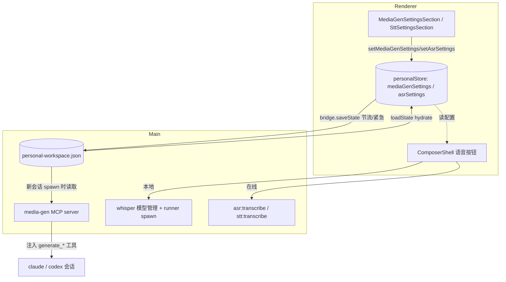
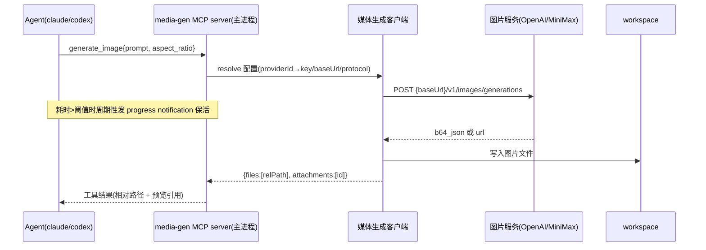
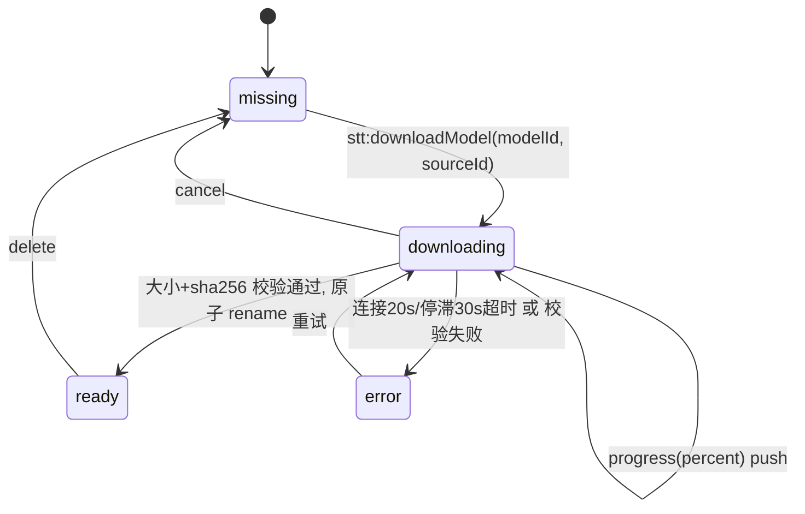

# feat: 媒体生成与语音转文字设置

## Summary

在个人工作区设置页新增两个分区:「媒体生成」把图片/语音/音乐/视频生成配置成 Agent 可调用工具(`generate_image`/`generate_speech`/`generate_music`/`generate_video`),经 MCP server 注入会话;「语音转文字」让聊天输入框的语音按钮支持本地 Whisper(打包 whisper.cpp runner + 模型下载管理 + HF 多源健康检查)、已配置供应商与自定义 OpenAI 兼容 API 三种后端。实现参考 `/Users/mike/source/ai/Kun`,落地时复用 cortex-work 既有的设置存储、DesktopBridge、MCP 注入与二进制打包 pattern。

---

## Problem Frame

cortex-work 的 Agent 目前不能生成媒体,聊天语音输入只有一条硬编码的本地 ASR 通道(`ComposerShell.tsx:44` 的 `DEFAULT_ASR` 指向 `http://127.0.0.1:8000`),用户无法配置语音后端,也没有离线可用的本地转写。Kun 已实现了这两套完整能力,本计划把它们移植到 cortex-work 的分层架构里,统一从设置页驱动。

两个功能放在同一份计划、两个独立设置分区,共享设置存储 / DesktopBridge / i18n 脚手架以避免重复。

---

## Requirements

### 媒体生成

- R1. 设置页新增「媒体生成」分区,含总览说明 + 图片/语音/音乐/视频四个子区,每子区有独立启用开关。
- R2. 图片生成支持选择已配置供应商(复用其密钥/baseUrl)或「自定义图片 API」;自定义时可选协议(OpenAI Images / MiniMax)、填 API 地址、密钥、模型。
- R3. 语音/音乐/视频子区同样支持供应商复用或自定义,字段对齐 Kun(协议、baseUrl、apiKey、model 及各模态特有字段)。
- R4. 启用某模态后,该模态对应的 `generate_*` 工具注册给 Agent(claude/codex);关闭则不注册。
- R5. 工具调用把生成结果写入当前 workspace 并向 Agent 返回文件相对路径;图片额外返回可内联预览的附件引用(预览渲染可延后)。
- R6. 设置「修改自动生效」——保存后新建会话即使用新配置,无需重启应用。

### 语音转文字

- R7. 设置页新增「语音转文字」分区,含总开关、语音供应商选择(本地 Whisper / 已配置供应商 / 自定义 API)、识别语言。
- R8. 选择本地 Whisper 时:展示下载源(Hugging Face / HF-Mirror / HF CDN)及各源可用性与延迟健康检查;展示本地模型卡片(Base/Small/Medium),支持下载、取消、删除,显示下载进度与已下载状态。
- R9. 自定义 API 时可填协议、API 地址、密钥、模型;供应商时从 profile 继承。
- R10. 聊天输入框语音按钮按当前 STT 配置录音并转写,本地 Whisper 走打包的 whisper.cpp runner 离线转写,在线后端走主进程网络请求。
- R11. 语音按钮仅在 STT 已启用且配置完整(本地模型已就绪,或在线后端 baseUrl+key 齐备)时可用。

### 跨切面

- R12. 两个分区的新增设置字段经「主进程 JSON 持久化」落盘,与现有个人工作区设置同源;切换语言不把本地化文案冻进磁盘。
- R13. macOS(arm64 + x64)打包须带上 whisper.cpp runner 二进制并能离线转写;其它平台延后。

---

## Key Technical Decisions

- KTD1. **媒体工具走 MCP server 注入,不做 adapter 内置工具。** 复用 `apps/desktop/src/main/capabilities/browser/inject.ts`(`buildBrowserMcpServerConfig`)与 `doc-extract/mcp.ts` 的常驻 MCP server pattern,在 `apps/desktop/src/main/capabilities/media-gen/` 新建 `buildMediaGenMcpServerConfig(settings, sessionId, cwd)`,加入 `cli.ts:433` 的注入列表(同处可取 `req.cwd` 工作区路径,见 U5)。鉴权用 `Authorization: Bearer <token>` 头(对齐 `browser/inject.ts`),**不**用 URL path token——codex streamable-http 原生支持 `http_headers`,已由浏览器 MCP spike 证实(`mcp-config.ts:87`)。pi adapter `mcpInjection:"none"`,故 v1 仅覆盖 claude/codex(与浏览器控制一致)。
- KTD2. **媒体生成设置存为独立配置块 `mediaGenSettings`,四模态各含 `providerId`。** `providerId` 指向现有 `ProviderProfile`(继承 `apiKey`/`baseUrl`)或 `'custom'`(用自填字段),解析逻辑对齐 Kun 的 `resolveKun*Settings`。不为媒体新建独立密钥存储,复用 `PersonalState.providerSettings`(见 origin Kun `src/shared/app-settings-provider.ts`)。
- KTD3. **本地 Whisper 二进制走 `extraResources`(不进 asar)+ `child_process.spawn`。** 仿 pi 二进制打包(`electron-builder.yml:81` extraResources、`apps/desktop/scripts/build-pi-binary.mjs`、`agents/pi-locate.ts`)。`docs/lessons.md` 已定论:二进制塞 asar 必崩,打包验证须 `ditto` 到 `/tmp` 仓库外跑。whisper.cpp 是 native 二进制,无需 bun 编译步,比 pi 更简单。
- KTD4. **STT 复用既有 `asr:transcribe` 在线通道,新增 local-whisper 后端;`ComposerShell` 的 `DEFAULT_ASR` 改读 store。** 已有 `bridge.asrTranscribe`(`ipc/llm.ts:192`)处理 OpenAI 兼容 `/v1/audio/transcriptions`。STT 后端在「本地 Whisper / 供应商 / 自定义」三档间分发,本地走新 `stt:transcribe`(spawn runner),在线复用现有通道。
- KTD5. **模型下载进度复用 `useUpdateState` 的 push 镜像模式,不进 Zustand。** 主进程持下载状态机,`webContents.send` 广播,渲染端 hook「订阅推送 + 挂载补拉」镜像主进程单例状态(见 `docs/plans/2026-06-20-002`、`packages/core/desktop/useUpdateState.ts`)。
- KTD6. **图片生成同时支持 OpenAI Images 与 MiniMax 两种协议,其余模态按 Kun 协议枚举。** 对齐 origin Kun 协议常量;OpenAI Images 请求 `{baseUrl}/v1/images/generations`,遇 4xx 含 `response_format` 自动去字段重试。
- KTD7. **生成产物写入 workspace 子目录,工具返回相对路径。** 图片/音频/视频各落固定目录,返回路径供 Agent 引用;图片内联预览(附件注册)作为增强、可延后,不阻塞工具可用。
- KTD8. **各模态 `timeoutMs` 必须严格小于会话看门狗 `RUN_STALL_TIMEOUT_MS`(=300_000ms,`packages/core/personal/messages.ts:190`)。** 关键修正:看门狗只在 agent stdout 产生 CLI 事件时重置 `lastEventAt`(`cli.ts:520`),而 MCP progress notification 走 HTTP 不经 stdout——**发 MCP 进度通知并不能给看门狗续命**。因此长耗时工具(尤其 MiniMax 视频异步轮询)要么把 `timeoutMs` 卡在 300s 以内令其先于看门狗失败/完成,要么另开一条 `cli:keepalive` IPC 由主进程在工具执行期间显式重置 `lastEventAt`(二选一见 Open Questions)。各模态独立 `timeoutMs` + 主进程 `AbortController`。
- KTD9. **新增设置字段遵循「五处对称镜像」。** `packages/core/desktop/types.ts`(类型+默认值)、`apps/desktop/src/main/ipc/types.ts`(镜像,`satisfies` 对齐)、`packages/core/store/personal.ts`(state+setter+`toPersistedState`+`hydrate` 兜默认)、`packages/core/desktop/bridge.ts`(新能力签名)、`usePersonalPersistence.ts`(确认 saveUrgency 覆盖切片)。
- KTD10. **i18n 新 key 加 `settings`(分区文案)与 `chat`(语音按钮)namespace,不提交全量 extract 输出,不 `t()` 持久化值。** 同步 `zh-Hans`/`en`/`@types/resources.d.ts` 三处;供应商预设名按 `nameKey` 在创建时解析(见现有 `PROVIDER_PRESETS`)。
- KTD11. **不可信输入与传输安全在主进程统一收口。** (1) Agent 提供的所有路径(`reference_image_paths`、`first/last_frame_image_path`、产物子目录)在任何 fs 读写前 `path.resolve(workspaceRoot, p)` 并断言落在 workspace 内,拒绝越界——既防写越界也防把本地敏感文件喂给第三方 API。(2) 媒体 API `baseUrl` 与 whisper 下载源(含 HF-Mirror 第三方镜像)强制 `https:`,sha256 与 host 全部 hardcode 在清单里(不从同一不可信通道取校验值)。(3) 各模态响应体与音频上传设 `MAX_BYTES`/`MAX_RESPONSE_BYTES` 上限(含**复用的既有 `asr:transcribe` 在线通道**,该 handler 目前缺上限)。(4) `modelId` 拼路径前白名单校验,防 spawn 任意二进制。

---

## High-Level Technical Design

### 设置数据流(渲染 ↔ 主进程,两个分区共用)



### 媒体工具调用时序(以 generate_image 为例)



### 本地 Whisper 模型下载状态机



STT 后端分发(`stt-service` 内):`protocol === 'local-whisper'` → spawn runner;`=== custom/provider 的 openai-transcriptions` → 复用 `asr:transcribe`;其它协议按 origin Kun 对齐。

---

## Output Structure

```text
apps/desktop/
  resources/whisper/                      # extraResources, 不进 asar
    darwin-arm64/{whisper-cli, runner.json}
    darwin-x64/{whisper-cli, runner.json}
  scripts/
    prepare-whisper-runner.mjs            # 构建/下载 whisper.cpp 二进制
  src/main/
    capabilities/
      media-gen/
        inject.ts                         # buildMediaGenMcpServerConfig
        client.ts                         # 四模态生成客户端 + 协议
        resolve.ts                        # providerId → 有效配置解析
      whisper/
        locate.ts                         # 定位打包二进制(仿 pi-locate)
        models.ts                         # 模型清单/下载源(主进程侧)
    ipc/
      stt.ts                              # stt:transcribe/listModels/downloadModel/...
packages/core/
  desktop/
    types.ts                              # +MediaGenSettings +AsrSettings(改)
    bridge.ts                             # +STT/模型管理能力签名(改)
    useModelDownloadState.ts              # 下载进度镜像 hook(仿 useUpdateState)
  store/personal.ts                       # +setMediaGenSettings/+setAsrSettings(改)
  whisper/models.ts                       # 共享模型清单(纯数据)
packages/views/cortex-desktop/personal/
  MediaGenSettingsSection.tsx
  SttSettingsSection.tsx
  settingsControls.tsx                    # +导出 SecretField(改)
  SettingsMenu.tsx                        # +两个 tab/分组接入(改)
  ComposerShell.tsx                       # DEFAULT_ASR→读 store(改)
```

per-unit `**Files:**` 为权威清单,实现时可微调结构。

---

## Implementation Units

### U1. 设置数据模型与存储(五处镜像)+ SecretField 提取

- Goal: 定义 `MediaGenSettings`(四模态)与 `AsrSettings`(含 local-whisper)类型及默认值,接入 store 与持久化;把 `SecretField` 从 SettingsMenu 提取到 settingsControls 供新分区复用。
- Requirements: R12;为 R1–R11 提供数据基座。
- Dependencies: 无。
- Files:
  - `packages/core/desktop/types.ts`(加 `MediaGenSettings`/`MediaGenModalitySettings`/`AsrSettings` 类型 + 默认值工厂)
  - `apps/desktop/src/main/ipc/types.ts`(镜像类型,`satisfies` 对齐)
  - `packages/core/store/personal.ts`(`PersonalState` 加 `mediaGenSettings`/`asrSettings` + `setMediaGenSettings`/`setAsrSettings`,`toPersistedState` 导出,`hydrate` 兜默认)
  - `packages/core/desktop/types.ts` 的 `PersistedState`(加可选字段)
  - `packages/core/desktop/usePersonalPersistence.ts`(saveUrgency 是逐字段引用比较,新切片不加进去会「会话内生效、重启丢失」——必须把 `s.mediaGenSettings !== prev.mediaGenSettings || s.asrSettings !== prev.asrSettings` 加入节流分支;`asrSettings` 因主进程 `stt:transcribe` 读持久化态决定路由,考虑用 immediate 档)
  - `packages/views/cortex-desktop/personal/settingsControls.tsx`(导出 `SecretField`)
  - `packages/core/store/personal.test.ts`(就近)
- Approach: 字段对齐 origin Kun `KunImageGeneration/TextToSpeech/Music/Video SettingsV1` 与 `KunSpeechToTextSettingsV1`,但命名 cortex-work 化。协议枚举与默认值(`enabled:false`、各 `timeoutMs`、STT 默认 `localWhisperDownloadSource:'huggingface'`、默认模型 small)照搬。`SecretField` 提取保持原 props 形状,SettingsMenu 内引用改为 import。
- Patterns to follow: 既有 `browserControl`/`providerSettings` 的挂载与 setter;`docs/plans/2026-06-23-003` 记录的镜像约定(本计划第五处为 `bridge.ts` 新能力签名)。
- Test scenarios:
  - hydrate 缺 `mediaGenSettings`/`asrSettings` 时回落到默认工厂值(向后兼容旧 json)。
  - `setMediaGenSettings` patch 单模态 `enabled` 后,`toPersistedState` 输出含新值且其它模态不变。
  - `setAsrSettings` 切换 backend 后 state 正确;default 工厂返回 `enabled:false`、默认下载源与默认模型。
  - 类型镜像:`apps/desktop/src/main/ipc/types.ts` 的镜像类型 `satisfies` core 类型(typecheck 守护)。
- Verification: typecheck 通过;store 单测绿;SettingsMenu 仍编译(SecretField 引用改为 import 后无回归)。

### U2. SettingsMenu 接入两个设置分区(tab / 分组 / i18n)

- Goal: 在设置页左栏新增「媒体生成」「语音转文字」两项,右栏渲染对应 Section 薄壳。
- Requirements: R1、R7。
- Dependencies: U1(类型可用);可与 U3/U6 并行(先接空壳)。
- Files:
  - `packages/views/cortex-desktop/personal/SettingsMenu.tsx`(`SettingsTab` 联合加 `"mediaGen"|"stt"`;`TAB_META` 加两条;`NAV_GROUPS` 媒体生成挂 `tabGroups.apps`、语音转文字挂 `tabGroups.personalization`;右栏 switch 加两 case 包壳渲染 `<MediaGenSettingsSection/>`/`<SttSettingsSection/>`)
  - `packages/core/i18n/resources/zh-Hans/settings.json`、`packages/core/i18n/resources/en/settings.json`(`tabs.mediaGen`/`tabs.stt` 及分区文案 key)
  - `packages/core/i18n/@types/resources.d.ts`(同步类型)
  - `packages/views/cortex-desktop/personal/SettingsMenu.test.tsx`(就近)
- Approach: 严格仿 `BrowserSection` 薄壳(SettingsMenu 第 ~1919 行):壳只渲 `pw-dlg-title`+`pw-dlg-desc`+Section 组件,逻辑全在独立文件。不得把新分区逻辑内联进 SettingsMenu(该文件已 2022 行超 1200 上限)。图标从 lucide 选 `Waveform`/`AudioLines` 类。
- Patterns to follow: `TAB_META`+`NAV_GROUPS` 两层数据模型(`docs/plans/2026-06-23-002`);BrowserSection 薄壳。
- Test scenarios:
  - 点击「媒体生成」「语音转文字」导航项分别渲染对应 Section。
  - 两项归入正确分组(apps / personalization),组标题与顺序正确。
  - 右栏 switch 对新 tab 有显式 case(不落兜底)。
- Verification: 设置页可切换到两个新分区;i18n 中英 key 齐全,typecheck 无缺键。
- Execution note: 加 i18n key 后只提交新增行,勿提交 `i18n:extract` 全量规范化 diff。

### U3. 媒体生成设置 Section UI

- Goal: 实现「媒体生成」分区:总览说明卡 + 图片/语音/音乐/视频四子区表单。
- Requirements: R1、R2、R3、R6。
- Dependencies: U1、U2。
- Files:
  - `packages/views/cortex-desktop/personal/MediaGenSettingsSection.tsx`(主组件,≤1200 行)
  - `packages/views/cortex-desktop/personal/MediaGenImageSubsection.tsx`(图片子区,若主文件逼近上限则拆出)
  - `packages/views/cortex-desktop/personal/MediaGenSettingsSection.test.tsx`
- Approach: 复用 settingsControls 的 `SettingCard`/`SRow`/`SwitchRow`/`BareSelect`/`SecretField`。每子区:启用开关 → 供应商下拉(已配置供应商列表 + 「自定义」)→ 仅自定义时展示协议下拉/baseUrl/SecretField → 模型 → 模态特有字段(图片:aspect/size 默认;视频:时长/分辨率/轮询;语音/音乐:voice/format)。供应商切换联动 `protocol`/`model`(切到 custom 时保留自填值,不清空)。所有变更经 `setMediaGenSettings` 写 store(自动持久化、自动生效)。
- Patterns to follow: origin Kun `settings-section-media-generation.tsx` 与 `settings-section-image-generation.tsx` 的子区结构与联动;cortex-work `BrowserSettingsSection.tsx`。
- Test scenarios:
  - 关闭模态开关时隐藏该模态详细字段;打开时展示。
  - 供应商选「自定义」展示协议/baseUrl/密钥;选已配置供应商时**隐藏 key/baseUrl 行**、改显「使用 <供应商名> 的密钥」提示(不回填、不泄露 key 预览)。
  - 无任何已配置供应商时,下拉只剩「自定义」(媒体)/「本地 Whisper」+「自定义」(STT),不显示空的供应商分组(首次启动路径)。
  - 切换图片协议 OpenAI Images ↔ MiniMax,表单字段随协议变化。
  - 编辑字段触发 `setMediaGenSettings`,store 收到对应 patch。
  - SecretField 默认遮蔽,可切换显隐。
- Verification: 四子区可独立配置;切换供应商/协议联动正确;刷新后配置从持久化恢复。

### U4. 媒体生成客户端(主进程,四模态 + 协议)

- Goal: 在主进程实现图片/语音/音乐/视频生成客户端及协议适配,含 providerId→有效配置解析。
- Requirements: R2、R3、R5(产物落盘)、KTD6。
- Dependencies: U1。可与 U3 并行。
- Files:
  - `apps/desktop/src/main/capabilities/media-gen/resolve.ts`(`resolveMediaGenSettings`:providerId 指向 ProviderProfile 时继承 key/baseUrl/protocol/model,否则用自填)
  - `apps/desktop/src/main/capabilities/media-gen/client.ts`(`generateImage`/`generateSpeech`/`generateMusic`/`generateVideo`)
  - `apps/desktop/src/main/capabilities/media-gen/protocols/openai-images.ts`、`minimax.ts`(协议实现)
  - `apps/desktop/src/main/capabilities/media-gen/client.test.ts`、`resolve.test.ts`
- Approach: 端口对齐 origin Kun `kun/src/adapters/tool/image-gen-tool-provider.ts`、`media-gen-tool-provider.ts`。OpenAI Images:`{baseUrl}/v1/images/generations`,body `{model,prompt,n:1,size,response_format:'b64_json'}`,4xx 含 `response_format` 去字段重试;解析 `data[0].b64_json` 或下载 `url`。MiniMax:`/v1/image_generation`、`/v1/video_generation`(异步 task 轮询 + files/retrieve)。产物写入 workspace 固定子目录,返回 `{files:[{relativePath,absolutePath,mimeType,byteSize}]}`。主进程发网络(renderer 不直连);各模态独立 `AbortController` 超时(KTD8)。
- Patterns to follow: `probeProvider` 的「主进程发外网 + scheme 校验 + 按 endpointFormat 选鉴权头」(`docs/plans/2026-06-14-006` KTD8);origin Kun 协议响应解析与重试。
- Test scenarios:
  - `resolveMediaGenSettings`:providerId='custom' 用自填;指向有效 provider 时继承 apiKey/baseUrl/protocol;指向不存在 provider 时给出可诊断错误。
  - OpenAI Images 成功(b64)写盘并返回相对路径;返回 url 时下载写盘。
  - OpenAI Images 首请求 4xx 含 `response_format` → 去字段重试成功。
  - MiniMax 图片解析 `image_base64`/`image_urls`;`base_resp.status_code!==0` 视为失败。
  - MiniMax 视频:提交 task → 轮询 status → retrieve download_url → 下载;轮询超时报错。
  - 缺 baseUrl/apiKey/model 任一时返回明确 unavailable 原因。
  - 超时触发 AbortController,返回超时错误而非挂死。
- Verification: 四模态客户端单测绿(网络 mock);产物正确落 workspace。
- Execution note: 协议解析与重试先写失败测试再实现(边界多,test-first)。

### U5. 媒体生成 MCP server 与会话注入

- Goal: 把四个 `generate_*` 工具经常驻 MCP server 暴露,启用位控制注册,接入会话 spawn 注入。
- Requirements: R4、R5、R6、KTD1、KTD8。
- Dependencies: U4。
- Files:
  - `apps/desktop/src/main/capabilities/media-gen/inject.ts`(`buildMediaGenMcpServerConfig(mediaGenSettings, sessionId): McpServerConfig | null`)
  - `apps/desktop/src/main/capabilities/media-gen/server.ts`(`McpServer` + `StreamableHTTPServerTransport`,工具 schema + 调 U4 client)
  - `apps/desktop/src/main/ipc/cli.ts`(注入列表 `cli.ts:433` 加 `buildMediaGenMcpServerConfig(gs?.mediaGenSettings, req.sessionId)`)
  - `apps/desktop/electron.vite.config.ts`(确认 MCP SDK 已在 `externalizeDepsPlugin.exclude`,如新依赖另加)
  - `apps/desktop/src/main/capabilities/media-gen/inject.test.ts`
- Approach: 仿 `capabilities/browser/inject.ts` 与 `doc-extract/mcp.ts`:绑 `127.0.0.1` 随机端口、`Authorization: Bearer <token>` 头鉴权(`crypto.randomBytes(32)` + 常量时间比较,**不用 URL path token**,见 KTD1)、与主进程同生命周期。**工作区路径必须显式穿透**:注入点 `req.cwd` 经 `buildMediaGenMcpServerConfig(settings, sessionId, cwd)` 传入(或在 spawn 时按 sessionId 注册 cwd 映射),否则工具无从得知产物写哪(R5);现有 `X-Cortex-Session` 头只带 sessionId。`client.ts` 在**每次调用时**从持久化态读 `mediaGenSettings`(不在 server 构造时缓存),令设置改动对新调用即时生效;模态被禁用后再调用返回可读「工具已禁用」错误而非 opaque 失败。工具 schema 对齐 origin Kun(`generate_image`:prompt/aspect_ratio/image_size/reference_image_paths;`generate_video`:prompt/duration/resolution/frame 路径 等)。`enabled` 全关返回 null(不注入);单模态关则不暴露该工具。长耗时调用的看门狗续命见 KTD8(不能只靠 MCP progress notification)。pi 走 `mcpInjection:"none"` 不注入(v1 限制)。是否复用 `mcp-host/server.ts` 的 `createMcpHost` 工厂(继承 Origin 校验/常量时间比较/DNS-rebinding 防护)还是自起 `McpServer`,见 Open Questions。
- Patterns to follow: `buildBrowserMcpServerConfig` 注入 gate 与 token 鉴权;`docs/plans/2026-06-22-003` MCP server 模式与 SDK 打包边界(lessons.md zod/asar 坑)。
- Test scenarios:
  - `mediaGenSettings.enabled` 全关 → `buildMediaGenMcpServerConfig` 返回 null。
  - 仅图片启用 → server 仅暴露 `generate_image`,其余工具不出现在 tool list。
  - 工具入参 schema 校验:缺 required `prompt` 被拒。
  - 鉴权 token 错误的请求被拒(常量时间比较)。
  - 注入仅作用于主会话,ask/oneshot/automation 不注入(与浏览器 MCP 一致)。
- Verification: 启用图片后,claude/codex 会话能调用 `generate_image` 并拿到 workspace 相对路径;打包后仓库外(`ditto` 到 `/tmp`)验证 MCP SDK 不在 asar 边界崩溃。
- Execution note: 先做架构 spike 确认 codex 的 url 型 MCP server 连通(`docs/plans/2026-06-22-003` RISK-1 前置闸);复用已验证通道则可跳过。

### U6. 语音转文字设置 Section UI

- Goal: 实现「语音转文字」分区:总开关 + 供应商选择 + 本地 Whisper(下载源健康检查、模型卡片下载/删除/进度)+ 识别语言。
- Requirements: R7、R8、R9、R11。
- Dependencies: U1、U2、U7(模型管理 bridge 能力)。UI 可先用桩,联调依赖 U7。
- Files:
  - `packages/views/cortex-desktop/personal/SttSettingsSection.tsx`(≤1200 行)
  - `packages/core/desktop/useModelDownloadState.ts`(下载进度镜像 hook,仿 `useUpdateState`)
  - `packages/views/cortex-desktop/personal/SttSettingsSection.test.tsx`
- Approach: 供应商下拉 = `[本地 Whisper]` + 已配置(有 speech 能力的)供应商 + `[自定义]`。本地 Whisper 时:下载源下拉(HF/HF-Mirror/HF CDN)+ mount 时调健康检查展示各源延迟 ms 与可用性;模型卡片列表(Base/Small/Medium,展示文件大小/内存/线程/质量/推荐徽标/状态徽标),下载(带进度条)/取消/删除按钮;识别语言下拉(自动检测/zh/en/ja/ko)。自定义时:协议/baseUrl/SecretField/model。进度经 `useModelDownloadState`(订阅 push + 挂载补拉)渲染,不进 Zustand。模态弹窗复用 `.pw-dlg` 外壳。
- Patterns to follow: origin Kun `settings-section-speech-to-text.tsx` 控件树;`useUpdateState` 推送镜像(`docs/plans/2026-06-20-002`)。
- Test scenarios:
  - 选「本地 Whisper」展示下载源 + 模型卡片;选「自定义」展示协议/baseUrl/密钥/model。
  - 健康检查结果按源展示可用/不可用 + 延迟 ms。
  - 模型状态 missing → 「下载」按钮;downloading → 进度条 + 取消;ready → 删除按钮;error → 进度条换成「下载失败: <原因>」+「重试」按钮(无「删除」,临时文件已清)。
  - 三源全不可用 → 显示「重试健康检查」按钮;对不可用源发起下载时给「该源不可达,请换源或检查网络」错误。
  - 下载进度 push 到达时进度条更新;晚到补拉不覆盖已推送结果(pushed flag)。
  - 识别语言切换写入 asrSettings;默认值为 `auto`(非空串),下拉无空选项;`auto` 对应转写时省略 whisper `-l` 标志(见 U8)。
- Verification: 分区可完整配置三种后端;本地模型下载 UI 状态机随主进程事件正确流转。

### U7. 本地 Whisper 模型管理(主进程:清单/下载/删除/源检查/进度)

- Goal: 主进程实现模型清单、下载(校验)、删除、状态查询、下载源健康检查与进度推送,经 bridge 暴露。
- Requirements: R8、R13、KTD5。
- Dependencies: U1。可与 U6 并行。
- Files:
  - `packages/core/whisper/models.ts`(共享纯数据:模型清单 + 下载源,供渲染与主进程共用)
  - `packages/core/package.json`(`exports` 加 `"./whisper/models": "./whisper/models.ts"`——core 子路径导入须显式登记,否则 views/main 无法 import,见 CLAUDE.md)
  - `apps/desktop/src/main/capabilities/whisper/models.ts`(下载/删除/状态/源检查实现 + 进度 emitter)
  - `apps/desktop/src/main/ipc/stt.ts`(`stt:listModels`/`stt:modelStatus`/`stt:downloadModel`/`stt:cancelDownload`/`stt:deleteModel`/`stt:checkSources`,进度 `stt:downloadProgress` push)
  - `apps/desktop/src/main/ipc/register.ts`(注册 stt handlers)
  - `packages/core/desktop/bridge.ts`(`listWhisperModels`/`downloadWhisperModel`/`onWhisperDownloadProgress` 等可选能力)
  - `apps/desktop/src/preload/index.ts`(暴露上述 invoke + `ipcRenderer.on('stt:downloadProgress')`)
  - `apps/desktop/src/main/capabilities/whisper/models.test.ts`
- Approach: 端口对齐 origin Kun `local-whisper-service.ts` + `src/shared/local-whisper.ts`。模型清单(id/fileName/sha256/sizeBytes/maxBytes/resourceEstimate/qualityTier/recommended),下载源 URL `{host}/ggerganov/whisper.cpp/resolve/main/{filename}`。下载:单例互斥、HEAD Range 探测源、写 `.download` 临时文件、连接 20s/停滞 30s 超时、大小精确匹配 + sha256 校验、原子 rename、写 `model.json`。存储 `<userData>/models/speech/whisper/<modelId>/`。进度 `webContents.send('stt:downloadProgress', {modelId,downloadedBytes,totalBytes,percent})`。源检查并发 HEAD 测各源延迟。下载进度推送不写 Zustand(KTD5)。
- Patterns to follow: 五处对称 bridge 能力(`docs/plans/2026-06-14-006`、`2026-06-18-001`);ArrayBuffer/push 通道;更新下载状态机。
- Test scenarios:
  - 下载成功:大小+sha256 校验通过 → state ready,model.json 写入。
  - 大小不符或 sha256 不符 → 删临时文件,报校验错误。
  - 连接超时(20s)/停滞超时(30s)→ 报对应错误。
  - 已有下载进行中再发下载 → 互斥拒绝或排队。
  - cancel 中止下载并清临时文件;delete 移除已下载模型回到 missing。
  - checkSources 返回每源 available + responseTimeMs。
  - 进度 emitter 周期推送 percent。
- Verification: 真实下载 small 模型成功并校验;源不可用时健康检查如实标红;删除后状态归 missing。

### U8. 本地 Whisper runner 打包与转写后端

- Goal: 准备/打包 whisper.cpp runner 二进制(macOS),实现 spawn 转写与三后端分发的本地分支。
- Requirements: R10、R13、KTD3、KTD4。
- Dependencies: U7(模型路径/状态)。
- Files:
  - `apps/desktop/scripts/prepare-whisper-runner.mjs`(按平台准备 `whisper-cli` 到 `resources/whisper/<platform>-<arch>/`,写 runner.json)
  - `apps/desktop/scripts/before-pack.cjs`(新增 beforePack:打包前 prepare + prune 非目标平台;**现有 `electron-builder.yml` 已为 pi 配 beforePack,需合并进同一 hook,不能声明两个 beforePack 互相覆盖**)
  - `apps/desktop/electron-builder.yml`(注册 `beforePack: ./scripts/before-pack.cjs`;`extraResources` 加 `resources/whisper → whisper`;mac `target.arch` 由 `[arm64]` 扩为 `[arm64, x64]`;确认 `files` 黑名单不误伤主进程新依赖)
  - `apps/desktop/package.json`(`prepackage:mac` 脚本链加 `prepare-whisper-runner` 步)
  - `.github/workflows/desktop-release.yml`(现仅 `build-macos-arm64` 单 job 且只发 `*-arm64` 产物;x64 需新增 `macos-13` Intel job 交叉编译 + `electron-builder --mac --arch x64`,或改 universal 二进制——见 Open Questions)
  - `apps/desktop/electron-builder.yml`(mac `extendInfo.NSMicrophoneUsageDescription` 覆盖 Electron 默认文案;注:该 key 已由 Electron 默认注入,此处仅替换文案)
  - `apps/desktop/src/main/capabilities/whisper/locate.ts`(`resolveWhisperRunner()`,仿 `pi-locate.ts`,打包 `process.resourcesPath/whisper/<platform>-<arch>/whisper-cli`,dev 回落)
  - `apps/desktop/src/main/capabilities/whisper/transcribe.ts`(spawn runner 转写)
  - `apps/desktop/src/main/ipc/stt.ts`(`stt:transcribe` 后端分发:local-whisper → transcribe.ts;在线 → 复用 asr 逻辑)
  - `apps/desktop/src/main/capabilities/whisper/transcribe.test.ts`、`locate.test.ts`
- Approach: 端口对齐 origin Kun `prepare-whisper-runner.cjs`/`before-pack.cjs`/`local-whisper-service.ts` spawn 段。v1 仅 macOS:`darwin-arm64`、`darwin-x64`(cmake 静态构建 whisper.cpp v1.9.x,`-DBUILD_SHARED_LIBS=OFF`),其它平台延后(prepare 脚本对未支持平台报清晰错误)。转写:音频写临时 WAV,`whisper-cli -m <model> -f <in.wav> -otxt -of <out> -nt -l <lang>`,cwd=runnerDir,读 `<out>.txt` trim 返回。`stt:transcribe` 按 protocol 分发:本地走 runner,在线复用 `asr:transcribe` 逻辑(OpenAI 兼容 multipart)。新 handler 加 `MAX_BYTES` 体积上限(现有 ASR handler 缺)。
- Patterns to follow: pi 二进制打包全链(`build-pi-binary.mjs`/`pi-locate.ts`/`electron-builder.yml:81`);`docs/lessons.md` 二进制不进 asar + 仓库外验证 + files 黑名单坑。
- Test scenarios:
  - `resolveWhisperRunner` 在打包/dev 路径分别解析正确,均缺失时报可诊断错误。
  - transcribe 拼对 spawn args(模型路径、-otxt、-nt、语言);`language=auto` 时省略 `-l` 标志;读取 `.txt` 并 trim。
  - runner 退出非 0 / 输出文件缺失 → 报错而非静默空串。
  - `stt:transcribe` 按 protocol 路由到本地/在线分支;本地与在线两条路径都受 `MAX_BYTES` 约束(含复用的 `asr:transcribe` 在线通道)。
  - 音频超 MAX_BYTES 被拒;`modelId` 含非法路径字符被拒(防 spawn 越界)。
- Verification: macOS 本地用 small 模型离线转写一段录音得到文本;`pnpm dist:desktop` 后 `ditto` 到 `/tmp` 仓库外启动,语音转写离线可用;asar 内不含 whisper 二进制。
- Execution note: 打包验证必须仓库外(`ditto` 到 `/tmp`),否则仓库 node_modules/resources 兜底制造假通过。

### U9. ComposerShell 接入 store 配置与本地 whisper 路由

- Goal: 聊天输入框语音按钮从硬编码改为读 `asrSettings`,按后端路由,按配置完整性控制可用。
- Requirements: R10、R11。
- Dependencies: U1、U7、U8。
- Files:
  - `packages/views/cortex-desktop/personal/ComposerShell.tsx`(删 `DEFAULT_ASR` 硬编码,改读 `usePersonalStore(s => s.asrSettings)`;录音后按 backend 调 `stt:transcribe`/`asrTranscribe`;按 R11 控制按钮可用)
  - `packages/views/cortex-desktop/personal/ComposerShell.test.tsx`(就近,补语音路由用例)
- Approach: 复用既有录音逻辑(`ComposerShell.tsx:429-488` MediaRecorder)与麦克风按钮(:798)。录音 Blob 重采样为 16kHz 单声道 WAV(对齐 origin Kun `use-voice-dictation.ts`),按 `asrSettings` backend:本地 → `bridge` 新 `stt:transcribe`;在线 → 复用 `asrTranscribe`。语音按钮显示/可用条件:STT 启用 且(本地模型 ready 或 在线 baseUrl+apiKey 齐备)。转写中按钮转 loading 禁用。
- Patterns to follow: origin Kun `FloatingComposer.tsx` 显示条件与 dictation 接线;cortex-work 既有 ComposerShell 录音状态机。
- Test scenarios:
  - STT 未启用或配置不全 → 语音按钮隐藏/禁用(R11)。
  - 本地后端选中但模型仍在 downloading → 按钮禁用 + tooltip「模型下载中(N%),换就绪模型或等待」(绑 U6/U7 下载状态机)。
  - 本地后端且模型 ready → 录音转写走 `stt:transcribe` 本地分支,文本回填输入框。
  - 在线后端配置齐备 → 走 `asrTranscribe`,文本回填。
  - 转写进行中按钮 loading 禁用;失败弹 inline toast 带原因(区分本地 runner 退出码与网络错误),输入框内容不变、不崩。
  - 录音 Blob(webm/mp4)转写前重采样为 16kHz 单声道 WAV(whisper-cli `-f` 不接受 webm,对齐 Kun `encodeBlobAsWav`)。
  - 移除 `DEFAULT_ASR` 后无遗留硬编码引用。
- Verification: 切换后端后语音按钮行为随配置变化;本地与在线两条路径均能把转写文本写入输入框。

---

## Open Questions

实现前应决议的分叉(不阻塞计划成形,但开工前需明确):

- OQ1. **长耗时工具看门狗续命方案二选一**(KTD8/RISK-4):是把各模态 `timeoutMs` 硬卡在 300s 内(简单,但视频可能不够),还是新增 `cli:keepalive` IPC 在工具执行期间重置 `lastEventAt`(彻底,但要改 `messages.ts` 看门狗逻辑)。需先量 MiniMax 视频 p95 时延——若常超 300s,视频是 v1 阻塞项。
- OQ2. **darwin-x64 是否纳入 v1**(R13):当前 release CI 只有 `build-macos-arm64` 单 job、只发 arm64 产物。x64 要么新增 `macos-13` Intel job 交叉编译,要么改 universal 二进制——都不在现有任何单元里。若不做,应把 R13 收窄为「v1 仅 arm64」。
- OQ3. **whisper.cpp 主供给路径**(RISK-6):源码 cmake 构建放进 release CI 关键路径有工具链/时长风险。是否反转为「预编译二进制为主、源码构建为开发者可选」(对齐 pi 用 npm 预编译二进制的取舍)。
- OQ4. **在线 STT 逻辑去重方式**(U8/KTD4):`stt:transcribe` 在线分支是把 `asr:transcribe` 的转写逻辑抽成共享函数复用(推荐),还是复制一份。复制会留两处待同步,且既有 handler 缺 `MAX_BYTES`(见 KTD11)。
- OQ5. **媒体 MCP server 复用 `createMcpHost` 工厂还是自起 `McpServer`**(U5):复用可继承既有安全属性,自起会重复端口/token/生命周期管理。
- OQ6. **图片内联预览是否进 v1**:当前 R5 只返回相对路径,Agent 回复里是裸路径而非可见图片(媒体生成的核心用户产出缺失)。预览已列入延后,但应明确交付窗口,避免「Agent 说生成好了在 /path/… 但用户看不到图」的体验。

---

## Risks & Dependencies

- RISK-1. **whisper.cpp 二进制打包后崩溃(asar 边界)。** 缓解:走 extraResources(不进 asar)+ spawn;打包后 `ditto` 到 `/tmp` 仓库外验证(lessons.md 已定论)。
- RISK-2. **MCP SDK / 主进程新依赖被 `electron-builder.yml` files 黑名单误伤。** 缓解:引入主进程依赖后先查 files 黑名单(zod 历史事故);确认 SDK 在 `externalizeDepsPlugin.exclude`。
- RISK-3. **codex 的 url 型 MCP server 连通性。** 是 U5 前置闸(`docs/plans/2026-06-22-003` RISK-1);先 spike 确认或复用已验证浏览器 MCP 通道。
- RISK-4. **长耗时生成工具被会话看门狗(`RUN_STALL_TIMEOUT_MS`=300s)误杀。** MCP 进度通知不经 stdout、无法重置看门狗(见 KTD8)。缓解:模态 `timeoutMs` 卡在 300s 内,或新增 `cli:keepalive` IPC 显式续命;视频若实测 p95 超 300s,该路径是 v1 阻塞项,须先决议(Open Questions)。
- RISK-5. **模型下载源在中国网络不可用。** 缓解:三源(HF/HF-Mirror/HF CDN)+ mount 健康检查引导用户选可用源。
- RISK-6. **whisper.cpp 从源码 cmake 构建依赖 CI 有 git+cmake;跨架构(darwin-x64)构建环境。** 缓解:v1 限 macOS,prepare 脚本对缺失工具链报清晰错误;预编译二进制作为备选(对齐 Kun win/linux-arm64 走预编译)。
- 依赖:`@modelcontextprotocol/sdk`(媒体 MCP server,已在浏览器 MCP 引入);whisper.cpp 上游 v1.9.x。

---

## Scope Boundaries

### 本计划内

- 媒体生成四模态(image/speech/music/video)设置 + 客户端 + MCP 工具注册(claude/codex)。
- 语音转文字三后端(本地 Whisper / 供应商 / 自定义)设置 + 本地模型下载管理 + macOS runner 打包 + ComposerShell 接入。

### Deferred to Follow-Up Work

- **写作面「信息图生成」**(`write:generate-infographic`):图1 设置说明提及「供写作里的信息图生成使用」,但不属于这两个设置分区核心;复用同一图片生成客户端,作为后续单独接入。
- **生成图片内联预览**(AttachmentStore 注册):v1 工具返回相对路径即可用,内联缩略图预览作为增强延后。
- **pi adapter 的媒体工具注入**:pi `mcpInjection:"none"`,与浏览器控制一致 v1 不支持。
- **Windows / Linux 的 whisper runner 打包**:v1 限 macOS(arm64+x64),其它平台延后(可参照 Kun 预编译二进制方案)。
- **API Key keychain 加密**(`safeStorage`):沿用现有明文落盘约定,加密为团队既有延后项。

---

## Sources & Research

- origin 参考实现 `/Users/mike/source/ai/Kun`:
  - 媒体生成:`kun/src/adapters/tool/media-gen-tool-provider.ts`、`image-gen-tool-provider.ts`;配置类型 `src/shared/app-settings-types.ts`;供应商复用 `src/shared/app-settings-provider.ts`;UI `src/renderer/src/components/settings-section-media-generation.tsx`。
  - 语音转文字:`src/main/services/speech-to-text-service.ts`、`local-whisper-service.ts`;模型清单 `src/shared/local-whisper.ts`;runner 打包 `scripts/prepare-whisper-runner.cjs`、`scripts/before-pack.cjs`、`electron-builder.config.cjs`;UI `src/renderer/src/components/settings-section-speech-to-text.tsx`;输入接入 `src/renderer/src/components/chat/use-voice-dictation.ts`、`FloatingComposer.tsx`。
- cortex-work 落地 pattern:
  - 设置页:`packages/views/cortex-desktop/personal/SettingsMenu.tsx`(TAB_META/NAV_GROUPS)、`BrowserSettingsSection.tsx`(薄壳)、`settingsControls.tsx`;计划 `docs/plans/2026-06-23-002`、`2026-06-23-003`。
  - 设置存储 + bridge 五处镜像:`packages/core/store/personal.ts`、`packages/core/desktop/types.ts`、`apps/desktop/src/main/ipc/types.ts`、`packages/core/desktop/usePersonalPersistence.ts`、`packages/core/desktop/bridge.ts`;计划 `docs/plans/2026-06-14-006`、`2026-06-18-001`。
  - MCP 注入:`apps/desktop/src/main/capabilities/browser/inject.ts`、`doc-extract/mcp.ts`、`ipc/cli.ts:417-435`、`ipc/mcp-config.ts`;计划 `docs/plans/2026-06-22-003`。
  - 二进制打包:`apps/desktop/electron-builder.yml:81`、`apps/desktop/scripts/build-pi-binary.mjs`、`apps/desktop/src/main/agents/pi-locate.ts`;`docs/lessons.md`(asar 边界、files 黑名单)。
  - 下载进度推送:`packages/core/desktop/useUpdateState.ts`、`apps/desktop/src/main/ipc/update.ts`;计划 `docs/plans/2026-06-20-002`。
  - 既有语音通道:`apps/desktop/src/main/ipc/llm.ts:135,192`(tts/asr)、`packages/views/cortex-desktop/personal/ComposerShell.tsx:44,465`。
  - i18n:`packages/core/i18n/resources/{zh-Hans,en}/settings.json`、`@types/resources.d.ts`;MEMORY「i18n extract CI 坑」。
