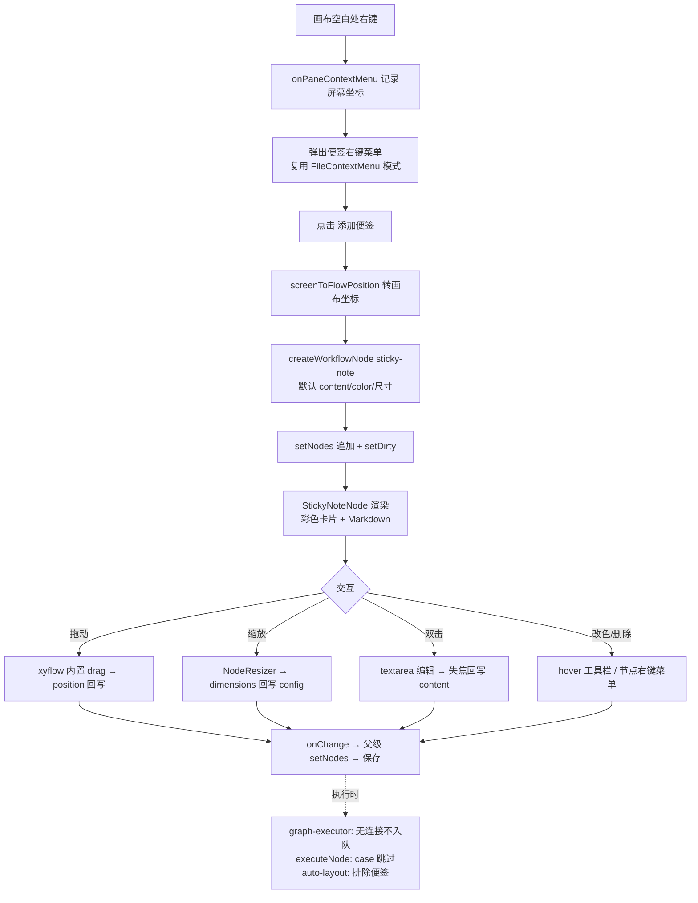

# feat: 工作流画布便签(sticky note)节点

## Summary

在工作流画布上新增「便签(sticky note)」节点：用户在画布空白处右键 → 「添加便签」即可放置一张彩色便签卡片，可拖动、可缩放、双击编辑文本（Markdown 渲染）、改颜色、删除。便签作为画布注释存在，不参与连接与执行。实现方式是把便签做成一种新的 `WorkflowNode` kind（`sticky-note`），复用现有节点的持久化、拖拽、选中全套机制，并在执行/连接/自动布局处把它排除。

---

## Problem Frame

当前工作流画布只有功能节点，缺少给画布加注释/分组说明的手段（对齐 n8n 的 sticky note）。用户需要在画布上贴说明性便签来标注流程意图。截图给出两项形态约束：

- **节点右键菜单**（Image 4）：选中便签后右键有 Edit / Change color / Copy / Duplicate / Delete 等项（其中 Tidy up / Convert / Select all / Clear 属通用画布动作，不在本次便签范围）。
- **便签视觉**（Image 5）：彩色圆角卡片，标题 + Markdown 正文（含加粗、链接），顶部 hover 工具栏（删除 / 改色 / 更多）。

Kun（本仓库参照的上游）**没有**便签实现，需参考 n8n 从零设计；Kun 仅提供右键菜单 UI 骨架参考。

---

## Requirements

- **R1** 画布空白处右键弹出菜单，含「添加便签」，在点击位置创建一张便签节点。
- **R2** 便签以彩色卡片渲染，正文按 Markdown 渲染（标题/加粗/链接/列表）。
- **R3** 便签可用鼠标拖动改变位置，位置随工作流保存。
- **R4** 便签可缩放（NodeResizer），宽高随工作流保存。
- **R5** 双击便签进入编辑（textarea 纯文本），失焦/确认后回写并重新渲染 Markdown。
- **R6** hover/选中工具栏提供改颜色与删除；改色从预设调色板选取。
- **R7** 便签不参与连接（无输入/输出 handle）、不参与执行、不被自动布局移动。
- **R8** 便签节点存盘后重新加载不丢失（normalize 容错 content/color/width/height）。

---

## Key Technical Decisions

- **KTD1 — 便签是 `WorkflowNode` kind，不是独立 annotations 数组。** 整个架构以判别联合 + 单一 `nodeTypes` 映射 + `normalizeWorkflowNode` switch 为中心；做成 kind 可复用持久化、拖拽、选中、删除、撤销全套，代价是要在若干穷尽 switch 里补 case 并在执行/布局处排除。独立 annotations 数组需另造一套存储/渲染/交互，成本更高且与现有不一致。
- **KTD2 — 便签特有字段放 `config`。** `WorkflowStickyNoteConfig { content: string; color: string; width: number; height: number }`，与其它 kind 的 config 建模一致，自动走 DSL 导入导出与持久化。
- **KTD3 — 便签不进左侧 palette。** palette 是「拖拽功能节点」面板；便签只能通过画布右键添加（对齐 n8n）。因此不加入 `WORKFLOW_PALETTE_GROUPS`，`nodeCategory` 走兜底。
- **KTD4 — Markdown 复用 `chatMarkdown.tsx` 的渲染组件**（`chatMarkdownComponents`，react-markdown `Components`），不新造渲染器；便签内用精简配置（不需要文件打开等回调）。
- **KTD5 — 专属画布组件 `StickyNoteNode`，与 `WorkflowCanvasNode` 并列注册**，而非在共享组件里堆分支。便签的视觉/交互（彩色背景、markdown、resize、双击编辑、无 handle、低 zIndex）与功能节点差异过大，独立组件更清晰。
- **KTD6 — 缩放/位置回写：针对便签放行 `dimensions` 变更。** `WorkflowCanvas.tsx:328` 当前把 `dimensions` 变更挡在 `notifyChange` 之外；便签 resize 需要把 `width/height` 回写 `config`，故对便签节点解除该过滤。
- **KTD7 — 便签 zIndex 低于功能节点**，作为背景注释；选中时临时提升，避免遮挡连线操作。

---

## High-Level Technical Design

便签的「数据是节点、行为非节点」是核心张力：存储/渲染走节点通道，执行/连接/布局三处显式排除。

---

## Scope Boundaries

**In scope（标准范围）**：右键添加、拖动、缩放、双击编辑、Markdown 渲染、改色（调色板）、hover/选中工具栏、删除、持久化、配置面板兜底编辑、执行/布局排除。

### Deferred to Follow-Up Work
- 节点右键菜单的 Copy / Duplicate（便签复制粘贴）——属「完整对齐 n8n」层级，本次不做。
- 通用画布动作（Tidy up workflow / Convert to sub-workflow / Select all / Clear selection）——非便签特性，独立功能。
- 便签内富文本工具条 / 所见即所得编辑（本次为 textarea 编辑 + Markdown 预览）。

### Out of scope
- 便签参与连接或执行的任何语义。
- 多便签框选批量操作。

---

## Implementation Units

### U1. 便签节点类型与常量

**Goal**：在类型系统中引入 `sticky-note` kind 及其 config。
**Requirements**：R1, R2, R8
**Dependencies**：无
**Files**：
- `packages/core/desktop/workflow-types.ts`（渲染层权威）
- `apps/desktop/src/main/workflow/types.ts`（主进程镜像，逐字同步）

**Approach**：在两份镜像文件同步新增——`WorkflowNodeKind` 联合加 `"sticky-note"`；`WORKFLOW_NODE_KINDS` 数组加该值（**必须**，否则 normalize 丢弃）；新增 `WorkflowStickyNoteConfig { content; color; width; height }`；在 `WorkflowNodeConfigByKind` 映射加 `"sticky-note": WorkflowStickyNoteConfig`。两文件头注释已声明「两侧改动必须同步」，务必同改。
**Patterns to follow**：现有任一 kind 的 config 接口 + `WorkflowNodeConfigByKind` 条目。
**Test scenarios**：`Test expectation: none — 纯类型/常量声明，行为由 U3 normalize 测试覆盖`（确保两份文件的 `WORKFLOW_NODE_KINDS` 一致可在 U3 测试断言）。

---

### U2. 节点元数据、工厂与调色板常量

**Goal**：补齐便签的展示元数据、创建工厂、默认文案与颜色常量；确保便签不进 palette。
**Requirements**：R1, R6
**Dependencies**：U1
**Files**：
- `packages/views/cortex-desktop/personal/workflow-flow.ts`（`NODE_ICONS` / `createWorkflowNode` / `nodeCategory` 派生）
- `packages/views/cortex-desktop/personal/WorkflowNodes.tsx`（`NODE_LABELS` / `nodeSummary`）
- `packages/views/cortex-desktop/personal/WorkflowEditorView.tsx`（`NODE_LABELS`）
- `packages/views/cortex-desktop/personal/node-config/NodeConfigPanel.tsx`（`KIND_LABELS`）
- 新增 `packages/views/cortex-desktop/personal/workflow-sticky.ts`（`STICKY_NOTE_COLORS` 调色板、`STICKY_DEFAULT_*` 默认文案/颜色/尺寸）

**Approach**：`createWorkflowNode` 的 switch 加 `case "sticky-note"`，用 `workflow-sticky.ts` 的默认值（默认文案如「I'm a note\n\nDouble click to edit me.」、默认颜色取调色板首色、默认尺寸 240×160）。`NODE_LABELS`/`KIND_LABELS` 加「便签」；`NODE_ICONS` 给一个便签图标；`nodeSummary` 给副标题（如「注释」或空）。**不**加入 `WORKFLOW_PALETTE_GROUPS` —— `nodeCategory` 会兜底到 `"data"`，便签不出现在左侧面板。调色板 `STICKY_NOTE_COLORS` 取 6-7 个柔和色（黄/粉/蓝/绿/紫/灰），与截图粉色一致。
**Patterns to follow**：现有 kind 在这些 Record/switch 中的写法；`workflow-flow.ts` 的 `nodeCategory` 兜底逻辑。
**Test scenarios**：
- `createWorkflowNode("sticky-note", pos)` 返回 `type:"sticky-note"`、`config` 含默认 content/color/width/height、`position` 为传入值。
- `nodeCategory("sticky-note")` 返回兜底分类、且 `sticky-note` 不在任何 `WORKFLOW_PALETTE_GROUPS.kinds` 中。
- 测试文件：`packages/views/cortex-desktop/personal/workflow-flow.test.ts`（若不存在则新建）。

---

### U3. normalize 容错 + 执行跳过 + 自动布局排除

**Goal**：便签存盘可恢复、执行不报错、自动布局不移动便签。
**Requirements**：R7, R8
**Dependencies**：U1
**Files**：
- `apps/desktop/src/main/workflow/normalize.ts`（`normalizeWorkflowNode` 加 case）
- `apps/desktop/src/main/workflow/node-executors/index.ts`（`executeNode` 加 case，绕过穷尽 `never` 检查）
- `packages/views/cortex-desktop/personal/WorkflowEditorView.tsx`（`handleAutoLayout` BFS 排除便签）

**Approach**：`normalizeWorkflowNode` 加 `case "sticky-note"`，容错读取 `content`(string,默认空)、`color`(string,默认调色板首色)、`width/height`(number,默认 240/160，下限保护)。`executeNode` 加 `case "sticky-note": return { payload: primary }`（透传/no-op，仅为满足穷尽 switch；图执行器本就不会调用它，因便签无连接不入 readyQueue，见 graph-executor）。`handleAutoLayout`：构建 in-degree/BFS 前先过滤掉 `type === "sticky-note"` 的节点，最后 `return prev.map(...)` 时保留便签原 `position`。
**Patterns to follow**：`normalizeWorkflowNode` 现有 case 的字段容错风格；`executeNode` 现有 case 的返回形状。
**Test scenarios**：
- normalize 往返：含 content/color/width/height 的便签节点 → normalize 后字段不变。
- normalize 默认：缺字段的便签 → 填入默认 content/color/240/160。
- normalize 仍丢弃真正未知 kind；但 `sticky-note` 被保留（断言 `WORKFLOW_NODE_KINDS` 含之）。
- executeNode：传入 sticky-note 节点不抛「未知节点类型」，返回透传 payload。
- auto-layout：含 1 个触发器 + 1 个便签时，便签 `position` 不被改写（仍在原坐标）。
- 测试文件：`apps/desktop/src/main/workflow/normalize.test.ts`、`apps/desktop/src/main/workflow/node-executors/index.test.ts`（按既有测试就近放置；auto-layout 断言放 `WorkflowEditorView` 相关测试或纯函数抽取后测试）。

---

### U4. StickyNoteNode 画布组件

**Goal**：便签的彩色卡片渲染 + Markdown + 双击编辑 + hover 工具栏 + 缩放 + 无 handle。
**Requirements**：R2, R4, R5, R6
**Dependencies**：U1, U2
**Files**：
- 新增 `packages/views/cortex-desktop/personal/StickyNoteNode.tsx`
- `packages/views/cortex-desktop/personal/WorkflowNodes.tsx`（`workflowNodeTypes` 对 `sticky-note` 映射到 `StickyNoteNode` 而非 `sharedNode`）
- 新增 `packages/views/cortex-desktop/personal/StickyNoteNode.test.tsx`

**Approach**：组件用 `config.color` 作背景的柔和卡片，正文经 `chatMarkdownComponents`（U/KTD4）渲染 Markdown；**双击**切换到编辑态（`<textarea>` 绑 `config.content`，失焦/Cmd+Enter 回写 → 调用注入的 `onNodeChange`）。`@xyflow/react` 的 `NodeResizer`（minWidth/minHeight 保护）显示在选中时；`NodeToolbar`（或自定义 hover 浮条）给改色按钮（弹 `STICKY_NOTE_COLORS` 调色板小面板）与删除按钮。**不渲染** `Handle`（无连接）、不渲染运行按钮。设较低 `zIndex`（KTD7）。组件通过 xyflow node `data` 拿到 `node` + 回调（沿用 `WorkflowNodes.tsx` 现有把 `onNodeChange/onDeleteNode` 经 node data 传入的方式）。
**Patterns to follow**：`WorkflowNodes.tsx` 的 `WorkflowCanvasNode`（NodeToolbar、选中态、node data 注入回调）；`chatMarkdown.tsx` 的 `chatMarkdownComponents` 用法（见其它调用点如 `MarkdownView`/`NotesView`）。
**Test scenarios**：
- 渲染：给定含加粗/链接的 markdown content，渲染出 `<strong>` 与 `<a>`（Covers R2）。
- 编辑：双击 → 出现 textarea，输入文本 blur → `onNodeChange` 收到更新后的 `config.content`（Covers R5）。
- 改色：点改色 → 选调色板某色 → `onNodeChange` 收到 `config.color` 更新（Covers R6）。
- 删除：点删除 → `onDeleteNode(node.id)` 被调用。
- 无 handle：组件不渲染任何 `.react-flow__handle`。

---

### U5. 缩放与位置持久化

**Goal**：便签 resize 的宽高与拖动的位置都回写并保存。
**Requirements**：R3, R4
**Dependencies**：U4
**Files**：
- `packages/views/cortex-desktop/personal/WorkflowCanvas.tsx`（`onNodesChange` 处理 + `flowToWorkflowGraph` 回写 sticky 尺寸）

**Approach**：位置已由 xyflow 内置 drag + 现有 `position` 回写覆盖，无需新逻辑（验证即可）。缩放：当前 `WorkflowCanvas.tsx:328` 把 `dimensions` 变更挡在 `notifyChange` 外；改为**对便签节点放行** `dimensions` 变更（拖动结束/稳定时），并在 `flowToWorkflowGraph`（或回写映射处）把 xyflow 节点的 `width/height` 写回该便签 `config.width/height`。注意沿用现有「拖动进行中（`dragging:true`）抑制回写」的防闪烁约束，仅在结束态回写。
**Patterns to follow**：`WorkflowCanvas.tsx` 现有 `applyNodeChanges` + `notifyChange` + `flowToWorkflowGraph` 流向（L311-335）。
**Test scenarios**：
- 缩放回写：模拟便签 `dimensions` change（结束态）→ `onChange` 收到的对应节点 `config.width/height` 更新。
- 拖动回写：模拟 `position` change（`dragging:false`）→ `onChange` 收到便签新 `position`（Covers R3）。
- 拖动中不回写：`dragging:true` 的 position change 不触发 `onChange`（沿用既有防闪烁，回归保护）。
- 测试文件：`packages/views/cortex-desktop/personal/WorkflowCanvas.test.tsx`（若无则就近新建，必要时把回写映射抽成纯函数单测）。

---

### U6. 画布右键菜单（添加便签 + 便签节点菜单）

**Goal**：空白处右键添加便签；便签上右键提供改色/删除。
**Requirements**：R1, R6
**Dependencies**：U2, U4
**Files**：
- `packages/views/cortex-desktop/personal/WorkflowCanvas.tsx`（`onPaneContextMenu` / `onNodeContextMenu` 接线 + `screenToFlowPosition`）
- 新增 `packages/views/cortex-desktop/personal/WorkflowCanvasContextMenu.tsx`（复用 FileContextMenu 模式的 fixed 菜单）
- `packages/views/cortex-desktop/personal/WorkflowEditorView.tsx`（新增「在坐标处创建便签」回调，复用 `onPaletteClick` 的 createWorkflowNode 路径）

**Approach**：`<ReactFlow>` 挂 `onPaneContextMenu`（阻止默认菜单，记录屏幕坐标，打开「添加便签」菜单）。点击「添加便签」→ `screenToFlowPosition`（`useReactFlow`）把屏幕坐标转画布坐标 → `createWorkflowNode("sticky-note", flowPos)` → 追加到 nodes（复用 `WorkflowEditorView` 既有 setNodes+setDirty 路径，类似 `onPaletteClick`）。`onNodeContextMenu` 对便签节点弹「改颜色 / 删除」（标准范围；Copy/Duplicate 列入 Deferred）。菜单 UI 复用 `FileContextMenu.tsx` 的 fixed 定位 + useLayoutEffect 防溢出 + 点外/Escape 关闭。
**Patterns to follow**：`FileContextMenu.tsx`（菜单骨架）；`WorkflowCanvas.tsx` 既有 `connectMenu` fixed 弹层与 handle-drop 节点选择菜单（屏幕↔画布坐标参考）；`WorkflowEditorView.onPaletteClick`（创建并选中节点）。
**Test scenarios**：
- 右键空白：`onPaneContextMenu` 阻止默认并打开菜单，菜单含「添加便签」。
- 添加：点「添加便签」→ 新增一个 `sticky-note` 节点，`position` 接近右键点（坐标转换后）（Covers R1）。
- 节点右键：在便签上右键 → 菜单含「改颜色」「删除」；点删除移除该节点。
- 关闭：点菜单外/Esc 关闭菜单。
- 测试文件：`packages/views/cortex-desktop/personal/WorkflowCanvasContextMenu.test.tsx` + 在 `WorkflowCanvas.test.tsx` 覆盖接线（坐标转换可对 mock 的 screenToFlowPosition 断言）。

---

### U7. 便签配置面板表单（兜底编辑）

**Goal**：选中便签时右侧配置面板提供 content/color/尺寸的兜底编辑（与其它节点选中即有配置面板的体验对齐）。
**Requirements**：R5, R6
**Dependencies**：U2, U4
**Files**：
- 新增 `packages/views/cortex-desktop/personal/node-config/StickyNoteForm.tsx`
- `packages/views/cortex-desktop/personal/node-config/NodeConfigPanel.tsx`（`renderForm` 路由 `sticky-note` → `StickyNoteForm`）

**Approach**：`NodeConfigPanel.renderForm` 加一支：`sticky-note` → `StickyNoteForm`（content textarea + 颜色选择 `STICKY_NOTE_COLORS` + 宽高数值）。复用现有表单样式（`INPUT_CLS`/`FIELD_LABEL_CLS`）。画布内双击编辑为主，本面板为兜底，二者都经 `onNodeChange` 更新同一 `config`。
**Patterns to follow**：现有任一 `XxxNodeForm.tsx`（如 `HttpNodeForm` 的字段表单 + `onChange` 回写）。
**Test scenarios**：
- 渲染：选中便签 → 面板出现 content/color/尺寸字段，回填当前 config。
- 编辑：改 content/color → `onNodeChange` 收到对应 config 更新。
- 测试文件：`packages/views/cortex-desktop/personal/node-config/StickyNoteForm.test.tsx`。

---

## Risks & Dependencies

- **镜像类型漂移**：`workflow-types.ts` 与 `main/workflow/types.ts` 必须同步加 kind/config，否则主进程 normalize 与渲染层类型不一致。缓解：U1 一次同改 + U3 测试断言两份 `WORKFLOW_NODE_KINDS` 一致。
- **穷尽 switch 遗漏**：`executeNode` 的 `never` 兜底会在编译期报错提示，但 `normalizeWorkflowNode`/`createWorkflowNode`/`nodeSummary` 等若漏 case 可能静默走兜底/丢弃。缓解：U2/U3 清单逐项落地 + 测试覆盖往返。
- **dimensions 放行的回归风险**：U5 修改 `WorkflowCanvas` 的变更过滤需限定便签，避免影响功能节点（功能节点不应回写 dimensions）。缓解：按 `type === "sticky-note"` 精确放行 + 保留 dragging 防闪烁约束 + 回归测试「拖动中不回写」。
- **zIndex/选中遮挡**：便签置底后选中/resize 手柄可能被功能节点遮挡。缓解：选中态临时提升 zIndex（U4）。
- **Markdown 渲染依赖**：复用 `chatMarkdownComponents` 需确认其不强依赖 chat 专属回调（onOpenFile 等可选/给空实现）。缓解：U4 以最简 options 调用，必要时包一层轻量 wrapper。

---

## Open Questions（deferred to implementation）

- 便签默认尺寸与调色板具体色值（240×160 与 6-7 色为初值，实现时按视觉微调，截图为粉色系）。
- `executeNode` 便签 case 的返回形状以现有 case 的 `WorkflowNodeResult` 类型为准（实现时对齐）。
- 便签 Markdown 是否需要点击链接的行为（默认渲染为链接即可；是否拦截在主进程打开外部浏览器，留待实现时按 `chatMarkdown` 既有 onOpenFile/链接处理决定）。

---

## Sources & Research

- 代码探查（cortex-work 节点系统/画布/执行/持久化）：`packages/core/desktop/workflow-types.ts`、`apps/desktop/src/main/workflow/{types,normalize}.ts`、`apps/desktop/src/main/workflow/node-executors/index.ts`、`apps/desktop/src/main/workflow/runtime/graph-executor.ts`、`packages/views/cortex-desktop/personal/{WorkflowCanvas,WorkflowNodes,WorkflowEditorView,workflow-flow}.tsx/ts`、`packages/views/cortex-desktop/personal/FileContextMenu.tsx`、`node-config/NodeConfigPanel.tsx`、`chatMarkdown.tsx`。
- 上游对照：Kun 仓库**无**便签实现（节点系统/右键菜单架构作为骨架参考，需参照 n8n stickyNote 从零设计）。
- 关联记忆：复刻 Kun loop 工作流（25 节点）、loop 节点面板参数核对。
