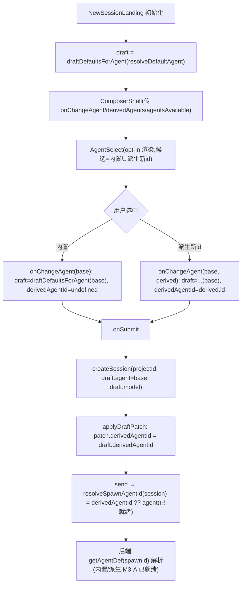

# feat: 新会话落地页支持选择 agent(收尾 008/U5)

> ID 约定:`R*` = 需求,`U*` = 实现单元,`KTD*` = 技术决策,`RISK-*` = 风险。
> 这是派生 agent 计划(`docs/plans/2026-06-21-008-feat-derived-agent-picker-plan.md`)里**唯一未落地的 U5**
> 的收尾:U1–U4 已交付(`SessionMeta.derivedAgentId` 字段、`derivedAgents` store 状态、`agentMeta` helper、
> 主聊天会话头 `PersonalTopBar` 选择器),后端派生解析与 spawn 取值(`resolveSpawnAgentId`)亦已就绪。
> **当前缺口**:新建会话落地页 `NewSessionLanding` 没有任何 agent 选择控件——agent 由 `resolveDefaultAgent`
> 静默确定,用户在发起新会话前无法切换(更无法选派生 agent)。

## Summary

给新建会话落地页的输入框加一个 agent 选择器,候选与显示语义跟主聊天会话头**完全一致**(内置 claude/codex/pi
+ 用户派生 agent、未安装置灰、派生跳过门控)。选中后新会话以该 agent(含派生)发起。核心取舍:**抽出**会话头现有
的 `PersonalAgentSelect` 为一个不依赖 `session` 对象的共享选择器(`AgentSelect`),由会话头与落地页共用,候选/门控/
显示逻辑单一来源;选择器以 **opt-in** 方式接入 `ComposerShell` 工具栏(仅落地页传入 `onChangeAgent` 时渲染,会话内
`PersonalComposer` 不传、不受影响,因其已有顶栏选择器)。落地页 `draft` 增 `derivedAgentId`,切换 agent 时按目标
重置默认 model/provider,发送时经既有 `applyDraftPatch` 把 `derivedAgentId` 落到新会话。纯渲染端,后端零改动,
`createSession` 签名不变。

---

## Problem Frame

008/U1–U4 已让主聊天会话头(`PersonalTopBar.tsx` 的 `PersonalAgentSelect`)列出并可切换内置 + 派生 agent,且
spawn 单点 `resolveSpawnAgentId(session, derivedAgents)`(`packages/core/personal/messages.ts`)已能把
`session.derivedAgentId ?? session.agent` 作为 spawn id 传给后端。但**新会话发起路径**绕过了这一切:
`NewSessionLanding.tsx` 用 `resolveDefaultAgent({ generalSettings, agentsAvailable })` 静默选 agent 存进 `draft.agent`,
`ComposerShell` 只接收 `agent` 用于占位文案,**没有 `onChangeAgent`**,工具栏只有模型下拉。于是:用户必须先用默认
agent 建会话、进会话页、再去顶栏换 agent——多一次往返,且派生 agent 在新会话场景完全选不到(`draft` 无
`derivedAgentId`,`createSession` 出来的 `SessionMeta.derivedAgentId` 恒为 `undefined`,`resolveSpawnAgentId` 永远走
base 分支)。本计划补齐这条新会话端的选择路径,复用已有的 helper 与显示语义,把改动控制在渲染端三处接线。

---

## Requirements

- R1. 新建会话落地页(`NewSessionLanding`)的输入框提供 agent 选择器,列出内置 claude/codex/pi + 用户派生新 id
  agent;覆盖内置同名 id 的派生**不**新增条目(仍走内置项),与会话头 `PersonalAgentSelect` 候选规则一致。
  (收尾 008/R1)
- R2. 选中某 agent(内置或派生)后,发起的新会话以该 agent spawn:内置 → `session.agent = 该内置`;派生 →
  `session.agent = 派生 base` 且 `session.derivedAgentId = 派生 id`,经既有 `resolveSpawnAgentId` 让后端收到派生 id。
  (收尾 008/R2)
- R3. 选择器显示与会话头一致的名称/头像:内置用 `AGENT_LABEL`/`AGENT_AVATAR`,派生用其 `label`(缺省用 id)与
  base 头像(派生优先、base 兜底,经 `agentDisplayLabel`/`agentDisplayAvatar`)。(收尾 008/R3)
- R4. 切换 agent 时,落地页 `draft` 的 model/provider 按目标 agent 重置为其默认(claude/codex 用 `DEFAULT_MODEL[base]`;
  pi 用默认 provider + 模型),避免把上一个 agent 的模型带到新 agent。
- R5. 可用性门控与会话头一致:非 pi 的内置 agent 若 `agentsAvailable?.[a] === false` 置灰不可选;pi 与派生不门控。
- R6. 兼容:会话内 `PersonalComposer` 经 `ComposerShell` 渲染时**不**出现该 agent 选择器(不传 `onChangeAgent`),
  行为与现状完全一致;`createSession` 签名不变;未配置派生 agent 时落地页选择器仅列内置三者。

---

## Key Technical Decisions

- KTD1. **抽共享 `AgentSelect`,不复制选择器逻辑。** 把 `PersonalTopBar.tsx` 内私有的 `PersonalAgentSelect` 抽到
  `packages/views/cortex-desktop/personal/AgentSelect.tsx`,入参从「`session` 对象」改为「`agent: AgentKind` +
  `derivedAgentId?: string`」这对裸值(其余 `agentsAvailable`/`derivedAgents`/`onSwitch` 不变)。会话头改为传
  `session.agent`/`session.derivedAgentId`,落地页传 `draft.agent`/`draft.derivedAgentId`。候选过滤(派生新 id)、
  门控、选中态、显示 helper 全部单一来源,避免两份漂移(RISK-1)。
- KTD2. **选择器 opt-in 接入 `ComposerShell` 工具栏。** `ComposerShell` 新增可选 props:`derivedAgents?`、
  `agentsAvailable?`、`onChangeAgent?(agent, derived?)`。**仅当传入 `onChangeAgent`** 时在工具栏(模型 pill 之前)
  渲染 `AgentSelect`;落地页传这三者,会话内 `PersonalComposer` 不传 → 不渲染(R6)。`ComposerShell` 已有 `agent`
  prop,新增 `derivedAgentId?` 用于选中态显示。这样会话内输入框零变化,落地页复用同一套输入能力。
- KTD3. **`draft` 增 `derivedAgentId`,切换走「目标默认」重置。** 落地页 `draft` 状态加 `derivedAgentId?: string`。
  `onChangeAgent(agent, derived)` 把 `draft` 重置为该目标的默认:`agent = derived?.base ?? agent`、
  `derivedAgentId = derived?.id`、`model`/`providerId` 用与 `draft` 初始化同一段逻辑(pi → 默认 provider+模型;
  其余 → `DEFAULT_MODEL[base]`)。把这段默认计算抽成小工具 `draftDefaultsForAgent(base, providerSettings)` 供初始化
  与切换复用,避免两处不一致(R4)。
- KTD4. **`derivedAgentId` 经既有 `applyDraftPatch` 落盘,`createSession` 签名不动。** `createSession(projectId, agent,
  model)` 仍只收 base `agent`(`session.agent` 保持 base,KTD 与 008/KTD1 一致);在已有的 `applyDraftPatch(sess)`
  里追加 `if (draft.derivedAgentId) patch.derivedAgentId = draft.derivedAgentId`,经 `updateSession` 写入。spawn 端
  `resolveSpawnAgentId` 已就绪,新会话发送即走派生 id(R2)。`createSession` 的 `agent` 传 `draft.agent`(base)。

---

## High-Level Technical Design

新会话选 agent → 发起 spawn 的数据流(渲染端,粗体为本计划新增/改动):

共享选择器抽取(KTD1):`PersonalAgentSelect(session)` → `AgentSelect(agent, derivedAgentId, …)`,会话头与落地页两
处调用方各自传裸值。

---

## Implementation Units

### U1. 抽出共享 `AgentSelect` 组件(去 session 依赖)

- Goal: 把会话头私有的 `PersonalAgentSelect` 抽成可被落地页复用的纯展示选择器,入参改裸值,行为不变。
- Requirements: R1, R3, R5
- Dependencies: 无
- Files:
  - 新增 `packages/views/cortex-desktop/personal/AgentSelect.tsx`(从 `PersonalTopBar.tsx` 的 `PersonalAgentSelect`
    迁移并改签名:`{ agent: AgentKind; derivedAgentId?: string; agentsAvailable; derivedAgents; onSwitch }`)
  - `packages/views/cortex-desktop/personal/PersonalTopBar.tsx`(删除内联 `PersonalAgentSelect`,改 import `AgentSelect`
    并传 `agent={session.agent} derivedAgentId={session.derivedAgentId}`)
  - 新增 `packages/views/cortex-desktop/personal/AgentSelect.test.tsx`
- Approach: 组件内部把原先的 `session.derivedAgentId ?? session.agent` 改为 `derivedAgentId ?? agent`;选中态判断
  `a === agent && !derivedAgentId`、`d.id === derivedAgentId` 同义替换。候选过滤(`builtIn` 派生新 id)、门控
  (`agentsAvailable?.[a] === false`,pi 例外)、`useDismissableMenu` 菜单交互、`agentDisplayLabel`/`agentDisplayAvatar`
  显示全部原样保留。导出 `AgentSelect`;若需经包 `exports` 子路径对外可不导(仅 views 内部用)。
- Patterns to follow: `PersonalTopBar.tsx:148-237` 现有 `PersonalAgentSelect` 实现与 `useDismissableMenu` 用法。
- Test scenarios:
  - 内置:传 `agent="codex"` 无 `derivedAgentId` → codex 项打勾、显示 `AGENT_LABEL["codex"]`/头像。
  - 派生新 id:`derivedAgents` 含 `{id:"my-cx",base:"codex",label:"我的CX"}` 且传 `derivedAgentId="my-cx"` →
    菜单出现「我的CX」并打勾,内置 codex **不**打勾。
  - 覆盖内置同名派生(`id:"codex"`)→ 菜单不重复出条目(走内置 codex)。
  - 门控:`agentsAvailable.codex === false` → codex 置灰、标「(未安装)」、点击不触发 `onSwitch`;pi 永不置灰。
  - 点击派生项 → `onSwitch(d.base, d)` 被调用;点击内置 → `onSwitch(a)`(无第二参)。
- Verification: 抽取后 `PersonalTopBar` 会话头选择器行为与抽取前一致(回归);新组件单测覆盖内置/派生/门控三路。

### U2. `ComposerShell` opt-in agent 选择器

- Goal: 让 `ComposerShell` 在收到 `onChangeAgent` 时于工具栏渲染 `AgentSelect`,否则保持现状。
- Requirements: R1, R3, R5, R6
- Dependencies: U1
- Files:
  - `packages/views/cortex-desktop/personal/ComposerShell.tsx`(props 增 `derivedAgentId?: string`、
    `derivedAgents?: DerivedAgentMeta[]`、`agentsAvailable?`、`onChangeAgent?: (agent: AgentKind, derived?: DerivedAgentMeta) => void`;
    工具栏模型 pill 前条件渲染 `AgentSelect`)
  - `packages/views/cortex-desktop/personal/ComposerShell.test.tsx`(补 opt-in 渲染用例)
- Approach: 在工具栏(`ComposerShell.tsx:776` `spacer` 后、模型 pill `:777` 前)插入 `onChangeAgent ? <AgentSelect
  agent={agent} derivedAgentId={derivedAgentId} agentsAvailable={agentsAvailable} derivedAgents={derivedAgents}
  onSwitch={onChangeAgent} /> : null`。`AgentSelect` 自带样式类(沿用 `pw-sh-agent*`/`pw-tb-menu*`),布局与会话头一致。
  不传 `onChangeAgent` 的现有调用方(`PersonalComposer` 等)零变化。
- Patterns to follow: `ComposerShell.tsx` 现有可选回调 props(`onChangePiThinking` 等)的 opt-in 渲染范式。
- Test scenarios:
  - 传 `onChangeAgent` + `derivedAgents` → 工具栏渲染出 agent 选择器;点击某项触发 `onChangeAgent`。
  - 不传 `onChangeAgent`(会话内调用)→ 工具栏**无** agent 选择器(R6 回归)。
  - 传 `agent="pi"` → 选择器显示 pi;同时既有 pi 模型/thinking 下拉不受影响。
- Verification: opt-in 两态(传/不传)渲染正确;会话内 `PersonalComposer` 经 `ComposerShell` 渲染无新控件(回归)。

### U3. `draftDefaultsForAgent` 工具 + `NewSessionLanding` 接线

- Goal: 落地页 `draft` 支持 `derivedAgentId`,切换 agent 重置默认 model/provider,发送时落 `derivedAgentId`。
- Requirements: R1, R2, R4, R6
- Dependencies: U2
- Files:
  - `packages/views/cortex-desktop/personal/NewSessionLanding.tsx`(`draft` 增 `derivedAgentId?: string`;新增
    `onChangeAgent` handler;`applyDraftPatch` 追加 `derivedAgentId`;`ComposerShell` 传入新 props)
  - 抽出 `draftDefaultsForAgent(base, providerSettings)`(置于 `NewSessionLanding.tsx` 内部或就近工具文件)供
    `draft` 初始化与切换复用
  - `packages/views/cortex-desktop/personal/NewSessionLanding.test.tsx`(新增或就近)
- Approach: 把 `draft` 初始化里 `model`/`providerId` 的计算逻辑(`NewSessionLanding.tsx:44-52`)抽成
  `draftDefaultsForAgent(base, providerSettings)`,返回 `{ model, providerId }`。`onChangeAgent(agent, derived)`:
  `const base = derived?.base ?? agent; setDraft(d => ({ ...d, agent: base, derivedAgentId: derived?.id, ...draftDefaultsForAgent(base, providerSettings) }))`。
  `ComposerShell` 传 `derivedAgentId={draft.derivedAgentId}`、`derivedAgents`、`agentsAvailable`、`onChangeAgent`。
  `applyDraftPatch` 增 `if (draft.derivedAgentId) patch.derivedAgentId = draft.derivedAgentId`。`createSession` 仍传
  `draft.agent`(base,KTD4)。`derivedAgents`/`agentsAvailable` 从 `usePersonalStore` 读(store 已有,008/U2)。
- Patterns to follow: `NewSessionLanding.tsx` 现有 `draft`/`applyDraftPatch`/`onChangeModel` 接线;会话头切换经
  `buildAgentSwitchPatch` 的「重置 model」语义(`agentMeta.ts`)。
- Test scenarios:
  - 选内置 codex → `draft.agent="codex"`、`derivedAgentId=undefined`、`model=DEFAULT_MODEL.codex`。
  - 选派生 `{id:"my-cx",base:"codex"}` → `draft.agent="codex"`、`derivedAgentId="my-cx"`、model 为 codex 默认。
  - 选 pi → `draft.providerId`/`model` 为默认 provider+模型(`draftDefaultsForAgent` 的 pi 分支)。
  - 发起会话(选派生)→ 创建后 `applyDraftPatch` 使 `session.derivedAgentId="my-cx"`;`createSession` 收到的 `agent` 为
    base `"codex"`。
  - 发起会话(选内置)→ `session.derivedAgentId` 为空(无 patch),回归现状。
  - 端到端:派生会话 `send` → `resolveSpawnAgentId` 返回 `"my-cx"`(已就绪逻辑,断言 spawn id)。
- Verification: 落地页可选内置/派生 agent;切换重置模型;发送后新会话 `agent=base`/`derivedAgentId` 正确,spawn 取派生 id;
  内置路径与未配置派生时回归现状。

---

## Scope Boundaries

### Deferred to Follow-Up Work(沿用 008 未覆盖项)

- 其它 agent 选择面纳入派生/选择能力:automation(`AutomationDialog`)、菜单栏 Spotlight(`SpotlightBar`)、设置区默认
  agent(`SettingsMenu`)、日报模型(`SummaryModelConfig`)。本计划只补**新建会话落地页**一处。
- 派生 agent 的自定义头像(独立 initials/底色):本期复用 base 头像(同 008)。
- UI 内编辑 `agents.local.json`(增删派生):仍由用户手改文件 + `agents:reloadProfiles` 刷新。
- 把 `AgentSelect` 经 `packages/views` 的 `exports` 子路径对外导出:本期仅 views 内部复用,无需对外。

### 不属于本里程碑

- 后端派生 agent 能力、`getAgentDef` 派生解析、`resolveSpawnAgentId`(均已就绪)。
- 放宽 `SessionMeta.agent` 为 string 的全仓重构(008/KTD1 已用旁车字段规避)。

---

## Risks & Dependencies

- RISK-1(抽取回归):把 `PersonalAgentSelect` 抽成 `AgentSelect` 改签名时,若选中态/候选过滤的 `session.*` →
  裸值替换有遗漏,会话头会显示退化或误打勾。缓解:U1 单测覆盖内置/派生/覆盖同名三路,且保留 `PersonalTopBar` 行为对照
  (抽取前后会话头选择器表现一致)。
- RISK-2(失效派生 id):用户删了 `agents.local.json` 的派生项但落地页 `draft.derivedAgentId` 仍指向它 → 发起会话后
  `resolveSpawnAgentId` 已有兜底(`derivedAgentId` 不在 `derivedAgents` 中则回退 base),不崩;但选择器显示会回退 base 名。
  可接受,无需额外处理(与 008/RISK-3 同一兜底)。
- RISK-3(共用组件污染会话内输入框):`ComposerShell` 被 `PersonalComposer` 等多处共用,若 agent 选择器非 opt-in 会
  在会话内重复出现(顶栏已有)。缓解:KTD2 严格以 `onChangeAgent` 是否传入为开关,U2 单测断言不传时不渲染。
- 依赖:008/U1–U4(`SessionMeta.derivedAgentId`、`derivedAgents` store、`agentMeta` helper、`AgentSelect` 前身)与
  spawn 端 `resolveSpawnAgentId`(`packages/core/personal/messages.ts`),均已就绪。

---

## Open Questions

- agent 选择器在落地页工具栏的**视觉密度**:工具栏已有模型 pill(pi 时还有 thinking pill)、Skills、语音等图标,再加
  agent 选择器是否过挤?倾向放在 `spacer` 后、模型 pill 前与会话头同款紧凑样式;若实测过挤,可改为仅图标+名缩写。
  执行时按真实渲染定,属样式微调,不影响数据流。

---

## Sources / Research

- 现状(已核对代码):
  - `packages/views/cortex-desktop/personal/NewSessionLanding.tsx:43-53,86,96,112-131`——`draft` 经
    `resolveDefaultAgent` 静默选 agent,`ComposerShell` 无 `onChangeAgent`,`createSession(projectId, draft.agent, draft.model)`,
    `applyDraftPatch` 已有 providerId/useOwnSkills/permissionMode 落盘路径(可挂 `derivedAgentId`)。
  - `packages/views/cortex-desktop/personal/PersonalTopBar.tsx:132-237`——`PersonalAgentSelect(session)` 完整实现
    (候选 `Object.keys(AGENT_MODELS)` ∪ 派生新 id、门控、`agentDisplayLabel/Avatar`、`buildAgentSwitchPatch` 切换)。
  - `packages/views/cortex-desktop/personal/ComposerShell.tsx:78-128,160-161,776-815`——props `agent`/`onChangeModel`/
    `onChangePiModel`,工具栏模型 pill 渲染点;被 `PersonalComposer.tsx` 等共用(故 opt-in)。
  - `packages/views/cortex-desktop/personal/agentMeta.ts`——`baseAgentOf`/`agentDisplayLabel`/`agentDisplayAvatar`/
    `buildAgentSwitchPatch` 均已实现(008/U3)。
  - `packages/core/store/personal.ts:226-231,676-717,1003-1023`——`createSession(projectId,agent,model,opts)` 签名、
    `SessionMeta` 组装、`resolveDefaultAgent`/`defaultAgent`;`derivedAgents` store 状态已存在(008/U2)。
  - `packages/core/personal/messages.ts:200-210,2236`——`resolveSpawnAgentId(session, derivedAgents)` 已就绪
    (`derivedAgentId ?? agent`,含失效兜底),spawn 单点已调用。
  - `packages/core/desktop/types.ts:4,7-11,62`——`AgentKind`、`DerivedAgentMeta`、`SessionMeta.derivedAgentId?`(008/U1)。
- 关联计划:`docs/plans/2026-06-21-008-feat-derived-agent-picker-plan.md`(本计划收尾其 U5);origin 需求
  `docs/brainstorms/2026-06-21-optimize-agent-cli-invocation-requirements.md`(FR-M3-1)。
