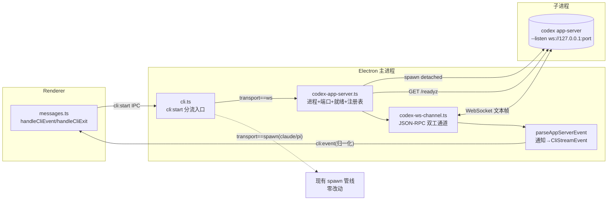
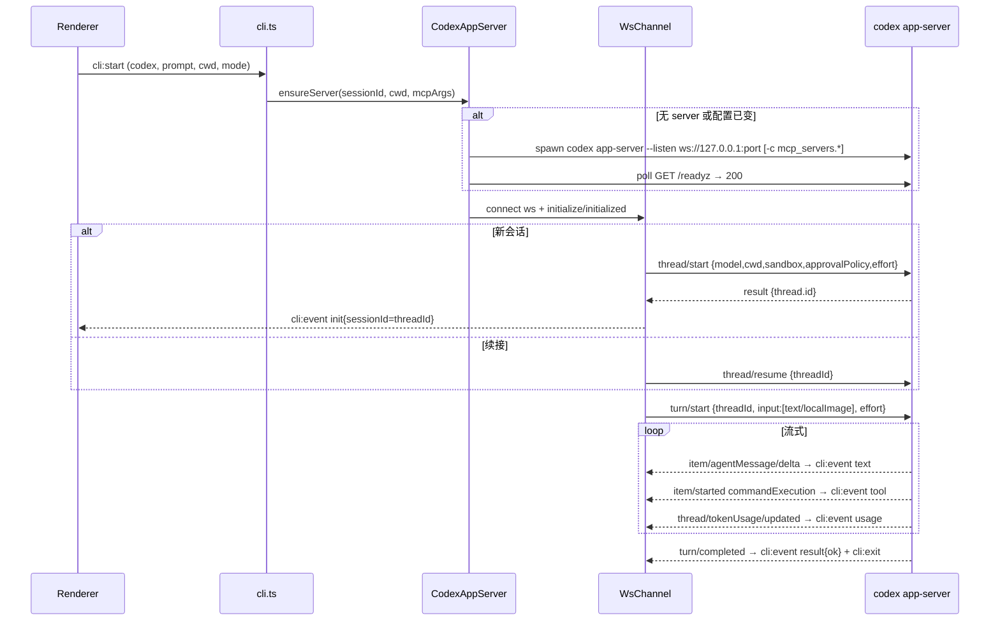
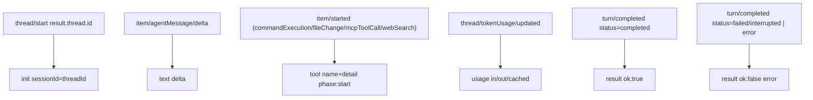

# feat: Codex agent 切换为 app-server WebSocket 持久连接传输

## Summary

把 Cortex Desktop 的 **codex 主交互会话**从「每轮 spawn `codex exec --json` 子进程 + 逐行解析 stdout JSONL」改为「本地长驻 `codex app-server --listen ws://127.0.0.1:<port>` + WebSocket 持久连接（JSON-RPC 协议）」。

范围严格限定：
- **仅 codex**。claude / pi 保持现有 spawn + `parseLine` 管线，零改动。
- **仅主交互会话**（`cli:start`）走 ws。轻量路径（oneshot 标题/日报、ask 追问、automation 后台批跑、workflow-headless）继续走 `codex exec`，保留 `CODEX_MCP_CLEAR`（**混合模式**）。
- 对渲染端的归一化事件契约（`CliStreamEvent`：init / text / tool / usage / result / retry）**保持不变**，UI 侧零感知切换。

动机：app-server 是单进程多 thread 的持久会话模型，避免每轮 spawn 的冷启与会话重水合成本，并提供更丰富的流式事件（增量 text delta、命令 outputDelta、reasoning 摘要流）。

---

## Problem Frame

当前 codex 集成（`apps/desktop/src/main/agents/codex.ts` + `apps/desktop/src/main/ipc/cli.ts`）的形态：

- 每一轮用户消息 → `cli:start` → `adapter.buildArgs` 构造 `codex exec --json …` → `startAgentProcess` spawn 一个**短命**子进程 → prompt 经 stdin EOF 投递 → stdout 逐行 JSONL → `codexDef.parseLine` 归一化 → `cli:event` 推渲染端 → 进程退出 → `cli:exit`。
- 续接靠 `codex exec resume <threadId>` / `--last`，每轮重新 spawn + 重水合会话。

局限：
1. 每轮 spawn 有冷启成本；会话状态靠磁盘 rollout 重水合。
2. `codex exec --json` 事件 schema 扁平，无 item 级流式（text 一次性整段返回，无 token-by-token delta）。
3. 长会话每轮都付出 resume 成本。

app-server 模式用一条持久 WebSocket 连接承载整个会话生命周期，turn 之间不再 spawn，且协议提供 `item/agentMessage/delta` 等真正的流式通知。

本计划**不改变**：claude/pi 行为、渲染端事件消费契约、codex 轻量路径、sandbox/approval 的语义映射（plan→readOnly、accept-edits→workspaceWrite、full-auto→dangerFullAccess+never）。

---

## Requirements

| R-ID | 需求 | 验证锚点 |
|------|------|----------|
| R1 | codex 主交互会话经本地 `codex app-server --listen ws://127.0.0.1:<port>` + WebSocket 驱动，不再每轮 spawn `codex exec` | U1,U2,U3,U5 |
| R2 | 归一化 `CliStreamEvent` 契约对渲染端保持不变（init/text/tool/usage/result/retry 语义与字段一致） | U4,U8 |
| R3 | `init.sessionId` 仍是 codex 自身的 `threadId`，可被持久化并用于后续 `thread/resume` | U4,U6 |
| R4 | 会话续接经 `thread/resume`；续接失败（thread 不存在）回退干净新建，且错误文本能触发渲染端 codex 专属 session-lost 清理 | U6 |
| R5 | sandbox/approval 三档映射到 `thread/start` 的 `sandbox` + `approvalPolicy`，且无人值守不弹审批 | U3,U5 |
| R6 | MCP 注入映射到 app-server 启动参数；MCP 配置变更触发 server 重启；轻量路径保留 `CODEX_MCP_CLEAR` | U7 |
| R7 | 取消（`cli:kill`/`killAllCli`）、活跃看门狗、安全重试在 ws 形态下有等价且正确的语义；app 退出回收长驻 server 进程 | U2,U5 |
| R8 | claude / pi / codex 轻量路径（oneshot/ask/automation/workflow-headless）行为完全不变 | U1,U7,U8 |
| R9 | app-server 不可用（旧版 codex 无该子命令）时有明确降级/报错，不静默卡死 | U2 |
| R10 | 本地 ws 端口须防止非 Cortex 进程（尤其浏览器经 DNS rebinding）连上后以 `dangerFullAccess`+`never` 驱动 codex：强制 Origin 校验或 capability token | U0,U2,U3 |

---

## Key Technical Decisions

### KTD1 — `AgentDef` 增加**可选** `transport?: "spawn" | "ws"` 能力位（缺省 `"spawn"`），由公共管线消费

沿用现有「能力位」模式（`mcpInjection` 已被 `cli.ts` 真正消费的先例）。新增 `transport` 位为**可选字段、缺省视作 `"spawn"`**，**仅 codex 显式标 `"ws"`**；claude/pi **不改动**（缺省即 spawn）。`cli:start` 入口按 `def.transport === "ws"` 分流；其余路径（oneshot/ask/automation/workflow-headless）**不读** `transport`，恒走 spawn —— 这是混合模式的落点。

理由：最小侵入，且守住「仅 codex、不碰 claude/pi」的范围 —— 可选字段使 `claude.ts`/`pi.ts` 零改动（修订自 scope 审查：必填字段会强迫改这两个文件，与 R8 矛盾）。派生 agent（`base:"codex"`）经 `{...base}` 展开继承 `transport:"ws"`，需在 U1 明确该继承语义（见 R6/RISK-7）。

> 注：`index.ts` 已有 `baseAgentKindOf(agent)` 能把派生 codex 解析为 `"codex"`，是分流判断的备选实现；本计划选 `transport` 位以保持「能力位驱动」的一致风格，二者等价。

### KTD2 — app-server 协议：JSON-RPC over WebSocket 文本帧（每帧一条完整 JSON）

官方确证（https://developers.openai.com/codex/app-server）：JSON-RPC 2.0 但 on-the-wire **省略 `"jsonrpc":"2.0"` 字段**；WebSocket 模式每条消息 = 一个文本帧。连接生命周期：`initialize`（带 `clientInfo` + `capabilities.experimentalApi`）→ `initialized` 通知 → `thread/start` → `turn/start` → 流式通知 → `turn/completed`。

理由：WebSocket 文本帧天然分帧，**无需** pi-rpc 那套 `\n` 行缓冲（但保留单帧 1MB 溢出保护思路）。请求-应答用 pending Map + id 关联，事件通知（无 id）走 onEvent 回调 —— 结构与 `apps/desktop/src/main/agents/pi-rpc.ts` 的 `PiRpcSession` 同构，直接照搬其设计模板。

### KTD3 — Node 22 原生全局 `WebSocket`，不引入 `ws` 包

Electron 39 内嵌 Node 22，`global.WebSocket` 稳定可用。主进程直接 `new WebSocket(url)`，零新增依赖。

### KTD4 — 就绪探测走 HTTP `GET /readyz`，不 sleep 固定值

app-server 在 ws 端口就绪后同端口响应 `GET /readyz → 200`。spawn 后轮询 `/readyz`（带超时上限）再建 ws 连接，替代固定 sleep。对齐 pi-rpc「探针命令而非 sleep」的实测结论。

### KTD5 — 端口分配：优先随机空闲端口，回退实测确定

`ws://127.0.0.1:0` 自动分配端口是否被 app-server 支持、以及如何回传实际端口，**官方文档无记载（执行期未知项 OQ1）**。计划默认：主进程先用 `net` 找一个空闲端口（`createServer().listen(0)` 取 `address().port` 后 close），再以该确定端口启动 app-server。若实测发现 app-server 拒绝预绑定端口或有竞态，回退到固定端口段 + 冲突重试。

### KTD6 — sandbox/approval 映射（无人值守不弹审批）

| permissionMode | `thread/start.sandbox` | `thread/start.approvalPolicy` |
|----------------|------------------------|-------------------------------|
| `plan` | `readOnly` | `never` |
| `accept-edits` | `workspaceWrite` | `never` |
| `full-auto`/缺省 | `dangerFullAccess` | `never` |

全程 `approvalPolicy:"never"` → 服务端不发 `item/*/requestApproval`，客户端无需实现审批回调（大幅简化）。`effort` 经 `turn/start.effort`（low/medium/high）。注意 `sandbox` 与实验性 `permissions` 互斥，只传 `sandbox`。

### KTD7 — MCP 注入：app-server 启动参数注入，配置变更重启 server

app-server 模式 MCP 在 server 生命周期内固定（不像逐 turn `-c`）。复用 `buildCodexMcpArgs`（产出 `-c mcp_servers.*` dotted-path）放进 app-server 启动 args（**需 spike 验证 `codex app-server` 接受 `-c`，OQ2**）。MCP 配置变更 → 标记当前 server 失效 → 下次会话惰性重启。轻量路径仍走 `codex exec` + `CODEX_MCP_CLEAR`，该常量**保留不删**。

### KTD8 — server 作用域：每会话一个长驻 server（v1 保守），不做跨会话连接池

v1 采用 `Map<sessionId, CodexAppServer>`，一个交互 session 对应一个 app-server 进程 + 一条 ws 连接。虽然 app-server 支持单进程多 thread，但跨会话共享会引入 cwd/sandbox/MCP 配置冲突与隔离复杂度。每会话一进程换取隔离清晰、取消/回收语义简单，与现有 per-run 进程模型最接近。跨会话池化列为 Future Consideration。

**资源回收（修订自 adversarial 审查）**：与 `codex exec` 每轮自然退出不同，长驻 server 会随会话增多累积进程。v1 必须有上界：① 空闲驱逐 —— server 无活跃 turn 超过空闲阈值（默认 30 分钟，环境变量可覆盖）→ SIGTERM 整组 + 从注册表移除；② 最大并发 server 数上限（默认 8）+ LRU 驱逐最久未用的空闲 server。仅 `killAllCli()` 在退出时兜底是不够的。在 `CodexAppServer` 记录 `lastActiveAt` 即可实现，归 U2。

### KTD9 — 本地 ws 端口的连接鉴别：强制 Origin 校验（首选）或 capability token（修订自 security 审查）

**这是安全硬要求（R10），非执行期可选项。** 无鉴权的本地 ws 端口可被同机浏览器经 DNS rebinding 连上：恶意网页把某域名解析到 `127.0.0.1`，从页面发起 ws 连接，因无 Origin 校验、无 token 而握手成功，随后 `turn/start{sandbox:dangerFullAccess,approvalPolicy:never}` → 以用户身份任意命令执行、零审批弹窗。开发者「开着 app 时访问了恶意站点」即触发，路径现实。

v1 必须二选一并落为 U2/U3 的实现要求：
- **(A) Origin 校验（首选，零依赖、零误伤）**：主进程在接受 ws Upgrade 前校验 `Origin` header —— Node 原生 WebSocket 客户端**不发** Origin，浏览器**必发** Origin，故「拒绝任何非空 Origin」即可挡掉浏览器发起的连接，对 Electron→app-server 自身零误伤。需 OQ4 确认 app-server 是否对 ws Upgrade 暴露/校验 Origin；若 app-server 不自带校验，则改用 (B)。
- **(B) capability token**：server 启动随机生成 128-bit token，经 `--ws-auth capability-token` + `--ws-token-file`/`--ws-token-sha256` 传给 app-server，客户端连接时携带。`--ws-auth` 虽在官网归为「远程」用法，但本地用进程生成的一次性 token 同样适用，且顺带消解多用户主机风险（同机其它用户不知 token）。

**多用户主机**：`127.0.0.1` 在 Linux/macOS 非按用户隔离，同机其它账户可连。(B) 的 token 同时覆盖此风险；若仅做 (A)，需在文档注明「无鉴权本地 socket 仅适用单用户个人机；多用户/云开发机须用 (B)」。

---

## High-Level Technical Design

### 组件与进程关系



### 会话与 turn 时序



### 通知 → 归一化事件映射（U4 核心）



---

## Output Structure

```
apps/desktop/src/main/
├── agents/
│   ├── index.ts                  (改：AgentDef 增可选 transport? 能力位)
│   ├── codex.ts                  (改：transport:"ws" + 复用 prompt 包装/sandbox 映射工具)
│   ├── codex-app-server.ts       (新：长驻进程+端口+就绪+注册表+驱逐+killAll+鉴别接入)
│   ├── codex-app-server.schema.ts(新：codex app-server generate-ts 生成的官方类型，U3/U4 对齐)
│   └── (claude.ts / pi.ts 不改动 —— 可选字段缺省即 spawn)
├── ipc/
│   ├── codex-ws-channel.ts       (新：WebSocket JSON-RPC 双工通道 + 通知归一化 parseAppServerEvent)
│   └── cli.ts                    (改：cli:start 入口按 transport 前置分流；ws 看门狗/kill/keepalive/MCP 清理接入)
```

> 结构为范围声明，非约束；实现时若 `codex-ws-channel.ts` 过大可再拆 `parseAppServerEvent` 为独立文件（注意 1200 行上限；`cli.ts` 现 870 行，ws 逻辑应尽量委托给 codex-app-server.ts / codex-ws-channel.ts，避免逼近上限）。OQ2=否 时另增临时 config 写入 + 严格 gate 工具。

---

## Implementation Units

> **执行顺序硬约束**：U0 是**阻塞性 spike**，必须先完成并记录结论；其结论可能改写 KTD5/KTD7/KTD9 与 U2/U3/U7 的具体实现分支。U0 未结之前不要开工 U2 及之后单元。

### U0. 协议 spike：一次性消解执行期未知项（阻塞门）

**Goal**：在写生产代码前，用最小脚本 + 官方 schema 实测确认 app-server 的关键行为，把 OQ1–OQ5 从「执行期未知」变为「已决」，并为每个失败分支落地设计（而非动工时才发现）。

**Requirements**：R1, R5, R6, R10（前置验证）

**Dependencies**：无（最先做）

**Files**：
- `apps/desktop/src/main/agents/codex-app-server.schema.ts` 或 `docs/` 下参考（`codex app-server generate-ts --out` 生成的官方 TS 类型落库，供 U3/U4 类型对齐）
- spike 脚本（一次性，可放 scratchpad，不入库）+ 结论回写本计划「Open Questions」段

**Approach**：
- 先 `codex app-server generate-ts --out <dir>` / `generate-json-schema` 生成官方类型与 schema，作为 U3/U4 的权威依据（并评估接入 CI 类型校验，防协议漂移 —— 见 residual risk）。
- 最小脚本：spawn `codex app-server --listen ws://127.0.0.1:<port>` → 轮询 `/readyz` → ws `initialize`/`initialized` → `thread/start` → `turn/start` → 打印全部通知。一次性回答：
  - **OQ1**：`ws://127.0.0.1:0` 是否支持随机端口、如何回传实际端口；预绑定端口是否被接受、有无竞态。失败 → 落地固定端口段（如 40000–40099）+ 重试次数（3）+ 失败即硬报错的设计。
  - **OQ2**：`codex app-server` 是否接受 `-c mcp_servers.*`（与 exec 同 parser）。失败 → **先设计**临时 config 文件回退（文件路径/生命周期/严格 gate 防覆盖 `~/.codex/config.toml`），spike 用于确认而非发现（见 U7）。
  - **OQ3**：app-server 模式 skills（斜杠命令）是否加载。失败 → U3 的 `promptWithSkills` 在 ws 路径需跳过或加可见警告（见 U3）。
  - **OQ4**：ws Upgrade 是否暴露/校验 `Origin`；本地连接握手形态 → 决定 KTD9 走 (A) 还是 (B)。
  - **OQ5**：是否存在 `turn/interrupt`（或等价中途取消方法）→ 决定 U5 取消是「协议中断」还是「ws.close()+杀进程」。

**Execution note**：纯探索性 spike，不写生产代码；结论以「已决/失败分支」形式回写本计划，再开工 U2。

**Test scenarios**：`Test expectation: none -- 探索性 spike，产出是结论与 schema，不引入可测行为`。

**Verification**：OQ1–OQ5 各有明确「已决」结论 + 失败分支设计；官方 TS schema 落库；KTD5/KTD7/KTD9 据结论定稿。

---

### U1. `AgentDef` 增加 `transport` 能力位与 codex 标注

**Goal**：在声明式注册表引入**可选** `transport?: "spawn" | "ws"`（缺省 `"spawn"`），**仅 codex 显式标 `"ws"`**，claude/pi 不改动，并明确派生 agent 的继承语义与 `bin` 覆盖的已知限制。

**Requirements**：R1, R8

**Dependencies**：U0（spike 结论确认 ws 形态可行后再固化契约）

**Files**：
- `apps/desktop/src/main/agents/index.ts`（`AgentDef` 接口加**可选** `transport?` 字段 + 类型联合 + 文件头能力位注释）
- `apps/desktop/src/main/agents/codex.ts`（`transport:"ws"`）
- ~~claude.ts / pi.ts~~ **不改动**（可选字段缺省即 spawn —— 守住 R8「仅 codex」）
- `apps/desktop/src/main/agents/claude.ts`、`apps/desktop/src/main/agents/pi.ts`（`transport:"spawn"`）
- `apps/desktop/src/main/agents/agent-profiles.ts`（`deriveAgentDef` 透传/覆盖 `transport`，确认 `base:"codex"` 派生是否继承 ws）
- `apps/desktop/src/main/agents/index.test.ts`、`apps/desktop/src/main/agents/agent-profiles.test.ts`

**Approach**：照 `mcpInjection` 的现有模式新增一个**可选**能力位。文件头注释说明：`transport` 由公共管线（cli.ts）真正消费（与 mcpInjection 同级），不属于「仅声明式」那组；缺省 `"spawn"`。派生 agent（`base:"codex"`）经 `{...base}` 展开继承 `transport:"ws"`（保守：v1 仅继承不暴露覆盖）。

**`bin` 覆盖的已知限制（修订自 feasibility 审查）**：用户派生 agent 若同时设 `{base:"codex", bin:"/opt/custom-codex"}`，会继承 `transport:"ws"`，但 U2 的 ws 启动路径 spawn 的是字面量 `"codex"`（app-server 子命令），**不会**用 `bin` 覆盖 —— 自定义二进制被静默忽略。v1 处理：在 U2 spawn app-server 时改用 `def` 暴露的有效命令名（新增 `def.serverCmd?? "codex"` 或从 buildArgs 取 `cmd`），或在 profile 加载期对「`base:codex` + 自定义 bin」发出警告并注明 ws 模式暂不支持 bin 覆盖。择一并在 U2 落地。

**Patterns to follow**：`index.ts` 现有 `McpInjection` 类型与 `AgentDef` 字段；`agent-profiles.ts` 的 `deriveAgentDef`。

**Test scenarios**：
- `codexDef.transport === "ws"`；`claudeDef`/`piDef` 的 `transport` 为 `undefined`（缺省视作 spawn）。
- 分流判定 `(def.transport ?? "spawn") === "ws"`：codex → true，claude/pi → false。
- `deriveAgentDef(codexDef, {base:"codex",...})` 结果 `transport === "ws"`（继承）。
- `deriveAgentDef(claudeDef, ...)` 结果 `transport` 仍为 undefined。
- `base:codex` + 自定义 `bin` 的派生 agent：触发 bin-override 限制处理（警告或有效命令名替换，断言所选方案）。

**Verification**：`pnpm --filter @cortex-work/desktop typecheck` 通过；分流判定与继承断言通过；claude.ts/pi.ts 无 diff。

---

### U2. CodexAppServer 长驻进程生命周期（spawn / 端口 / 就绪 / 注册表 / 回收 / 检测）

**Goal**：实现 `codex app-server --listen ws://127.0.0.1:<port>` 的启动、端口分配、`/readyz` 就绪探测、按 sessionId 注册、取消/回收、app 退出清理，以及 app-server 子命令可用性检测与降级。

**Requirements**：R1, R7, R9, R10

**Dependencies**：U0, U1

**Files**：
- `apps/desktop/src/main/agents/codex-app-server.ts`（新）
- `apps/desktop/src/main/ipc/cli.ts`（`killAllCli` 扩展、复用 `startAgentProcess`/`buildEnv`/`signalChildGroup`/`detectAgents`）
- `apps/desktop/src/main/agents/codex-app-server.test.ts`（新）

**Approach**：
- 端口：`net.createServer().listen(0)` 取空闲端口（KTD5），失败回退固定段重试。**TOCTOU 注意**：probe→close→交给 app-server 之间存在端口被抢占窗口；启动失败按 OQ1 落地的「固定端口段 + 重试」分支处理，且若启用 KTD9 (B) token，抢占者无 token 连接会失败，token 同时是此处的正确防御。
- 鉴别（R10/KTD9）：按 U0 对 OQ4 的结论启用 (A) Origin 校验或 (B) capability token；token 方案在此处生成随机 128-bit、经 `--ws-auth` 传给 app-server，并把 token 交 U3 连接时携带。
- 自定义 bin（承接 U1）：spawn app-server 用 `def` 暴露的有效命令名（`def.serverCmd?? "codex"`），而非字面量 `"codex"`，以免静默忽略派生 agent 的 bin 覆盖。
- spawn：复用 `startAgentProcess(cmd="codex", args=["app-server","--listen",`ws://127.0.0.1:${port}`, ...mcpArgs], {env:buildEnv(), detached})`。**必须 `detached:true`**，使取消时 `process.kill(-pgid)` 整组回收 app-server 衍生的 MCP/模型子进程（沿用 `cli.ts` `signalChildGroup`/`killWithTimeout` 既有进程组约定，源自 `docs/plans/2026-06-21-004-feat-agent-cli-pipeline-hardening-plan.md`）。
- 就绪：`GET http://127.0.0.1:<port>/readyz` 轮询直到 200 或超时（KTD4）。
- 注册表：`Map<sessionId, CodexAppServer>`（KTD8）；`CodexAppServer` 持有 `proc`(AgentProcess)、`port`、`wsUrl`、`mcpArgsKey`（用于配置变更比对，U7）。
- 检测/降级：`detectAgents` 之外，首次启动前确认 `codex app-server --help` 退出 0（OQ：旧版无此子命令）；不可用 → 产 `result{ok:false,error:"…"}` + `cli:exit`，文案提示升级 codex（R9）。
- 回收：`killAllCli()` 遍历注册表 SIGTERM 整组；server 进程崩溃（onExit）→ 通知上层产失败 result + 从注册表移除。
- 资源上界（KTD8 修订）：每个 `CodexAppServer` 记 `lastActiveAt`；定时器扫描，空闲超阈值（默认 30min）→ SIGTERM + 移除；并发 server 数超上限（默认 8）→ LRU 驱逐最久未用的空闲 server（有活跃 turn 的不驱逐）。

**Patterns to follow**：`cli.ts` 的 `startAgentProcess`/`signalChildGroup`/`killWithTimeout`/`buildEnv`/`running` map；`pi-rpc.ts` 的进程崩溃 `handleExit` + `stopped`/`exited` 双 flag。

**Test scenarios**：
- 端口分配返回空闲端口；并发请求两个 session 拿到不同端口。
- `/readyz` 在 server 就绪前返回非 200 → 轮询继续；就绪后 200 → resolve；超时 → reject 并产降级错误。
- spawn 以 `detached:true`；取消调用 `process.kill(-pgid)` 路径（mock spawn 验证整组信号）。
- app-server 子命令不可用（mock `--help` 非零退出）→ 产 `result{ok:false}` 含升级提示，不卡死。
- `killAllCli()` 对注册表内所有 server 发 SIGTERM；注册表清空。
- server 进程意外退出 → 上层收到失败 result，注册表移除该 sessionId。
- 空闲驱逐：server 空闲超阈值 → 被 SIGTERM + 移除；有活跃 turn 的 server 不被驱逐。
- 并发上限：超过上限新建会话 → LRU 驱逐最久未用的空闲 server。
- 鉴别（R10）：(A) 非空 Origin 连接被拒、空/缺 Origin 放行；或 (B) 错误/缺失 token 连接被拒、正确 token 放行（按 U0 结论二选一测）。

**Verification**：单测覆盖端口/就绪/降级/回收；手动 spike 确认 `codex app-server --help` 与实际 spawn 能起来（执行期）。

---

### U3. WebSocket JSON-RPC 双工通道（initialize / thread / turn）

**Goal**：在就绪的 app-server 上建立 ws 连接，实现 JSON-RPC 请求-应答 + 通知接收，封装 `initialize`/`initialized`/`thread/start`/`thread/resume`/`turn/start` 调用。

**Requirements**：R1, R3, R4, R5, R10

**Dependencies**：U0, U2

**Files**：
- `apps/desktop/src/main/ipc/codex-ws-channel.ts`（新；通道类 + 请求封装）
- `apps/desktop/src/main/ipc/codex-ws-channel.test.ts`（新）

**Approach**：
- `new WebSocket(wsUrl)`（Node 22 全局，KTD3）；若 U0 选 KTD9 (B)，连接时携带 capability token（URL 或握手消息，按 OQ4 结论）。`ws.on("message")` → JSON.parse → 有 `id` 走 pending Map 应答、无 `id` 走 onEvent（通知）。
- pending：`Map<id,{resolve,reject,timer}>`，每请求独立超时；`ws.on("close"/"error")` drain 全部 pending 为 reject（类比 pi-rpc `rejectAllPending`）。
- `stopped`/`closed` 双 flag：`stop()` 立即置 `stopped`，丢弃后续到达的通知，防重连/旧事件串入。
- 握手：连接后发 `initialize`（`clientInfo:{name:"cortex-desktop",version}`、`capabilities.experimentalApi:true`）→ 收应答 → 发 `initialized` 通知。
- 会话：新建发 `thread/start`（KTD6 的 sandbox/approvalPolicy + model + cwd），取 `result.thread.id`；续接发 `thread/resume{threadId}`（U6）。
- turn：`turn/start{threadId,input:[{type:"text",text},{type:"localImage",path}],effort}`。图片用 `localImage`（本地路径，对齐现有 `--image` 语义）。prompt 复用 `promptWithSkills`（appendSystemPrompt 的 `<user_request>` 包裹）。**OQ3 守卫（修订自 adversarial 审查）**：`promptWithSkills` 当前无条件包裹；若 U0 实测 skills 在 app-server 模式不加载，ws 路径需跳过包裹（传原始 prompt）或向渲染端发可见警告，避免把 `<user_request>` XML 喂给无 handler 的 server 导致输出污染。U0 未结前在该调用处留 TODO 注明依赖 OQ3。
- JSON-RPC 注意：on-the-wire 省略 `"jsonrpc"` 字段（KTD2），发送端按此构造、解析端不依赖该字段。

**Patterns to follow**：`apps/desktop/src/main/agents/pi-rpc.ts` 的 `PiRpcSession.send`/pending/超时/`rejectAllPending`/`stop`；`codex.ts` 的 `promptWithSkills`。

**Test scenarios**：
- `initialize` 往返：发送含 `experimentalApi:true`，收到应答后发 `initialized` 通知（mock ws）。
- `thread/start` 应答返回 `thread.id` → 通道暴露该 id（供 U4 产 init）。
- sandbox/approval 映射：plan→readOnly/never，accept-edits→workspaceWrite/never，full-auto→dangerFullAccess/never（断言发出的 `thread/start.params`）。
- `turn/start` input 携带文本 + localImage 路径；effort 透传。
- 请求超时 → pending reject。
- ws `close` → 所有 in-flight pending reject；`stopped` 后到达的通知被丢弃。
- 省略 `jsonrpc` 字段的消息能被正确解析（应答与通知区分仅看有无 `id`）。
- OQ3 守卫：skills-不可用配置下，ws 路径 prompt 不含 `<user_request>` 包裹（或发出警告事件）。
- KTD9 (B) 时：连接携带 token；缺/错 token 被 server 拒（与 U2 鉴别测呼应）。

**Verification**：单测用 mock WebSocket 验证全部往返与边界；`pnpm --filter @cortex-work/desktop test` 绿。

---

### U4. app-server 通知 → 归一化 `CliStreamEvent` 解析器

**Goal**：把 app-server 的 JSON-RPC 通知映射为现有归一化 `CliStreamEvent`，保证渲染端契约零变化（R2）。

**Requirements**：R2, R3

**Dependencies**：U3

**Files**：
- `apps/desktop/src/main/ipc/codex-ws-channel.ts`（`parseAppServerEvent` 函数，或同目录新文件）
- `apps/desktop/src/main/ipc/types.ts`（确认 `CliStreamEvent` 无需扩展；如需 reasoning 流再议）
- 测试：`apps/desktop/src/main/ipc/codex-ws-channel.test.ts`

**Approach**（映射表，参见上方 High-Level Technical Design 的「通知 → 归一化事件映射（U4 核心）」图）：
- `thread/start` 应答的 `thread.id` → `{type:"init",sessionId:threadId}`（**threadId 不是 ws 连接 UUID**，R3）。
- `item/agentMessage/delta` → `{type:"text",delta}`（真流式，逐 chunk）。
- `item/started`（`commandExecution`/`fileChange`/`mcpToolCall`/`webSearch`）→ `{type:"tool",name,detail,phase:"start",toolCallId}`。复用 `codex.ts` 的 `CODEX_TOOL_NAMES`/`codexToolDetail` 思路（item 字段名按 app-server schema 对齐：command/path/server/query）。只产 `phase:"start"`，与现有一致避免折叠污染。
- `thread/tokenUsage/updated` → `{type:"usage",inputTokens,outputTokens,cachedInputTokens}`（字段 `input_tokens`/`cached_input_tokens`/`output_tokens`）。
- `turn/completed` status `completed` → `{type:"result",ok:true}`；`failed`/`interrupted` 或带 `error` → `{type:"result",ok:false,error}`。
- 未知通知 → 返回 null（忽略），不抛错。
- 接入 trace：text → `recordStreamDelta`，其余 → `recordAgentTrace`（对齐 `cli.ts` 现有分流）。

**Patterns to follow**：`apps/desktop/src/main/agents/codex.ts` 的 `parseLine` 映射结构与 `mapCodexUsage` 的防御性降级；`cli.ts` L540-562 的 trace 分流。

**Test scenarios**：
- `thread/start` 应答 → init，sessionId 等于 `thread.id`。
- 连续多个 `item/agentMessage/delta` → 多个 text delta（增量，非整段）。
- `item/started` 各 item 类型 → 正确 tool name（command_execution→Shell、mcp_tool_call→MCP、web_search→WebSearch、file_change→Edit）。
- `thread/tokenUsage/updated` → usage 三字段正确；字段缺失 → 降级不产出（返回 null），不抛错。
- `turn/completed{status:"completed"}` → result ok:true；`status:"failed"`/带 error → result ok:false 含 error 文本。
- 未知通知方法 → null。
- Covers R2：一段完整 turn 的通知序列产出的事件流，类型与顺序与 `codex exec` 路径等价（init→text*→tool*→usage→result）。

**Verification**：单测覆盖每类通知映射 + 一条完整 turn 的端到端事件序列断言。

---

### U5. `cli:start` 管线分流 + 看门狗 / kill / cancel / 安全重试 映射

**Goal**：`cli.ts` 的 `launchAttempt` 按 `transport` 分流；codex 主会话走 ws 路径，并把看门狗、取消、安全重试映射到 ws 语义，同时保证 `running` map 统一管理。

**Requirements**：R1, R5, R7

**Dependencies**：U2, U3, U4

**Files**：
- `apps/desktop/src/main/ipc/cli.ts`（`launchAttempt` 入口分流；`running` map 统一；看门狗 `noteActivity` 接入 ws 消息；`cli:kill`/`killAllCli` 映射；MCP session 清理；keepalive）
- `apps/desktop/src/main/ipc/cli.test.ts`（如存在）/ 新增测试

**Approach**：
- 入口（分流点，修订自 feasibility 审查）：现状 `cli.ts` L468 在 `launchAttempt` 之前就**无条件**调了 `adapter.buildArgs(req, mcpArgs)`，而 ws 路径不需要 `{cmd,args,stdin}`、却需要 `mcpArgs`。因此**分流必须前置到 `cli:start` handler 体的最前面**：`if ((def.transport ?? "spawn") === "ws") return codexWsLaunch(req, mcpArgs, sender, …)`（直接把 `mcpArgs` 交给 ws 路径，**不调 `buildArgs`**），否则才进现有 `buildArgs` + spawn 分支。spawn 分支**零改动**。
- `running` map：ws 路径登记一个实现 `AgentProcess` 接口的 `WsAgentHandle`（修订自 feasibility 审查）：`pid:undefined, stdout:null, stderr:null`，`kill()` 先 `ws.close()` 再 `CodexAppServer.kill()`（SIGTERM 整组）；`onExit` 在 server 进程真正退出后触发（非仅 ws close），使重试/清理语义与 spawn 路径一致。
- 看门狗（U5/R7）：主进程 10min 活跃看门狗的 `noteActivity()` 改由「收到任意 ws 消息」触发（替代 stdout 行）；超时 → 关 ws + 杀 server 整组 + 产超时 result/exit。
- keepalive（OQ6，修订自 adversarial/scope 审查 —— 媒体生成是已知受影响场景，不是推测）：长耗时 MCP 工具执行期 ws 无帧，渲染端 300s per-run 看门狗会误杀。v1 在活跃 turn 期间由主进程按 60s 间隔向渲染端发 `cli:keepalive`（或一个无副作用的活跃信号 IPC），让渲染端重置 `RUN_STALL_TIMEOUT_MS`。**本项从 follow-up 提升为 U5 内必做**（否则 media-gen 在 ws 下回归）。
- MCP session 清理（修订自 feasibility 审查）：ws 路径终态 handler（产 result + cli:exit 处）必须镜像 spawn 路径的 `unregisterMediaGenSession(req.sessionId)` + `unregisterLoopWorkflowsSession(req.sessionId)`，否则同 sessionId 复用时残留 MCP host 状态。
- 取消：`cli:kill` → `cancelledRunIds.add` + 发 `turn/interrupt`（U0/OQ5 确认存在则用，否则 `ws.close()` + 杀进程整组）+ 视作取消，不重连复活（对齐 `cancelledRunIds` 防复活）。注意 ws.close 与 SIGKILL 之间在跑的工具命令靠进程组 kill 兜底回收。
- 安全重试：区分「连接级失败」（ws 建连失败/server 崩溃且未产任何可见输出）可重试，与「turn 级失败」（已有 text/tool）不重试。复用 `decideSafeRunRetry` 的输入（`userVisibleOutputSeen`/`toolCallSeen`），ws 断线重连带同一 threadId 续上而非重发 turn（避免 side-effect 重复）。
- 收尾：无论成功/失败/取消，**必须产出一个 result + cli:exit**（渲染端唯一收尾信号，R2）。

**Patterns to follow**：`cli.ts` 现有 `launchAttempt` 的看门狗/重试/收尾骨架；`cancelledRunIds` 取消语义；`pi-rpc.ts` 崩溃恢复。

**Execution note**：先写一个「ws 路径产出与 spawn 路径等价事件序列」的集成测试（mock app-server），再实现分流 —— 契约对齐是本单元成败关键。

**Test scenarios**：
- `transport:"spawn"`（claude/pi）→ 完全走原 spawn 路径，无行为变化（回归）。
- `transport:"ws"`（codex）→ 走 ws 路径，产出 init→text→result + cli:exit。
- 看门狗：ws 静默超阈值 → 杀 server + 产超时 result/exit；ws 消息到达重置计时。
- `cli:kill` → 取消标记 + ws 关闭 + 不重连；后续到达通知被丢弃；产取消 cli:exit。
- `killAllCli` → 所有 ws server 回收。
- 连接级失败（建连失败、未产可见输出）→ 触发安全重试；已产 text/tool 后失败 → 不重试。
- 收尾保证：异常路径（server 崩溃）仍产 result{ok:false} + cli:exit。
- MCP 清理：ws 终态（成功/失败/取消/崩溃）均调用 `unregisterMediaGenSession`/`unregisterLoopWorkflowsSession`。
- keepalive：活跃 turn 期 ws 静默时仍按 60s 发 `cli:keepalive`；渲染端 300s 看门狗不误杀（media-gen 模拟长工具）。

**Verification**：spawn 路径回归测试全绿；ws 路径集成测试覆盖正常/取消/超时/崩溃四态收尾。

---

### U6. 会话续接（thread/resume）与渲染端 session-lost 对齐

**Goal**：把现有 resume 语义（`exec resume <threadId>`/`--last`）迁移到 `thread/resume`，并保证续接失败时的回退与渲染端 codex 专属 session-lost 清理逻辑仍生效。

**Requirements**：R3, R4

**Dependencies**：U3, U5

**Files**：
- `apps/desktop/src/main/ipc/codex-ws-channel.ts`（`thread/resume` 调用）
- `apps/desktop/src/main/ipc/cli.ts`（resume fallback：thread 不存在 → 清除 resumeSessionId 干净新建）
- `packages/core/personal/messages.ts`（确认 `isMissingAgentSessionError` 正则能匹配 app-server 的 resume 失败错误文本）
- 测试：`packages/core/personal/messages.test.ts`、`codex-ws-channel.test.ts`

**Approach**：
- 续接：`req.resumeSessionId`（= 之前持久化的 threadId）→ 发 `thread/resume{threadId}`；新建 → `thread/start` 取新 threadId 经 init 透出。
- **pre-flight 短路修正（修订自 feasibility 审查）**：现状 `cli.ts` L404-419 在分流前**无条件**用 `agentSessionExists`（codex 走磁盘 `findCodexSessionFile`）判定 session 是否存在，不存在就清空 `resumeSessionId`。app-server 的 thread 可能存在于 server 内部状态而磁盘 rollout 已不在 → 这个磁盘检查会**误清** ws 仍可续接的 threadId，使 ws 路径根本不发 `thread/resume`、静默新建。修正：`transport === "ws"` 时**跳过** `agentSessionExists` 磁盘检查（ws 续接失败由下方 fallback 处理）；该检查仅对 spawn/exec 路径有意义。
- fallback：app-server 报 thread 不存在 → 产 `result{ok:false,error:<含 resume failed 语义文本>}`，使渲染端 `isMissingAgentSessionError`（`messages.ts` 正则 `/thread\/resume failed|no rollout found for thread id/i`）命中 → 清除存储的 `agentSessionId` → 下轮干净新建。**关键**：app-server 的错误文本若与 exec 不同，需在主进程归一化为该正则可匹配的文本，或扩展正则（择一，倾向归一化以减少渲染端改动）。
- `continueSession`（原 `--last`）：app-server 无「最近会话」概念 —— 用本地持久化的最近 threadId 走 `thread/resume`；无则新建。
- **exec→ws 升级迁移（修订自 adversarial 审查）**：老用户从 exec 升级到 ws 时，客户端**没有**存过 threadId（exec 的 `--last` 靠 codex 自身磁盘态，不需客户端 id），直接「无则新建」会**静默丢弃**其磁盘上仍可续的在途会话。v1 处理：首次 ws 启动若无客户端 threadId 但 exec 侧 `agentSessionExists` 通过，一次性 `codex exec resume --last` 抽出最近 threadId、持久化，再走 ws `thread/resume`；**或**在 CHANGELOG + Scope Boundaries 显式声明该断点为有意取舍。择一，倾向迁移以免回归。

**Patterns to follow**：`cli.ts` L404-419 的现有 resume fallback；`messages.ts` L339-341 的 session-lost 检测。

**Test scenarios**：
- 带 threadId → 发 `thread/resume`，续上同会话。
- thread 不存在 → 产可被 `isMissingAgentSessionError` 匹配的错误 → 渲染端清除 agentSessionId（messages.test）。
- 新建 → init 透出新 threadId；该 id 被持久化（与现有 `agentSessionIds[agent]` 写入路径一致）。
- `continueSession` 无本地 threadId → 干净新建，不报错。
- ws 路径**跳过** `agentSessionExists` 磁盘检查：磁盘 rollout 缺失但带 threadId 时仍发 `thread/resume`（不被 pre-flight 误清）。
- exec→ws 升级：无客户端 threadId 但 exec 磁盘会话存在 → 触发一次性迁移（抽 threadId 后 resume），或按声明的取舍干净新建。
- Covers R3：init.sessionId 恒为 codex threadId，非 ws 连接标识。

**Verification**：resume / 新建 / 失败回退三路径单测；messages session-lost 回归测试绿。

---

### U7. MCP 注入映射与配置变更重启 + 轻量路径保留 exec

**Goal**：app-server 模式下 MCP 经启动参数注入；MCP 配置变更触发 server 重启；轻量路径（oneshot/ask/automation/workflow-headless）保持 `codex exec` + `CODEX_MCP_CLEAR` 不变。

**Requirements**：R6, R8

**Dependencies**：U0（OQ2 结论决定走 `-c` 还是配置文件分支）, U2, U5

**Files**：
- `apps/desktop/src/main/agents/codex-app-server.ts`（启动 args 拼入 `buildCodexMcpArgs` 产物；记录 mcpArgsKey 用于变更比对与重启）
- `apps/desktop/src/main/ipc/cli.ts`（主会话 ws 路径：把已算好的 `mcpArgs` 交给 CodexAppServer；轻量路径不变）
- `apps/desktop/src/main/ipc/mcp-config.ts`（确认 `buildCodexMcpArgs`/`CODEX_MCP_CLEAR` 复用，不改语义）
- 仅当 OQ2 为否（配置文件回退）：临时 config 文件写入 + 严格 gate 工具（同目录新增，列入 Output Structure）
- `apps/desktop/src/main/ipc/ask.ts`、`apps/desktop/src/main/automation/runner.ts`、`apps/desktop/src/main/workflow/run-prompt-headless.ts`（**确认零改动** —— 它们恒走 spawn+exec）
- 测试：`codex-app-server.test.ts`、`mcp-config.test.ts`（如存在）

**Approach**：
- 主会话：`cli.ts` 现有逻辑算出的 `mcpArgs`（`-c mcp_servers.*`）传给 `ensureServer`，拼入 app-server 启动 args。OQ2 已由 U0 定论：
  - **OQ2=是**（接受 `-c`）：直接拼入启动 args，零额外工作。
  - **OQ2=否**（配置文件回退，修订自 scope 审查 —— 此分支是真实工作量，非括号附注）：写临时 config 文件（确定路径/生命周期：server 起前写、被 kill 时清理）+ **严格 gate 防覆盖** `~/.codex/config.toml`（参照 claude `.mcp.json.cortex` 标记机制）。此分支需各自的测试场景（见下），且文件与 gate 工具列入 Files/Output Structure。
- 变更重启：`mcpArgsKey`（mcpArgs 的稳定序列化）与注册表中 server 的记录比对，不一致 → 标记失效 → 下次 `ensureServer` 杀旧起新（KTD7）。注意：变更落在**下一会话**，in-flight turn 完成在旧配置上（一轮不一致窗口，可接受）。
- 轻量路径：保持现状。`CODEX_MCP_CLEAR` 仅用于 exec 路径，保留。U1 的 `transport` 位**不被** oneshot/ask/automation 读取，天然只影响 `cli:start`。

**Patterns to follow**：`mcp-config.ts` 的 `buildCodexMcpArgs`/`CODEX_MCP_CLEAR`；claude 的 `.mcp.json.cortex` 严格 gate（OQ2=否 时的配置文件路径参照）。

**Test scenarios**：
- 主会话 MCP 启用 → app-server 启动 args 含 `buildCodexMcpArgs` 产物（OQ2=是）。
- OQ2=否分支：写临时 config 文件含 mcp_servers；存在用户 `~/.codex/config.toml` 时严格 gate 不覆盖；server kill 时临时文件清理。
- MCP 关闭/无配置 → 不注入，app-server 原生继承 `~/.codex`。
- mcpArgsKey 变更 → 旧 server 标记失效，下次新建带新 mcpArgs。
- 轻量路径（oneshot/ask/automation/workflow-headless）调用仍走 `codex exec` + `CODEX_MCP_CLEAR`（断言 buildArgs 被调用、未触达 ws 路径）。
- Covers R8：ask/automation 的 codex 调用 transport 分流不生效（恒 spawn）。

**Verification**：MCP 注入/重启单测（含 OQ2=否 的配置文件 + gate 分支）；轻量路径回归断言未走 ws。

---

### U8. 集成测试与跨端契约回归

**Goal**：端到端验证 ws 路径与 spawn 路径在渲染端契约上等价，且 claude/pi/codex-轻量路径无回归。

**Requirements**：R2, R8

**Dependencies**：U4, U5, U6, U7

**Files**：
- `apps/desktop/src/main/ipc/codex-ws-channel.test.ts`（端到端通知序列）
- `apps/desktop/src/main/ipc/cli.test.ts`（分流回归，如存在）
- `packages/core/personal/messages.test.ts`（消费 ws 产出的事件序列，断言 UI 状态机不变）

**Approach**：用 mock app-server（mock WebSocket + mock /readyz）回放一条真实 turn 的通知序列，断言 `handleCliEvent`/`handleCliExit` 在 ws 与 exec 两路径下产生**相同**的渲染端状态变化（消息折叠、agentLog、typing 收尾、usage 记账）。

**Test scenarios**：
- 完整 turn：ws 通知序列 → cli:event 序列 → messages store 状态与 exec 路径等价。
- 取消中途：renderer 收到取消 cli:exit，typing 占位清理。
- 续接会话：第二轮 turn 复用同 threadId，UI 连续。
- 回归：claude/pi 路径测试全绿（未受 transport 引入影响）。

**Verification**：`pnpm --filter @cortex-work/desktop test`、`pnpm --filter @cortex-work/core test`、`pnpm typecheck`、`pnpm lint` 全绿。

---

## Risks & Mitigations

| 风险 | 影响 | 缓解 |
|------|------|------|
| RISK-1：随机端口 `ws://127.0.0.1:0` 不被支持 / 无法回传实际端口（OQ1） | 无法启动 ws | KTD5 预绑定空闲端口；**U0 spike 先消解**；失败分支落地固定端口段（如 40000-40099）+ 重试 3 次 + 失败硬报错。注意 probe→spawn 的 TOCTOU 窗口，token（KTD9-B）是兼具防御 |
| RISK-2：`codex app-server` 不接受 `-c mcp_servers.*`（OQ2） | MCP 注入失效 | **U0 spike 先消解**；OQ2=否 分支在 U7 实现临时 config 文件 + 严格 gate（已列入 Files/测试，非括号附注） |
| RISK-3：app-server 错误文本与 exec 不同，session-lost 检测失效 | 失效会话不清理、续接死循环 | U6 在主进程归一化错误文本为渲染端正则可匹配形式；集成测试验证（无锚点直到 U8） |
| RISK-4：skills（斜杠命令）在 app-server 模式不加载（cowart R-1 同源未验证） | 依赖 skills 的会话能力缺失 / `<user_request>` 污染输出 | **U0 spike 实测（OQ3）**；缺失则 U3 ws 路径跳过 `promptWithSkills` 包裹或发警告；列为已知限制 |
| RISK-5：看门狗活跃信号从 stdout 行改为 ws 消息后错位（双看门狗）+ MCP 静默期 ws 无帧 | 长 turn / 长 MCP 工具被误杀（media-gen 是已知场景） | U5 对齐 `noteActivity` 触发点；**`cli:keepalive` 从 follow-up 提升为 U5 内必做**，否则 media-gen 在 ws 下回归 |
| RISK-6：app-server 冷启延迟未知 | 首轮卡顿 | KTD4 `/readyz` 轮询 + 合理超时上限；每会话进程仅首轮付出 |
| RISK-7：派生 codex-variant agent 继承 `transport:"ws"` 意外；自定义 `bin` 在 ws 路径被静默忽略 | 派生 agent 走 ws / bin 覆盖失效 | U1 明确继承语义（v1 不暴露覆盖）；U2 用 `def.serverCmd?? "codex"` 而非字面量，或对 bin+codex 派生发警告 |
| RISK-8：codex 版本不一致（旧版无 app-server） | 启动失败 | U2 子命令检测 + 降级报错（R9），文案提示升级 |
| RISK-9（安全）：本地 ws 无鉴权 → 浏览器 DNS rebinding 以 dangerFullAccess+never 任意命令执行 | 同机恶意网页可 RCE | **R10/KTD9 硬要求**：U0 定 OQ4 后 U2/U3 落地 Origin 校验（首选）或 capability token |
| RISK-10：codex app-server 协议较新且活跃演进，schema 漂移 | parseAppServerEvent 静默失配 | U0 落 `generate-ts` 官方类型 + 评估接入 CI 类型校验 |
| RISK-11：每会话一进程无驱逐 → 进程累积 | 资源无界增长 | KTD8 修订：空闲驱逐（30min）+ 并发上限（8）+ LRU，归 U2 |

---

## Open Questions（执行期未知项）—— U0 spike 已全部消解（codex-cli 0.142.2 实测 2026-06-26）

> 结论由 U0 spike（`codex app-server generate-ts` 官方类型 + 最小连接脚本端到端实跑）确认。

- **OQ1 = 已决**：`--listen ws://127.0.0.1:<port>` 接受**预绑定固定端口**（无需 `:0`）。stderr 打印 `listening on: ws://...` / `readyz:` / `healthz:` 且注明「binds localhost only」。`GET /readyz` ~103ms 返回 200。→ `net` 预绑定空闲端口（KTD5）+ `/readyz` 轮询（KTD4），**无端口回传难题、无需固定端口段回退**。
- **OQ2 = 是**：`codex app-server` 接受 `-c mcp_servers.<id>.command=…` dotted-path，`mcpServer/startupStatus/updated` 通知确认真正加载。→ **U7 取消临时 config 文件 + 严格 gate 回退分支**，直接复用 `buildCodexMcpArgs`；热重载另有 `config/mcpServer/reload` 方法可选。
- **OQ3 = 非问题**：`promptWithSkills` 仅 `<user_request>` 文本包裹，turn 正常完成；这是 Cortex 自身约定，非 codex 原生 slash 命令。→ U3 无条件复用 `promptWithSkills`，无需守卫。
- **OQ4 = 已决（安全由 server 原生兜底）**：loopback 上 app-server **只接受无 `Origin` 头的连接**：no-Origin→`101`；`Origin: https://evil.example.com`→`403`；`Origin: http://localhost`→`403`。浏览器必发 Origin→必被拒（DNS rebinding 被 codex 自身挡住）；Node 原生 `WebSocket` 不发 Origin→通过。→ **R10/KTD9 由 codex 兜底，我方无需实现 Origin 校验/token**（KTD9 降级为「验证依赖 + 不回归」）。
- **OQ5 = 是**：`turn/interrupt{threadId,turnId}` 存在。→ U5 取消优先 `turn/interrupt`，连接级回收再 `ws.close()` + 杀进程组。
- **OQ6 = 已决**：`cli:keepalive` 为 U5 内必做。实测工具进度有 `item/commandExecution/outputDelta`、`item/mcpToolCall/progress` ws 通知会重置主进程看门狗，但渲染端 300s 看门狗仍需 keepalive 兜底。

**实测协议事实（实现依据）：**
- JSON-RPC **不带** `jsonrpc` 字段（发 `{method,id,params}`；通知 `{method,params}` 无 id；响应 `{id,result}`/`{id,error}`）。
- `initialize.params`：`{clientInfo:{name,title,version}, capabilities:{experimentalApi:true, requestAttestation:false}}`，响应 `{userAgent,codexHome,platformFamily,platformOs}`；随后发 `{method:"initialized",params:{}}` 通知。
- `thread/start.params`：`{cwd, sandbox:"read-only"|"workspace-write"|"danger-full-access", approvalPolicy:"never", model?}`，响应 `{thread:{id,sessionId,path,status:{type:"idle"},…}}`，**threadId = thread.id**（UUID = sessionId；`path` = `~/.codex/sessions/YYYY/MM/DD/rollout-*.jsonl`）。
- `turn/start.params`：`{threadId, input:[{type:"text",text,text_elements:[]}|{type:"localImage",path}], effort?}`，响应 `{turn:{id,status:"inProgress"}}`，turnId = turn.id。
- 一轮 turn 通知序列：`thread/started`→`thread/status/changed`→`turn/started`→`item/started`+`item/completed`（userMessage/reasoning/agentMessage）→`item/agentMessage/delta`（**真流式增量**）→`thread/tokenUsage/updated`→`turn/completed`（`params.turn.status:"completed"`,`error:null`）。
- **token usage（嵌套）**：`thread/tokenUsage/updated.params.tokenUsage.total.{totalTokens,inputTokens,cachedInputTokens,outputTokens}`。
- agentMessage：`item/agentMessage/delta.params.delta` 流式累加；`item/completed`(agentMessage) 带最终 `item.text`、`phase:"final_answer"`。
- **Node 版本警示**：构建/单测在 node 20.x（无全局 `WebSocket`）；运行时 Electron 39 主进程 Node 22（有全局 `WebSocket`）。→ U3 WebSocket 构造器**可注入**（测试传 mock，生产 `globalThis.WebSocket`），见 KTD3 修订。

---

## Scope Boundaries

**In scope**：codex 主交互会话（`cli:start`）切换为本地 app-server WebSocket；归一化事件契约保持；sandbox/approval/effort/MCP/resume 映射；进程生命周期/看门狗/取消/重试/回收。

**Out of scope（本产品形态外）**：
- 远程 app-server（`wss://` + bearer token + 连接设置 UI + 断线重连）—— 已明确选择本地形态。
- claude / pi 的传输层改造 —— 已明确仅 codex。
- 通用传输层抽象（把 spawn 与 ws 统一为所有 agent 的接口）—— 已明确不做。

**Deferred to Follow-Up Work**：
- 跨会话 app-server 连接池（KTD8 单进程多 thread 复用）。
- codex 轻量路径（oneshot/ask/automation/workflow-headless）迁移到 ws（当前保留 exec）。
- reasoning 摘要流（`item/reasoning/summaryTextDelta`）作为新 `thinking` 事件透出到 UI（协议已支持，UI 消费另案）。
- 审批交互回调（`approvalPolicy != never` 的 `requestApproval`/`serverRequest/respond`）—— 当前恒 `never`，无需实现。
- 派生 codex agent 在 ws 模式下的 `bin` 覆盖支持（v1 仅警告/回退，见 RISK-7）。

> 注：`cli:keepalive` 心跳原拟 defer，经审查已**上提为 U5 内必做**（media-gen 回归风险），不再列为 follow-up。

---

## Sources & Research

- 官方 app-server 协议参考：https://developers.openai.com/codex/app-server（JSON-RPC 方法名、字段、示例、通知类型、审批/sandbox 语义 —— KTD2/KTD6/U3/U4 的权威依据）
- Codex CLI reference（`--listen`/`--ws-auth`/`--sandbox`）：https://developers.openai.com/codex/cli/reference
- 源码 README：https://github.com/openai/codex（`codex-rs/app-server/README.md`；`codex app-server generate-ts` 生成类型）
- 仓库现状触点与可复用先例（ce-repo-research-analyst）：`apps/desktop/src/main/ipc/cli.ts`、`apps/desktop/src/main/agents/codex.ts`、`apps/desktop/src/main/agents/pi-rpc.ts`（长驻子进程 RPC 模板）、`apps/desktop/src/main/ipc/mcp-config.ts`、`packages/core/personal/messages.ts`（事件消费 + session-lost）
- 过往约定（ce-learnings-researcher）：`docs/plans/2026-06-21-004-feat-agent-cli-pipeline-hardening-plan.md`（双看门狗/进程组取消/安全重试）、`docs/plans/2026-06-21-005-feat-agent-cli-m2-capabilities-plan.md`（能力位/MCP 注入）、`docs/brainstorms/2026-06-21-cowart-codex-canvas-requirements.md`（skills 加载风险 R-1）
- Node 22 全局 `WebSocket`（Electron 39）—— 零新增依赖（KTD3）
- 第三方 app-server WebSocket 实践指南：https://codex.danielvaughan.com/2026/03/31/codex-cli-app-server-remote-websocket/
- 文档评审（ce-doc-review，5 persona）成果已并入本计划：新增 U0 阻塞 spike、R10/KTD9 安全鉴别、KTD8 资源驱逐、U5 buildArgs 前置分流 / WsAgentHandle / MCP 清理 / keepalive、U6 agentSessionExists ws 跳过 + exec→ws 升级迁移、U7 OQ2=否 配置文件分支、transport 改可选字段、多处交叉引用修正
