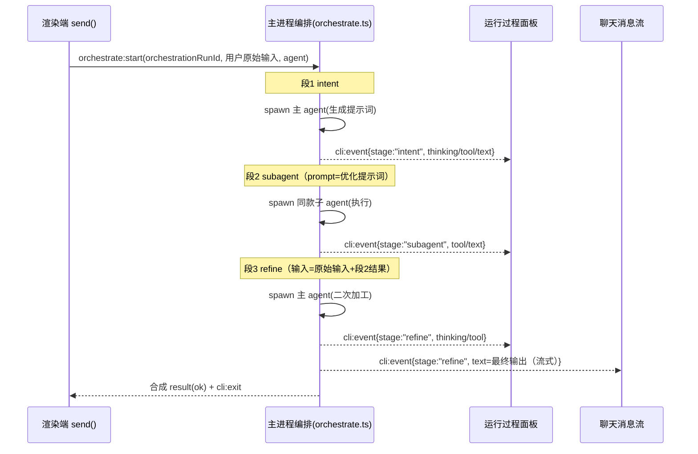
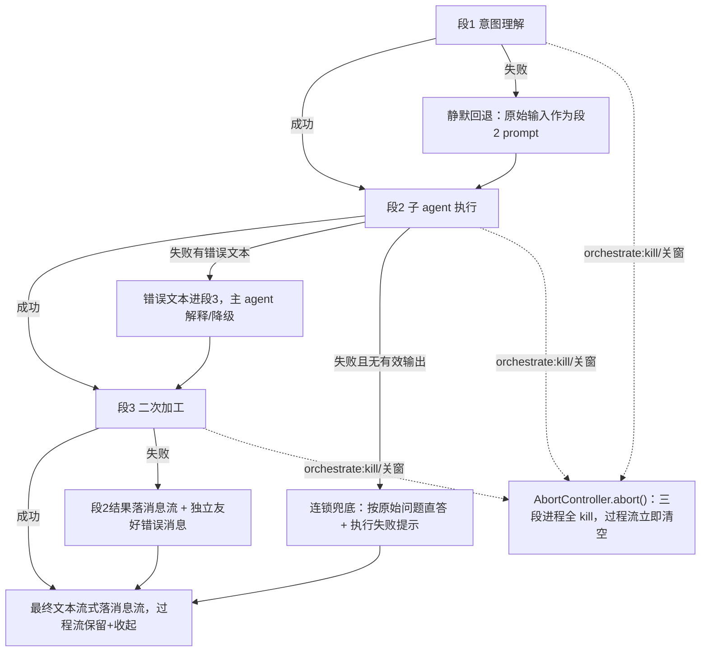

# feat: 个人工作区 chat 主 agent 编排子 agent 三段式执行链路

## Summary

在个人工作区 chat 会话引入「主 agent 编排子 agent」三段式执行链路，对会话消息**自动生效**。用户发一条消息后：(1) 主 agent 理解意图、产出一份优化提示词；(2) spawn **同款**子 agent 执行该提示词；(3) 子 agent 结果回传主 agent，二次加工（总结 / 校验 / 润色）后输出。三段中间过程（生成的提示词、子 agent 执行进度）展示在现有「运行过程」时间线面板，**只有第三段（二次加工）的文本**落聊天持久消息流。

编排在**主进程**内完成，直接复用 `startAgentProcess` / `pipeStdoutLines` / `parseLineEvents` 三个 spawn 原语；渲染端经**单一 orchestration runId** 消费带 `stage` 标注的事件流，并按 `stage` 决定事件去向（过程面板 vs 聊天流）。

---

## Problem Frame

当前 `packages/core/personal/messages.ts` 的 `send()` 是「一条用户消息 = 一次 agent run」：claude/codex 走 `bridge.startCli`、pi 走 `promptPi`，agent 直接拿**用户原始措辞**执行并把结果流回。本计划在「用户输入」与「执行」之间插入一层主 agent 意图理解，把原始输入改写为更精确的提示词再交子 agent 执行，并由主 agent 对子 agent 产出做二次加工。

**为什么放主进程编排而非渲染端串行**：渲染端若顺序 await 三次调用，会同时引入多 runId 看门狗协调、过程流段归属、`processResetKey` 闪烁三类状态难题。主进程统一编排把这些收敛到一个 orchestration run，渲染端事件契约改动最小。

**已知的前提局限（诚实记录，见 Risks）**：三段串行使简单消息也付出数倍延迟与 token 成本；同款 agent 二次加工自身输出存在「回声」风险，质量增益尚未实测验证；意图改写可能偏离原意且本期无 diff 视图。default-on 是已确认的决策；本计划保留它，但把上述代价列为风险，并以「段3 流式落聊天 + 段切换更新 typing」缓解感知延迟。

**不改变**：claude/codex/pi 适配器；非编排的轻量路径（`autoTitle`、`ask` 追问、`automation`、`workflow-headless`）；运行过程面板「永不落盘」双流约束；pi 的 `steer` 插话路径；`run-prompt-headless.ts`（编排直接调用三原语，不扩展该文件）。

---

## Requirements

| R-ID | 需求 | 验证锚点 |
|------|------|----------|
| R1 | 一条用户消息触发主进程三段编排（意图理解 → 子执行 → 二次加工），单 orchestration run 贯穿；三段 prompt 数据流：段1输出 → 段2输入，段3输入 = 用户原始输入 + 段2输出 | U1,U2 |
| R2 | 主 / 子 / 二次加工同款 agent（复用 `resolveSpawnAgentId`，含派生 agent）；codex 经同源路径走 `codex exec` spawn（混合模式） | U1 |
| R3 | 仅 `stage:"refine"` 的 text 落持久聊天消息流；`intent` / `subagent` 段的 text 与所有 tool/thinking 进过程流、永不落盘 | U1,U2,U3 |
| R4 | 中间段（intent/subagent）的 `result` 不触发渲染端 `finalizeRun`；编排器在三段完成后推一次合成终态（`result(ok)` + `cli:exit`），使渲染端正确识别成功/失败 | U1,U2 |
| R5 | 三段中间过程在运行过程面板按段可辨（意图理解 / 子 agent 执行 / 二次加工） | U3 |
| R6 | 单一 orchestration runId 驱动渲染端，三段间 `processResetKey` 不变、不触发面板重置闪烁 | U2,U3 |
| R7 | 取消（`killCli` / 关窗）经编排专属取消通道终止三段全部在途子进程；子进程不进 `cli.ts` 的 `running` Map，但有独立 `killAllOrchestrations` 接入 app 退出钩子 | U1,U2 |
| R8 | 子执行段期间主 agent 等待不被渲染端 90s/300s 看门狗误杀（编排 run 经 `transport` 标记放宽看门狗） | U2 |
| R9 | 三段串行期间聊天主流 typing 占位随段切换更新文案，避免误判卡死；段3 文本流式落聊天 | U1,U2 |
| R10 | 任一段失败有明确收尾：过程流按语义清理、用户可见错误或降级输出落**持久消息流**、不留永久 spinner；覆盖意图段静默降级与连锁失败兜底 | U1,U2 |
| R11 | 编排自动生效仅作用于个人 chat 的 `send()` 路径；轻量路径与 pi `steer` 不受影响 | U2 |

---

## Key Technical Decisions

KTD1. **编排放主进程，渲染端只见单一 orchestration run。** 新增 `apps/desktop/src/main/ipc/orchestrate.ts`，主进程内串行三段；渲染端 `send()` 把原 `bridge.startCli` 分流为「发起编排」，仍复用 `cli:event` / `cli:exit` 通道消费，只识别一个 runId。理由：避免渲染端多 run 看门狗与 `processResetKey` 闪烁。

KTD2. **直接调用三个 spawn 原语，不抽象 `runPromptHeadless`。** `orchestrate.ts` 直接组合 `startAgentProcess` + `pipeStdoutLines` + `parseLineEvents`（与 `runPromptHeadless` 同源的三个已导出原语），各段传入捕获 `sender` 与 `stage` 的行处理闭包。不给 `runPromptHeadless` 加 `onEvent` 回调变体（单消费者泛化、且需回归现有 workflow AI 节点调用方）。理由：三原语本就可直接组合，零复制；不改 `run-prompt-headless.ts`。

KTD3. **`stage` 字段同时扩展事件契约与过程流 Message 类型。** `CliStreamEvent` 加 `stage?: "intent" | "subagent" | "refine"`（`apps/desktop/src/main/ipc/types.ts` 与 `packages/core/desktop/types.ts` 两份镜像）；`Message` 的 `reasoning` / `agentLog` 变体（`packages/core/types/index.ts`）各加同名可选字段，供面板按段渲染。理由：调研指出过程流块缺「段归属」；若只改事件不改 Message，写入时 TS 报错。

KTD4. **事件按 `stage` 分流，中间段终态不外泄。** 这是「现有 fold 逻辑可直接承载」乐观断言的修正——`handleCliEvent` 的 `text` 分支当前无条件 `foldTextIntoCache`（落盘）。新行为：`intent` / `subagent` 段的 text 走过程流通道（`foldToolIntoProcess` 同侧的 text-into-process）；只有 `refine` 段（或无 stage 的非编排 run）的 text 走 `foldTextIntoCache` 落聊天。中间段的 `result` 不转发触发 `finalizeRun`；编排器在三段全部完成后推一次合成 `result(ok)` + `cli:exit`，渲染端据此识别终态（成功保留过程流+收起，失败立即清空）。理由：否则段1/段2 输出会污染聊天流、且首段 `result` 会在 1s 后提前 `finalizeRun` 清掉 run 状态使后续事件被丢弃。

KTD5. **取消经编排专属通道，独立注册表 + 全局回收接入。** 三段子进程注册到 `orchestrate.ts` 自有注册表（仿 `headlessProcs`），**不进** `running` Map。`RunState` 增 `transport: "cli" | "pi" | "orchestration"`；渲染端对编排 run 的取消改走**新增 `orchestrate:kill` IPC channel**（而非 `cli:kill`——后者只查 `running` Map，对编排子进程是 no-op）→ `AbortController.abort()` → 三段 `proc.kill()`。导出 `killAllOrchestrations()`，在 `register.ts` 导出清单登记并接入 app 退出钩子（仿 `killAllHeadlessPrompts` 由调用链触发）。理由：C1/FE4/F4 指出 `killAllCli` 与私有注册表的设计原则本就互斥，必须显式接线，不能假定 `killAllCli` 覆盖。

KTD6. **看门狗协调：编排 run 放宽渲染端看门狗。** 编排 run（`transport === "orchestration"`）放宽/禁用渲染端 `RUN_START_TIMEOUT_MS` 与 `RUN_STALL_TIMEOUT_MS`，改由主进程分段超时兜底（意图 / 二次加工短超时、子执行长超时）；段切换与子 agent 活动持续推事件作心跳。理由：RISK-7 双看门狗冲突——子执行期主 agent 静默会被渲染端 90s/300s 误杀，而看门狗的 `killCli` 对编排子进程又无效（KTD5），会留下孤立进程。

KTD7. **失败降级，链路总有用户可见且诚实的输出。**
- 段1失败 → **静默**回退用原始输入直接交段2（不通知用户——明确为设计意图，避免被当 bug）。
- 段2失败 → 错误文本进段3，由主 agent 解释 / 降级。
- 段3失败 → 段2结果落消息流 + 一条独立友好错误消息（`kind:"text"`，落**持久流**可回看），措辞面向用户而非透传技术报错。
- 段1+段2连锁失败（段2无任何有效输出）→ 不把错误文本当「子结果」，最终落「按原始问题直答 + 明确『执行失败』提示」。
- 意图**语义漂移**（段1技术成功但改写偏离原意）：本期**已知限制**，不做相似度检测，记入 Risks。
理由：F1/F5/D4 指出 KTD 原稿只覆盖技术失败、且连锁失败下「子结果」语义未定义。

KTD8. **主 / 子同款 agent 经 `resolveSpawnAgentId` 解析。** 子 agent 与二次加工沿用 `resolveSpawnAgentId(session, derivedAgents)`（含 JSON 派生 agent）；codex 经同源路径走 `codex exec` spawn（混合模式，非 app-server WS）。理由：用户明确「同款」；codex 混合模式是既有设计。

---

## High-Level Technical Design

三段链路是「渲染端发起 → 主进程编排 → 三段子进程 → 事件按 `stage` 分流 → 仅 refine 文本落消息流」的跨进程时序，带失败降级与连锁兜底分支。

失败降级与连锁兜底（KTD7）：

---

## Implementation Units

### U1. 主进程编排调度器（含类型扩展、取消、失败降级）

- **Goal**：实现 `orchestrate.ts`，主进程内串行三段、构造各段 prompt、推带 `stage` 的事件、合成终态、分段超时、统一取消与失败降级。
- **Requirements**：R1, R2, R3, R4, R7, R9, R10
- **Dependencies**：无
- **Files**：`apps/desktop/src/main/ipc/types.ts`、`packages/core/desktop/types.ts`（`stage` 字段，本单元首个 commit）、`apps/desktop/src/main/ipc/orchestrate.ts`（新增）、`apps/desktop/src/main/ipc/orchestrate.test.ts`（新增）、`apps/desktop/src/main/ipc/register.ts`（注册 handler + 导出 `killAllOrchestrations`）
- **Approach**：
  - Step 0：两份 `CliStreamEvent` 镜像加 `stage?: "intent" | "subagent" | "refine"`，由本单元 typecheck 连带验证镜像一致。
  - 新增 handler `orchestrate:start`，入参含 `orchestrationRunId`、用户原始输入、`cwd`、解析后的 agent（渲染端传入 `resolveSpawnAgentId` 结果）。
  - 三段各以「`startAgentProcess` + `pipeStdoutLines` + `parseLineEvents`」直接组合执行（不抽象 `runPromptHeadless`、不改该文件），行处理闭包捕获 `sender` 与本段 `stage`，经 `sender.send("cli:event", { runId: orchestrationRunId, event: {...event, stage} })` 推渲染端。
  - 段1 prompt = 意图理解系统提示 + 原始输入 → 取聚合 `text` 为优化提示词。段2 prompt = 段1 提示词。段3 prompt = 原始输入 + 段2 结果 → 段3 的 text 即最终输出。
  - 中间段（intent/subagent）的 `result` 仅编排器内部消费，**不**转发；三段完成后推一次合成 `result(ok)` + `cli:exit`（KTD4）。
  - 三段子进程注册到本模块自有 Map（仿 `headlessProcs`），不进 `running` Map；统一 `AbortController`，`abort()` → 各段 `proc.kill()`。导出 `killAllOrchestrations()`。
  - 失败降级按 KTD7 五分支实现（含连锁兜底）。分段超时具体值见 Open Questions。
- **Patterns to follow**：`run-prompt-headless.ts`（独立注册表 + AbortSignal + `killAllHeadlessPrompts` 导出范式 + 文本上限）；`cli.ts` 的 `startAgentProcess` L165 / `pipeStdoutLines` L139 / `parseLineEvents`；`register.ts` 第 36-72 行注册与导出范式。
- **Test scenarios**：
  - 三段按 intent→subagent→refine 顺序，段2 prompt = 段1 聚合 text，段3 prompt 含原始输入与段2 结果。
  - 各段事件带正确 `stage`；段3 的 text 即最终输出。
  - 中间段 `result` 不被转发；三段完成后恰好推一次合成 `result(ok)` + `cli:exit`。
  - 段1 非零退出 / 空 text → 静默回退原始输入作段2 prompt，链路继续。
  - 段2 失败有错误文本 → 错误进段3 prompt；段2 失败且无有效输出 → 走连锁兜底（不把错误当子结果）。
  - 段3 失败 → 段2 结果 + 独立错误消息两者都产出。
  - `abort()` → 三段在途进程全部 `kill`，不再推后续事件。
  - 子进程不出现在 `cli.ts` `running` Map；`killAllOrchestrations()` 能终止全部在途编排子进程。
  - 分段超时触发 → 该段 `kill` 并按失败降级处理。
- **Verification**：`pnpm --filter @cortex-work/desktop test -- run apps/desktop/src/main/ipc/orchestrate.test.ts` 全绿；`pnpm --filter @cortex-work/desktop typecheck` 通过（两份镜像一致）。

### U2. 渲染端编排接入（事件 stage 路由、看门狗、取消、typing）

- **Goal**：`send()` 分流到编排，注册单一 orchestration `RunState`，按 `stage` 路由事件，适配看门狗 / 取消 / typing 占位。
- **Requirements**：R1, R3, R4, R6, R8, R9, R10, R11
- **Dependencies**：U1
- **Files**：`packages/core/desktop/bridge.ts`、`apps/desktop/src/preload/index.ts`、`apps/desktop/src/main/ipc/orchestrate.ts`（`orchestrate:kill` channel）、`packages/core/personal/messages.ts`、`packages/core/personal/messages.test.ts`
- **Approach**：
  - bridge 新增 `orchestrateStart?(req)` 与 `orchestrateKill?(runId)`（preload 暴露 `orchestrate:start` / `orchestrate:kill`），契约镜像；web 端为 `null`，`send()` 前置守卫在缺失时回退直连 `startCli`（单一明确策略，非二选一）。
  - `send()` 在 `ensureChatLoaded` 之后、组装 prompt 处，对 claude/codex 路径改为 `bridge.orchestrateStart`（传 `resolveSpawnAgentId` 结果）；pi 路径与轻量路径不变（R11）。
  - 注册单个 orchestration `RunState`（`transport:"orchestration"`，沿用 `runs` Map 与 `runningBySession` 单 runId 槽）。
  - `handleCliEvent` 的 `text` 分支按 `stage` 路由：`intent`/`subagent` → 过程流；`refine`/无 stage → `foldTextIntoCache` 落聊天（R3）。`result` 分支：中间段不触发 `scheduleResultExitFallback`/`finalizeRun`；仅合成终态触发（R4）。
  - 取消：编排 run 的看门狗与用户 stop 改调 `bridge.orchestrateKill(orchestrationRunId)`（非 `killCli`）。
  - 看门狗：`transport==="orchestration"` 放宽 `RUN_START_TIMEOUT_MS` / `RUN_STALL_TIMEOUT_MS`（KTD6）。
  - typing：段切换时 `updateTypingMsg` 反映当前段（如「子 agent 执行中…」「整理回复中…」），由主进程在段边界事件携带可选 `stageLabel` 触发（R9）。
- **Patterns to follow**：`messages.ts` `send()` L2013-2285（注入点 step 4-8 之间）；`resolveSpawnAgentId` L204；`handleCliEvent` text 分支 L810、result 分支 L822、`scheduleResultExitFallback` L885、`finalizeRun` L938、看门狗 L2224；bridge 四文件接线（`startCli` 范式）。
- **Test scenarios**：
  - claude/codex 会话走 `orchestrateStart`，pi 会话仍走 `sendPiTurn`，`autoTitle`/`steer` 不经编排（R11，路径/调用计数断言）。
  - `stage:"intent"`/`"subagent"` 的 text **不**落持久流（不触发 `scheduleChatSave`）；`stage:"refine"` 的 text 落持久流（R3）。
  - 中间段 `result` 不触发 `finalizeRun`；合成终态触发成功保留 / 失败清空（R4）。
  - 编排 run 注册单一 runId；`runningBySession[sessionId]` 只存一个。
  - 编排 run 不被 `RUN_START_TIMEOUT_MS`/`RUN_STALL` 误杀（看门狗放宽断言）。
  - 用户 stop / 看门狗触发调 `orchestrateKill`（非 `killCli`）。
  - 段切换时 typing 文案更新（断言文案随 `stageLabel` 变化）。
  - 缺失 `bridge.orchestrateStart`（web null）→ 回退 `startCli`。
- **Verification**：`pnpm --filter @cortex-work/core test -- run packages/core/personal/messages.test.ts` 全绿；dev 桌面端 claude 会话端到端：三段先后执行、聊天只出现最终输出、典型场景无卡死误判。

### U3. 运行过程面板分段展示

- **Goal**：面板按 `stage` 分段展示三段过程，收起态可感知当前段，复用双流与折叠、不引入闪烁。
- **Requirements**：R5, R6
- **Dependencies**：U1, U2
- **Files**：`packages/core/types/index.ts`（`Message` 的 `reasoning`/`agentLog` 变体加 `stage?`）、`packages/core/personal/messages.ts`（`foldToolIntoProcess`/`foldReasoning` 透传 `stage`）、`packages/views/cortex-desktop/personal/PersonalProcessPanel.tsx`、`packages/views/cortex-desktop/personal/PersonalProcessPanel.test.tsx`（如无则新增）
- **Approach**：
  - `Message` 的 `reasoning`/`agentLog` 变体加 `stage?: "intent" | "subagent" | "refine"`；过程流写入时透传事件 `stage`。
  - 面板渲染采用**插入轻量段标题行**（`role="separator"` 的标注行）而非嵌套折叠卡片——段内步骤已有折叠，再套一层会增加操作深度。三段用户可见文案在本单元 Approach 定稿（建议「理解意图」/「执行中」/「整理回复」，最终措辞见 Open Questions）。
  - 收起态 tooltip 随 `stage` 更新（如「段 2/3：子 agent 执行中，点击展开」），纯渲染改动、无视觉重构。
  - 单 orchestration runId → `processResetKey = sessionId:runId` 三段间不变，天然规避「子 run 启动重置面板」闪烁（R6）。检测到 `stage` 切换时强制 `stick=true` 滚底，避免用户错过新段开始。
  - 默认收起语义不变（`process-panel-default-collapsed`）。
- **Patterns to follow**：`PersonalProcessPanel.tsx` 闪烁防护 L137-145、粘底滚动 L153-168、收起态按钮 L182-196；`messages.ts` `foldToolIntoProcess` L703、`foldReasoning` L1136；交错分块（commit `9b69036`，L787-806）。
- **Test scenarios**：
  - 三段事件写入过程流后按 `stage` 正确归段，段标题行出现在段边界，段内时序（thinking↔tool 交错）保持。
  - 无 `stage`（非编排 run）面板行为与现状一致（向后兼容）。
  - 三段切换不重置 `userOpen` 展开态（`processResetKey` 不变）。
  - 收起态 tooltip 随段更新。
  - 段切换触发滚底（`stick` 重置断言）。
- **Verification**：`pnpm --filter @cortex-work/views test`（面板用例）全绿；dev 端可见三段分段的运行过程时间线。

---

## Scope Boundaries

### 本计划范围内

- 个人工作区 chat 的 claude/codex 会话；主 / 子同款 agent；单子 agent；三段中间过程进运行过程面板；仅二次加工文本进聊天。

### Deferred to Follow-Up Work

- **复杂度分流 / opt-in 开关**：本期 default-on；按实测延迟与质量数据，后续评估「按消息复杂度分流」或「输入框工具栏即时开关 / `!` 前缀直连」。
- **意图改写 diff 视图**：让用户看到段1 把原始输入改成了什么。
- **多子 agent fan-out / 并行**：需扩展 `runningBySession` 为多 runId 与过程流多段并发归属。
- **跨 agent 编排**：主 claude + 子 codex 等异款组合。
- **按 agent 类型差异化段3**：codex 子 agent 的代码类输出，段3 是否跳过或用不同模板。
- **用户可配置的提示词模板 UI**：意图理解 / 二次加工系统提示当前内置。

### 非目标（不做）

- 不改 claude/codex/pi 适配器与轻量路径（`autoTitle`/`ask`/`automation`/`workflow-headless`）。
- 不改 pi `steer`。
- 不把中间产物（提示词、子结果）落盘——沿用过程流「永不落盘」。
- 不复用 / 合并 workflow runtime 的图执行器——`orchestrate.ts` 是 chat 专属编排层，与 canvas 工作流编排分层独立（见 Risks 的重叠说明）。

---

## Risks & Dependencies

- **延迟与成本放大（产品风险，default-on 已确认）**：三段串行使简单消息也付出数倍首 token 延迟与 token 成本（段1输出→段2输入→段3输入逐层累加）。缓解：段3 文本流式落聊天（R9）、段切换更新 typing 文案降低感知卡死；未缓解残留写入「复杂度分流 / opt-in」后续项。
- **质量增益未验证（前提风险）**：同款 agent 二次加工自身输出存在「回声 / 自我确认」效应，增益未实测。建议实现后以「单次调用 + 富 CoT 系统提示」为对照组实测；若增益不显著，重新评估 default-on（见 Open Questions）。
- **意图语义漂移**：段1 技术成功但改写偏离原意时无错误信号、本期无 diff 视图，用户可能收到「假信心」输出。本期已知限制，不做相似度检测。
- **RISK-7 双看门狗冲突（高）**：渲染端 90s/300s 看门狗会在主 agent 等待子 agent 期间误杀，且其 `killCli` 对编排子进程无效会留孤立进程。KTD5（`orchestrate:kill` + `killAllOrchestrations`）+ KTD6（放宽看门狗）是核心缓解，U1/U2 专项验证。若 M1 硬化计划（`docs/plans/2026-06-21-004-feat-agent-cli-pipeline-hardening-plan.md`）「主进程看门狗成为权威」先合入可进一步收敛。
- **runId 代际守卫**：三段复用单一 orchestration runId 天然规避串场；若实现中给某段单独 runId，须按 `docs/plans/2026-06-17-002-feat-pi-rpc-robustness-plan.md` KTD-3 做 `ev.runId !== active.runId → 丢弃` 守卫。
- **agent-trace 500 环形缓冲被子 agent 流式挤爆**：依赖 `docs/plans/2026-06-20-006-feat-agent-trace-stream-coalescing-plan.md` 的记录端流式合并；编排子进程 text 增量须走合并 API。
- **`foldCliEvent` 跨流收尾**：段切换时若不对过程流 `finalizeAgentLog` 收尾会留永久 spinner（U1/U2 覆盖）。
- **三镜像漂移**：`CliStreamEvent`（两份）+ `Message`（一份）的 `stage` 字段须同步，否则 narrow 失败（U1/U3 typecheck 兜底）。
- **与 workflow runtime 能力重叠**：三段编排在概念上等价于 `ai-agent → ai-agent → ai-agent` 的固定拓扑工作流。本计划有意不复用图执行器（chat 编排对单 runId/看门狗/typing 有专属耦合），但须在 `orchestrate.ts` 注释分层理由，防止未来误合并。
- **codex 子 agent 路径**：经同源走 `codex exec` spawn + `CODEX_MCP_CLEAR`（无 MCP 注入）。子 agent 若需工具须另评估放开 MCP——本期不放开。

---

## Open Questions（deferred to implementation）

- 意图理解段与二次加工段的具体**系统提示词措辞**——impl 时按实际效果迭代。
- 三段**分段超时阈值**具体数值（意图 / 二次加工短超时、子执行长超时）——impl 实测确定。
- 三段在面板的**用户可见段标题文案**与降级**错误提示措辞**——形态已在 KTD7 / U3 约束（段标题行、错误消息落持久流），具体用词 impl 定稿。
- **质量增益对照实验**（最大未知量）：三段编排 vs 单次富 CoT 调用的输出质量与延迟对比，建议 impl 后执行；结果回头校验 default-on 决策。

通道与抽象选型已在本计划关闭：事件走 `cli:event`（带 `stage`，KTD4）、不抽象 `runPromptHeadless`（KTD2）。

---

## Sources & Research

代码定位（实现起点）：

- 子 agent 执行底座参照：`apps/desktop/src/main/workflow/run-prompt-headless.ts`（独立注册表 + `killAllHeadlessPrompts` + AbortSignal + 文本上限）。
- spawn / 流式原语：`apps/desktop/src/main/ipc/cli.ts`（`startAgentProcess` L165、`pipeStdoutLines` L139、`killAllCli` L910、`cli:kill` L903、`cli:start` L407）。
- 事件契约镜像：`apps/desktop/src/main/ipc/types.ts`（`CliStreamEvent` L511-519）与 `packages/core/desktop/types.ts`。
- 过程流 Message 类型：`packages/core/types/index.ts`（`reasoning`/`agentLog` 变体 L122-141）。
- 发送入口与事件路由：`packages/core/personal/messages.ts`（`send()` L2013、`resolveSpawnAgentId` L204、`handleCliEvent` text L810 / result L822、`scheduleResultExitFallback` L885、`finalizeRun` L938、看门狗 L2224、`foldTextIntoCache`/`setMessages` L688、`setProcessMessages` L492、`foldToolIntoProcess` L703、`foldReasoning` L1136、`runs` Map L146）。
- 运行过程面板：`packages/views/cortex-desktop/personal/PersonalProcessPanel.tsx`（`processResetKey` 闪烁防护 L137-145、粘底滚动 L153-168、收起态按钮 L182-196）。
- agent 解析 / 同款：`apps/desktop/src/main/agents/agent-profiles.ts`、`resolveSpawnAgentId`。
- IPC 接线四文件范式：`register.ts`、`apps/desktop/src/preload/index.ts`、`bridge.ts`、两份 `types.ts`。

相关计划（既往决策 / 风险来源）：

- `docs/plans/2026-06-18-003-feat-personal-process-side-panel-plan.md`（双流架构、清理出口语义、timer 复活竞态）。
- `docs/plans/2026-06-14-002-fix-streaming-message-interleaving-plan.md`（`foldCliEvent` 尾部折叠、`FoldCursor`）。
- `docs/plans/2026-06-21-004-feat-agent-cli-pipeline-hardening-plan.md`（RISK-7 双看门狗、重试污染、镜像同步）。
- `docs/plans/2026-06-17-002-feat-pi-rpc-robustness-plan.md`（runId 代际守卫、会话空闲 vs 轮级看门狗正交）。
- `docs/plans/2026-06-20-006-feat-agent-trace-stream-coalescing-plan.md`（流式合并保护环形缓冲）。
- `docs/plans/2026-06-26-004-feat-codex-app-server-ws-transport-plan.md`（codex 混合模式：轻量路径走 `codex exec`）。
- `docs/lessons.md`（打包验证须复制到仓库外、`electron-builder.yml` 排除清单）。
