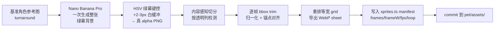
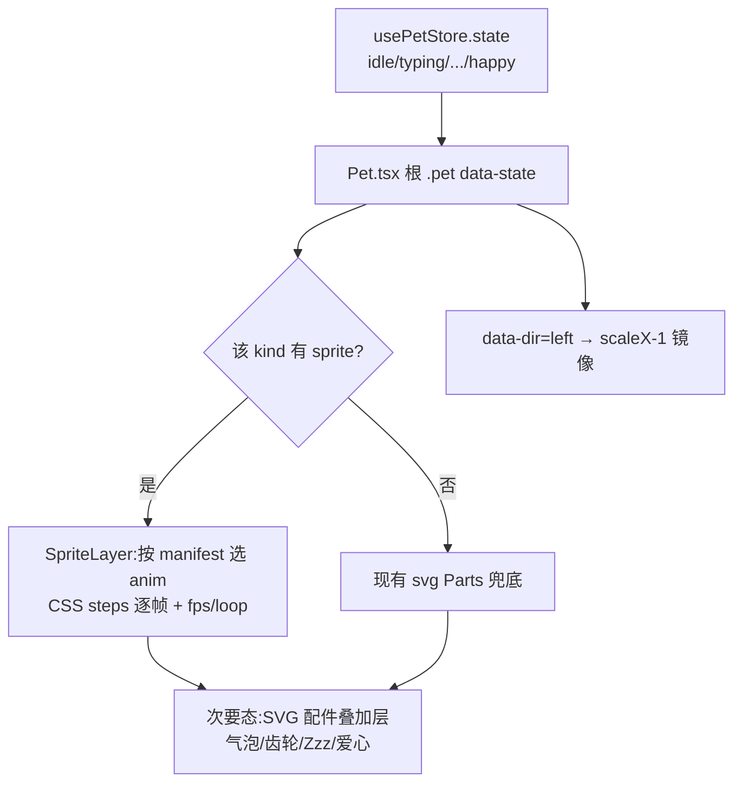

# 宠物系统 2D 游戏质感升级(Sprite 序列帧重构)

> **路线变更说明**:本计划的早期版本走「美化现有 SVG + GSAP 物理」路线。经与需求方确认,改为 **Sprite 序列帧 + AI 生成资产** 路线——用真正的逐帧 2D 美术替换内联 SVG,以达到精品虚拟宠物的游戏质感。GSAP/SVG 渐变方案已被本版本取代。

## 摘要

把桌面宠物的**渲染层**从纯 SVG + CSS keyframes 改为 **sprite sheet(序列帧)动画**:用 AI(Google Nano Banana Pro / `gemini-3-pro-image-preview`)离线生成逐帧角色美术,经一条「绿幕抠图 → 内容感知切分 → 重排等宽网格 → 导出 manifest」的资产管线,产出 commit 进仓库的 WebP sprite sheet;运行时用 CSS `steps()` 驱动逐帧播放,沿用现有 `data-state` 机制做帧序列切换。**宠物的全部外围行为逻辑(定位 / 底部巡逻 / 趴姿 / 拖拽 / 状态机节拍器)保持不变**,只替换 `<svg><Parts/></svg>` 这一层渲染。

分两阶段、先验证后铺开:**阶段一**打通整条管线并只做 1 个角色(cat)端到端跑通;**阶段二**铺开到 4 角色、接入次要状态的 SVG 配件叠加、迁移配色策略、效果打磨。

---

## 问题定义

当前宠物(`packages/views/cortex-desktop/pet/`)用内联 SVG + CSS keyframes 驱动,「卡通效果质量低、不符合游戏质感预期」:

1. **画面质量受限于手写 SVG**:纯色平填、几何简单,精细度天花板低,无法呈现精品 2D 角色的体积感、光影与细腻表情。
2. **动画物理感缺失**:跳跃只是 `translateY + rotate`,无落地弹压、腾空拉伸,缓动离游戏级弹性差一个数量级——而这类「挤压拉伸」最自然的承载方式是**把动作画进帧里**,而非用代码模拟矢量变形。
3. **生命力/互动感弱**:空闲只有呼吸,状态切换靠属性显隐配件,缺少连续逐帧动作带来的「活物感」。

**目标**:用逐帧 2D 美术 + 合适的播放节奏,使宠物在画面精细度与动作生命力上达到精品虚拟宠物的体感,同时不破坏现有的多角色 / 多状态 / 多行为模式架构。

### 范围内
- AI 资产生成管线(提示策略、绿幕抠图、内容感知切分、等宽重排、manifest 导出),作为**离线开发期工具**,产物为 commit 进仓库的 sprite sheet。
- CSS `steps()` 序列帧渲染层,挂入现有 `.pet-3d`,由 `data-state` 驱动选择帧序列。
- Pet.tsx 集成:sprite 层与现有 SVG 路径**按角色共存**(角色有 sprite 资产则走 sprite,否则回退 SVG),保证迁移期可灰度。
- 核心状态(idle/walk/happy/sleeping)丰帧;次要状态(typing/thinking/working/replying)少帧 + 复用现有 SVG 配件叠加。
- 配色策略迁移:**放弃任意主题色换肤**,改为每角色策展固定配色(可出 2–3 种预设变体)。
- 4 个角色全部接入 + 趴姿(perch)处理 + 设置页预览/选择适配。

### 范围外(延后,见末尾「延后」)
- Live2D / Spine / DragonBones 骨骼动画运行时。
- Lottie 矢量动画。
- WebGL / PixiJS 渲染(单宠物 DOM/CSS 已足够 60fps)。
- 运行时任意精确换色(canvas 灰度乘色 tint)——经评估小尺寸下发灰发糊,本期不做。
- 音效、宠物成长/数值系统、多宠物并存。

---

## 关键技术决策

| 决策 | 选型 | 理由 |
|------|------|------|
| 渲染方式 | **CSS `steps(N, jump-none)` + `background-position`** | 单只小尺寸宠物跑合成线程即可 60fps,不占主线程、不被 React rerender 拖累;左右镜像用现有 `scaleX(-1)`。canvas/PixiJS 对单宠物属过度工程。 |
| 资产生成 | **Nano Banana Pro(`gemini-3-pro-image-preview`)离线生成 + 后处理管线** | 复用 `ce-gemini-imagegen`(需 `GEMINI_API_KEY`);支持多参考图合成,利于角色一致性。产物 commit 进仓库,**非运行时生成**。 |
| 一致性策略 | **单角色单 sheet、一次生成整张 + 参考图锚定 + turnaround 提示 + 负向提示** | 一手生产案例证实:跨次生成会比例漂移,多 sheet 拼一个角色难一致;故每角色每「状态组」一次出整张,用基准角色图锚定。 |
| 抠图 | **绿幕 `#00FF00` + HSV 键控 + 2–3px 白描边缓冲** | Nano Banana Pro **不输出真 alpha**,必须后处理抠图;绿与灰/黑/肤/蓝色相无重叠,白缓冲让抗锯齿边混白而非染绿。 |
| 切帧 | **内容感知切分 + 逐帧 bbox trim + 归一化到固定网格** | 模型**不会**对齐规整网格,各帧宽度随内容变;不能均匀切,需按透明列检测切分、逐帧裁剪再统一缩放对齐锚点,最后**重排成等宽 grid** 供 CSS 消费。 |
| 配色 | **每角色策展固定配色(放弃运行时任意换色)** | 位图 `hue-rotate` 命不中精确品牌色(如 `#7c5cff`);canvas 乘色 tint 小尺寸发灰。固定配色质量最高、渲染最简。现有调色器退化为预设变体选择。 |
| 状态覆盖 | **核心态丰帧 + 次要态少帧 + 现有 SVG 配件叠加** | 控制 AI 生成 + 一致性 QA 成本;最有「体感」的动作(idle/walk/happy/sleeping)做精,信息性状态(打字/思考/工作/回复)靠少帧本体 + 复用现成气泡/齿轮/Zzz/爱心 SVG 叠层表达。 |
| 资产格式/位置 | **WebP(带 alpha)放 `pet/assets/<kind>/`,纯 ESM `import`** | Vite(desktop)与 Next(web,`transpilePackages` 含 views)各自默认解析资产,自动随 renderer bundle 进 Electron `out/**`,**无需改 electron-builder.yml**(extraResources 仅用于主进程旁置资产,sprite 不属此类)。 |
| 游戏感来源 | **挤压拉伸画进帧 + 每态独立 fps/loop + 轻量 CSS 落地补偿** | 不引入 GSAP;弹性来自帧内容与播放节奏,落地/点击可叠一个极轻的 CSS transform pop 作锦上添花。 |

### 渲染层级与共存约定
- sprite 层是 `.pet-3d` 内的一个 `background-image` 容器,与现有 hover 3D tilt(`rotateX/Y` 作用于 `.pet-3d`)层级隔离、不冲突。
- **角色级共存**:manifest 里有该 kind 的 sprite → 渲染 sprite 层;否则回退现有 `<svg><Parts/></svg>`。迁移期可逐角色切换,旧 SVG 路径在 4 角色全部就绪前保留为兜底。
- 次要状态的 SVG 配件(气泡/齿轮/汗滴/Zzz/爱心)抽成独立叠加层,**绝对定位浮在 sprite 之上**,与 sprite 本体解耦。

---

## 高层技术设计

### 资产生成管线(离线 / 开发期,产物 commit)



### 运行时渲染流(状态驱动)



---

## 输出结构(新增 / 改动文件)

```
packages/views/cortex-desktop/pet/
├── Pet.tsx                  # 改:接入 SpriteLayer + 配件叠加层,角色级 sprite/SVG 共存
├── designs.tsx              # 改/拆:抽出配件与表情,体量回落到 1200 行内
├── sprites.ts               # 新:sprite manifest(类型 + 每 kind×state 帧表)
├── SpriteLayer.tsx          # 新:CSS steps() 序列帧渲染组件
├── PetAccessories.tsx       # 新:从 designs.tsx 抽出的 SVG 配件叠加层
├── assets/                  # 新:sprite sheet 资产(WebP)
│   ├── cat/{idle,walk,happy,sleeping,...}.webp
│   ├── shiba/...
│   ├── bunny/...
│   └── robot/...
└── *.test.{ts,tsx}          # 改/增:manifest 校验 + 渲染层断言

scripts/pet-sprites/         # 新:离线资产管线(开发期工具,不进打包)
├── generate.py              # 调 Gemini 生成绿幕整张 sheet
├── key_and_slice.py         # HSV 抠图 + 内容感知切分 + bbox trim + 归一化
├── pack.py                  # 重排等宽 grid + 导出 WebP + 打印 manifest 片段
├── prompts/                 # 每角色每状态组的提示词与参考图
└── README.md               # 管线用法、GEMINI_API_KEY、QA 清单
```

> 该树是预期产出形状,非约束;实现时可按需调整布局,各单元 `**Files:**` 为准。

---

## 实现单元

> 阶段一(U1–U3)目标:**整条管线打通 + 1 个角色(cat)端到端可见**。阶段二(U4–U7)铺开。

### U1. AI sprite 资产管线 + cat 角色核心态资产

**Goal**:建立离线资产管线(生成→抠图→切分→重排→manifest),并产出 cat 角色 idle/walk/happy/sleeping 四个核心态的等宽 WebP sheet + manifest 条目,作为整条链路的验证样本。

**Requirements**:范围内「AI 资产生成管线」「核心状态丰帧」「固定配色」。

**Dependencies**:无(最先做)。

**Files**:
- `scripts/pet-sprites/generate.py`(新建)— 调 `gemini-3-pro-image-preview`,绿幕背景、turnaround/参考图锚定、负向提示,一次出整张。
- `scripts/pet-sprites/key_and_slice.py`(新建)— HSV 绿幕键控(hue ±22°、sat≥0.3、value≥0.3)+ 白描边缓冲;按透明列内容感知切分;逐帧 bbox trim;归一化缩放 + 锚点对齐。
- `scripts/pet-sprites/pack.py`(新建)— 重排等宽 grid,导出 WebP;打印可粘贴的 manifest 片段。
- `scripts/pet-sprites/prompts/cat/*.md`(新建)— cat 各核心态提示词 + 基准参考图。
- `scripts/pet-sprites/README.md`(新建)— 用法、`GEMINI_API_KEY`、人工 QA 清单。
- `packages/views/cortex-desktop/pet/assets/cat/{idle,walk,happy,sleeping}.webp`(新建,生成产物)。
- `packages/views/cortex-desktop/pet/sprites.ts`(新建)— 导出 `SpriteAnim` 类型与 `PET_SPRITES` manifest(先只含 cat 四态)。

**Approach**:
- manifest 形状(指向性,非最终签名):`type SpriteAnim = { src: string; frames: number; frameW: number; frameH: number; fps: number; loop: boolean | 'pingpong' }`;`PET_SPRITES: Partial<Record<PetKind, Partial<Record<PetState, SpriteAnim>>>>`。
- 管线为**离线一次性**:产物是 commit 的 WebP,运行时不调 Gemini。脚本语言用 Python(复用 ce-gemini-imagegen + Pillow/numpy 做 HSV 与切分),与前端 ESM 解耦。
- 关键产物纪律:每角色每状态组**一次生成整张**避免比例漂移;切帧不用均匀网格,务必内容感知 + 逐帧 trim 再统一缩放。
- 落地纪律:`generate.py` 不读取/不写入任何 renderer 代码;只产出图片与 manifest 片段供人工粘贴。

**Patterns to follow**:`~/.claude/.../ce-gemini-imagegen/SKILL.md` 的 Gemini 调用范式;资产放置沿用现有 `packages/views/cortex-desktop/personal/assets/` 同目录 `assets/` 惯例。

**Test scenarios**:
- `key_and_slice` 单测:喂一张已知绿幕测试图 → 输出 PNG 的绿色像素占比为 0(抠净),且非绿区 alpha 保留。
- 切分单测:喂一张含 3 个间隔色块的测试图 → 切出 3 帧,各帧无空白边(bbox trim 生效)。
- `pack` 单测:3 帧不等宽输入 → 输出等宽 grid,单帧宽 = max(各帧宽),帧数/尺寸写入 manifest 片段正确。
- manifest 类型测:`sprites.ts` 的 `PET_SPRITES.cat.idle` 符合 `SpriteAnim` 结构,`frames>0`、`fps∈[1,30]`。
- `Test expectation`:管线脚本为开发期工具,单测覆盖纯函数(键控/切分/打包),不验证 Gemini 网络调用(mock 或跳过)。

**Verification**:跑管线对 cat 产出 4 个 WebP + manifest 片段;肉眼 QA 帧一致、无绿边、网格对齐。

---

### U2. CSS steps() 序列帧渲染层(SpriteLayer)

**Goal**:实现一个由 manifest 驱动、`data-state` 选择帧序列、CSS `steps()` 逐帧播放的渲染组件,支持每态 fps/loop 与左右镜像。

**Requirements**:范围内「CSS steps() 渲染层」「核心状态丰帧」。

**Dependencies**:U1(需要 manifest 与一份真实 sheet 验证)。

**Files**:
- `packages/views/cortex-desktop/pet/SpriteLayer.tsx`(新建)。
- `packages/views/cortex-desktop/cortex-desktop.css`(改动,新增 sprite 动画类/变量,约 L5316–5543 宠物样式区内)。

**Approach**:
- `SpriteLayer({ kind, state })`:从 `PET_SPRITES[kind][state]` 取 `SpriteAnim`;无该态条目时回退到 idle(或交由上层决定)。
- 渲染一个 `div.pet-sprite`,`background-image: url(src)`,`background-size` = 整张 sheet 宽;用 CSS 自定义属性传 `--frames`、`--frame-w`、`--dur`,`@keyframes pet-sprite-run` 从 `background-position-x: 0` 到 `-(frames-1)*frameW`,`animation-timing-function: steps(var(--frames), jump-none)`。
- 高 DPI:出 2x 资产 + `image-rendering` 控制采样(像素风用 `pixelated`,手绘用默认平滑);`background-size` 按设计像素而非物理像素。
- 镜像沿用现有 `data-dir="left"` → 父级 `scaleX(-1)`,sprite 层无需额外资产。
- 尺寸跟随现有 `--pet-scale`。
- loop='pingpong' 用 `animation-direction: alternate` 实现来回(如呼吸/idle)。

**Patterns to follow**:现有 `.pet-3d > svg` 在 `data-dir="left"` 下 `scaleX(-1)` 的镜像写法(cortex-desktop.css L5515);`data-state` 选择器驱动动画的既有范式。

**Test scenarios**:
- 渲染 `<SpriteLayer kind="cat" state="idle"/>` → DOM 存在 `.pet-sprite`,内联/类样式含正确 `--frames` 与 `background-image`。
- 切换 `state` prop idle→happy → `.pet-sprite` 的 anim 类或 `--frames`/`--dur` 随之更新(断言 DOM/style,不验像素;jsdom 不跑动画)。
- 缺失态(如 cat 无 `typing` 条目)→ 回退 idle,不抛错。
- CSS 文本断言:`cortex-desktop.css` 含 `@keyframes pet-sprite-run` 且 timing 用 `steps(`(沿用 Pet.test.tsx 的读 CSS 字符串正则范式)。

**Verification**:desktop 跑起后 cat 在 idle/walk/happy/sleeping 下逐帧播放流畅、镜像正确。

---

### U3. Pet.tsx 集成 + 行为外壳保留(cat 端到端)

**Goal**:把 SpriteLayer 接进 Pet.tsx,按角色共存(cat 走 sprite、其余回退 SVG),保留全部定位/巡逻/趴姿/拖拽/节拍器逻辑,完成 cat 端到端可见。

**Requirements**:范围内「Pet.tsx 集成」「角色级共存」「行为外壳不变」。

**Dependencies**:U1、U2。

**Files**:
- `packages/views/cortex-desktop/pet/Pet.tsx`(改动)。

**Approach**:
- 在 `.pet-3d` 内:`PET_SPRITES[kind]` 存在 → 渲染 `<SpriteLayer kind state/>`;否则保留现有 `<svg viewBox="0 0 140 120"><Parts/></svg>`(L360 附近)。
- state→anim 映射:核心态直接映射;walk 用 `is-walking`/`data-dir` 已有信号(巡逻 rAF 改 `left` 不变),walk 序列在散步时播放。
- 现有 hover tilt、拖拽 pointer、巡逻 effect、节拍器(L105–117)**完全不动**——它们作用于根 `.pet`/`.pet-3d`,与 sprite 层正交。
- happy 触发点(L254 点击 toggle)不变,sprite 的 happy 序列由 `data-state="happy"` 选中。
- perch 暂回退现有 SVG perch 造型(sprite perch 放 U5),保证不回归。

**Patterns to follow**:现有 `data-state`/`data-mode`/`data-dir` 挂载方式(L318/346)。

**Test scenarios**:
- `kind="cat"` 渲染 → DOM 出现 `.pet-sprite`、无 `<svg><Parts/>`;`kind="shiba"`(尚无 sprite)→ 仍渲染现有 SVG。
- 点击 cat → `data-state` 切到 `happy`,sprite 层 anim 切到 happy(断言 DOM/data-state)。
- 巡逻散步:`is-walking` + `data-dir="left"` 下 sprite 层存在且父级镜像类生效(沿用 Pet.test.tsx 的 fake timers + act 推进 rAF 范本)。
- 拖拽 cat → 位置更新逻辑与现有一致(回归现有拖拽用例)。

**Verification**:cat 在所有行为模式(free/walk/perch 回退)与状态切换下表现正常,其余 3 角色无回归。

---

### U4. 次要状态处理 + SVG 配件叠加层(PetAccessories)

**Goal**:把 typing/thinking/working/replying 做成「少帧 sprite 本体 + 复用现有 SVG 配件叠加」;将配件/表情从 designs.tsx 抽成独立叠加层组件,控制 designs.tsx 体量。

**Requirements**:范围内「次要状态少帧 + SVG 配件叠加」;约束「单文件 ≤1200 行」。

**Dependencies**:U3。

**Files**:
- `packages/views/cortex-desktop/pet/PetAccessories.tsx`(新建,从 designs.tsx 抽出 `Accessories`/气泡/齿轮/Zzz/爱心等)。
- `packages/views/cortex-desktop/pet/designs.tsx`(改动,移除已抽出部分,体量回落)。
- `packages/views/cortex-desktop/pet/Pet.tsx`(改动,在 sprite 上叠加配件层)。
- `packages/views/cortex-desktop/cortex-desktop.css`(改动,配件叠加层定位/显隐沿用现有 `[data-state]` 显隐规则,约 L5355–5413)。

**Approach**:
- `PetAccessories({ state })`:绝对定位浮在 sprite 之上的 SVG 叠层,沿用现有「默认隐藏 + `data-state` 显隐」机制(气泡/齿轮/汗滴/Zzz/爱心)。
- 次要态本体用少帧(如 1–3 帧的轻动:打字耳动、思考仰头),信息靠配件叠层表达。
- 抽离纯搬运:`Accessories`/`Eyes` 等迁到新文件,导出供 Pet.tsx 与设置页预览共用;designs.tsx 仅保留 SVG 兜底造型与配色/持久化纯函数。

**Patterns to follow**:现有 cortex-desktop.css L5355–5413 的 `[data-state]` 配件显隐;designs.tsx 现有 `Accessories()`(L12)/`Eyes()`(L67)结构。

**Test scenarios**:
- `state="thinking"` → 配件叠加层中思考气泡可见(`data-state` 选择器命中,断言 DOM 结构/class)。
- `state="idle"` → 所有配件隐藏。
- designs.tsx 抽离后:`petColorVars`/`loadPetSize` 等纯函数测试仍通过(designs.test.ts 不回归)。
- 行数核对:designs.tsx 与 PetAccessories.tsx 均 < 1200 行。

**Verification**:四个次要态在 sprite 角色上配件叠加正确,SVG 兜底角色行为不变。

---

### U5. 铺开至 shiba/bunny/robot + 趴姿(perch)处理

**Goal**:用 U1 管线产出其余 3 角色的核心态 + 次要少帧 sheet,补 manifest;处理各角色 perch 姿态(专属帧或优雅回退)。

**Requirements**:范围内「4 个角色全部接入 + 趴姿处理」。

**Dependencies**:U1(管线)、U3(集成)、U4(配件层)。

**Files**:
- `scripts/pet-sprites/prompts/{shiba,bunny,robot}/*`(新建)。
- `packages/views/cortex-desktop/pet/assets/{shiba,bunny,robot}/*.webp`(新建,生成产物)。
- `packages/views/cortex-desktop/pet/sprites.ts`(改动,补 3 角色条目 + 各 perch 条目)。
- `packages/views/cortex-desktop/pet/Pet.tsx`(改动,perch 分支接 sprite)。

**Approach**:
- 复用 U1 管线;每角色保持单角色单 sheet 一致性纪律 + 人工 QA。
- perch:优先出一帧专属趴姿(对齐现有 `PERCH_EDGE_Y` 几何);若该角色 perch 资产未就绪,回退现有 SVG perch(共存机制保证不回归)。
- 全部 4 角色就绪后,SVG 兜底路径可标记为可删(实际删除放 U7 cleanup,避免本单元过宽)。

**Test scenarios**:
- 四角色各自渲染 → 均出 `.pet-sprite`,manifest 条目齐全。
- robot perch 有 sprite → 渲染 sprite perch;某角色 perch 无 sprite → 回退 SVG perch,几何对齐输入框上沿不偏。
- 设置页造型切换 cat→robot → sprite 正确换角色(无残留上一角色帧)。

**Verification**:4 角色 × 核心态 + 次要态 + perch 全部可见且一致;设置页预览正确。

---

### U6. 配色策略迁移(固定配色 + 设置页调色器退化)

**Goal**:对 sprite 角色放弃运行时任意换色,设置页颜色选择器退化为「预设配色变体」选择(或在 sprite 角色下隐藏),清理失效的 CSS 变量上色路径。

**Requirements**:范围内「固定配色 / 调色器退化」。

**Dependencies**:U3(至少一个 sprite 角色就绪)。

**Files**:
- `packages/views/cortex-desktop/personal/SettingsMenu.tsx`(改动,`PetSection` 约 L187)。
- `packages/views/cortex-desktop/pet/designs.tsx`(改动,梳理 `petColorVars`/`loadPetColor` 仅服务 SVG 兜底)。
- `packages/views/cortex-desktop/pet/Pet.tsx`(改动,sprite 角色不注入 `--pet-*` 颜色变量)。
- `packages/core/i18n/resources/{zh-Hans,en}/pet.json`(改动,变体/配色文案)。

**Approach**:
- sprite 角色:`styleVars` 不再注入 `petColorVars(color)`(那是给 SVG `fill` 用的);若该角色出了多预设配色变体,调色器改为列出变体(每变体对应一套 sheet,manifest 用变体 key)。
- SVG 兜底角色:保留现有任意换色,迁移期不破坏。
- 决策记录:任意精确换色(canvas tint)确认延后,文案与 UI 不暴露「自定义颜色」给已 sprite 化的角色。

**Test scenarios**:
- sprite 角色(cat)被选中 → 设置页不显示 RGB 调色器(或显示预设变体列表);`styleVars` 不含 `--pet-main`。
- SVG 兜底角色被选中 → 现有调色器仍可用(回归)。
- i18n:变体名在 zh-Hans/en 均有键,缺失走兜底不报错。

**Verification**:sprite 角色配色稳定、调色器行为符合预期;SVG 角色换色无回归。

---

### U7. 效果打磨 + 清理(落地补偿 / retina / 废弃 keyframes)

**Goal**:加入轻量游戏感锦上添花(落地/点击的 CSS pop、可选 happy 粒子叠层),处理高 DPI 采样,清理 4 角色全 sprite 化后失效的旧 SVG keyframes。

**Requirements**:范围内「效果打磨」;质量约束「简洁优先」。

**Dependencies**:U3–U6。

**Files**:
- `packages/views/cortex-desktop/cortex-desktop.css`(改动,落地 pop / image-rendering / 移除迁移角色的废弃 `@keyframes`)。
- `packages/views/cortex-desktop/pet/Pet.tsx`(改动,落地/点击 pop 触发,可选粒子叠层挂载)。
- (可选)`packages/views/cortex-desktop/pet/PetEffects.tsx`(新建,happy/complete 轻量粒子叠层,CSS/SVG 驱动,`pointer-events:none`)。

**Approach**:
- 落地补偿:拖拽松手 / happy 落地时,对 sprite 层叠一个极轻 CSS transform pop(scaleY 0.92→1,~0.12s),与帧内挤压拉伸互补,不抢戏。
- happy/complete 粒子:沿用旧计划思路但**轻量化**——纯 CSS/SVG 几颗星/心从中心扩散淡出,`pointer-events:none`,不引动画库。可作为本单元可选项,体感不足再加。
- retina:`image-rendering` 与 2x 资产策略统一确认。
- cleanup:全 sprite 化的角色对应的旧 `@keyframes pet-jump` 等若不再被任何 SVG 路径引用则移除;仍有 SVG 兜底引用的保留。

**Test scenarios**:
- 拖拽松手 → sprite 层短暂出现 pop 类/内联 transform 后归零(断言 class 切换 + fake timers)。
- 粒子叠层(若实现):happy 进入后 DOM 出现 ≥N 个粒子元素,且 `pointer-events:none`(显示时仍可拖拽宠物)。
- CSS 文本断言:被删 keyframes 确实不再出现在 cortex-desktop.css,且无选择器引用残留。
- `Test expectation`:retina/image-rendering 为纯样式,jsdom 不验渲染,仅文本断言 CSS 含 `image-rendering`。

**Verification**:整体体感达「精品 2D 宠物」预期;无废弃样式残留;全套测试 + lint + typecheck 绿。

---

## 依赖 / 前置

- **运行时新增 npm 依赖:无**(CSS steps() 原生,无需 GSAP/Pixi/动画库)。
- **开发期工具依赖**:`scripts/pet-sprites/` 的 Python 环境(google-genai SDK、Pillow/numpy);`GEMINI_API_KEY` 环境变量。这些不进前端 bundle、不影响 Electron 打包。
- **资产产物**:WebP sprite sheet commit 进仓库,随 renderer bundle 进 `out/**`,electron-builder 无需改动。

---

## 风险与对策

| 风险 | 概率 | 对策 |
|------|------|------|
| AI 帧间角色一致性差(脸/比例漂移) | **高** | 单角色单 sheet 一次生成 + 参考图锚定 + turnaround/负向提示;先 U1 只做 cat 验证整条链路再铺开;人工 QA 关卡(README 清单)。 |
| Nano Banana 无真 alpha、网格不齐 | 高(已知) | 管线强制绿幕 + HSV 键控 + 白缓冲;内容感知切分 + bbox trim + 等宽重排,**不依赖模型对齐网格**。 |
| 资产体积撑大 Electron 包 | 中 | WebP + 单帧压到 ~128px 量级 + 每角色每状态独立 sheet 按需懒加载;关注总产物体积,必要时按状态拆分懒加载。 |
| 放弃任意换色引发现有用户感知倒退 | 中 | 每角色出 2–3 预设配色变体作补偿;SVG 兜底角色迁移期保留换色;canvas tint 明确列为「延后」可回补。 |
| designs.tsx + 新代码超 1200 行 | 中 | U4 抽出 PetAccessories;sprites.ts/SpriteLayer 独立成文件;designs.tsx 仅留兜底造型与纯函数。 |
| jsdom 无法验逐帧动画 | 低(已知) | 沿用现有 Pet.test.tsx 策略:断言 DOM/`data-state`/class/style 数值 + CSS 文本正则 + fake timers 推 rAF,不验像素。 |
| Web 端(Next)与 Desktop(Vite)资产解析差异 | 低 | 统一用 ESM 默认 `import` 取 URL(避免 `new URL(import.meta.url)` 在 Next 的坑);两端 `transpilePackages`/Vite 默认均支持;U2 落地时两端各验一次。 |

---

## 延后(本计划不做)

- **运行时任意精确换色(canvas 灰度乘色 tint)**:小尺寸发灰发糊,作为 U6 的二期可回补项。
- **Live2D / Spine / DragonBones 骨骼动画**:工具链与资产成本高,延后。
- **Lottie 矢量动画 / 外部皮肤市场**:延后。
- **WebGL / PixiJS 渲染**:单宠物 CSS 已足够,延后。
- **音效**:Electron 音频权限与多平台适配需单独规划。
- **宠物成长/数值系统(亲密度、饥饿值)、多宠物并存**:独立规划,延后。

---

## 实现顺序建议

1. **阶段一(打通 + 验证)**:U1(管线 + cat 核心态)→ U2(渲染层)→ U3(集成,cat 端到端可见)。这是最大风险点(AI 一致性 + 整条链路),先用 1 角色坐实。
2. **阶段二(铺开)**:U4(次要态 + 配件层)→ U5(其余 3 角色 + perch)→ U6(配色迁移)→ U7(打磨 + 清理)。
3. U4 与 U5 可部分并行(配件层与资产生成相互独立);U6/U7 依赖前序就绪后收尾。

---

> **资产生成提示策略沉淀建议**:本工作落地后值得用 `/ce-compound` 沉淀三类易踩坑点——electron-builder 资产两端打包差异、jsdom 下序列帧动画测试策略、Nano Banana 生成一致角色 sheet 的提示/后处理管线。仓库当前无 `docs/solutions/`,可借此首次建立。
