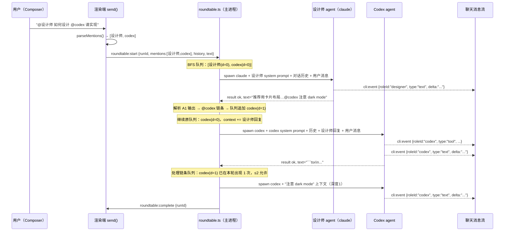
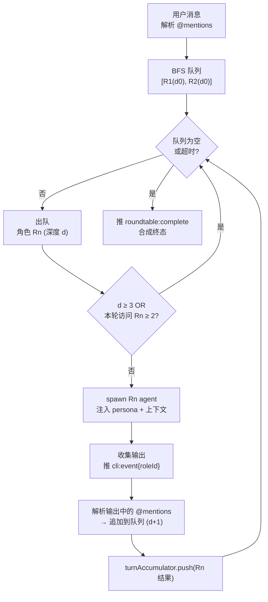

# feat: 多 agent 角色圆桌会话（@mention 路由 + 全局角色库 + 跨 agent 链条执行）

## Summary

在个人工作区 chat 中引入「圆桌会话（Roundtable）」能力：用户在消息中通过 `@角色名` 指向特定 agent，该 agent 的输出作为对话上下文的一部分返回，并可自动触发被提到的其它角色（跨 agent 链条，最大深度 3）。

全局角色库（`roles.json`）统一管理「角色 ↔ agent 映射 + persona system prompt」；`@claude` / `@codex` / `@pi` 作为内置快捷方式无需配置即可直接 @。所有角色跨会话复用。

主进程侧新增 `roundtable.ts` 编排器，复用 `orchestrate.ts` 已建立的三原语（`startAgentProcess` + `pipeStdoutLines` + `parseLineEvents`）+ 独立进程注册表 + 专用取消通道模式。渲染端经 `cli:event` 消费带 `roleId` 标注的事件流，每个角色的响应作为独立带角色头的消息呈现在聊天流中。

---

## Problem Frame

当前个人 chat 的 `send()` 是「一条用户消息 = 一次 agent run」：会话绑定单一 `session.agent`，无法在同一会话内按需切换到另一个 agent，也没有「角色/人格」抽象。用户若需让 codex 和 claude 协作完成一个任务，必须手动在两个不同会话之间切换、复制粘贴结果，无法实现有机对话。

**本计划目标**：
1. 允许用户在消息中 `@角色名` 路由该消息（或其中某个 @mention 片段）给特定角色的 agent 执行。
2. 允许 agent 的输出中再包含 `@mention` 来触发另一个角色（跨 agent 链条，有深度上限）。
3. 提供全局角色库 UI，让用户创建带 persona prompt 的自定义角色（如「前端设计师 → claude + 设计专家 system prompt」）。
4. 内置 `@claude` / `@codex` / `@pi` shortcut，无需创建角色即可直接调用。

**不改变**：
- 无 @mention 的消息走现有路径（`startCli` / `startOrchestration` / `sendPiTurn`），行为零变化。
- Pi steer/fork 路径不受影响。
- `orchestrate.ts` 三段编排不变，圆桌编排是独立层。
- `cli.ts` 的 `running` Map、`cli:kill`、看门狗语义不变。

---

## Requirements

| R-ID | 需求 | 验证锚点 |
|------|------|----------|
| R1 | 消息中的 `@角色名` 被解析为圆桌调度目标；多个 @mention 依次执行 | U2, U4 |
| R2 | 内置 shortcut：`@claude`/`@codex`/`@pi` 无需创建角色直接可用 | U2 |
| R3 | 角色库支持 CRUD（名称、绑定 agent、persona system prompt、颜色/emoji avatar） | U1, U5 |
| R4 | 角色全局持久化（`roles.json`），跨会话复用 | U1 |
| R5 | 圆桌执行顺序：按 @mention 出现顺序 BFS 调度；每个角色的响应纳入后续角色的上下文 | U3 |
| R6 | 跨 agent 链条：角色 A 输出中的 @mention 自动触发角色 B（深度上限 3，单轮内每角色最多出现 2 次） | U3 |
| R7 | 每个角色响应以独立消息（带角色头像/标签）呈现在聊天流中 | U4, U6 |
| R8 | 单一圆桌 `runId`，过程面板按角色分区显示；看门狗放宽（对齐 orchestration 模式） | U3, U4 |
| R9 | 取消（`roundtable:kill` / 关窗）终止所有在途角色子进程；注册表独立不进 `running` Map | U3 |
| R10 | 无 @mention 的消息不走圆桌，走现有路径，行为不变 | U4 |
| R11 | @mention 在 Composer 中有触发下拉选角色的 autocomplete UI | U6 |
| R12 | 角色失败（子进程非零/超时）有明确收尾：错误标注在该角色的消息块中，不影响后续角色 | U3 |

---

## Key Technical Decisions

**KTD1. 角色持久化：`roles.json` + `PersistedState.roles[]`，复用 `agents.local.json` 模式。**
主进程持有 `~/.cortex-desktop/roles.json`（结构同 `agents.local.json`）；IPC CRUD 写穿到文件；`store:load` 时随 `PersistedState` 一同注入渲染端 store。内置 shortcut 不存 JSON，由 `mention.ts` 的常量表计算。理由：与 derivedAgents 同源，持久化语义一致，不引入新机制。

**KTD2. `CliStreamEvent` 扩展 `roleId?: string` 字段，复用 `cli:event` 通道。**
不新增 IPC 通道。圆桌各角色的事件在现有 `cli:event` 上附加 `roleId`（形如 `"designer"` / `"codex"`）；渲染端 `handleCliEvent` 按 `roleId` 分支到角色消息累积器。与 `stage` 字段正交——圆桌 run 不用 `stage`（无三段语义）。理由：统一事件通道，减少 IPC 接线；渲染端路由分支清晰。

**KTD3. 聊天流新增 `roleHeader` 消息类型 + `text` 扩展 `roleId?` 字段。**
每个角色开始说话前推一条 `{ kind: "roleHeader", roleId, roleLabel, roleColor? }` 分隔行（对齐 `stageTitle` 语义），之后的 text 增量带 `roleId` 字段落入 `foldTextIntoCache` 对应角色的独立 buffer。渲染端按 `roleId` 切换头像/颜色显示。理由：最小化 `Message` 改动（复用 `foldTextIntoCache` 机制，只加字段），视觉上清晰区分各角色发言。

**KTD4. `roundtable.ts` 为独立 BFS 编排器，不复用/不改 `orchestrate.ts`。**
新增 `apps/desktop/src/main/ipc/roundtable.ts`，内置 BFS 队列（按 @mention 顺序 + 链条追加），独立 AbortController 注册表（`activeRoundtables: Map<runId, AbortController>`），`roundtable:kill` IPC channel，`killAllRoundtables()` 导出。理由：圆桌编排是多进程/多角色/BFS 语义，与三段编排差异大；强行复用 orchestrate 反而复杂化。

**KTD5. 每轮上下文累积：后续角色获得前序角色的响应作为上下文。**
Context 构造：`[role system prompt] + [对话历史（截断至合理长度）] + [本轮用户消息] + [本轮已响应角色的文本]`。后调度的角色自然比先调度的角色拥有更多轮次上下文，实现「角色 A 说完，角色 B 看到 A 的回答再作答」。主进程维护 `turnAccumulator: { roleId, roleLabel, text }[]`，每次角色完成后 append。理由：实现跨角色信息传递，无需额外 IPC。

**KTD6. @mention 解析为纯函数 `parseMentions(text, roles)` 在渲染端执行。**
`packages/core/personal/mention.ts` 导出 `parseMentions(text: string, roles: RoleConfig[], builtins: BuiltinRole[]): MentionTarget[]`。规则：匹配 `@(\w+)` 或 `@([\p{L}\d_]+)`（支持中文标签）；code fence / inline code 内的跳过；先查 builtin shortcut（完全匹配 id），再查自定义角色（id 或 label 大小写不敏感匹配）；去重保序。解析在 `send()` 内调用，结果传入 IPC。理由：纯函数易测，避免主进程依赖渲染端业务逻辑。

**KTD7. `send()` 前置 @mention 检测，分流到圆桌路径。**
在 `ensureChatLoaded` 之后、agent 路由之前插入 `parseMentions()`。有 mention → `bridge.startRoundtable(...)` + `transport:"roundtable"` RunState；无 mention → 走既有 orchestration / startCli 路径（R10）。Pi 路径不变（R10 约束）。理由：最小入侵现有 send 链路，一个条件分支收口。

**KTD8. 失败隔离：角色失败不阻断后续角色。**
每个角色子进程的 `runStage()` 捕获 reject / 超时，向渲染端推 `{ type: "result", ok: false, error, roleId }` 事件，在该角色消息块内显示错误标注（R12）。之后 BFS 队列继续处理后续角色，turn accumulator 将失败角色标记为 `[Error: ...]`（作为后续角色的上下文提示）。全部角色完成后推 `roundtable:complete`。

---

## High-Level Technical Design

圆桌会话的完整数据流：Composer @mention → 渲染端分流 → 主进程 BFS 调度 → 各角色 agent 并串 → `cli:event + roleId` 流回 → 渲染端按角色累积消息 → 聊天流多角色呈现。



BFS 调度与深度控制：



角色消息在聊天流中的布局（概念）：

```
[用户] @设计师 如何设计 @codex 请实现
─────────────────────────────────────
[🎨 设计师 · claude]
  推荐用卡片布局，主色 #7c5cff，注意 dark mode...
─────────────────────────────────────
[💻 Codex · codex]
  ```tsx
  export function Card({ ... }) { ... }
  ```
─────────────────────────────────────
[💻 Codex · codex]（链条深度 1：dark mode 补丁）
  ...
```

---

## Output Structure

新增的关键文件布局（其余为已有文件扩展）：

```
apps/desktop/src/main/ipc/
  roundtable.ts        ← 新增：BFS 编排器
  roundtable.test.ts   ← 新增：编排器单测
  roles.ts             ← 新增：全局角色 CRUD + roles.json 持久化

packages/core/personal/
  mention.ts           ← 新增：@mention 解析器
  mention.test.ts      ← 新增：解析器单测

packages/views/cortex-desktop/personal/
  RoleManager.tsx      ← 新增：角色库管理 UI
  RoleEditor.tsx       ← 新增：创建/编辑角色 Modal
  MentionPicker.tsx    ← 新增：@-触发的角色选择下拉
  RoleMessageBubble.tsx ← 新增：带角色头的消息气泡
```

---

## Implementation Units

### U1. 全局角色数据模型与持久化（类型 + IPC + Store）

- **Goal**：建立 `RoleConfig` 类型、主进程 `roles.json` 持久化、IPC CRUD、渲染端 store 同步。
- **Requirements**：R3, R4
- **Dependencies**：无
- **Files**：
  - `packages/core/desktop/types.ts` — 新增 `RoleConfig`，扩展 `PersistedState.roles?`
  - `apps/desktop/src/main/ipc/roles.ts` — 新增，CRUD + JSON 持久化
  - `apps/desktop/src/main/ipc/register.ts` — 注册 `registerRoleHandlers`
  - `packages/core/store/personal.ts` — 新增 `roles: RoleConfig[]` store 字段 + CRUD actions
  - `packages/core/desktop/bridge.ts` — 新增 `listRoles?`/`createRole?`/`updateRole?`/`deleteRole?`
  - `apps/desktop/src/main/ipc/roles.test.ts` — 新增
- **Approach**：
  - `RoleConfig`: `{ id: string; label: string; agent: string; systemPrompt: string; color?: string; avatar?: string; createdAt: string; updatedAt: string }`。`agent` 是字符串（接受 `AgentKind` 或 `derivedAgentId`，对齐 `CliStartRequest.agent`）。
  - 持久化路径：`join(homedir(), ".cortex-desktop", "roles.json")`（对齐 `agents.local.json` 模式）。
  - `roles.ts` 导出：`loadRoles()` / `saveRoles()` / `createRole(payload)` / `updateRole(id, patch)` / `deleteRole(id)` — 同步读写 + 竞态保护（`sessionWriteQueue` 或简单 lock file 同模式）。
  - IPC handler：`roles:list`（`ipcMain.handle`）/ `roles:create`/`update`/`delete`（`ipcMain.handle`）；CRUD 后广播 `roles:changed` 事件（`webContents.send`），渲染端 store 更新。
  - `PersistedState` 扩展 `roles?: RoleConfig[]`，`hydrate()` 写入 store。
  - 内置 shortcut（`@claude`/`@codex`/`@pi`）不存 `roles.json`，由 U2 的常量表提供，此处只管理用户自定义角色。
- **Patterns to follow**：`agent-profiles.ts`（loadAgentProfiles/saveAgentProfiles 范式）；`register.ts` handler 注册范式。
- **Test scenarios**：
  - `loadRoles()` 在文件不存在时返回 `[]`，不 throw。
  - `createRole()` 新增角色后 `loadRoles()` 返回包含该角色的数组。
  - `updateRole()` 只更新指定字段，`updatedAt` 刷新。
  - `deleteRole()` 移除对应 id，id 不存在时静默成功。
  - `roles:list` IPC 返回当前全量角色列表。
  - `roles:create` → 文件写穿 → `loadRoles()` 验证一致。
- **Verification**：`pnpm --filter @cortex-work/desktop test -- run apps/desktop/src/main/ipc/roles.test.ts` 全绿；`pnpm typecheck`。

---

### U2. @mention 解析器

- **Goal**：纯函数解析用户消息中的 `@mention`，分别解析内置 shortcut 与用户自定义角色，返回有序去重的调度目标列表。
- **Requirements**：R1, R2
- **Dependencies**：U1（`RoleConfig` 类型）
- **Files**：
  - `packages/core/personal/mention.ts` — 新增
  - `packages/core/personal/mention.test.ts` — 新增
  - `packages/core/desktop/types.ts` — 新增 `MentionTarget`（含解析出的角色信息）
- **Approach**：
  - 正则匹配 `@([\w\p{L}\p{N}_\-]+)`（支持 Unicode 字母 + 数字 + 下划线 + 连字符）；使用 `u` flag。
  - 跳过 code fence（` ``` ` 内部）和 inline code（`` ` `` 内部）里的 @。
  - 解析顺序：① 按 `mention.toLowerCase()` 完全匹配内置 shortcut id（`claude`/`codex`/`pi`）→ 返回 builtin `RoleConfig`；② 查自定义角色的 `role.id`（exact lowercase）→ 命中则返回；③ 查自定义角色的 `role.label`（toLowerCase 包含匹配）→ 命中返回首个。未匹配的 mention 跳过（不 throw）。
  - 去重保序：同一角色 id 的多次 @mention 只保留首次出现的位置。
  - 返回 `MentionTarget[]`，每项含 `{ mention: string; role: RoleConfig }`。
  - 内置 shortcut 常量：`BUILTIN_ROLES: Record<string, RoleConfig>` — `claude`/`codex`/`pi` 各有 `{ id, label, agent, systemPrompt: "" }`。
- **Patterns to follow**：纯函数 + 单测，无副作用，无 IPC 依赖。
- **Test scenarios**：
  - `@codex` → 解析为内置 codex shortcut role。
  - `@claude @codex` → 返回 `[claude_role, codex_role]`，保序。
  - `@设计师` → 匹配 `label="设计师"` 的自定义角色（Unicode 中文标签）。
  - ` ```\n@codex\n``` ` → code fence 内的 @codex 被跳过。
  - `@codex @codex` → 去重，返回单个 codex。
  - 未知 `@foobar` → 跳过，不出现在结果中。
  - 混合：`@设计师 请设计 @codex 请实现` → `[设计师, codex]`，保序。
- **Verification**：`pnpm --filter @cortex-work/core test -- run packages/core/personal/mention.test.ts` 全绿；`pnpm typecheck`。

---

### U3. 主进程 Roundtable 编排器（BFS 调度 + 链条执行 + 取消）

- **Goal**：新增 `roundtable.ts`，主进程内 BFS 顺序调度多角色子进程，支持链条 @mention，独立进程注册表，统一取消，每角色失败独立收尾。
- **Requirements**：R5, R6, R8, R9, R12
- **Dependencies**：U1, U2（类型与 `RoleConfig`）
- **Files**：
  - `apps/desktop/src/main/ipc/roundtable.ts` — 新增
  - `apps/desktop/src/main/ipc/roundtable.test.ts` — 新增
  - `apps/desktop/src/main/ipc/types.ts` — 扩展 `CliStreamEvent` 加 `roleId?: string`；新增 `RoundtableStartRequest`
  - `packages/core/desktop/types.ts` — 镜像 `RoundtableStartRequest`；`CliStreamEvent` 镜像同步 `roleId?`
  - `apps/desktop/src/main/ipc/register.ts` — 注册 handler + 导出 `killAllRoundtables`
- **Approach**：
  - `RoundtableStartRequest`：`{ runId, sessionId, cwd, text, conversationHistory: Message[], mentions: MentionTarget[], permissionMode, approvalPolicy, appendSystemPrompt? }`。
  - 独立注册表：`activeRoundtables: Map<runId, AbortController>`，`roundtableProcs: Set<AgentProcess>`。
  - BFS 队列 item：`{ role: RoleConfig; depth: number; triggeredBy?: string }`。初始化为 `req.mentions.map(m => ({ role: m.role, depth: 0 }))`.
  - 每轮角色执行前检查：`depth >= MAX_DEPTH(3)` 或 `visitCount[role.id] >= 2` → skip，继续队列。
  - 上下文构造 `buildRoleContext(role, history, text, turnAccumulator)` → 组合 prompt 字符串：`[角色 system prompt] + [对话历史摘要] + [本轮用户消息] + [本轮已响应角色的文本（格式：<角色标签>: <响应>）]`。
  - 每个角色执行：调用 `startAgentProcess(getAgentDef(role.agent), { cwd, stdin: context, ...spawn opts })` + `pipeStdoutLines` + `parseLineEvents`，行处理闭包推 `sender.send("cli:event", { runId, event: { ...ev, roleId: role.id } })`。
  - 角色开始前推 `{ type: "init", roleId, stageLabel: role.label }` 作为角色头信号。
  - 中间角色的 `result` 事件不转发（防止 `finalizeRun`）；收集文本后 append `turnAccumulator`。
  - 解析该角色输出中的 @mention → 追加到 BFS 队列（depth+1），使用传入的 `builtinRoles + req.roles`。
  - 角色超时：`ROLE_TIMEOUT_MS = 30 * 60_000`（子 agent 可能有长工具链）；意图改写类角色未来可差异化（本期统一）。
  - 失败处理（R12）：catch 或非零退出 → 推 `{ type: "result", ok: false, error, roleId }` → `turnAccumulator.push({ roleId, text: "[执行失败]" })` → 继续队列。
  - 全部角色完成 → 推合成 `{ type: "result", ok: true }` + `cli:exit`（对齐 orchestrate 终态约定，让渲染端 `finalizeRun` 执行）。
  - `roundtable:kill` handler：`controller.abort()` → 各进程 `proc.kill()`。
  - `killAllRoundtables()` 导出，接入 `register.ts` app 退出钩子。
- **Patterns to follow**：`orchestrate.ts`（独立注册表 L59-76、`runStage` 模式 L156、事件转发闭包 L314、合成终态 L446-447）；`run-prompt-headless.ts`（AbortSignal + kill 导出）；`cli.ts` 三原语。
- **Test scenarios**：
  - 两个角色 `[设计师, codex]`：顺序执行，codex 收到包含设计师回复的上下文。
  - 角色 A 输出含 `@codex` → `codex` 追加到 BFS 队列（深度 1）；深度 3 时不再追加。
  - 单轮内同一角色出现 3 次 → 第 3 次 skip。
  - 各角色事件带正确 `roleId`；中间角色 `result` 不转发；最终推一次合成 `result(ok:true)` + `cli:exit`。
  - 角色子进程不进 `cli.ts` `running` Map。
  - `roundtable:kill` → 所有在途子进程 kill，不再推后续事件。
  - 角色 B 超时 → 推 `result(ok:false, roleId:B)` → 角色 C 仍正常执行。
  - `killAllRoundtables()` 终止全部在途圆桌子进程。
- **Verification**：`pnpm --filter @cortex-work/desktop test -- run apps/desktop/src/main/ipc/roundtable.test.ts` 全绿；`pnpm typecheck`（两份镜像一致）。

---

### U4. 渲染端接入（send() 分流 + handleCliEvent roleId 路由 + RunState）

- **Goal**：`send()` 在有 @mention 时路由到圆桌，注册单一圆桌 `RunState`，按 `roleId` 路由事件到角色累积消息，适配看门狗与取消。
- **Requirements**：R7, R8, R10, R12
- **Dependencies**：U2, U3
- **Files**：
  - `packages/core/personal/messages.ts` — `send()` 分流、`handleCliEvent` roleId 分支、RunState
  - `packages/core/personal/messages.test.ts`
  - `packages/core/desktop/bridge.ts` — 新增 `startRoundtable?`/`killRoundtable?`
  - `apps/desktop/src/preload/index.ts` — 暴露 `roundtable:start`/`roundtable:kill`
  - `packages/core/types/index.ts` — 新增 `roleHeader` 消息种类；`text` 消息加 `roleId?`/`roleLabel?`/`roleColor?`
- **Approach**：
  - `send()` 插入点（`ensureChatLoaded` 之后、agent 路由之前）：调 `parseMentions(text, usePersonalStore.getState().roles, BUILTIN_ROLES)`；有结果 → `bridge.startRoundtable(req)` + `RunState{ transport: "roundtable" }`；无结果 → 既有路径。Pi 路径不变。
  - Bridge：`startRoundtable(req: RoundtableStartRequest): void`；`killRoundtable(runId: string): void`。Web 端为 null，`send()` 无 roundtable bridge 时降级到 `startCli`（同 orchestration 降级约定）。
  - RunState `transport: "cli" | "pi" | "orchestration" | "roundtable"` 扩展。
  - `handleCliEvent` 新增 `roleId` 分支：
    - `type:"init"` + `roleId` → 向聊天流 append `{ kind:"roleHeader", roleId, roleLabel: stageLabel, uid }` 消息。
    - `type:"text"` + `roleId` → 调 `foldTextIntoCache` 时附带 `roleId`；写入对应角色的消息 buffer（按 `roleId` 区分 uid）。
    - `type:"tool"`/`"thinking"` + `roleId` → 过程面板（role 分区，带 `roleId`）。
    - `type:"result"` + `roleId` + `ok:false` → 在该角色的消息块尾部追加错误标注，不触发 `finalizeRun`。
    - `type:"result"` 无 `roleId`（合成终态）→ 触发 `finalizeRun`（成功保留 / 失败清空）。
  - 看门狗：`transport==="roundtable"` 放宽/禁用 `RUN_START_TIMEOUT_MS`/`RUN_STALL_TIMEOUT_MS`（对齐 orchestration 模式）。
  - 取消：圆桌 run 的 stop → `bridge.killRoundtable(runId)`（非 `killCli`）。
- **Patterns to follow**：`messages.ts` `send()` L2053-2347（orchestration 分流范式）；`handleCliEvent` stage 分支 L810；`foldTextIntoCache` L688；bridge 四文件接线范式；RunState `transport` 字段（orchestration 模式）。
- **Test scenarios**：
  - 有 `@codex` 的消息 → 调 `startRoundtable`，不调 `startCli`/`startOrchestration`。
  - 无 @mention 的消息 → 调现有路径，不调 `startRoundtable`（R10）。
  - `roleId:"designer"` text 事件 → 累积到设计师消息 buffer；`roleId:"codex"` 到 codex buffer（两个独立消息）。
  - `type:"init" roleId:"designer"` → 聊天流中 push `roleHeader` 消息。
  - `type:"result" roleId:"codex" ok:false` → 不触发 `finalizeRun`；codex 消息块含错误标注。
  - 无 `roleId` 的合成 `result(ok:true)` → 触发 `finalizeRun`。
  - 圆桌 run 不被 `RUN_START_TIMEOUT_MS` 误杀。
  - 用户 stop → 调 `killRoundtable`，非 `killCli`。
  - `bridge.startRoundtable` 为 null → 降级到 `startCli`，不 throw。
- **Verification**：`pnpm --filter @cortex-work/core test -- run packages/core/personal/messages.test.ts` 全绿；dev 桌面端：`@codex 写一个 hello world` 发送后 codex 以独立角色消息出现在聊天流中。

---

### U5. 全局角色管理 UI（创建 / 编辑 / 删除）

- **Goal**：在设置面板提供角色库 CRUD UI，支持配置角色名称、绑定 agent、persona system prompt、颜色/emoji avatar。
- **Requirements**：R3, R4
- **Dependencies**：U1
- **Files**：
  - `packages/views/cortex-desktop/personal/RoleManager.tsx` — 新增
  - `packages/views/cortex-desktop/personal/RoleEditor.tsx` — 新增（创建/编辑 Modal）
  - 已有设置面板入口文件（根据实际文件名接入，待 impl 定位）
- **Approach**：
  - `RoleManager`：角色列表（卡片式），每项显示 `avatar emoji / 颜色标识 + label + agent 标签 + system prompt 截断预览`；操作：Edit / Delete（二次确认）。底部「+ 新建角色」按钮。
  - `RoleEditor` Modal：表单字段：
    - 名称（label）：文本输入，最长 20 字。
    - Agent：下拉选（从 `agentsAvailable` + `derivedAgents` 取列表；显示 agent 名称 + 类型标签）。
    - System Prompt：多行文本 textarea，placeholder 示例（如「你是一位专业的 UI 设计师，擅长现代 SaaS 风格设计...」）。
    - Avatar emoji：可选，自由输入一个 emoji；颜色：6 种预设色板单选。
  - 保存：调 `bridge.createRole` / `bridge.updateRole`，store 同步更新。
  - 内置角色（`@claude`/`@codex`/`@pi`）展示为只读条目（不可删改），提示「内置快捷方式」。
- **Patterns to follow**：现有设置面板 Modal 组件（样式 + 布局对齐）；`agentsAvailable` store 取值方式（`usePersonalStore`）。
- **Test scenarios**：
  - 创建角色：填写表单 → 保存 → 列表出现新角色 → `bridge.createRole` 被调用。
  - 编辑角色：点击 Edit → 表单预填现有值 → 修改并保存 → `bridge.updateRole` 被调用。
  - 删除角色：点击 Delete → 确认弹窗 → 确认后角色从列表消失 → `bridge.deleteRole` 被调用。
  - 内置角色行：Edit/Delete 按钮不显示；显示「内置快捷方式」标签。
  - 名称为空时保存按钮禁用。
- **Verification**：dev 桌面端：设置面板打开角色管理，创建一个「设计师（claude）」角色，关闭重启后角色仍存在（持久化验证）。

---

### U6. Composer @mention 集成 + 多角色消息渲染

- **Goal**：Composer 输入 `@` 弹出角色选择下拉；聊天流中的圆桌消息以角色头（avatar/颜色/名称）的独立气泡渲染。
- **Requirements**：R7, R11
- **Dependencies**：U1, U4（`roleHeader` 消息类型、`text.roleId`）
- **Files**：
  - `packages/views/cortex-desktop/personal/MentionPicker.tsx` — 新增
  - `packages/views/cortex-desktop/personal/PersonalChatArea.tsx` — 集成 @mention trigger
  - `packages/views/cortex-desktop/personal/RoleMessageBubble.tsx` — 新增
  - 现有消息渲染文件（适配 `roleHeader` + `text.roleId`）
- **Approach**：
  - `MentionPicker`：监听 Composer textarea 的 `@` 触发（键盘事件检测）→ 弹出浮层列表，展示内置角色（shortcut 标签）+ 自定义角色（emoji + 名称 + agent 标签）；按 ↑↓ 导航，Enter/点击插入 `@label`；Esc / 无匹配时关闭；支持过滤输入（`@设` 过滤含「设」的角色）。
  - `RoleMessageBubble`：接收 `roleId`/`roleLabel`/`roleColor`，渲染：角色头（emoji avatar + 颜色背景标识） + 角色名 label + agent 类型徽标；消息内容区沿用现有 Markdown 渲染。
  - `roleHeader` 消息种类：渲染为水平分隔带角色标签（细线 + 「🎨 设计师 · claude」），不显示消息气泡。
  - `text` 消息带 `roleId`：识别后渲染为 `RoleMessageBubble`（角色头模式），而非普通 assistant 气泡。
  - 链条消息（depth > 0）：在角色标签旁显示「链条 · 深度N」小徽标（可选，impl 定稿）。
- **Patterns to follow**：现有 Composer 键盘事件处理（`PersonalChatArea.tsx`）；现有消息渲染分支（message.kind switch）；Tailwind 内置组件样式。
- **Test scenarios**：
  - Composer 输入 `@` → MentionPicker 出现，展示内置 3 个 + 自定义角色列表。
  - 输入 `@设` → 列表过滤为包含「设」的角色。
  - 选中角色 → Composer 插入 `@设计师`。
  - `roleHeader` 消息渲染为分隔行，不显示气泡。
  - `text` 消息含 `roleId:"designer"` → 渲染为设计师头像 + 名称 + 内容。
  - 无 `roleId` 的 `text` 消息 → 普通 assistant 气泡（向后兼容）。
- **Verification**：dev 桌面端：发送 `@codex 写一个冒泡排序`，聊天流中出现 `[💻 Codex · codex]` 角色头 + 代码内容；MentionPicker 在输入 `@` 时弹出并可选择。

---

## Scope Boundaries

### 本计划范围内

- 个人 chat 的 @mention 路由与圆桌编排（claude/codex/pi 均支持）。
- 全局角色库 CRUD（名称 + agent + system prompt + 颜色/avatar）。
- 内置 shortcut（`@claude`/`@codex`/`@pi`）无需配置直接 @。
- BFS 跨 agent 链条（深度 ≤ 3，每角色每轮 ≤ 2 次）。
- 角色消息在聊天流中的多角色气泡渲染。
- Composer @mention autocomplete 下拉。

### Deferred to Follow-Up Work

- **并行执行**：当前圆桌按序执行；并行调度需扩展 `runningBySession` 为多 runId 与过程流并发归属。
- **角色会话延续（agentSessionId per role）**：本期每轮角色均无状态 spawn；持久化每个角色的 `agentSessionId` 可提升代码质量连贯性（derivedAgent 范式已支持，后续接入）。
- **角色导入/导出预设**：社区分享的角色模板（如「全栈工程师 + 设计师」搭档预设）。
- **可视化角色关系图**：定义「角色 A 默认接力角色 B」的固定拓扑（接近 workflow 节点）。
- **角色发言顺序模板**：预定义「设计 → 实现 → 审查」这类固定轮序，用户只需填写任务不需要 @。
- **过程面板角色分区**：本期过程流按角色合并（tool/thinking 统一展示），后续可按 roleId 分区渲染。

### 非目标（不做）

- 不改 `orchestrate.ts` 三段编排。
- 不改 `cli.ts` 的 `running` Map 与 `cli:kill`。
- 不把圆桌中间响应落盘（角色消息落聊天 JSON，过程 tool/thinking 走过程流不落盘）。
- 不复用 workflow runtime 图执行器（圆桌编排对单 runId/看门狗/typing 有 chat 专属耦合，分层独立）。

---

## Risks & Dependencies

- **链条深度与 token 成本（主要风险）**：深度 3、每角色 2 次上限，理论最坏 6 次子进程 + 上下文逐轮膨胀，单轮延迟与成本可达 6 倍。缓解：设硬上限不可配；实现后以真实任务实测，评估是否需要用户可见的「圆桌进行中」进度指示。
- **无限循环防护**：角色 A 输出 @B，B 输出 @A，若不防护则死循环。KTD7 的「每角色每轮 ≤ 2 次 + 深度上限」是核心防护，U3 测试专项覆盖。
- **上下文长度爆炸**：多角色响应逐轮叠加，超出模型 context window。缓解：`buildRoleContext` 对 `conversationHistory` 截断（对齐 `runPromptHeadless.ts` 的 `MAX_OUTPUT` 逻辑）；本期不实现智能压缩，记为限制。
- **`CliStreamEvent` 两份镜像**：新增 `roleId?` 须同步 `apps/desktop/src/main/ipc/types.ts` + `packages/core/desktop/types.ts`，typecheck 兜底（对齐 `stage` 字段既有处理）。
- **`foldTextIntoCache` 多角色 buffer 冲突**：现有实现是单消息 buffer；按 `roleId` 区分 uid 后，需确保每个角色有独立的累积器不互相覆盖。U4 测试覆盖两角色同时流式输出的交错场景。
- **与 orchestrate.ts 的能力重叠**：圆桌编排（多 agent / 多 role）在概念上是 orchestrate 的超集变体。本计划有意不复用（理由见 KTD4），须在 `roundtable.ts` 注释分层说明，防止未来误合并。
- **Pi 路径不支持圆桌**：Pi 走 RPC 长连接，与子进程 spawn 模式不兼容；`send()` 对 pi 会话检测到 @mention 时返回提示「Pi 会话暂不支持 @mention 路由」并降级直连 Pi（不调 `startRoundtable`）。记为已知限制。
- **看门狗双轨**：圆桌与 orchestration 同样需放宽渲染端看门狗（KTD8 / R8），实现须与既有 `transport==="orchestration"` 逻辑对齐，避免漏放。

---

## Open Questions（deferred to implementation）

- `buildRoleContext` 中对话历史截断策略的具体 token 上限（按字符还是按 token 估算？）——impl 时参照 `runPromptHeadless.ts` 的 `MAX_OUTPUT = 200_000` 字符上限定稿。
- 角色下拉 UI 集成到哪个现有设置面板入口——impl 时定位 `PersonalSettingsPanel` 或等价文件。
- 链条消息的视觉表达方式（「链条·深度N」徽标 vs 缩进 vs 分色）——impl 时按实际视觉效果定稿。
- 角色 system prompt 与 `globalInstruction` / `appendSystemPrompt` 的优先级与拼接顺序——impl 时参照 `messages.ts:2204-2208` 的拼接顺序定稿。

---

## Sources & Research

代码定位（实现起点）：

- 编排器模板：`apps/desktop/src/main/ipc/orchestrate.ts`（BFS 替换三段串行；进程注册表 L59-76；事件转发 L314；合成终态 L446）。
- Spawn 原语：`apps/desktop/src/main/ipc/cli.ts`（`startAgentProcess` L165，`pipeStdoutLines` L139，`parseLineEvents`，`spawnEnvForDef`）。
- Agent 解析：`apps/desktop/src/main/agents/index.ts`（`getAgentDef` L118，`baseAgentKindOf` L134）。
- 事件契约（两份镜像）：`apps/desktop/src/main/ipc/types.ts`（`CliStreamEvent` L516-524）与 `packages/core/desktop/types.ts`。
- 消息发送入口：`packages/core/personal/messages.ts`（`send()` L2053，orchestration 分流 L2300-2324，`handleCliEvent` L810，`foldTextIntoCache` L688，看门狗 L2224）。
- 持久化模式：`apps/desktop/src/main/agents/agent-profiles.ts`（roles.json 建模参考）；`packages/core/store/personal.ts`（`PersistedState` 扩展，derivedAgents L170）。
- 消息类型：`packages/core/types/index.ts`（`Message` 联合 L109-164，`stageTitle` 的 L154-164 是 `roleHeader` 建模参考）。
- Bridge 接线四文件：`packages/core/desktop/bridge.ts` L80；`apps/desktop/src/preload/index.ts`；`apps/desktop/src/main/ipc/register.ts` L65；`apps/desktop/src/main/ipc/types.ts`。
- Composer 键盘事件：`packages/views/cortex-desktop/personal/PersonalChatArea.tsx` L502（submit 入口）。

相关计划（依赖与风险参考）：

- `docs/plans/2026-06-27-001-feat-chat-subagent-orchestration-plan.md`（单 agent 三段编排；KTD5/KTD6 看门狗模式是圆桌的建模参考；明确分层独立，防止误合并）。
- `docs/plans/2026-06-21-004-feat-agent-cli-pipeline-hardening-plan.md`（看门狗双轨风险；进程注册表隔离）。
- `docs/plans/2026-06-17-002-feat-pi-rpc-robustness-plan.md`（Pi 路径独立性，不参与圆桌）。
- `docs/plans/2026-06-26-004-feat-codex-app-server-ws-transport-plan.md`（codex 路由细节）。
