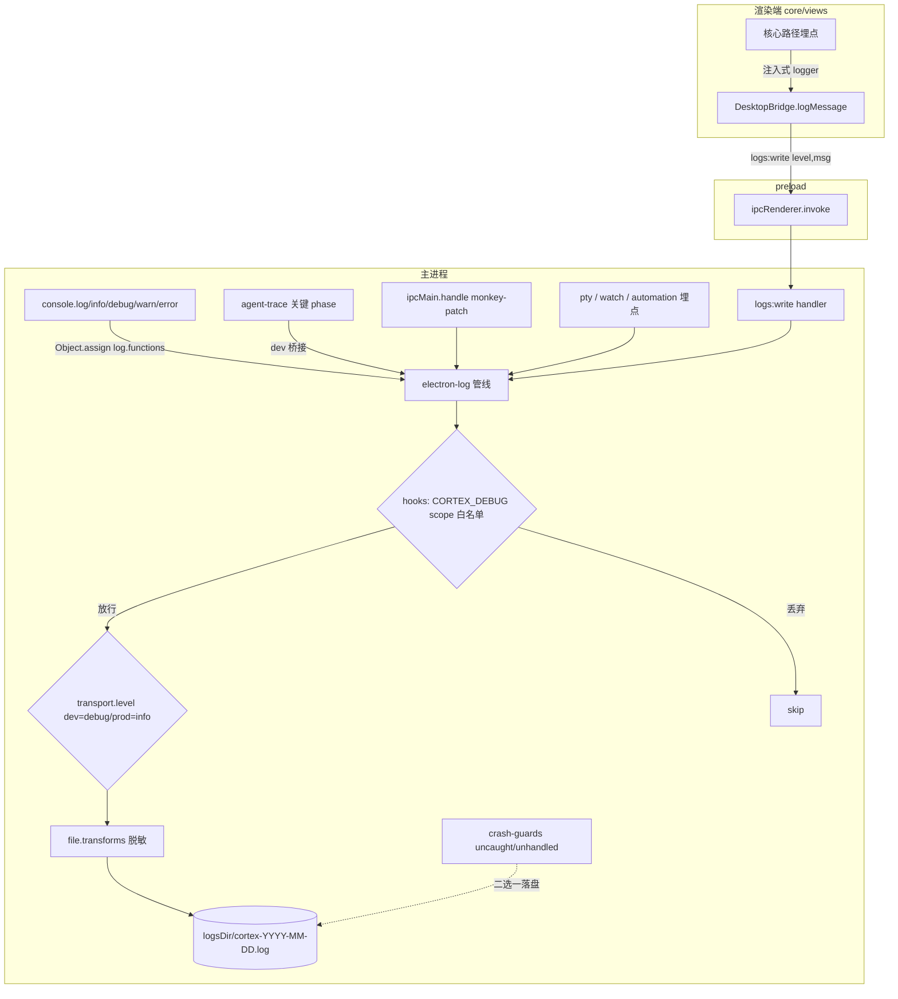
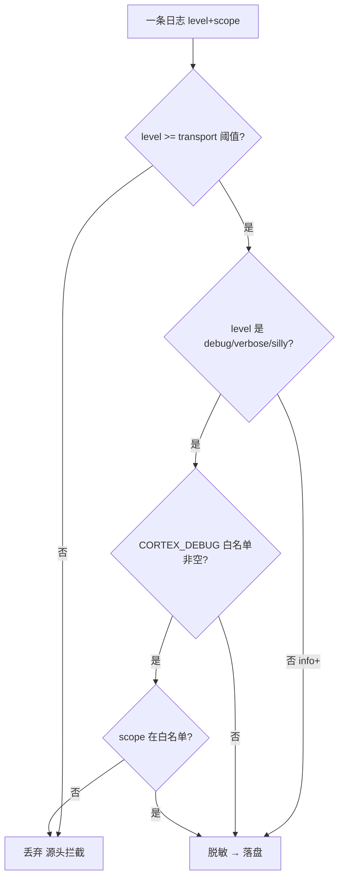

# feat: dev 本地开发阶段核心关键路径日志增强（electron-log 接管 + 全链路埋点）

## Summary

为提升本地开发调试效率，把现有「仅接管 console.error/warn 的自研文件日志」升级为以 **electron-log v5** 为传输核心的分级、带命名空间（scope）的统一日志体系，并在四类核心关键路径上补齐结构化埋点：Agent CLI/RPC 流式管线、IPC 调用边界、渲染端核心路径、automation/pty/watch 后台。

调试日志默认在 dev（`!app.isPackaged`）下放开到 `debug` 级落盘，生产维持 `error`/`warn`，并支持 `CORTEX_DEBUG` 环境变量与设置项按 scope 白名单过滤，避免高频流式日志噪声。迁移过程**严格保留**现有三项契约资产：敏感字段脱敏、`logs:open/setEnabled/write` IPC 与 `generalSettings.log` 设置项、按天文件 + 保留 N 天清理。

关键前提（来自仓库研究）：Agent CLI/RPC 管线**已有** `agent-trace.ts` 旁路追踪系统覆盖大部分生命周期，但仅 dev、仅内存、不落盘——因此该部分的工作主要是「把 trace 关键 phase 桥接落盘 + 补齐解析/终态/超时盲区」，而非从零埋点。

---

## Problem Frame

当前日志能力对本地调试支撑不足，具体缺口：

1. **级别缺失**：`patchConsole()`（`apps/desktop/src/main/logger.ts:68`）只接管 `console.error`/`console.warn`，`console.log`/`info`/`debug` 完全不落盘——dev 阶段最常用的调试输出无法持久化复盘。
2. **无 scope 维度**：63 处散落的 `console.*`（主进程 26 个文件）无统一命名空间与级别分层，无法按子系统过滤。
3. **核心路径盲区**：`parseLineEvents` 返回空的「无法识别行」被静默丢弃（正是 Pi RPC 终态卡死类 bug 的盲区）；pi-rpc 命令级超时、`mapPiEvent` 未产终态、扩展命令补发收尾、codex channel/server 就绪超时与意外断连均无落盘记录。
4. **IPC 异常不可观测**：`ipcMain.handle` 内部 reject 由 Electron 转发渲染端，既不冒泡到 crash-guards 也不落盘，handler 异常无据可查。
5. **渲染端近乎无日志**：`packages/core` 仅 5 处 console（全在 `personal/timeline.ts`）；`messages.ts` 的 run 看门狗超时/孤儿回收等最高价值诊断点无任何记录。
6. **脱敏口径分裂**：`logger.redactSensitive`（字符串正则）与 `agent-trace.sanitizeTraceData`（对象 key + 截断）两套独立实现，易漂移。

目标：用一套分级 scoped logger 统一以上路径，dev 下可观测、可按 scope 过滤、不泄密、不拖垮主进程，且不破坏既有契约。

---

## Requirements

### 日志基础设施

- R1. 引入 `electron-log@5.4.x` 作为日志传输核心，配置集中在主进程，`log.initialize()` 在第一个 BrowserWindow 创建之前调用。
- R2. 提供 scoped logger 工厂（如 `createLogger("cli")`），输出带 scope 标签；scope 命名沿用现有 console 前缀（`cli`/`pi-rpc`/`automation-runner` 等）。
- R3. dev（`!app.isPackaged`）下文件 transport 级别为 `debug`，生产为 `info`（或按设置）；控制台 transport 级别 dev 为 `debug`、生产 `false`。两个 transport 级别可运行时调整。
- R4. 接管全级别 console（`Object.assign(console, log.functions)`，**仅在主进程**），使 `console.log/info/debug/warn/error` 全部进入统一管线落盘。
- R5. 支持 `CORTEX_DEBUG` 环境变量与设置项按 scope 白名单过滤细粒度日志（debug/verbose/silly），经 electron-log `hooks` 实现；空白名单时按全局阈值。

### 契约保留（迁移不丢能力）

- R6. 保留并复用 `logs:open`/`logs:setEnabled`/`logs:write` 三个 IPC 契约与 `generalSettings.log` 设置项；`logs:write` 级别联合类型从 `warn|error` 放宽到含 `info`/`debug`，三处镜像（`bridge.ts` ↔ preload ↔ `core/desktop/types.ts`）同步。
- R7. 保留按天文件命名（`resolvePathFn` 输出 `cortex-YYYY-MM-DD.log` 于 `logsDir()`）与「保留 N 天清理」（electron-log 不提供，沿用 `cleanupOldLogs`）；关闭 electron-log 的大小轮转（`maxSize=0`）。
- R8. 收敛脱敏为单一共享工具，覆盖字符串行与结构化对象两种形态（合并 `redactSensitive` 与 `sanitizeTraceData` 口径），接到 electron-log `transports.file.transforms`，并由 agent-trace 同源调用。
- R9. 与 crash-guards 协作避免 crash 重复落盘：electron-log `errorHandler.startCatching` 与现有 `process.on(uncaughtException/unhandledRejection)` 落盘二选一，不得两边都写。

### 核心路径埋点

- R10. Agent CLI/RPC 管线：dev 下把 agent-trace 关键 phase（`error`/`exit`/`watchdog`/`retry`/`crashed`）镜像进文件日志；补齐盲区——`parseLineEvents` 返回空（解析失败）、pi-rpc 命令超时、`mapPiEvent` 未产终态、`scheduleExtensionCommandFinalize` 触发/未触发、codex channel/server 就绪超时与意外断连。
- R11. IPC 边界：以幂等 monkey-patch 方式集中拦截所有 `ipcMain.handle`，记录 channel + 入参摘要 + 耗时 + reject（仿 `patchConsole` 风格，不逐文件改 handler）。
- R12. 渲染端核心路径：经注入式 logger（扩展 `DesktopBridge.logMessage` 或 `CoreProvider` 注入）记录 CoreProvider 初始化、`messages.ts` run 看门狗超时/孤儿回收、WebSocket 触发 invalidation；dev/prod gating 在 `apps/desktop` 壳完成，`core`/`views` 零环境依赖。
- R13. 后台子系统：pty（spawn/onExit/回收）、watch（watchDir/watcher error/closeAll）、automation（runAutomation start/success/finalize/超时）关键生命周期节点补点；现有 63 处散落 console.* 迁移到 scoped logger（保留原级别）。

### 非功能

- R14. 日志写入失败不得影响主流程（沿用现有 try/catch 吞错原则）；埋点不得插入阻塞 stdout 读取的同步落盘。
- R15. 高频流式日志（agent stdout 逐行）在源头按 level/scope 拦截，而非写完再过滤；`transports.file.sync` 在高频场景评估改为异步。
- R16. 打包验证：核对 `electron-builder.yml` 的 `files` 未排除 electron-log；按 lessons 纪律做一次仓库外（/tmp）打包冒烟验证。

---

## Key Technical Decisions

- KTD1. **electron-log 作为传输核心，但不丢既有契约**。用户已确认引入 electron-log。决策为「electron-log 接管 transport / 接管 console / 提供 scope，而 `redactSensitive`、`logs:*` IPC、`generalSettings.log` 设置项、按天 + 保留 N 天清理整体迁移保留」。`logger.ts` 重构为在 electron-log 之上重新实现其既有导出（`logLine`/`appendLog` 语义、`registerLogHandlers`、`initLogger`、`setLogEnabled`、`cleanupOldLogs`），消费方（crash-guards、index 装配序列、IPC）改动面最小。理由：避免两套日志/两个开关并行漂移（learnings 明确告警）。

- KTD2. **复用 agent-trace 而非在 CLI/RPC 管线重复埋点**。`agent-trace.ts` 已覆盖 cli/oneshot/pi/pi-rpc/codex-ws 的关键 phase 且自带脱敏与环形缓冲。决策为新增「dev 下把指定 phase 镜像进 `logLine`」的桥接，并仅在当前盲区（解析失败、命令超时、终态缺失、就绪超时、意外断连）新增 trace/log 调用。理由：避免与既有看门狗/终态逻辑产生第二条权威路径（learnings 警告「看门狗只有一条权威路径」）。

- KTD3. **scope 过滤用 hooks，level 控制用 transport.level，脱敏用 transforms**。electron-log 无内置 per-scope level；按职责分工：`hooks` 做「是否放行」（返回 false 丢弃，承载 `CORTEX_DEBUG` 白名单），`transports.*.level` 做全局阈值（承载 dev/prod 分级），`transports.file.transforms` 做 data 脱敏。理由：在 level 阈值处源头拦截被丢弃的低级别日志，避免触达 transform 的开销（R15）。

- KTD4. **渲染端走注入式 logger，沿用 `DesktopBridge.logMessage` → `logs:write` 落盘通道**。`packages/core` 不得依赖 `process.env`/`react-dom`，无法自判 dev。决策为扩展现有注入式 bridge（已是「core 定义契约、壳注入实现」先例）放宽级别，dev gating 留在 `apps/desktop` 壳。理由：满足包分层硬边界，复用唯一既有渲染端落盘通道，避免新造机制。

- KTD5. **IPC 可观测用一次性 monkey-patch 而非 wrapHandle 逐文件改**。`register.ts` 无统一 invoke 包装层，~28 个 handler 散落。决策为在 `register.ts` 入口对 `ipcMain.handle` 做幂等接管（仿 `patchConsole`）。理由：阻力最小、与既有风格一致，填补「handler 异常既不进 crash-guards 也不落盘」缺口。

- KTD6. **统一脱敏口径**。合并 `logger.redactSensitive`（字符串正则，匹配 `api_key/token/secret/authorization`）与 `agent-trace.sanitizeTraceData`（对象 key 级 + `cortexpikey/password/credential` + 4000 字截断）为共享 `log/redact.ts`，导出字符串与对象两个入口，二者同源调用。理由：杜绝第三套口径，安全回退（electron-log 默认不脱敏）。

---

## High-Level Technical Design

### 日志数据流（迁移后）



### dev/prod 级别与 scope 过滤决策



---

## Output Structure

新增/重构的日志基础设施文件（主进程）：

```
apps/desktop/src/main/
  log/
    index.ts        # electron-log 初始化、scope 工厂、transport 级别、resolvePathFn、console 接管
    redact.ts       # 统一脱敏（字符串 + 对象两入口），KTD6
    scope-filter.ts # CORTEX_DEBUG + 设置项 scope 白名单 hook，KTD3
    ipc-trace.ts    # ipcMain.handle 幂等 monkey-patch，KTD5
  logger.ts         # 重构为在 log/ 之上重新实现既有导出（保留 IPC 契约 + retention 清理）
```

> 该结构为范围声明，实现时可微调；各单元的 `Files` 为权威清单。

---

## Implementation Units

### U1. electron-log 接管：日志核心与 console 全级别捕获

- **Goal**: 引入 electron-log，建立分级、带 scope、按天落盘的日志核心，接管全级别 console。
- **Requirements**: R1, R2, R3, R4, R7
- **Dependencies**: 无
- **Files**:
  - `apps/desktop/package.json`（加 `electron-log@5.4.x` 到 dependencies）
  - `apps/desktop/src/main/log/index.ts`（新建）
  - `apps/desktop/src/main/log/index.test.ts`（新建）
  - `apps/desktop/src/main/paths.ts`（复用 `logsDir()`）
- **Approach**:
  - `log.initialize()` 在创建首个窗口前调用（接入 `index.ts` 装配序列，早于 `createWindow`）。
  - `transports.file.resolvePathFn` 输出 `join(logsDir(), cortex-${YYYY-MM-DD}.log)`；`maxSize=0` 关闭大小轮转（保留按天 + 自研清理）。
  - `transports.file.level` = dev `debug` / prod `info`；`transports.console.level` = dev `debug` / prod `false`。
  - 导出 `createLogger(scope)` 包装 `log.scope(scope)`；`labelPadding=false`。
  - 主进程 `Object.assign(console, log.functions)` 接管全级别（**仅 main**，渲染端不覆盖 console，规避无限循环）。
  - electron-vite externalize：确认 `electron-log` 保持 externalized；必要时 `build.rollupOptions.external` 显式加入。
- **Patterns to follow**: 现有 `logger.ts` 的幂等接管（`patched` 标志）、`is.dev`/`app.isPackaged` 判断（`index.ts` 既有用法）。
- **Test scenarios**:
  - Happy path: `createLogger("cli").debug("x")` 在 dev 级别下产出一条带 `(cli)` scope 的 file transport 记录。
  - Edge: prod（`app.isPackaged=true`）下 `console.debug` 不落盘、`console.error` 落盘。
  - Edge: 跨天调用 `resolvePathFn` 切到新文件名，无需重启。
  - `Object.assign(console, log.functions)` 后 `console.log` 进入管线（mock transport 断言）。
  - Covers R4 / R7. 初始化幂等：重复调用 `initialize` 不重复注入。
- **Verification**: dev 启动后 `logsDir()/cortex-<today>.log` 出现 debug 级别行；prod 模式下仅 info+。

### U2. 统一脱敏工具

- **Goal**: 把字符串与对象两套脱敏收敛为单一共享工具，接入 electron-log 与 agent-trace。
- **Requirements**: R8, KTD6
- **Dependencies**: U1
- **Files**:
  - `apps/desktop/src/main/log/redact.ts`（新建；迁移 `logger.ts:19 redactSensitive` + `agent-trace.ts:78 isSecretKey/sanitizeTraceData`）
  - `apps/desktop/src/main/log/redact.test.ts`（新建）
  - `apps/desktop/src/main/ipc/agent-trace.ts`（改为调用共享工具）
  - `apps/desktop/src/main/logger.ts`（移除本地 `redactSensitive`，改调共享）
- **Approach**:
  - 导出 `redactString(line)`（正则口径，含 `api_key/token/secret/authorization`）与 `redactObject(data)`（key 级，含 `cortexpikey/password/credential` + 截断 `MAX_STRING_LENGTH`）。
  - 接到 `transports.file.transforms.push(({data}) => data.map(maskValue))`。
  - agent-trace 的 `sanitizeTraceData` 改为复用 `redactObject`，保留 4000 字截断与事件上限语义。
- **Patterns to follow**: `agent-trace.ts` 现有 `sanitizeTraceData` 的截断与上限逻辑。
- **Test scenarios**:
  - `redactString('authorization: Bearer abc123')` → `***`。
  - `redactObject({apiKey:'x', nested:{token:'y'}})` → 两处脱敏，超长字符串被截断。
  - agent-trace 事件经迁移后脱敏结果与迁移前一致（快照对比，防口径回退）。
  - Edge: 非敏感字段原样保留；非字符串值不抛错。
- **Verification**: 单测覆盖两入口；agent-trace 既有测试仍绿。

### U3. 契约迁移：IPC / 设置项 / 级别放宽 / scope 过滤 / crash 协作

- **Goal**: 在 electron-log 之上重建既有日志契约，扩展级别与 scope 过滤，理顺 crash 落盘。
- **Requirements**: R5, R6, R9
- **Dependencies**: U1, U2
- **Files**:
  - `apps/desktop/src/main/logger.ts`（重构：`logLine`/`appendLog` 语义改走 electron-log；保留 `cleanupOldLogs`/`logFileName`/`registerLogHandlers`/`initLogger`/`setLogEnabled`）
  - `apps/desktop/src/main/log/scope-filter.ts`（新建：`CORTEX_DEBUG` + 设置项 scope 白名单 hook）
  - `apps/desktop/src/main/log/scope-filter.test.ts`（新建）
  - `apps/desktop/src/main/crash-guards.ts`（与 `errorHandler.startCatching` 协作，去重落盘）
  - `apps/desktop/src/main/index.ts`（装配序列：initialize → patch console → registerLogHandlers → initLogger 顺序对齐）
  - `packages/core/desktop/types.ts`（`LogSettings` 增 `level?`/`debugScopes?` 维度，默认值）
  - `apps/desktop/src/main/ipc/types.ts`（镜像 `LogSettings` 扩展）
- **Approach**:
  - `logs:setEnabled`/`logs:open` 不变；`logs:write` handler 沿用 `logLine`（脱敏 + 尊重 enabled）。
  - `scope-filter` 读 `process.env.CORTEX_DEBUG` 与 `generalSettings.log.debugScopes`，构造 `Set`，`log.hooks.push` 对 debug/verbose/silly 做白名单过滤；运行时设置变更可更新该 Set。
  - crash 协作：保留自研 crash-guards 落盘、`startCatching({ onError: () => false })` 阻断 electron-log 重复处理；**或**反向二选一（在计划执行时按实测确定，记入 KTD9 deferred）。
  - `cleanupOldLogs` 继续在 `initLogger` 调用（electron-log 不提供保留清理）。
- **Patterns to follow**: 现有 `initLogger` 读 `generalSettings.log` 的顺序；`LogSettings` 默认值 `{enabled:true, retentionDays:2}`（types.ts:703）。
- **Test scenarios**:
  - `logs:setEnabled(false)` 后 `logLine` 不落盘。
  - `CORTEX_DEBUG="cli"` 时 `cli` scope 的 debug 放行、`pi` scope 的 debug 被丢弃、两者的 `error` 都放行。
  - 空 `CORTEX_DEBUG` 且空 `debugScopes` 时按全局阈值（dev 全放行）。
  - crash：触发一次 uncaughtException，断言日志文件只出现一条该 crash 记录（不重复）。
  - `LogSettings` 扩展后 `retentionDays` 清理仍生效。
  - Covers R5 / R6 / R9.
- **Execution note**: crash 落盘去重路径建议先写一个验证「只落一次」的测试，再改 crash-guards/startCatching。
- **Verification**: 既有 `logger.test.ts` 适配后全绿；`CORTEX_DEBUG` 过滤、crash 单次落盘可验证。

### U4. Agent CLI/RPC 管线：trace 落盘桥接 + 盲区补点

- **Goal**: dev 下把关键 agent-trace phase 落盘，并补齐解析失败/终态缺失/超时/就绪/断连盲区。
- **Requirements**: R10, R14
- **Dependencies**: U1, U2, U3
- **Files**:
  - `apps/desktop/src/main/ipc/agent-trace.ts`（新增 dev 下指定 phase 镜像 `logLine` 的桥接）
  - `apps/desktop/src/main/agents/index.ts`（`parseLineEvents` 返回空时记录原始行 + scope `parse`）
  - `apps/desktop/src/main/agents/pi-rpc.ts`（命令超时、`mapPiEvent` 未产终态、`scheduleExtensionCommandFinalize` 触发/未触发、`handleExit`/`handleError` crashed）
  - `apps/desktop/src/main/agents/codex-app-server.ts`（就绪超时、旧版不支持、LRU 驱逐）
  - `apps/desktop/src/main/ipc/codex-ws-channel.ts`（request 超时、ws close、意外断连）
  - 对应 `*.test.ts`
- **Approach**:
  - 桥接：在 `recordAgentTrace` 内，当 `is.dev` 且 `phase ∈ {error, exit, watchdog, retry, crashed}` 时调用 `createLogger(scope).debug(summary, sanitizedData)`；避免改动看门狗/终态权威逻辑。
  - 盲区补点均走 scoped logger（如 `createLogger("pi-rpc")`），**不内联同步落盘**，不阻塞 stdout 读取（R14）。
  - `cli.ts`（922 行，逼近上限）尽量不新增内联代码，复用 agent-trace 既有调用点。
- **Patterns to follow**: `agent-trace.ts` 既有 `recordAgentTrace`/`recordStreamDelta`；`pi-rpc.ts` 既有 `scope:"pi-rpc"` 事件；「日志失败 try/catch 吞、不阻塞主流程」。
- **Test scenarios**:
  - `parseLineEvents` 收到无法识别行 → 记录一条 `parse` scope 警告，含原始行（脱敏后）。
  - pi-rpc `send` 超时 → 记录命令级超时（含 channel/timeout 阈值）。
  - `mapPiEvent` 收到未知 `message_end.stopReason` → 记录「未产终态」。
  - `scheduleExtensionCommandFinalize` grace 超时补发 → 记录补发触发。
  - codex channel request 超时 / 意外断连 → 各记录一条。
  - dev 下 `phase:"exit"` trace 同时出现在文件日志；prod 下不出现 debug 级桥接。
  - Covers R10. 验证不破坏「任意路径必产一个 cli:exit」不变量（既有测试）。
- **Execution note**: 先跑既有 `cli.test.ts`/`pi-rpc.test.ts`/`codex-ws-*.test.ts` 建立基线，埋点后确保不变量测试仍绿。
- **Verification**: 制造一次解析失败与一次 pi-rpc 超时，日志中可见对应记录；既有管线测试无回归。

### U5. IPC 边界统一可观测

- **Goal**: 集中拦截所有 `ipcMain.handle`，记录 channel + 入参摘要 + 耗时 + reject。
- **Requirements**: R11, R14
- **Dependencies**: U1, U3
- **Files**:
  - `apps/desktop/src/main/log/ipc-trace.ts`（新建：幂等 monkey-patch）
  - `apps/desktop/src/main/ipc/register.ts`（入口启用 patch）
  - `apps/desktop/src/main/log/ipc-trace.test.ts`（新建）
- **Approach**:
  - 仿 `patchConsole` 幂等接管 `ipcMain.handle`：包装 handler，记录 `channel`、入参摘要（脱敏 + 截断，避免大 payload）、耗时（ms）、reject 的 error。
  - 级别：成功调用 `debug`（dev 才落）、reject `warn`/`error`（始终落，填补 handler 异常落盘缺口）。
  - scope `ipc`，便于 `CORTEX_DEBUG=ipc` 单独放行。
- **Patterns to follow**: `logger.patchConsole` 幂等风格；脱敏复用 U2。
- **Test scenarios**:
  - 注册一个 handler 并 invoke → 记录含 channel 与耗时。
  - handler reject → 记录 error 级（即便 dev 关闭也落，因 reject 缺口是重点）。
  - 大入参被截断；敏感字段被脱敏。
  - 幂等：重复 patch 不重复包装、不重复落盘。
  - Covers R11.
- **Verification**: 触发一个故意 reject 的 handler，日志中出现该 channel 的 error 记录。

### U6. 后台子系统埋点 + 散落 console 迁移

- **Goal**: pty/watch/automation 关键生命周期补点；63 处散落 console.* 迁到 scoped logger。
- **Requirements**: R13
- **Dependencies**: U1, U2
- **Files**:
  - `apps/desktop/src/main/ipc/pty.ts`（spawn/onExit/回收/killAll）
  - `apps/desktop/src/main/ipc/watch.ts`（watchDir/watcher error/closeAll）
  - `apps/desktop/src/main/automation/runner.ts`（start/success/finalize/超时；现有 5 处 console.error 迁移）
  - `apps/desktop/src/main/automation/scheduler.ts`、`push-on-complete.ts`、`store.ts`（console 迁移）
  - `apps/desktop/src/main/agents/agent-profiles.ts`、`ipc/ask.ts`、`ipc/pi-session.ts`、`capabilities/mcp-host/server.ts` 等（console 迁移，保留原级别）
- **Approach**:
  - 每个文件 `const log = createLogger("<scope>")`，scope 沿用现有前缀（`automation-runner`/`pty`/`watch`/`pi-ext` 等）。
  - 散落 `console.error/warn` → `log.error/warn`（级别不降）；新增节点用 `log.debug`（dev 才落）。
  - 纯机械迁移与新增节点分开提交，便于 review。
- **Patterns to follow**: 现有 console 调用已带 `[scope]` 前缀，直接转为 scope。
- **Test scenarios**:
  - pty spawn 成功 → debug 记录；onExit → 记录退出码。
  - watch watcher error → 记录并关闭。
  - automation 超时（10min）→ 记录 finalize 超时。
  - 迁移后原 error 级别不丢（抽样断言）。
  - Test expectation: 机械 console→logger 迁移部分以「级别不降」抽样测试为主，不逐处加测试。
- **Verification**: 启动一个 pty 与一个 watch，日志中出现对应生命周期记录。

### U7. 渲染端核心路径埋点（注入式 logger）

- **Goal**: 经注入式 logger 记录渲染端核心路径，dev/prod gating 在壳完成，core/views 零环境依赖。
- **Requirements**: R12, R6
- **Dependencies**: U1, U3
- **Files**:
  - `packages/core/desktop/bridge.ts`（`logMessage` 级别放宽到 `"debug"|"info"|"warn"|"error"`）
  - `packages/core/desktop/types.ts`（镜像级别放宽）
  - `apps/desktop/src/preload/index.ts`（`logMessage` 签名放宽，转发 `logs:write`）
  - `apps/desktop/src/main/ipc/types.ts`（镜像）
  - `packages/core/provider.tsx`（CoreProvider 初始化记录：wsId、liveDataEnabled、是否有 desktopBridge）
  - `packages/core/personal/messages.ts`（run 看门狗超时/孤儿回收/强制回收节点，**调外部注入 logger，不堆该 2614 行文件**）
  - `apps/desktop/src/App.tsx`（壳注入 dev gating 的 logger 实现）
- **Approach**:
  - 复用 `DesktopBridge.logMessage` → preload `logs:write` → 主进程 `logLine` 落盘的既有唯一通道。
  - core/views 只调用注入抽象（`useDesktopBridge()?.logMessage(level, msg)`），dev 判断由 `apps/desktop` 壳在注入时决定（壳可访问 `import.meta.env.DEV`）。
  - `messages.ts` 已超行：仅插入对外部 logger 的调用，不新增本地辅助逻辑；必要时把埋点封装在已有函数边界处。
  - WebSocket 触发 invalidation 处记录（不改写 invalidation 行为，仅观测）。
- **Patterns to follow**: `DesktopBridge` 既有注入模式（`agentTraceList`/`onAgentTrace`/`setLogEnabled` 均「core 定义契约、壳注入实现」）。
- **Test scenarios**:
  - CoreProvider 挂载 → 经注入 logger 产出一条初始化记录（mock bridge 断言入参）。
  - `messages.ts` run 看门狗超时分支触发 → 调用 `logMessage("warn", ...)`（mock 断言）。
  - 级别放宽后 `logMessage("debug", ...)` 类型通过且经 preload 转发 `logs:write`。
  - Web 端（`desktopBridge=null`）调用安全 no-op，不抛错。
  - Covers R12.
- **Execution note**: 验证包分层——core/views 不得直接引用 `process.env`/`import.meta.env`（lint/typecheck 守住边界）。
- **Verification**: dev 桌面端启动后日志含 CoreProvider 初始化行；制造一次 run 超时见到记录；Web 端构建无边界违规。

### U8. 打包验证与文档

- **Goal**: 确保 electron-log 不被打包排除，仓库外打包冒烟通过；补充必要文档/术语。
- **Requirements**: R16
- **Dependencies**: U1–U7
- **Files**:
  - `apps/desktop/electron-builder.yml`（核对 `files` 未排除 `electron-log`）
  - `docs/lessons.md`（如发现新坑追加）
  - `CONCEPTS.md`（若存在且引入「scope 日志」等域术语则补条目；不存在则跳过）
- **Approach**:
  - 按 lessons 纪律：`pnpm dist:desktop:dir` 后把 app 复制到 `/tmp` 仓库外目录再启动，验证日志正常落盘、无 ESM/依赖排除崩溃。
  - 抽查 dev 与「模拟 prod」（`app.isPackaged` 路径）两种级别行为。
- **Patterns to follow**: `docs/lessons.md` 既有「新增主进程依赖核对 files / 仓库外打包验证」两条。
- **Test scenarios**:
  - Test expectation: none —— 打包验证为手工冒烟，不写自动化测试；记录验证结论于 PR。
- **Verification**: /tmp 启动的打包应用能正常写 `cortex-<date>.log`，无启动崩溃。

---

## Scope Boundaries

### 本计划包含

- electron-log v5 接管传输 + console 全级别捕获 + scope + dev/prod 分级 + CORTEX_DEBUG/设置项 scope 过滤。
- 四类核心路径埋点（CLI/RPC 桥接与盲区补点、IPC 边界、渲染端核心、后台子系统）。
- 脱敏收敛、契约保留（IPC/设置/按天/保留清理）、crash 落盘去重、打包验证。

### Deferred to Follow-Up Work

- 把本次落地沉淀为 `docs/solutions/` 正式 learning（本仓库尚无该目录，`/ce-compound` 另起）。
- 日志查看/搜索 UI（设置页内置 viewer）——本计划只到「落盘 + 打开目录」。
- 远程日志上报/聚合（Sentry/telemetry）。
- 把 `messages.ts`（2614 行）按职责拆分——本计划仅插入埋点调用，不做该重构。
- `agent-trace` dev 窗口的 UI 增强。

### 非目标

- 不改变现有看门狗/终态/重试的权威控制逻辑（仅观测）。
- 不改变生产环境默认日志噪声（生产维持 error/warn/info）。
- 不引入第二条超时或第二套脱敏口径。

---

## Risks & Dependencies

- 风险：electron-log 同步写在高频 agent stdout 下阻塞主进程 → 缓解：源头 level/scope 拦截（KTD3），评估 `transports.file.sync=false`（R15），crash 路径单独保同步。
- 风险：renderer 覆盖 console 形成无限循环（issue #56）→ 缓解：仅 main 做 `Object.assign(console, log.functions)`，渲染端只显式 `import electron-log/renderer` 或经 bridge（KTD4）。
- 风险：electron-builder `files` 排除 electron-log / ESM 拍平崩溃（lessons 反复出现）→ 缓解：U8 仓库外打包验证 + files 核对。
- 风险：crash 重复落盘 → 缓解：R9/U3 二选一落盘，单测断言「只落一次」。
- 风险：包分层越界（core 引入环境判断）→ 缓解：KTD4 注入式 + lint/typecheck 守边界（U7 execution note）。
- 风险：`cli.ts`/`messages.ts` 逼近/超行上限 → 缓解：埋点只调外部 logger、复用既有 trace 调用点，不内联堆叠。
- 依赖：electron-log@5.4.x（Electron 13+，本仓库满足）；electron-vite externalize 配置。

---

## Sources & Research

- 仓库测绘（ce-repo-research-analyst）：`agent-trace.ts` 旁路追踪系统现状、四类路径关键节点表、63 处 console 清单、行数红线、包分层边界对渲染端注入的影响。
- electron-log 集成（ce-framework-docs-researcher）：v5.4.4、三端初始化、scope/hooks/transforms/transport.level、`resolvePathFn` 按天、`Object.assign(console, log.functions)`、`errorHandler.startCatching`、renderer 无限循环规避（issue #56）、initialize 排查（issue #428）。
- 机构经验（ce-learnings-researcher）：`docs/lessons.md` 主进程新依赖打包纪律 + 仓库外验证；`docs/plans/2026-06-21-004` 管线可观测约定（stderr 先挂、看门狗单一权威）；`docs/plans/2026-06-17-002` 与 commit `ea6abd3` Pi RPC 终态卡死；两套脱敏需收敛。
