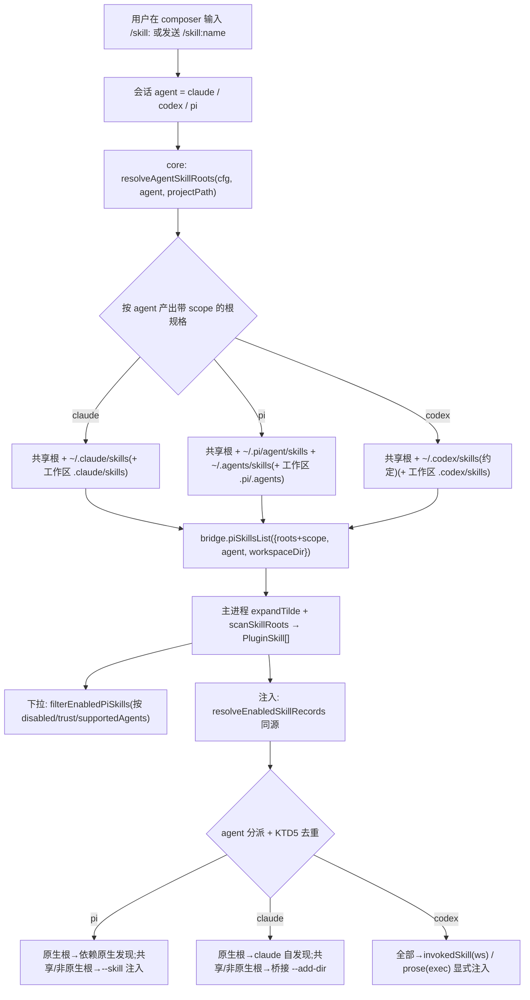

# feat: skill 发现按 agent 各自原生目录分流(Design B)

## Summary

当前 `/skill:` 下拉菜单与 skill 注入的**扫描根是一套 agent 无关的全局配置**(`generalSettings.piSkills`
的 `globalRoots`/`userGlobalRoots`/`workspaceEnabled`),因此切换 claude / codex / pi 时下拉列表完全一样,
实际调用的 skill 也来自同一批目录。本 plan 把 skill 发现改为**按会话当前 agent 分流**:每个 agent 只
扫它自己的原生 skill 目录(claude=`~/.claude/skills`、pi=`~/.pi/agent/skills`+`~/.agents/skills`、
codex 约定=`~/.codex/skills`),外加一个可选的「共享(all-agents)」根类别供跨端复用。切 agent 时下拉与
注入随之变化。

三端能力差异是本设计的根本约束(已实测确认):**pi 与 claude 有真实的原生 skill 目录发现**,而
**codex 没有任何原生目录发现**——codex 的触发 100% 靠 Cortex 把 skill 目录路径经 app-server 的 `skill`
input item 显式注入。因此 codex 的「原生目录」是一个 **Cortex 侧约定**(扫 `~/.codex/skills` 再显式注入),
而非 codex-cli 自己发现。这决定了 codex 分支的实现与 pi/claude 不同(见 KTD3)。

配置从「一套全局根」重构为「共享根 + 每 agent 私有根」,附带旧配置迁移;SkillPanel 管理 UI 改为随当前
会话 agent 自动切视图。启用/禁用与工作区信任态**保持全局键**(按 name 一处禁用处处生效),不按 agent 拆分。

---

## Problem Frame

`ce-work` 上一轮(commit `d1a0bec`)已修复 pi 的 `--no-skills` 随 `useOwnSkills` gate,放开了 pi 的原生
发现,让三端在「是否启用原生发现」上初步一致。但**扫描根来源**仍是一套 agent 无关配置,导致更深层的
不一致没解决:

- 下拉数据源 `usePiEnabledSkills`(`packages/core/personal/piSkills.ts`)对所有 agent 都扫同一批
  `cfg.globalRoots`,`queryKey` 里没有 agent(只有 `projectPath` + 固定根),唯一的按 agent 过滤是
  `supportedAgents` frontmatter——而绝大多数 skill 不声明 `supportedAgents`,故三端列表逐字相同。
- 注入解析 `resolveEnabledSkillRecords`(`packages/core/personal/skill-injection.ts`)同样取全局 cfg,
  `agent` 参数只用于过滤、不参与根选择。
- 用户预期:每个 agent 用「自己的」skill(各自原生目录),切 agent 应看到不同列表。

**收益是「让 skill 归属回到各 agent 自己的原生位置」**,而不是修一个当前会报错的 bug(现状能用,只是三端
共用一套根、列表雷同、与用户对"各 agent 各自 skill"的心智不符)。代价是引入 per-agent 配置结构 + 迁移 +
UI 改造,并要处理 codex 无原生目录的能力缺口。

---

## Requirements

- **R1**:`/skill:` 下拉菜单(`usePiEnabledSkills`)按会话当前 agent 分流,列表只含该 agent 的原生根 +
  共享根下扫到的 skill;切换 agent 时列表随之变化。
- **R2**:skill 注入解析(`resolveEnabledSkillRecords`/`resolveEnabledSkillPaths`)与下拉用**同一套** per-agent
  根,保证「菜单可见 == 实际注入」(不出现能选却没用 / 用了菜单外的)。
- **R3**:每个 agent 有一组默认原生根(claude=`~/.claude/skills`;pi=`~/.pi/agent/skills`+`~/.agents/skills`;
  codex=约定 `~/.codex/skills`),用户可在管理 UI 增删自己 agent 的根。
- **R4**:保留一个「共享(all-agents)」根类别,对三端都扫;老用户的 `userGlobalRoots`(自定义全局根)迁移到
  共享类别,不丢失。
- **R5**:codex 分支——因 codex 无原生目录发现,Cortex 扫 `~/.codex/skills`(+ 共享根)后仍走 app-server 的
  `skill` input item 显式注入(ws)/ prose 回退(exec),调用机制不变,只是扫描根按 agent 收窄。
- **R6**:启用/禁用(`disabledSkills`,键 `scope:name`)与工作区信任(`trustedWorkspaceSkillDirs`)保持全局键,
  不按 agent 拆分;向后兼容现有值。
- **R7**:旧配置(扁平 `globalRoots`/`userGlobalRoots`)自动迁移到新结构,老用户无感、不丢自定义根;迁移
  幂等(重复加载不重复迁移或叠加)。
- **R8**:SkillPanel 管理 UI 随当前会话 agent 自动切视图,展示/增删该 agent 的私有根 + 单列共享根;头部
  作用域说明相应更新。
- **R9**:各 agent 注入机制(pi `--skill`、claude 桥接 `--add-dir`、codex `invokedSkill`)本身不变;当扫描根
  就是 agent 自己的原生目录时,避免与 agent 自身原生发现产生重复加载(name collision 噪音)——对齐
  `d1a0bec` 的 pi gate 与 claude 桥接。
- **R10**:`workspaceEnabled` 语义保留;工作区级 skill 目录也按 agent 分(claude=`.claude/skills`、
  codex=`.codex/skills`、pi=`.pi/skills`+`.agents/skills`、共享=`.cortex-desktop/skills`),沿用现有
  「工作区未授信不注入」信任门。

---

## Key Technical Decisions

**KTD1:配置模型 = 「共享根 + 每 agent 私有根」,启用/信任态保持全局键。**
`PiSkillSettings` 从扁平 `globalRoots`/`userGlobalRoots` 重构为:
- `sharedRoots: string[]` — 对三端都扫的共享根(默认含 Cortex 自有 `~/.cortex-desktop/skills`;老
  `userGlobalRoots` 迁入)。
- `agentRoots: Record<AgentKind, string[]>` — 每 agent 私有根(默认 = 该 agent 原生目录)。
- `disabledSkills`/`trustedWorkspaceSkillDirs`/`workspaceEnabled` 保持不变(全局键)。
不把启用/禁用按 agent 拆分:按 name 禁用一处生效处处生效,心智简单、向后兼容(R6)。`disabledSkills` 键仍是
`scope:name`,不引入 agent 维度。

**KTD2:per-agent 根解析收敛到 core 单一纯函数,下拉与注入共用。**
新增 core 纯函数 `resolveAgentSkillRoots(cfg, agent, projectPath?)`,产出该 agent 应扫的**带 scope 的根规格**
(共享全局 / agent 全局 / 共享工作区 / agent 工作区),`usePiEnabledSkills` 与 `resolveEnabledSkillRecords`
都调用它,避免两处各写一份根选择逻辑再漂移(复刻现有 `skill-injection.ts` 作为「唯一实现」的做法)。`~`
展开仍在主进程 `expandTilde` 做,core 只产出含 `~` 的根字符串 + scope,主进程消费。

**KTD3:codex 走「Cortex 约定目录 + 显式注入」,不是 codex 自身发现。**
codex-cli 无原生 skill 目录发现(已实测:源码零 `~/.codex/skills`/`CODEX_HOME` 读取,触发只有 app-server 的
`skill` input item)。故 codex 的「原生目录」是 Cortex 约定扫 `~/.codex/skills`,扫到的 skill 仍通过既有
`invokedSkill`(ws)/`renderCodexSkillFallback`(exec)注入。**该约定目录名需在实现期核实 codex-cli 官方
惯例**(见 Open Questions)。这不是偷懒——codex 这条链路结构上就不做目录发现,Cortex 扫+注入是唯一可行路径。

**KTD4:主进程扫描接口按 agent 感知,root 计算下沉但 store 仍不读。**
`pi-skills:list` 的 `PiSkillsListArgs` 增加 `agent?: AgentKind` 与按 agent 的工作区子目录信息;主进程
`pluginSkillRoots` 变为 agent 感知(把硬编码的 `.cortex-desktop/skills` 工作区根扩成按 agent 的子目录集)。
主进程仍**不读 store**(KTD 沿用现状):要扫哪些根由渲染端 `resolveAgentSkillRoots` 算好、经 IPC 入参传入,
主进程只负责 `expandTilde` + 扫描。

**KTD5:根即原生目录时避免二次注入,复用 `d1a0bec` 的 gate 语义。**
当 agent 的扫描根就是它自己的原生目录:
- pi:`useOwnSkills=true` 已放开原生发现(`d1a0bec`);此时 `--skill` 显式注入与原生发现指向同一目录会触发
  pi 的 name collision 警告(保留先发现者,功能不坏但有噪)。决策:pi 分支在「根 ⊆ pi 原生目录」时**不再**
  重复 `--skill` 注入该目录下的 skill,只依赖原生发现;仅对「共享根 / 非 pi 原生根」保留 `--skill`。
- claude:同理,桥接目录只为「共享根 / 非 claude 原生根」的 skill 建 symlink;claude 原生根(`~/.claude/skills`)
  下的 skill 由 claude 自身发现,不进桥接,避免 `--add-dir` 与原生发现重复。
- codex:无原生发现,恒走显式注入,无重复问题。
具体「哪些根算该 agent 原生」由 KTD2 的根规格 scope 标注携带,注入侧据 scope 决策。

**KTD6:SkillPanel 随当前会话 agent 自动切视图(不做 per-agent tab)。**
UI 改动最小、最贴合「切 agent 列表就变」:面板读当前活动会话的 agent,展示该 agent 私有根 + 共享根;增删根
写入当前 agent 的 `agentRoots[agent]` 或 `sharedRoots`(用户显式选「加到共享」时)。不引入 per-agent tab 的
额外导航层。

---

## High-Level Technical Design

上图覆盖主聊天 composer 的下拉展示与单发注入。圆桌编排(`bridge.startOrchestration`)沿用上一 plan 的
Scope Boundaries——不在本 plan 范围(见下)。

---

## Implementation Units

### Phase A:配置模型与根解析(U1-U2)

### U1. `PiSkillSettings` per-agent 重构 + 迁移

**Goal**:把扁平 skill 根配置重构为「共享根 + 每 agent 私有根」,并提供旧配置到新结构的幂等迁移。

**Requirements**:R1、R3、R4、R6、R7

**Dependencies**:无

**Files**:
- `packages/core/desktop/types.ts`(`PiSkillSettings` / `DEFAULT_PI_SKILLS`:引入 `sharedRoots`、
  `agentRoots: Record<AgentKind,string[]>`;定义每 agent 默认原生根常量)
- `packages/core/store/personal.ts`(加载迁移:旧 `globalRoots`/`userGlobalRoots` → 新结构;setter 见 U6)
- `packages/core/store/personal.test.ts`(迁移单测)

**Approach**:
- 新结构(方向性,非最终签名):`sharedRoots`(默认 `["~/.cortex-desktop/skills"]`)、`agentRoots`
  默认 `{ claude: ["~/.claude/skills"], codex: ["~/.codex/skills"], pi: ["~/.pi/agent/skills","~/.agents/skills"] }`。
- **迁移规则(幂等)**:旧档 `globalRoots` 默认值 `["~/.agents/skills","~/.cortex-desktop/skills"]` → `~/.agents/skills`
  归入 pi 原生根、`~/.cortex-desktop/skills` 归入 `sharedRoots`;旧 `userGlobalRoots`(用户自增,不知属哪个 agent)
  → 全部归入 `sharedRoots`(R4,不丢)。迁移后写入版本标记 / 以「新字段存在」为已迁移信号,避免重复迁移或与用户
  后续编辑叠加(R7)。保留读取旧字段的兼容分支直到确认无旧档。
- `disabledSkills`/`trustedWorkspaceSkillDirs`/`workspaceEnabled` 原样保留(R6)。

**Patterns to follow**:`packages/core/store/personal.ts:356-359` 现有「旧档缺字段逐字段兜 DEFAULT」迁移写法;
`types.ts:565-589` 现有 `DEFAULT_PI_SKILLS` 注释风格(含安全模型注释)。

**Test scenarios**:
- 旧档 `{globalRoots:["~/.agents/skills","~/.cortex-desktop/skills"], userGlobalRoots:["~/x"]}` 迁移后:
  `agentRoots.pi` 含 `~/.agents/skills`;`sharedRoots` 含 `~/.cortex-desktop/skills` 与 `~/x`。
- 已是新结构的档再次加载 → 不重复迁移、不叠加(幂等)。
- 全新档(无任何 skill 设置)→ 得到三端默认原生根 + 默认共享根。
- 旧档只有部分字段缺失 → 逐字段兜默认,不抛错。
- `disabledSkills`/`trustedWorkspaceSkillDirs` 迁移前后逐字不变。

**Verification**:迁移单测覆盖上述;类型检查通过;应用加载旧档后设置结构为新形态且自定义根不丢。

---

### U2. core 根解析纯函数 `resolveAgentSkillRoots`

**Goal**:新增 core 纯函数,给定 cfg + agent + projectPath,产出该 agent 应扫的**带 scope 的根规格**,供
下拉与注入共用(单一真相源)。

**Requirements**:R1、R2、R3、R10

**Dependencies**:U1

**Files**:
- `packages/core/personal/skill-roots.ts`(新增;导出 `resolveAgentSkillRoots`)
- `packages/core/personal/skill-roots.test.ts`(新增)
- `packages/core/index.ts`(导出)

**Approach**:
- 产出结构方向:`{ path: string; scope: "shared-global" | "agent-global" | "shared-workspace" | "agent-workspace" }[]`
  (`~` 未展开,主进程展开)。scope 既供 UI 分组,也供 KTD5 注入侧判断「是否该 agent 原生根」。
- 组成:`sharedRoots`(shared-global)+ `agentRoots[agent]`(agent-global);`workspaceEnabled && projectPath` 时
  追加共享工作区根 `<proj>/.cortex-desktop/skills`(shared-workspace)与该 agent 的工作区子目录(agent-workspace):
  claude=`.claude/skills`、codex=`.codex/skills`、pi=`.pi/skills`+`.agents/skills`。
- 纯函数、不读盘、不展开 `~`(与现有 `pluginSkillRoots` 的 main 侧展开分工一致)。

**Patterns to follow**:`apps/desktop/src/main/skills/locate.ts` `pluginSkillRoots` 的 scope 标注结构;
`packages/core/personal/skill-injection.ts` 「唯一实现、勿漂移」的纯函数注释风格。

**Test scenarios**:
- claude + 有 projectPath + workspaceEnabled → 含 shared-global、`~/.claude/skills`(agent-global)、
  `<proj>/.cortex-desktop/skills`(shared-workspace)、`<proj>/.claude/skills`(agent-workspace)。
- pi → agent-global 含 `~/.pi/agent/skills` 与 `~/.agents/skills`;工作区含 `.pi/skills` 与 `.agents/skills`。
- codex → agent-global 含 `~/.codex/skills`;工作区含 `.codex/skills`。
- `workspaceEnabled=false` 或无 projectPath → 不产出任何 workspace scope 根。
- 空 `agentRoots[agent]` → 只产出共享根(不报错)。

**Verification**:纯函数单测覆盖三端 × 有/无工作区;被 U3/U4 引用后下拉与注入根一致。

---

### Phase B:下拉 + 注入接入 agent 分流(U3-U5)

### U3. 下拉数据源 `usePiEnabledSkills` 按 agent 分流

**Goal**:让 composer 的 `/skill:` 下拉按会话当前 agent 用 `resolveAgentSkillRoots` 算根,`queryKey` 并入
agent,切 agent 列表随之变化。

**Requirements**:R1、R2

**Dependencies**:U2

**Files**:
- `packages/core/personal/piSkills.ts`(`usePiEnabledSkills`:cfg→`resolveAgentSkillRoots`;queryKey 并入
  `session.agent` 与根签名;`piSkillsList` 入参改传 per-agent 根)
- `packages/core/personal/piSkills.test.ts`

**Approach**:
- `usePiEnabledSkills` 内用 `resolveAgentSkillRoots(cfg, session.agent, projectPath)` 得到根规格,经 IPC 传给
  `piSkillsList`(入参形态见 U5)。`queryKey` 现为 `["pi-enabled-skills", projectPath, globalRoots.join, ...]`,
  需并入 `session.agent` 与新的根签名,否则切 agent 命中旧缓存(串场)。
- `filterEnabledPiSkills`(supportedAgents/disabled/trust 过滤)保持不变——它作用在扫描结果上,分根只改上游。
- gate 语义(`useOwnSkills!==false` 等)不变。

**Patterns to follow**:`piSkills.ts:66-84` 现有 useQuery + queryKey 命名(仿 notes.ts、绝不用 wsId)。

**Test scenarios**:
- 同一 projectPath 下 claude 与 pi 两个 session → `usePiEnabledSkills` 产出不同根 → queryKey 不同(不串场)。
- claude session:下拉只含 claude 原生根 + 共享根扫到的 skill,不含 pi 独有根的 skill。
- `useOwnSkills===false` → 返回 `[]`(回归现状 gate)。
- `supportedAgents` 过滤仍生效(声明只支持 claude 的 skill 不出现在 pi 下拉)。

**Verification**:单测覆盖切 agent 列表变化 + queryKey 隔离;应用内切 agent 观察下拉列表随之变化(R1 手验)。

---

### U4. 注入解析 `resolveEnabledSkillRecords` 按 agent 分流

**Goal**:让 skill 注入解析与下拉用同一套 per-agent 根(R2),保证「菜单可见 == 实际注入」。

**Requirements**:R2、R6

**Dependencies**:U2

**Files**:
- `packages/core/personal/skill-injection.ts`(`resolveEnabledSkillRecords`:cfg 取值改为经
  `resolveAgentSkillRoots`;保留 disabled/trust/supportedAgents 过滤与 name 去重)
- `packages/core/personal/skill-injection.test.ts`
- `packages/core/personal/messages.ts`(`resolveEnabledSkillPaths` 委托不变,确认取到新根;仅确认无需改)
- `packages/core/personal/messages.test.ts`

**Approach**:
- `resolveEnabledSkillRecords` 现取 `usePersonalStore.getState().generalSettings.piSkills` 后传固定
  `{globalRoots,userGlobalRoots,workspaceEnabled}`;改为用 `resolveAgentSkillRoots(cfg, agent, projectPath)`
  产出的根经 `piSkillsList` 扫描。过滤链(disabled `scope:name` / 工作区未授信 / supportedAgents / name 去重
  全局覆盖工作区)保持逐字不变(R6)。
- 结果同时供 claude `skillRecords`、pi `skillPaths`、codex 记录查找——分根只改「扫哪些目录」,不改这三条下游。

**Patterns to follow**:`skill-injection.ts:160-199` 现有过滤链与去重注释;与 U3 共用 `resolveAgentSkillRoots`。

**Test scenarios**:
- 同一 cfg 下 claude 与 pi 的 `resolveEnabledSkillRecords` 返回不同记录集(各自原生根)。
- 下拉(U3)与注入(U4)对同一 agent 返回**一致**的 skill 集合(R2:菜单==注入)。
- `disabledSkills` 含 `global:foo` → 两端都排除 foo。
- 工作区 skill 未在 `trustedWorkspaceSkillDirs` → 不注入(信任门回归)。
- `useOwnSkills===false` → `[]`。

**Verification**:单测断言下拉与注入集合一致 + 三端差异;现有 messages/skill-injection 测试无回归。

---

### U5. 主进程 `pi-skills:list` / `pluginSkillRoots` agent 感知

**Goal**:主进程扫描接口消费渲染端传入的 per-agent 根(含各 agent 工作区子目录),保持主进程不读 store。

**Requirements**:R2、R5、R10

**Dependencies**:U2(根规格形态)

**Files**:
- `apps/desktop/src/main/ipc/types.ts`(`PiSkillsListArgs` 扩展:接受带 scope 的根列表 / 或 `agent` +
  per-agent 工作区子目录信息)
- `apps/desktop/src/main/ipc/skills.ts`(`pi-skills:list` handler:按新入参组装扫描根)
- `apps/desktop/src/main/skills/locate.ts`(`pluginSkillRoots` 改为 agent 感知:工作区根从硬编码
  `.cortex-desktop/skills` 扩成按 agent 的子目录集)
- `apps/desktop/src/main/skills/locate.test.ts`
- `packages/core/desktop/bridge.ts` + `apps/desktop/src/preload/index.ts`(`piSkillsList` 契约镜像同步)

**Approach**:
- 两种落法(实现期二选一,优先 A 以减少 main 逻辑):
  - **A**:渲染端 `resolveAgentSkillRoots` 直接产出**完整根列表(含工作区绝对/相对子路径)+ scope**,IPC 只传这份
    列表 + `workspaceDir`;主进程 `pluginSkillRoots` 退化为「`expandTilde` + resolve 工作区相对路径 + 附 scope」。
  - **B**:IPC 传 `agent`,主进程 `pluginSkillRoots` 内按 agent 展开工作区子目录。
- 无论哪种,主进程仍不读 store;`scanSkillRoots`/`registry.ts` 不变。
- 安全:工作区根 resolve 后仍按现有「未授信不注入」在渲染端过滤(U4);主进程扫描不越权(沿用现状)。

**Patterns to follow**:`apps/desktop/src/main/ipc/skills.ts:66-78` 现有 handler + `pluginSkillRoots` 调用;
契约「三处镜像」(bridge/preload/main types)同步纪律。

**Test scenarios**:
- `pluginSkillRoots`(或等价)给 claude + workspaceDir → 产出含 `<proj>/.claude/skills`(agent-workspace)与
  `<proj>/.cortex-desktop/skills`(shared-workspace)。
- pi → 工作区含 `.pi/skills` 与 `.agents/skills`。
- `workspaceEnabled=false` → 无工作区根。
- 契约三处字段一致(类型检查 + 现有 mirror 测试)。

**Verification**:locate 单测 + 类型检查;应用内三端扫描根正确(手验)。

---

### Phase C:注入机制去重对齐(U6-U7)

### U6. KTD5 去重:根即原生目录时不二次注入

**Goal**:当扫描根就是 agent 自己的原生目录时,避免 Cortex 注入与 agent 原生发现重复加载(name collision 噪音);
对齐 `d1a0bec` 的 pi gate 与 claude 桥接。

**Requirements**:R9

**Dependencies**:U4、U5

**Files**:
- `packages/core/personal/messages.ts`(单发派发:按根 scope 决定 pi `--skill` / claude `skillRecords` 是否
  包含「该 agent 原生根」下的 skill)
- `packages/core/personal/skill-injection.ts`(如需:记录携带 scope 供派发侧判断)
- `apps/desktop/src/main/skills/claude-bridge.ts`(桥接只为「共享/非 claude 原生根」的记录建 symlink)
- 对应测试:`messages.test.ts`、`claude-bridge.test.ts`

**Approach**:
- 让注入记录(`InjectableSkill`)携带其来源 scope 或「是否 agent 原生根」标记(由 U2 根规格传导)。
- **pi**:`skillPaths` 仅包含「共享根 / 非 pi 原生根」的 skill;pi 原生根下的 skill 交给 pi 原生发现
  (`d1a0bec` 已放开)。避免同目录既原生发现又 `--skill` → collision。
- **claude**:`buildClaudeSkillBridge` 只为「共享 / 非 claude 原生根」的记录建 symlink;`~/.claude/skills` 下的
  由 claude 自发现,不进桥接、不 `--add-dir` 重复。
- **codex**:无原生发现,全部走 `invokedSkill`/prose,不涉及去重。
- 降级:标记缺失时退回「全部注入」(不比现状差,只是可能有 collision 噪音),不阻断发送。

**Patterns to follow**:`d1a0bec`(pi `--no-skills` gate)、`claude.ts:115` `--add-dir` 条件式、
`claude-bridge.ts:67` 降级风格。

**Test scenarios**:
- pi + 某 skill 来自 `~/.pi/agent/skills`(原生根)→ `skillPaths` 不含该 skill(依赖原生发现)。
- pi + 某 skill 来自共享根 → `skillPaths` 含该 skill。
- claude + 某 skill 来自 `~/.claude/skills` → 桥接不为它建 symlink。
- claude + 某 skill 来自共享根 → 桥接为它建 symlink,`--add-dir` 生效。
- 标记缺失(降级)→ 全部注入,不抛错。

**Verification**:单测覆盖三端 × 原生根/共享根;手验 pi/claude 调用无重复 collision 日志、skill 仍生效。

---

### U7. SkillPanel 随当前 agent 自动切视图 + store setter 按 agent

**Goal**:管理 UI 随会话 agent 展示/增删该 agent 私有根 + 共享根;store setter 写入正确的根类别。

**Requirements**:R3、R4、R8

**Dependencies**:U1

**Files**:
- `packages/views/cortex-desktop/personal/SkillPanel.tsx`(读当前会话 agent;根管理区分「当前 agent 私有根」
  与「共享根」两组;增删写对应类别;头部作用域说明更新)
- `packages/views/cortex-desktop/personal/SkillPanel.test.tsx`
- `packages/core/store/personal.ts`(`addGlobalSkillRoot`/`removeGlobalSkillRoot` 改签名:接受目标类别
  {agent 私有 | 共享};或拆成两组 action)
- `packages/core/store/personal.test.ts`

**Approach**:
- SkillPanel 取当前活动会话 agent(经 store / props),用 `resolveAgentSkillRoots` 或直接读 cfg 展示两组根。
- 「管理」区:一组「<当前 agent> 的目录」(增删写 `agentRoots[agent]`)、一组「所有 agent 共享」(增删写
  `sharedRoots`);内置默认原生根不可删(仿现状 `builtin` 不可删)。
- 新建 skill(`createSkill`)默认落到当前 agent 的活动根或共享根(沿用现状目录选择)。
- 头部作用域说明从「对三端统一生效」改为解释「当前展示 <agent> 的 skill;共享根对三端生效」。

**Patterns to follow**:`SkillPanel.tsx:137-150,311-357`(现有增删根 UI)、`store/personal.ts:558-582`(setter 兜底
`DEFAULT_PI_SKILLS` 后整体写回)。

**Test scenarios**:
- 当前会话 agent=claude → 面板展示 claude 私有根 + 共享根;不展示 pi 独有根。
- 在「claude 的目录」增一个根 → 写入 `agentRoots.claude`,不影响 `sharedRoots` / 其他 agent。
- 在「共享」增一个根 → 写入 `sharedRoots`,三端可见。
- 删除内置默认原生根 → 被禁止(不可删)。
- 切换会话 agent → 面板展示的私有根组随之变化。

**Verification**:组件单测 + store 单测;应用内切 agent 面板视图变化、增删根落到正确类别(手验)。

---

## System-Wide Impact

- **圆桌编排(`bridge.startOrchestration` → `orchestrate.ts`)**:沿用上一 plan 的 Scope Boundaries,完全独立于
  `cli:start`,本 plan 不改;其 `renderSkillBlock` 批量注入仍用旧根来源。**注意**:U4 改了
  `resolveEnabledSkillRecords`(编排分支 `messages.ts:2469` 也调它)——需确认编排分支要么继续用全局根、要么
  接受按 agent 分根(实现期决定,默认让编排也走 per-agent 以保持一致,但不改其注入机制)。这是 U4 的一个
  System-Wide 触点,测试须显式覆盖编排分支未被误伤。
- **`oneshot`/`ask`/`automation`/`workflow-headless`**:这些路径不经 composer,不解析 `/skill:`;它们若也调
  `resolveEnabledSkillPaths`(如 pi automation)会随 U4 改成 per-agent 根——需确认其 agent 上下文可用,否则
  降级为共享根。实现期核对调用点。
- **内置库(`resources/skills` + `userData/skills`)**:当前 `pi-skills:list` 不扫它(只 `skills:list` 扫),
  故不在 `/skill:` 下拉。本 plan 默认维持现状(不接入),留作 Scope Boundary;若要让内置库出现在下拉,应作为
  「共享根」并入——留待后续。
- **query 缓存**:U3 的 queryKey 并入 agent 后,切 agent 会各自缓存;`refetchOnWindowFocus` 兜底不变。

---

## Scope Boundaries

**本次覆盖**:composer 单发 `/skill:` 的下拉展示与注入路径,按会话 agent 分根;配置模型重构 + 迁移;
SkillPanel 随 agent 切视图;三端注入机制的去重对齐。

**不属于本次**:
- 圆桌编排路径的原生化(沿用上一 plan 的 deferred)。
- 内置库(`resources/skills`/`userData/skills`)接入 `/skill:` 下拉(维持现状分离)。
- `usePiEnabledSkills`/`filterEnabledPiSkills`/`PiSlashSkill` 等 "pi" 前缀命名的重命名(上一 plan 已列为
  deferred,纯命名重构)。
- codex-cli 官方 skill 目录惯例的运行期探测/降级 UI(本次按约定 `~/.codex/skills`,见 Open Questions)。

### Deferred to Follow-Up Work
- 内置库并入「共享根」使其出现在 `/skill:` 下拉(需确认内置库对三端语义)。
- 圆桌编排的 per-agent skill 根(若编排也要按 agent 分,单独设计其 fresh-spawn 复用)。

---

## Risks & Dependencies

- **codex `~/.codex/skills` 约定未核实**:codex-cli 是外部二进制(不在 node_modules),无法静态确认其官方 skill
  目录惯例。若约定目录名与用户/codex 生态实际不符,codex 下拉会扫空目录(不报错但列表空)。实现 U2/U5 前应查
  codex 官方文档 / 实测其 skill 存放位置。缓解:约定目录名集中在一处常量,便于后续调整。
- **迁移风险(R7)**:旧 `userGlobalRoots` 无 agent 归属信息,只能整体归入共享根。若老用户本意是「某根只给某
  agent」,迁移后会对三端可见(比预期宽,但不丢功能)。可接受;在迁移注释里说明。
- **编排分支共用 `resolveEnabledSkillRecords`**:U4 改动会波及编排;须显式测试编排分支行为(见 System-Wide Impact)。
- **queryKey 不并入 agent 会串场**:U3 若漏改 queryKey,切 agent 命中旧缓存导致列表不变——这是本 bug 的直接
  成因之一,测试须显式断言 queryKey 隔离。
- **契约三处镜像(bridge/preload/main types)**:U5 改 `PiSkillsListArgs` 须同步三处,否则跨进程字段对不上、
  扫描静默失效。

---

## Open Questions

- codex 的约定 skill 目录:`~/.codex/skills` 是否为 codex-cli 官方/生态惯例?实现期需核实(文档或实测),
  必要时改约定目录名。
- 内置库(`resources/skills`/`userData/skills`)是否应作为「共享根」接入下拉——本次默认不接,留 follow-up。
- 编排分支是否也按 agent 分根:默认让它一致(走 per-agent),但需确认编排的 agent 上下文完整;若不完整则退回
  全局/共享根。
- 「共享根」默认集合是否应含 `~/.agents/skills`:本 plan 把 `~/.agents/skills` 归为 pi 原生根(它本就是 pi
  的原生标准目录),不放进共享;若产品希望它对三端可见,应显式加入 `sharedRoots` 默认。

---

## Sources / Research

- 上一 plan(原生 skill 调用机制):`docs/plans/2026-07-01-001-feat-native-agent-skill-invocation-plan.md`
- pi 原生 skill 目录与 `--no-skills`/`--skill` 语义:`node_modules/@earendil-works/pi-coding-agent/docs/skills.md`
  (Locations 段:`~/.pi/agent/skills`、`~/.agents/skills`、项目 `.pi/skills`/`.agents/skills`)
- codex 无原生目录发现、app-server `skill` input item(`path`=目录):
  `apps/desktop/src/main/agents/codex-app-server-protocol.ts:18-25`、
  `apps/desktop/src/main/ipc/codex-ws-channel.ts:186-214`、`apps/desktop/src/main/ipc/cli.ts:755-765`
- claude 原生发现 + 桥接:`apps/desktop/src/main/agents/claude.ts:110,115`、
  `apps/desktop/src/main/skills/claude-bridge.ts`
- 现状配置/下拉/注入/UI 关键点:`packages/core/desktop/types.ts:565-589`、
  `packages/core/personal/piSkills.ts`、`packages/core/personal/skill-injection.ts:160-199`、
  `packages/views/cortex-desktop/personal/SkillPanel.tsx`、`apps/desktop/src/main/ipc/skills.ts`、
  `apps/desktop/src/main/skills/locate.ts`、`apps/desktop/src/main/skills/registry.ts`
- 上一轮修复:commit `d1a0bec`(pi `--no-skills` 随 `useOwnSkills` gate)
