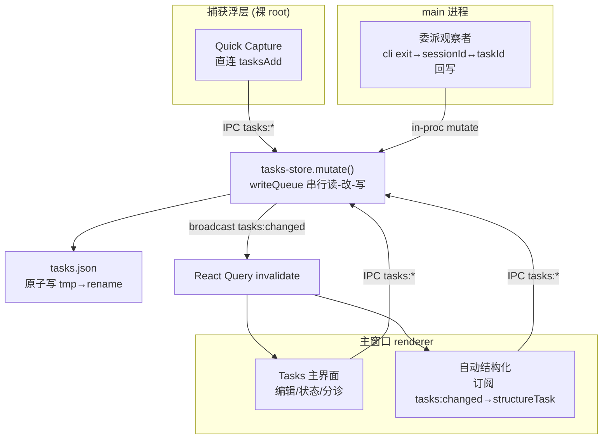
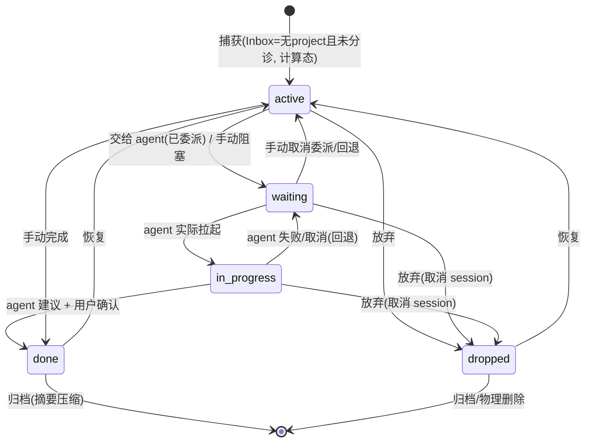

# feat: 个人工作区真任务系统（OmniFocus 内核 · Agent 原生 · 不重）

## Summary

用一个真正的个人任务系统替换现文档聚合式「Tasks」面板：自然语言捕获 → 后台模型补齐日期/标签/归类的建议层 → 渐进披露的结构（单层 project、多状态、今日视图）→ 任务可一键委派 agent 并双向回写。任务数据落到一个**新的 main-owned `tasks.json`**（照 `notes-store.ts` 的串行读-改-写，抗后台/委派并发写），并带一个**数据安全关键**、在 main 初始化阶段 eager 执行的 v1 迁移。个人 + 本地。

## Problem Frame

现「Tasks」右栏（`packages/views/cortex-desktop/personal/TasksDocsView.tsx`）是只读的 CE 文档流水线聚合器，不承载任务管理；更早的复选框待办（`TodoMeta` open/done）连同 `addTodo/createTaskFile/taskArchive` 还在，但唯一 UI `TodosView` 已未挂载。所以「task」在产品里没有实际意义。目标是给出 OmniFocus 的**内核**而非**体量**——关键洞察是 OmniFocus 的重来自「结构全靠手工维护」，而本 App 的 agent 内核可以替用户扛这份维护负担（详见 origin：`docs/brainstorms/2026-07-01-personal-tasks-agent-native-requirements.md`）。

## Requirements Traceability

本计划覆盖 origin 的 R1–R28、F1–F5、AE1–AE9 与全部 Scope Boundaries。按实现单元归集：

| 需求簇 | origin 条目 | 承载单元 |
|---|---|---|
| 任务模型 / 状态 / 派生 available / 委派子结构 | R6–R9 | U1 |
| main-owned 并发安全持久化 | R25*, R26* | U2 |
| v1 迁移 / 数据安全 | R23, R24*, F5, AE8 | U3 |
| CRUD IPC + 读写 hook + delete 语义 | R17(部分), R25* | U4 |
| 快速捕获 + Inbox | R1, R2, F1 | U5, U9 |
| 后台结构化建议引擎 | R3–R6, AE1–AE4, F1 | U6 |
| 建议 UI（逐字段接受/忽略） | R4, R6, AE3, AE4, AE9 | U7 |
| 结构编辑 / 标签 / project | R7, R10, R11, R12 | U8 |
| 内置视图 + 主界面替换 + 今日 | R1, R2, R10, R11, R13, R14, R15, R21, R28, F2, AE5 | U9 |
| 文档流水线下沉 | R16, R22, F4 | U10 |
| 委派派发 | R16, R17, R20, F3 | U11 |
| 委派回写 + 生命周期 | R18, R19, AE6, AE7, F3 | U12 |
| 归档 + 删除/恢复生命周期 | R27 | U13 |

\* **偏离 origin 说明**：origin R25/R26 写「进现有 `personal-workspace.json`」、R24 写「bump 1→2」。研究发现该文件是 renderer-owned 整表覆盖通道，后台/委派回写会被 clobber，且 bump 版本会触发旧代码「版本不匹配→回退 EMPTY→空态覆盖」的静默丢数据链。故任务改落**新的 main-owned `tasks.json`**，`personal-workspace.json` **不 bump 版本**（迁移后仅移除其 `todos` 字段，`hydrate` 已容忍缺省）。理由见 KTD1/KTD2。

## Key Technical Decisions

- **KTD1 — 持久化选新建 main-owned 读-改-写 store，不复用 renderer 整表覆盖。** 新任务有「后台结构化回写」「agent 委派回写」两类非 renderer 写者；现 `apps/desktop/src/main/ipc/store.ts` 的整表 `store:save`（renderer 节流全量覆盖）会 last-write-wins 静默 clobber 它们。照 `apps/desktop/src/main/ipc/notes-store.ts` 的 `mutate()`（writeQueue 串行读-改-写 + cached + 原子写 rename）新建独立 `tasks.json`。**这偏离 origin R25/R26「复用 personal-workspace.json」**（见上表脚注）。
- **KTD2 — v1 迁移是数据安全关键路径，main 初始化阶段 eager 执行并 await。**
  - 迁移在 main 初始化、**注册 `store:save` handler / renderer 能落盘之前** eager 读 `personal-workspace.json.todos` → 写 `tasks.json`（含 `migratedAt`）→ 原子落盘；以 `migratedAt` 为唯一幂等闸门做 single-flight，对已迁移输入纯 no-op。
  - **`personal-workspace.json` 不 bump 版本**（保持 `version:1`，避免 KTD 早期设想的 bump→旧校验失败→EMPTY 覆盖）；迁移成功落盘 `tasks.json` **之后**才移除 `personal-workspace.todos`。
  - 新增 `migrationDone` 标志：`toPersistedState` 剥离 `todos` 必须 gate 在该标志为真之后，否则原样保留 `todos`（防 renderer 首个 save 抢先抹掉源数据）。
  - 迁移前**强制** `.bak` 备份旧 `personal-workspace.json`（非可选）。（研究 C1/C2）
- **KTD3 — NL 结构化复用 `completeWithSummaryModel`；触发点在主窗口渲染端，不在裸浮层。** `completeWithSummaryModel` 直接读 `usePersonalStore.getState()`（渲染端绑定），而快速捕获浮层是无 store 的裸 root。故结构化触发改为：**主窗口订阅 `tasks:changed`，检测到 `source="capture"`、仍在 Inbox 且无结构的新任务后，触发一次结构化**（非击键级、非浮层内）。以调用侧 single-flight 闸自然限频 + 截断输入，**不新建专用限流框架**。（研究 rank3/rank13）
- **KTD4 — 委派闭环，回写走 main 侧观察者，脱离渲染端存活。**
  - **委派状态措辞统一**：委派提交 → `waiting`（已委派）；agent 实际拉起 → `in-progress`。
  - **回写写者在 main**：新增 main 侧会话退出观察者，用 `TaskMeta.delegation.sessionId ↔ taskId` 映射，订阅 cli 生命周期（spawn/exit）；终态到达时**在 `tasks-store.mutate(fn)` 闭包内原子**回写状态/结果——后台安全，主窗口关闭也不丢（修正旧「继续」fire-and-forget 与 mermaid 的写者归类）。
  - **回写重校验必须在 mutate 闭包内**（read→判定→写或丢弃，杜绝 TOCTOU）：谓词 = 任务仍存在 且 `status ∈ {waiting, in-progress}` 且 `delegation.sessionId` 匹配当前委派，否则丢弃回写、不复活终态/已删任务、不 clobber 后一次委派。
  - 成功 → 置 `delegation.state="awaiting-confirm"` + 结果引用，状态**建议 done、默认需用户确认**（不静默 done）；失败/取消 → 回退 `waiting` + 错误 + 保留会话链接 + 「重试」。
  - **取消**调用 `killCli(runId)`（`runId≠sessionId`，故 `delegation` 同时记 `runId`；成功/失败/取消后清空 `runId`）。（研究 C3/rank6/rank10）
  - 摘要压缩（可选、锦上添花）为渲染端 best-effort（模型配置在渲染端）；数据安全关键的状态/结果由 main 观察者保证。
- **KTD5 — 快速捕获复用 `hotkey.ts` 纯函数 + `notes-overlay.ts` 浮层，用独立 accelerator。** 闪记默认键 `CommandOrControl+Shift+N`，任务捕获须选不同键。**`rebindCandidates/resolveRebindChain` 现把闪记键硬编码为末级兜底**——U5 须把兜底键泛化为入参 `defaultAccelerator`，任务捕获传入自己的 `TASKS_HOTKEY_ACCELERATOR`（否则第三级降级会注册成闪记键）。仅 `isValidAccelerator` 可原样复用。（研究 rank11）
- **KTD6 — 分层与 exports。** 数据/纯函数在 `packages/core`，UI 在 `packages/views`，桌面能力经 `DesktopBridge`。main 需 import 的 `taskMigrate.ts` 是**纯模块**（不引 React Query），必须在 `packages/core/package.json` 的 `exports` 单列 `"./personal/taskMigrate"`；`taskStructure.ts` 经 `tasks.ts` re-export，只从 `"./personal/tasks"` 引用；新增 `"./personal/tasks"`。views 内部组件走相对 import + `PersonalRightPanel` 接线。core 不得依赖 react-dom/localStorage/process.env。（研究 rank8）
- **KTD7 — Today 聚合是状态门控的派生，跨日靠聚焦重算。** 三条 OR 子句（今天到期/逾期、defer≤today、已 flag）统一前置门控「状态 ∈ {active, in-progress}」；`defer > due` 时 due 优先（逾期任务无视未来 defer 仍进 Today）；日期字段以**本地日历日**语义存储/比较；跨午夜刷新**用已设的 `refetchOnWindowFocus` 重算**（不新建专用午夜定时器）；聚合后按任务 id 去重。（研究 I4/I5/I7/M1/rank14）
- **KTD8 — 任务正文内联存储，不为新任务建 `.md` 文件。** 新任务正文存 `TaskMeta.notes`（在 `tasks.json` 内），避免 `createTaskFile` 对 `projectRoot` 的强依赖、天然支持无项目任务（origin R17）；迁移时把旧 `tasks/<id>.md` 内容读入 `notes`（截断）。解决 origin OQ「正文存松散 md vs 并入 JSON」。
- **KTD9 — 任务路径新日志走 redact + `sync=false` + dev-gate。** 委派回写与结构化 prompt 都带用户内容 + provider key；照 commit `e231143` 修复后的约定，绝不手搓 `console.log` 打原始 payload。
- **KTD10 — task-project 是 `tasks.json` 内自持的一等分组实体，独立于工作区代码工程（honor R10）。** `TaskProject { id, name }`（v1 无路径；path-based project 归 fast-follow）。删除 task-project 走新 `tasksDeleteProject` IPC，在 `mutate` 内把其下任务 reparent 到 Inbox；工作区 `removeProject`（`personal.ts:462`，删代码项目 + legacy todos）与 task-project **无关**、不触达 `tasks.json`。**读时兜底**：任何 `task.projectId ∉ 当前 TaskProject 表` 一律按 Inbox 呈现。委派 cwd 因 task-project 无路径 → 走 R17 默认策略（提示选目录/默认根）。迁移时旧 `TodoMeta.projectId` → 按工作区项目名新建对应 task-project（名称在 eager 迁移读 `personal-workspace.json` 时解析），无法解析 → Inbox。（研究 rank5）

## High-Level Technical Design

### 写路径与数据流（三类写者共用一个 mutate 队列）

结构化触发在**主窗口渲染端**，委派回写在 **main 观察者**；React Query 只读、事件只触发 invalidation：



关键点：任务若留在 renderer-owned `store.ts` 整表覆盖通道，`ST`/`AG` 的回写会被下一次 renderer 全量 `store:save` 覆盖。所有写者共用一个 `mutate` 队列是抗 clobber 的根因。`AG` 在 main、脱离主窗口存活，是「后台/headless 回写」承诺的落点。

### 任务状态机（合法迁移；in-progress 仅由 agent 拉起驱动）



`inbox` 不是状态（是「无 project 且未分诊」的计算视图，origin R2）；`in-progress` 仅由 agent 实际拉起到达，用户不手动置；委派提交先进 `waiting`。

## Output Structure

```text
packages/core/
  personal/
    tasks.ts            # React Query hooks + 纯函数(状态/available 派生, tag 规范化) + re-export taskStructure
    taskStructure.ts    # NL 结构化: buildStructurePrompt + 可注入 complete + 归属/重校验
    taskMigrate.ts       # 纯模块(不引 RQ): v1 todos → v2 TaskMeta 映射, 供 main import
    tasks.test.ts / taskStructure.test.ts / taskMigrate.test.ts
apps/desktop/src/main/ipc/
  tasks.ts              # registerTasksHandlers: 绑 ipcMain + broadcast + tasksDeleteProject
  tasks-store.ts        # main-owned TasksStore: mutate/writeQueue/原子写/getTasks 损坏隔离
  tasks-migrate.ts       # main 初始化 eager 迁移编排(读 personal-workspace, 调 core/taskMigrate, .bak, migrationDone)
  tasks-delegate-observer.ts  # main 侧会话退出观察者: sessionId↔taskId 回写
  tasks-store.test.ts / tasks-migrate.test.ts
apps/desktop/src/main/
  tasks-overlay.ts       # 快速捕获浮层(仿 notes-overlay.ts)
packages/views/cortex-desktop/personal/
  TasksView.tsx / TaskCard.tsx / TaskDetail.tsx / SuggestionChips.tsx / TodayView.tsx
  TasksView.test.tsx
```

---

## Implementation Units

### U1. 任务领域模型与纯逻辑

- **Goal**：定义 v2 任务/项目数据结构与全部无 IO 纯函数（状态枚举、available 派生、Today 资格、日期语义、tag 规范化、状态迁移矩阵），供上层表驱动单测。
- **Requirements**：R6, R7, R8, R9, R10, R12, R14；F2。
- **Dependencies**：无。
- **Files**：`packages/core/desktop/types.ts` + `apps/desktop/src/main/ipc/types.ts`（**逐字镜像** `TaskMeta`/`TaskInput`/`TaskStatus`/`TaskProject`/`TaskSource`/`TaskDelegation`/`ArchivedTask`/`TasksFileData`）；`packages/core/personal/tasks.ts`（纯函数段）；`packages/core/personal/tasks.test.ts`。
- **Approach**：`TaskStatus = "active" | "in-progress" | "waiting" | "done" | "dropped"`（`inbox` 计算态、不入枚举）。`TaskMeta`：`{ id, title, notes?, status, deferDate?, dueDate?, tags: string[], projectId?, flagged?, source: "manual"|"capture"|"agent", delegation?: TaskDelegation, createdAt, updatedAt, migratedFrom? }`；`TaskDelegation = { sessionId, runId?, state: "running"|"awaiting-confirm"|"failed", error? }`；`TaskProject = { id, name }`（自持、无路径，KTD10）；`TasksFileData = { version, migratedAt?, tasks: TaskMeta[], projects: TaskProject[], archived: ArchivedTask[] }`；`ArchivedTask = { id, title, summary, originalStatus: "done"|"dropped", archivedAt }`（归档摘要条目，U13 产出）。日期存**本地日历日** `YYYY-MM-DD`。纯函数：`isAvailable`、`isTodayEligible`（实现 KTD7）、`normalizeTag`、`canTransition`（实现状态机：`in-progress` 仅 agent 驱动、`waiting→active` 允许、`done/dropped→active` 恢复允许、非法迁移拒绝）。两份 `types.ts` 手工逐字镜像。
- **Patterns to follow**：`packages/core/desktop/types.ts` 的 `NoteMeta` 形状；`taskArchive.ts` 纯函数 + 表驱动测试；`isoWeek`（timeline.ts）时区谨慎。
- **Test scenarios**：
  - `isAvailable`：active 无 defer→true；active defer=明天→false；in-progress defer=昨天→true；done/dropped/waiting→false。
  - `isTodayEligible`（Covers AE5）：defer=明天不进、到明天进、逾期持续进；**done 且 flagged → 不进**；**defer=下周但 due=昨天 → 进**（defer>due，due 优先）。
  - `canTransition`：`done→active` 允许；用户手动 `active→in-progress` 拒绝（仅 agent）；`waiting→active`（取消委派）允许；`in-progress→done` 允许（confirm）。
  - `normalizeTag`：`" @Email "`≡`"@email"`；空/纯空白→丢弃；单任务重复去重。
  - 日期跨午夜边界改变 eligibility；本地日与 UTC 不混用。
- **Verification**：纯函数全绿；两份 `types.ts` 字段逐字一致（附人工比对清单）。

### U2. main-owned 任务 store（并发安全 + 损坏隔离）

- **Goal**：实现 `TasksStore` 作为**所有写者**的唯一落盘入口，串行 `mutate` 抗丢更新，并区分「文件缺失」与「文件损坏」避免损坏后覆盖。
- **Requirements**：R25*, R26*。
- **Dependencies**：U1。
- **Files**：`apps/desktop/src/main/ipc/tasks-store.ts`；`apps/desktop/src/main/paths.ts`（`tasksJsonPath()`）；`apps/desktop/src/main/ipc/tasks-store.test.ts`。
- **Approach**：`class TasksStore` 私有 `cached` + `writeQueue`。`getTasks()`：缓存优先；**区分 ENOENT（安全返回空 v2、不缓存）与 `JSON.parse` 失败（危险）**——解析失败**绝不进入 overwrite 路径**，改为把损坏文件重命名到 `tasks.json.corrupt` 隔离并抛错/拒绝后续 `mutate`（研究 rank2）。`saveTasksFile()`：原子写 `mkdir→.tmp→rename`，异步 `fs.promises`。`mutate<T>(fn)`：`writeQueue = writeQueue.then(async ()=>{ const data = await getTasks(); const [next,result]=fn(data); cached=next; await saveTasksFile(next); return result })`。`list()` 先 `await writeQueue`。
- **Patterns to follow**：`apps/desktop/src/main/ipc/notes-store.ts:34-135`（`mutate/getNotes/save/list`）；`store.ts:51-58` 原子写。
- **Execution note**：先写「两并发 add 无丢更新」与「损坏文件不被覆盖而是隔离」两个失败测试，再实现。
- **Test scenarios**：
  - 并发两 `mutate` add → 两条都在（不丢更新）；add 后立即 `list` 立即可见（cached 同步）。
  - **文件缺失(ENOENT)** → 返回空 v2、不缓存空态、不隔离。
  - **文件损坏(parse 失败)** → 重命名 `.corrupt`、拒绝 mutate、**不落盘覆盖幸存数据**（与缺失分成两用例断言）。
  - 写入中断 → 原文件不被半写破坏；`.tmp` 不残留。
- **Verification**：并发稳定通过；损坏永不导致数据被空态覆盖。

### U3. v1 迁移（main 初始化 eager + 握手定序 + 坏数据容错）

- **Goal**：在 renderer 能落盘之前，把 legacy `PersistedState.todos` 一次性、幂等、坏数据容错地迁成 v2 `TaskMeta` + `TaskProject`，并以严格定序 + 备份杜绝源数据丢失。
- **Requirements**：R23, R24*；F5；AE8。
- **Dependencies**：U1, U2。
- **Files**：`packages/core/personal/taskMigrate.ts`（纯：`migrateLegacyTodos(persisted, readBody, resolveProjectName): {tasks, projects}`）+ `taskMigrate.test.ts`；`apps/desktop/src/main/ipc/tasks-migrate.ts`（main 编排：`.bak`→读 personal-workspace→调 core 迁移→原子写 tasks.json→置 migrationDone）；`apps/desktop/src/main/index.ts`（初始化序列接入，先于 `registerTasksHandlers`/`store:save`）；`apps/desktop/src/main/ipc/store.ts`（暴露 `migrationDone` 查询）；`packages/core/store/personal.ts`（`toPersistedState` 剥离 `todos` **gate 在 migrationDone**）；`packages/core/desktop/usePersonalPersistence.ts`（确认迁移完成前不整表 save 覆盖 todos）；`packages/core/package.json`（exports 加 `"./personal/taskMigrate"`）。
- **Approach**：main 初始化 eager：**先 `.bak` 备份**旧 `personal-workspace.json`（强制）→ 若 `tasks.json` 已有 `migratedAt` 则 no-op（single-flight 幂等）→ 否则读 todos，`open→active`/`done→done`，旧 `projectId` 按工作区项目名新建对应 `TaskProject`（名称从同一次读的 `projects[]` 解析，孤儿/无法解析 → Inbox），旧 `tasks/<id>.md` 读入 `notes`（截断 `MAX_DOC_CHARS`，**文件缺失/损坏 → 保任务空正文 + 降级说明，绝不阻断整体迁移**）→ 原子写 `tasks.json`(含 `migratedAt`) → **成功后**才移除 `personal-workspace.todos` 且置 `migrationDone=true`。`personal-workspace.json` **不 bump 版本**。
- **Patterns to follow**：`personal.ts:370-386 migrateSession`（field-presence 纯函数）；`timeline.ts:325-347`（`backfilledAt` 防重复）；`taskArchive.ts:91 staleTodoIds`（悬空文件容错）；`paths.ts:106-137 ensureMigrated`（memoize/幂等外形，但**错误不吞**）。
- **Execution note**：先写「renderer 首个 save 不得先于迁移抹掉 todos」「v2 输入 no-op」「坏数据不阻断」的失败测试，再实现。
- **Test scenarios**：
  - Covers AE8：v1 done + projectId + `tasks/<id>.md` → done、按项目名建 TaskProject 归属、正文接管。
  - **定序（研究 C1/rank1）**：模拟 renderer 在迁移中触发 save → `migrationDone` 为假时 `toPersistedState` 保留 todos，源不被抹；迁移成功后才剥离。
  - 幂等：对已 `migratedAt` 再跑 → 无变化、不二次接管正文。
  - 坏数据：detailPath 缺失→空正文保任务；孤儿 projectId→Inbox。
  - `.bak` 一定生成；迁移抛错时旧文件完整可回滚。
- **Verification**：迁移前后任务计数守恒（除坏数据降级）；反复加载无漂移；源 todos 在 tasks.json 落盘前绝不被移除。

### U4. 任务 CRUD IPC 与读写 hook（含 delete 语义）

- **Goal**：打通任务 CRUD 的 IPC 五处链路与 React Query 读写层，明确 delete 语义。
- **Requirements**：R25*；R17（正文归属）。
- **Dependencies**：U2, U3。
- **Files**：`packages/core/desktop/bridge.ts`（可选 `tasksList?/tasksAdd?/tasksUpdate?/tasksDelete?/tasksDeleteProject?/onTasksChanged?`）；`apps/desktop/src/preload/index.ts`（`tasks:*` 逐字对齐）；`apps/desktop/src/main/ipc/tasks.ts`（handler + `broadcastTasksChanged`）；`register.ts`（`registerTasksHandlers()`）；`packages/core/personal/tasks.ts`（hooks + `tasksKeys` + `tasksAvailable`）；`packages/core/package.json`（exports `"./personal/tasks"`）；`tasks.test.ts`。
- **Approach**：`tasksKeys.byProject(pid ?? "no-project")`（**绝不用 wsId**）；query `enabled: !!bridge?.tasksList`、`staleTime: Infinity`、`refetchOnWindowFocus: true`；mutation 成功**只 invalidate**；handler 每次写后 `broadcastTasksChanged(await store.list())`。**`delete` 语义**：`tasksDelete` = 从 `tasks.json` **物理移除**（不可恢复，区别于 `dropped` 软标记，见 U13）。web 端 bridge null → 全调用点 null-safe、UI 降级隐藏。
- **Patterns to follow**：`notes.ts:31-383`；`ipc/notes.ts:19-60`；`register.ts:46`；两份 `types.ts` 镜像。
- **Test scenarios**：`tasksAdd`→`onTasksChanged`→`useTasks` 重拉含新任务（跨 IPC 集成）；query key 按 project 命名空间不串数据；bridge null→`tasksAvailable` false 不报错；通道名三处（handle/invoke/send）对齐往返（防永久 pending）。
- **Verification**：CRUD 往返闭环；web 优雅降级。

### U5. 快速捕获（全局热键 + 浮层）

- **Goal**：从任意位置一键唤出极简一行输入，零必填落进 Inbox（`source="capture"`）。
- **Requirements**：R1；F1。
- **Dependencies**：U4。
- **Files**：`apps/desktop/src/main/hotkey.ts`（**泛化 `rebindCandidates/resolveRebindChain` 末级兜底键为入参** + 新增 `TASKS_HOTKEY_ACCELERATOR`）；`apps/desktop/src/main/tasks-overlay.ts`（仿 `notes-overlay.ts`）；`apps/desktop/src/main/index.ts`（注册 + 降级 toast + 退出 unregister）；`apps/desktop/src/preload/index.ts`（`tasksOverlay` 命名空间 + 直连 `personal.tasksAdd`）；`electron-builder.yml`（**将 tasks-overlay HTML/资产纳入 `files` glob**，防打包后启动崩，见 `docs/lessons.md`）；`hotkey.test.ts`。
- **Approach**：复用 `isValidAccelerator` + 泛化后的三级兜底（默认键传 `TASKS_HOTKEY_ACCELERATOR`，与闪记 `Cmd+Shift+N` 区分，KTD5）。浮层 frameless/transparent/alwaysOnTop、`type:"panel"`、复用主 preload、`blur` 隐藏、prod html existsSync 双路径兜底。浮层裸 root、无 CoreProvider，提交**只**直连 `window.desktopAPI.personal.tasksAdd`（结构化触发在主窗口，见 U6，**不在浮层**）。默认 project 用 `resolveDefaultNoteProject` 同款。
- **Patterns to follow**：`hotkey.ts` 全套纯函数；`notes-overlay.ts`；`preload/index.ts:602-606`。
- **Test scenarios**：任务键与闪记键并存、都有效且不相等 → 都注册成功；任务键被占用 → 降级窗口入口 + toast、**兜底注册成任务键而非闪记键**；浮层空/纯空白 → 不建；正常一行 → `tasksAdd` 落 Inbox（source="capture"）；blur 自动隐藏。
- **Verification**：非前台可唤出；提交后主界面 Inbox 出现该任务。

### U6. 后台结构化建议引擎（触发在主窗口）

- **Goal**：捕获后由主窗口自动触发一次结构化，产出 due/defer/tags/project 的非破坏性建议，可出错、可离线降级、按任务 id 精确归属。
- **Requirements**：R3, R4, R5, R6；AE1, AE2；F1。
- **Dependencies**：U1, U4。
- **Files**：`packages/core/personal/taskStructure.ts`（`buildStructurePrompt`、`parseStructureResult`、`structureTask(bridge, task, {complete})`）；`packages/core/personal/tasks.ts`（`useAutoStructure`：主窗口订阅 `tasks:changed`、single-flight 触发）+ re-export；`taskStructure.test.ts`。
- **Approach**：**触发点在主窗口渲染端**（KTD3）：`useAutoStructure` 订阅 `tasks:changed`，检出 `source="capture"` 且仍在 Inbox 且无结构的新任务，调 `structureTask` → `completeWithSummaryModel(bridge, buildStructurePrompt(raw))`（可注入 `complete` 便于单测）。截断输入；prompt 约束输出字段化 JSON；`parseStructureResult` 纯解析 + 空值/异常守卫。请求携带任务稳定 id，落地由 U7 执行且**落地前重校验**（目标字段已手填/已离开 Inbox/任务已不存在或已终态 → 降级或丢弃）。pending 为**瞬态、不进任何持久化**（不入 `toPersistedState`）。tag 建议优先复用已有规范化标签。**single-flight 闸**（同一任务不并发重复结构化）自然限频，**不建专用限流框架**（研究 rank13）。含用户内容/key 的日志走 redact+`sync=false`+dev-gate（KTD9）。
- **Patterns to follow**：`timeline.ts:574-590`；`taskArchive.ts:98-165`（buildPrompt + 可注入 complete + 截断 + 空值守卫）；`notes.ts:374-383`（`onTasksChanged` 订阅）。
- **Test scenarios**：Covers AE1（mock complete → due=周五、tag=@email）；Covers AE2（complete 抛错/离线 → 无建议、纯文本、不阻断）；并发解析乱序返回按 id 精确回填不串字段；迟到建议目标已删/已 done → 整体丢弃不复活；超长输入截断后仍出合法结果；`parseStructureResult` 对垃圾输出返回空不抛。
- **Verification**：捕获路径永不因结构化失败阻塞；主窗口离线/关闭时结构化跳过而捕获仍成功。

### U7. 建议 UI（逐字段接受/编辑/忽略）

- **Goal**：把建议以非侵入 chips 就地呈现，逐字段或整体接受/忽略，忽略零惩罚。
- **Requirements**：R4, R6；AE3, AE4, AE9。
- **Dependencies**：U6, U9。
- **Files**：`packages/views/cortex-desktop/personal/SuggestionChips.tsx` + `.test.tsx`。
- **Approach**：解析中显示非侵入 pending 指示（不抢焦点、不改用户正在编辑字段）；建议到达 chips 就地弹入。每 chip 独立「接受/编辑/忽略」+「全部接受/全部忽略」。接受 → `useUpdateTask` 落字段；忽略 → 无副作用。迟到冲突：目标字段已手填则该 chip 降级为可忽略提示、**绝不覆盖用户值**。
- **Patterns to follow**：`TasksDocsView.tsx` 就地编辑/预览态切换；`TodosView.tsx` 就地 input 改名。
- **Test scenarios**：Covers AE3（误标 due 一步忽略、无额外弹窗、不打断）；Covers AE4（due 已手填时迟到 due 建议不覆盖、tag 建议仍可独立接受）；Covers AE9（忽略全部 → 一行纯文本、不显空字段）；pending 不抢焦点。
- **Verification**：建议层始终「可覆盖」，从不静默改用户已填值。

### U8. 结构编辑：状态 / 日期 / 标签 / project / 渐进披露

- **Goal**：让任务四维结构可手动编辑，且无结构时渲染一行、空字段隐藏。
- **Requirements**：R7, R10, R11, R12；R8 状态迁移矩阵。
- **Dependencies**：U1, U4。
- **Files**：`packages/views/cortex-desktop/personal/TaskDetail.tsx`、`TaskCard.tsx` + `.test.tsx`。
- **Approach**：状态切换受 U1 `canTransition` 约束（`in-progress` 仅 agent 驱动、恢复允许、非法禁用）。defer/due 用本地日历日选择器。标签**即输即建 + 规范化（`normalizeTag`）+ delete（仅从任务移除、不删任务）**——**v1 不做 rename**（超 origin R12，已移入 Scope Boundaries fast-follow，研究 rank9）。单层 project 分配/移除（移除 → 落 Inbox）。渐进披露：无 date/tag/project 渲染一行、空字段不显形（R11）。
- **Patterns to follow**：`TodosView.tsx:24-36`（状态切换）、`:208-276`（增删改/就地改名）、`:560-568`（乐观 + 回滚）。
- **Test scenarios**：`canTransition` 各支（含 `waiting→active` 取消委派）；标签 create/规范化/delete（delete 保留任务）；渐进披露（无结构一行、加 due 仅 due 显形）；移除 project → 落 Inbox。
- **Verification**：四维可编辑；空结构无噪声；非法状态迁移被阻止；**无 rename 路径**。

### U9. 内置视图与 Tasks 主界面（替换占位）

- **Goal**：用新任务系统接管 `RightView "todos"` 槽作为主「Tasks」界面，提供 Today/Inbox/Projects/Tags，含空态、project 生命周期、可发现性兜底。
- **Requirements**：R1, R2, R10, R11, R13, R14, R15, R21, R28；F2；AE5。
- **Dependencies**：U4, U8。
- **Files**：`packages/views/cortex-desktop/personal/TasksView.tsx`、`TodayView.tsx` + `.test.tsx`；`PersonalRightPanel.tsx`（`view==="todos"` 改挂 `TasksView`）；`apps/desktop/src/main/ipc/tasks.ts`（`tasksDeleteProject` reparent→Inbox，KTD10）；`packages/core/store/personal.ts`（视图选择瞬态 UI 态；`requestTaskDetail` 改携带**任务 id**，见 U10）。
- **Approach**：Today 用 U1 `isTodayEligible` + 跨子句去重（KTD7）+ **聚焦重算**（`refetchOnWindowFocus`，不建午夜定时器，研究 rank14）。Inbox 是「无 project 且未分诊」计算视图（R2）；**读时兜底**：`projectId ∉ TaskProject 表` 的任务按 Inbox 呈现（KTD10）。Projects 单层分组；**删除含任务的 task-project → `tasksDeleteProject` 把任务 reparent 到 Inbox，不静默删**（KTD10，注意与旧 `removeProject:462` 行为不同）。Tags 视图列标签 + 点击过滤。空态：Today 区分「今日无事」vs「今天已做完」；Inbox 空态给「已清空」或首次捕获引导（R15）。默认排序声明、v1 不做手动 reorder（R28）。应用内快速新增（R1 应用内入口）。**「无 project + 已排期 + 未到期」可发现性空洞**：Inbox 增设「已排期」区（研究 I11）。
- **Patterns to follow**：`PersonalRightPanel.tsx:114-124`（RightView 分发）；`TasksDocsView.tsx`（三态结构）；`TodosView.tsx:679-704`（`consumeTaskDetailRequest` 跨栏跳转）。
- **Test scenarios**：Covers AE5（defer 明天不进/到明天进/逾期持续进，视图层验证 U1 派生）；Today 去重（逾期+flag 只出现一次）；删除含任务 project → 任务落 Inbox、未丢；空态（Inbox 清空确认、Today 正向反馈）；无 project 已排期任务在 Inbox「已排期」区可见。
- **Verification**：主 Tasks 替换生效；四视图正确聚合；无任务「无处可见」。

### U10. 下沉 CE 文档流水线为次要视图

- **Goal**：保留原文档聚合能力，让出主「Tasks」位置，改为等价可发现的次要视图。
- **Requirements**：R16, R22；F4。
- **Dependencies**：U9。
- **Files**：`packages/core/store/personal.ts`（`RightView` 加 `"pipeline"`；更新默认 `rightView`（`:400`）、`openHome`（`:927`）、`requestTaskDetail`（**`:877`**）；`PersonalSidebar.tsx:155`）；`PersonalRightPanel.tsx`（`"pipeline"` 挂原 `TasksDocsView`）。
- **Approach**：把原 `TasksDocsView` 迁到独立 `"pipeline"` 视图，保留 `useDocTasks`/`useContinueDoc`/阶段路由原样（F4 不变）。**保证等价可发现性**：常驻次级 tab（R22）。同步更新全部旧「回到 todos 槽」落点——含 **`requestTaskDetail`（`personal.ts:877`）**：现它把 `rightView` 设成 `"todos"` 且 req 形状是旧 `{projectId,path,name}`（指向 `tasks/<id>.md`），须**改造成携带新任务 id 供 `TasksView` 消费**（或删除该 stub，grounding 注明其无 live producer），避免 U9 的 `consumeTaskDetailRequest` 接线建立在错配契约上（研究 rank12）。
- **Patterns to follow**：`PersonalRightPanel.tsx` RightView 分发；`store/personal.ts:60` 联合定义。
- **Test scenarios**：切到 Pipeline → 文档聚合与「继续」阶段路由照常；默认落点更新后开项目/openHome 到达新主 Tasks，Pipeline 有常驻入口；`requestTaskDetail` 携带任务 id 时 `TasksView` 正确打开该任务详情。
- **Verification**：文档流水线不回退；可发现性不下降；跨栏跳转契约匹配新 id 模型。

### U11. Agent 委派派发（交给 agent）

- **Goal**：任何任务可一键起 headless 会话执行，正确处理无项目 cwd，标记「已委派」并记录归属。
- **Requirements**：R16, R17, R20；F3。
- **Dependencies**：U4, U9。
- **Files**：`packages/core/personal/tasks.ts`（`useDelegateTask`：拼上下文 + `createSession` + `mutate` 置 `waiting` + 写 `delegation`）；`packages/views/cortex-desktop/personal/TaskDetail.tsx`（入口 + 已委派标记 + 会话链接）。
- **Approach**：以「标题 + notes」为上下文起会话（复用 `createSession`）。**cwd 策略**（origin R17）：task-project 无路径（KTD10）→ 委派时提示选择目录，未选则落默认工作区根；正文内联无需 `createTaskFile`（KTD8）。经 `mutate` 置 `waiting` 并写 `delegation = { sessionId, runId, state:"running" }`（R20）。**再委派/双派发守卫**（研究 I12/rank10）：已有 `delegation.state==="running"` 时拦截二次委派；`delegation.sessionId` 记录当前委派归属供 U12 重校验；历史会话链接累积另存（不覆盖当前 `delegation`）。
- **Patterns to follow**：`docTasks.ts:162-211 useContinueDoc`（createSession/send）；`cli.ts`（spawn/runId 生命周期）。
- **Test scenarios**：委派有 project 任务 → 起会话、置 waiting、标「已委派」、可跳会话；无 project → 提示/默认根、不崩在 projectRoot；running 时再点 → 拦截（不起第二并发 session）；`delegation` 正确记录 sessionId/runId。
- **Verification**：委派起会话；无 project 不因缺 projectRoot 失败；归属信息可供回写重校验。

### U12. 委派回写与生命周期（main 观察者 · 原子重校验）

- **Goal**：让委派成为双向闭环——main 侧观察会话终态、在 `mutate` 内原子回写状态/结果，成功建议 done（需确认）、失败回退，脱离主窗口存活，且不复活终态/已删任务、不 clobber 后一次委派。
- **Requirements**：R18, R19；AE6, AE7；F3。
- **Dependencies**：U11。
- **Files**：`apps/desktop/src/main/ipc/tasks-delegate-observer.ts`（main 侧：订阅 cli spawn/exit，`delegation.sessionId ↔ taskId` 映射，终态回写走 `tasks-store.mutate`）；`apps/desktop/src/main/ipc/cli.ts`（在会话退出路径挂钩委派观察者）；`packages/core/personal/tasks.ts`（渲染端 best-effort 摘要压缩 + done 确认门 + 重试入口）；`TaskDetail.tsx`（done 确认、失败重试）。
- **Approach**：**回写写者在 main、脱离渲染端**（KTD4/研究 rank4）：观察者在 cli 会话终态到达时，**在 `tasks-store.mutate(fn)` 闭包内**执行 read→重校验→写或丢弃（原子，杜绝 TOCTOU，研究 rank10）。**重校验谓词**：任务仍存在 且 `status ∈ {waiting, in-progress}` 且 `delegation.sessionId` 匹配当前委派——否则丢弃回写、保留会话链接（研究 rank6/rank10）。观察者在 cli **实际拉起**时先把任务由 `waiting` 置 `in-progress`（`waiting→in_progress`，经 mutate）。成功 → 若任务仍为 `waiting`（spawn 事件缺失）先归一化到 `in-progress`，再置 `delegation.state="awaiting-confirm"` + 结果引用，状态**建议 done、默认需用户确认**（渲染端确认后走 `in_progress→done`，不经无对应边的 `waiting→done`）；失败/超时/崩溃/取消 → 回退 `waiting` + 错误 + 「重试」，清空 `runId`。**取消**调 `killCli(delegation.runId)`。摘要压缩（可选）为渲染端 best-effort（模型配置在渲染端，主窗口在线时做，不阻塞数据安全回写）。委派期用户手动置 done/dropped/删除 → 取消 session；随后到达的回写因重校验失败被丢弃。日志走 redact+sync=false+dev-gate（KTD9）。
- **Patterns to follow**：`notes-store.ts:70-86 mutate`（闭包内读-改-写）；`taskArchive.ts:142`（摘要生成 + 空值守卫）；`cli.ts` 的会话退出事件。
- **Execution note**：先写「agent 成功回写落在已被用户 dropped 的任务上应被丢弃、不复活」「session A 迟到回写不得 clobber session B 的 waiting」两个失败测试，再实现重校验门。
- **Test scenarios**：Covers AE6（委派→waiting→(agent 拉起)→in-progress→成功 `awaiting-confirm`、用户确认后才 done）；Covers AE7（session 崩溃→回 waiting+错误+保留链接+「重试」，任务不消失、不静默 done）；委派期用户 dropped→迟到成功回写被丢弃、保持 dropped；sessionId 归属：A→drop→恢复→B 委派，A 迟到回写不 clobber B；回写与用户编辑并发 → 同 mutate 队列无丢更新；主窗口关闭时委派仍能由 main 观察者回写状态。
- **Verification**：委派双向闭环、后台安全；终态/已删任务永不被复活；成功摘要不被静默丢弃。

### U13. 归档与删除/恢复生命周期

- **Goal**：实现 R27——done/dropped 的归档（摘要压缩）、明确 delete=物理移除 vs dropped=软标记可恢复。
- **Requirements**：R27。
- **Dependencies**：U4, U8。
- **Files**：`packages/core/personal/tasks.ts`（`useArchiveTasks`：渲染端 best-effort，对 done/dropped 生成压缩摘要落 `TasksFileData.archived`、原任务移出活动列表）；`TaskDetail.tsx`（恢复入口）；`apps/desktop/src/main/ipc/tasks.ts`（归档/恢复走 `mutate`）。
- **Approach**：归档对 `tasks.json` 内 done/dropped 的 `TaskMeta` 用 `completeWithSummaryModel` 生成压缩摘要（**不复用文件系统的 `taskArchive.ts`**——它对 `tasks/<id>.md`，与 KTD8 内联正文不兼容，研究 rank7），落到 `archived` 区，原任务从活动列表移除。**语义**：`dropped` = 软标记、可 `dropped→active` 恢复；`delete`（U4 `tasksDelete`）= 物理从 `tasks.json` 移除、不可恢复、不留残影；dropped 是否进归档随 done 一并处理。摘要生成失败不删原任务（空值守卫）。
- **Patterns to follow**：`taskArchive.ts:119-165`（可注入 complete + 空值守卫 + 成功才移除的思路，但落点改为 `archived` 数组而非文件）。
- **Test scenarios**：done 任务归档 → 出现在 archived、活动列表移除、摘要非空才移除；dropped→active 恢复成功；`tasksDelete` 物理移除后不可恢复、无残影；归档摘要生成失败 → 原任务保留。
- **Verification**：归档不丢任务；delete 与 dropped 语义清晰可区分。

---

## Scope Boundaries

**延后（fast-follow / 以后做，非本计划）**
- 子任务嵌套（v1 单层 project）。
- **标签 rename（跨任务批量替换）**（超 origin R12，研究 rank9）。
- task-project 绑定文件系统路径（v1 纯分组无路径）。
- 用户自定义 Perspectives；Agent 完成「自动 done」设置开关（v1 一律需确认）；手动拖拽 reorder。
- 重复/循环任务；每周 Review；sequential/parallel 项目语义。

**产品身份之外（不做）**
- 团队/共享任务、多人指派、跨设备同步。
- 日历/事件集成与时间块。
- 通用项目管理（Gantt、依赖图）。

**Deferred to Follow-Up Work（本计划实现期发现、非本轮）**
- 沉睡地基 `TodoMeta`/`createTaskFile`/`TodosView` 在迁移稳定后的物理删除清理（先保留可读，验证通过后另起 chore 删）。
- 长期前台驻留跨午夜不刷新时的专用 tick（v1 先用聚焦重算兜底 KTD7）。
- 后台模型跨功能（NL 解析/日报/归档）争用的专用限流（v1 靠每次提交一次 + 截断自然限频，观测到争用再做）。

---

## System-Wide Impact

- **默认主界面变更**：现 `rightView` 默认 `"todos"` 且 `openHome`（`personal.ts:927`）、`PersonalSidebar.tsx:155`、**`requestTaskDetail`（`personal.ts:877`）** 都回到它。替换后每个现有用户默认主界面变为「新任务」——U10 须同步更新这些落点并保证 Pipeline 等价可发现（origin R22 标为**待验证风险**），`requestTaskDetail` 须改携带任务 id。
- **持久化新增文件**：新增 `~/.cortex-desktop/tasks.json`（main-owned）+ 迁移前 `.bak`；`personal-workspace.json` **不 bump 版本**、仅移除 `todos` 字段。
- **共享 summary 模型**：NL 解析与日报/归档共用 `openaiComplete`（`timeline.ts:574`）——v1 靠每次提交一次 + 截断自然限频，不新建限流框架。
- **全局热键新增**：与闪记键共存须无冲突，且 `hotkey.ts` 兜底键需泛化（KTD5）。
- **打包**：新增主进程依赖或 overlay 资产时核对 `electron-builder.yml` 的 `files` 白名单（`docs/lessons.md` 教训），否则打包后启动崩。

## Risks & Dependencies

| 风险 | 影响 | 缓解 |
|---|---|---|
| 迁移跨双 store 定序错误（研究 C1/rank1） | 源 todos 永久丢失 | KTD2：main eager 迁移 + `migrationDone` gate 剥 todos + tasks.json 落盘后才剥 + 强制 `.bak` + `migratedAt` 幂等 |
| tasks.json 损坏后被空态覆盖（研究 rank2） | 幸存任务清空 | U2：区分 ENOENT vs parse 失败；损坏隔离 `.corrupt` 拒绝 mutate、绝不覆盖 |
| 后台/委派回写被 renderer 整表覆盖 | 静默丢回写 | KTD1：所有写者共用 `tasks-store.mutate` 队列 |
| 委派回写复活已删/终态或 clobber 后一次委派（研究 C3/rank10） | 状态/数据错乱 | KTD4/U12：mutate 闭包内原子重校验 + `sessionId` 归属匹配 |
| 状态机与回写谓词互斥（研究 rank6） | 每次成功委派摘要被丢弃 | 状态机修边 + 重校验谓词改 `{waiting,in-progress}`+sessionId |
| 结构化触发落在无配置裸浮层（研究 rank3） | 结构化跑不起来 | KTD3：触发移主窗口订阅 `tasks:changed` |
| 项目模型跨进程矛盾（研究 rank5） | 级联失效/悬空孤儿 | KTD10：task-project 自持 + 读时 Inbox 兜底 + `tasksDeleteProject` reparent |
| 热键兜底注册成闪记键（研究 rank11） | 键位冲突 | KTD5：泛化兜底键为入参 |
| exports 缺子路径（研究 rank8） | 编译失败 | KTD6：加 `"./personal/taskMigrate"` + `taskStructure` re-export |
| 任务路径日志泄漏 key/PII | 安全回归（e231143 复发） | KTD9：redact + sync=false + dev-gate |

**依赖**：现有 `DesktopBridge`/preload/`register.ts` 接线；`completeWithSummaryModel`/`openaiComplete`；`hotkey.ts`/`notes-overlay.ts` 基座；`createSession`/`killCli`/cli 会话生命周期。

## Open Questions

**实现期决定（带默认，可覆盖）**
- 建议 UI 最终形态：就地 chips（默认）vs 独立 review 步骤。
- 任务捕获热键的确切默认键位（须 ≠ 闪记 `Cmd+Shift+N`）。
- 各内置视图默认排序细则。
- 结构化的截断长度与 single-flight 具体形态；建议质量基准可实现期用真实样本 spike 校准（origin R6）。
- flag 目前按独立可选属性建模（U1）；如需改为状态由实现期定。
- 委派 cwd 未选目录时落「默认工作区根」的确切取值（当前 session / active project / 用户主目录）。

**已按安全默认解决（研究缺口，写入上文 KTD/单元，如需不同请指出）**
- 迁移定序/幂等/坏数据、tasks.json 损坏隔离、委派期竞态与 sessionId 归属、状态迁移矩阵、Today 状态门控/去重/defer>due、本地日历日 + 聚焦重算、孤儿 projectId→Inbox、project 删除→Inbox、标签规范化、delete vs dropped 语义、归档落点。

## Sources & Research

- Origin 需求文档：`docs/brainstorms/2026-07-01-personal-tasks-agent-native-requirements.md`（R/F/AE/Scope 全量）。
- 持久化范式：`apps/desktop/src/main/ipc/notes-store.ts:34-135`（照抄底座）；反例 `apps/desktop/src/main/ipc/store.ts:13,32,51-68`（整表覆盖 + `version===1` 校验）；`packages/core/desktop/usePersonalPersistence.ts:70,80,94`（整表回写风险点）。
- 迁移范式：`packages/core/store/personal.ts:370-386`（`migrateSession`）、`:462`（`removeProject` 旧级联）、`:975/:979`（`toPersistedState` version:1 + 写 todos）；`packages/core/personal/timeline.ts:325-347`（`backfilledAt` 防重复）；`packages/core/personal/taskArchive.ts:91`（`staleTodoIds` 悬空文件容错）；`apps/desktop/src/main/paths.ts:106-137`（`ensureMigrated` memoize/幂等）。
- 读写 hook：`packages/core/personal/notes.ts:31-383`；`docTasks.ts:39-101`（watch/invalidate）。
- IPC 链路：`packages/core/desktop/bridge.ts:113-119,338-343`；`apps/desktop/src/preload/index.ts:125-128,422-433`；`apps/desktop/src/main/ipc/notes.ts:19-60`、`register.ts:46`；两份 `types.ts` 镜像。
- 后台模型：`packages/core/personal/timeline.ts:574-590`（**渲染端绑定**，读 `usePersonalStore`）；`taskArchive.ts:98-165`（可注入 complete + 截断 + 空值守卫）；`apps/desktop/src/main/ipc/llm.ts:67`。
- 委派/会话：`packages/core/personal/docTasks.ts:8,162-211`（`useContinueDoc` fire-and-forget、只读不回写——本计划要纠正）；`cli.ts`（spawn/exit/`killCli` runId 生命周期）。
- 快速捕获：`apps/desktop/src/main/hotkey.ts`（`NOTES_HOTKEY_ACCELERATOR:6`、`rebindCandidates:123` 硬编码兜底）、`notes-overlay.ts`、`preload/index.ts:602-606`。
- 视图：`PersonalRightPanel.tsx:114-124`、`TasksDocsView.tsx`、`TodosView.tsx:22,24-36,208-218,560-568,679-704`；`store/personal.ts:60`（RightView）、`:400/:877/:927`（默认落点）。
- 边界/exports/教训：`CLAUDE.md`「包分层与硬边界」；`packages/core/package.json` exports；`docs/lessons.md`（electron-builder files 教训）；commit `e231143`（脱敏/`sync=false` 日志修复，针对**日志** transport 非 workspace store）。
```
