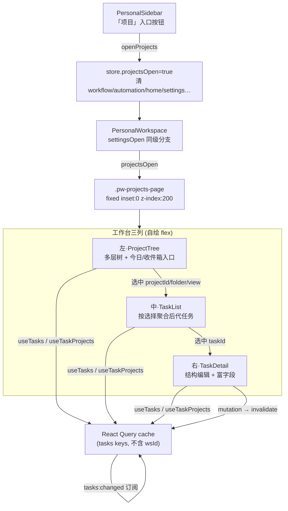
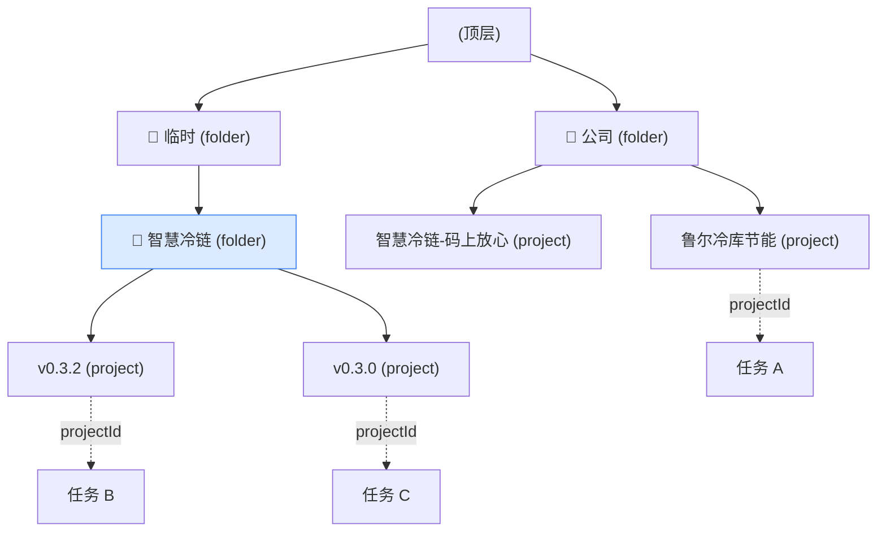
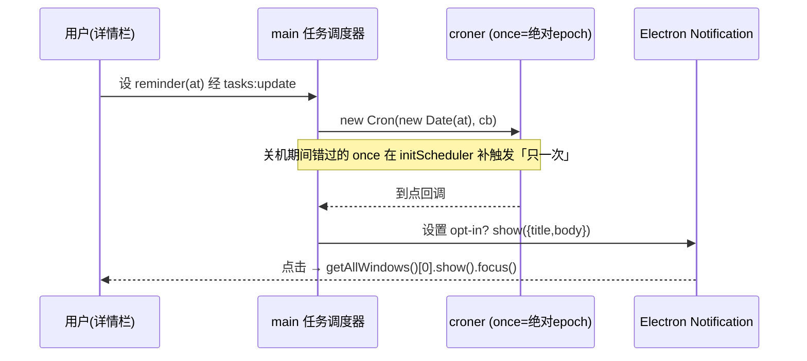

# feat: 个人任务系统 · 全屏三栏「项目」工作台（多层项目树 + 富详情）

## Summary

在已落地的个人任务系统（`tasks.json` + 右栏 Tasks 视图）之上，新增一个从侧栏进入的**独立全屏三栏工作台**：左列是可折叠的**多层项目树**（文件夹 → 项目 → 子项目），中列按左树选择聚合任务清单，右列是任务详情。为支撑左树，把扁平的 `TaskProject` 升级为**带 `parentId` + `kind` 的层级模型**（实现 origin 里被延后为 fast-follow 的子项目嵌套，origin R10）。右列详情面板补齐 OmniFocus 风格富字段：预计时长、时区、完成/丢弃时间戳、提醒、重复、附件——其中通知投递、croner 调度、附件存储三大重活复用仓库既有内核。个人 + 本地，全部新字段以可选字段落 `tasks.json` 并读时补默认，向前兼容旧档。

## Problem Frame

现有任务系统只有一个**窄右栏**入口（`packages/views/cortex-desktop/personal/TasksView.tsx`，Today/Inbox/Projects/Tags tab），项目是**扁平单层**的 `TaskProject { id, name }`（origin v1 刻意把嵌套下沉为 fast-follow）。当用户的项目数量与层次变多（公司 / 临时 / 内部运营 / 运维 / 个人 各含多个项目、项目下还有版本子项目），扁平列表 + 窄栏无法承载导航与浏览。目标是给出 OmniFocus 式的「文件夹树 + 任务清单 + 富详情」三栏工作台，作为项目管理主界面，同时保留右栏 Tasks 作快速访问。这是对 `docs/plans/2026-07-01-002-feat-personal-tasks-agent-native-plan.md`（同日前身）的延伸，复用其全部持久化 / IPC / 委派基座，只做「层级模型 + 三栏 IA + 富字段」三件增量。

## Requirements

本计划的需求为新增，与 origin 的连接处显式标注（origin R10 子项目嵌套、R13 内置视图、R7 任务字段）。

**项目层级与导航**

- R1. `TaskProject` 支持任意层级嵌套：新增 `parentId`（指向父 `TaskProject`）与 `kind`（`folder` / `project`）。project 可嵌套于 folder 或另一 project 之下（后者即「子项目」）；folder 仅作分组容器、不直接容纳任务；任务只挂 `project` 节点。（实现 origin R10 延后的子项目嵌套）
- R2. 左侧项目树可折叠展开、呈现 folder / project 层级；支持新建 folder / project、重命名、改父级（reparent），并禁止把节点挂到自身后代之下（防环）。
- R3. 删除 folder 不静默丢数据：其直属子节点上提到该 folder 的父级（无父则升为顶层）；删除叶子 project 时其任务回 Inbox（沿用现有 `deleteProject` 语义）。
- R4. 项目树含内置视图入口（今日 / 收件箱），与项目节点并列可选。

**三栏工作台与入口**

- R5. 侧栏新增「项目」入口，点击进入独立全屏三栏工作台，与自动化 / Loop 工作流 / 设置等既有全屏模式**互斥**；工作台接管整窗（左树替换会话侧栏）。
- R6. 中列按左树当前选择聚合任务：选中任意节点 → 聚合其子树内全部 project 的任务（选中 project → 其自身任务 + 后代 sub-project 任务，按 project 分组；选中 folder → 后代全部 project 的任务）；选中今日 / 收件箱 → 对应计算视图。
- R7. 右列为选中任务的详情，复用现有结构编辑（状态 / 项目 / 标签 / 截止 / 延后 / 标记 / 内联正文，origin R7）。
- R8. 新工作台为项目管理主界面；现有右栏 Tasks（今日 / 收件箱 / 标签）保留作快速访问，两者共享同一份任务数据；右栏扁平 Projects tab 与详情项目选择器过滤掉 folder（只列可容纳任务的 project）。

**任务详情富字段**（补齐图中面板）

- R9. 任务可设预计持续时间（`estimatedDuration`，分钟），提供快捷时长 chips 录入。
- R10. 任务可设时区语义：`floating`（浮动，按本地日历日解释）vs `fixed`（固定，绑具体时区）；影响到期 / 提醒的时刻解释。
- R11. done / dropped 记录 `completedAt` / `droppedAt` 时间戳（现仅有 `status` 枚举，无时间戳）。
- R12. 任务可设提醒（`reminder`）：到某时刻经桌面通知提醒；调度在 main、脱离渲染端存活；关机期间错过只补一次；通知默认关闭、opt-in。
- R13. 任务可设重复（`repeat`）：完成后按周期生成下一实例并顺延日期；复用既有 schedule 语法表达周期。
- R14. 任务可加附件：落盘复用现有文档附件存储（magic-bytes 校验 / 原子写 / 每任务目录），详情可列出 / 移除附件。

**持久化与兼容**

- R15. 全部新字段以**可选字段**加入 `tasks.json` 并读时补默认，向前兼容旧档：不 bump `personal-workspace.json`；`tasks.json` 遇未知字段读而不清空；文件损坏隔离到 `.corrupt`、绝不空态覆盖幸存数据。
- R16. 新增 IPC（项目 update、任务附件、提醒能力）走既有四文件接线（bridge ↔ preload ↔ ipc/tasks ↔ register 注册）+ 两份 `types.ts` 镜像；main 新增会 `require` 的依赖或 overlay 资产须核对 `electron-builder.yml` 的 `files` 白名单。

---

## Key Technical Decisions

- **KTD1 — 全屏三栏用 settings 式 fixed 覆盖层，不复用壳的 `.right` / `.pw-center-col`。** 新建布局根 `.pw-projects-page`，照 `.pw-settings-page`（`packages/views/cortex-desktop/cortex-desktop.css:6276-6283`，`position:fixed; inset:0; z-index:200`）做全窗覆盖 + 内部自绘三列 flex。壳的 `.right` / `.pw-center-col` 被 `.body:has(.pw-main)` 选择器与 2 列 grid 绑死（`cortex-desktop.css:3723,4725-4741`），复用会互相打架。互斥标志 `projectsOpen` 仿 `workflowOpen`，但须加进**全部** `open*` 清理站点（见 U4），否则两个全屏模式叠加。须镜像 `:6311` 的 mac 红绿灯 `padding-top` 到左列顶部。
- **KTD2 — 项目层级 = `parentId` + 可选 `kind`（读时默认 `"project"`），零迁移向前兼容。** project 可嵌套于 folder 或另一 project（子项目）；folder 仅分组、任务只挂 project；reparent 防环（不能把节点挂到自身后代下）。删除语义分两种：删 **folder** → 其直属子节点上提到该 folder 的父级（无父则升顶层），folder 本身不含任务；删 **project** → 其直属任务回 Inbox（沿用现 `deleteProject` 语义，`apps/desktop/src/main/ipc/tasks-store.ts:196-204`）、其直属子项目上提。现 `deleteProject` 只 reparent 直属任务、不处理子项目，须补「直属子节点上提」。
- **KTD3 — 任务类型抽到独立 `tasks-types.ts`（core + main 各一），`types.ts` 仅 re-export。** `packages/core/desktop/types.ts` 已 **1587 行、超 1200 上限**，`apps/desktop/src/main/ipc/types.ts` 1137 行逼近上限；继续内联新字段会加剧违规。把 task 类型段（core `types.ts:64-131`，**含 `TasksFileData`**；main `ipc/types.ts` 对应段）迁到 `tasks-types.ts`，原文件 re-export 保持导入路径不变（`tasks-store.ts:16` 正 import `TasksFileData`，漏迁会断链）。
- **KTD4 — `tasks.json` 字段演进走「可选字段 + 读时 `normalizeData` 补默认」，version 保持 1。** `getTasks`（`tasks-store.ts:55-85`）现无归一化步骤、原样返回。加可选字段零改动即兼容；对需被下游可靠依赖的字段（如 `kind`），在 `isValidTasksFile` 通过后、写 `cached` 前插入幂等 `normalizeData(parsed)` 补默认。**绝不 bump `personal-workspace.json`**；**不复用** `migratedAt` 闸门（那是 personal-workspace→tasks 的一次性导入，与字段演进正交）。
- **KTD5 — 提醒 / 重复调度复用 automation 的 croner + 纯函数 `schedule-cron.ts`，新建薄任务调度器（不耦合 `AutomationMeta`）。** 提醒用 `once`（绝对 epoch ms，croner 对 Date 不做时区换算）；关机期间错过的 once 在 `initScheduler` 补触发。**「只补一次」不能白拿**——automation 的幂等靠 `enabled:false` + `lastRunAt` + finalize，任务侧无此机制，须自建 `reminder.firedAt?` 持久化进 `tasks.json` 作幂等闸门（`at < now && !firedAt` 才补、补后写 `firedAt`），语义参照 `apps/desktop/src/main/automation/scheduler.ts:51-62,39-42`；有活跃提醒时 `powerSaveBlocker` 后台唤醒（既有基座）。通知走**主进程原生** `Notification`（照 `apps/desktop/src/main/automation/push-on-complete.ts:51-62`）：`mainWindow` 未导出 → click handler 走 `BrowserWindow.getAllWindows()`；close-to-tray 时窗口可能 hidden → 先 `win.show()` 再 `win.focus()`。默认关闭、经设置 opt-in。
- **KTD6 — 附件复用 `saveDocInto(root, id, …)` + `assertDocPath`，只加 root + task-doc IPC + `TaskMeta` 引用字段。** 新增 `taskDocsRoot()`（如 `~/.cortex-desktop/task-docs/<taskId>/`，仿 `apps/desktop/src/main/paths.ts:44-51` 的 `chatDocsRoot`），新 `task-doc:save` IPC 复用 `apps/desktop/src/main/ipc/doc.ts:70-94` 的 `saveDocInto` / `assertDocPath`；magic-bytes / 50MB 上限 / 原子写 / 去重白拿。引用形状仿 `{path,name,mimeType,sizeBytes}`（`packages/core/personal/messages.ts:1586-1588`）。
- **KTD7 — 任务型重复的「完成即再生」行为无先例、须新建纯逻辑，与调度触发分离。** 复用 `ScheduleSpec`（`apps/desktop/src/main/ipc/types.ts:989-996`）表达周期语法，但「完成后生成下一实例 / 顺延 `dueDate`」是 core 纯函数（`computeNextOccurrence`），在任务被置 done 时触发，独立于 croner 的到点触发。
- **KTD8 — 服务端态走 React Query；tasks keys 刻意不含 wsId；`onTasksChanged` 订阅须在工作台根真挂载。** 个人任务 main-owned、非工作区作用域，`tasksKeys` 不含 wsId 是 CLAUDE.md wsId 通例的**有意例外**（见前身 KTD）。工作台的选中项目 / 选中任务是 **UI 瞬态**（组件 `useState`），绝不复制一份服务端态；**树展开 / 折叠态提升为轻量持久客户端态**（落 `core/store` 客户端态，非服务端态——不违反本 KTD；避免深层树每次进出工作台塌回默认，设计研究）。工作台根须真正挂载 `useTasksChangeSubscription`（历史 bug：notes 订阅曾全仓零挂载导致后台落盘不刷新），否则委派 / 后台回写不刷新三栏。
- **KTD9 — 工作台一开始就按栏拆组件（`ProjectTree` / `TaskList` / 详情各独立文件 + 薄容器接线）。** 详情栏富字段会持续增长，`SettingsMenu.tsx` / `messages.ts` 已超 1200 的返工教训在先；避免攒进单文件再拆。详情正文复用既有 markdown 编辑器 `NoteCodeMirrorEditor`（本 worktree commit `af4d534` 已做过内联正文编辑复用）。

---

## High-Level Technical Design

### 全屏模式切换与三栏组合（与既有壳互斥）

`projectsOpen` 是纯瞬态互斥标志（不进 `toPersistedState`）；工作台是 fixed 覆盖层，盖住 App 左栏；三列共用同一份 `tasks.json`（经 React Query 读、mutation 只 invalidate）。



### 项目层级模型与中列聚合

folder 仅分组、任务只挂 project；project 可再嵌 project（子项目）。选中任意节点时，中列聚合其子树内全部 project 的任务（选中 project 含其自身 + 后代 sub-project）。



### 提醒调度与投递（main、脱离渲染端）



## Output Structure

```text
packages/core/desktop/
  tasks-types.ts          # 【新】从 types.ts 迁出的 task 类型 + 新字段(parentId/kind/富字段)
  types.ts                # 改：re-export ./tasks-types（保持导入路径不变）
packages/core/personal/
  taskProjectTree.ts      # 【新】纯函数：buildProjectTree / descendantProjectIds / isDescendant(防环) / 过滤 folder
  taskRepeat.ts           # 【新】纯函数：computeNextOccurrence(完成即再生/顺延)
  tasks.ts                # 改：useUpdateTaskProject + useAddTaskProject 入参对象化 + 富字段 hook 接线
packages/views/cortex-desktop/personal/
  ProjectsWorkbench.tsx   # 【新】三栏容器(薄接线) + 根挂 useTasksChangeSubscription
  ProjectTree.tsx         # 【新】左列多层树(折叠/新建/重命名/reparent/内置视图入口)
  TaskListColumn.tsx      # 【新】中列(按选择聚合 + 分组 + 快速新增 + 复用 TaskRow)
  TaskDetail.tsx          # 改：接入三栏选中态 + 富字段结构栏区块
  TaskDurationField.tsx   # 【新】时长 chips 控件
  TaskReminderField.tsx   # 【新】提醒/时区/重复 控件(复用 ScheduleEditor 零件)
  TaskAttachments.tsx     # 【新】附件列表 + 上传/移除
apps/desktop/src/main/
  ipc/tasks-types.ts      # 【新】main 侧 task 类型镜像(与 core/tasks-types 逐字一致)
  ipc/types.ts            # 改：re-export ./tasks-types
  ipc/tasks.ts            # 改：tasks:updateProject + task-doc:save/list/delete handler
  ipc/tasks-store.ts      # 改：normalizeData 补默认 + addProject 入参 + updateProject + deleteProject 级联
  paths.ts                # 改：taskDocsRoot()
  tasks-reminder-scheduler.ts # 【新】薄任务调度器(复用 croner + schedule-cron.ts)
apps/desktop/src/preload/index.ts  # 改：tasksUpdateProject / taskDoc:* 通道
packages/core/desktop/bridge.ts    # 改：tasksUpdateProject? / taskDoc* 契约
```

---

## Implementation Units

分五期交付。**A/B 期是本请求的核心**（层级模型 + 三栏 IA，复用现有任务字段即可端到端可用）。C 期是详情富字段基座（时长 / 完成·丢弃时间戳）；D 期（提醒）、E 期（重复 U12 / 附件 U13）均依赖 B、独立于 C——C/D/E 可并行分批落地。

### Phase A — 层级模型与项目 CRUD 基座

### U1. Task 类型抽离 + TaskProject 层级 + 树纯函数

- **Goal**：把 task 类型迁到独立文件（解 1200 行超限）、给 `TaskProject` 加 `parentId` / `kind`，并提供层级派生纯函数。
- **Requirements**：R1, R2（防环判定）, R6（后代聚合）；R15。
- **Dependencies**：无。
- **Files**：`packages/core/desktop/tasks-types.ts`（新，迁 `types.ts:64-131` 全部 task 类型**含 `TasksFileData`** + `TaskProject.parentId?: string` + `kind?: "folder" | "project"`）；`packages/core/desktop/types.ts`（改为 `export * from "./tasks-types"`）；`apps/desktop/src/main/ipc/tasks-types.ts`（新，逐字镜像）；`apps/desktop/src/main/ipc/types.ts`（re-export）；`packages/core/personal/taskProjectTree.ts`（新）；`packages/core/personal/taskProjectTree.test.ts`；`packages/core/package.json`（exports 加 `"./desktop/tasks-types"` 若被 main 直接 import；`"./personal/taskProjectTree"`）。
- **Approach**：`kind` 设可选（读时默认 `"project"`，KTD4），避免旧档破坏。纯函数：`buildProjectTree(projects)` → 嵌套节点数组（按 `parentId` 组树、无 parent 为顶层、悬空 parent 兜底为顶层）；`descendantProjectIds(projects, id)` → 该节点子树内全部 project id（选中节点若为 project 则含自身 + 后代 sub-project；若为 folder 则仅后代 project），作为中列统一聚合器；`isDescendant(projects, nodeId, candidateParentId)` → reparent 防环；`onlyProjects(projects)` → 过滤 `kind==="folder"`（供右栏扁平 tab / 详情 select）。两份 `tasks-types.ts` 手工逐字镜像。
- **Patterns to follow**：`packages/core/store/personal.ts:1001 partitionProjects`（派生纯函数不污染 store）；前身计划 KTD6（exports 子路径 + core 不引 react-dom）。
- **Test scenarios**：
  - `buildProjectTree`：三层（folder→folder→project）正确嵌套；悬空 `parentId`（父不存在）→ 兜底顶层不丢节点；空输入 → 空树。
  - `descendantProjectIds`：选中 folder → 其全部后代 project（跨多层、排除 folder 类型自身）；选中含子项目的父 project → 自身 + 后代 sub-project；叶子 project → 仅自身。
  - `isDescendant`：把 A 挂到其后代 B 下 → true（应拒绝）；挂到无关节点 → false；挂到自身 → true（拒绝）。
  - `onlyProjects`：混合列表过滤掉 folder。
  - `kind` 缺省的旧 project 经消费方按 `"project"` 处理（读时默认在 U2 落地，这里测纯函数对 `undefined` 的容错）。
- **Verification**：纯函数全绿；两份 `tasks-types.ts` 字段逐字一致（附人工比对清单）；`types.ts` 行数回落到上限内。

### U2. main store 层级支持（归一化 + updateProject + 删除上提）

- **Goal**：让 `tasks-store` 支持层级读写：读时补 `kind` 默认、支持带 `parentId`/`kind` 建项目、支持 rename/reparent、删 folder / project 时正确上提直属子节点并归位任务。
- **Requirements**：R1, R2, R3；R15。
- **Dependencies**：U1。
- **Files**：`apps/desktop/src/main/ipc/tasks-store.ts`（改 `addProject`:188-193、`deleteProject`:196-204、`getTasks`:55-85 插 `normalizeData`；新增 `updateProject`）；`apps/desktop/src/main/ipc/tasks-store.test.ts`。
- **Approach**：`normalizeData(parsed)`（幂等，在 `isValidTasksFile` 通过后、写 `cached` 前）：`projects.map(p => ({ ...p, kind: p.kind ?? "project" }))`；结果写 `cached`，下次 `saveTasksFile` 自然升级落盘。`addProject({ name, parentId?, kind? })`：`kind` 缺省 `"project"`；`parentId` 校验存在。`updateProject(id, { name?, parentId? })`：rename + reparent；reparent 前用 `isDescendant`（U1）**防环**，命中则拒绝。`deleteProject(id)`：先算「该节点直属子节点集合」；folder → 子节点 `parentId` 上提到被删节点的 `parentId`（无则顶层）；被删节点下**直属任务** reparent 到 Inbox（沿用现语义）；决策记录：不递归级联删整棵子树（避免静默丢数据，R3）。
- **Patterns to follow**：`tasks-store.ts:196-204`（现 deleteProject 形状）；前身计划 U2（mutate 串行 / 损坏隔离，本单元沿用不改）。
- **Execution note**：先写「删 folder 后其子项目不悬空、任务归 Inbox」「reparent 成环被拒」两个失败测试，再实现。
- **Test scenarios**：
  - `normalizeData`：旧 project 无 `kind` → 读后为 `"project"`；已有 `kind` 不被覆盖；幂等（跑两遍不变）。
  - `addProject` 带 `parentId`/`kind` → 落库正确；`parentId` 指向不存在项目 → 拒绝或降级为顶层（择一并断言）。
  - `updateProject` rename → 名变；reparent 到合法父 → `parentId` 变；reparent 成自身后代 → 拒绝、数据不变。
  - `deleteProject`（folder，含子项目 + 孙任务）→ 子项目上提到父级、任务回 Inbox、无悬空 `parentId`；`deleteProject`（叶子 project）→ 其任务回 Inbox（同现语义）。
- **Verification**：层级增删改守恒无悬空；防环生效；损坏隔离 / 串行写不回归。

### U3. 项目 update IPC 四文件接线 + hook

- **Goal**：打通 `tasks:updateProject` 的 IPC 链路与 React Query 写层，`addProject` 入参对象化。
- **Requirements**：R2, R16。
- **Dependencies**：U2。
- **Files**：`packages/core/desktop/bridge.ts`（`tasksUpdateProject?`; `tasksAddProject` 签名改对象入参，:355-356）；`apps/desktop/src/preload/index.ts`（`tasks:updateProject` invoke + addProject 对齐，:449-450）；`apps/desktop/src/main/ipc/tasks.ts`（新 `tasks:updateProject` handler + addProject 签名，:52-62）；`apps/desktop/src/main/ipc/register.ts`（确认 `registerTasksHandlers` 已注册，新 handler 在内）；`packages/core/personal/tasks.ts`（新 `useUpdateTaskProject`；`useAddTaskProject`:165-172 入参对象化）；`packages/core/personal/tasks.test.ts`。
- **Approach**：`useUpdateTaskProject` 的 `onSuccess` 同时 invalidate `tasksKeys.projects` 与 `tasksKeys.all`（reparent / 删除影响任务归属，照 `useDeleteTaskProject`:175-185 已两个都 invalidate）。四文件 + 两份 types 镜像逐字对齐（防永久 pending，learnings 主题 2）。web 端 bridge null → 调用点 null-safe。
- **Patterns to follow**：`packages/core/personal/tasks.ts:175-185`（useDeleteTaskProject）；`apps/desktop/src/main/ipc/notes.ts:19-60`；`register.ts:46`。
- **Test scenarios**：`tasksUpdateProject` rename → `onTasksChanged` → `useTaskProjects` 重拉含新名（跨 IPC 集成）；通道名三处（handle/invoke/send）往返对齐、不永久 pending；bridge null → hook 不报错、UI 降级。
- **Verification**：项目 rename/reparent 往返闭环；能力缺失优雅降级。

### Phase B — 全屏三栏工作台

### U4. 全屏模式接线（projectsOpen 互斥标志 + 入口）

- **Goal**：新增 `projectsOpen` 瞬态互斥标志、侧栏入口、`PersonalWorkspace` 覆盖层分支，进入 / 退出正确清理。
- **Requirements**：R5。
- **Dependencies**：无（可与 Phase A 并行）。
- **Files**：`packages/core/store/personal.ts`（状态字段:152 旁、动作声明:294-295 旁、默认值:403 旁、`openProjects`/`closeProjects` 实现:934-936 后；**全部互斥清理站点补 `projectsOpen:false`**：`createSession`:727-729、`setActiveSession`:803-806、`activateProject`:817-820、`openTimeline`:922、`openHome`:927、`openAutomation`:931、`openWorkflow`:935、`openNoteEditor`:940）；`packages/views/cortex-desktop/personal/PersonalWorkspace.tsx`（订阅:80-85 旁、覆盖层分支:185 旁）；`packages/views/cortex-desktop/personal/PersonalSidebar.tsx`（订阅:258-259 旁、入口按钮仿:333-342）；`packages/core/store/personal.test.ts`。
- **Approach**：`openProjects` 置真并清 `workflowOpen/automationOpen/homeOpen/timelineProjectId/activeSessionId/noteEditorId/settingsOpen`（照 `openWorkflow`:934-935 骨架）；`projectsOpen` **不进** `toPersistedState`（瞬态，与 workflow/settings 一致）。`PersonalWorkspace` 在 `settingsOpen` 覆盖层（:185）**之前**插 `{projectsOpen ? <ProjectsWorkbench onToast={onToast}/> : null}`——二者同为 `z-index:200 fixed`，且 `openSettings`（`personal.ts:945`）刻意不清 `projectsOpen`（设置是**栈式覆盖**），故工作台内打开设置时须让设置渲染在后（盖住工作台），`closeSettings` 回到工作台。`openProjects` 清 `settingsOpen`（进入工作台关掉残留设置）；设置侧**不反向清** `projectsOpen`（有意的栈式例外，非遗漏）。侧栏入口能力门控 `bridge?.tasksListProjects`，`is-active` 绑 `projectsOpen`，ESC / 关闭按钮调 `closeProjects`。
- **Patterns to follow**：`personal.ts:934-935 openWorkflow`（互斥清理骨架）；`PersonalWorkspace.tsx:185 settingsOpen` 覆盖层；`PersonalSidebar.tsx:333-342` Loop 入口。
- **Test scenarios**：`openProjects` 后其它全屏标志全 false（逐一断言 8 处互斥）；打开其它模式（openHome/openWorkflow/openAutomation）后 `projectsOpen` 回 false；`projectsOpen` 不出现在 `toPersistedState` 输出；bridge 无 `tasksListProjects` → 入口不渲染。
- **Verification**：入口进入 / 退出；无两个全屏模式叠加；不持久化。

### U5. ProjectsWorkbench 容器 + 三栏 CSS

- **Goal**：三栏容器（薄接线，根挂 `onTasksChanged` 订阅）+ `.pw-projects-page` 全窗覆盖布局。
- **Requirements**：R5, R8（共享数据刷新契约）；KTD8。
- **Dependencies**：U4。
- **Files**：`packages/views/cortex-desktop/personal/ProjectsWorkbench.tsx`（新，三列 flex 接线 + `useTasksChangeSubscription` 根挂载 + 选中态 `useState`）；`packages/views/cortex-desktop/cortex-desktop.css`（新增 `.pw-projects-page` 及三列类，仿 `.pw-settings-page`:6276-6283 + mac 红绿灯:6311）；`ProjectsWorkbench.test.tsx`。
- **Approach**：容器持有 UI 瞬态 `{ selection: {kind:"project"|"folder"|"today"|"inbox", id?}, selectedTaskId }`（`useState`，不进 store，KTD8）。根组件真挂载 `useTasksChangeSubscription`（KTD8：否则后台回写不刷新）。CSS：`.pw-projects-page{ position:fixed; inset:0; z-index:200; display:flex }`；左列固定宽（如 260px）、中列 `flex:1`、右列固定宽（如 360px，可后续加拖拽）；左列顶部镜像 mac 红绿灯 `padding-top:40px`（`.app-frame[data-native-titlebar="mac"]` 门控）。叶子样式复用 `.pw-task-row`/`.pw-task-badge`/`.pw-task-detail*`/`.pw-project*`。
- **Patterns to follow**：`cortex-desktop.css:6276-6311`（settings 覆盖层 + 红绿灯）；`packages/core/personal/tasks.ts:213-223 useTasksChangeSubscription`（根挂载）。
- **Test scenarios**：渲染出三列容器；根挂载订阅（mock bridge.onTasksChanged 被调用一次、卸载清理）；选中态在容器内切换不触发服务端态复制。
- **Verification**：三栏骨架显示；`tasks:changed` 能刷新三栏；ESC / 关闭回到底层视图。

### U6. 左列 ProjectTree（多层树 + 增删改 + reparent + 内置视图入口）

- **Goal**：可折叠的多层项目树，支持新建 folder/project、重命名、改父级，并含今日 / 收件箱入口。
- **Requirements**：R1, R2, R3, R4。
- **Dependencies**：U1, U3, U5。
- **Files**：`packages/views/cortex-desktop/personal/ProjectTree.tsx`（新）+ `.test.tsx`。
- **Approach**：用 `buildProjectTree`（U1）渲染嵌套；每层可折叠，**展开态落轻量持久客户端态（KTD8，非 useState）**避免深树每次进出工作台塌回。folder 用文件夹图标、project 用列表图标区分（复用 `.pw-project*` 样式 + `Icon.Folder`）。新建：**常驻「＋」入口（不依赖选中即可建顶层 folder/project）**，并支持在选中 folder 下加 folder/project、选中 project 下加子项目（`useAddTaskProject` 对象入参带 `parentId`/`kind`）；重命名就地 input（`useUpdateTaskProject`）；reparent 用「移动到…」菜单（可后续加拖拽）→ `useUpdateTaskProject({parentId})`，防环由 U2 store 层拒绝、UI 给 toast。删除经 `useDeleteTaskProject`（上提语义在 U2）。顶部固定「今日 / 收件箱」两个视图入口，点选 → 容器 `selection`。选中项高亮。**首次无项目**给空态 + 首建引导。**可达性（v1 最低承诺，设计研究）**：树设 `role="tree"/"treeitem"` + 基本方向键导航（上下移动 / 左右折叠展开）。
- **Patterns to follow**：`PersonalSidebar.tsx:108-240 ProjectBlock`（折叠 / 悬停菜单 / 就地操作）；`packages/views/cortex-desktop/personal/MoveToProjectMenu.tsx`（移动菜单先例）。
- **Test scenarios**：三层树渲染 + 折叠展开；**展开态退出再进工作台保持不塌回**；新建子 project 落在选中 folder 下；常驻「＋」在无选中时可建顶层节点；重命名生效；reparent 到合法父生效、成环被拒 + toast；删 folder 后子节点仍在（上提）；首次无项目显空态引导；今日 / 收件箱入口切换 `selection`。
- **Verification**：树导航完整；层级增删改经 U2/U3 闭环；无悬空节点。

### U7. 中列 TaskListColumn（按选择聚合 + 分组 + 快速新增）

- **Goal**：按左树选择聚合任务清单，folder 聚合子树后代任务，含快速新增与完成 / 委派等行内动作。
- **Requirements**：R6；R7（打开详情）。
- **Dependencies**：U1, U5, U6。
- **Files**：`packages/views/cortex-desktop/personal/TaskListColumn.tsx`（新）+ `.test.tsx`。
- **Approach**：读 `useTasks()` 全量 + `useTaskProjects()`。按容器 `selection` 过滤：`project` / `folder` 统一走 `projectId ∈ descendantProjectIds(projects,id)`（U1；project 含自身 + 后代 sub-project，folder 仅后代）；`today` → `isTodayEligible`；`inbox` → 无有效 project（读时兜底 `projectId ∉ 表 → Inbox`）。子树含多个 project 时按 project 分组显示（分组头 = project 名）。**默认排序**（关闭 origin 遗留 OQ，设计研究）：组间按左树顺序，组内 `flag → 逾期 → due 升序 → 无 due 末尾`（与右栏窄视图一致，保 U7 验收「结果一致」）。**快速新增归属**：选中 project → 落该 project；选中 folder → 落 Inbox（folder 不容纳任务、无从定归属）；选中 today → 落 Inbox 且 `due=今天`；选中 inbox → 无 project。行复用现有 `TaskRow` 交互（完成 / flag / 删除 / 委派 / 建议 chips），点标题 → 容器 `selectedTaskId`。**委派例外（对抗 #3）**：现 `useDelegateTask`（`taskDelegate.ts:59`）末尾调 `setActiveSession`，而该动作被 U4 列为清 `projectsOpen` 的站点——直接复用会在工作台内点委派时**当场关闭工作台**。故工作台内委派须走**不切视图的委派路径**（委派后保持 `projectsOpen`、不经 `setActiveSession` 清理），并在委派前把目标 cwd（`taskDelegate.ts:38-42` 取自 `activeProjectId`、全屏内不可见）明示给用户。**空态**：选中空 project / 空 folder → 「此项目 / 分组下暂无任务」（区别于 Today/Inbox 空态）。
- **Patterns to follow**：`TasksView.tsx:159-317`（分组聚合 + TaskRow + 快速新增，整段可复用重组）；`TasksView.tsx:75-76 effectiveProjectId`（读时兜底）。
- **Test scenarios**：选中叶子 project → 仅其任务；选中含子项目的父 project → 自身 + 后代 sub-project 任务按 project 分组；选中 folder → 后代全部 project 任务按 project 分组；组内排序为 `flag→逾期→due 升序→无 due 末尾`；选中今日 → `isTodayEligible` 结果（复用前身计划派生，非本计划 U1）；选中 folder 快速新增 → 落 Inbox；today 快速新增 → Inbox + due=今天；**工作台内委派 → 工作台不关闭、cwd 有可见来源**；选中空 project → 显「暂无任务」空态；点任务 → 右列打开该任务。
- **Verification**：中列聚合正确；folder 后代聚合与右栏窄视图结果一致（同数据源）。

### U8. 右列 TaskDetail 接入三栏 + 富字段结构栏骨架

- **Goal**：让 `TaskDetail` 在三栏中受控于容器选中态，复用现有结构编辑，并为 C–E 期富字段预留结构栏区块。
- **Requirements**：R7, R11（富字段渐进披露）；R8。
- **Dependencies**：U5, U7。
- **Files**：`packages/views/cortex-desktop/personal/TaskDetail.tsx`（改：新增可选 props 适配三栏受控；结构栏预留富字段挂载点）+ `.test.tsx`。
- **Approach**：`TaskDetail` 现已是完整详情组件（结构栏 + 内联正文，:82-208），三栏中直接复用；容器传 `selectedTaskId → task`，无选中时右列显空态引导。为 C–E 期字段（时长 / 提醒 / 重复 / 附件）在结构栏预留分区容器（各子控件 U10–U13 挂入），本单元只搭骨架不实现字段。**富字段沿用 origin R11 渐进披露（关键，防 AI slop，设计研究）**：空字段**默认不渲染**其区块，仅显示统一「＋添加属性」入口按需显形；已填字段才显区块——绝不把 5 个空字段常驻堆一屏。
- **Patterns to follow**：`TaskDetail.tsx:82-208`（现结构栏 + 编辑器）。
- **Test scenarios**：容器选中任务 → 右列显该任务详情；切换任务 → 草稿正确重置（沿用现 `useEffect [task.id]`）；无选中 → 空态引导；**新任务详情不渲染任何空富字段区块、仅显「＋添加属性」入口**；添加某字段后仅该区块显形。
- **Verification**：右列详情端到端（含现有结构编辑）；富字段挂载点就位。

### U9. 右栏扁平 Projects tab / 详情 select 适配 folder

- **Goal**：加嵌套后，右栏窄视图与详情项目选择器只呈现可容纳任务的 project（过滤 folder），共享数据不破坏。
- **Requirements**：R8。
- **Dependencies**：U1。
- **Files**：`packages/views/cortex-desktop/personal/TasksView.tsx`（Projects tab 分组:183-189 过滤 folder；**建议接受 `acceptField`:129-135 匹配/新建收敛到 `onlyProjects`**）；`packages/views/cortex-desktop/personal/TaskDetail.tsx`（项目 `<select>`:142-146 过滤 folder）+ 相关 `.test.tsx`。
- **Approach**：**三处**消费面统一过滤 folder，缺一即 folder 会被写进 `projectId`：(1) 右栏扁平 Projects tab 用 `onlyProjects`（U1）过滤 `kind==="folder"`（避免空 folder 显「0 项」）；(2) 详情 `<select>` 只列 project（任务不挂 folder，KTD2）；(3) **结构化建议接受路径**（前身 `TasksView.tsx:129-135 acceptField` 按 `projectName` 名字匹配 + 未命中新建）必须匹配 / 新建于 `onlyProjects(projects)`——否则模型建议的名字命中同名 folder（如「智慧冷链」），任务被写成 `projectId=folderId`，在中列（`descendantProjectIds` 不含 folder id）与右栏 Projects tab **双双不可见、不可达**（对抗 #1）。`useTaskProjects` 仍返回原始扁平数组，过滤在消费方。
- **Patterns to follow**：`TasksView.tsx:183-189`；`TaskDetail.tsx:136-147`。
- **Test scenarios**：右栏 Projects tab 不出现 folder；含子项目的 folder 不显示为空组；详情 select 只列 project、不含 folder；**结构化建议的 projectName 命中同名 folder 时不写 folderId（新建同名 project 或忽略），任务不消失**；消费面与工作台读同一 RQ cache。
- **Verification**：右栏与工作台数据一致；folder 不误入扁平选择器。

### Phase C — 详情富字段（时长 / 完成·丢弃时间戳）

### U10. TaskMeta 轻富字段（时长 / 完成·丢弃时间戳）

- **Goal**：加 `estimatedDuration` / `completedAt` / `droppedAt` 字段与时长录入控件，状态迁移写时间戳。（时区 `fixed`/IANA 单设备无消费方 → 延后，v1 仅隐式 `floating`，见 Scope Boundaries）
- **Requirements**：R9, R11；R15。
- **Dependencies**：U1, U8。
- **Files**：`packages/core/desktop/tasks-types.ts` + `apps/desktop/src/main/ipc/tasks-types.ts`（加可选字段：`estimatedDuration?: number`（分钟）、`completedAt?: number`、`droppedAt?: number`）；`apps/desktop/src/main/ipc/tasks-store.ts`（置 done/dropped 时写对应时间戳；`normalizeData` 无需改——纯可选）；`packages/core/personal/tasks.ts`（`useUpdateTask` 已通用，无需新 hook）；`packages/views/cortex-desktop/personal/TaskDurationField.tsx`（新，时长 chips +1/+5/+15/+1h）；`TaskDetail.tsx`（结构栏按渐进披露挂入，U8）+ 各 `.test.tsx`。
- **Approach**：时间戳在 main 侧状态迁移落点写（`status→done` 写 `completedAt=now`、`→dropped` 写 `droppedAt`；恢复清空），保证权威。时长 chips 仿 ScheduleEditor 分段控件手感，新建（无现成 duration stepper）。**时区**：v1 只用隐式 `floating`（= 现有本地日历日语义，零新字段/UI）；`fixed`+IANA 在单设备本地无可观测行为差异（提醒是绝对 epoch、到期是本地日历日字符串，都不经时区），推 fast-follow（scope-guardian + 对抗一致）。全部可选字段 → 旧档零迁移（KTD4）。
- **Patterns to follow**：`packages/views/cortex-desktop/personal/ScheduleEditor.tsx:24-25,136-221`（select / SegmentedRadio / 日期换算零件）；前身计划日期本地日历日语义（KTD7）。
- **Test scenarios**：置 done → `completedAt` 有值、恢复 active → 清空；置 dropped → `droppedAt`；时长 chips 累加 / 清零；旧档缺这些字段 → 读为 `undefined` 不报错（向前兼容）。
- **Verification**：轻富字段闭环；时间戳权威在 main；旧档兼容。

### Phase D — 提醒 / 通知

### U11. 任务提醒（main 调度器 + 原生通知 + 设置 opt-in）

- **Goal**：任务可设到点提醒，main 侧调度脱离渲染端存活、错过只补一次，经原生桌面通知投递，默认关闭 opt-in。
- **Requirements**：R12；R16；KTD5。
- **Dependencies**：U8（详情骨架 + 字段基座；提醒用绝对 epoch，不依赖 C 期时区，scope-guardian #2）。
- **Files**：`packages/core/desktop/tasks-types.ts` + main 镜像（`TaskMeta.reminder?: { at: number; firedAt?: number }`）；`apps/desktop/src/main/tasks-reminder-scheduler.ts`（新，复用 croner + `schedule-cron.ts`）；`apps/desktop/src/main/index.ts`（初始化调度器 + 补触发；退出清理）；`apps/desktop/src/main/ipc/tasks.ts`（写 reminder 时 (re)schedule）；`packages/views/cortex-desktop/personal/TaskReminderField.tsx`（新，详情栏提醒段 UI：日期 + 时刻选择写 `reminder.at`，复用 ScheduleEditor 的 hour/minute select 零件）；`TaskDetail.tsx`（结构栏挂入提醒段）；设置项（`notifications.tasks` opt-in，接入既有设置存储）；`apps/desktop/src/main/ipc/tasks-store.test.ts` / 调度器纯函数测试。
- **Approach**：薄调度器**不耦合** `AutomationMeta`：对每个有 `reminder.at` 的任务建 `new Cron(new Date(at), cb)`（绝对 epoch，croner 不做时区换算）；写 `reminder` 前校验 `Number.isFinite(at)` + 合理上下界（非法则拒绝该条、不让调度器整体抛错，安全 #3）；`initScheduler` 补触发关机期间错过的提醒，用 `reminder.firedAt` 持久化幂等闸门（`at < now && !firedAt` 才补、补后写 `firedAt`，KTD5），保证「只补一次」。**opt-in 门控在调度层、非仅投递层（对抗 #5）**：通知 opt-in 关时整个提醒子系统惰性——**不建 Cron、不持 `powerSaveBlocker`**（否则设了提醒没开通知的用户白耗电、通知还从不弹）。到点回调 → `showTasksNotification(title, body)`：`if (!Notification.isSupported()) return; new Notification(...).show()`，click → `BrowserWindow.getAllWindows()[0]`，close-to-tray 先 `show()` 再 `focus()`（KTD5）。**锁屏隐私（安全 #2）**：通知默认只带 `title`（或对 `body` 照 `push-on-complete` 同款截断），避免正文进锁屏 / 通知中心。日志走 redact + `sync=false` + dev-gate（含用户内容）。
- **Patterns to follow**：`apps/desktop/src/main/automation/scheduler.ts:25-62`（croner 编排 + once + 补跑）；`automation/push-on-complete.ts:51-62`（原生 Notification + click + isSupported）；`schedule-cron.ts`（纯函数）。
- **Execution note**：先写「关机期间错过的 once 补触发只一次」「设置未 opt-in 时不弹通知」两个失败测试，再实现。
- **Test scenarios**：设 reminder → 到点回调触发通知（fake timers）；`at` 已过 + 未触发 → 补触发一次、再跑不重复；**opt-in 关 → 无 Cron job、无 `powerSaveBlocker`、不弹**；非法 `at`（NaN/负/超界）→ 拒绝该条、不影响同批其它提醒装载；`Notification.isSupported()` false → 静默不崩；删任务 / 清 reminder → 取消调度。
- **Verification**：主窗口关闭时提醒仍触发；错过只补一次；默认不打扰。

### Phase E — 重复 / 附件

### U12. 任务重复（周期语法复用 + 完成即再生）

- **Goal**：任务可设重复，完成后按周期生成下一实例 / 顺延日期。
- **Requirements**：R13；R15；KTD7。
- **Dependencies**：U1, U8。
- **Files**：`packages/core/desktop/tasks-types.ts` + main 镜像（`TaskMeta.repeat?: ScheduleSpec`-style 或精简周期结构）；`packages/core/personal/taskRepeat.ts`（新纯函数 `computeNextOccurrence(task, completedAt)`）+ `.test.ts`；`apps/desktop/src/main/ipc/tasks-store.ts` 或 `tasks.ts`（置 done 时若含 `repeat` → 生成下一实例 / 顺延 `dueDate`+`deferDate`）；`packages/views/cortex-desktop/personal/TaskRepeatField.tsx`（新，重复段 UI，独立文件避免与 U10/U11 挤同一文件——scope-guardian #3）。
- **Approach**：周期语法复用 `ScheduleSpec`（daily/weekly/cron，`main/ipc/types.ts:989-996`）表达。`computeNextOccurrence` 纯函数：按 `repeat` 与原 `dueDate`/`deferDate` 算下一日期（本地日历日语义）。任务被置 done 且含 `repeat` → 默认把同一任务日期顺延到下一周期并回 active（「滚动」，更简、无实例爆炸）。**已知后果（对抗 #4，须在 UI 交代）**：滚动任务恒 active → 永不进归档（`tasks-store.ts:211` 归档只收 done/dropped）、`completedAt` 每滚动即清（R11 完成历史为空）、勾选框每次回弹。故须：(a) 提供「结束重复」入口（清 `repeat` 后可正常置 done）；(b) 决定是否为每次滚动写一条完成计数 / `archived` 记录（默认不写，作已知限制记入 Open Questions）。与 U11 到点触发解耦（本单元只管再生，不管通知）。
- **Patterns to follow**：`automationTemplates.ts:44,77`（daily/weekly ScheduleSpec 词汇）；`schedule-cron.ts:94 computeNextRun`（下一次时间计算思路）。
- **Test scenarios**：daily 重复任务置 done → `dueDate` 顺延一天并回 active；weekly → 顺延到下周对应日；无 `repeat` 的任务置 done → 不再生（保持 done）；`computeNextOccurrence` 对边界（月末 / defer>due）正确。
- **Verification**：重复行为可预测；无实例爆炸；「结束重复」入口可让重复任务真正 done；与提醒 / 状态机不冲突。

### U13. 任务附件（复用文档附件存储）

- **Goal**：任务可加附件，落盘复用现有文档附件闸门，详情可列出 / 移除。
- **Requirements**：R14；R16；KTD6。
- **Dependencies**：U8。
- **Files**：`apps/desktop/src/main/paths.ts`（`taskDocsRoot()` 仿:44-51）；`apps/desktop/src/main/ipc/tasks.ts`（`task-doc:save`/`task-doc:delete` 复用 `saveDocInto`/`assertDocPath`）；`apps/desktop/src/preload/index.ts` + `packages/core/desktop/bridge.ts`（`taskDocSave`/`taskDocDelete` 契约）；`packages/core/desktop/tasks-types.ts` + main 镜像（`TaskMeta.attachments?: {path,name,mimeType,sizeBytes}[]`）；`packages/views/cortex-desktop/personal/TaskAttachments.tsx`（新）+ `docIntake` 复用；`electron-builder.yml`（核对新 main 依赖 / 资产在 `files` 白名单）；相关 `.test.tsx`。
- **Approach**：新 `taskDocsRoot()` = `~/.cortex-desktop/task-docs/<taskId>/`；`task-doc:save` 调 `saveDocInto(taskDocsRoot(), taskId, fileName, source)`（`doc.ts:70-89`，magic-bytes / 50MB / 原子写 / 去重白拿）；引用落 `TaskMeta.attachments`（可选字段，KTD4 兼容）。**注意 `saveDocInto` 的 `extToDocExt`（`doc.ts:78`）仅收 pdf/docx/xlsx/pptx/csv/txt/md，图片会被拒**——任务截图是高频场景，须择一：(a) 本期附件仅限文档类型（图片延后）；(b) 扩展 `extToDocExt` + `sniffDocMatches` 纳入图片（触碰共享 doc 代码、非纯复用，须回归 chat-docs 不受影响）。默认 (a)，见 Open Questions。渲染端复用 `docIntake.ts`（优先 `srcPath` 避免大 ArrayBuffer 过 IPC）。移除附件 → 删磁盘 + 去引用。**日志脱敏（对齐前身 KTD9，安全 #1）**：`task-doc:*` handler 的错误/路径日志走 redact + `sync=false` + dev-gate，尤其避免原样打印用户 `fileName`（`saveDocInto` 抛错会带原始名）与 `taskDocsRoot()/<taskId>/` 绝对路径。**打包核对**：新增 main 侧 `require` 的依赖或资产先查 `electron-builder.yml` 的 `files` 黑名单，仓库外验证（learnings 主题 3）。**边界（安全 #4）**：`taskDocsRoot()` **禁止**加入 `fs.ts` 的 `allowedRoots()`（其 `assertOpenable` 有「任意真实文件即放行」兜底会击穿限制）；未来若开放 agent 读附件，须走 `assertDocPath` 式专用根边界（realpath+lstat 拒符号链 + 严格根，同 `doc.ts:93` 对 chat-docs 的处理）。
- **Patterns to follow**：`apps/desktop/src/main/ipc/doc.ts:70-94`（saveDocInto/assertDocPath）；`paths.ts:44-51`（chatDocsRoot）；`packages/views/cortex-desktop/personal/docIntake.ts`；`packages/core/personal/messages.ts:1586-1588`（引用形状）。
- **Test scenarios**：加附件 → 落 `task-docs/<taskId>/`、`attachments` 引用写入；非白名单扩展名 / 超 50MB → 拒绝；移除 → 磁盘 + 引用同删；旧档无 `attachments` → 读为 undefined 不报错。
- **Verification**：附件闭环复用既有闸门；打包后不因 `files` 遗漏崩（仓库外验证）。

---

## Scope Boundaries

**本计划范围内**
- 多层项目树（folder/project 任意嵌套）+ 三栏全屏工作台 + 右栏 Tasks 保留（共享数据）。
- 详情富字段：预计时长、完成/丢弃时间戳、提醒、重复、附件（时区 v1 仅隐式 floating）。

**延后（fast-follow / 以后做，非本计划）**
- 右列拖拽调宽 / 三栏各自宽度持久化（先固定宽）。
- 项目树拖拽排序（reorder）与手动任务排序（沿用前身 R28：v1 不做手动 reorder）。
- 重复任务的「新建下一实例并归档当前」模式（本计划默认滚动同一任务）。
- 固定时区（`fixed`）+ IANA 选择器（v1 仅隐式 `floating`，单设备无可观测消费方，scope-guardian + 对抗一致建议延后）。
- 提醒的「提前 N 分钟 / 多次提醒 / 到期自动通知」高级策略（本计划先做单次到点提醒）。
- agent 读取任务附件（需比照 chat-docs 的 `fs.ts` allowedRoots 边界，暂不开放）。
- 自定义 Perspectives（沿用 origin Scope Boundaries）。

**产品身份之外（不做）**
- 团队 / 共享项目、多人指派、跨设备同步（保持个人 + 本地）。
- 日历 / 事件集成与时间块。
- 通用项目管理（Gantt、依赖图）。

**Deferred to Follow-Up Work（本计划实现期发现、非本轮）**
- `tasks.json` 若因富字段最终需引入 `version:2`，把 `isValidTasksFile` 放宽为 `>=1` + `normalizeData` 按 version 分支的收尾（本计划优先全可选字段、保持 version 1）。
- 沉睡地基 `TodoMeta`/`TodosView` 的物理删除清理（沿用前身，另起 chore）。

---

## System-Wide Impact

- **新增全屏模式**：`projectsOpen` 加入 8 处互斥清理站点（U4）；遗漏任一处会导致两个全屏模式叠加。入口能力门控 `bridge?.tasksListProjects`（web/旧壳降级隐藏）。**设置是栈式覆盖例外**：`openProjects` 清 `settingsOpen`，但设置侧不反向清 `projectsOpen`——`ProjectsWorkbench` 须渲染在 `PersonalWorkspace.tsx:185` settings 覆盖层之前，工作台内打开设置才能盖在其上（U4）。
- **数据模型演进**：`TaskProject` 加 `parentId`/`kind`、`TaskMeta` 加一批可选富字段，全部落 `tasks.json`、读时补默认；**不 bump `personal-workspace.json`**；task 类型迁到独立 `tasks-types.ts`（解 `core/desktop/types.ts` 1587 行超限）。
- **共享后台基座**：提醒 / 重复复用 automation 的 croner + `schedule-cron.ts` + `powerSaveBlocker`（`powerSaveBlocker` 与调度均门控在通知 opt-in 之上——关时不建 Cron、不持锁）；通知复用原生 `Notification` 投递；附件复用 `saveDocInto` 闸门——均薄层接入，不新建并行子系统内核。
- **打包**：附件 / 通知若引入 main 侧新 `require` 依赖或 overlay 资产，须核对 `electron-builder.yml` 的 `files` 白名单并**仓库外验证**（`docs/lessons.md` 教训）。
- **右栏 Tasks 共存**：右栏扁平 Projects tab / 详情 select 过滤 folder（U9）；两消费面与工作台共用同一 RQ cache，`onTasksChanged` 订阅须在工作台根真挂载。

## Risks & Dependencies

| 风险 | 影响 | 缓解 |
|---|---|---|
| `core/desktop/types.ts` 已超 1200 行，继续加字段加剧违规 | lint/返工 | KTD3：先抽 `tasks-types.ts` 再加字段，`types.ts` re-export |
| 删 folder 未递归 → 悬空 `parentId`（现 deleteProject 仅处理直属任务） | 树结构错乱 | KTD2/U2：删 folder 直属子节点上提到父级 + 删 project 任务回 Inbox；reparent 用 `isDescendant` 防环 |
| reparent 成环（把节点挂到自身后代下） | 树渲染死循环 | U1 `isDescendant` + U2 store 层拒绝 + UI toast |
| 新字段 bump 版本触发旧代码空态覆盖 | 数据丢失 | KTD4：全可选字段 + 读时补默认 + version 保持 1 + 损坏隔离不覆盖 |
| 新 IPC 通道名四文件未对齐 | 永久 pending | KTD/learnings：bridge↔preload↔ipc↔register + 两份 types 镜像逐字对齐 |
| 提醒关机期间错过 / 重复补触发 | 漏提醒或重复打扰 | KTD5：`once` 绝对 epoch + `initScheduler` 补触发「只一次」+ powerSaveBlocker |
| 通知 click 拿不到窗口 / close-to-tray 隐藏 | 点通知无反应 | KTD5：`getAllWindows()` + 先 `show()` 再 `focus()`；`isSupported()` 守卫 |
| 附件打包 `files` 白名单遗漏 | 正式版启动崩（dev 假通过） | KTD6/learnings：核对 `electron-builder.yml` + 仓库外 asar 验证 |
| 全屏模式互斥清理漏站点 | 两模式叠加 | U4：8 处清理站点逐一断言 |
| `onTasksChanged` 订阅未在工作台根挂载 | 后台回写不刷新三栏 | KTD8：根组件真挂载（历史 notes 零挂载 bug 在先） |
| 结构化建议按名匹配把任务写到同名 folder（对抗 #1） | 任务两处 UI 双双不可见 | U9：`acceptField` 匹配 / 新建收敛到 `onlyProjects` |
| 工作台内委派经 `setActiveSession` 关闭工作台（对抗 #3） | 批量分诊被反复弹出 | U7：委派走不切视图路径、保持 `projectsOpen`、cwd 明示 |
| 提醒调度 + `powerSaveBlocker` 未随 opt-in 门控（对抗 #5） | 未开通知也后台耗电 | U11：opt-in 关时不建 Cron、不持锁 |
| 富字段常驻堆一屏（违反 origin R11，设计研究） | AI slop、简单任务噪声 | U8：空字段隐藏 + 统一「＋添加属性」入口 |

**依赖**：既有 `DesktopBridge`/preload/`register.ts` 接线；`tasks-store.mutate` 串行写队列（前身 U2）；automation 的 croner + `schedule-cron.ts` + `powerSaveBlocker`；原生 `Notification`（`push-on-complete.ts`）；`saveDocInto`/`assertDocPath`（`doc.ts`）；既有设置存储（提醒 opt-in）。

## Open Questions

**已按安全默认解决（研究缺口，如需不同请指出）**
- 全屏落法：用 **settings 式 fixed 覆盖层**接管整窗（左树替换会话侧栏），非 workflow 式留 App 左栏（KTD1）。
- 删 folder：**子节点上提到父级、任务回 Inbox**，非级联删整棵子树（R3）。
- `TaskProject.kind`：**可选 + 读时默认 `"project"`**（零迁移，KTD4）。
- 任务归属：**只能挂 project 节点，folder 仅分组**（KTD2）；右栏 / 详情 select 过滤 folder（U9）。
- 重复模式：**滚动同一任务（顺延日期回 active）**，非新建下一实例 + 归档（U12）；如偏好实例流转请指出。
- 任务附件类型：**默认仅限文档类型（pdf/docx/xlsx/pptx/csv/txt/md，复用 `saveDocInto` 白名单）**；图片附件延后（需扩展共享 doc 代码，U13/研究）。如需首版即支持截图请指出。
- 时区语义：**v1 仅隐式 `floating`（本地日历日）**；`fixed`+IANA 无单设备可观测消费方，延后 fast-follow（scope-guardian + 对抗一致）。如需 fixed 请指出。
- 富字段渐进披露：**空字段隐藏 + 统一「＋添加属性」入口**（沿用 origin R11，防 AI slop，设计研究）。

**实现期决定（带默认，可覆盖）**
- 三栏各列固定宽的具体取值（左 ~260 / 右 ~360）与是否首版即加右列拖拽。
- `estimatedDuration` 的展示粒度与 chips 档位（+1/+5/+15/+1h）。
- 重复任务是否为每次滚动写一条完成计数 / 归档记录（默认不写，作已知限制，对抗 #4）。
- 提醒通知正文是否只带标题（默认，锁屏隐私，安全 #2）或带截断正文；是否附「打开任务」深链。
- `reminder` 是否独立于 `dueDate`，还是「到期即提醒」的派生（本计划按独立字段建模）。
- 双入口（工作台 + 右栏 Tasks）的分工说明与至少一个跨入口跳转点（设计研究 #5）。
- 三栏覆盖层的窄窗 `min-width` / 中列优先降级策略（设计研究 #6，固定宽已列入延后）。

## Sources & Research

- Origin 需求文档：`docs/brainstorms/2026-07-01-personal-tasks-agent-native-requirements.md`（R10 子项目嵌套延后、R13 内置视图、R7 任务字段）。
- 前身计划（复用其全部基座）：`docs/plans/2026-07-01-002-feat-personal-tasks-agent-native-plan.md`（tasks.json / mutate 串行写 / 委派 / KTD 汇总）。
- 全屏模式接线：`packages/core/store/personal.ts`（RightView:60、状态:146-158、`open*` 实现:922-946、互斥清理:727-729/803-820/927-940、`toPersistedState`:973-995）；`packages/views/cortex-desktop/personal/PersonalWorkspace.tsx:80-85,162-185`；`PersonalSidebar.tsx:258-259,333-342`。
- 三栏 CSS：`packages/views/cortex-desktop/cortex-desktop.css`（`.pw-settings-page`:6276-6311、`.right`:3723/`.pw-center-col`:4725-4741、叶子 `.pw-task-*`:3911+/`.pw-task-detail*`:4075+/`.pw-project*`:3627-3660）。
- 项目层级 / store：`apps/desktop/src/main/ipc/tasks-store.ts`（`emptyTasks`:29-30、`isValidTasksFile`:34-38、`getTasks`:55-85、`list`:133-138、`addProject`:188-193、`deleteProject`:196-204）；`apps/desktop/src/main/ipc/tasks.ts:52-70`；`packages/core/personal/tasks.ts:99-223`；两份 `types.ts`（core:64-124 / main 对应段）。
- 富字段可复用内核：通知 `apps/desktop/src/main/automation/push-on-complete.ts:51-62` + `notification-window.ts`；调度 `automation/scheduler.ts:25-62` + 纯函数 `automation/schedule-cron.ts:52-94` + `ScheduleSpec` `main/ipc/types.ts:989-996`；附件 `apps/desktop/src/main/ipc/doc.ts:70-94` + `paths.ts:44-51` + `docIntake.ts` + 引用 `messages.ts:1586-1588`；日期控件零件 `ScheduleEditor.tsx:24-25,136-221` + `SegmentedRadio`。
- 教训（`docs/lessons.md` + 相关 plans）：electron-builder `files` 白名单 + 仓库外验证；IPC 四文件对齐防永久 pending；原生 Notification（`getAllWindows` + show→focus、opt-in）；croner `once` 绝对 epoch + 补触发只一次 + powerSaveBlocker；tasks keys 不含 wsId 的有意例外；`onTasksChanged` 须根挂载；单文件 1200 上限 + core/views 硬边界。
