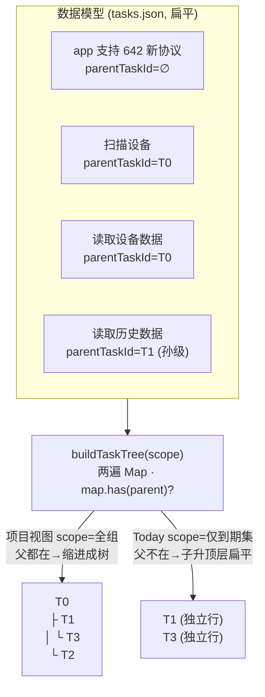
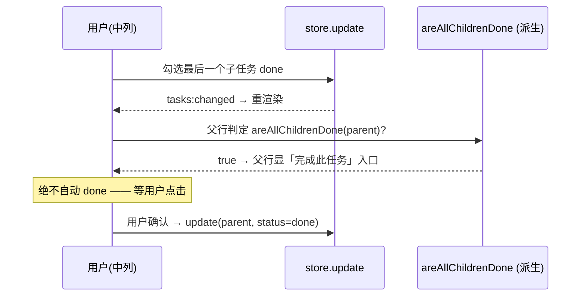
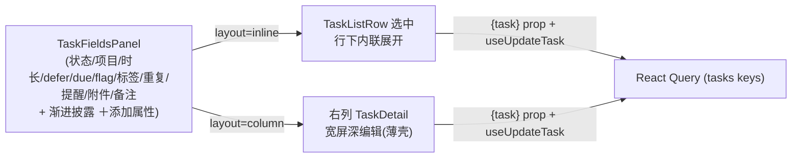

# feat: 个人任务系统 · 任意层级子任务 + 中列 OmniFocus 内联 inspector

## Summary

在已落地的三栏「项目」工作台（`docs/plans/2026-07-01-003-feat-tasks-projects-workbench-plan.md`，U1–U13 已全部实现）之上，给**中列任务清单**补两件增量，把它做成图片里的 OmniFocus 单栏观感：(1) **任意层级子任务**——给 `TaskMeta` 加 `parentTaskId` 指针，实现 origin R10 延后为 fast-follow 的子任务嵌套；(2) **中列行内 inspector**——点击任务时在行下内联展开一个承载全部结构字段编辑的属性面板（新增缺失的「状态」控件），作为主编辑面，右列 `TaskDetail` 保留作宽屏深编辑备用。子任务是一等公民：按自身 due/defer 独立进 Today/Inbox（计算视图扁平），在项目视图下缩进成树；完成语义为**父随子建议**——全部子任务完成时父行浮现「建议完成」入口，用户确认才置 done（沿用系统「完成需确认」基调，不自动）。设计与部分领域规则借鉴用户既有项目 `IFocus`（Electron+React 的 OmniFocus 类应用）。全部新字段以可选字段落 `tasks.json`、读时兼容旧档。

## Problem Frame

当前中列 `TaskListColumn`（`packages/views/cortex-desktop/personal/TaskListColumn.tsx`）只做**扁平按项目分组**的任务行，点任务仅把 `selectedTaskId` 冒泡给右列 `TaskDetail`——**无行内展开、无选中高亮、无子任务**。数据侧 `TaskMeta`（`packages/core/desktop/tasks-types.ts:57-79`）**没有任何父子字段**（`parentId` 只存在于 `TaskProject` 项目层级），store（`apps/desktop/src/main/ipc/tasks-store.ts`）零子任务处理。而图片展示的是 OmniFocus 经典形态：任务行可展开子任务、选中行在标题下内联铺开一整条属性栏（项目 / 状态 / 持续时间 / 推迟至 / 到期 / 已完成 / 重复 / 截止 / 添加备注）。差距是三处：**任务模型缺父子关系**、**中列缺内联 inspector**、**详情缺状态控件**。目标是补齐这三处，把中列升级为图片效果，同时不破坏已实现的三栏工作台与右栏 Tasks 共享数据。

## Requirements

本计划需求为新增，与 origin 连接处显式标注（origin R10 子任务嵌套、R7 任务字段、R11 渐进披露、R8 状态枚举、「完成需确认」基调）。

**子任务模型与层级**

- R1. `TaskMeta` 新增 `parentTaskId?: string`（指向父 `TaskMeta`），支持**任意层级**嵌套（无深度上限）；子任务是一等 `TaskMeta`，拥有自身全部字段（含 `projectId` / `dueDate` / `deferDate` / `status`）。（实现 origin R10 延后的子任务嵌套）
- R2. 新建子任务：从某任务派生子任务，子任务默认继承父的 `projectId`；`TaskInput` 加 `parentId`，经既有 `tasks:add` 透传（不新增 IPC 通道）。
- R3. 改父级（把任务变成另一任务的子任务 / 提升层级）经既有 `tasks:update` 的 `parentTaskId` patch；store 层用 `isTaskDescendant` **防环**（不能把节点挂到自身后代之下），命中拒绝并 toast。
- R4. 删除含子任务的任务：**级联删除整棵子树**，但 UI 先确认（「此任务含 N 个子任务，一并删除？」）；无子任务的任务照常直接删。（借鉴 `IFocus` 的 `ON DELETE CASCADE` 语义，叠加确认以不静默丢数据）

**子任务完成联动**

- R5. 完成语义为**父随子建议**：子任务各自独立完成；当某任务的**全部直属子任务**进入终态（done/dropped）且该任务本身未完成时，其在中列的行浮现「全部子任务已完成 · 完成此任务」入口，用户点击才置父 done——**绝不自动 done**（沿用系统「完成需确认」）。该「全部子任务完成」为**派生属性**，不落库、不新增状态枚举。

**子任务呈现**

- R6. 项目 / folder 视图下，中列按 `parentTaskId` 缩进成树呈现，父行可折叠 / 展开子任务；展开态为轻量持久客户端态，避免进出工作台塌回。
- R7. Today / Inbox / Tags 计算视图下，子任务按自身 `due`/`defer`/`flag`/无项目**独立扁平参与聚合**（父不在结果集时子自动升为顶层行）；此「嵌套 vs 扁平」由同一个建树器的「父在则嵌套、父不在则提升」自动成立，无需按视图特判。（借鉴 `IFocus` 的 `map.has(parent)` 建树法）

**中列内联 inspector**

- R8. 中列点击任务 → 该行选中高亮，并在标题行下**内联展开** inspector，承载全部结构字段编辑：状态 / 项目 / 持续时间 / 推迟至(defer) / 到期(due) / 标记 / 标签 / 重复 / 提醒 / 附件 / 备注。（对应图片灰色选中任务的属性栏）
- R9. 新增「状态」编辑控件（枚举 active / in-progress / waiting / done / dropped，origin R8）：现 `TaskDetail` 无状态控件，状态只能经 checkbox / 委派间接改；本控件为内联 inspector 与右列详情共用。
- R10. 富字段沿用 origin R11 **渐进披露**：空字段不常驻，经统一「＋添加属性」入口按需显形；避免 5 个空字段堆一屏（防 AI slop）。
- R11. 为避免中列内联 inspector 与右列 `TaskDetail` 两套字段逻辑漂移，把字段簇抽为**共享面板组件**，两处以 `layout` 变体复用同一实现。

**持久化与兼容**

- R12. `parentTaskId` 及任何新字段以**可选字段**加入 `tasks.json`、读时补默认，向前兼容旧档：**不 bump** `personal-workspace.json`；`normalizeData` 保持幂等；损坏隔离到 `.corrupt`、绝不空态覆盖幸存数据。（沿用前身 KTD4）

---

## Key Technical Decisions

- **KTD1 — 父子关系用 `parentTaskId` 单指针，不用内嵌 `children[]`。** 与 `TaskProject.parentId` 同构，任意深度天然支持；重排 / 改父 O(1)、聚合视图友好。子任务是一等 `TaskMeta`（自带 `projectId`/`dueDate`/`status`），不是父的内嵌子结构。（借鉴 `IFocus` `apps/desktop/src/shared/types/task.types.ts:100`；同仓库 `TaskProject.parentId` 先例）

- **KTD2 — 树在渲染层用两遍 Map 法即时组装，`map.has(parent)` 同时给「嵌套」与「孤儿提升」。** 建树纯函数 `buildTaskTree(tasksInScope)`：第一遍把每个 task 包成 `{ ...task, children:[], depth:0 }` 入 `Map`；第二遍遍历，父在 scope 内 → push 到父的 `children` 且 `depth=parent.depth+1`，父**不在** scope 内 → 作为 root。于是**项目视图**（父子同在一组）自然缩进、**Today/Inbox**（扁平结果集，父多半不在）自然全扁平——**零按视图特判**。这是本计划避免「聚合视图要不要带上父」纠结的关键。（直接借鉴 `IFocus` `TaskList.tsx:102-128`）

- **KTD3 — 防环用 `isTaskDescendant`（新纯函数），补上 `IFocus` 的短板。** `IFocus` 的 indent 无环检测（把节点拖成自身后代会成环，是其已知缺陷）。本计划 reparent 前在 store 层用 `isTaskDescendant(tasks, nodeId, candidateParentId)` 拒绝成环，形状照搬同仓库 `packages/core/personal/taskProjectTree.ts` 已有的 project 层 `isDescendant`。

- **KTD4 — 完成联动「父随子建议」为纯派生 + UI 确认，不落库、不加状态枚举、不自动 done。** 派生 `areAllChildrenDone(tasks, parentId)` = 有 ≥1 直属子且全部子 ∈ {done, dropped}。中列在满足该条件且父未完成时，于父行渲染「完成此任务」入口，用户确认才 `updateTask(parent,{status:"done"})`。**不**采用 `IFocus` 的 `autoCompleteGroup` 自动置父完成——与系统「完成需确认」基调冲突（用户已明确选「建议」而非「自动」）。sequential/parallel 群组语义（`IFocus` 的 `groupType`）为 origin 明确延后项，本计划不做。

- **KTD5 — 删含子任务的任务 = 级联删子树 + UI 确认。** store `delete(id)` 现为纯物理删单条（`tasks-store.ts:257-259`）。改为：算出 `taskDescendantIds(id)`，一并删除；渲染层删除前若 `hasChildren` 弹确认。**与 `deleteProject` 的「上提」语义不同**——项目是容器（删项目任务回 Inbox 保命），而子任务是父动作的子步骤，级联删除更符合直觉（借鉴 `IFocus` `ON DELETE CASCADE`），叠加确认以不静默丢数据。（备选「上提子任务到父的父」列 Open Questions）

- **KTD6 — 子任务读写复用既有 IPC，零新通道。** 新建子任务经既有 `tasks:add`（`apps/desktop/src/main/ipc/tasks.ts:103`，整体透传 `TaskInput`）——只扩 `TaskInput.parentId` + `store.add` 读取透传；改父级经既有 `tasks:update` 的 `parentTaskId` patch（`store.update` 是字段级合并，天然支持，仅需插入防环校验）。避免 IPC 四文件对齐负担与永久 pending 风险。两份 `tasks-types.ts` 镜像仍须逐字同步。

- **KTD7 — 中列 inspector 与右列 `TaskDetail` 共用一个 `TaskFieldsPanel`（`layout: "inline" | "column"`），防两套漂移。** 现 `TaskDetail`（292 行）把结构栏（`:152-241`）+ 渐进披露 richFields（`:90-121,243-267`）内联在自身。抽出 `TaskFieldsPanel` 承载全部字段控件 + **新建状态控件**，`TaskDetail` 重构为薄壳消费它、中列内联 inspector 也消费它。字段控件本就 `{task}` prop + `useUpdateTask` 直驱、无 selection 依赖，天然可两处复用（Explore 已核实）。`TaskDetail` 抽薄后须仍 <1200 行。（借鉴 `IFocus` `TaskDetailEnhanced.tsx` 的 `of-field-group > label + 控件` 分组蓝本，但**其 `of-*` 样式源码缺失**，本仓库须自写 CSS）

- **KTD8 — 选中态与展开态归属：选中任务 = 工作台 UI 瞬态（既有 `selectedTaskId`），子树展开态 = 轻量持久客户端态。** `selectedTaskId` 已在 `ProjectsWorkbench`（`:29`）以 `useState` 持有，直接下传中列驱动「哪一行展开 inspector」——不复制服务端态。子任务折叠 / 展开态提升为轻量持久客户端态（落 `core/store`，仿 workbench KTD8 的树展开态），避免深树每次进出工作台塌回。选中行视觉借鉴 `IFocus`：`bg #E5F1FF` + `inset 3px 0 0` 蓝左条（正是图片选中样式）。

- **KTD9 — 全部新字段可选 + 读时兼容，version 保持 1，绝不 bump `personal-workspace.json`。** `parentTaskId`/新字段纯可选，`normalizeData`（`tasks-store.ts:46-56`）无需改（旧档读为 undefined 即顶层任务）；损坏隔离沿用既有 `.corrupt` 机制。（沿用前身 KTD4）

---

## High-Level Technical Design

### 子任务模型与「嵌套 / 孤儿提升」建树

`parentTaskId` 单指针 + 渲染层两遍 Map 建树；同一建树器在项目视图缩进、在计算视图扁平。



### 完成联动：父随子建议（派生 + 确认，不自动）



### 内联 inspector 与右列详情共用字段面板



## Output Structure

```text
packages/core/personal/
  taskTree.ts             # 【新】纯函数: buildTaskTree / taskDescendantIds / isTaskDescendant(防环) / areAllChildrenDone
  taskTree.test.ts        # 【新】
  tasks.ts                # 改: useAddTask 入参含 parentId(透传); 无新 hook(reparent 走 useUpdateTask patch)
packages/core/desktop/
  tasks-types.ts          # 改: TaskMeta.parentTaskId? + TaskInput.parentId?
packages/views/cortex-desktop/personal/
  TaskFieldsPanel.tsx     # 【新】抽出的共享字段面板(含新状态控件) + layout: inline|column
  TaskStatusField.tsx     # 【新】状态枚举控件(图标按钮 row)
  TaskDetail.tsx          # 改: 重构为薄壳消费 TaskFieldsPanel
  TaskListColumn.tsx      # 改: 嵌套树渲染 + 折叠/展开 + 子任务创建/删除确认/完成 rollup + 行内 inspector 挂载
  ProjectsWorkbench.tsx   # 改: selectedTaskId 及 setter 下传中列(现仅 onOpenTask)
  cortex-desktop.css      # 改: .pw-task-row.is-selected 选中态 + .pw-task-inspector 内联栏 + 子任务缩进/折叠 类
apps/desktop/src/main/ipc/
  tasks-types.ts          # 改: 镜像 parentTaskId / TaskInput.parentId (逐字同步 core)
  tasks-store.ts          # 改: add 透传 parentId + update 防环 + delete 级联子树
  tasks-store.test.ts     # 改
packages/core/store/
  personal.ts             # 改: 子树展开态(轻量持久客户端态)
```

---

## Implementation Units

分三期。**Phase A（模型 + store）** 是地基；**Phase B（子任务渲染 + 创建）** 与 **Phase C（内联 inspector）** 均依赖 A，但 B、C 彼此独立、可并行分批落地。C 期的 U5（抽共享面板 + 状态控件）不依赖子任务，可最先并行启动。

### Phase A — 子任务模型与 store

### U1. `parentTaskId` 字段 + 树纯函数

- **Goal**：给 `TaskMeta`/`TaskInput` 加父子字段，并提供层级派生纯函数（建树 / 后代 / 防环 / 完成派生）。
- **Requirements**：R1, R2, R3（防环判定）, R5（完成派生）, R7（建树）；R12。
- **Dependencies**：无。
- **Files**：`packages/core/desktop/tasks-types.ts`（`TaskMeta.parentTaskId?: string`:57-79；`TaskInput.parentId?: string`:82-87）；`apps/desktop/src/main/ipc/tasks-types.ts`（逐字镜像）；`packages/core/personal/taskTree.ts`（新）；`packages/core/personal/taskTree.test.ts`（新）；`packages/core/package.json`（exports 加 `"./personal/taskTree"`）。
- **Approach**：`buildTaskTree(tasks)` → 两遍 Map 法（KTD2）：入 Map 包 `{...task, children:[], depth}`；第二遍父在 Map 内则挂子、`depth=parent.depth+1`，否则为 root（悬空 `parentTaskId` 兜底顶层，不丢节点）；组内叶排序沿用现 `compareTasks` 语义（flag→逾期→due→无 due 末尾）由调用方注入或在此复用。`taskDescendantIds(tasks, id)` → 该任务全部后代 id（供级联删除 / 后代查询）。`isTaskDescendant(tasks, nodeId, candidateParentId)` → reparent 防环（照 `taskProjectTree.ts` 的 `isDescendant`）。`areAllChildrenDone(tasks, parentId)` → 有 ≥1 直属子且全部子 ∈ {done,dropped}（无子返回 false）。纯函数不引 react-dom / 不碰 store。
- **Patterns to follow**：`packages/core/personal/taskProjectTree.ts`（`buildProjectTree`/`isDescendant` 同构）；`IFocus` `TaskList.tsx:102-128`（两遍 Map + `map.has(parent)`）。
- **Test scenarios**：
  - `buildTaskTree`：三层（父→子→孙）正确嵌套且 `depth` 递增；悬空 `parentTaskId`（父不在集合）→ 该子升为 root、不丢；空输入 → 空树；**父不在 scope 但子在（Today 场景）→ 子为 root**（覆盖 R7 扁平化）。
  - `taskDescendantIds`：多层子树返回全部后代（含孙）；叶子 → 空。
  - `isTaskDescendant`：把 A 挂到其后代 B 下 → true（应拒）；挂到自身 → true；挂到无关节点 → false。
  - `areAllChildrenDone`：全部子 done → true；含一个 active 子 → false；含 dropped+done 混合 → true；无子 → false。
- **Verification**：纯函数全绿；两份 `tasks-types.ts` 字段逐字一致（附人工比对清单）。

### U2. main store 子任务支持（add 透传 + reparent 防环 + delete 级联）

- **Goal**：让 store 支持建子任务、改父级防环、删父级联删子树。
- **Requirements**：R1, R2, R3, R4；R12。
- **Dependencies**：U1。
- **Files**：`apps/desktop/src/main/ipc/tasks-store.ts`（`add`:166-182 读 `input.parentId`；`update`:186-217 patch 含 `parentTaskId` 时插 `isTaskDescendant` 防环；`delete`:257-259 改级联）；`apps/desktop/src/main/ipc/tasks-store.test.ts`。
- **Approach**：`add({...,parentId})` → 落 `parentTaskId=input.parentId`（缺省顶层）；`parentId` 校验存在（不存在则降级为顶层并断言）。`update(id, patch)`：若 patch 含 `parentTaskId` 且 `isTaskDescendant(tasks,id,patch.parentTaskId)` 命中 → 拒绝该 patch（抛可捕获错误，渲染层 toast），其余字段照常合并。`delete(id)`：算 `taskDescendantIds(id)`（复用 U1 纯函数），一并从 `tasks` 移除（级联）；被删任务若为某父的唯一子，父的 `areAllChildrenDone` 随之变化由渲染层派生、store 不额外处理。`normalizeData` 无需改（`parentTaskId` 纯可选）。写走既有 `writeQueue` 串行、损坏隔离不回归。
- **Patterns to follow**：`tasks-store.ts:329-342 deleteProject`（级联 / 上提先例）；`tasks-store.ts:296-324 updateProject`（`isDescendant` 防环先例）；前身 U2（mutate 串行 / 损坏隔离）。
- **Execution note**：先写「删父级联删整棵子树」「reparent 成环被拒、数据不变」两个失败测试，再实现。
- **Test scenarios**：
  - `add` 带 `parentId` → 落 `parentTaskId` 正确；`parentId` 指向不存在任务 → 降级顶层（断言）。
  - `update` 改 `parentTaskId` 到合法父 → 变；改到自身后代 → 拒绝、`tasks` 不变。
  - `delete` 含两层子树的父 → 父 + 全部后代一并移除、无残留悬空 `parentTaskId`；`delete` 叶子 → 仅删自身。
  - 损坏隔离 / 串行写不回归（沿用既有断言）。
- **Verification**：子任务增删改守恒无悬空；防环生效；级联删除彻底。

### Phase B — 子任务渲染与创建

### U3. 中列嵌套树渲染 + 折叠/展开

- **Goal**：中列在项目视图按 `parentTaskId` 缩进成树、可折叠展开；计算视图（Today/Inbox）经同一建树器自动扁平。
- **Requirements**：R6, R7。
- **Dependencies**：U1；（U2 便于端到端，但渲染可先于 store 落地用现有数据验证）。
- **Files**：`packages/views/cortex-desktop/personal/TaskListColumn.tsx`（`groups`:77-110 每组内改用 `buildTaskTree` + DFS 展平；`render`:168-188 按 `depth` 缩进 + 折叠箭头；`TaskListRow`:195-263 加 `depth`/`hasChildren`/`expanded`/`onToggleExpand`）；`packages/core/store/personal.ts`（子树展开态：`Set<taskId>` 轻量持久客户端态 + toggle 动作，仿 workbench 树展开态）；`TaskListColumn.test.tsx`。
- **Approach**：每个 project 分组内用 `buildTaskTree(组内任务)` 建树后 DFS 展平为带 `depth` 的有序行；只有 `expandedTasks.has(id)` 才递归展开其子（折叠即不展平，借鉴 `IFocus`）。缩进用行首 `depth * STEP_PX` 占位（借鉴 `IFocus` `TaskCard.tsx:548-551`，STEP≈24px）。`hasChildren` 时渲染折叠箭头（Chevron 右/下）→ `onToggleExpand`。展开态落 `core/store` 客户端态（KTD8）。**Today/Inbox** 组因结果集扁平、父多半不在组内，`buildTaskTree` 自动把子当 root → 天然扁平（R7，零特判）。选中带子任务的父时自动展开（借鉴 `IFocus` `TaskList.tsx:72-99`）。
- **Patterns to follow**：`IFocus` `TaskList.tsx:102-143`（建树 + DFS 展平 + expandedSet）、`TaskCard.tsx:548-575`（缩进占位 + 折叠箭头）；同仓库 `ProjectTree.tsx`（折叠树先例）；`cortex-desktop.css:4017 .pw-todo-row.is-open`（行展开态 CSS 先例）。
- **Test scenarios**：项目视图三层任务缩进树渲染、`depth` 正确；折叠父 → 子行不渲染，展开 → 恢复；展开态退出再进工作台保持不塌回（客户端态持久）；Today 视图下子任务扁平为独立行（父不在集合）；选中含子任务父 → 自动展开。
- **Verification**：项目视图缩进树完整；计算视图扁平；折叠展开态持久。

### U4. 子任务创建 / 层级操作 / 删除确认 / 完成 rollup

- **Goal**：中列可建子任务、改层级、删父确认、以及「全部子任务完成→建议完成父任务」入口。
- **Requirements**：R2, R3, R4, R5。
- **Dependencies**：U2, U3。
- **Files**：`packages/views/cortex-desktop/personal/TaskListColumn.tsx`（行悬停 / 菜单加「添加子任务」「移动为子任务/升级」；删除父时确认；父行 rollup 入口）；`packages/core/personal/tasks.ts`（`useAddTask`:138 入参含 `parentId` 透传，无新 hook——reparent 走 `useUpdateTask` patch `parentTaskId`）；`TaskListColumn.test.tsx`。
- **Approach**：「添加子任务」→ `useAddTask({ title, parentId: task.id, projectId: task.projectId })`（子继承父项目，R2），落库后自动展开父。层级操作沿用 `IFocus` 的**菜单式 indent/outdent**（不做拖拽，与 workbench「v1 不做 reorder」一致）：「移动为上一行子任务」/「升级到父的父」→ `useUpdateTask({parentTaskId})`，成环由 U2 store 拒绝 + UI toast。删除：若 `taskDescendantIds(task).length>0` → 确认弹窗「含 N 个子任务，一并删除？」，确认才 `useDeleteTask`（级联在 U2 store）。**完成 rollup（R5，KTD4）**：父行渲染时若 `areAllChildrenDone(tasks, task.id)` 且父未完成 → 显「完成此任务」入口（区别于普通 checkbox），点击 `useUpdateTask({status:"done"})`；**不自动**。委派仍走工作台内不切视图路径（沿用 workbench U7）。
- **Patterns to follow**：`IFocus` `InboxPage.tsx:74-124`（handleAddSubtask / indent / outdent 菜单回调）、`taskStore.ts:344-369`（完成 rollup 判定，但改为**建议非自动**）；同仓库 `MoveToProjectMenu.tsx`（菜单先例）；`TaskListColumn.tsx:132-139 toggleDone`（`canTransition` 守卫）。
- **Execution note**：先写「全部子任务完成→父浮现建议入口且不自动 done」失败测试，再实现。
- **Test scenarios**：某任务「添加子任务」→ 落库带 `parentTaskId`、父自动展开；「移动为子任务」到合法父生效、成环被拒 + toast；删含子任务父 → 弹确认、确认后子树全删、取消则不变；**全部直属子完成 → 父行显「完成此任务」入口，未点击时父保持未完成**；点击后父 done；子任务未全完时父行不显该入口。
- **Verification**：子任务创建 / 层级 / 删除 / 完成建议全闭环；父不自动 done。

### Phase C — 中列内联 inspector

### U5. 抽共享 `TaskFieldsPanel` + 新建状态控件

- **Goal**：把 `TaskDetail` 的字段簇抽为共享面板（含新状态控件、渐进披露），`TaskDetail` 重构为薄壳消费它。
- **Requirements**：R8, R9, R10, R11。
- **Dependencies**：无（基于现有模型，可与 Phase A/B 并行、最先启动）。
- **Files**：`packages/views/cortex-desktop/personal/TaskFieldsPanel.tsx`（新，抽 `TaskDetail:152-267` 结构栏 + richFields，加 `layout:"inline"|"column"` prop）；`packages/views/cortex-desktop/personal/TaskStatusField.tsx`（新，状态枚举控件）；`packages/views/cortex-desktop/personal/TaskDetail.tsx`（改：重构为薄壳，头部 + 标题 input + 正文编辑器保留，字段簇改用 `<TaskFieldsPanel layout="column">`）；各 `.test.tsx`。
- **Approach**：`TaskFieldsPanel` 收 `{ task, layout, onToast }`，`useUpdateTask` 直驱；内含项目 select（`onlyProjects` 过滤 folder，沿用 U9）、defer/due 日期、flag、标签、时间戳只读、以及渐进披露 richFields（时长 `TaskDurationField` / 提醒 `TaskReminderField` / 重复 `TaskRepeatField` / 附件 `TaskAttachments`）+ 统一「＋添加属性」（沿用 `TaskDetail:90-121` 的 `isSet||revealed` 逻辑，R10）。`layout` 只切样式类（inline=紧凑横排属性栏、column=竖排分组），不分叉逻辑。**新 `TaskStatusField`**：枚举 active/in-progress/waiting/done/dropped 的图标按钮 row（借鉴 `IFocus` statusOptions 的 4 图标按钮形态，扩到 5 态），`useUpdateTask({status})`；置 done/dropped 时 main 侧已写 `completedAt`/`droppedAt`（现有）。`TaskDetail` 抽薄后须仍 <1200 行且导入路径不变。
- **Patterns to follow**：`TaskDetail.tsx:90-267`（结构栏 + richFields 渐进披露，整段抽出）；`IFocus` `TaskDetailEnhanced.tsx:634-648`（状态图标按钮 row）、`:650-705`（快捷条 + 条件挂载渐进披露蓝本）。
- **Test scenarios**：`TaskFieldsPanel` 在 column 布局渲染出全部现有字段（回归 TaskDetail 行为不变）；状态控件切换 → `useUpdateTask({status})` 被调、置 done 写 `completedAt`；空富字段默认隐藏、点「＋添加属性」显形；inline/column 两 layout 渲染同字段、mutation 一致。
- **Verification**：TaskDetail 行为无回归；状态控件闭环；共享面板两布局可用；文件行数达标。

### U6. 中列行内 inspector 挂载 + 选中态

- **Goal**：中列点任务 → 行选中高亮 + 行下内联展开 `TaskFieldsPanel(inline)`。
- **Requirements**：R8；R11。
- **Dependencies**：U3, U5。
- **Files**：`packages/views/cortex-desktop/personal/ProjectsWorkbench.tsx`（把 `selectedTaskId` + setter 下传 `TaskListColumn`，现仅传 `onOpenTask`:64）；`packages/views/cortex-desktop/personal/TaskListColumn.tsx`（`TaskListRow` 加 `isSelected`；选中时行下渲染 `<TaskFieldsPanel layout="inline">`）；`packages/views/cortex-desktop/cortex-desktop.css`（`.pw-task-row.is-selected` + `.pw-task-inspector` 内联栏）；`TaskListColumn.test.tsx`。
- **Approach**：`ProjectsWorkbench` 已持 `selectedTaskId`（`:29`），下传中列；`TaskListRow` 按 `task.id===selectedTaskId` 置 `is-selected` 并在 `.pw-task-row-main` 下挂内联 inspector（`TaskFieldsPanel layout="inline"`，含备注入口——点「添加备注」展开紧凑 `NoteCodeMirrorEditor`）。选中行视觉：`bg` 淡蓝 + `inset 3px 0 0` 蓝左条（借鉴 `IFocus`，即图片选中样式）。右列 `TaskDetail` 仍随 `selectedTaskId` 显示（KTD7 双面共存，用户已确认「行内为主·保留右列」）——两处编辑同一 `task`、经同一 mutation，React Query 保证同步。
- **Patterns to follow**：`IFocus` `TaskCard.tsx:536-543`（选中 bg + inset 蓝条）、`:658-681`（选中行内联展开）；`cortex-desktop.css:4017 .pw-todo-row.is-open`（行展开 CSS 先例）。
- **Test scenarios**：点任务 → 该行 `is-selected`、行下出现 inspector；再点另一任务 → 前者收起、后者展开；inspector 内改字段 → `useUpdateTask` 被调、右列 TaskDetail 同步更新（共享 cache）；无选中 → 无行内 inspector。
- **Verification**：中列内联 inspector 端到端；选中态唯一；与右列数据同步。

### U7. OmniFocus 风格视觉打磨（对齐图片）

- **Goal**：按图片调中列行与内联 inspector 的视觉——badge/chip、checkbox 圆圈、缩进层级、属性栏排布。
- **Requirements**：R8（视觉保真）；R6（缩进）。
- **Dependencies**：U6。
- **Files**：`packages/views/cortex-desktop/personal/TaskListColumn.tsx`（badge/图标微调）；`packages/views/cortex-desktop/cortex-desktop.css`（任务行 `:8975-9053` + 内联 inspector 属性栏样式）。
- **Approach**：对齐图片：任务行 checkbox 用圆圈（active 空心 / 完成实心勾）；内联 inspector 属性栏横排 chips（项目 chip / 状态 chip / 时长 / 推迟至 / due 红色逾期 / 已完成按钮 / 重复 / 截止相对时间 / 添加备注），空字段走渐进披露不常驻（R10）；子任务缩进层级留视觉留白 / 细线。**CSS 注意**：本仓库经 Lightning CSS 处理，注释内出现 `*/` 会提前闭合致规则丢失（近期 `33658f6`/`d89763d` 教训）——新增注释务必规避；改后须实机核对布局不塌。
- **Patterns to follow**：`IFocus` `TaskCard.tsx:317-526 metaItems`（chip 数组 + 图标 + 空占位）、`:528-699`（行结构从左到右）；`docs/lessons.md`（Lightning CSS 注释坑）。
- **Test scenarios（以视觉为主，含少量断言）**：选中任务的内联属性栏渲染出项目 / 状态 / due 等 chip；逾期 due 显红；子任务行有缩进；空字段不常驻。（视觉保真以实机截图核对为准）
- **Verification**：中列观感对齐图片；逾期 / 选中 / 缩进正确；CSS 无 Lightning 丢规则。

---

## Scope Boundaries

**本计划范围内**
- `TaskMeta.parentTaskId` 任意层级子任务（建树 / 防环 / 级联删除 / 完成派生）。
- 子任务在项目视图缩进成树、在 Today/Inbox 扁平参与聚合。
- 中列行内 inspector（复用共享 `TaskFieldsPanel` + 新状态控件）+ 选中态 + 图片视觉保真。
- 右列 `TaskDetail` 保留（重构为消费共享面板），两处编辑同步。

**延后（fast-follow / 以后做，非本计划）**
- 子任务 / 任务的**拖拽调层级与手动排序**（沿用 workbench：v1 菜单式 indent/outdent、不做拖拽；`order` 分数索引延后）。
- **sequential / parallel 群组语义**（`IFocus` 的 `groupType`）——origin 明确延后项。
- **`autoCompleteGroup` 自动置父完成**——本计划采「建议非自动」；自动 done 作为设置延后（沿用 origin）。
- **子任务 dueAt ≤ 父 + 父改期级联下压子任务**（`IFocus` 领域规则）——本计划不做父子日期约束。
- 删父的「上提子任务到父的父」备选模式（本计划默认级联删 + 确认）。
- 行字段可见性全局开关 / 行密度自定义（`IFocus` `displayFields`）。

**产品身份之外（不做）**
- 团队 / 共享、多人指派、跨设备同步（保持个人 + 本地）。
- 日历 / 事件集成与时间块。
- 通用项目管理（Gantt、依赖图）。

---

## System-Wide Impact

- **数据模型演进**：`TaskMeta` 加 `parentTaskId?`、`TaskInput` 加 `parentId?`，全部可选、读时兼容，**不 bump** `personal-workspace.json`；两份 `tasks-types.ts` 镜像逐字同步。
- **共享编辑面**：抽 `TaskFieldsPanel` 后，中列内联 inspector 与右列 `TaskDetail` 共用一份字段实现——改字段控件一处生效两处；须保证 TaskDetail 抽薄后 <1200 行。
- **既有数据不串场**：子任务是一等任务，右栏 Tasks（Today/Inbox/Tags）与工作台共享同一 RQ cache；`tasksKeys` 不含 wsId 的有意例外不变；子任务经 `onTasksChanged` 订阅刷新（工作台根已挂载）。
- **IPC 零新增通道**：复用 `tasks:add`/`tasks:update`/`tasks:delete`，降低永久 pending 风险。
- **CSS 风险**：新增中列 / inspector 样式须规避 Lightning CSS 注释坑（`*/` 提前闭合），改后实机核对。

## Risks & Dependencies

| 风险 | 影响 | 缓解 |
|---|---|---|
| reparent 成环（挂到自身后代下）—— `IFocus` 无此检测 | 建树 / 渲染死循环 | KTD3/U1 `isTaskDescendant` + U2 store 拒绝 + UI toast |
| 删父静默丢子任务 | 数据丢失 | KTD5/U2 级联删 + U4 UI 确认（含 N 子提示） |
| 完成联动误做成自动 done | 违反「完成需确认」、任务被静默移出视野 | KTD4/U4 派生建议 + 用户确认，绝不自动 |
| `TaskFieldsPanel` 抽取致 TaskDetail 回归 | 右列详情失灵 | U5 先回归 TaskDetail 行为再接中列；两 layout 同逻辑 |
| 新字段致旧代码空态覆盖 | 数据丢失 | KTD9 全可选 + 读时兼容 + version 保持 1 + 损坏隔离 |
| 内联 inspector 与右列双写同一 task 冲突 | 编辑错乱 | 二者同经 `useUpdateTask` + RQ 单一 cache，无本地态复制 |
| 深层子树每次进出工作台塌回 | 导航体验差 | KTD8 展开态提升为轻量持久客户端态 |
| 富字段常驻堆一屏 | AI slop、简单任务噪声 | R10/U5 渐进披露 + 统一「＋添加属性」 |
| Lightning CSS 注释 `*/` 提前闭合丢规则 | 整体布局塌垮 | U7 规避注释坑 + 实机核对（近期教训） |

**依赖**：已实现三栏工作台全部基座（`tasks.json` / mutate 串行写 / `onTasksChanged` 根挂载 / `selectedTaskId` 瞬态 / `onlyProjects` 过滤）；同仓库 `taskProjectTree.ts` 的 `isDescendant` 防环范式；`IFocus`（`/Users/mike/dev/IFocus`）作为设计参照（建树法 / 状态控件 / 选中样式 / 缩进 / 级联删除语义）。

## Open Questions

**已按安全默认解决（如需不同请指出）**
- 编辑面：**中列内联 inspector 为主 + 保留右列 `TaskDetail`**（用户已确认；非移除右列）。
- 子任务深度：**任意层级**（用户已确认；非单层）。
- 完成联动：**父随子建议**（全部子完成→父浮现「完成此任务」入口，用户确认；用户已确认；非自动、非双向联动）。
- 视图归属：**子任务独立参与 Today/Inbox 聚合**（用户已确认；项目视图缩进、计算视图扁平，由建树器自动成立）。
- 删父语义：**级联删子树 + UI 确认**（借鉴 `IFocus`；备选「上提子任务」延后）。
- 层级调整：**菜单式 indent/outdent、不做拖拽**（与 workbench v1 一致）。
- 状态控件枚举：直接暴露 origin R8 的 5 态（active/in-progress/waiting/done/dropped）；图片「待评估」是 OmniFocus 自有项目状态，**不新增**该枚举，映射到既有状态。

**实现期决定（带默认，可覆盖）**
- 子任务缩进步距具体像素（默认 ≈24px，借鉴 `IFocus` 26.67px）。
- 「添加子任务」入口形态：行悬停 ＋ 按钮 vs 右键菜单（默认行悬停 ＋，更直达）。
- 内联 inspector 的备注是复用完整 `NoteCodeMirrorEditor`（紧凑高度）还是纯 textarea（默认复用编辑器，与 TaskDetail 一致）。
- 内联属性栏空字段的「＋添加属性」是单入口下拉还是逐 chip 占位（默认单入口，沿用 TaskDetail 现状）。

## Sources & Research

- Origin 需求文档：`docs/brainstorms/2026-07-01-personal-tasks-agent-native-requirements.md`（R10 子任务嵌套延后、R7 任务字段、R8 状态枚举、R11 渐进披露、「完成需确认」基调、Scope 延后 sequential/parallel）。
- 前身工作台计划（复用全部基座，U1–U13 已实现）：`docs/plans/2026-07-01-003-feat-tasks-projects-workbench-plan.md`。
- 当前实现锚点（本仓库）：中列 `packages/views/cortex-desktop/personal/TaskListColumn.tsx`（groups:77-110、compareTasks:29-43、render:168-188、TaskListRow:195-263）；详情 `TaskDetail.tsx`（结构栏:152-241、richFields:90-121/243-267）；容器 `ProjectsWorkbench.tsx:28-32,64-72`；模型 `packages/core/desktop/tasks-types.ts`（TaskMeta:57-79、TaskInput:82-87、TaskStatus:5）+ 镜像 `apps/desktop/src/main/ipc/tasks-types.ts`；store `apps/desktop/src/main/ipc/tasks-store.ts`（add:166-182、update:186-217、delete:257-259、deleteProject:329-342、updateProject:296-324、normalizeData:46-56）；hooks `packages/core/personal/tasks.ts`（useAddTask:138、useUpdateTask:147、useDeleteTask:156）；防环范式 `packages/core/personal/taskProjectTree.ts`；IPC `tasks.ts:103`(tasks:add 透传)、`bridge.ts:354`(tasksAdd)；CSS `packages/views/cortex-desktop/cortex-desktop.css`（任务行:8975-9053、详情:9056-9096、行展开先例:4017）。
- 设计参照 `IFocus`（`/Users/mike/dev/IFocus`，Electron+React+Zustand+SQLite 的 OmniFocus 类应用）：`parentTaskId` 单指针模型 `apps/desktop/src/shared/types/task.types.ts:100`；两遍 Map 建树 + 孤儿提升 `renderer/components/task/TaskList.tsx:102-143`；缩进 + 折叠 `renderer/components/task/TaskCard.tsx:548-575`；子任务创建 / indent/outdent 菜单 `renderer/pages/InboxPage.tsx:74-124`；完成 rollup（本计划改建议非自动）`renderer/stores/taskStore.ts:344-369`；OmniFocus 风格 inspector 字段与状态控件 `renderer/components/task/TaskDetailEnhanced.tsx:634-705,833-1065`；选中样式 `TaskCard.tsx:536-543`；级联删除 `main/db/migrations/001_initial.ts:71`。**注意**：`IFocus` indent 无环检测（本计划补 `isTaskDescendant`）、`of-*` inspector 样式源码缺失（本仓库自写 CSS）。
- 教训（`docs/lessons.md`）：Lightning CSS 注释内 `*/` 提前闭合丢规则；单文件 1200 上限 + core/views 硬边界；IPC 四文件对齐防永久 pending；`onTasksChanged` 须根挂载。
