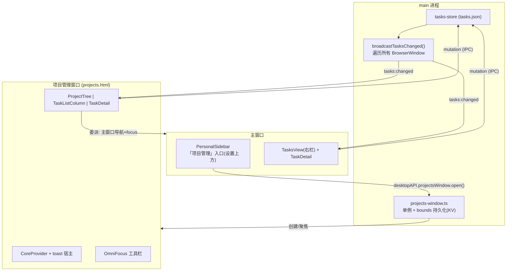
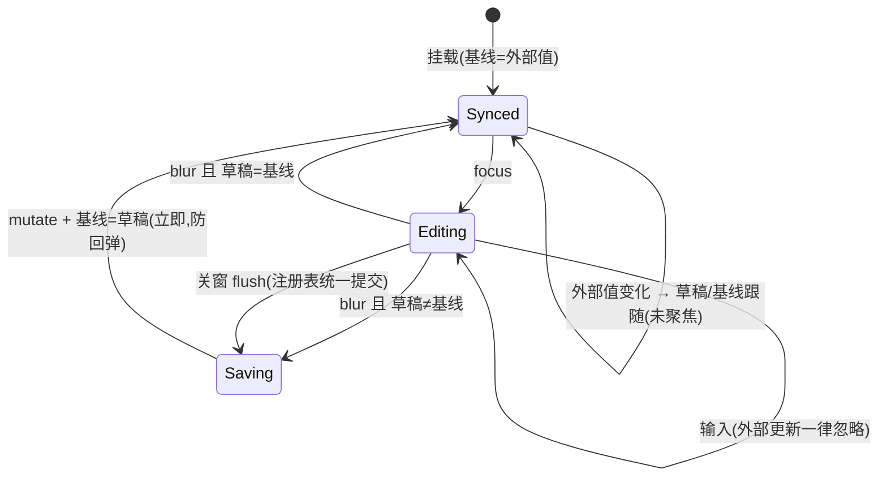

# feat: 项目管理独立窗口 + OmniFocus 工具栏与大纲中栏 + 跨列编辑同步修复

## Summary

把「项目」三栏任务工作台从主窗口内的全屏覆盖层改为独立桌面窗口：侧栏入口移到底部「设置」上方并改名「项目管理」，窗口顶部做 OmniFocus 式自绘工具栏（边栏切换 / 后退前进 / 「显示」过滤弹层 / 新建动作 / 占位项）。同时把中栏任务清单升级为 OmniFocus 大纲式（统计条、项目组头、元数据 chips、选中行为），项目支持并行/顺序两种模式并驱动「可用/首先可用」过滤，修复中栏 ↔ 右栏编辑不同步的草稿冻结缺陷。目标是一个完整可用的类 OmniFocus 项目任务管理。仅桌面端，web 端明确不在范围。

---

## Problem Frame

本分支已落地个人任务系统与三栏工作台（`packages/views/cortex-desktop/personal/ProjectsWorkbench.tsx`：左 `ProjectTree` / 中 `TaskListColumn` / 右 `TaskDetail`），但它是主窗口内的 fixed 覆盖层，入口挤在侧栏顶部动作区，与「设置」这类全局入口的定位不符；覆盖层也无法与主工作区并排使用。中栏视觉仍是简单列表，与 OmniFocus 参考稿（大纲分组、行内元数据、统计条）差距明显。另有一个实际缺陷：标题与备注在中栏、右栏各自持有「按 task.id 冻结」的本地草稿，一侧编辑后另一侧不刷新——结构化字段（状态/日期/标记等）走 React Query 缓存本来就同步，只有 title/notes 这层草稿挡掉了合法更新。

调研确认了两个关键事实，使窗口化成本可控：main 进程的 `broadcastTasksChanged()`（`apps/desktop/src/main/ipc/tasks.ts:34-38`）已向所有 `BrowserWindow` 广播变更，跨窗口数据同步零 main 改动；仓库已有四个二级窗口先例，`agent-trace-window` 可直接照抄骨架。

---

## Requirements

**入口与窗口**

- R1. 侧栏顶部动作区的「项目」按钮移除；新入口「项目管理」渲染在侧栏底部「设置」（`SettingsMenu`）正上方，仍按桌面能力门控（无 bridge 或无窗口能力时隐藏）。
- R2. 点击入口打开独立 `BrowserWindow`：单例（再次点击 → restore + focus）；`hiddenInset` 标题栏保留 mac 红绿灯；窗口尺寸/位置持久化并在创建时 clamp 到现存显示器工作区。
- R3. 主窗口内覆盖层打开方式退役：`PersonalWorkspace` 渲染分支、store 的 `projectsOpen` 状态及全部互斥清理站点收缩，相关测试同步更新。
- R4. 跨窗口数据一致：新窗口挂载 tasks React Query hooks 与 `onTasksChanged` 订阅；任一窗口或后台（委派回写）修改任务，两窗口同时刷新。
- R5. 窗口生命周期无回归：关闭项目管理窗口不退出 app；dock 激活恢复主窗口的既有路径不变；关窗前 flush 未保存的编辑草稿（见 R21）。
- R6. web 端明确不在范围（用户确认）：入口按 `bridge?.tasksListProjects` 与窗口能力门控隐藏，不做任何 web 适配，也不为 web 保留覆盖层。

**工具栏（新窗口顶部）**

- R7. 自绘工具栏：`-webkit-app-region: drag`，左侧留 84px 红绿灯避让，交互子元素 no-drag。
- R8. 边栏切换：隐藏/显示左树列；隐藏态下新建项目时自动展开边栏。
- R9. 后退/前进：左树选择的浏览历史。历史导航本身不 push 新条目；指向已删除节点的条目剪除；到达端点时按钮禁用。
- R10. 「显示」弹层：过滤四档（首先可用 / 可用 / 剩余 / 全部）+ 结构开关（显示收件箱、在大纲中显示文件夹）；选档与开关持久化，重开窗口不丢。四档取代中栏现有的「进行中/已完成/全部」三态筛选。
- R11. 新建动作：按当前左树选择决定落点（选中项目 → 该项目；今日/收件箱/文件夹 → 收件箱）；创建后无视当前过滤自动选中并滚动到新任务，标题进入编辑态。
- R12. 「聚焦」「快速入口」「设置显示字段」「设置编辑字段」以占位禁用态呈现（对齐参考截图中聚焦的灰色态）。

**中栏 OmniFocus 大纲式**

- R13. 顶部大标题（当前视图名）+ 统计条「N 个动作，M 个项目」：动作数 = 当前过滤后可见任务行数（含子任务）；项目数——项目/文件夹视图取左树选择范围内 project 节点数，今日/收件箱等非项目视图取命中任务所属去重项目数；有选中任务时右侧显示「已选择」状态条（含清除按钮）。
- R25. 非项目视图（今日/收件箱）的中栏按任务所属项目分组出组头；无项目任务归入「收件箱」组平铺。
- R26. 中栏过滤后可见行数为 0 时渲染空态占位：文案区分「该项目暂无动作」与「当前『显示』档下无匹配动作」；统计条与工具栏保留。
- R14. 按项目分组的组头：项目名 + 计数 + 折叠开关（含顺序项目模式标识）；文件夹或多项目子树聚合时显示组头。项目自身日期/旗标随延后的 `TaskProject` 字段工作跟进（见 Scope Boundaries）。
- R15. 子任务缩进 + 展开三角（复用 `buildTaskTree`）；父任务被过滤档滤掉而子任务命中时，补一行灰显父标题作上下文（不可勾选、不计入统计）。
- R16. 行内元数据 chips：已设置字段实色常显（项目 / 标签 / 预计时长 / 推迟至 / 计划 / 截止 / 重复 / 通知）；未设置字段以灰色占位**默认常显于所有行**（用户修订，对齐 OmniFocus 自定义流体默认态），点击即进入设置；选中行下方展开的行内检查器与标题文字左缘对齐（含子任务缩进层级）。
- R17. 完成/丢弃任务标题划线；行右侧备注图标（有备注时）与旗标图标；选中行高亮；有备注任务在标题下显示备注首行预览。
- R18. 选中任务因切换过滤档或完成而从中栏隐藏时：清除选中、右栏回空态、「已选择」条消失。

**项目模式（并行/顺序）**

- R23. `TaskProject` 支持「并行/顺序」模式：新增可选 `mode` 字段（缺省读作并行，读时补默认、零迁移）；顺序项目中仅首个未完成的顶层任务（含其子树）可用，其余任务呈阻塞态。
- R24. 模式切换入口：左树项目上下文菜单；顺序项目在中栏组头与左树节点上有模式标识；「可用/首先可用」两档按模式派生。

**编辑同步（跨列 / 跨窗口）**

- R19. title/notes 草稿四站点修复：`TaskListColumn` 标题输入、`TaskDetail` 的 title 与 notes、`TaskInlineInspector` 的 noteDraft、`TasksView` 的 TaskRow 重命名草稿。重置条件从「仅 task.id 变化」改为「task.id 变化，或（未聚焦 且 外部值 ≠ 上次同步基线）」；聚焦输入中的草稿永不被外部更新覆盖。
- R20. 备注 CodeMirror 编辑器在未聚焦时接受外部 notes 热更（跨窗口/跨列修改无需切换任务即可见）。
- R21. 关闭窗口或退出 app 前 flush 未保存草稿（title/notes 仅在 blur 时落库，销毁 renderer 不触发 blur 会静默丢数据）。
- R22. 从项目管理窗口委派任务给 agent：session 仍在主窗口拉起，主窗口导航至该 session 并 focus；项目管理窗口内 toast 反馈；原先依赖 `projectsOpen` 的 keepView/prevNav 存档还原语义移除。

---

## Key Technical Decisions

- **KTD1 — 窗口骨架照抄 `agent-trace-window`，标题栏照抄主窗。** 模块级单例 + `closed` 置空 + HTML 双路径兜底（`apps/desktop/src/main/agent-trace-window.ts:6-37`）；`titleBarStyle:"hiddenInset"` + `trafficLightPosition` 照主窗（`apps/desktop/src/main/index.ts:120-146`）。渲染入口只需 `import "./globals.css"` 即获得全套 `cortex-desktop.css`（`agent-trace.tsx:3` 先例）。`electron-builder.yml` 的 `files: out/**` 通配已覆盖新 html，唯一构建改动是 `electron.vite.config.ts` renderer input 加一行。
- **KTD2 — 打开窗口走 `desktopAPI` 顶层能力（如 `projectsWindow.open()`），不进 `DesktopBridge`。** 对齐 spotlight / notesOverlay / agentTrace 的惯例（窗口专用桥不进业务 bridge，`apps/desktop/src/preload/index.ts:636-643` 注释）；侧栏入口门控条件为 `bridge?.tasksListProjects && desktopAPI.projectsWindow` 同时存在。
- **KTD3 — 新窗口 renderer 自包 `CoreProvider` + 自持 toast 宿主。** agent-trace 因只用单个 bridge 方法未包 CoreProvider；本窗口用 React Query hooks，必须按主窗 `App.tsx:88-104` 的注入形状自包一层。`tasksKeys` 刻意不含 wsId（个人任务 main-owned，前身计划已确立），不存在 wsId 串场风险。原经 `PersonalWorkspace` 透传的 `onToast` 改为窗口根自建 toast 通道。
- **KTD4 — bounds 持久化用既有 KV store（`apps/desktop/src/main/ipc/store.ts`），全仓无窗口先例、自建最小实现。** close 时 `getNormalBounds()` 写入（最小化/全屏态不覆盖）；创建时读回并 clamp 到当前存在 display 的 workArea（外接屏断开防离屏）；几何计算抽纯函数并测试（仿 `notes-overlay-geometry.ts` 的做法）。
- **KTD5 — 可用性按项目模式派生：`TaskProject.mode ∈ {parallel, sequential}`，可选字段、读时默认 parallel。** 并行项目：任务可用 = 现有 `isAvailable`（`packages/core/personal/tasks.ts:26-30`）；顺序项目：可用集收窄为首个未完成顶层任务及其子树。「首先可用」= 每项目可用集的显示顺序首项。四档均为纯函数派生；`mode` 是唯一新增持久化字段，演进遵循前身计划 KTD4 规范（可选字段 + `normalizeData` 补默认，version 保持 1），写回复用既有 `useUpdateTaskProject` 通道。OmniFocus 的 action-group 级（子任务组）顺序/并行设置延后（见 Scope Boundaries）。
- **KTD6 — 草稿守卫统一抽共享 hook：focused ref + 同步基线。** 四站点各自手写重置条件会再犯同类 bug；抽一个「受控草稿」hook 封装：聚焦跟踪、外部值变化且未聚焦时跟随、blur 保存后立即更新基线（防非乐观更新下的旧值回弹）。同时注册进窗口级「pending 草稿注册表」，供 R21 关窗 flush 统一提交。
- **KTD7 — 后退/前进历史是窗口内 UI 瞬态（组件级栈），不持久化。** 入栈仅发生在用户主动选择左树节点时；导航前校验目标节点仍存在（`descendantProjectIds` 对悬空 id 返回空数组兜底），失效条目剪除。
- **KTD8 — ESC 语义重定义：取消行内编辑 / 清除选中，不关闭窗口。** 覆盖层时代的 `ESC → closeProjects` 与头部「关闭(Esc)」X 按钮（`ProjectsWorkbench.tsx:55-71`）随窗口化移除，关窗交给系统红绿灯。
- **KTD9 — 显示弹层选档、结构开关、边栏显隐、树展开态、组头折叠态 → 窗口专属 KV 窄通道（KTD4 同款，经 `apps/desktop/src/main/ipc/store.ts`），不进 `toPersistedState`。** 项目管理窗口**不挂** `usePersonalPersistence` 全量持久化——否则它会以陈旧全量快照覆盖主窗口写入的会话/待办（双窗口 clobber）；窗口专属视图态独立读写。服务端态仍只走 React Query，不复制。
- **KTD10 — 委派跨窗口走「委派意图中继」：项目管理窗口不在本地拉起 session。** sessions 是 renderer 本地 Zustand、不跨窗口同步，故委派必须中继：项目管理窗口经 IPC 向 main 发送委派意图（taskId + 上下文）并本地 toast → main 显式定位 mainWindow（不用 `getAllWindows()[0]`）`show()+focus()` 后把意图转发给主窗口 renderer → 主窗口监听意图、执行 createSession+send 并导航至该 session（hidden 时先 show 再 focus，参照 `push-on-complete.ts:51-62`）。`taskDelegate` 摘除 `projectsOpen` prevNav 存档还原逻辑。

---

## High-Level Technical Design

以下为方向性设计，非实现规范。

### 窗口拓扑与数据同步

跨窗口一致性完全由「main 广播 → 各窗口 React Query invalidate」承担，两窗口之间无直接通信。

### 草稿守卫状态机（R19/R21，共享 hook）

---

## Implementation Units

### U1. 跨列编辑同步修复（草稿守卫基建）

- **Goal:** 中栏 ↔ 右栏 ↔ 主窗口右栏的 title/notes 编辑全向同步；正在输入的草稿不被外部更新冲掉。
- **Requirements:** R19, R20
- **Dependencies:** 无（可最先落地，独立于窗口化）
- **Files:** `packages/views/cortex-desktop/personal/useTaskDraftField.ts`（新，共享 hook + 草稿注册表）、`packages/views/cortex-desktop/personal/TaskListColumn.tsx`（TaskTitleInput，:445-448）、`packages/views/cortex-desktop/personal/TaskDetail.tsx`（:23-38）、`packages/views/cortex-desktop/personal/TaskInlineInspector.tsx`（:35，noteDraft 现无重置 effect）、`packages/views/cortex-desktop/personal/TasksView.tsx`（TaskRow 重命名草稿，:358+）；测试 `useTaskDraftField.test.ts`（新）、`TaskListColumn.test.tsx`、`TaskDetail.test.tsx`（新）。
- **Approach:** 按 KTD6 抽共享 hook；四站点全部换用。备注 CodeMirror（`TaskDetail.tsx:87` 以 `key={task.id}` 挂载）确认 `NoteCodeMirrorEditor` 是否接受受控 value 热更，不接受则在「未聚焦且外部值变化」时以 key 变化重挂——具体机制实现时定。
- **Patterns to follow:** 结构化字段子控件的「直读 prop + `useUpdateTask` 写回、无本地副本」形态（`TaskDateField.tsx:38-45` 等）是正确基准；草稿 hook 只covering title/notes 这类连续输入场景。
- **Test scenarios:**
  - 同渲染树挂中栏 + 右栏，右栏改标题 blur 落库后，中栏同一任务标题 input 显示新值（现状失败，回归主证）。
  - 反向：中栏改标题，右栏 title 更新。
  - 中栏标题聚焦输入中，模拟 `tasks:changed` 外部更新到达 → 草稿不被覆盖。
  - blur 保存后外部确认前（非乐观窗口期）草稿不回弹旧值。
  - `TaskInlineInspector` noteDraft：右栏改备注后，选中行内联检查器展示新备注。
  - `TasksView` TaskRow 重命名草稿同步（同 hook 行为）。
- **Verification:** 上述跨列回归测试全绿；手动在工作台双列互改标题/备注即时互见。

### U2. 主进程「项目管理」独立窗口骨架

- **Goal:** 可打开、可记忆位置、可安全关闭的独立窗口，渲染出现有三栏工作台。
- **Requirements:** R2, R4, R5（生命周期部分）, R7（drag 区基础）
- **Dependencies:** 无（与 U1 并行）
- **Files:** `apps/desktop/src/main/projects-window.ts`（新）+ `projects-window-geometry.ts`/`.test.ts`（新，bounds clamp 纯函数）、`apps/desktop/src/main/ipc/register.ts`、`apps/desktop/src/preload/index.ts`（顶层能力 `projectsWindow`）、`apps/desktop/electron.vite.config.ts`（renderer input）、`apps/desktop/src/renderer/projects.html`（新）、`apps/desktop/src/renderer/src/projects-window.tsx`（新：CoreProvider + toast 宿主 + `ProjectsWorkbench`）。
- **Approach:** KTD1-KTD4。本单元只做窗口创建与基础 close→destroy 生命周期；关窗前 flush 草稿的握手由 U7 独占实现（依赖 U1 注册表）。`window-all-closed`/`activate` 行为核对不回归（项目窗口关闭不退出 app）。
- **Patterns to follow:** `apps/desktop/src/main/agent-trace-window.ts`（单例/双路径/show API）、`apps/desktop/src/main/notes-overlay-geometry.ts` + 测试（几何纯函数形态）、`apps/desktop/src/renderer/src/agent-trace.tsx`（入口挂载 + globals.css）、主窗 `App.tsx:88-104`（CoreProvider 注入形状）。
- **Test scenarios:**
  - bounds clamp 纯函数：保存坐标落在已断开显示器区域 → clamp 回当前 workArea；最小化/全屏时保存的 bounds 不覆盖正常值。
  - 单例：连续两次 open 只有一个窗口实例（第二次 restore+focus 路径）。
  - Test expectation（窗口生命周期 mac 行为）: 手动验收——自动化对 Electron 窗口生命周期收益低。
- **Verification:** `pnpm dev:desktop` 下打开窗口见完整三栏、任务数据正常；主窗口改任务、项目窗口即时刷新（反向同样）；关窗重开位置尺寸保持；关闭项目窗口后 app 不退出。

### U3. 侧栏入口迁移 + 覆盖层退役 + 委派重写

- **Goal:** 「项目管理」成为唯一入口（设置上方）；覆盖层代码与 `projectsOpen` 状态机收缩；委派跨窗口语义成立。
- **Requirements:** R1, R3, R6, R22
- **Dependencies:** U2
- **Files:** `packages/views/cortex-desktop/personal/PersonalSidebar.tsx`（:346-356 移除，:422 `SettingsMenu` 上方新增）、`packages/views/cortex-desktop/personal/PersonalWorkspace.tsx`（:190 渲染分支 + 主窗口侧「委派意图」监听）、`packages/core/store/personal.ts`（`projectsOpen`/`openProjects`/`closeProjects` 及 :945-969 互斥站点）+ `personal.test.ts`（:1284-1327）、`packages/core/personal/taskDelegate.ts`（:49-74 prevNav 逻辑）+ 测试、`apps/desktop/src/main/projects-window.ts` 与 `apps/desktop/src/preload/index.ts`（委派意图 IPC 中继通道）、`packages/views/cortex-desktop/personal/ProjectsWorkbench.tsx`（摘除 ESC-close 与头部 X，:55-71）。
- **Approach:** KTD2、KTD8、KTD10。注意 `ProjectsWorkbench.tsx:28` 的 `useTasksChangeSubscription` 挂载点随组件迁入新窗口后仍然成立（窗口根即工作台根）；主窗口侧 `TasksView.tsx:51` 的挂载不受影响。委派的「主窗口导航 + focus」走 main 中转（参照 `push-on-complete.ts:51-62` 的窗口唤醒式样）。
- **Patterns to follow:** 侧栏底部入口的渲染位置对齐 `SettingsMenu` 现有形态；store 收缩对照 `personal.test.ts` 既有互斥断言逐条改写而非删除。
- **Test scenarios:**
  - 侧栏渲染：有桌面能力时「项目管理」出现在设置上方；无能力时隐藏（web 无回归，R6）。
  - store：`projectsOpen` 及互斥清理断言更新后全绿；`openSettings` 栈式语义不受牵连。
  - `taskDelegate`：委派后不再读写 prevNav；mock 验证项目窗口只发「委派意图」IPC + toast、不在本地 createSession。
  - 主窗口侧：收到委派意图后 createSession+send 并导航（mock 意图事件断言）。
- **Verification:** 全仓 `pnpm --filter @cortex-work/core test` + views 相关测试绿；手动从项目窗口委派 → 主窗口前置并进入 session，项目窗口出 toast。

### U4. 工具栏骨架：边栏切换 + 后退/前进 + 占位项

- **Goal:** 新窗口顶部 OmniFocus 式工具栏可用：拖拽区正确、边栏可收起、历史可导航、未实装项呈禁用态。
- **Requirements:** R7, R8, R9, R12；KTD8（ESC 新语义）
- **Dependencies:** U2, U3
- **Files:** `packages/views/cortex-desktop/personal/WorkbenchToolbar.tsx`（新 + 测试）、`packages/views/cortex-desktop/personal/ProjectsWorkbench.tsx`（接线 + 历史栈 + 边栏显隐）、`packages/core/store/personal.ts`（边栏显隐持久客户端态）、`packages/views/cortex-desktop/cortex-desktop.css`。
- **Approach:** 工具栏布局对齐参考截图（左：边栏切换、后退/前进、显示；右：新建动作、快速入口、聚焦，图标+标签纵排）；drag/no-drag 与 84px 避让照 `.ds-drag`（`cortex-desktop.css:8717`）与 `TitleBar.tsx` 惯例。历史栈按 KTD7 放容器组件；「显示」按钮本单元先渲染入口、弹层内容归 U5。
- **Test scenarios:**
  - 历史：选择 A→B→C 后退回 B、再后退 A，前进恢复 B；端点时对应按钮 disabled。
  - 历史导航不产生新历史条目（往返不膨胀栈）。
  - 删除项目 B 后，后退跳过/剪除 B 的条目不落入空组（`descendantProjectIds` 悬空 id 返回空数组兜底）。
  - 边栏隐藏态下点「添加项目」→ 边栏自动展开。
  - 聚焦/快速入口/设置字段按钮渲染为 disabled。
  - ESC：行内编辑中按 ESC 取消编辑；无编辑时清除选中；不关窗。
- **Verification:** 工具栏交互手动过一遍 + 组件测试绿；红绿灯不与按钮重叠、空白区可拖动窗口。

### U8. 项目并行/顺序模式（模型 + 切换入口）

- **Goal:** `TaskProject` 获得 `mode` 字段并可在左树切换；顺序项目的可用集收窄语义以纯函数形式就绪，供 U5 过滤消费。
- **Requirements:** R23, R24
- **Dependencies:** 无（可与 U1/U2 并行；U5 依赖本单元）
- **Files:** `packages/core/desktop/tasks-types.ts` 与 `apps/desktop/src/main/ipc/tasks-types.ts`（镜像加可选 `mode`）、`apps/desktop/src/main/ipc/tasks-store.ts`（`normalizeData` 补默认）、`packages/core/personal/tasks.ts`（顺序可用集纯函数 + `tasks.test.ts`）、`packages/views/cortex-desktop/personal/ProjectTree.tsx`（上下文菜单切换 + 节点模式标识）+ 测试。
- **Approach:** KTD5。两份 `tasks-types.ts` 逐字镜像（前身计划 R16 接线规范）；写回复用 `useUpdateTaskProject`，无新 IPC。顺序可用集：按顶层任务显示顺序取首个非 done/dropped 者及其子树；defer 未到的首任务不使后续任务解锁（保持阻塞，与 OmniFocus 一致）。
- **Patterns to follow:** 前身计划 KTD4 的「可选字段 + 读时补默认、version 保持 1」演进规范；`isAvailable`/`isTodayEligible` 的纯函数形态与测试写法。
- **Test scenarios:**
  - 旧档 `tasks.json`（project 无 `mode`）读入 → 默认并行，行为与现状一致。
  - 顺序项目 [A(未完成), B, C]：可用集仅 A 及其子任务；A 完成后可用集变 B。
  - 顺序项目首任务 defer 未到：A、B、C 均不可用。
  - 切换 mode 经 `useUpdateTaskProject` 写回并广播刷新（mock 断言 patch 内容）。
- **Verification:** core 纯函数测试绿；左树切换模式后中栏「可用」档即时收窄/放宽。

### U5. 「显示」弹层与过滤语义

- **Goal:** 四档过滤与结构开关生效，且与分组、子任务树、选中态、新建动作的组合行为自洽。
- **Requirements:** R10, R11, R15（孤儿上下文行）, R18
- **Dependencies:** U4, U8（可用性谓词按项目模式派生）
- **Files:** `packages/views/cortex-desktop/personal/ViewOptionsPopover.tsx`（新 + 测试）、`packages/core/personal/tasks.ts`（新增四档谓词/首先可用派生纯函数 + `tasks.test.ts`）、`packages/views/cortex-desktop/personal/TaskListColumn.tsx`（过滤接入、移除三态筛选按钮、新建 auto-select）、`packages/views/cortex-desktop/personal/ProjectTree.tsx`（「显示收件箱」开关联动）、选档/开关持久化走 KTD9 的窗口专属 KV 通道（`apps/desktop/src/main/ipc/store.ts` 既有 KV，不进 `packages/core/store/personal.ts` 的 `toPersistedState`）、`packages/views/cortex-desktop/personal/ProjectsWorkbench.tsx`（R18 选中清理）。
- **Approach:** KTD5、KTD9。四档语义：全部=所有任务（含 done/dropped）；剩余=未完成未丢弃；可用=剩余中按项目模式可用（并行走 `isAvailable`，顺序走 U8 收窄集）；首先可用=每 project 可用集首项。结构开关「在大纲中显示文件夹」控制中栏是否按 folder 层级出组头；「显示收件箱」控制左树 inbox 入口显隐，关闭时若正选中 inbox 则重定向到今日（R18 同款悬空处理）。
- **Test scenarios:**
  - 四档谓词纯函数：defer 未到的任务在「可用」不出现、在「剩余」出现；done 只在「全部」出现；「首先可用」每项目至多一条且为顺序首个可用项。
  - 父被 defer 滤掉、子可用：子仍显示且带灰显父上下文行，统计不计父。
  - 选中任务完成后切「可用」档：选中清除、右栏空态、「已选择」条消失。
  - 「首先可用」档下新建任务（非首个可用）：仍被自动选中并可见（无视过滤）。
  - 关闭「显示收件箱」时 inbox 正被选中 → 重定向今日。
  - 选档持久化：重建组件树后选档保持。
- **Verification:** 纯函数与组件测试绿；手动核对四档数字与 OmniFocus 语义直觉一致。

### U6. 中栏 OmniFocus 大纲式升级

- **Goal:** 中栏达到参考截图的信息密度与交互：统计条、组头、chips、划线、备注预览、选中行为、空态。
- **Requirements:** R13, R14, R16, R17, R25, R26
- **Dependencies:** U1（标题输入换草稿 hook 后再动此文件）, U5（过滤语义先定，统计条读同一份派生结果）
- **Files:** `packages/views/cortex-desktop/personal/TaskListColumn.tsx`（重构，行组件拆出 `TaskOutlineRow.tsx` 防逼近 1200 行上限）+ `TaskListColumn.test.tsx`、`packages/views/cortex-desktop/cortex-desktop.css`（:9006-9117 段为主）。
- **Approach:** 组头按 R14 收窄口径（名称 + 计数 + 折叠 + 顺序模式标识，项目级日期/旗标字段延后）；今日/收件箱视图按 R25 以所属项目分组；空态按 R26 双文案；chips 常显/占位切换按 R16（占位仅选中/悬停行渲染，避免全列表 DOM 膨胀）；备注预览取 notes 首行纯文本。
- **Patterns to follow:** 现有 `.pw-task-badge.*` chips 体系与 `TaskInlineInspector` 的 chip 交互（点击进入编辑）；行内标题输入沿用 U1 的草稿 hook。
- **Test scenarios:**
  - 统计条：项目视图下「N 个动作，M 个项目」随过滤档变化正确；「已选择」条随选中出现/清除。
  - 完成任务标题有划线样式类；有备注行显示备注图标与首行预览。
  - 未设置字段的占位 chips 仅在选中/悬停行出现；点击占位 chip 进入对应字段编辑。
  - 折叠组头后该组行隐藏、统计不变（统计按过滤结果而非折叠可见性）。
  - 空态：项目无任务 → 「该项目暂无动作」；有任务但过滤后为 0 → 「当前『显示』档下无匹配动作」。
  - 今日视图：跨 3 个项目命中 5 条任务 → 3 个组头、统计「5 个动作，3 个项目」。
- **Verification:** 与参考截图并排目检（结构、层级、密度对齐）；测试绿；`TaskListColumn.tsx` 拆分后各文件低于 1200 行。

### U7. 关窗 flush 与全链路收尾

- **Goal:** 数据安全闭环与整体验收：关窗不丢草稿、双窗口并发场景过关、全仓检查绿。
- **Requirements:** R21；R4/R5 全链路复核
- **Dependencies:** U1, U2, U3（其余单元不阻塞本单元开工，但完整验收在全部落地后）
- **Files:** `apps/desktop/src/main/projects-window.ts`（close 握手）、`apps/desktop/src/renderer/src/projects-window.tsx`（flush 注册表消费 + `beforeunload` 兜底）、`packages/views/cortex-desktop/personal/useTaskDraftField.ts`（注册表 flush API）。
- **Approach:** close 流程：main 收到 close → 发 flush 请求 → renderer 提交 pending 草稿（有则等 mutation 落库）→ 回执后销毁；`beforeunload` 同步兜底 app 退出路径。双窗口并发编辑同字段维持 last-writer-wins（记录于 Scope Boundaries）。
- **Test scenarios:**
  - flush API：注册表含 pending 草稿时调用 flush → 对应 update mutation 被触发。
  - 正在编辑标题时触发 flush → 草稿值落库（而非旧值）。
  - Test expectation（关窗端到端）: 手动验收——输入备注不 blur 直接红绿灯关窗，重开后备注在。
- **Verification:** `pnpm typecheck && pnpm lint && pnpm test` 全绿；手动验收清单过一遍：入口位置、窗口记忆、双窗口互改即时同步、委派跨窗口、关窗草稿保全。

---

## Scope Boundaries

**Deferred to Follow-Up Work**

- action-group 级（子任务组）的顺序/并行设置（本期项目级 `mode` 已实装，组级延后）。
- `TaskProject` 自身的 defer/due/flagged 字段（组头完整元数据依赖它，U6 先按现有字段呈现）。
- 「聚焦」「快速入口」「设置显示字段/编辑字段」的实装（本期占位禁用）。
- 全局热键 / 应用菜单「项目管理」入口（`app-menu.ts`/`hotkey.ts` 现无联动，加入是独立小增量）。
- 双窗口同字段并发编辑的合并策略（现为 last-writer-wins）。
- 任务拖拽重排 / 拖拽改父子关系。
- 大纲列键盘导航（方向键选行 / Enter 进入编辑 / 快捷键切换完成）：本期交互为鼠标 + ESC，键盘导航整体延后。
- 新窗口首开加载态：首帧复用 R26 空态占位，骨架态延后。

**Outside this product's identity（本期不做，亦无既定计划）**

- OmniFocus 的透视（Perspectives）、检查（Review）、跨设备同步服务。
- web 端项目工作台：用户明确不考虑（desktop-only，入口按能力门控隐藏，不为 web 做任何适配）。

---

## Risks & Dependencies

- **CodeMirror 受控热更不确定（R20）**：`NoteCodeMirrorEditor` 若不支持外部 value 热更，需 key 重挂方案，可能有光标/滚动位置损失——实现时验证，属 U1 内部决策。
- **`projectsOpen` 收缩牵连面（R3）**：约 7 处互斥站点 + `taskDelegate` + 一批 store 测试；漏改会导致互斥态机残留或测试挂掉。U3 按调研列出的站点清单逐一处理。
- **mac 窗口生命周期回归（R5）**：`window-all-closed`/`activate`/close-to-tray 组合行为自动化收益低，依赖 U2/U7 的手动验收项。
- **`TaskListColumn.tsx` 行数**：大纲化会显著加码，U6 强制拆行组件，逼近 1200 行上限即再拆。

---

## Acceptance Examples

- AE1. **跨列标题同步**：Given 工作台中栏与右栏同时可见且选中任务 T，When 在右栏把 T 标题改为「X」并 blur，Then 中栏 T 行标题 input 立即显示「X」。
- AE2. **输入保护**：Given 中栏 T 标题输入框聚焦且已输入未保存文本，When 后台委派回写触发 `tasks:changed`，Then 输入框内容不变。
- AE3. **过滤隐藏选中**：Given 选中任务 T 且过滤档为「剩余」，When 勾选完成 T，Then 中栏 T 消失、右栏回空态、「已选择」条消失。
- AE4. **关窗草稿保全**：Given 项目管理窗口备注编辑器有未 blur 的输入，When 点红绿灯关窗后重新打开窗口，Then 该备注已保存。
- AE5. **首先可用（并行项目）**：Given 并行项目 P 下依次有任务 A（defer 未到）、B、C（均可用），When 切到「首先可用」档，Then P 组内仅显示 B。
- AE6. **历史死条目**：Given 历史栈含项目 B，When 删除 B 后连续点后退，Then 不会落到 B 的空组（条目被剪除）。
- AE7. **顺序项目可用性**：Given 顺序项目 Q 下依次有未完成任务 A、B，When 过滤档为「可用」，Then 仅显示 A；When 完成 A，Then B 出现在「可用」档。

---

## Sources & Research

- 前身计划（同分支已落地）：`docs/plans/2026-07-01-002-feat-personal-tasks-agent-native-plan.md`（持久化/IPC/委派基座）、`docs/plans/2026-07-01-003-feat-tasks-projects-workbench-plan.md`（三栏工作台与层级模型，KTD 编号引用均指此文）、`docs/plans/2026-07-01-004-feat-tasks-subtasks-inline-inspector-plan.md`。
- 产品需求上游：`docs/brainstorms/2026-07-01-personal-tasks-agent-native-requirements.md`。
- 关键调研结论：`broadcastTasksChanged` 全窗口广播（`apps/desktop/src/main/ipc/tasks.ts:34-38`）；同步 bug 根因四站点（`TaskListColumn.tsx:445-448`、`TaskDetail.tsx:23-38`、`TaskInlineInspector.tsx:35`、`TasksView.tsx:358+`）；窗口先例接线（`agent-trace-window.ts`、`electron.vite.config.ts:56-63`）；`isAvailable`/`isTodayEligible`（`packages/core/personal/tasks.ts:26-45`）；store 互斥站点（`packages/core/store/personal.ts:945-969`）。
- OmniFocus 参考：用户提供的四张截图（侧栏入口位置、工具栏、「显示」弹层、大纲式任务列表）。
