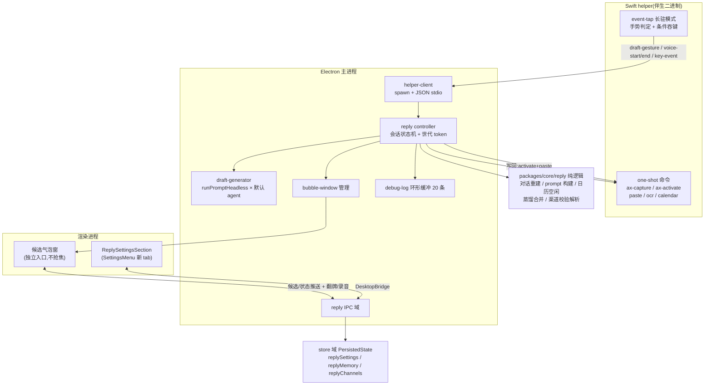
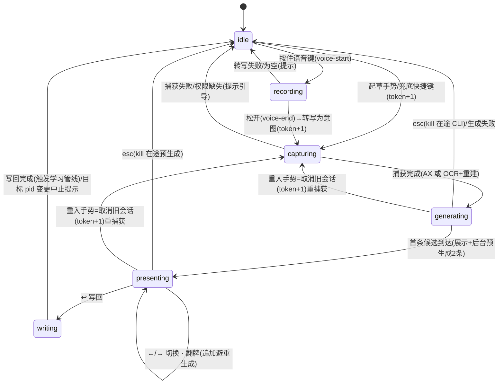

# feat: ReplyClone 快捷回复助手迁移至 cortex-desktop

## Summary

把 ReplyClone(macOS 原生 SwiftUI 回复助手)的功能迁移进 `apps/desktop`:全局修饰键手势唤起 → 读取前台第三方应用对话(AX 优先、截屏 OCR 降级)→ 组装 prompt → 用应用默认 agent 单发生成多条候选 → 不抢焦的浮动候选气泡翻牌 / 回车写回目标输入框。记忆系统(分区手写笔记 + 语气蒸馏)在本项目首次真正落地。原生能力统一收口到一个 Swift helper 伴生二进制。

## Problem Frame

ReplyClone 是独立的 Swift 应用,验证了「在任意 app 上快捷起草回复」的交互,但模型层是自配 OpenAI-compatible 端点、记忆只有设计未接线、且与 cortex-desktop 的 agent 生态割裂。迁移后由 cortex-desktop 的默认 agent(claude/codex/pi)承担生成,复用其 STT、浮窗、设置、持久化基建;Swift 侧只保留 Electron 做不到的系统能力。这是重实现,不是代码移植——但 ReplyClone 的纯逻辑模块(对话重建、prompt 构建、日历空闲)带有完整测试,行为契约可原样搬运。

---

## Requirements

**核心起草链路**

- R1. 双击起草修饰键(默认 ⌘,间隔 < 0.35s)在任意前台 app 触发起草;按住语音键(默认 Fn)说话、松开后以转写文本为意图触发起草。辅助功能未授权或原生层不可用时,降级为普通组合快捷键入口(accelerator)仍可起草。
- R2. 捕获前台应用文本:AX 树读取优先;文本「不像对话」时降级为窗口截屏 + Vision OCR;OCR 文本块经对话重建输出「对方：/我：/[时间戳]」结构化文稿,行为契约与 ReplyClone 既有测试一致(左右对齐分说话人、同侧合并、剔除侧栏/标题栏/噪声/纯符号块、居中块转时间戳行)。
- R3. prompt 按固定段落序组装:用户档案与分区记忆(手写标注最高优先级)→ 可见对话 → 键入或语音意图(typed 优先,标注 highest priority)→ 日历空闲 → 翻牌避重列表 → 收尾指令;system prompt 语义与 ReplyClone 一致(以「我」侧续写、只回应对方、只输出回复正文、匹配对话语言、绝不自动发送)。
- R4. 草稿由默认 agent(`GeneralSettings.defaultAgent`)单发生成,无会话;首条候选到达即展示,随后后台预生成 2 条翻牌候选,左右切换零等待。
- R5. 候选气泡:无边框、不抢焦、锚定目标输入框上方;生成中有动画;←/→ 循环切换候选、↩ 写回、esc 关闭、「翻牌」追加一条避开已有候选的新草稿;气泡激活期间这四个键被吞掉,不落入目标 app。
- R6. 写回:重新激活捕获时的目标 app → 多格式备份剪贴板 → 写草稿 → 模拟 ⌘V → 延迟恢复剪贴板;写回前校验目标 app 未变(pid),变了则中止并提示,绝不盲粘。
- R7. 并发安全:每次唤起分配递增 session 世代 token;生成中重入 = 取消旧会话(kill 在途 CLI)重新捕获;esc 关闭时 kill 在途生成;过期回调按 token 丢弃。

**上下文注入**

- R8. 日历上下文:读未来 3 天非全天事件,计算 ≥30 分钟空闲间隙,最多 8 段,格式 `HH:mm-HH:mm` 逗号分隔、前缀 `可用时间：`;日历未授权或无空闲时静默跳过该段落。
- R9. 语音意图复用应用既有 STT 通道(本地 whisper / 在线 ASR),不新建转写引擎。

**记忆系统(ReplyClone 设计的首次落地)**

- R10. 分区记忆(档案 / 通用 / IM / 邮件 / 公开):每分区独立的自动学习区 + 手写补充区(修复 ReplyClone 自动区共用一个变量的缺陷);手写内容注入 prompt 时标注「优先级最高,冲突以此为准」。
- R11. 语气蒸馏:「从我发出的消息学习语气」开关开启时,把当次捕获对话的「我：」侧样本喂给蒸馏 prompt(走默认 agent),输出 ≤10 条「- 」风格要点,与已学规则合并后按分区持久化;原始对话样本不落盘。

**设置、权限与外围**

- R12. 设置新增 reply 分区:起草/语音触发键选择、权限中心(辅助功能 / 屏幕录制 / 麦克风 / 语音识别 / 日历五项状态 + 授权引导)、记忆管理入口、数据清理(清空记忆 / 学习要点 / 渠道备注)。
- R13. 渠道连接:Slack / Gmail / Lark 粘贴 token + 凭据校验(Slack `auth.test`、Lark `user_info`、Google `tokeninfo`,Gmail 另支持 env 凭据文件),连接状态展示与断开清除;token 用 `safeStorage` 加密存储。
- R14. 调试记录:最近 20 次调用(捕获来源 / AX 原文 / OCR 原文 / system+user prompt / 输出或错误),仅内存驻留,应用退出即清。

---

## Key Technical Decisions

- KTD1. **原生能力统一收口单个 Swift helper CLI**(one-shot JSON 命令承载 AX 读写 / CGEventPost ⌘V / Vision OCR / EventKit 日历;长驻 event-tap 模式承载修饰键手势与气泡吞键):吞键需要 active CGEventTap(被动监听库做不到),Fn 键在 libuiohook 系不可靠,nut-js 已转商业收费、robotjs 停维护;单二进制把 ABI/prebuild/签名的横切风险压到最小,是社区验证过的架构(Orbit)。手势判定(双击时间窗、按住阈值)放在 helper 原生侧,JS 只收 `draft-gesture / voice-start / voice-end` 高层事件。
- KTD2. **helper 打包仿 pi 二进制链**:构建脚本 → `extraResources`(不进 asar)→ 主进程 `spawn`;签名随 `mac` 段 hardenedRuntime/notarize 整体处理(现有 `apps/desktop/electron-builder.yml` 无独立 binaries 列表,pi 二进制即此模式),产物验证必须 `ditto` 到 `/tmp` 仓库外执行(`docs/lessons.md` 铁律)。权限查询引入 `node-mac-permissions`(覆盖 accessibility/screen/calendar/microphone/speech-recognition),新原生依赖须核对 `electron-builder.yml` 的 `files` 黑名单、`pnpm.onlyBuiltDependencies`,并确认 `npmRebuild:false` 下在 install 步完成重建。
- KTD3. **生成通道 = 默认 agent CLI 单发**,复用/仿写 `runPromptHeadless`(Promise 式、独立进程注册表、支持 abort;注意它不自行解析默认 agent,须由调用方传 `providerId`,默认 agent 的解析逻辑在 `packages/core/store/personal.ts` 的 `resolveDefaultAgent`):用户明确指定「利用默认的 agent」,不走 `llm:openaiComplete` 直连。agent CLI 无 temperature 参数,ReplyClone 的 0.3/0.9 温度分层改用 prompt 避重列表实现多样性;冷启动延迟(数百 ms~秒级)靠「先弹气泡再生成 + 后台预生成翻牌」掩盖。
- KTD4. **分层落位**:纯逻辑(对话重建 / prompt 构建 / 日历空闲 / 蒸馏合并 / 渠道校验解析)落 `packages/core/reply/` 并新增 exports 子路径 `@cortex-work/core/reply`;系统能力与编排落 `apps/desktop/src/main/reply/` + 新 `reply` IPC 域。IPC 契约三处同步(`main/ipc/types.ts` → preload → `packages/core/desktop/types.ts`),`DesktopBridge` 新方法全部可选(`?:`,Web 端为 null 降级)。
- KTD5. **气泡窗采用 notification-window 的不抢焦模式**(`focusable:false` + `showInactive()`),而非 spotlight 的抢焦+blur 隐藏模式——抢焦即丢失目标输入框焦点。窗口配方沿用仓库 panel 惯例(`type:"panel"`、`setAlwaysOnTop("screen-saver")`、`setVisibleOnAllWorkspaces(..., skipTransformProcessType:true)`);新 renderer 入口注册进 `electron.vite.config` 多入口;高度由 renderer 实测回传后 `setBounds`。
- KTD6. **持久化走 `store` 域 `PersistedState` 新分片**(`replySettings` / `replyMemory` / `replyChannels`),不建 markdown 文件夹(ReplyClone 的 Finder 打开文件夹交互不保留);新分片必须加入 `usePersonalPersistence` 的节流分支,否则「会话内生效、重启丢失」;Zustand 分片新建独立 store 文件(`personal.ts` 已 1149 行,逼近 1200 硬上限,禁止再塞)。
- KTD7. **快捷键降级链**:辅助功能未授权 / helper 加载失败 → 用 `hotkey.ts` 既有 accelerator 工具注册组合键兜底(默认 `CommandOrControl+Shift+R`),授权后自动切回手势;复用其三级兜底与占用降级模型。
- KTD8. **隐私边界**:对话原文、OCR 原文、蒸馏样本一律不落盘(调试记录仅内存);持久化仅限手写笔记与蒸馏产出的风格要点;蒸馏由「学习开关」显式启用,注入 prompt 与蒸馏调用都走用户自选的默认 agent,不引入额外出网通道。
- KTD9. **渠道范围**:本期只迁「粘贴 token + 凭据校验 + 状态管理」;Lark 扫码设备流(RFC 8628,含品牌切换/addons 编码)复杂度高且不阻塞主链路,缓迁(见 Scope Boundaries)。

---

## High-Level Technical Design

### 组件拓扑与数据流



### 气泡会话状态机(世代 token 绑定)



所有跨状态回调(CLI 输出、OCR 结果、转写结果)携带世代 token,与当前 token 不符即静默丢弃——这是并发安全(R7)的唯一裁决机制。

---

## Scope Boundaries

### 明确不迁(用户排除或源项目空壳)

- **关系(relationship)tab**:用户明确排除;源项目中本就是纯占位视图(无模型、无存储、按钮 no-op)。
- **待办(OwedItem)**:用户明确排除;源项目仅手动增删,UI 宣称的「自动从对话整理待还」并无实现。
- **模型设置面**(Provider 预设 / oMLX 本机模型自动发现 / 模型列表 Picker / API URL+Key / 测试本地模型 / temperature 与 maxTokens 调参):被 KTD3「默认 agent 生成」决策整体取代——本应用的模型能力由 agent 设置统一管理,不再自配端点。
- **Lark 日历 / Google 日历渠道卡片**:源项目只有渠道目录定义,无对应 reader,连接后也不产生忙闲上下文(空壳);本期日历上下文仅本地日历(EventKit,经 helper)。

### Deferred to Follow-Up Work

- **Lark 扫码自动建应用设备流**(RFC 8628 + addons scope 编码 + 飞书/Lark 双品牌):KTD9 已决策缓迁,本期 Lark 走粘贴 token + `user_info` 校验。
- **Google 浏览器 OAuth 全流程**(loopback server + PKCE + state 校验 + client 凭据录入表单):与 Lark 扫码同理缓迁;本期 Gmail 走粘贴 token + `tokeninfo` 校验,另支持 `~/.config/reply/gmail.env` 凭据文件(R13)。
- **「公开」(publicVoice)分区自动采集路由**:源项目该分区 UI 存在但自动路由永不命中(`channelScopeForCapturedApp` 只返回 im/email)。本期忠实迁移:保留 5 分区的手写编辑与注入,自动样本采集仅路由 im/email;接线 publicVoice 留待后续产品定义。
- **IM/邮件共性沉淀「通用」分区**:源项目注释明确本期不做,沿袭。
- **「立即重新学习」(relearn)**:R11/KTD8 决策原始样本不落盘(源项目落盘 30 条/分区,本迁移收紧隐私边界),样本仅内存驻留导致 relearn 无历史可用,本期不提供该按钮;若后续需要,须先重新评估样本落盘的隐私取舍。
- **菜单栏 tray 手动入口**(源项目 MenuBarExtra「为当前窗口起草回复」):本期以兜底 accelerator(KTD7)承担手动触发;tray 集成另议。
- **Windows / Linux 支持**:AX / CGEventTap / Vision / EventKit 均为 macOS 专属,本期 reply 功能 macOS-only;非 mac 平台隐藏设置分区、不 spawn helper(此降级本身在 U5/U9 范围内)。

---

## Implementation Units

依赖顺序(以各单元 Dependencies 字段为准):U1、U2、U3 均无前置,可并行启动;U4←U3;U5←U2;U6←U5;U7←U1/U4/U5/U6;U8←U7;U9←U2/U4/U5(可与 U6/U7 并行);U10←U2/U7。

### U1. core/reply 会话链路纯逻辑:对话重建 / prompt 构建 / 日历空闲

**Goal**:把 ReplyClone `ReplyCore` 的三个纯逻辑模块移植为 `@cortex-work/core/reply`,行为契约与源测试一致。
**Requirements**:R2、R3、R8。
**Dependencies**:无。
**Files**:`packages/core/reply/types.ts`、`packages/core/reply/conversation-layout.ts(+.test.ts)`、`packages/core/reply/prompt-builder.ts(+.test.ts)`、`packages/core/reply/calendar-slots.ts(+.test.ts)`、`packages/core/package.json`(exports 加 `./reply/*`)。
**Approach**:逐函数移植源项目 `ConversationLayoutBuilder` / `ReplyPromptBuilder` / `CalendarSlotFormatter`;OCR 文本块坐标沿用 Vision 归一化坐标系(原点左下),坐标系转换责任划给 helper 输出侧,core 类型注释写明契约。日历模块输入忙碌区间数组(helper 读取),输出空闲段与 `HH:mm-HH:mm` 摘要。
**Execution note**:test-first——先把源项目测试断言移植为 vitest 用例,再实现至全绿。
**Patterns to follow**:`packages/core/whisper/models.ts`(独立子目录纯数据模块 + exports 子路径);就近 `*.test.ts`。
**Test scenarios**(搬运源契约,输入→期望):
- 对话重建:左对齐块→「对方:」、右对齐→「我:」、相邻同侧合并、顺序保持;左侧聊天列表列整体剔除(不含「张三/李四」);右侧长消息续行偏中仍归「我」;纯符号块(`● 4"`、`☺`)剔除;居中块 `6月3日 22:17|` → `[6月3日 22:17]`(清尾部残渣);面板偏斜时时间戳容差 0.25 仍识别;`已取消` 前缀+总长≤前缀+4 的系统事件气泡剔除;midY≥0.95 顶部窗口标题栏剔除;`输入文字` 噪声占位符过滤。
- prompt 构建:system 含「只输出回复正文」与「我:/对方:」续写语义;typedIntent 存在时 user 不含 Spoken intent 段(typed 压制 voice);typed 为空白时回退 Spoken intent;avoidReplies 非空→含避重列表且空白项被过滤;全空白→无翻牌段;段落序=档案记忆→可见对话→意图→日历→避重→收尾指令。
- 日历空闲:窗口 9:00 起 4h、忙碌 9:30-10:00 与 11:00-11:30、minDuration 30min → 空闲时长 [30,60,90]、摘要含 `09:00-09:30`;无空闲→空摘要(prompt 侧静默跳段);段数 >8 截断为 8。
**Verification**:`pnpm --filter @cortex-work/core test` 全绿;typecheck 通过。

### U2. core/reply 记忆与渠道纯逻辑

**Goal**:分区记忆数据模型 + 蒸馏 prompt/清洗/合并 + 渠道凭据校验的请求构造与响应解析,全部纯函数化。
**Requirements**:R10、R11、R13。
**Dependencies**:无。
**Files**:`packages/core/reply/memory.ts(+.test.ts)`、`packages/core/reply/channels.ts(+.test.ts)`。
**Approach**:记忆分区枚举 5 项(profile/core/im/email/publicVoice),每分区 `{manual, auto}` 双字段结构(KTD6 决策不落 markdown 文件,故源项目 `## ⟨auto⟩` 标记解析不迁,数据结构直接分字段——顺带修复源项目自动区共用变量缺陷);样本队列上限 30、FIFO 淘汰(内存态,见 KTD8);蒸馏 prompt 按分区带场景文案与「不超过 10 条」约束,输出清洗仅保留 `- `/`• ` 行;合并策略=清洗产出覆盖该分区 auto 区。渠道模块只做纯函数:Slack `auth.test`/Lark `user_info`/Google `tokeninfo` 的请求描述构造与响应解析(fetch 由 main 侧执行),gmail.env 键值解析,Google refresh→access token 交换请求构造。
**Execution note**:test-first,同 U1。
**Test scenarios**:
- 蒸馏:scope=im 时 prompt 含「IM 场景」「不超过 10 条」;已学规则以 `已学到的规则:` + `- ` 行注入;样本按 `1.` `2.` 编号;清洗过滤解释文字仅留 bullet 行;样本追加超 30 淘汰最旧。
- 渠道:Slack `{ok:true,user,team}` → 身份(账号名+团队);HTTP 200 但 `ok:false` → apiError(`invalid_auth`);Lark `code:0` → name+email,`code!=0` → apiError;Google tokeninfo 有 email → 通过,缺 email → invalidResponse;token 交换请求为 refresh_token form POST、响应取 `access_token`;gmail.env 容忍注释/空行、值含 `=` 只按首个分割;渠道目录覆盖全部渠道 ID(防解包缺口)。
- 记忆注入:composedProfile 恒含 profile+core,按捕获应用类别二选一注入 im 或 email;手写在前且带「优先级最高,冲突以此为准」标注。
**Verification**:同 U1。

### U3. Swift helper 伴生二进制 + 构建打包链

**Goal**:单个 Swift CLI 承载全部 macOS 原生能力(KTD1),接入 pi 式打包链(KTD2)。
**Requirements**:R1、R2、R6、R8(系统能力侧)。
**Dependencies**:无(可与 U1/U2 并行)。
**Files**:`apps/desktop/native/reply-helper/`(Swift package,含 main/AX 捕获/OCR/粘贴/日历/权限/event-tap 模块)、`apps/desktop/scripts/build-reply-helper.mjs`、`apps/desktop/package.json`(`build:reply-helper` + `prepackage:*` 钩子)、`apps/desktop/electron-builder.yml`(extraResources 加 `resources/reply-helper → reply-helper`)。
**Approach**:stdin/stdout NDJSON 协议。one-shot 子命令:`ax-capture`(焦点应用文本,深度 8/每层 80,输出文本+焦点输入框 frame+pid)、`ax-activate <pid>`、`paste <text>`(多格式剪贴板备份→写入→CGEventPost ⌘V→约 150ms 后恢复)、`ocr`(前台窗口截屏+Vision,输出归一化坐标文本块)、`calendar`(未来 3 天非全天事件忙碌区间)、`permissions`(五项 TCC 状态)。长驻 `events` 模式:CGEventTap 监听 flagsChanged,双击 0.35s 窗口与按住阈值判定在 Swift 侧完成,输出 `draft-gesture`/`voice-start`/`voice-end`;吞键仅在 JS 下发 `intercept on` 期间生效(Enter 36/小键盘 76、Esc 53、← 123、→ 124),转发为 `key-event`;处理 tap 超时与安全输入(secure input)后的 tap 重建(源项目 `CandidateKeyInterceptor` 契约)。移植参照:`AccessibilityBridge` / `ScreenTextReader`(含微信噪声与系统事件前缀表)/ `HotkeyMonitor` / `CandidateKeyInterceptor` / `CalendarReader` / `PermissionCenter`。
**Test scenarios**:Test expectation: none——原生系统能力无法在 CI 单测;以手动验证清单代替:每个 one-shot 命令在终端直接调用可得合法 JSON;`events` 模式双击 ⌘ 出 `draft-gesture`、按住 Fn 出 voice-start/end;吞键开启时四键不落入前台 app、关闭后恢复;产物 `ditto` 到 `/tmp` 仓库外可执行(lessons 铁律)。
**Verification**:`pnpm dist:desktop:dir` 产物内 `Resources/reply-helper` 存在且签名校验通过(`codesign -v`);手动清单全过。

### U4. 主进程 helper-client 与权限查询

**Goal**:main 进程对 helper 的 spawn/协议/生命周期封装,权限查询接入。
**Requirements**:R1、R12(权限中心数据源)。
**Dependencies**:U3。
**Files**:`apps/desktop/src/main/reply/helper-locate.ts`、`apps/desktop/src/main/reply/helper-client.ts(+.test.ts)`、`apps/desktop/package.json`(新增 `node-mac-permissions`)。
**Approach**:`helper-locate` 仿 `apps/desktop/src/main/agents/pi-locate.ts` 的 dev/打包双路径;`events` 长驻进程崩溃退避重启,one-shot 每命令独立 spawn 带超时;NDJSON 解析容错(半行缓冲、非 JSON 行丢弃)。权限查询用 `node-mac-permissions`(accessibility/screen/calendar/microphone/speech-recognition),helper `permissions` 命令兜底。新原生依赖核对 `electron-builder.yml` files 黑名单、`pnpm.onlyBuiltDependencies`、`npmRebuild:false` 下 install 期重建(KTD2)。
**Patterns to follow**:`apps/desktop/src/main/ipc/cli.ts` 的 spawn 管线与进程注册表风格。
**Test scenarios**:协议编解码纯函数(完整行/跨 chunk 半行/脏行);退避重启序列(纯逻辑抽离可测);one-shot 超时 reject;helper 缺失时降级标志置位(供 KTD7 兜底链)。
**Verification**:`pnpm --filter @cortex-work/desktop test`(相关文件)与 typecheck;dev 环境手测 spawn 正常。

### U5. 契约与持久化:store 分片 + reply IPC 域 + DesktopBridge

**Goal**:打通「设置/记忆/渠道」三分片的持久化与三处类型契约同步(KTD4、KTD6)。
**Requirements**:R10、R12、R13(数据面)。
**Dependencies**:U2(数据类型)。
**Files**:`packages/core/desktop/types.ts`(`PersistedState` 加 `replySettings`/`replyMemory`/`replyChannels` + 类型)、`packages/core/store/reply.ts(+.test.ts)`(独立 zustand store,仿 `pet.ts`/`ui.ts`——`personal.ts` 已 1149 行禁止再塞)、`packages/core/desktop/usePersonalPersistence.ts`(saveUrgency 分支 + 订阅接入)、`packages/core/desktop/bridge.ts`(新增 `reply` 能力方法,全部 `?:` 可选,Web 端 null 降级)、`apps/desktop/src/main/ipc/types.ts`、`apps/desktop/src/preload/index.ts`(`desktopAPI.reply`)、`apps/desktop/src/main/ipc/reply.ts`(域 handler 骨架)。
**Approach**:分片状态放独立 reply store,`usePersonalPersistence` 扩展为同时订阅 reply store 并合并进 `PersistedState` 序列化(具体接法——合并序列化 vs 独立节流通道——实现期定,倾向前者少动持久化管线);`saveUrgency`:replySettings/replyChannels 为 throttled,replyMemory 为 throttled;hydrate 对缺失分片给空默认。渠道 token 经 `safeStorage` 在 main 侧加解密,store 内只存密文与连接状态。reply IPC 域注册仿 `notification-window` 先例(在 `apps/desktop/src/main/index.ts` 单独调用或并入 `register.ts`,取后者保持惯例)。
**Test scenarios**:saveUrgency 对三个新分片变更返回 throttled、无变更返回 none;hydrate 空/半缺分片兜底不抛;reply store 的设置更新/记忆分区写入/渠道状态流转 reducer 行为;`toPersistedState` 序列化含新分片且字段完整往返。
**Verification**:core + desktop typecheck;`pnpm --filter @cortex-work/core test`;手测:改设置→重启→仍生效(防「会话内生效、重启丢失」)。

### U6. 候选气泡窗

**Goal**:不抢焦候选气泡窗(KTD5):新 renderer 入口、窗口管理、候选翻牌 UI。
**Requirements**:R5。
**Dependencies**:U5(IPC 契约)。
**Files**:`apps/desktop/src/main/reply/bubble-window.ts`、`apps/desktop/src/main/reply/bubble-window-geometry.ts(+.test.ts)`、`apps/desktop/src/renderer/reply.html`、`apps/desktop/src/renderer/src/reply-bubble.tsx`(+样式)、`apps/desktop/electron.vite.config.ts`(renderer input 加 `reply`)。
**Approach**:窗口配方照抄 `notification-window.ts`(`frame:false, transparent:true, focusable:false, skipTaskbar:true`、macOS `type:"panel"`、`setAlwaysOnTop(true,"screen-saver")`、`setVisibleOnAllWorkspaces(...,{skipTransformProcessType:true})`、`showInactive()`);preload 复用主 `index.js`(notification/spotlight 先例,无需改 preload input)。锚定:AX 焦点输入框 frame 上方,坐标换算与屏幕边缘 clamp 抽 geometry 纯函数;frame 不可得时兜底鼠标所在屏中下方。renderer 实测内容高度回传 `setBounds`。候选状态(列表/当前索引/生成中/错误)经 reply IPC 推送;键盘事件不走 DOM(窗口永不聚焦),由 helper 吞键 `key-event` → controller → IPC 推送驱动 UI。UI 含生成中动画、翻牌按钮、错误态(默认 agent 未配置时引导去设置)。
**Test scenarios**:geometry——输入框 frame → 气泡 bounds(上方留白)、屏幕顶部溢出翻转到下方、跨屏 clamp、frame 缺失兜底;组件——候选切换渲染当前项与序号、生成中态显示动画且禁写回、错误态渲染引导文案。
**Verification**:组件/geometry 单测绿;手测:气泡出现时目标 app 焦点不丢、输入框仍可继续打字。

### U7. reply controller 编排 + 兜底快捷键 + 调试记录

**Goal**:会话状态机落地(上图),打通 手势→捕获→重建→prompt→默认 agent 生成→候选→写回 全链;调试环形缓冲。
**Requirements**:R1、R2、R3、R4、R6、R7、R14。
**Dependencies**:U1、U4、U5、U6。
**Files**:`apps/desktop/src/main/reply/controller-state.ts(+.test.ts)`(状态机与 token 纯逻辑)、`apps/desktop/src/main/reply/controller.ts`、`apps/desktop/src/main/reply/draft-generator.ts`、`apps/desktop/src/main/reply/debug-log.ts(+.test.ts)`、`apps/desktop/src/main/ipc/reply.ts`(handler 填实)、`apps/desktop/src/main/index.ts`(启动接线)、`apps/desktop/src/main/hotkey.ts`(加 `REPLY_HOTKEY_ACCELERATOR = CommandOrControl+Shift+R` 与既有 resolve 链复用)。
**Approach**:`draft-generator` 封装 `runPromptHeadless`(传 `signal` 支持取消;`providerId` 取自默认 agent——设置变更时由 renderer 经 IPC 推送快照到 main 侧缓存,具体机制实现期定);首条候选到即推气泡,随后串行预生成 2 条避重候选;翻牌=避重列表追加后再生成一条。捕获策略:AX 文本「像对话」直接用,否则 `ocr` + U1 重建(「像对话」判定移植源项目启发式)。写回:`ax-activate(pid)` 前校验 pid 未变→`paste`。agent 输出清洗(剥离常见 markdown 围栏/前后缀)兜底 prompt 约束。调试记录:环形 20 条,内存驻留,含捕获来源/AX 原文/OCR 原文/prompt/输出或错误。兜底 accelerator 按 KTD7 注册,辅助功能授权后自动切手势。
**Test scenarios**:
- 状态机纯逻辑:每条上图转移;过期 token 回调(CLI 输出/OCR/转写)静默丢弃;generating/presenting 中重入→旧会话取消标志置位且 token 递增;esc 在 generating→kill 在途;写回时 pid 变更→中止并产出提示事件,不粘贴。
- 候选管理:首条到达即 presenting;预生成候选追加不打断当前索引;翻牌带全部已有候选为避重列表。
- 调试缓冲:第 21 条写入淘汰最旧;记录含错误分支;进程内存态(无持久化调用)。
- 输出清洗:带 ``` 围栏/前缀寒暄的模型输出→纯正文。
**Verification**:相关单测绿 + typecheck;dev 手测端到端:微信/邮件窗口双击 ⌘ → 气泡出候选 → ↩ 写回目标输入框、剪贴板恢复。

### U8. 语音意图链路

**Goal**:按住语音键说话→松开→转写文本作为意图触发起草(R1 后半、R9)。
**Requirements**:R1、R9。
**Dependencies**:U7。
**Files**:`apps/desktop/src/main/reply/voice-intent.ts`、`apps/desktop/src/renderer/src/reply-bubble.tsx`(录音宿主态)、必要时抽取 `packages/views/cortex-desktop/personal/useComposerVoice.ts` 的录音核心为可复用 hook。
**Approach**:helper `voice-start` → 显示气泡「聆听中」态并令气泡 renderer 启动 MediaRecorder(复用 `useComposerVoice` 的 16kHz WAV 重采样 + `bridge.transcribeSpeech` 按 `asrSettings.protocol` 路由本地 whisper/在线 ASR,不新建转写引擎);`voice-end` → 停止→转写→文本经 IPC 回 main 作为 voiceIntent 触发起草。转写为空/失败→气泡提示后回 idle。
**Test scenarios**:voiceIntent 进入 prompt 的 Spoken intent 段(U1 已覆盖纯逻辑);状态机 recording 分支转移(U7 状态表补充);录音核心抽取后 useComposerVoice 原用例不回归(`packages/views` 既有测试)。集成为手测清单:按住 Fn 说「明天上午可以」→ 松开 → 候选围绕该意图。
**Verification**:单测绿;手测清单过。

### U9. 设置分区「快捷回复」+ 渠道连接 UI

**Goal**:设置页新分区:触发键、权限中心、记忆管理、渠道连接、数据清理、调试记录查看(R12、R13、R14 的 UI 面)。
**Requirements**:R12、R13、R14。
**Dependencies**:U5(数据契约);U2(校验纯函数);U4(权限查询)。
**Files**:`packages/views/cortex-desktop/personal/ReplySettingsSection.tsx(+.test.tsx)`(独立文件,仿 `SttSettingsSection`——`SettingsMenu.tsx` 已 1960 行,只允许加 `SettingsTab` 成员/`TAB_META`/`NAV_GROUPS`/渲染分支四处注册行)、`packages/core/i18n/resources/en/settings.json`、`packages/core/i18n/resources/zh-Hans/settings.json`、`apps/desktop/src/main/ipc/reply.ts`(渠道校验 fetch handler:调 U2 纯函数构造请求/解析响应,token `safeStorage` 加密入 store)。
**Approach**:分区内容——起草触发键(⌘/⌥/Fn)与语音触发键(Fn/右⌥/⌘)选择;权限中心五项状态徽标 + 「去授权」引导(打开系统设置对应页);记忆管理(5 分区手写笔记编辑、学习开关、清空记忆/学习要点);渠道卡片(Slack/Gmail/Lark:粘贴 token→校验→显示账号身份→断开清除);数据清理;调试记录列表(展开看 prompt 与输出)。非 mac 平台或 bridge.reply 缺失→整个分区隐藏(Web 端天然降级)。
**Test scenarios**:权限五项各状态(granted/denied/unknown)渲染与引导按钮出现;渠道卡片:校验成功显示账号名+团队、`ok:false` 显示错误、断开清除状态;触发键选择变更调用设置更新;学习开关切换写入 store;调试记录空态与 20 条渲染。
**Verification**:`pnpm --filter @cortex-work/views test`(新文件)+ typecheck + lint;手测设置页导航与 i18n 中英文案。

### U10. 语气蒸馏接线

**Goal**:写回成功→样本采集→默认 agent 蒸馏→分区 auto 区合并持久化(R11 首次真正落地)。
**Requirements**:R10、R11。
**Dependencies**:U2、U7。
**Files**:`apps/desktop/src/main/reply/distill.ts(+.test.ts 可测部分)`。
**Approach**:写回完成事件→若学习开关开启:当次捕获对话「我:」侧样本 + 已接受草稿追加进该分区内存样本队列(路由按捕获应用类别 im/email,与注入路由一致)→ 后台低优先级调 `runPromptHeadless` 跑 U2 蒸馏 prompt → 清洗 → 覆盖该分区 auto 区 → 经 store 持久化(仅要点落盘,样本不落盘,KTD8)。蒸馏失败静默(不打扰),下次写回再试。
**Test scenarios**:开关关闭→零副作用;写回成功且开关开→样本入队且分区路由正确;蒸馏输出经清洗后覆盖 auto 区、手写区不动;蒸馏进行中再次写回→排队不并发(单飞);持久化调用仅含 auto 要点不含样本原文。
**Verification**:单测绿;手测:连续接受几条草稿后,设置页记忆分区 auto 要点出现且重启保留。

---

## Risks & Dependencies

- **CGEventTap 稳定性**(高):active tap 会被系统在 secure input(密码框)或超时后禁用。缓解:仅气泡激活期间开吞键缩小暴露面;helper 内建 tap 失效检测与重建(源项目已有此契约);彻底失效时降级 KTD7 兜底 accelerator。
- **TCC 权限归属**(高):helper 作为子进程,AX/屏幕录制权限提示的 responsible process 归属需真机验证签名产物(未签名 dev 态与签名产物行为可能不同)。计划应对:U3 验证清单强制含签名产物 `/tmp` 外执行的权限弹窗归属检查;若归属到 helper 而非宿主 app,权限引导文案与授权列表条目要相应指向。
- **agent CLI 输出纯净度**(中):候选可能带围栏/寒暄/思考残留。prompt 收尾硬约束 + U7 输出清洗兜底;调试记录留原始输出便于迭代清洗规则。
- **冷启动延迟**(中):agent CLI 数百 ms~秒级。先弹气泡(生成中动画)再等首条 + 后台预生成掩盖;默认 agent 未配置→气泡错误态引导。
- **大文件红线**(确定):`SettingsMenu.tsx`(1960 行)与 `personal.ts`(1149 行)只允许加注册行,新逻辑一律独立文件(U5/U9 已按此拆)。
- **原生依赖构建链**(中):`node-mac-permissions` 在 `npmRebuild:false` 下须 install 期完成 electron ABI 重建,并核对 files 黑名单与 `pnpm.onlyBuiltDependencies`(KTD2)。
- **多屏/缩放几何**(低):OCR 归一化坐标与气泡锚定在多屏、Retina 缩放下的换算;geometry 纯函数单测覆盖 + 手测清单含双屏用例。

---

## Deferred Implementation Notes(实现期再定,不假装已决)

- helper NDJSON 协议的具体字段命名与版本协商方式。
- 默认 agent 快照同步到 main 的机制(IPC push vs main 读持久化文件)。
- 「像对话」启发式的阈值移植细节(源项目 `AccessibilityBridge` 判定)。
- 写回双路径:本期仅 ⌘V 粘贴(R6);AX `setValue` 直写作为后续优化项。
- 持久化接线取合并序列化还是独立节流通道(U5 内定,倾向合并)。
- 气泡窗与 spotlight/notes overlay 同屏共存时的层级与互斥策略。

---

## Sources & Research

- **源项目**:`/Users/mike/source/project/ai/ReplyClone`(macOS SwiftUI 原型,单 commit;`ReplyCore` 纯逻辑层带完整测试,是 U1/U2 的行为契约来源;`ReplyCloneApp` 系统集成层是 U3 helper 的移植参照)。关键参照文件(相对该仓库根):`Sources/ReplyCore/ConversationLayoutBuilder.swift`、`ReplyPromptBuilder.swift`、`CalendarSlotFormatter.swift`、`MemoryStore.swift`、`MemoryDistillPromptBuilder.swift`、`ChannelCredentialVerifier.swift`、`GmailEnvCredentials.swift`;`Sources/ReplyCloneApp/AccessibilityBridge.swift`、`ScreenTextReader.swift`、`HotkeyMonitor.swift`、`CandidateKeyInterceptor.swift`、`CalendarReader.swift`、`PermissionCenter.swift`、`AppState.swift`;`Tests/` 全部。
- **本仓库机制核实**(KTD 引用均已落到实际文件):`apps/desktop/src/main/workflow/run-prompt-headless.ts`、`apps/desktop/src/main/hotkey.ts`、`apps/desktop/src/main/notification-window.ts`(对比 `spotlight.ts`)、`apps/desktop/electron.vite.config.ts`、`apps/desktop/src/main/ipc/register.ts`、`packages/core/desktop/usePersonalPersistence.ts`、`apps/desktop/scripts/build-pi-binary.mjs` + `electron-builder.yml`、`apps/desktop/src/main/capabilities/whisper/` + `packages/views/cortex-desktop/personal/useComposerVoice.ts`、`packages/views/cortex-desktop/personal/SettingsMenu.tsx`、`packages/core/store/pet.ts`。
- **关键常量沿源项目**:双击窗口 0.35s、日历 3 天/30 分钟/8 段、蒸馏 ≤10 条、样本上限 30、调试记录 20 条、回填延迟 150ms、候选预生成 2 条;源项目 temperature 分层(0.3/0.9/0.2)不可迁(agent CLI 无该参数),以避重列表替代多样性(KTD3)。