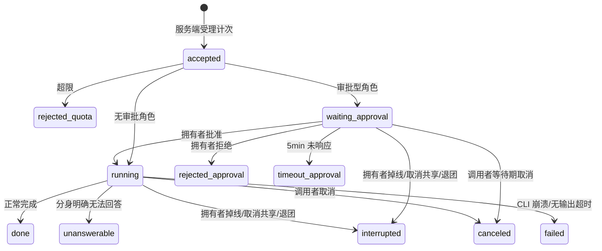

# feat: 团队工作区数字分身(共享角色)调用

## Summary

把团队工作区从 mock 变成真实的「分身通讯录」:成员把个人工作区的圆桌角色共享到团队,同事经服务端路由向拥有者电脑上的分身提问,主进程用本机 agent CLI 只读执行并流式回传。首版含逐角色能力/审批/限额配置、调用审计、邀请码建团,仅桌面端。

**本计划跨两个仓库**:前端 `cortex-work`(Electron 桌面端 + 共享包)与 Go 后端 `../server`(module `github.com/cortex-ai/cortex-work/server`)。前端路径 repo-relative 于 `cortex-work`;服务端单元标注 **[server]** 且路径 repo-relative 于 `../server`。关键前提:服务端**不是从零建**——调用路由、桌面长连、两级在线、保序回传、限额计数、审计、团队、邀请码的基建均已存在(见 Key Technical Decisions 首条),本功能是在其上扩展跨成员调用语义。

---

## Problem Frame

个人工作区已成熟(本地 agent、圆桌角色、可访问本机资料的 skill),但能力锁死在个人电脑上;团队侧至今全走 mock,无真实功能。核心场景:不打扰真人,直接问他的分身拿到他环境里的项目资料(见 origin: docs/brainstorms/2026-07-04-team-workspace-avatar-roles-requirements.md)。

审批型角色(origin R13)经用户确认进首版。流程分析补齐了 origin 未覆盖的非 happy-path 终态与数据归属裁决,全部落入本计划,不留给实现期即兴发挥。

---

## Requirements

**角色与共享**

- R1. 圆桌角色可标记「共享到团队」并配置授权目录(能力边界)、审批策略、每日调用次数上限;取消共享立即从团队侧消失,在途会话按「执行中断」终态收尾(origin R1-R3)。
- R2. `RoleConfig` 数据模型支持一人多共享角色;首版界面允许仅支持单角色共享,切换共享角色等于注销旧分身+注册新分身,旧会话按分身维度归档(origin R3)。

**通讯录与在线**

- R3. 团队通讯录展示真实成员(来自服务端组织),成员下挂共享分身,层级形如「nesocks → codex」;query key 不变,`Contact` 契约做加性扩展(新增可选 owner 关联字段表达成员→分身挂靠,不破坏现有消费方)(origin R4)。
- R4. 「在线」分两级:主进程心跳在线 + 本机 agent CLI 可执行;CLI 未装/损坏时分身显示不可用(`AgentStatus` 新增「在线不可执行」枚举值,与 offline 区分呈现)并向拥有者告警(origin R5 的收紧)。
- R5. 真人条目可见不可聊,展示降级提示;零分身成员显示「暂未共享分身」空态,与离线态文案区分(origin R7)。

**会话与执行**

- R6. 调用者向在线分身发起对话式提问,回答流式返回;会话按「调用者 × 分身」维度保存,可回看历史(origin R6)。
- R7. 提问经服务端路由到拥有者主进程,复用 agent CLI spawn 流式管线在角色约束下执行;执行不依赖拥有者渲染端存活(origin R8)。
- R8. 只读约束在执行节点侧强制:剥离危险 flag、回退默认审批/沙箱。**读范围收敛到授权目录,而非仅设 cwd**——剥离 flag + cwd 只挡写不挡越权读(codex read-only 仍可读全盘,pi 对绝对路径/符号链接拦不全);须以 OS 级沙箱(macOS `sandbox-exec` / Linux bubblewrap)把可读根收敛到授权目录,拒绝 prompt 中越界的绝对路径/父目录逃逸。对无法 jail 读取的 CLI,授权目录降级为 advisory 并在角色配置 UI 明确提示拥有者「授权目录内一切可读资料都可能被问出」,不再宣称为强制边界(origin R9)。
- R9. 会话有唯一状态机,终态集合固定为:完成、无法回答、超限、审批拒绝、审批超时、调用者取消、执行中断(拥有者掉线/取消共享/退团,含审批等待期与执行期)、执行失败(CLI 崩溃/无输出超时);调用者取消与审批拒绝在审批等待期同样可达;每个终态对调用者都有明确 UI 呈现,无静默失败(origin R10 的扩展)。
- R10. 保序复用服务端 `task_message` 的插入序(桌面逐帧 HTTP 上行落库、realtime hub 推送调用者),不新造 WS 注入序号;断线不做断点续传,整轮置为「执行中断」由调用者重问。
- R11. 同一「调用者 × 分身」会话串行:进行中时输入禁用(UI)+ 服务端兜底拒绝并发提问(承 KTD 串行执行模型)。
- R12. 调用者可中途取消:取消信号原路下达至主进程 kill 对应 CLI 进程组,已消耗部分计入审计(承 R9 终态补齐)。

**控制与可见性**

- R13. 限额口径为「每日调用次数、服务端受理时计次」;超限拒绝并给调用者明确提示,审计留痕(origin R2/R12 的收敛,用量型限额推迟)。非调用者过错的终态(执行中断、执行失败、审批拒绝、审批超时)由服务端释放该次计数(审计仍留痕),避免基础设施故障白扣调用者额度。每日次数为 per-avatar 汇总,另设 per-caller 子上限防单人耗尽共享额度。
- R14. 审批型角色:调用先过服务端限额、后到拥有者审批;拥有者收到应用内弹窗+系统通知,展示调用者身份、分身/角色名、完整问题文本、当日剩余限额(字段复用 R15 审计口径),批准/拒绝回执;默认超时 5 分钟自动判拒并告知调用者「拥有者未响应」;系统通知直接挂批准/拒绝按钮,不依赖渲染端弹窗(关窗态可操作),点击通知唤起 app 期间宽限倒计时(origin R13/AE6)。
- R15. 拥有者可查看分身调用记录:谁、何时、问了什么、消耗多少(origin R11)。
- R20. 同一分身可同时有多个来自不同调用者的待审批(串行仅约束「调用者×分身」);拥有者侧以待审批队列/列表呈现,逐项批准/拒绝,多个待审批的系统通知合并去抖,不互相覆盖或静默丢失。

**服务端与团队生命周期**

- R16. 服务端为权威数据点,三条数据归属裁决:C1 会话问答内容以服务端落库为准(两端为投影,中断时不各存一份);C2 审计以服务端为准;C3 每日限额计数由服务端权威持有(拥有者主进程仅上报增量),据此跨调用者可汇总。
- R17. 服务端扩展既有 runtime/daemon/task/squad 基建(非新建):分身 = 带共享元数据的 `agent_runtime`、调用 = task claim + `task_message` 保序回传、路由 = daemon WS hub + RelayNotifier、两级在线 = 既有 liveness + sweeper、限额 = `task_usage_daily` 扩展、审计 = `activity_log`。新增仅跨成员调用授权与分身共享元数据(origin R14;服务端实现见 U13-U19)。
- R19. 调用授权在服务端受理时校验(先于限额计次):调用者必须与分身拥有者同团队且该分身对其可见,拒绝非成员/跨团队的分身 id 直呼;sessions/audit 端点的读取按会话双方授权(问答内容仅该会话调用者与拥有者可读,审计按拥有者可见)。
- R18. 团队复用既有 `squad`(建团 = 建 squad,成员 = squad_member);邀请复用 `workspace_invitation`(凭码加入幂等、带有效期);退团/被移除即注销其全部共享分身(等同取消共享收尾),双方通讯录移除条目,历史会话与审计按服务端留存(origin R15 的补全)。

---

## Key Technical Decisions

- **复用服务端既有 runtime/daemon/task/squad 基建,不另建分身实体或另造机制(载荷决策)**:分身 = 现有 `agent_runtime`(已带 `owner_id` 与 `visibility private|public`,`internal/handler` + `pkg/db/queries/runtime.sql`),共享即注册/更新一条 owner 的 runtime 并附共享元数据(角色 label、授权目录、审批策略);「一次调用」= 现有 `task`(claim + `task_message` 保序回传 + `task_usage` 计量);「路由到拥有者桌面」= 现有 daemon WS hub(`internal/daemonws/hub.go`)+ 跨节点唤醒 `RelayNotifier`(`internal/daemonws/notifier.go`);「两级在线」= 现有 Redis liveness + `runtime_sweeper`;「团队」= 现有 `squad`(`migrations/084_squad.up.sql`);「邀请码」= 现有 `workspace_invitation`。**这条决策把服务端从「未知大工程」降为「扩展既有模型」,并约束所有服务端单元优先扩展而非新造。** 需新增的只有:跨成员调用授权、分身共享元数据、每日次数限额、调用审计投影。
- **服务端为权威落库与限额计数点,两端为投影**:提问文本(`task_message`)、审计(`activity_log`)、当日计次(`task_usage_daily` 扩展)都在服务端落库;拥有者桌面只上报增量,调用者/拥有者 UI 都从服务端查询。避免中断时两端数据不一致,也让跨调用者的每日限额可汇总。代价:离线看不到完整历史,首版接受。
- **保序复用 `task_message` 插入序 + realtime hub 推送,而非新造 WS 注入 seq**:服务端既有模型是「桌面 HTTP claim 任务 → 逐帧 `POST /tasks/{id}/messages` 上行落 `task_message`(correctness)→ realtime hub 按 task scope 推送给调用者;daemon WS 仅 best-effort 唤醒」(`internal/daemonws/hub.go:71` 明确 WS 唤醒、HTTP 保 correctness)。保序即 `task_message` 的自增插入序,调用者按此序去重渲染。**修正原设计假设的「WS 注入单调 seq」——与服务端真实模型对齐**;断线整轮判「执行中断」重问,协议无续传语义(`CliStreamEvent` 无序号的既有约束仍适用于桌面→服务端上行段,docs/plans/2026-06-14-002 教训)。
- **「在线」两级化**:主进程 WS 心跳携带 CLI 可用性探测结果(共享注册时 + 心跳周期性),服务端据此区分「在线可用/在线不可执行/离线」。修正 origin 把「主进程连着」当「能执行」的等价误设。
- **分身执行走独立 IPC 域,复用 cli.ts 三原语**:仿 `ask.ts` / `roundtable.ts` 先例——复用 `startAgentProcess` / `pipeStdoutLines` / `parseLineEvents`,但独立进程注册表、独立取消通道、独立 `killAllAvatar` 退出钩子,防止与本地会话误合并(apps/desktop/src/main/ipc/roundtable.ts:1-20 的既定纪律)。
- **只读收紧沿用 `tightenTools` 手法,但补读边界**:剥离 claude `--dangerously-skip-permissions` / codex `--dangerously-bypass-approvals-and-sandbox` 类 flag、回退默认审批/沙箱、以授权目录为 cwd(apps/desktop/src/main/ipc/ask.ts:38-50 现成范式)。**关键补强**:现成 `tightenTools` 只挡写(codex read-only 仍可读全盘),不构成读边界;分身场景须叠加 OS 级沙箱把可读根收敛到授权目录(见 R8),否则「能力边界」名不副实——这是分身相对个人侧 ask 的新增安全要求。
- **prompt 走 stdin,不走 argv**:远程提问长度不可控,argv 有 `E2BIG` 风险(docs/plans/2026-06-21-004 教训)。
- **调用者经服务端 realtime hub 消费两类事件**:状态类(在线状态、通讯录/审计变更,realtime `workspace`/`user` scope)只触发 React Query invalidation,遵守 CLAUDE.md 既有硬约定;会话流式帧(realtime `task`/`chat` scope,源自 `task_message`)按个人侧 run 状态机思路直接更新会话缓存(逐 token invalidation 不现实)。调用者需新建服务端 realtime WS 客户端(`packages/core` 侧,此前 `cortex-work` 无面向服务端的 WS client)。
- **并发防串场用「会话代际 + 委托 sink」**:每次调用带代际标记,迟到事件按代际丢弃(docs/plans/2026-06-17-002 pi RPC 的 runId 代际手法);同会话串行由 R11 保证。
- **限额首版只做每日次数、受理时计次**:次数在受理时可判,用量要执行后才知、判定时点不同;二选一收敛,用量型进 Deferred。
- **执行链全部落主进程**:路由长连、心跳、执行、回传、审批通知都在主进程,假设窗口关闭仍工作(docs/plans/2026-06-21-002 无头出站先例);在线状态是一等公民。
- **跨包类型镜像义务照旧**:分身相关新 DTO 在 `apps/desktop/src/main/ipc/types.ts` 与 `packages/core/desktop/types.ts` 逐字镜像,注释标注同步义务。
- **owner 长连接复用既有 daemon 通道与 `mdt_` token**:拥有者桌面以 daemon 身份连服务端 `GET /api/daemon/ws`(`DaemonAuth` 中间件,`mdt_` token,`internal/middleware/daemon_auth.go`),而非另建 WS 客户端;分身注册即注册/更新该 daemon 下的 `agent_runtime`。这把 U4 从「全新鉴权长连」降为「接入既有 daemon 契约面」。执行侧仍须强制只读(读边界不靠网络位置,见 R8)。
- **超时源统一,且服务端超时须分阶段**:服务端会话超时是继渲染端 per-run 看门狗(90s/300s)、主进程执行看门狗之后的第三个超时源;约定服务端超时 > 主进程执行超时 > 渲染端 stall 阈值(docs/plans/2026-06-21-004 RISK-7)。审批型会话在 running 前还有最长 5min 的 waiting_approval,故服务端会话超时必须 phase-aware:waiting_approval 阶段用 ≥5min 审批预算,进入 running 才切换执行预算并重置起点——否则从受理起算的扁平超时会误杀「拥有者第 4 分钟才批准」的合法会话。审批超时是排序里的第 4 个计时器。
- **执行节点 per-owner 并发上限**:串行只约束「同一调用者 × 分身」,不同调用者对同一分身可并发;抢手分身被多人同时提问会在拥有者机上并发 spawn 多个 CLI 打满资源。avatar-exec 进程注册表设 per-owner 并发上限(N=2~3),超出以「分身繁忙」瞬态拒绝(或排队),服务端/调用者 UI 呈现该状态。每日次数限额是频次约束,不替代并发上限。

---

## High-Level Technical Design

调用链(审批型角色的完整路径;无审批角色跳过 approval 段):

调用链复用服务端既有 task claim + `task_message` 保序回传模型(daemon WS 仅 best-effort 唤醒,correctness 靠 HTTP):

```mermaid
sequenceDiagram
  participant C as 调用者 app
  participant S as 服务端 (../server)
  participant O as 拥有者桌面 (daemon)
  participant CLI as 本机 agent CLI

  C->>S: 发起提问 (REST,含分身 runtime id)
  S->>S: 调用授权 (同 squad/workspace + runtime 可见)
  S->>S: 限额受理计次 (超限→拒绝);建 task
  S-->>O: daemon WS best-effort 唤醒 (RelayNotifier 跨节点)
  O->>S: HTTP claim task (correctness)
  O->>O: 校验共享态/CLI 可用性/审批策略
  opt 审批型角色
    O-->>O: 弹窗+系统通知,等待确认 (默认 5min 超时→判拒)
  end
  O->>CLI: 只读 spawn (tightenTools + 沙箱读根收敛 + stdin)
  CLI-->>O: 逐行流式事件
  O->>S: POST /tasks/{id}/messages 逐帧上行 (落 task_message,插入序即时序)
  S-->>C: realtime hub (task scope) 按序推送
  O->>S: task complete/fail + usage
  S->>S: 终态落库 (task_message / activity_log / task_usage_daily)
```

会话状态机(R9 的终态集合):



图为权威内容的一部分;终态命名等标识符以实现时的契约文件为准。

---

## Implementation Units

单元跨 `cortex-work`(前端,U 无标注)与 `../server`(Go 后端,标 **[server]**),按两个里程碑组织。**Milestone 1(最薄竖切)** 优先打通一条无审批/无限额/无审计/无团队生命周期的端到端只读问答,前后端一起双机验证三项最高风险的跨仓契约——调用路由(daemon 唤醒 + claim)、`task_message` 保序回传、只读读边界。**Milestone 2** 在骨架之上回填审批、限额、审计、并发上限与团队生命周期。服务端单元一律**优先扩展既有 runtime/daemon/task/squad 基建**(见首条 KTD)。U-ID 稳定不重编号。

### Milestone 1 — 最薄竖切(打通跨仓契约)

#### 前端

### U1. 分身与调用协议契约定义

- **Goal**: 定义全链路共享的类型契约:分身 DTO(映射服务端 `agent_runtime` + 共享元数据)、会话状态机、会话帧封套(对齐服务端 `task_message` 形状 + 桌面代际)、`RoleConfig` 扩展字段,并扩展 `DesktopBridge` 契约。
- **Requirements**: R1, R2, R9, R10
- **Dependencies**: 无(与 U13 服务端契约并行敲定,字段命名对齐)
- **Files**: `packages/core/desktop/types.ts`、`apps/desktop/src/main/ipc/types.ts`(逐字镜像)、`packages/core/desktop/bridge.ts`、`packages/core/api/types.ts`
- **Approach**: `RoleConfig` 增量加可选字段(共享开关、授权目录、审批策略、每日次数上限),不破坏现有 roles.json;会话帧封套对齐服务端 `task_message`(插入序即时序)+ 桌面上行段的代际标记;终态枚举与状态机图一致。镜像处注释标注同步义务;DTO 字段命名与 U13 的 `agent_runtime` 共享列对齐。
- **Patterns to follow**: `RoleConfig` 现有形状(`packages/core/desktop/types.ts:15-24`);`CliStreamEvent` 向后兼容扩展纪律(docs/plans/2026-06-21-004)。
- **Test scenarios**: Test expectation: none — 纯类型契约,校验逻辑在 U2/U5 测。
- **Verification**: `pnpm typecheck` 全绿;两处镜像逐字一致。

### U2. 共享开关与授权目录(个人工作区,骨架部分)

- **Goal**: 拥有者在角色编辑器里打开「共享到团队」并选授权目录;保存后经通道注册/注销分身。审批策略与限额配置留 U10。
- **Requirements**: R1(共享开关 + 授权目录部分)
- **Dependencies**: U1
- **Files**: `apps/desktop/src/main/ipc/roles.ts`(校验+CRUD payload)、`packages/views/cortex-desktop/personal/RolesSettingsSection.tsx`(RoleEditor 表单)、`apps/desktop/src/main/ipc/roles.test.ts`
- **Approach**: 表单在现有 `.pw-srow` 行式布局上加共享 toggle + 目录选择;共享状态变化经 U4 通道向服务端注册/注销;取消共享触发在途会话中断(经 U5)。
- **Patterns to follow**: `RolesSettingsSection` 现有表单;`roles.ts` 的纯函数 CRUD + `broadcastRolesChanged` 广播。
- **Execution note**: 校验纯函数先写失败测试再实现。
- **Test scenarios**:
  - 共享开关开启但未选授权目录 → 校验拒绝保存
  - Covers R2(切换共享角色):从 codex 切到 claude → 旧分身注销、新分身注册各触发一次
  - 旧版 roles.json(无新字段)load → 默认不共享,不崩
- **Verification**: 角色编辑器可开启共享并持久化授权目录;取消共享后通讯录条目消失(联调 U7 后)。

### U3. ApiClient 扩展与调用者侧客户端(happy-path 部分)

- **Goal**: 补齐 `ApiClient` 的 POST/DELETE helper,接入 U13/U14 服务端端点:分身列表、发起调用(建 task)、取消、会话帧订阅(realtime hub task scope)。限额/审计/团队端点留 U11。
- **Requirements**: R3, R6, R16, R17, R19(基础授权)
- **Dependencies**: U1, U13/U14(端点契约)
- **Files**: `packages/core/api/client.ts`、`packages/core/api/types.ts`、`packages/core/api/client.test.ts`(新)
- **Approach**: 沿用 `get<T>` + `ApiError` 约定加 `post/del`;端点对齐 U13/U14 实际形状(runtime 列表复用现有、调用建 task、`GET /api/tasks/{id}/messages` 取历史);会话实时帧经 U8 的 realtime WS 客户端(task scope)。契约以 U13/U14 服务端为准,不再另写独立契约文档。
- **Patterns to follow**: `client.ts:55-124` headers/错误约定;`appendSearch`。
- **Test scenarios**:
  - post 序列化 body、携带 Authorization/X-Workspace-ID header
  - 非 2xx 抛 `ApiError` 且带 status
- **Verification**: typecheck + 单测绿;端点形状与 U13/U14 对齐。

### U4. 拥有者桌面接入 daemon 通道与分身注册

- **Goal**: 拥有者桌面以 daemon 身份接入服务端既有 `GET /api/daemon/ws`(`mdt_` token);分身共享即注册/更新其 `agent_runtime`,心跳携带 CLI 可用性;收 best-effort 唤醒后 HTTP claim 分身调用 task。
- **Requirements**: R4, R7, R16, R17
- **Dependencies**: U1, U13(daemon/runtime 端点)
- **Files**: `apps/desktop/src/main/ipc/team-node.ts`(新域:daemon 客户端 + claim 循环)、`apps/desktop/src/main/ipc/register.ts`、`apps/desktop/src/main/ipc/team-node.test.ts`
- **Approach**: 接入既有 daemon 契约面(register → `mdt_` token → WS 连 + 心跳 + claim),**不另建鉴权长连**;CLI 可用性探测(`detectAgents` 类)随注册与心跳上报;窗口全关时通道仍存活(主进程持有)。新 ws 依赖(若需)先过 electron-builder 黑名单三连检查。
- **Patterns to follow**: 服务端 daemon 契约 `internal/handler/daemon.go`、`internal/daemonws/hub.go`;桌面侧 `codex-ws-channel.ts` 连接生命周期;`push.ts` 密钥不回显纪律。
- **Test scenarios**:
  - 心跳 payload 组装:CLI 探测结果变化反映到下一次心跳(纯函数)
  - 断线 → 重连退避;重连后重新注册/上报分身 runtime
  - 收到唤醒 → 触发 HTTP claim;未知消息类型 → 忽略不崩
- **Verification**: 双机联调:桌面注册出现在服务端 runtime 列表;关窗后心跳持续;杀 CLI 后服务端 runtime 转「不可执行」。

### U5. 分身执行域(avatar-exec,只读骨架部分)

- **Goal**: 接收派发 → 校验共享态 → 只读 spawn(读根收敛到授权目录)→ 带代际/seq 前的原始事件上行 → 核心终态映射(完成/无法回答/执行中断/执行失败)+ 取消。审批 gating 与 per-owner 并发上限留 U12。
- **Requirements**: R7, R8, R9(核心终态), R12
- **Dependencies**: U1, U4
- **Files**: `apps/desktop/src/main/ipc/avatar-exec.ts`(新域)、`apps/desktop/src/main/ipc/avatar-exec.test.ts`、`apps/desktop/src/main/ipc/register.ts`(注册 + `killAllAvatar` 导出)
- **Approach**: 复用 `cli.ts` 三原语(`startAgentProcess`/`pipeStdoutLines`/`parseLineEvents`)+ 独立进程注册表;只读收紧独立成纯函数(仿 `tightenTools`,覆盖 claude/codex/pi 三 adapter),**叠加 OS 级沙箱把可读根收敛到授权目录**(仅剥 flag + cwd 不构成读边界,见 R8/KTD);prompt 走 stdin;进程组级 kill;无输出超时看门狗,超时/非零退出映射为「执行失败」,与「无法回答」(语义层)区分;取消共享/退团时对在途会话广播中断。
- **Execution note**: 只读收紧、读根收敛、终态映射纯函数 test-first。
- **Patterns to follow**: `ask.ts`/`roundtable.ts` 的「复用三原语 + 独立注册表 + 独立取消通道」先例;`register.ts:82-91` 子进程回收纪律;pi 沙箱局限见 `apps/desktop/src/main/agents/pi-extensions.ts:49-50`。
- **Test scenarios**:
  - 只读收紧:claude/codex 各自的危险 flag 被剥离,pi 落到等价只读配置;cwd 固定为角色授权目录
  - Covers AE2:请求含写操作意图 → CLI 在默认沙箱下拒绝(参数层面断言收紧后配置)
  - 读边界:prompt 含授权目录外的绝对路径/父目录逃逸(如 `~/.ssh/id_rsa`)→ 沙箱配置拒绝该读根(参数层面断言可读根被收敛)
  - 终态映射:非零退出→失败(Covers AE8);无输出超时→失败;kill→取消(Covers AE9);正常 result→完成
  - Covers AE7:执行中拥有者掉线 → 会话转「执行中断」,partial 保留
  - Covers AE12:取消共享时在途会话 → 转「执行中断」,新请求即拒
  - 代际:旧代际迟到事件被丢弃,不串入新会话
  - killAllAvatar 清空注册表并 kill 进程组
- **Verification**: 双机联调:提问→拥有者机 spawn→流式回到调用者;中途拔网线→调用者见「执行中断」;越授权目录读取被沙箱拒绝。

### U7. 团队通讯录真实化

- **Goal**: contacts 从 mock 切到服务端数据:成员+分身层级、两级在线态、零分身空态、真人不可聊降级提示;query key 与组件契约不变。
- **Requirements**: R3, R4, R5
- **Dependencies**: U3
- **Files**: `packages/core/types/index.ts`(`Contact` 加可选 owner 字段、`AgentStatus` 加「在线不可执行」值)、`packages/core/cortex/queries.ts`、`packages/core/cortex/contacts-map.ts`(新,服务端 DTO→`Contact` 映射纯函数)+ 就近测试、`packages/views/cortex-desktop/Sidebar.tsx`(两级嵌套渲染)/ `ChatArea.tsx`(空态/降级提示)
- **Approach**: `contactKeys` 不变;`Contact`/`AgentStatus` 做加性扩展(新增可选 owner 关联字段 + 新枚举值),不破坏现有消费方——「替换 mock 不改契约」指 query key 与既有字段稳定,新增字段是允许的加法(AGENTS.md)。Sidebar 从扁平 `filter` 改为支持成员→分身两级嵌套渲染;在线状态经 WS 状态事件触发 invalidation(遵守既有硬约定);真人条目复用 `Contact.group` 语义标记不可聊。
- **Patterns to follow**: `cortex/queries.ts:20-33` key 工厂;`mock/api.ts` 注释的替换纪律;`Contact`/`AgentStatus` 现有形状(`packages/core/types/index.ts`)。
- **Test scenarios**:
  - 映射纯函数:成员含 0/1/多分身的层级展开;在线三态(在线可用/在线不可执行/离线)映射到 `agentStatus`
  - Covers AE1:拥有者离线 → 分身条目不可发起提问
  - Covers AE11:主进程在线但 CLI 被卸载 → 分身「不可用」态,区别于离线呈现
  - Covers AE4:真人条目无输入框、有降级提示
  - 零分身成员 → 「暂未共享分身」空态,文案区别于离线
- **Verification**: 团队通讯录展示真实成员与分身;切 workspace 无数据串场。

### U8. 分身会话与流式渲染(含取消/并发约束)

- **Goal**: 发起提问、订阅会话流、`ChatArea` 消费真实流式并呈现终态;取消按钮;进行中禁止并发提问。核心终态(完成/无法回答/中断/失败/取消)在 M1 打通并双机验证;审批等待态与超限态的 UI 一并建好,但其后端(U12/U11)落地后才在 M2 联调验证。
- **Requirements**: R6, R9, R10, R11, R12
- **Dependencies**: U1, U3, U7(联调还需 U4/U5)
- **Files**: `packages/core/cortex/mutations.ts`(替换 mock `useCortexActions`)、`packages/core/cortex/session-stream.ts`(新,服务端 realtime WS 客户端 + `task_message` 保序纯函数)+ 就近测试、`packages/core/cortex/queries.ts`(会话历史 queryFn 切真实 `GET /api/tasks/{id}/messages`)、`packages/views/cortex-desktop/ChatArea.tsx`(终态/等待态呈现)
- **Approach**: 订阅服务端 realtime hub(task scope);保序/去重按 `task_message` 插入序、事件→会话缓存更新拆成纯函数;流式帧直接更新会话缓存(不走 invalidation),终态与列表类数据变更触发 invalidation;审批等待态呈现「等待拥有者确认」;超限/中断/失败各有明确文案。`messages.ts` 已 151KB,团队侧状态机一律放新文件。
- **Execution note**: 保序/去重纯函数 test-first。
- **Patterns to follow**: `personal/messages.ts` 的 run 状态机思路(`handleCliEvent` 按类型聚合、tail-fold 分块);`cortex/mutations.ts` 现有纯 transform + 就近测试范式。
- **Test scenarios**:
  - seq 乱序到达 → 按序渲染;重复 seq 去重;跨代际事件丢弃
  - Covers AE5:无法回答 → 明确回复而非静默
  - 8 终态各自映射到确定的会话 UI 状态(参数化用例;各终态文案互不雷同,中断/失败/无法回答/超限区分清晰;超限/审批态 M2 联调)
  - 进行中再发提问 → 输入禁用;强行(多窗口)发起 → 服务端拒绝呈现
  - Covers AE9:取消 → 会话转「已取消」,partial 输出保留可见
- **Verification(M1)**: 双机联调完整只读问答;断网中断、取消两场景 UI 正确(超限/审批等待留 M2)。

#### 服务端 [server]

### U13. [server] 共享分身:agent_runtime 扩展 + 注册/授权

- **Goal**: 把 `agent_runtime` 扩展为可被跨成员调用的「共享分身」:附共享元数据(角色 label、授权目录、审批策略),沿用既有 `owner_id`/`visibility`;桌面注册/注销分身;列出某 workspace/squad 内对调用者可见的分身。
- **Requirements**: R3, R17, R19(基础授权)
- **Dependencies**: 无(与 U1 前端契约并行敲定字段)
- **Files**: `migrations/NNN_avatar_sharing.{up,down}.sql`(扩展列或旁表)、`pkg/db/queries/runtime.sql`、`internal/handler/daemon.go`(注册路径扩展)、`internal/handler/avatar.go`(新,列表/授权)、`cmd/server/router.go`(挂载)
- **Approach**: 优先扩展 `agent_runtime`(既有 `owner_id`/`visibility`/upsert 唯一键),不新建实体;分身列表 handler 走 `RequireWorkspaceMember` + squad 成员 + runtime 可见性 gating(参照现有 `visibility` gating)。
- **Patterns to follow**: `pkg/db/queries/runtime.sql` upsert + `(xmax=0) AS inserted`;handler 范例 `internal/handler/invitation.go`;`RequireWorkspaceMember`(`internal/middleware/workspace.go:141`)。
- **Execution note**: sqlc 查询 + handler 授权分支写集成测试(真实 PG,`handler_test.go` fixture 范式)。
- **Test scenarios**:
  - 注册/更新分身 → runtime 出现共享元数据;取消 → 不再可见
  - 授权:同 squad 成员可列出可见分身;非成员/不可见 runtime → 403
  - Covers AE11 后端侧:CLI 不可用心跳 → runtime 标不可执行
- **Verification**: `go test ./internal/handler/...`(有 DB 时);分身列表端点授权分支覆盖。

### U14. [server] 跨成员调用路由与保序回传(happy path)

- **Goal**: 成员发起分身调用 → 建 avatar-invocation task → 按 `runtime.owner_id` 定位拥有者 daemon → `RelayNotifier` 唤醒 → 桌面 claim → 桌面逐帧 `POST /tasks/{id}/messages` 上行 → realtime hub(task scope)按插入序推送调用者;支持取消。
- **Requirements**: R6, R7, R10, R16, R19(基础授权)
- **Dependencies**: U13
- **Files**: `internal/handler/avatar.go`(发起/取消)、`internal/service/task.go`(复用 claim/wakeup)、`pkg/db/queries/task*.sql`(复用)、`cmd/server/router.go`
- **Approach**: 最大化复用既有 task claim + `task_message` + `RelayNotifier` + realtime hub;新增仅「avatar-invocation」task 类型与发起时的调用授权校验。保序即 `task_message` 插入序,不引入新序号机制。
- **Patterns to follow**: `internal/service/task.go` 的 `ClaimTaskForRuntime`/`Wakeup`;`internal/daemonws/notifier.go:26` `NewRelayNotifier`;`GET/POST /tasks/{id}/messages`(`router.go:290-291`)。
- **Execution note**: 发起→路由→回传的 handler/service 集成测试(真实 PG + daemon context 模拟 `WithDaemonContext`)。
- **Test scenarios**:
  - 发起 → 建 task、按 owner 定位 runtime、触发唤醒
  - 授权:跨 squad/不可见分身发起 → 拒绝(Covers R19)
  - 保序:多帧 `task_message` 按插入序对调用者可见
  - 取消 → task 置终态,桌面收取消
- **Verification**: 双机联调:调用者发起 → 拥有者机 claim 执行 → 流式按序回到调用者;取消走通。

### Milestone 2 — 横向能力回填(审批 / 限额 / 审计 / 生命周期)

#### 前端

### U10. 角色审批策略与限额配置(个人工作区)

- **Goal**: 在角色编辑器补齐审批策略与每日限额配置行;拆自 U2 的横向部分。
- **Requirements**: R1(审批/限额部分), R2, R13(配置侧)
- **Dependencies**: U2
- **Files**: `apps/desktop/src/main/ipc/roles.ts`、`packages/views/cortex-desktop/personal/RolesSettingsSection.tsx`、`apps/desktop/src/main/ipc/roles.test.ts`
- **Approach**: 在 U2 的 `.pw-srow` 布局补审批策略选择 + 每日限额行;校验纯函数扩展。
- **Execution note**: 校验纯函数先写失败测试再实现。
- **Test scenarios**:
  - 每日限额为 0 或负数 → 校验拒绝;缺省值合法
  - 审批策略枚举值持久化与回读一致
- **Verification**: 角色编辑器可配置并持久化审批策略与限额。

### U11. ApiClient 接入 M2 服务端端点(限额/审计/团队)

- **Goal**: 前端接入 U15/U16/U17 的服务端端点:限额查询、审计列表、团队/邀请码。拆自 U3 的横向部分;契约以服务端单元为准,不再另写契约文档。
- **Requirements**: R13(查询侧), R15, R18
- **Dependencies**: U3, U15/U16/U17(端点契约)
- **Files**: `packages/core/api/client.ts`、`packages/core/api/types.ts`、`packages/core/api/client.test.ts`
- **Approach**: 补 audit/usage/teams/invite 端点的 client 方法,形状对齐服务端实现。
- **Test scenarios**:
  - audit/teams 端点 post/get 序列化与 header 正确
  - 非 2xx 抛 `ApiError`
- **Verification**: typecheck + 单测绿;端点形状与 U15/U16/U17 对齐。

### U12. 审批 gating 与并发上限(avatar-exec)

- **Goal**: 在 U5 骨架上加审批策略 gating、per-owner 并发上限、非过错终态的配额释放;拆自 U5 的横向部分。
- **Requirements**: R11(并发), R13(释放), R14, R20
- **Dependencies**: U5, U4, U11
- **Files**: `apps/desktop/src/main/ipc/avatar-exec.ts`、`apps/desktop/src/main/ipc/avatar-exec.test.ts`
- **Approach**: 审批型派发进 waiting_approval 等主进程确认(含 5min 超时、掉线转中断);per-owner 并发上限(N=2~3)超出瞬态拒绝;终态为 interrupted/failed/rejected/timeout 时通知服务端释放计数。
- **Execution note**: 并发上限与终态释放判定纯函数 test-first。
- **Test scenarios**:
  - per-owner 并发:超上限的新调用被「分身繁忙」瞬态拒绝
  - waiting_approval → 掉线转「执行中断」而非永久等待
  - 非过错终态 → 触发配额释放上报
- **Verification**: 双机联调审批 gating 与并发拒绝各走通一次。

### U6. 拥有者侧审批与审计 UI

- **Goal**: 审批型角色的确认弹窗+系统通知(展示调用者/角色/问题文本/剩余限额,批准/拒绝,5 分钟超时自动判拒);多待审批队列;调用记录(审计)查询页。
- **Requirements**: R14, R15, R20
- **Dependencies**: U12, U11, U4
- **Files**: `apps/desktop/src/main/ipc/avatar-exec.ts`(审批等待/超时/队列)、`packages/views/cortex-desktop/personal/`(审批弹窗/队列面板、审计区块,具体文件实现期定)、`packages/core/`(审计 query,key 含 wsId)
- **Approach**: 审批等待在主进程持有(渲染端可能关窗);系统通知直接挂批准/拒绝按钮,不依赖渲染端弹窗;点击通知唤起 app 期间宽限倒计时;超时计时器在主进程;多个来自不同调用者的待审批以队列/列表呈现、逐项处理、通知合并去抖;审计列表走 React Query 从服务端查询,key 形如 `["avatar-audit", wsId, ...]`,含加载骨架与空态文案(「尚无调用记录」)。
- **Patterns to follow**: 原生通知出站参照 automation 完成推送先例(docs/plans/2026-06-21-002);设置区块沿 `.pw-scard`。
- **Test scenarios**:
  - Covers AE6:批准→执行继续;拒绝→调用者收到「审批拒绝」终态
  - Covers AE10:超时 5 分钟未响应 → 自动判拒,终态「审批超时」,调用者见「拥有者未响应」
  - 弹窗/通知展示字段完整:调用者、角色、问题文本、剩余限额
  - 同一分身两个不同调用者的待审批并存 → 队列各自可批准/拒绝,互不覆盖
- **Verification**: 双机联调审批三分支(批准/拒绝/超时)各走通一次;关窗态经系统通知按钮直接批准一次。

### U9. 建团、邀请码与退出(前端)

- **Goal**: 创建团队、生成/使用邀请码(幂等、有效期)、退团/移除的前端流程;退出触发分身注销语义的呈现。
- **Requirements**: R18
- **Dependencies**: U11, U17, U7
- **Files**: `packages/views/cortex-desktop/`(OrgSwitcher 或设置区块内的建团/加入入口,实现期定)、`packages/core/cortex/`(teams queries/mutations + 就近测试)
- **Approach**: UI 走最小形态:建团表单(名称)→ 得邀请码;加入表单(码)→ 进团;成员列表含移除(仅管理员)。服务端(U17)负责幂等与过期;前端呈现错误语义(码过期/已在团队)。
- **Patterns to follow**: `organizationKeys` 全局 key(不带 wsId);`personal/tasks.ts` 的 `useMutation` + invalidation 范式。
- **Test scenarios**:
  - 建团成功 → 组织列表 invalidate 并出现新团队
  - 码过期/已在团队 → 对应错误文案(mock ApiError)
  - 退团 → 通讯录/会话相关 query 全部 invalidate
- **Verification**: 双机走通「A 建团 → B 凭码加入 → B 看到 A 的分身」。

#### 服务端 [server]

### U15. [server] 每日次数限额

- **Goal**: 在既有 `task_usage_daily` rollup 基础上加分身调用的每日次数计数:受理时计次、per-avatar 汇总 + per-caller 子上限、非过错终态(中断/失败/拒绝/超时)释放该次计数。
- **Requirements**: R13, R16(C3)
- **Dependencies**: U14
- **Files**: `migrations/NNN_avatar_quota.{up,down}.sql`(如需)、`pkg/db/queries/task_usage.sql`、`internal/handler/avatar.go`(受理校验/释放)、`internal/service/task.go`
- **Approach**: 优先复用 `task_usage_daily` 计数与聚合;受理时原子计次并校验上限,终态回调时对非过错终态释放。计数为服务端权威(R16 C3)。
- **Patterns to follow**: `pkg/db/queries/task_usage.sql` 的 `UpsertTaskUsage`/`GetWorkspaceUsage*` 聚合;task 终态回调路径。
- **Execution note**: 计次/释放/上限判定写集成测试。
- **Test scenarios**:
  - 受理计次 → 达上限后新调用拒绝(Covers AE3 后端侧)
  - 非过错终态 → 计数释放;正常完成 → 不释放
  - per-caller 子上限:单调用者耗尽自身子上限但不锁死他人
- **Verification**: `go test`;上限与释放分支覆盖。

### U16. [server] 调用审计

- **Goal**: 每次分身调用在 `activity_log` 落审计投影(谁、何时、问了什么、消耗多少、终态);拥有者按可见性读取,读取端点授权(会话双方可读问答、拥有者可读审计)。
- **Requirements**: R15, R16(C1/C2), R19(读取授权)
- **Dependencies**: U14
- **Files**: `pkg/db/queries/activity_log.sql`(或复用)、`internal/handler/avatar.go`(审计写/读)、`cmd/server/router.go`
- **Approach**: 复用 `activity_log`(actor_type 支持 system);调用终态时写审计;读取端点走 `RequireWorkspaceMember` + 会话双方/拥有者授权分支。
- **Patterns to follow**: `activity_log` 表(`migrations/001_init.up.sql`);既有 handler 授权分支。
- **Execution note**: 审计写与读取授权写集成测试。
- **Test scenarios**:
  - 调用终态 → 审计记录含调用者/时间/问题/消耗/终态
  - 读取授权:拥有者可读自己分身审计;非拥有者/跨会话读问答 → 拒绝(Covers R19)
- **Verification**: `go test`;审计读写授权分支覆盖。

### U17. [server] 团队与邀请码(squad + invitation 接入)

- **Goal**: 分身调用的团队边界接入既有 `squad` + `workspace_invitation`:建团 = 建 squad、邀请码复用 invitation、退团/移除即注销该成员全部共享分身(等同取消共享收尾)。
- **Requirements**: R18
- **Dependencies**: U13
- **Files**: `pkg/db/queries/{squad,invitation,runtime}.sql`、`internal/handler/{squad,invitation}.go`(扩展退团联动)、`cmd/server/router.go`
- **Approach**: 复用 squad/invitation 既有端点与幂等/过期语义;新增仅「退团/移除 → 注销其 owner 的共享分身 runtime + 中断在途 task」的联动。
- **Patterns to follow**: `pkg/db/queries/squad.sql`、`invitation.sql`;`internal/handler/invitation.go`。
- **Execution note**: 退团联动写集成测试。
- **Test scenarios**:
  - 凭码加入幂等;过期码拒绝
  - 退团 → 该成员共享分身注销、在途 task 中断(Covers R18)
- **Verification**: `go test`;退团联动分支覆盖。

---

## Acceptance Examples

origin AE1-AE6 全部保留并由上表 `Covers` 链接到具体测试;计划新增:

- AE7. **Covers R9/R10.** Given 流式回答进行中拥有者断网,Then 调用者会话在心跳超时内转「执行中断」,partial 输出保留,可重新提问。
- AE8. **Covers R9.** Given CLI 进程崩溃退出,Then 调用者看到「执行失败」(与「无法回答」文案区分),审计留痕。
- AE9. **Covers R12.** Given 调用者点取消,Then 拥有者机上对应 CLI 进程组被 kill,会话转「已取消」,已消耗计入审计。
- AE10. **Covers R14.** Given 审批型角色调用且拥有者 5 分钟未响应,Then 自动判拒,调用者看到「拥有者未响应」。
- AE11. **Covers R4.** Given 拥有者主进程在线但 codex CLI 被卸载,Then 分身显示「不可用」,拥有者收到告警,调用无法发起。
- AE12. **Covers R1.** Given 拥有者取消共享时存在进行中会话,Then 新请求即刻被拒,在途会话转「执行中断」。

---

## Scope Boundaries

**Deferred for later(二期及以后,承 origin)**

- 任务看板与任务派发、转交真人兑底、可读写分身能力、多角色管理界面与目录视图、远程分身注入个人工作区圆桌、群组 @ 分身、Web 端调用界面。
- 用量型(token)限额(本计划收敛为每日次数)。
- 断点续传/会话恢复(断线即中断重问)。

**Outside this product's identity(定位排除,承 origin)**

- 人与人 IM;云端托管执行与离线兜底;跨组织/对外共享分身。

**Deferred to Follow-Up Work(计划内顺延)**

- 跨机端到端自动化测试:首版以双机人工验证清单(各单元 Verification)+ 服务端 Go 集成测试代替。
- 团队侧接入后的 mock 数据清理(`mock/data.ts` 中 contacts/convos 的裁撤时机待团队侧全量真实化后)。
- 服务端多节点 sharded relay 在高并发分身流下的背压压测(复用既有 relay,首版不改其内部)。

---

## System-Wide Impact

- **团队侧「零回归」历史终结**:此前 70+ 计划都声明不触碰团队侧,本计划是团队侧第一次真实化;`cortex/queries.ts` 的 query key 与组件契约保持不变是控制爆炸半径的关键。
- **包边界**:WS 客户端与保序逻辑放 `packages/core`(不触 `react-dom`/`process.env`);主进程能力一律经 `DesktopBridge` 契约暴露,`core`/`views` 不碰 `window.desktopAPI`;新增对外模块同步 `exports` 字段。
- **类型镜像面扩大**:分身 DTO 加入 `ipc/types.ts` ↔ `core/desktop/types.ts` 逐字镜像义务。
- **主进程新增两个长驻域**(team-node、avatar-exec):须接入 `register.ts` 退出回收钩子;若引入新依赖,过 electron-builder `files` 黑名单/onlyBuiltDependencies/重建三连检查,产物 `ditto` 到仓库外验证(docs/lessons.md 铁律)。
- **服务端影响**:优先扩展既有 `agent_runtime`/task/`task_message`/`task_usage_daily`/`activity_log`/squad/invitation,不新建并行机制;新增 migration 落在 242-migration 序列尾部(注意同号并存约定);分身调用作为新 task 类型接入既有 claim/relay,须确认不干扰现有 task 语义(autopilot、issue 等复用同表)。事件总线 listener 顺序敏感,新增 listener 谨慎插入。
- **安全面**:本应用首次接受「远程指令驱动本机 agent」;四道安全底线——① 服务端调用授权(同 squad/workspace + 分身可见,先于限额,建立在 `RequireWorkspaceMember` + `visibility` gating 之上)、② daemon `mdt_` token 鉴权长连、③ 只读收紧叠加 OS 级沙箱把读根收敛到授权目录(仅 cwd 不构成读边界)、④ 审计/问答读取按会话双方授权——任何放宽都须回到需求层重议。授权目录选择 UI 须提示拥有者「目录内一切可读资料都可能被问出」。

---

## Risks & Dependencies

- **两仓协同**(R16/R17)。服务端已纳入本计划(U13-U17),不再是外部黑盒;但前后端仍在两个仓库,U1↔U13 的 DTO 字段命名、U3/U8↔U14 的端点/帧形状须双向对齐。**Milestone 1 竖切把最高风险的三项跨仓契约(daemon 唤醒+claim 路由、`task_message` 保序、只读读边界)的双机验证提到最前**,收敛返工半径。**服务端非从零建大幅降低了原「服务端未知工程量」风险**——路由/长连/在线/回传/限额/审计/团队地基均已存在,主要工作是扩展与授权。
- **风险:复用既有 task 模型的语义耦合**。分身调用作为新 task 类型复用 claim/`task_message`/`task_usage`,须确认不与既有 task 消费者(autopilot、issue)串数据或触发其 listener 副作用;U14 集成测试须覆盖「分身 task 不误入既有 task 流」。
- **风险:流式中转性能与保序**。`task_message` 插入序即时序;高频 token 帧经既有 realtime relay 转发的延迟与背压首版未压测,双机联调时观察,必要时批量合帧(实现期决定)。
- **风险:审批等待期的状态一致性**。审批挂起横跨服务端超时、主进程计时、拥有者掉线三种打断,状态机转换在 U5/U6 测试中显式覆盖,不留隐式路径。
- **风险:三超时源误杀**。渲染端 90s/300s 看门狗、主进程执行看门狗、服务端会话超时并存;按 KTD 的「服务端 > 主进程 > 渲染端 stall」排序配置,联调时验证不互相抢跳。
- **假设**:公司内部互信环境,限额+审计足以约束滥用;工作时段电脑普遍在线(承 origin Dependencies)。

---

## Sources / Research

- origin 需求文档:docs/brainstorms/2026-07-04-team-workspace-avatar-roles-requirements.md(R/A/F/AE 与 Key Decisions 全部承接)。
- 前端复用资产:`apps/desktop/src/main/ipc/cli.ts`(spawn 三原语)、`ask.ts:38-50`(tightenTools 只读收紧)、`roundtable.ts:1-20`(独立域纪律)、`codex-ws-channel.ts`(持久连接生命周期)、`packages/core/personal/messages.ts:859`(流式状态机思路)、`packages/core/cortex/queries.ts` + `mock/api.ts`(替换契约)。
- **服务端复用资产(`../server`,repo-relative)**:`internal/daemonws/hub.go`(daemon WS hub,`:71` WS 唤醒 + HTTP correctness、`:158` `NotifyTaskAvailable`)、`internal/daemonws/notifier.go:26`(`RelayNotifier` 跨节点唤醒)、`internal/service/task.go`(`ClaimTaskForRuntime`/`Wakeup`)、`pkg/db/queries/runtime.sql`(`agent_runtime` upsert + `owner_id`/`visibility`)、`migrations/083_runtime_visibility.up.sql`(visibility gating)、`pkg/db/queries/task_usage.sql`(每日计量)、`migrations/084_squad.up.sql` + `pkg/db/queries/squad.sql`(团队)、`migrations/041_workspace_invitation.up.sql` + `internal/handler/invitation.go`(邀请码范例)、`internal/middleware/workspace.go:141`(`RequireWorkspaceMember`)、`internal/middleware/daemon_auth.go`(`mdt_` token)、`cmd/server/router.go:263-300`(daemon 路由组)、`internal/handler/handler_test.go:36`(真实 PG 集成测试范式)。
- 历史教训:docs/plans/2026-06-26-004(本地 ws 鉴权/连接模型)、2026-06-21-004(stdin/进程组 kill/看门狗协调)、2026-06-14-002(到达顺序即时序)、2026-06-17-002(runId 代际防串场)、2026-06-21-002(无头主进程出站)、2026-07-03-001 + docs/lessons.md(主进程新依赖打包/签名三连检查、仓库外验证)。
- 约束来源:CLAUDE.md / AGENTS.md / docs/floder.md(状态管理硬约定、包边界、镜像义务、1200 行上限——团队侧状态机一律新文件);服务端 sqlc 加表流程(migration + `pkg/db/queries/*.sql` + `sqlc generate`)。
