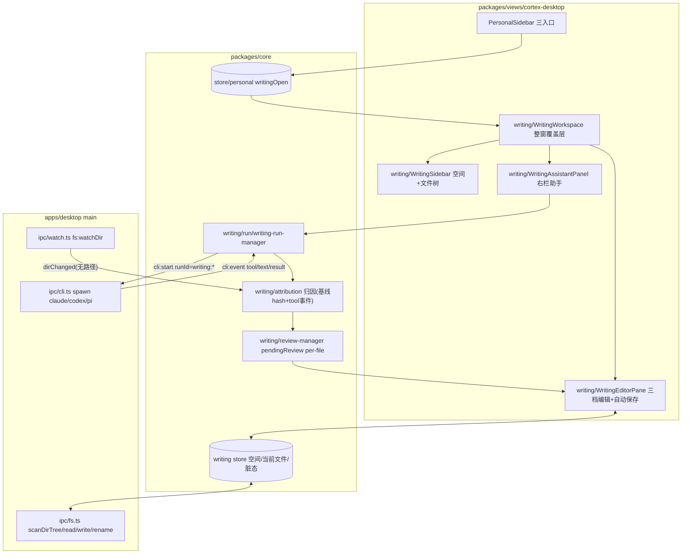
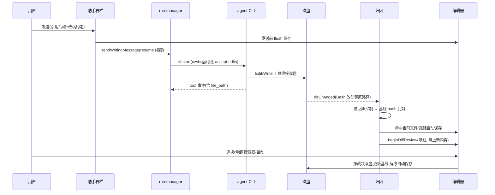
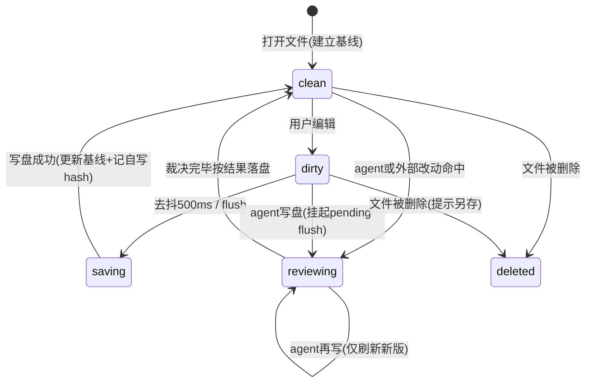

# feat: 写作工作区(移植 Kun 写作功能)与侧边栏三入口

> 参照仓库:文中 `Kun:` 前缀的路径相对 Kun 仓库根(本机与本仓库同级的 `ai/Kun`),仅作移植参照;其余路径均为本仓库 repo 相对路径。

## Summary

个人工作区左侧边栏顶部由「新会话」改为 会话 / 写作 / 项目管理 三入口(底部项目管理移除);新增「写作」整窗工作区:写作空间与文件树、三档 Markdown 编辑,以及右栏写作助手——复用 cortex 既有 agent CLI 管线让 agent 用文件工具直接改盘,改动以 CodeMirror 行级红绿 diff 逐块审阅。

## Problem Frame

Kun 应用已验证的写作台形态(文件树 + Markdown 编辑 + 写作助手)要落到 cortex-desktop。本仓库已具备大部分底座:闪记已从 Kun 移植了 CM6 实时预览编辑器内核;设计工作台已验证「整窗覆盖层 + compat 思路 + 复用 `cli:start` 管线 + runId 前缀守卫」的移植模式;fs/watch IPC 域基本齐备。缺的是写作工作区本体,尤其是「让 agent 修改文档」的右栏:Kun 的核心机制是 agent 用 read/edit/write 工具直接落盘,渲染端感知后以红绿 diff 拉起供用户逐块裁决——这一回路(归因、竞态、审阅态)是本计划的主体。侧边栏入口同步重排,把写作提为一级入口。

---

## Requirements

**侧边栏与导航**

- R1. 侧边栏顶部为三入口:会话(原「新会话」落地页行为与 ⌘N 快捷键保留)、写作(打开写作工作区)、项目管理(唤起既有独立窗口)。
- R2. 底部全局入口组移除项目管理;设计与设置保留。
- R3. 写作、项目管理入口按桥接能力降级隐藏(web 端 bridge=null、旧壳缺方法时不渲染)。

**写作工作区**

- R4. 写作工作区为整窗覆盖层,与其他中心视图互斥;`writingOpen` 为瞬态、不进持久化状态。
- R5. 写作空间 = 一个根目录;默认空间外可经系统目录选择器添加;左栏文件树支持新建文件/目录、重命名、删除,重名预检拒绝。
- R6. Markdown 编辑三档(源码 / live 实时预览 / 仅预览),自动保存(500ms 去抖 + 切换/卸载/发送前 flush),复用现有 CM6 内核。
- R7. 外部(非 agent)改动:编辑器干净时静默刷新;脏时不静默覆盖,进入冲突审阅。
- R8. 当前打开文件被删除/重命名时编辑器进入对应状态,不静默丢失未保存内容。

**写作助手(右栏)**

- R9. 右栏助手按写作空间绑定会话列表、可新建会话;后端复用 cortex agent CLI 管线(claude/codex/pi),多轮对话经 resume 续接。
- R10. 空态提供快捷动作卡(总结当前文档 / 拟一个大纲 / 润色选中文本),点击填入输入框、手动发送;润色卡无选区时禁用。
- R11. 编辑器选中文本可引用进对话(chip 展示,创建时快照文本与行号)。
- R12. agent 用文件工具直接改盘;命中当前打开文件的改动以行级红绿 diff 审阅呈现:全部/逐块接受或拒绝、审阅态编辑器只读、裁决完按结果落盘;非当前文件的改动刷新文件树。
- R13. 存在未处理审阅时禁止发送新回合;审阅跨切文件、关覆盖层保留,重进可恢复。
- R14. 停止按钮只中断当前空间的写作 run,不影响其他空间与设计 run。

**守卫与隔离**

- R15. 写作 run 不得污染个人会话运行态:所有按 runId/sessionId 归属个人会话的消费点对 `writing:`/`writing-` 前缀免疫,并有回归测试锁住。
- R16. 写作 run 由模块级 manager 持有,关覆盖层不中断,重进后会话与运行态恢复。

---

## Key Technical Decisions

- **整窗覆盖层而非中栏内嵌**:写作自带三栏(文件树/编辑/助手),照 `DesignWorkspace` 的 fixed inset-0 覆盖层模式挂在 `PersonalWorkspace`,复用已验证的互斥与降级写法。
- **agent 后端复用 `cli:start` 管线,不移植 Kun runtime**:Kun 链路 A 的本质是「有文件工具的 agent 直接落盘」;cortex 的 CLI 适配器(claude/codex/pi)+ `permissionMode: "accept-edits"` 即等价物。`sessionId = writing-<threadUuid>`、`runId = writing:<spaceId>:<uid>`、`cwd = 空间根`。
- **会话续接走 `resumeSessionId`**:与设计工作台「刻意不续接」是实质差异——写作助手是多轮改稿对话,依赖对话记忆;复用 `apps/desktop/src/main/ipc/cli.ts` 既有的 resume 丢失回退新建兜底。
- **编辑器复用闪记 CM6 内核**:`NoteCodeMirrorEditor`(源码/live)+ `MarkdownView`(仅预览)+ `useNoteAutosave`,零 store 耦合、content string in/out;新增依赖仅 `@codemirror/merge`(红绿 diff),与既有 CM6 包一致走动态 import。
- **磁盘基线一份数据两用**:每文件维护「上次加载/保存时的内容快照」,既是外部改动判定的对照,也是 diff 审阅的旧版。
- **agent 改动归因 = tool 事件优先 + 基线 hash 兜底**:`fs:watchDir` 只有无路径的 dirChanged 信号,不能直接三分支。优先从 `writing:` run 的 tool 事件解析 file_path(claude/codex 可靠);agent 走 Bash 或 pi 事件缺路径时,兜底为「run 活跃期(含 exit 后约 2s 尾窗)收到 dirChanged → 重读当前文件与基线比对」。自动保存写盘的自回声用「保存后记录自写内容 hash,比对相同即忽略」抑制。
- **审阅态集中在模块级 review-manager**:pendingReview 为 per-file map(key=绝对路径),不放组件 state(agent 可能在覆盖层关闭后写盘);审阅中编辑器只读、该文件自动保存冻结、禁发新回合;agent 同回合再写只刷新「新版」、基线不动。
- **外部脏冲突复用同一 diff 审阅通道**:入口不同(基线=编辑器内容、新版=盘上内容),机制与 agent 审阅共用,避免第二套冲突 UI。
- **一空间一根目录**:添加目录 = 新增空间;切空间 = 切树 + 切会话列表 + run 归属随 `runId` 中的 spaceId 过滤。
- **main 侧最小新增**:仅 `fs:writingWorkspaceRoot`(默认根,仿 `fs:designWorkspaceRoot`)与 `fs:renameEntry`;树/读写/监听全部复用既有 fs/watch 域。持久化(空间列表、会话索引)仿 `DesignUiState` 的 KV 分片 + 类型双镜像模式。

---

## High-Level Technical Design

组件拓扑(新增模块加粗于 core/writing 与 views/writing):

agent 改稿回路(核心序列):

当前打开文件的状态机(竞态裁决依据):

以上为方向性设计,组件/模块的最终拆分以实现为准(受单文件 1200 行约束驱动)。

---

## Scope Boundaries

### Deferred to Follow-Up Work(二期)

Kun 写作的附属能力,均已确认可干净不移植(渲染层能力探测,不做即隐藏入口):

- TipTap 富文本模式及 markdown 保真度审计(一期只有 CM6 三档)
- inline-completion(打字 ghost text、Cmd-K 就地改写)与 `WriteInlineAgent` 选区浮层工具条
- retrieval(工作区级 RAG 上下文)、infographic(信息图生成)、PDF 阅读(pdfjs-dist)、导出(DOCX/PDF/HTML)
- agent 人设预设(Kun 的 coordinator/editor 等 4 内置角色)
- 覆盖层关闭期间 run 完成的系统通知/侧边栏徽标(一期重进覆盖层可见 pending 审阅即可)
- 未打开文件的跨文件 diff 审阅(无基线可对照,一期只刷新文件树)
- 崩溃/重启后的审阅基线恢复(基线为内存态,重启后 agent 改动已在盘上,接受此限制)

### 非目标

- 不移植 Kun 的 `kun` runtime 二进制与 HTTP+SSE 通道
- web 端不提供写作工作区(入口降级隐藏)
- 不约束 agent 经 Bash 写空间外文件的能力(改稿约定 prompt 级要求「只改写作空间内文件」,非强制沙箱)

---

## Implementation Units

### U1. personal store 新增 writingOpen 互斥视图态

- **Goal**:中心视图态支持写作工作区的打开/关闭,与既有视图互斥。
- **Requirements**:R4
- **Dependencies**:无
- **Files**:`packages/core/store/personal.ts`、`packages/core/store/personal.test.ts`
- **Approach**:加 `writingOpen`(初始 false)+ `openWriting()`/`closeWriting()`;`openWriting` 清其它全部视图标志,**所有既有 `openXxx` action 同步清 `writingOpen`**(最易漏点,逐一核对 `openHome/openDesign/openAutomation/openWorkflow/openSettings/openNoteEditor/openTimeline` 等);`closeWriting` 回落 `homeOpen: true`(同 `closeDesign` 写法);`writingOpen` 不进 `toPersistedState`(瞬态,消掉 web 恢复白屏路径)。
- **Patterns to follow**:`personal.ts` 中 `openDesign`/`closeDesign` 的互斥与回落写法。
- **Test scenarios**:
  - `openWriting()` 后 `writingOpen=true` 且 `homeOpen/designOpen/automationOpen/workflowOpen/settingsOpen/noteEditorId/timelineProjectId` 全部清空。
  - 逐一调用每个既有 `openXxx`,断言 `writingOpen` 被清为 false。
  - `closeWriting()` 后 `writingOpen=false` 且 `homeOpen=true`。
  - `toPersistedState()` 输出不含 `writingOpen`。
- **Verification**:`pnpm --filter @cortex-work/core test -- run packages/core/store/personal.test.ts` 全绿。

### U2. PersonalSidebar 顶部三入口与底部项目管理移除

- **Goal**:侧边栏顶部呈现 会话/写作/项目管理 三入口,底部只剩设计与设置。
- **Requirements**:R1、R2、R3
- **Dependencies**:U1
- **Files**:`packages/views/cortex-desktop/personal/PersonalSidebar.tsx`、`packages/views/cortex-desktop/personal/PersonalSidebar.test.tsx`
- **Approach**:顶部「新会话」按钮(现 :355-359 附近)改为三入口组:会话=`openHome`(保留 ⌘N 与原 title 语义)、写作=`openWriting`(bridge 存在性门控,同设计入口写法)、项目管理=沿用既有双门控 `bridge?.tasksListProjects && onOpenProjectsWindow` 与 `onOpenProjectsWindow` 透传链;删除底部 `.pw-footer-row` 中的项目管理按钮,保留设计与 `SettingsMenu`。新增 `.pw-*` 样式注意 CSS 注释内不得出现 `*/`(lessons.md 教训)。
- **Patterns to follow**:同文件设计入口的 bridge 门控(:457-466)、项目管理双门控(:469-474)。
- **Test scenarios**:
  - bridge 完整时顶部渲染三入口;点击分别触发 `openHome`/`openWriting`/`onOpenProjectsWindow`。
  - bridge=null 时写作、项目管理入口不渲染,会话入口仍在。
  - `bridge.tasksListProjects` 缺失或 `onOpenProjectsWindow` 未注入时项目管理入口不渲染(双门控两臂各测一边)。
  - 底部 footer 不再渲染项目管理,仍渲染设计入口与设置。
- **Verification**:组件测试全绿;`pnpm dev:desktop` 手验三入口与底部布局(不要杀用户已在跑的 dev 进程,仅构建验证亦可)。

### U3. 写作空间数据层与 main 侧最小 IPC

- **Goal**:写作空间(一空间一根目录)的默认根、增删、持久化,与文件读写/树/监听桥接就绪。
- **Requirements**:R5、R16(为 run 归属提供 spaceId)
- **Dependencies**:无(与 U1/U2 可并行)
- **Files**:`apps/desktop/src/main/ipc/fs.ts`(`fs:writingWorkspaceRoot`、`fs:renameEntry`)、`apps/desktop/src/main/ipc/types.ts`、`packages/core/desktop/types.ts`(镜像)、`apps/desktop/src/preload/index.ts`、`packages/core/desktop/bridge.ts`(可选方法)、`packages/core/writing/spaces.ts`(空间 store 与持久化)、`packages/core/writing/spaces.test.ts`、`packages/core/package.json`(exports 加 `"./writing/*"`)
- **Approach**:`fs:writingWorkspaceRoot` 仿 `fs:designWorkspaceRoot`(默认 `Documents/cortex/writing`,确保存在);`fs:renameEntry` 带同目录重名预检。空间列表(id、name、root)持久化仿 `DesignUiState` 的 KV 分片挂个人持久化状态,类型在 `ipc/types.ts` 与 `core/desktop/types.ts` 双镜像。添加空间走既有 `bridge.pickDirectory()`(取消返回 null 不添加);移除空间仅移出列表不删盘。文件树用既有 `fs:scanDirTree`,监听用 `fs:watchDir`/`fs:unwatchDir`。桥接新方法一律可选(`?`),四层对齐(types 镜像 → handler → preload → bridge),漏一层调用永久 pending。
- **Patterns to follow**:`fs:designWorkspaceRoot`(fs.ts:530)、`DesignUiState` 分片(ipc/types.ts:455 附近)、bridge 可选方法惯例。
- **Test scenarios**:
  - 空间 store:添加(pickDirectory 返回路径)/取消(null)/移除/重复根目录拒绝;持久化 roundtrip(序列化→恢复一致)。
  - `fs:renameEntry`:正常重命名;目标已存在时报错不覆盖。
  - 默认空间:首次进入时以 `fs:writingWorkspaceRoot` 建立默认空间。
- **Verification**:core 单测全绿;`pnpm --filter @cortex-work/desktop typecheck` 通过(双 tsconfig)。

### U4. 写作工作区整窗覆盖层骨架与文件树

- **Goal**:`writingOpen` 时整窗三栏覆盖层可用:左栏空间切换 + 文件树 CRUD,中/右栏挂占位。
- **Requirements**:R4、R5、R8(树侧联动部分)
- **Dependencies**:U1、U3
- **Files**:`packages/views/cortex-desktop/personal/PersonalWorkspace.tsx`(挂载)、`packages/views/cortex-desktop/writing/WritingWorkspace.tsx`、`packages/views/cortex-desktop/writing/WritingSidebar.tsx`、`packages/views/cortex-desktop/writing/WritingWorkspace.test.tsx`、`packages/core/writing/file-tree.ts`(树数据与 CRUD 动作)及就近测试
- **Approach**:`PersonalWorkspace` 照 `{designOpen && !settingsOpen ? <DesignWorkspace/> : null}`(:207)加平行的 writing 分支;`WritingWorkspace` 组装三栏与返回按钮(`closeWriting`)。文件树节点 key 一律绝对路径;新建文件/目录预检重名;删除当前打开文件先确认(脏时强提示);树内重命名当前打开文件同步 store 的 currentFile 与监听;移除空间时关闭其下打开文件并 `fs:unwatchDir`。
- **Patterns to follow**:`packages/views/cortex-desktop/design/DesignWorkspace.tsx` 的覆盖层组装与卸载语义;`design` 的 bridge 端口注入模式(`packages/core/design/platform/bridge-adapter.ts`)。
- **Test scenarios**:
  - `writingOpen=true` 渲染覆盖层,返回按钮调用 `closeWriting`。
  - 树渲染 `scanDirTree` 结果;新建重名被拒并提示。
  - 删除当前打开文件触发确认;确认后编辑器收到 deleted 信号(U5 消费)。
  - 切空间:树、当前文件、watch 订阅全部切换。
- **Verification**:组件测试全绿;手验三栏骨架与树操作。

### U5. 文件版 Markdown 编辑器面板(三档 + 自动保存 + 磁盘基线)

- **Goal**:中栏对当前文件提供 源码/live/仅预览 三档编辑,自动保存与外部改动感知正确。
- **Requirements**:R6、R7(判定与干净刷新)、R8(编辑器侧)
- **Dependencies**:U4
- **Files**:`packages/views/cortex-desktop/writing/WritingEditorPane.tsx` 及就近测试、`packages/core/writing/baseline.ts`(基线快照与 hash)及就近测试
- **Approach**:复用 `personal/editor/NoteCodeMirrorEditor.tsx`(源码/live,CM6 动态 import 范式不变)与 `MarkdownView`(仅预览),外壳以 `{path}` 为主键、`onSave = bridge.writeFile(path, content)`,自动保存复用 `useNoteAutosave`(500ms 去抖 + 切文件/卸载 flush + 防回灌),**补「发送前 flush」钩子供 U8 调用**。每次加载/保存成功更新磁盘基线并记录自写 hash(自回声抑制)。收到归因模块(U9)的「外部改动」信号:干净 → 静默重读刷新(external sync 保光标);脏 → 转交 U6 冲突审阅。文件被删 → deleted 态(提示 + 另存),清自动保存定时器。CM 加载失败降级仅预览(既有行为)。
- **Patterns to follow**:`FlashNoteEditor.tsx` 三档外壳、`useNoteAutosave.ts`、闪记的 CM6 隔离范式(动态 import + vitest alias)。
- **Test scenarios**:
  - 三档切换内容一致,live/source 共享实例切 compartment。
  - 编辑后 500ms 落盘;切文件立即 flush;flush 后基线与自写 hash 更新。
  - 外部改动 + 干净:内容静默刷新;外部改动 + 脏:不覆盖、发出冲突审阅请求。
  - 自回声:保存触发的变更信号被 hash 比对忽略,不引发刷新或审阅。
  - deleted 态:提示渲染、编辑冻结、另存可用。
- **Verification**:`pnpm --filter @cortex-work/views test` 相关文件全绿。

### U6. diff 审阅子系统(@codemirror/merge + review-manager)

- **Goal**:对「基线 → 盘上新内容」呈现行级红绿 diff,支持全部/逐块接受拒绝,审阅态生命周期正确。
- **Requirements**:R12(审阅呈现)、R13(保留与恢复)
- **Dependencies**:U5
- **Files**:`packages/views/package.json`(新增 `@codemirror/merge`)、`packages/core/writing/review-manager.ts` 及就近测试、`WritingEditorPane.tsx`(接入 `beginDiffReview`)、`WritingSidebar.tsx`(pending 徽标)
- **Approach**:`review-manager` 为模块级 per-file map(key=绝对路径,值含基线内容与新版内容),组件卸载不丢;进入审阅:编辑器切 `unifiedMergeView`、只读、冻结该文件自动保存(挂起 pending flush);逐块 accept/reject 用 merge 内置 chunk 操作,顶部全部接受/拒绝;裁决完按结果落盘、更新基线、解冻。审阅中 agent 再写同一文件:仅替换「新版」,基线不动。切文件保留 pending(树徽标提示),切回恢复;关覆盖层/切空间保留,重进恢复。`@codemirror/merge` 动态 import,加载失败降级为「全部接受 / 全部拒绝」两按钮。外部脏冲突走同一通道(基线=编辑器当前内容,新版=盘上内容)。
- **Patterns to follow**:Kun:`src/renderer/src/components/write/WriteMarkdownEditor.tsx` 的 `beginDiffReview` 交互语义;cortex 侧 CM6 动态 import 范式。
- **Test scenarios**:
  - `beginDiffReview` 后逐块接受/拒绝各自产出正确合成文本;全部接受=新版、全部拒绝=基线。
  - 审阅态编辑器只读;审阅期间自动保存不触发。
  - 审阅中再次收到同文件新内容:diff 刷新、基线不变。
  - 切文件后 pending 保留、徽标出现;切回恢复审阅;关覆盖层重进恢复。
  - merge 动态加载失败:降级两按钮仍可完成裁决。
- **Verification**:review-manager 单测 + 编辑器接入测试全绿。

### U7. writing-run-manager 与 writing: 前缀守卫

- **Goal**:写作 run 经既有 CLI 管线收发,且对个人会话体系完全隔离。
- **Requirements**:R9(管线与续接)、R14、R15、R16
- **Dependencies**:U3(spaceId/cwd)
- **Files**:`packages/core/writing/run/writing-run-manager.ts` 及就近测试、`packages/core/personal/messages.ts`(守卫)、`packages/core/personal/writing-run-guard.test.ts`(新)
- **Execution note**:先写守卫回归测试(仿 `packages/core/personal/design-run-guard.test.ts`),再实现 manager。
- **Approach**:仿 `packages/core/design/run/design-run-manager.ts`:模块级 activeRuns Map 持有 run(组件卸载不中断),`bridge.startCli` 构造 `CliStartRequest`——`sessionId = writing-<threadUuid>`、`runId = writing:<spaceId>:<uid>`、`cwd = 空间根`、`permissionMode: "accept-edits"`、`approvalPolicy: "auto"`;与 design 的差异:**传 `resumeSessionId` 做多轮续接**(复用 cli.ts 既有 resume 丢失回退新建兜底)。事件订阅侧只收 `writing:` 前缀。守卫:实现前先 grep 全仓所有按 runId/sessionId 归属个人会话的消费点(`handleCliEvent`/`handleCliExit` 两处已知,另查 usage、trace、通知等),对 `writing:`/`writing-` 前缀逐一免疫——不能只抄 design 的两处。停止:按 runId 中 spaceId 过滤 kill,当前空间之外(含 design run)不受影响。主进程 `cli.ts` 预期零改动(design 的前缀分支是 MCP 注入所需,写作不需要);若实现中发现需要分支,单独小改并说明。
- **Patterns to follow**:`design-run-manager.ts` 的 run 生命周期与事件折叠;`design-run-guard.test.ts` 的守卫测试形状。
- **Test scenarios**:
  - Covers R15:`writing:` 前缀的 cli:event/cli:exit 不产生任何个人会话运行态(消息、运行标志、通知均无变化)。
  - runId/sessionId 形状正确;`resumeSessionId` 在第二轮起被传递。
  - 停止当前空间:仅该空间 runId 被 kill;并存的另一空间 run 与 `design:` run 存活。
  - 关闭覆盖层(模拟组件卸载)后事件仍被 manager 收取,重进后消息镜像完整。
- **Verification**:守卫回归测试 + manager 单测全绿;既有 `design-run-guard.test.ts` 不回归。

### U8. 写作助手右栏 UI、prompt 拼装与会话管理

- **Goal**:右栏可完成完整对话回合:快捷动作、选中引用、模型(agent)选择、发送/中断、会话切换。
- **Requirements**:R9、R10、R11、R13(禁发部分)
- **Dependencies**:U7、U5(选区与 flush 钩子)
- **Files**:`packages/views/cortex-desktop/writing/WritingAssistantPanel.tsx` 及就近测试、`packages/core/writing/prompt.ts`(composeWritingPrompt)及就近测试、`packages/core/writing/threads.ts`(会话索引)及就近测试
- **Approach**:面板为受控组件:顶栏(新建会话/会话切换 + 当前文件路径)、消息时间线(参照 `design/DesignAIRail.tsx` 折叠 CliStreamEvent 的做法,复用/简化其 compat chat-store 思路)、空态三卡(点击把预置 prompt 填入输入框,润色卡无选区禁用)、引用条(chip 来自编辑器选区快照:文本+行号,创建时冻结)、composer(发送/中断 + agent 选择 claude/codex/pi,复用 `AgentSelect` 若适用)。`composeWritingPrompt` 拼装:`[写作上下文]`(当前文件相对路径、发送时快照)+`[引用片段]`+ 改稿约定(要求 agent 用文件工具直接改盘、只改写作空间内文件、告知用户将以 diff 审阅)+ 用户正文;哨兵常量集中定义供解析与展示复用(参照 Kun:`src/renderer/src/write/quoted-selection.ts` 的拼装/反解析对称设计)。发送前调 U5 的 flush 钩子;存在 pending 审阅时发送禁用并提示。会话:`threads.ts` 持久化 thread 元数据(id、标题、spaceId、resumeSessionId),消息本体内存镜像(重启后靠 resume 续上下文,不做消息持久化)。
- **Patterns to follow**:`design/DesignAIRail.tsx` 事件折叠;`personal/AgentSelect.tsx`;Kun:`WriteAssistantPanel.tsx` 的空态三卡与引用条交互。
- **Test scenarios**:
  - 三卡点击填入输入框且不自动发送;无选区时润色卡禁用。
  - 选区引用 chip:创建后修改文档,chip 内容不变(快照语义)。
  - `composeWritingPrompt`:含/不含引用、含当前文件路径的拼装正确;改稿约定恒在。
  - pending 审阅存在时发送按钮禁用;裁决完毕恢复。
  - 新建会话产生新 threadUuid;切会话后发送使用该会话的 resumeSessionId。
  - 发送触发 U5 flush(以回调 spy 断言时序:flush 先于 startCli)。
- **Verification**:面板与 prompt/threads 单测全绿。

### U9. agent 改动归因与 diff 回路接线

- **Goal**:agent 写盘 → 编辑器 diff 审阅的端到端回路闭合,归因三分支正确。
- **Requirements**:R7(归因判定)、R12(回路)
- **Dependencies**:U5、U6、U7、U8
- **Files**:`packages/core/writing/attribution.ts` 及就近测试、`WritingWorkspace.tsx`(接线)、集成测试(views 或 core 就近)
- **Approach**:归因模块订阅两路信号:①`writing:` run 的 tool 事件,解析 Edit/Write 工具 input 中的 file_path(claude/codex 可靠;pi 的 detail 字符串不强求);②`fs:watchDir` 的 dirChanged(无路径)。判定顺序:自回声 hash 命中 → 忽略;tool 事件带路径命中当前文件、或 run 活跃期(含 cli:exit 后约 2s 尾窗,覆盖 watch 250ms 去抖迟到)dirChanged 且当前文件重读与基线不一致 → agent 改动:冻结自动保存、`beginDiffReview(基线, 盘上新内容)`;run 非活跃期的差异 → 外部改动(U5 的干净刷新/脏冲突分支);路径命中非当前文件 → 仅刷新文件树。「run 活跃期用户继续编辑」由 diff 基线语义吸收:基线取 agent 写盘时刻的编辑器内容,用户 run 期间的编辑体现在 diff 中由用户裁决。
- **Test scenarios**:
  - Covers R12 主流程:模拟 tool 事件(file_path=当前文件)→ 进入审阅、自动保存冻结、diff 内容正确。
  - Bash 兜底:无路径 tool 事件 + run 活跃期 dirChanged + 盘上内容≠基线 → 进入审阅。
  - 尾窗:cli:exit 后 1s 到达的 dirChanged 仍归因 agent。
  - 自回声:自动保存落盘触发的 dirChanged 被忽略。
  - 非当前文件路径:不进审阅,树刷新被调用。
  - run 非活跃期外部改动:干净 → 静默刷新;脏 → 冲突审阅(基线=编辑器内容)。
- **Verification**:归因单测 + 端到端集成测试全绿;`pnpm typecheck && pnpm lint && pnpm test` 全仓通过;`pnpm dev:desktop` 手验完整回合(发送 → agent 改盘 → diff → 逐块裁决 → 落盘)。

---

## Risks & Dependencies

- **归因兜底的误判面**:agent 经 Bash 改「非当前文件」且不带 tool 路径时,兜底只对当前文件比对,该改动只体现为树刷新——与 R12 的降级语义一致,但要在改稿约定里引导 agent 优先用 Edit/Write 工具。
- **pi 的 tool 事件缺结构化路径**:pi 归因整体依赖 hash 兜底,体验略差(无法即时命中非当前文件);可接受,不阻塞。
- **`@codemirror/merge` 新依赖**:仅 renderer(packages/views),不触 electron-builder 主进程排除清单;仍按 lessons.md 在打包验证时仓库外抽查。
- **messages.ts 守卫遗漏面**:design 先例只有两处守卫,但消费点可能更多(usage/trace/通知);U7 已把「先 grep 审计全部消费点」写为硬步骤,回归测试锁行为。
- **1200 行上限**:`WritingWorkspace`/`WritingAssistantPanel`/`WritingEditorPane` 按职责预拆(store 动作、prompt、归因均在 core 侧独立模块),避免重演 `messages.ts` 超限。
- **accept-edits 的能力边界**:agent 理论可写空间外文件且 watch 无感知;prompt 级约束已写入改稿约定,非强制沙箱(见非目标)。

---

## Sources & Research

- 设计工作台移植先例(本次的结构模板):`packages/views/cortex-desktop/design/DesignWorkspace.tsx`、`packages/core/design/run/design-run-manager.ts`、`packages/core/personal/design-run-guard.test.ts`、`packages/core/design/platform/bridge-adapter.ts`。
- 编辑器内核(移植自 Kun、可直接复用):`packages/views/cortex-desktop/personal/editor/NoteCodeMirrorEditor.tsx`、`editor/markdownLivePreview.ts`、`personal/MarkdownView.tsx`、`personal/useNoteAutosave.ts`;取舍记录见 `docs/flash-notes-impl-contract.md`、`docs/plans/2026-06-15-001-feat-flash-notes-plan.md`(当时后置的 Kun 写作台即本计划主体)。
- CLI 管线:`apps/desktop/src/main/agents/index.ts`(claude/codex/pi 适配器)、`apps/desktop/src/main/ipc/cli.ts`(spawn/流式/resume 兜底/cancelledRunIds)。
- fs/watch 现状:`apps/desktop/src/main/ipc/fs.ts`(scanDirTree/readFile/writeFile/mkdir/deleteEntry/exists/pickDirectory/designWorkspaceRoot)、`apps/desktop/src/main/ipc/watch.ts`(fs:watchDir,250ms 去抖、无路径信号——归因子系统的直接动因)。
- Kun 写作实现(交互与机制参照):Kun:`src/renderer/src/components/write/WriteAssistantPanel.tsx`(右栏)、Kun:`src/renderer/src/write/quoted-selection.ts`(prompt 拼装与哨兵)、Kun:`src/renderer/src/components/write/WriteMarkdownEditor.tsx`(@codemirror/merge diff 审阅)、Kun:`src/renderer/src/write/write-workspace-store.ts`(pendingAgentReview/脏态保护)、Kun:`src/renderer/src/write/write-file-watch.ts`(外部同步双策略)。
- 打包与样式教训:`docs/lessons.md`(主进程依赖排除清单、仓库外验证、CSS 注释 `*/` 陷阱)。
