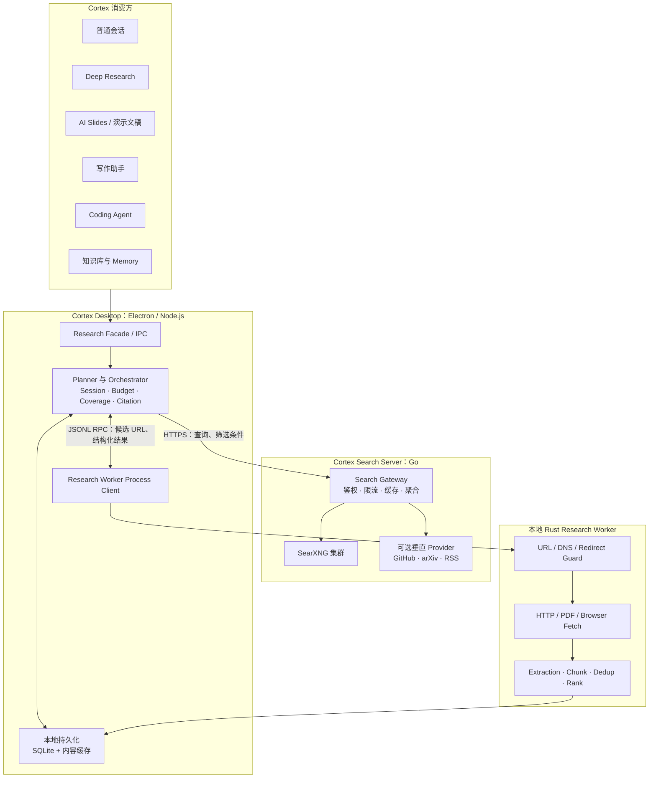
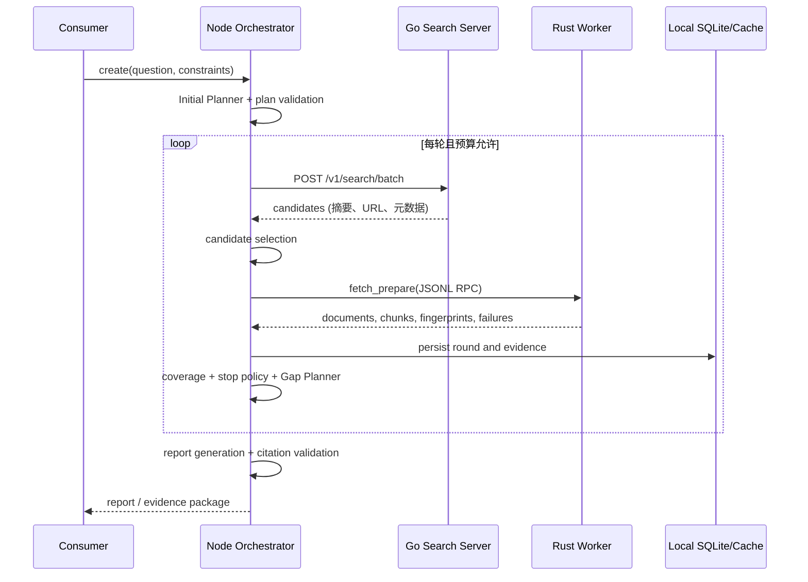

# Cortex Research Engine：信息智能基础设施架构方案

## 1. 摘要

**Cortex Research Engine（CRE）不是 Deep Research 功能本身，而是 Cortex 的底层信息智能能力。**

它向上为 Deep Research、普通会话、演示文稿、写作、Coding Agent、知识库与 Memory 提供统一的「发现 → 获取 → 解析 → 理解 → 证据化 → 知识化」链路；向下封装远程搜索、本地安全抓取、文档解析、去重、排序和来源追溯。

核心边界如下：

> Electron/Node.js 负责意图、编排、会话状态与最终产物；Go Search Server 负责低成本发现候选 URL；Rust Research Worker 在本地安全地验证和处理不可信内容。

因此，搜索服务端只看到查询及最少的筛选条件；网页正文、用户文件、证据片段、报告和本地记忆默认留在桌面端。

## 2. 项目定位与设计目标

### 2.1 定位

CRE 是 Cortex 的 **Information Intelligence Layer（信息智能层）**。它不是一个 UI 页面、不是某一个模型供应商的封装，也不只为长研究任务服务。

```text
Agent / 产品能力：决定为什么需要信息、需要什么信息、何时停止
CRE：            负责发现、验证、组织和复用信息
```

Deep Research 只是第一个、也是要求最完整的消费者：它需要多轮规划、覆盖度判断和带证据的报告。普通会话可能只使用一次快速检索和一个证据片段；演示文稿可能使用 CRE 收集可引用的数据与图表素材。

### 2.2 目标

- 让所有 Cortex 能力通过统一契约检索外部、本地和后续企业知识来源。
- 用“可追溯证据”替代模型凭空生成的链接、事实和统计数字。
- 保持本地优先：正文、用户文件、浏览器登录态和研究结果不默认上传。
- 不使用收费通用搜索 API；服务端通过自建 SearXNG 集群和可扩展垂直 Provider 发现线索。
- 允许长研究多轮执行，也能支持普通会话的低延迟单轮调用。
- 将不可信 URL、HTML、PDF 和浏览器自动化隔离在独立本地 Worker，提供严格 SSRF 与资源限制。
- 复用当前 Desktop 的 Electron main/preload/renderer 分层、AI Slides、嵌入浏览器和 Memory 能力，不复制一套平行运行时。

### 2.3 非目标（第一阶段）

- 不建设全互联网自有索引或通用爬虫集群。
- 不让服务端保存网页全文、用户文件或最终报告。
- 不让模型直接访问任意 URL、Cookie、文件系统或浏览器调试接口。
- 不在首版建立复杂知识图谱、全局向量数据库或多 Agent 自由协作网络。
- 不把 CRE 设计成 Electron renderer 可直接调用的裸网络能力。

## 3. 总体架构



### 3.1 信息流与隐私边界

| 层 | 输入 | 输出 | 默认不离开该层的数据 |
| --- | --- | --- | --- |
| Go Search Server | 查询、语言、时间范围、域名规则 | 标题、摘要、URL、来源元数据 | 正文、用户文件、报告、Cookie |
| Rust Worker（本地） | 已筛选候选 URL、研究目标、已知指纹 | 文档、分块、指纹、失败原因、预排序 | 抓取正文、PDF、浏览器上下文 |
| Electron/Node（本地） | 用户意图、结构化证据 | Session、计划、报告、引用索引、Memory 写入候选 | 模型密钥、完整本地状态、用户文件 |

## 4. 能力分层

CRE 对上提供能力，而非暴露某个 SearXNG、HTTP 或浏览器实现。

| 层 | 职责 | 典型输入/输出 | 首版实现 |
| --- | --- | --- | --- |
| Discovery | 找到可能相关的候选来源 | `SearchQuery → SearchCandidate[]` | Go Search Server + SearXNG |
| Retrieval | 将 URL、文件或已有文档转为可处理内容 | `SourceRef → RawDocument` | Rust HTTP/PDF/Browser 抓取 |
| Extraction | 清洗和结构化内容 | `RawDocument → ExtractedDocument` | HTML 正文、元数据、PDF 页码、Markdown |
| Understanding | 切分、分类、摘要、实体/主题与相关性理解 | `Document → Chunk[] + annotations` | 规则/词法预排序；后续 Embedding/Reranker |
| Evidence | 让结论可回溯到来源和位置 | `Claim ↔ EvidenceChunk ↔ Source` | Chunk ID、页码/offset、引用校验 |
| Knowledge | 将经过选择的信息组织为可复用知识对象 | `Evidence → KnowledgeItem` | 去重簇、主题、来源质量、摘要 |
| Memory | 按用户授权将稳定知识写入 Cortex Memory | `KnowledgeItem → MemoryCandidate` | 复用现有 main-owned Memory 契约，显式确认写入 |

其中 Evidence 是质量边界：模型不能凭空生成 URL 或引用；报告、PPT、对话中的关键事实只可引用已存在的 `EvidenceChunk`。

## 5. 三层技术架构

### 5.1 Electron / Node.js：控制层与智能层

Electron main process 是 CRE 的本地协调者，负责：

- 研究、会话、演示文稿和写作等消费者的统一入口；
- Planner、预算、轮次、停止策略、覆盖度和报告生成；
- 对 Search Server 的 HTTPS 调用；
- Rust Worker 生命周期、JSONL RPC、崩溃重启和取消；
- SQLite Session、文档元数据、证据及引用索引；
- 模型调用和凭据保管；
- 把窄面 IPC 暴露给 preload，renderer 不直接拿到 Worker、密钥或任意网络权限。

Node 不负责大规模正文抓取、PDF 解析或不可信内容处理。

### 5.2 Go Search Server：远程发现层

Search Server 是无状态优先的服务端网关，负责：

- API Key/设备身份校验、限流、查询长度与请求大小限制；
- 多查询、多 SearXNG 节点和垂直 Provider 的有限并发；
- TTL 缓存、节点健康检查、超时、局部失败降级；
- URL 规范化、完全相同 URL 合并、多引擎命中合并和单域名配额；
- 返回候选线索而不抓取全文。

SearXNG 仅部署在服务端的内网容器网络中，不直接向桌面端或公网暴露。

### 5.3 Rust Research Worker：本地信息处理层

Worker 是随桌面应用分发的独立二进制，尽量无状态，职责限定为一次受控的处理请求：

```text
候选 URL → 安全校验 → 获取 → 解析 → 分块 → 指纹/去重 → 预排序 → 结构化结果
```

它提供 HTTP、PDF 与动态网页降级抓取；动态网页只在 HTTP 正文不足时使用 `agent-browser` Adapter，不把每个 URL 都交给浏览器。

## 6. 消费方与应用场景

| 消费方 | 如何使用 CRE | 典型结果 |
| --- | --- | --- |
| Deep Research | Planner 多轮发现、验证、Coverage 与报告 | 带引用研究报告、来源列表、证据簇 |
| 普通会话 | 低预算单轮 Discovery + 少量 Retrieval | 最新事实与可点击引用 |
| AI Slides | 收集市场数据、竞品、统计、图片/原始资料 | Slide facts、图表数据、演讲者备注引用 |
| 写作助手 | 针对大纲补齐一手资料、反方观点和案例 | 可引用资料包、写作来源卡 |
| Coding Agent | 发现仓库、官方文档、issue、release 和规范 | 技术决策证据、代码调研上下文 |
| 知识库 | 导入 URL/文件并解析、去重和标注 | 可检索 Document/Chunk/KnowledgeItem |
| Memory | 将用户确认且长期有效的知识写入记忆 | 带来源、日期和失效策略的 MemoryCandidate |

各消费方只声明目标、时延等级、隐私约束与预算；它们不需要了解 SearXNG、浏览器或 PDF 解析器。

## 7. 调用模式与完整研究流程

### 7.1 统一调用模式

```ts
interface ResearchEngine {
  discover(request: DiscoveryRequest): Promise<DiscoveryResult>
  prepare(request: PrepareSourcesRequest): Promise<PreparedSourcesResult>
  createKnowledge(request: KnowledgeRequest): Promise<KnowledgeResult>
}
```

- 普通会话可依次调用 `discover` 与 `prepare` 一次即结束。
- Deep Research 由 Orchestrator 循环调用三种能力，补齐证据缺口。
- PPT/写作/Coding Agent 可复用同一 `PreparedSourcesResult`，避免重复抓取。

### 7.2 Deep Research 多轮流程



### 7.3 Planner 与 Orchestrator

Planner 属于 Node 层，不放入 Rust Worker。它只决定“接下来找什么”，不裁决事实真伪。

1. **Initial Planner**：将请求标准化，输出子问题、首轮查询、范围、预算与完成标准。
2. **Plan Validator**：裁剪子问题/查询数，校验语言、域名、预算、枚举值和查询去重；空或越界计划不得执行。
3. **Orchestrator**：执行搜索、候选选择、Worker 调用、状态持久化、取消和恢复。
4. **Coverage Evaluator**：按子问题计算来源数、独立域名、一手来源、反方来源和相关性。
5. **Gap Planner**：只读取精简 Coverage 与剩余预算，输出 `search_more`、`fetch_more` 或 `finish`。
6. **Report Generator**：仅引用已知 Chunk ID；Citation Validator 移除模型臆造的 ID/URL。

停止条件须同时包含硬限制（轮数、查询、文档、浏览器抓取、取消）和软限制（高优先级问题已充分覆盖、连续低新颖度、无可执行查询）。

## 8. 数据模型与持久化

本地 SQLite 是 Session 的真源；大正文可用 zstd 压缩文件保存，SQLite 只保存路径、Hash 与索引。Worker 不维护跨请求 Session。

```ts
interface ResearchSession {
  id: string
  consumer: "chat" | "deep_research" | "slides" | "writing" | "coding" | "knowledge"
  question: string
  status: "draft" | "planning" | "searching" | "fetching" | "evaluating" | "reporting" | "completed" | "paused" | "cancelled" | "failed" | "interrupted"
  plan?: ResearchPlan
  currentRound: number
  budgetUsage: BudgetUsage
}

interface ResearchDocument {
  documentId: string
  canonicalUrl: string
  title?: string
  contentHash: string
  simhash?: string
  sourceType: string
  fetchMethod: "http" | "browser" | "pdf" | "local_file"
  duplicateOf?: string
}

interface EvidenceChunk {
  chunkId: string
  documentId: string
  page?: number
  startOffset: number
  endOffset: number
  text: string
  objectiveScore: number
  subquestionScores: Record<string, number>
}
```

建议主要表：`research_sessions`、`research_plans`、`research_rounds`、`research_queries`、`search_candidates`、`research_documents`、`document_chunks`、`duplicate_clusters`、`coverage_reports`、`research_reports`、`citation_links`、`knowledge_items`、`memory_candidates`。

持久化写入由 main process 串行化并原子提交；恢复时 `running` Session 先标记为 `interrupted`，用户可选择继续、从当前轮重试、基于已有证据生成摘要或删除。

## 9. 协议设计

### 9.1 Search Server API

```http
POST /v1/search/batch
Authorization: Bearer <device-or-user-scoped-key>
```

请求包含 `research_job_id`、查询文本、语言、时间范围、类别、域名 allow/block list 与限制；响应只含 `result_id`、标题、URL、canonical URL、摘要、来源、搜索引擎、时间、语言、来源类型和 `server_score`。

### 9.2 Worker JSONL RPC

Electron 使用 `spawn()` 管理 Worker，并通过 stdin/stdout 一行一个 JSON 消息通信：

```json
{"type":"request","id":"round-1","method":"fetch_prepare","params":{"objective":"...","items":[...],"known_documents":[...],"limits":{"maxDocuments":20,"maxBrowserFetches":4}}}
```

Worker 可在响应前发 `progress` 事件，并支持 `cancel`。返回的 Document/Chunk 必须带稳定 ID、规范 URL、抓取方法、Hash、失败原因和来源定位；任何日志走 stderr，避免污染协议 stdout。

### 9.3 Desktop IPC

renderer 通过 `contextIsolation` 下的 preload 调用窄面 `cortexResearch` API，例如 `create`、`run`、`pause`、`cancel`、`get` 和 `onEvent`。main process 校验所有请求、路径和来源；不向 renderer 暴露通用 `child_process`、文件系统、模型密钥或 Worker stdin。

## 10. 去重、排序与证据规则

### 10.1 分层去重

- **服务端**：移除 tracking 参数/fragment、统一 URL、合并相同 URL 的多引擎命中、限制单域名数量。
- **桌面端**：canonical URL、SHA-256 精确正文、SimHash/MinHash 近似正文、标题与长度比例校验。
- **结果表示**：保留重复簇而不是静默丢弃；选最早、最完整、最权威的原始来源作为 primary document。

### 10.2 排序

首版组合服务端分数、标题/正文词法相关性、来源类型、完整度、时效性、跨引擎支持和域名多样性。后续在 Worker 内以 ONNX 增加本地 embedding/reranker，但不改变上层协议。

### 10.3 引用规则

- 关键事实必须链接到至少一个现有 `EvidenceChunk`。
- PDF 引用包含页码；HTML 引用包含 URL 与 offset/段落定位。
- 结论区分来源事实、模型推断和不确定性。
- 竞争公司官网可作为一手产品信息，不自动视为客观市场结论。

## 11. 推荐目录结构（落地到当前 monorepo）

```text
apps/desktop/
  src/main/research/
    research-service.ts              # CRE Facade
    research-orchestrator.ts
    research-session-store.ts
    coverage-evaluator.ts
    citation-validator.ts
    planner/
    clients/search-server-client.ts
    worker/worker-process-manager.ts
  src/main/ipc/research.ts           # 窄面 Electron IPC
  src/preload/research-bridge.ts
  src/renderer/.../research/         # 各 consumer 的 UI，不承载引擎逻辑
  resources/research-worker/
    darwin-arm64/ cortex-research-worker
    darwin-x64/   cortex-research-worker
    win32-x64/    cortex-research-worker.exe
    linux-x64/    cortex-research-worker

packages/core/
  research/
    types.ts                         # 跨 consumer 的领域类型
    schemas.ts                       # Zod / JSON schema
    citation.ts
    knowledge.ts

server/
  cmd/research-search-server/
  internal/researchsearch/
    api/ providers/ cache/ normalize/ policy/

tools/research-worker/               # 独立 Rust crate / CI / tests
  Cargo.toml
  src/{ipc,security,fetch,browser,extract,document,dedup,ranking}/

deploy/research-search/
  docker-compose.yml
  searxng/{general,technical,news}/settings.yml
  nginx/ redis/

docs/plans/
  cortex-research-engine-architecture.md
```

`packages/core` 只保存平台无关的类型、schema 和纯函数；Electron main 拥有本地 I/O、密钥、进程和持久化；UI 继续放在现有 renderer/views 边界。Search Server 以当前根 `server/` 作为 Go 代码归属，不另建脱离 monorepo 的平行仓库。

## 12. 部署与运维

服务端使用 Docker Compose：`nginx/caddy → Go Search Server → 内网 SearXNG general/technical/news + Redis`。公网仅暴露 TLS 终端与 Search Server API；SearXNG 的端口不映射到公网。

桌面端在安装资源中携带与平台匹配的 Worker。main 启动时解析受控路径、校验版本/Hash、执行 `doctor` 并启动长驻子进程；Worker 不可用时，明确降级为仅 Discovery 或提示用户，不能静默伪造已验证的网页内容。

关键指标：Provider 成功率/延迟、缓存命中率、每轮候选/抓取/重复比例、Worker 失败分类、浏览器降级次数、每 consumer 的预算使用及引用覆盖率。日志不记录正文、Cookie、密钥或未经脱敏的用户提问。

## 13. 安全设计

### Search Server

- TLS、轮换 API Key、设备/用户限流、请求体/查询长度限制与审计摘要。
- SearXNG 只在内网；缓存不保存正文；不能把上游搜索摘要当最终证据。

### Electron

- `contextIsolation: true`、`nodeIntegration: false`；preload 只提供命名、类型化的研究方法。
- API Key 与模型凭据只在 main 保存；renderer 不直接访问 Server 或 Worker。
- 本地文件进入 CRE 前由 main 显式授权，Memory 写入需按来源和作用域确认。

### Rust Worker

- 仅 HTTP/HTTPS，拒绝 URL 内嵌账号、localhost、`.local`、私网、loopback、link-local、保留 IP 与非允许端口。
- DNS 解析、每次重定向和最终连接均重新执行 IP 策略；禁用环境代理继承。
- 限制重定向、超时、响应体大小、全局并发、每域并发、浏览器数和重试数。
- 默认不复用用户 Cookie；需要登录态时必须由用户明确授权并使用隔离 browser profile。

## 14. 扩展点

- **Discovery Provider**：SearXNG、GitHub、arXiv、OpenAlex、RSS、企业搜索、本地文件索引。
- **Retriever/Extractor**：HTTP、`agent-browser`、PDF、Office、OCR、音视频转写。
- **Ranker**：规则、BM25、Embedding、ONNX Reranker、用户偏好来源规则。
- **Planner Provider**：OpenAI、Claude、Gemini、本地模型或 Cortex Agent Runtime；通过统一结构化 Plan/Decision 契约替换。
- **Knowledge Sink**：Research Session、Slides facts、写作 source pack、Coding context、知识库、MemoryCandidate。

所有扩展须继承统一安全预算、来源记录、错误分类和数据最小化原则；不得绕过 Evidence/Citation 规则直接把非受控内容送入最终产物。

## 15. 分阶段路线图

### Phase 0：契约与最小闭环

- 定义 `packages/core/research` 类型、schema 和引用规则。
- 单节点 SearXNG + Go batch search；Rust HTTP/HTML 抓取、URL/Hash 去重；Electron 单轮调用。
- 支持普通会话或 Slides 取得少量、可点击引用的来源。

### Phase 1：Deep Research 可用版

- Planner/Validator、Session SQLite、候选选择、Chunk/Coverage、多轮和取消/恢复。
- PDF、动态页面有限降级、SimHash、Search Server 缓存与多 SearXNG 节点。
- 生成带 Citation Index 的报告，禁止模型伪造来源。

### Phase 2：跨消费者复用

- 接入 AI Slides 的数据/备注引用、写作 source pack、Coding Agent 技术调研、知识库导入。
- 实现 KnowledgeItem 与经用户确认的 MemoryCandidate，增加来源过期与刷新策略。

### Phase 3：质量与企业能力

- 本地 ONNX embedding/reranker、OCR、Office、企业私有 Provider、权限感知检索、导出与审计。
- 建立来源质量策略、冲突证据提示、定期刷新和可观察性面板。

## 16. 技术选型

| 范围 | 选型 | 原因 |
| --- | --- | --- |
| 编排与桌面集成 | Electron + Node.js + TypeScript | 与当前 Desktop、IPC、Agent Runtime、AI Slides 与 Memory 同层，模型/MCP 生态成熟 |
| 远程搜索网关 | Go（归属现有 `server/`） | 高并发 I/O、单二进制部署、现有服务端语言一致 |
| 搜索发现 | 自建 SearXNG + 可选垂直 Provider | 避免收费通用搜索 API，集中配置、缓存和限流 |
| 本地内容处理 | Rust + Tokio/Reqwest/Serde | 限制不可信网络内容、并发抓取、跨平台独立二进制 |
| 动态网页 | `agent-browser` CLI Adapter | 作为 HTTP 失败时的可替换降级层，不耦合其内部实现 |
| 本地状态 | SQLite + 压缩内容缓存 | 事务、恢复、可查询，避免首版部署本地服务 |
| 结构化协议 | TypeScript/Zod + JSON Schema、JSONL RPC | 进程边界清晰、可验证、跨语言稳定 |

## 17. 最终架构决策

1. **CRE 是 Cortex 的底层信息智能能力，Deep Research 是消费者而非同义词。**
2. **Node 是大脑和状态拥有者，Go 是服务端候选发现入口，Rust 是本地受控信息处理引擎。**
3. **服务端只返回线索；本地才读取正文、做正文级去重、排序、证据和最终引用。**
4. **EvidenceChunk 是对所有用户可见事实的共同约束，模型不可自行发明来源。**
5. **先交付一条可靠、可恢复、可引用的单/多轮链路，再增加本地模型、知识图谱和复杂 Provider。**

该设计可让 Cortex 在不重复建设搜索、抓取和引用系统的前提下，把“理解外部世界”的能力提供给会话、研究、演示、写作、编码和长期 Memory。
