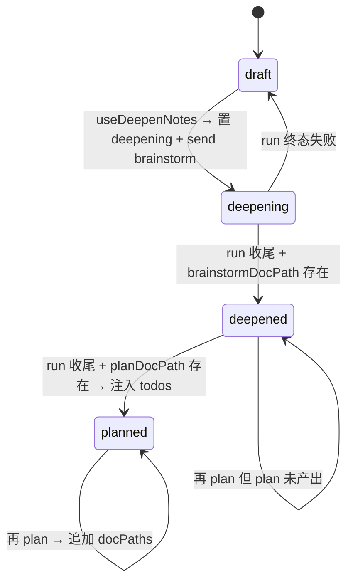
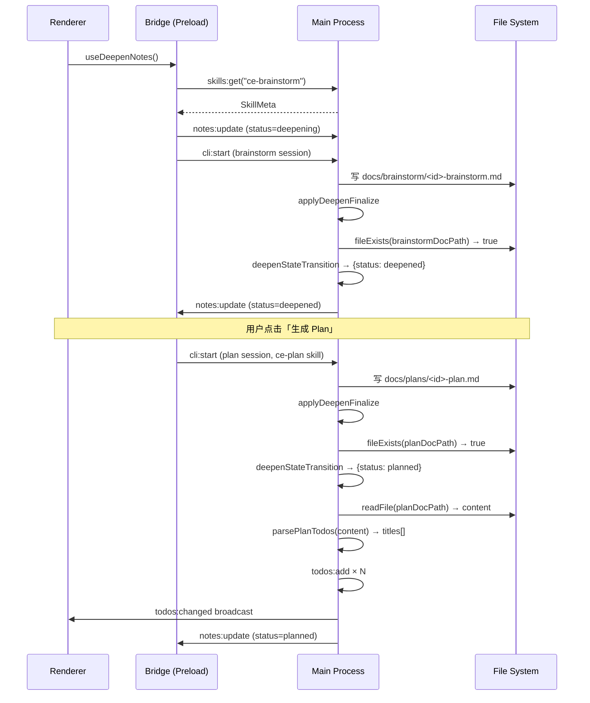

# feat: 闪记深化流水线 — ce-brainstorm + planned 状态 + Todos 自动注入

## Summary

把闪记「深化」的 skill 从 `ce-ideate`（发散候选方向）切换为 `ce-brainstorm`（产出可执行需求），同时扩展 `NoteStatus` 增加 `"planned"` 态，并在 plan 产出后自动解析 markdown checkbox 注入 `TodoMeta`。新增独立 todos IPC 层（仿 notes 模式），并通过文件 watcher 自动把 plan.md 中 checkbox 状态变更同步到 todos 列表，实现「闪记 → brainstorm doc → plan doc → todos」的完整自动化流水线。

---

## Problem Frame

当前深化流程（`packages/core/personal/notes.ts`）存在三处语义错配：

1. `useDeepenNotes()` 调用 `ce-ideate`，产出是「候选方向列表」，而深化的实际目标是把闪记发展成「可执行需求」——这是 `ce-brainstorm` 的定位（「what exactly should one chosen idea mean?」）。
2. Brainstorm 完成后，用户须手动点击「生成 plan」，中断了思路流；plan 与 brainstorm 之间无自动衔接。
3. Plan.md 里已有 markdown checkbox 形式的 todos，但 `TodoMeta` 数据（`PersistedState.todos`）与这些 checkbox 完全脱钩，用户须手动同步；checkbox 被实现后系统也无法感知状态变化。

---

## Requirements

**Skill 与路径**

- R1. `useDeepenNotes()` 调用 `bridge.skillGet?.("ce-brainstorm")` 而非 `"ce-ideate"`。
- R2. 产出路径函数 `deepenDocPath` 重命名为 `brainstormDocPath`，路径变为 `<cwd>/docs/brainstorm/<sessionId>-brainstorm.md`。
- R3. `buildDeepenSystemPrompt` 已通过 `SkillMeta` 参数携带 skill 元数据，无需修改函数签名，只需调用方传入 `ce-brainstorm` 的 meta。

**状态机**

- R4. `NoteStatus` 扩展为 `"draft" | "deepening" | "deepened" | "planned"`。
- R5. `deepenStateTransition` 在 `note.status === "deepened"` 且 `produced === true` 时，返回 `{ status: "planned", docPaths: appendUnique(..., planDocPath) }`；`terminalFailure` 时返回 `null`（保护已深化成果）。
- R6. `useGeneratePlan()` 的前置 guard 从 `status !== "deepened"` 改为允许 `"deepened"` 和 `"planned"` 均可触发（允许对已 planned 的闪记再次生成 plan，追加 docPaths）。

**Todos IPC 层**

- R7. 新建独立 todos IPC 层：`todos:list`、`todos:add`、`todos:update`、`todos:delete`，变更后广播 `todos:changed` 全量快照。
- R8. `DesktopBridge` 增加可选方法 `todosList?`、`todosAdd?`、`todosUpdate?`、`todosDelete?`、`onTodosChanged?`，签名仿 notes 对应方法。
- R9. Preload 绑定 R7 的 IPC channel，形状与 R8 逐字对齐。

**Todos 自动注入**

- R10. 纯函数 `parsePlanTodos(content: string): string[]` 提取 `- [ ]` 行的 checkbox 标题（支持前置缩进，不含 `- [x]`）。
- R11. `applyDeepenFinalize` 在 `deepened → planned` 迁移后，读取 plan 文件，调用 `parsePlanTodos`，去重后批量写入 `TodoMeta`（`detailPath` 指向 plan 文件，`status: "open"`）。
- R12. todos 注入失败（读文件失败、接口不存在）时仅 warn，不回滚 `"planned"` 状态迁移。

**Plan 文件 Watcher**

- R13. 主进程支持对指定项目的 `docs/plans/` 目录进行 plan 文件监听，renderer 经 `todos:watchPlan` / `todos:unwatchPlan` IPC 控制开关。
- R14. Plan 文件变更时，`syncPlanTodos` 重新解析全部 checkbox（`- [ ]` 与 `- [x]`），与已关联 todos（`detailPath === planPath`）做 diff，按需 add / update status。
- R15. `todos:changed` 事件在 watcher 触发任何写操作后广播。

---

## High-Level Technical Design





---

## Key Technical Decisions

KTD1: **Todos 独立 JSON 文件（仿 notes-store.ts）**。选择 `userData/todos.json` 独立存储，而非写入 `PersistedState.todos`（`saveState` 保存全量 state，并发写入有冲突风险；独立文件配合写队列原子写更安全，broadcast 机制也与 notes 一致）。`PersistedState.todos` 字段保留以向后兼容，不迁移历史数据。

KTD2: **`deepenDocPath` 重命名为 `brainstormDocPath`，路径切 `docs/brainstorm/`**。`docs/ideation/` 目录原本是 `ce-ideate` 的领域，切到语义准确的 `docs/brainstorm/`。现有 `docs/ideation/` 历史文件不迁移——agent 会自动用新路径写新文件，旧文件仍可手动访问。

KTD3: **Plan checkbox 解析正则 `/^[ \t]*- \[ \] (.+)/gm`（开放缩进，不含 `- [x]`）**。初始注入只提取未完成项；watcher 触发时扩展解析全部 `[ ]` 和 `[x]`，以支持 diff。不处理嵌套 checkbox（`ce-plan` 产出的 todos 通常平级）。

KTD4: **`todos 注入失败不回滚 `planned` 状态**。`"planned"` 表示 plan 文档已产出（高价值信号），todos 解析是锦上添花。注入失败仅 warn，状态迁移已写入；用户可在 `planned` 状态下再次触发 plan 重新注入。

KTD5: **Watcher 由 Renderer 主动注册（event-driven），不在主进程扫全量 projects**。Renderer 切换/激活 project 时发 `todos:watchPlan(projectRoot)`，主进程开始监听；project 离开时发 `todos:unwatchPlan(projectRoot)` 关闭。避免主进程同时持有所有项目的 watcher 导致资源泄漏。

---

## Scope Boundaries

**Deferred to Follow-Up Work:**
- Idea #4（单 session 链式调用）：brainstorm + plan 在同一 headless session 内完成。风险评估（brainstorm 产出格式不确定 + token 消耗倍增）需单独规划。
- Idea #6（闪记卡片 Pipeline 进度徽标 UI）：独立 UI 工作，依赖本次状态机扩展落地后实施。
- Idea #7（git diff 检测 todo 代码落地）：复杂度 High + 置信度 60%，先观察 checkbox watcher 效果。
- 历史 `docs/ideation/*.md` 文件迁移到 `docs/brainstorm/`。
- `PersistedState.todos` → 新 todos store 数据迁移。

**Outside this product's identity:**
- 用 AST 解析 plan.md（正则足够，AST 过重）。
- 基于 AI 推断哪些 todos 已实现（超出本次范围）。

---

## Risks & Dependencies

- **DesktopBridge 可选方法降级**：`todosList?`/`todosAdd?` 均为可选方法，web 端或旧壳 `bridge` 为 null 时，`applyDeepenFinalize` 里所有 bridge 调用均有 `?.` guard，安全降级。
- **Plan 文件格式不稳定**：`ce-plan` 产出的 checkbox 格式可能因 skill 版本变化而变，当前正则覆盖主流写法；需在 `parsePlanTodos` 加单测固化契约。
- **注册顺序**：`registerTodosHandlers()` 需在 `registerIpcHandlers()` 内调用，preload 重启生效（改 preload 须重启桌面端）。

---

## Implementation Units

### U1. 切换深化 skill 为 `ce-brainstorm` + 路径函数重命名

**Goal:** `useDeepenNotes()` 调用 `ce-brainstorm` skill，产出路径改为 `docs/brainstorm/<id>-brainstorm.md`。

**Requirements:** R1, R2, R3

**Dependencies:** 无

**Files:**
- `packages/core/personal/notes.ts`
- `packages/core/personal/notes.test.ts`

**Approach:**
- `deepenDocPath` → 重命名为 `brainstormDocPath`，路径改为 `${root}/docs/brainstorm/${sessionId}-brainstorm.md`。
- `useDeepenNotes`：`bridge.skillGet?.("ce-ideate")` → `bridge.skillGet?.("ce-brainstorm")`；`outPath = brainstormDocPath(cwd, sess.id)`。
- `buildDeepenSystemPrompt` 签名和实现不变（`opts.skill` 已携带 meta）；调用方参数自动携带新 skill 内容。
- Toast 文案中 `ce-ideate` 字样改为 `ce-brainstorm`。
- `applyDeepenFinalize`：`deepening` 分流的路径探测从 `deepenDocPath` → `brainstormDocPath`（`notes.ts:271-276` 的探测逻辑）。

**Patterns to follow:** `planDocPath` 的写法（notes.ts:127-129）。

**Test scenarios:**
- `brainstormDocPath("~/proj", "abc")` → `~/proj/docs/brainstorm/abc-brainstorm.md`（纯函数）
- `useDeepenNotes` mock bridge：`skillGet` 参数为 `"ce-brainstorm"`（非 `"ce-ideate"`）
- `skillGet?.("ce-brainstorm")` 返回 `null` 时 toast 含 `ce-brainstorm`，无新会话建立
- `brainstormDocPath` 在 cwd 有尾斜杠时正确去除（仿 `deepenDocPath` 现有测试）

**Verification:** `notes.test.ts` 纯函数测试全绿；mock `useDeepenNotes` 测试校验 skillGet 调用参数。

---

### U2. 扩展 `NoteStatus` 四态 + 更新状态机纯函数

**Goal:** 增加 `"planned"` 状态；`deepenStateTransition` 支持 `deepened → planned` 迁移；`useGeneratePlan` guard 允许 `planned` 态再次触发。

**Requirements:** R4, R5, R6

**Dependencies:** U1（路径函数已重命名，`applyDeepenFinalize` 路径探测以 U1 为前提）

**Files:**
- `packages/core/desktop/types.ts`
- `packages/core/personal/notes.ts`
- `packages/core/personal/notes.test.ts`

**Approach:**
- `types.ts:805`：`NoteStatus = "draft" | "deepening" | "deepened" | "planned"` — 末尾追加，保持现有三态值不变。
- `deepenStateTransition`（notes.ts:216）`deepened` 分支修改：
  - `produced === true` → `{ status: "planned", docPaths: appendUnique(note.docPaths, planDocPath(cwd, sessionId)) }`
  - `terminalFailure === true` → `null`（保护 `deepened` 成果，不回落 `draft`）
  - 其余 → `null`（澄清轮保持原状）
- 同步添加 `"planned"` 分支：`produced` → 仅追加 docPaths（再次 plan），`terminalFailure` → `null`。
- `useGeneratePlan`（notes.ts:499-505）：guard 从 `note.status !== "deepened"` 改为 `note.status !== "deepened" && note.status !== "planned"`。

**Test scenarios:**
- `deepenStateTransition({ note: {status:"deepened"}, produced: true })` → `{ status: "planned", docPaths: [planPath] }`
- `deepenStateTransition({ note: {status:"deepened"}, produced: false, terminalFailure: false })` → `null`
- `deepenStateTransition({ note: {status:"deepened"}, terminalFailure: true })` → `null`
- `deepenStateTransition({ note: {status:"planned"}, produced: true })` → 追加 docPaths，status 不变
- `deepenStateTransition({ note: {status:"planned"}, terminalFailure: true })` → `null`
- `useGeneratePlan` mock：note.status `"planned"` 时不提前返回

**Verification:** `notes.test.ts` 所有 `deepenStateTransition` 分支绿；状态迁移覆盖 `deepened → planned` 场景。

---

### U3. Todos IPC 层（存储 + handlers + preload + bridge）

**Goal:** 建立独立 todos IPC 层，CRUD + `todos:changed` broadcast，bridge 接口和 preload 绑定。

**Requirements:** R7, R8, R9

**Dependencies:** 无（可独立开发）

**Files:**
- `apps/desktop/src/main/ipc/todos-store.ts`（新建）
- `apps/desktop/src/main/ipc/todos.ts`（新建）
- `apps/desktop/src/main/ipc/register.ts`
- `apps/desktop/src/main/paths.ts`
- `apps/desktop/src/main/ipc/types.ts`
- `packages/core/desktop/bridge.ts`
- `packages/core/desktop/types.ts`
- `apps/desktop/src/preload/index.ts`

**Approach:**

`todos-store.ts` — 仿 `notes-store.ts`：写队列防并发、原子写（写临时文件 rename）、内存缓存（cached）。
- `list(projectId?: string): Promise<TodoMeta[]>` — 过滤或全量
- `add(input: TodoInput): Promise<TodoMeta>` — 生成 id/timestamps/status="open"
- `update(id, patch): Promise<TodoMeta | null>`
- `delete(id): Promise<void>`
- `bulkAdd(inputs: TodoInput[]): Promise<TodoMeta[]>` — 去重（按 title + projectId + detailPath 三元组），只写新增项

`todos.ts` — 注册 IPC handlers，每次 CRUD 后 broadcastTodosChanged（仿 notes.ts 模式）。

`paths.ts` — 追加 `todosStorePath = path.join(app.getPath("userData"), "todos.json")`。

`types.ts`（main/ipc）— 新增 `TodoInput = { projectId: string; title: string; detailPath: string }`，镜像 `TodoMeta`/`TodoStatus`（与 `core/desktop/types.ts` 保持一致）。

`bridge.ts` — 新增可选方法（末尾 notes 组之后）：
```
todosList?(projectId?: string): Promise<TodoMeta[]>
todosAdd?(input: TodoInput): Promise<TodoMeta>
todosUpdate?(id: string, patch: Partial<Pick<TodoMeta, "status" | "title">>): Promise<TodoMeta | null>
todosDelete?(id: string): Promise<void>
onTodosChanged?(cb: (list: TodoMeta[]) => void): () => void
```

`preload/index.ts` — 在 notes 方法之后追加同名方法，绑定 `todos:list`/`todos:add`/`todos:update`/`todos:delete`/`todos:changed`。

**Patterns to follow:** `notes-store.ts`（写队列 + 原子写）、`notes.ts`（CRUD + broadcast）、`preload/index.ts` 的 notes 方法段。

**Test scenarios:**
- `TodosStore.list()` 返回全量，`list("p1")` 仅返回 projectId "p1"
- `TodosStore.add(input)` 生成 uuid id，status="open"，createdAt/updatedAt 非零
- `TodosStore.update(id, { status: "done" })` 更新 status + updatedAt，其余字段不变
- `TodosStore.delete(id)` 后 list 中不含该 id
- `bulkAdd([A, A, B])` — A 去重，仅写入一次；返回实际写入数组
- 并发两次 add 不丢数据（写队列保证）

**Verification:** `todos-store.test.ts` 覆盖 CRUD + 并发场景；preload channel 名称与 handler 注册名称人工比对一致。

---

### U4. `applyDeepenFinalize` 扩展 — plan checkbox 解析注入 todos

**Goal:** 在 `deepened → planned` 迁移后自动读取 plan.md，提取 `- [ ]` 项，去重后批量注入 todos。

**Requirements:** R10, R11, R12

**Dependencies:** U2（`"planned"` 状态），U3（`bridge.todosAdd`/`bridge.todosList`）

**Files:**
- `packages/core/personal/notes.ts`
- `packages/core/personal/notes.test.ts`

**Approach:**
- 新增纯函数 `parsePlanTodos(content: string): string[]`：正则 `/^[ \t]*- \[ \] (.+)/gm`，捕获 group 1 trim，返回非空 title 数组。
- `applyDeepenFinalize` 在 `deepenStateTransition` 返回 `{ status: "planned" }` 后追加逻辑：
  1. `const { content } = await bridge.readFile(planDocPath)` — 失败 catch → warn + return（状态已写入，不抛错）
  2. `const titles = parsePlanTodos(content)`
  3. `const existing = await bridge.todosList?.(note.projectId) ?? []` — 已有 todos（去重用）
  4. `const existingTitles = new Set(existing.filter(t => t.detailPath === planDocPath).map(t => t.title))`
  5. 过滤新 titles，逐条调用 `bridge.todosAdd?.({ projectId: note.projectId, title, detailPath: planDocPath })`
  6. 任一步骤 bridge 方法不存在（`?.` 链）时静默跳过

**Patterns to follow:** `applyDeepenFinalize` 里 `bridge.notesUpdate` 的 `Promise.all + catch` 模式（notes.ts:278–286）。

**Test scenarios:**
- `parsePlanTodos("- [ ] Task A\n- [ ] Task B\n- [x] Done C")` → `["Task A", "Task B"]`
- `parsePlanTodos("  - [ ] Indented")` → `["Indented"]`
- `parsePlanTodos("")` → `[]`
- `parsePlanTodos("- [ ] ")` → `[]`（trim 后空串过滤）
- `applyDeepenFinalize` mock：`deepened` 状态 + plan 存在 → `todosAdd` 调用次数 = 新增 title 数
- 已有同 title+detailPath 的 todo 时不重复调用 `todosAdd`
- `readFile` 抛错 → 状态仍迁移 `planned`，`todosAdd` 不调用，无 throw

**Verification:** `parsePlanTodos` 纯函数测试全绿；`applyDeepenFinalize` mock 测试覆盖注入 + 去重 + 容错路径。

---

### U5. Plan 文件 Watcher → Todo 状态自动同步

**Goal:** 监听项目 `docs/plans/*.md` 变更，自动将 `- [x]` 对应 todos 置 done、`- [ ]` 置 open，支持 renderer 主动控制监听开关。

**Requirements:** R13, R14, R15

**Dependencies:** U3（TodosStore），U4（todos 已注入为初始数据）

**Files:**
- `apps/desktop/src/main/ipc/watch.ts`
- `apps/desktop/src/main/ipc/todos.ts`
- `apps/desktop/src/preload/index.ts`
- `packages/core/desktop/bridge.ts`

**Approach:**

`todos.ts` — 新增纯函数 `parsePlanCheckboxes(content: string): { title: string; done: boolean }[]`：正则 `/^[ \t]*- \[([ x])\] (.+)/gim`，捕获 group 1（空格=open，x=done）和 group 2（title）。

`todos.ts` — 新增 `syncPlanTodos(planPath: string, projectId: string): Promise<void>`：
1. 读取 planPath 文件内容（失败 → warn + return）
2. `parsePlanCheckboxes(content)` → `items[]`
3. `store.list(projectId)` 过滤 `detailPath === planPath` → `existingTodos`
4. Diff：
   - `items` 中存在但 `existingTodos` 中不含（按 title 匹配）→ `store.add`
   - 两者都有但 status 不一致 → `store.update(id, { status })`
   - `existingTodos` 中有但 `items` 不含 → 不处理（checkbox 被删除时保守策略，不自动删 todo）
5. 有任何写操作 → `broadcastTodosChanged(await store.list())`

`todos.ts` — 新增 `watchPlan(projectRoot: string)` / `unwatchPlan(projectRoot: string)`：用 chokidar 监听 `${projectRoot}/docs/plans/*.md`，change/add 事件触发 `syncPlanTodos(planPath, projectId)` — `projectId` 由 `watchPlan` 调用方提供，与 watcher key 一起存 Map。

`watch.ts` — 暴露 `registerPlanWatchHandlers()`，注册 `todos:watchPlan(projectRoot, projectId)` 和 `todos:unwatchPlan(projectRoot)` IPC handlers，委托到 `todos.ts` 的 watch 方法。

`preload/index.ts` — 追加 `todoWatchPlan` / `todoUnwatchPlan` 绑定（renderer 在 project 激活/离开时调用）。

`bridge.ts` — 追加可选 `todoWatchPlan?(root: string, projectId: string): Promise<void>` / `todoUnwatchPlan?(root: string): Promise<void>`。

**Patterns to follow:** `watch.ts` 现有 chokidar 用法和去抖（`watchDir`）；`todos.ts` 的 broadcast 函数（来自 U3）。

**Test scenarios:**
- `parsePlanCheckboxes("- [ ] A\n- [x] B\n- [ ] C")` → `[{title:"A",done:false},{title:"B",done:true},{title:"C",done:false}]`
- `syncPlanTodos` mock：plan 文件 `- [ ] A` → 已有 todo status open → no-op
- `syncPlanTodos` mock：plan 文件 `- [x] A` → 已有 todo status open → `update(id, {status:"done"})`
- `syncPlanTodos` mock：plan 文件新增 `- [ ] B` → `add` 调用
- `syncPlanTodos` mock：readFile 失败 → 无任何写操作，无 throw
- Plan 中 checkbox 被删除 → 对应 todo 保持原状（保守策略）

**Verification:** `parsePlanCheckboxes` 纯函数测试全绿；`syncPlanTodos` mock TodosStore 测试覆盖 diff 逻辑四条路径。

---

## Open Questions

- **`docs/brainstorm/` 目录需要 agent 在 headless 执行中自动创建**（`ce-brainstorm` 的 `Write` 工具应会自动创建父目录，与现有 `docs/ideation/` 行为一致）——实现时验证。
- **TodosStore 与 PersistedState 的共存策略**：目前 `PersistedState.todos` 字段保留，但新增 todos 只写 `todos.json`。两套来源的 UI 整合留 follow-up。
