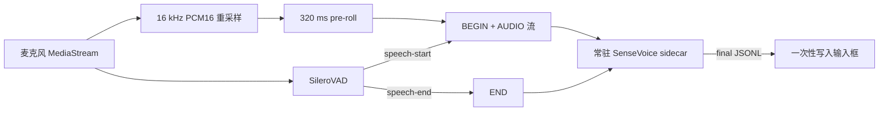

# SenseVoiceSmall 本地语音识别

## 业务背景

Cortex 的本地语音输入需要在不上传录音的前提下，缩短“松开录音后才开始处理”的等待。
本模块以 SenseVoiceSmall Q8 GGUF 替代原本逐次启动的本地识别进程，并复用现有 SileroVAD
判断句子边界。采集期间持续发送 PCM，句末才执行整句推理并返回一次最终文本。

## 领域概念与规则

- `capture`：浏览器从同一个麦克风流同时生成 MediaRecorder 音频和 16 kHz mono PCM16。
- `utterance`：一次 `BEGIN` 到 `END` 的整句音频，最长 30 秒，同一时刻仅允许一条实时会话。
- `pre-roll`：VAD 判定说话前保留 320 ms PCM，避免吞掉句首。
- `sidecar`：主进程持有的常驻原生进程；模型只在进程启动或模型切换时加载一次。
- `final`：SenseVoiceSmall 不输出 partial；SileroVAD speech-end 或手动提交后只返回整句结果。
- 在线 `openai-transcriptions` 与 `mimo-asr` 保留，选择本地时绝不静默回退到云端。
- 旧持久化 `local-whisper` 配置按非法旧值处理，回落为“关闭 + SenseVoiceSmall 默认值”。

## 业务流程

如果 SileroVAD 初始化失败，控制器取消实时会话并使用现有能量 VAD 与整段 WAV 入口；本地识别
仍由同一个 sidecar 完成，不会转为云端。完整 PCM 任务串行执行，等待队列最多两条。

## 关键实现

- 模型清单：`packages/core/asr/local-models.ts`，固定仓库、revision、文件大小与 SHA-256。
- 下载管理：`apps/desktop/src/main/capabilities/sensevoice/models.ts`，使用 `.download` 临时文件，
  通过大小和摘要校验后原子重命名。
- 帧协议：4 字节大端长度 + 1 字节类型；`BEGIN/AUDIO/END/CANCEL/SHUTDOWN`。
- sidecar 输出：逐行 JSON，事件仅为 `ready/final/error/cancelled`；stdout 不写诊断日志。
- 崩溃恢复：当前句 PCM 只在主进程内存保留，sidecar 异常时最多重启并重放一次。
- 空闲回收：完成后 60 秒没有任务则关闭进程；应用退出时显式发送 `SHUTDOWN`。
- 构建：`prepare-sensevoice-sidecar.mjs` 固定 FunASR `runtime-llamacpp-v0.1.9` 语义来源和
  llama.cpp `8086439a...`，支持 macOS arm64/x64、Windows x64，不支持 Linux。

模型文件为 `sensevoice-small-q8.gguf`（约 242 MiB），存放于
`<userData>/models/speech/sensevoice/sensevoice-small-q8/`，不进入安装包。原生 sidecar 位于
`resources/sensevoice/<platform>-<arch>/`，作为 `extraResources` 放在 asar 外。

## 失败语义与边界

- 模型缺失、校验失败、sidecar 缺失或协议不兼容均直接返回可诊断错误。
- 超过 30 秒或 PCM 超过 960,000 字节时拒绝继续写入；UI 在 30 秒自动提交。
- IPC 只接受白名单 modelId；模型路径由主进程生成，renderer 不能传入任意原生模型路径。
- 麦克风权限、WebAudio 初始化或设备中断会结束本次采集，并清理 VAD、音轨和 sidecar 会话。
