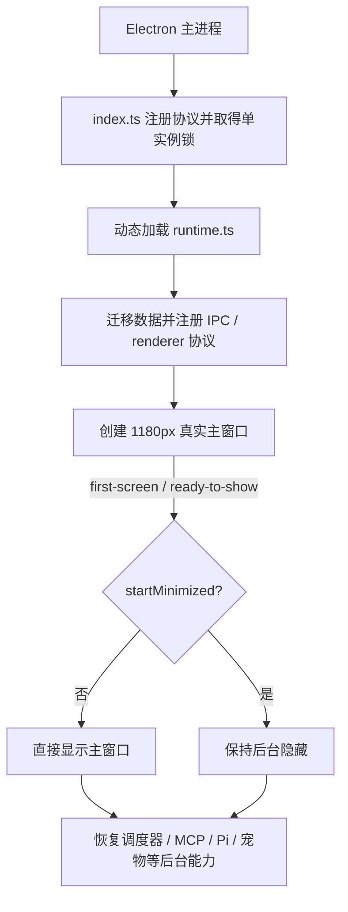

# Desktop 启动性能

## 背景与目标

Desktop 主进程原先在创建主窗口前串行等待数据迁移、设置恢复、调度器、任务提醒、MCP host 与 Agent runtime 预热。production 冷启动的真实主窗口 `ready-to-show` 基线中位数为 `1296.1 ms`。

当前体验要求是**直接打开主窗口**，不插入独立启动页，也不发生启动页到主窗口的尺寸或内容跳转。主窗口默认宽度固定为 `1180px`；非首屏后台能力在主窗口出现后继续恢复。

## 领域概念

- **入口**：`main/index.ts`，只负责进程级崩溃保护、特权协议注册和单实例锁。
- **完整 runtime**：`main/runtime.ts`，承载迁移、IPC、主窗口及全部后台能力。
- **首屏**：真实主窗口触发 `ready-to-show` 并显示的时刻；`first-screen` 与 `ready-to-show` 指向同一主窗口事件。

## 核心规则

1. `registerAppSchemes()` 必须留在 `index.ts` 且发生在 `app.ready` 前。
2. 启动过程中只能创建真实主窗口，禁止增加独立启动窗或 splash → main 跳转。
3. 数据迁移仍须先于 `registerIpcHandlers()`；主窗口仍须先注册协议和 IPC，再加载 renderer。
4. `startMinimized=true` 时主窗口保持隐藏；第二实例在首轮初始化期间到达时，只记录显示意图，不能抢跑 `createWindow()`。
5. 调度器、MCP host、Pi gateway 预热和其它非首屏恢复只在主窗口首帧后启动，避免争抢 renderer 首次解析与布局的 CPU。
6. 主窗口默认宽度由 `main-window-geometry.ts` 单一维护，当前为 `1180px`。

## 启动流程



## 基准与验收

先执行 production build，再运行隔离基准：

```bash
pnpm --filter @cortex-work/desktop build
pnpm --filter @cortex-work/desktop benchmark:startup -- 7
```

基准脚本为每次运行创建独立临时 `userData`，不会争抢用户正在运行的实例或修改真实配置。输出包含：

- `window-created`：真实主窗口完成构造的耗时。
- `first-screen` / `ready-to-show`：真实主窗口首次可以显示的耗时，两者应一致。

同一机器应比较多次运行的中位数，并保留首个冷盘样本；单次最小值不能作为验收结论。
