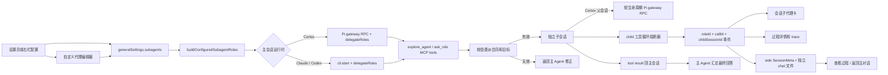

# 子代理管理与会话呈现

## 背景

个人会话原有 delegate 能力只能在自动模式下注入一个匿名 `subagent`，角色选择、模型覆盖和运行状态都缺少直接界面。当前实现参考 Kun，将代理目录、右侧工具栏和会话任务卡收敛为一条可配置链路。

## 领域概念

- **基础代理**：Kun 原始的 8 个稳定角色，始终可委派。
- **扩展代理**：其余 37 个专项角色；先打开扩展总开关，再逐项启用。
- **角色覆盖**：用户只保存 Agent、model、effort、追加提示词和启用态等差异；名称、描述、策略和分类由代码目录提供。
- **自定义代理**：用户定义名称、描述、场景、底层 Agent、模型、提示词和工具策略；保存前统一归一化，不能覆盖内置角色 ID。
- **工作表面**：`shared`（基础）是通配场景，`code`、`write`、`design` 分别约束角色进入对应会话回合的委派目录。
- **主会话**：保留原生会话上下文并负责最终回答；实质性任务在受益于专项能力、独立复核或并行工作流时主动委派，琐碎或紧密串行任务直接完成。
- **子会话**：收到自包含任务，独立执行，不能继续递归委派。
- **委派合同**：每次调用必须显式提供 `title`、`objective`、`target`、`inScope`、`outOfScope`、`constraints`、`context`、`deliverable`、`doneWhen` 和 `blockedWhen`。子 Agent 只依据这份合同执行，不从父会话猜测缺失信息。
- **运行护栏**：`maxParallel` 控制并行槽位，满额后 FIFO 排队；`maxChildRuns` 限制一轮主会话可创建的子任务总数；每份委派合同另外强制限制当前 child 的工具调用次数和执行时长；child 工具循环熔断器限制确定性重复失败。以上限制都只终止当前 child，不影响父会话或其他 child。

## 流程

## 关键实现

- `packages/core/personal/subagents.ts` 是目录和设置归一化真源，角色列表从 Kun 同步为 45 项。
- 设置页与右栏共享同一份 `generalSettings.subagents` 数据和保存逻辑，但按使用场景分别呈现：设置页采用 Kun 对齐的“运行策略 / 子代理配置 / 自动模型角色”三段结构，右栏保留适合会话内快速调整的紧凑目录。产品没有“启用编排”开关，默认向主模型提供委派工具。
- “子代理配置”提供工作表面、搜索、分类筛选、代理目录和右侧详情检查器。内置角色只保存差异；“新建子代理”可创建、编辑和删除完整自定义角色。
- 场景切换会写入角色的 `surfaces`；发送边界依据普通代码会话、写作 skill 或设计/Slides 产物选择场景，`buildConfiguredSubagentRoles` 只注入当前场景可用的角色。
- “自动模型角色”中的标题生成会直接配置 `oneshotCli`，代码审查会作为 `code-reviewer` 的目录默认模型；单角色显式覆盖优先。上下文压缩由 Pi 长驻会话运行时管理，当前版本没有独立会话摘要任务，因此这两项明确显示只读状态，不保存伪配置。
- `packages/core/personal/delegate-orchestration.ts` 将当前场景的内置角色与自定义角色解析为 `RoleConfig[]`；关闭“使用现有代理”时保留原匿名角色行为。
- `apps/desktop/src/main/capabilities/delegate/contract.ts` 是委派合同的单一真源：统一定义 MCP schema、目标文件系统校验、规范 child prompt 和单 child 预算守卫。`explore_agent` 与所有 `ask_*` 只注册角色信息，不再各自拼自由文本任务。
- 合同的访问模式不由主模型填写，而是从角色 `toolPolicy` 派生并在运行时强制执行；这样只读角色无法通过参数把自己提升为可写。文件系统合同提供 `target.rootPath` 时，CLI 与 Pi child 都把它设为真实 `cwd`，保证 prompt、相对路径和进程目录只有一个真相。
- Repository Explorer 的 `target.rootPath` 必须是绝对、存在、可读且非空的目录；`target.paths` 经规范化后必须仍位于该根目录内。校验失败直接把结构化错误返回主 Agent，不创建 child、不消耗子任务配额，也不允许向父目录或用户主目录扩散搜索。
- 合同中的 `constraints.maxToolCalls` 与 `constraints.maxDurationMinutes` 是硬限制。公共 delegate host 在每个 tool start 计数并启动独立定时器，超过限制只中止本次 `subagentCallId`；trace 只记录限制类型、阈值和计数，不记录可能含私有数据的合同正文。
- Cortex（`pi`）主会话无论是否启用自动委派、是否进入 Design/Slides 产物都只走长驻 Pi gateway RPC，不再切到无 UI 的 `startCli` / one-shot。角色目录、产物 cwd/身份和本轮并发上限属于 open 冷配置；变化时由 `extensionFingerprint` 串行关闭旧世代并重开。普通聊天与每个产物分别持有 Pi JSONL 恢复槽，切换工作区不会串上下文。
- `apps/desktop/src/main/ipc/pi-session.ts` 给 Cortex 主会话注入 delegate MCP，`apps/desktop/src/main/ipc/pi-delegate.ts` 负责每次委派的短生命周期 Pi gateway RPC 子会话。角色配置中的 Claude/Codex 运行时在 Cortex 父会话下归一为 Pi，保留角色 persona、工具策略和展示信息，模型改为继承父 Pi 会话。Pi 角色自己的 model/effort 覆盖仍可使用。
- Claude/Codex 父会话仍由 `apps/desktop/src/main/ipc/cli.ts` 应用角色级 `agent`、`model`、`effort` 和 `systemPrompt` 覆盖。两条路径上的 `readOnly` 角色都会物理收窄到只读工具，不能继承主会话的写权限。
- delegate host 为每一次调用分别生成 `subagentCallId` 和 `childSessionId`。前者隔离卡片与过程，后者标识持久化 side 会话；同一角色重复或并行委派不会互相混入。
- delegate host 以 `maxParallel` 管理 FIFO 并行槽，以 `maxChildRuns` 管理本轮总任务数；不再硬编码“每个角色最多 3 次”。
- `apps/desktop/src/main/capabilities/delegate/tool-loop-guard.ts` 在公共 `executeDelegateTool` 边界按 `toolCallId` 配对 child 工具 start/end。相同工具、完整参数和错误累计重复 3 次时熔断；最近 8 次已完成调用若前后四步完全相同且包含错误，也按无进展循环熔断。参数和输出只进入稳定哈希，trace 仅记录工具名、类型与次数，不泄露私有路径或凭据。
- 每次 `subagentCallId` 都有独立的循环状态和 `AbortController`。熔断只取消当前 child，保留其失败前的部分文本并向父 Agent 返回结构化 tool error；父回合、并行 child 和之后新建的 child 不受影响。
- Cortex 子会话的 `bash`、`write`、`edit` 等审批请求使用不透明 routed id 映射回真实 child request，并统一以父 `uiSessionId` 推到主工作区。用户允许、拒绝、停止父轮或关闭窗口时，响应只会回到原始 child；并行 child 即使产生相同原生 request id 也不会串台。
- Slides 产物在 Pi session 准备工具前登记 `cortex-slides` 与 `cortex-design-delegate` 状态；逐页设计子任务同样经短生命周期 Pi gateway RPC 运行并继承父审批。产物根、cwd、索引与 run identity 都在主进程边界重新校验。
- `packages/core/personal/messages.ts` 把带 `roleId`、`subagentCallId` 和 `childSessionId` 的事件折叠为持久化 `subagentCard`，同时把委派任务与子 Agent 回复写入子会话自己的 chat 文件。子进程的原生 `init.sessionId` 只写子会话 `agentSessionIds`，不会覆盖父会话续接槽。
- `SessionMeta.relation="side"`、`parentSessionId` 和 `parentSubagentCallId` 构成父子关系。side 会话不进入侧栏、全局搜索或归档列表，只能从父卡片进入；过程页不提供输入框，底部用“返回主对话”状态条替代。删除父会话会级联清理子会话元数据、chat 文件和 Pi 运行态。
- 卡片按当前界面语言展示角色类型；内置 Repository Explorer 显示为“探索 / 代理 探索代理”，同时标明实际运行模型。展开结论使用 GitHub Flavored Markdown 渲染；“预览”使用锚定浮层，正文优先读取子会话持久化的真实输出，最近步骤仅作次要补充；“查看过程”直接进入这一次委派对应的只读 side 会话，不再保留单独的“进入子会话”按钮或按调用过滤的 transcript 弹层。
- 异常退出时，落盘中的运行卡归一为失败，避免重启后永久显示“进行中”。

## 边界

- 子代理不继承主会话文本历史；所有角色统一使用结构化委派合同。旧的 `ask_*({ task })` 与 `explore_agent({ title, query })` 自由文本形状不再接受，避免“提示里要求自包含、运行时却无法校验”的空约束。
- 仓库或项目探索优先调用只读 `explore_agent`。父 Agent 必须先确定绝对目标根；目标未知时在父会话继续定位或询问用户，不能把“猜项目在哪里”委派给 child。复杂探索按互不重叠的证据范围动态拆成多个并行调用；数量由实际问题决定，禁止固定次数、合并独立范围或把整仓调查塞进一次调用。返回后主 Agent 只做窄范围补充检查并负责整合与最终验证。
- `inScope`、`outOfScope`、`doneWhen` 和 `blockedWhen` 都至少包含一项；`context` 与 `target.paths` 即使不适用也显式传空数组。遇到 `blockedWhen` 条件时 child 必须停止并报告，不得扩大目标、扫描父目录或用无依据猜测补齐材料。
- 子代理没有 delegate 工具，避免递归资源放大。
- 子代理不能无限重复已经确定失败的工具调用。相同调用与错误达到 3 次，或 8 次调用形成含错误的完整重复窗口时，当前 child 自动结束；父 Agent 应基于其部分结果改用其他证据或明确报告阻塞。
- Cortex 主/子 Pi gateway 不可用时显式失败，不回退到无审批的 CLI / one-shot；父会话停止、关闭或 renderer 销毁会级联取消在途 child 并清理审批路由。
- side 子会话只用于查看委派任务、子 Agent 输出和过程，不接受继续发送；后续需求需返回主对话，由主 Agent 结合完整上下文继续编排。
- 普通会话默认提供已启用角色目录；模型按任务收益调用一个或多个，琐碎任务可以不调用。显式 `@角色` 仍优先并收窄为用户点名角色。
- 模型覆盖是可选值；空值沿用所选 Agent 的默认配置。
- renderer 刷新后，delegate 的 `stage=subagent` 事件会恢复卡片语义，不会误折叠成圆桌角色消息。
- 子会话的委派任务、回复和续接 id 会持久化。运行中，子代理的思考与工具调用实时折进子会话自己的过程流（side 页与主会话同款 Trajectory 形态），不再复制进主会话过程流；子任务收尾时该过程会归档落盘（过程快照 + 截断后的工具输入/输出），应用重启后进入子会话仍可回看完整过程。原始事件流（运行详情弹层的数据源）仍为瞬态，不承诺跨重启保留。
