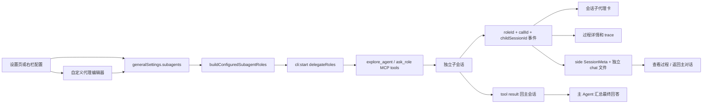

# 子代理管理与会话呈现

## 背景

个人会话原有 delegate 能力只能在自动模式下注入一个匿名 `subagent`，角色选择、模型覆盖和运行状态都缺少直接界面。当前实现参考 Kun，将代理目录、右侧工具栏和会话任务卡收敛为一条可配置链路。

## 领域概念

- **基础代理**：Kun 原始的 8 个稳定角色，始终可委派。
- **扩展代理**：其余 37 个专项角色；先打开扩展总开关，再逐项启用。
- **角色覆盖**：用户只保存 Agent、model、effort、追加提示词和启用态等差异；名称、描述、策略和分类由代码目录提供。
- **自定义代理**：用户定义名称、描述、场景、底层 Agent、模型、提示词和工具策略；保存前统一归一化，不能覆盖内置角色 ID。
- **工作表面**：`shared`（基础）是通配场景，`code`、`write`、`design` 分别约束角色进入对应会话回合的委派目录。
- **主会话**：保留原生会话上下文并负责最终回答；实质性任务在受益于专项能力、独立复核或并行工作流时主动委派，琐碎或紧密串行任务直接完成。
- **子会话**：收到自包含任务，独立执行，不能继续递归委派。
- **运行护栏**：`maxParallel` 控制并行槽位，满额后 FIFO 排队；`maxChildRuns` 限制一轮主会话可创建的子任务总数。

## 流程

## 关键实现

- `packages/core/personal/subagents.ts` 是目录和设置归一化真源，角色列表从 Kun 同步为 45 项。
- 设置页与右栏共享同一份 `generalSettings.subagents` 数据和保存逻辑，但按使用场景分别呈现：设置页采用 Kun 对齐的“运行策略 / 子代理配置 / 自动模型角色”三段结构，右栏保留适合会话内快速调整的紧凑目录。产品没有“启用编排”开关，默认向主模型提供委派工具。
- “子代理配置”提供工作表面、搜索、分类筛选、代理目录和右侧详情检查器。内置角色只保存差异；“新建子代理”可创建、编辑和删除完整自定义角色。
- 场景切换会写入角色的 `surfaces`；发送边界依据普通代码会话、写作 skill 或设计/Slides 产物选择场景，`buildConfiguredSubagentRoles` 只注入当前场景可用的角色。
- “自动模型角色”中的标题生成会直接配置 `oneshotCli`，代码审查会作为 `code-reviewer` 的目录默认模型；单角色显式覆盖优先。上下文压缩由 Pi 长驻会话运行时管理，当前版本没有独立会话摘要任务，因此这两项明确显示只读状态，不保存伪配置。
- `packages/core/personal/delegate-orchestration.ts` 将当前场景的内置角色与自定义角色解析为 `RoleConfig[]`；关闭“使用现有代理”时保留原匿名角色行为。
- `apps/desktop/src/main/ipc/cli.ts` 在子会话创建时应用角色级 `agent`、`model`、`effort` 和 `systemPrompt` 覆盖；显式角色模型优先，未覆盖且父子使用同一底层 Agent 时继承父会话实际模型。`readOnly` 角色会强制使用原生 `plan/read-only` 权限，不能继承主会话的写权限。
- delegate host 为每一次调用分别生成 `subagentCallId` 和 `childSessionId`。前者隔离卡片与过程，后者标识持久化 side 会话；同一角色重复或并行委派不会互相混入。
- delegate host 以 `maxParallel` 管理 FIFO 并行槽，以 `maxChildRuns` 管理本轮总任务数；不再硬编码“每个角色最多 3 次”。
- `packages/core/personal/messages.ts` 把带 `roleId`、`subagentCallId` 和 `childSessionId` 的事件折叠为持久化 `subagentCard`，同时把委派任务与子 Agent 回复写入子会话自己的 chat 文件。子进程的原生 `init.sessionId` 只写子会话 `agentSessionIds`，不会覆盖父会话续接槽。
- `SessionMeta.relation="side"`、`parentSessionId` 和 `parentSubagentCallId` 构成父子关系。side 会话不进入侧栏、全局搜索或归档列表，只能从父卡片进入；过程页不提供输入框，底部用“返回主对话”状态条替代。删除父会话会级联清理子会话元数据、chat 文件和 Pi 运行态。
- 卡片按当前界面语言展示角色类型；内置 Repository Explorer 显示为“探索 / 代理 探索代理”，同时标明实际运行模型。展开结论使用 GitHub Flavored Markdown 渲染；“预览”使用锚定浮层，正文优先读取子会话持久化的真实输出，最近步骤仅作次要补充；“查看过程”直接进入这一次委派对应的只读 side 会话，不再保留单独的“进入子会话”按钮或按调用过滤的 transcript 弹层。
- 异常退出时，落盘中的运行卡归一为失败，避免重启后永久显示“进行中”。

## 边界

- 子代理不继承主会话文本历史；主 Agent 必须把任务和必要材料写进 `task`，Repository Explorer 则使用 Kun 同款 `{ title, query }` 契约。
- 仓库或项目探索优先调用只读 `explore_agent`。复杂探索必须按互不重叠的范围动态拆成多个并行调用，整项目分析先枚举产品定位、后端或核心实现、前端交互、测试与完成度等所有适用证据面；数量由实际问题决定，禁止固定次数、为减少调用次数合并独立证据面，或把整仓调查塞进一次调用。返回后主 Agent 只做窄范围补充检查并负责整合与最终验证。
- 子代理没有 delegate 工具，避免递归资源放大。
- side 子会话只用于查看委派任务、子 Agent 输出和过程，不接受继续发送；后续需求需返回主对话，由主 Agent 结合完整上下文继续编排。
- 普通会话默认提供已启用角色目录；模型按任务收益调用一个或多个，琐碎任务可以不调用。显式 `@角色` 仍优先并收窄为用户点名角色。
- 模型覆盖是可选值；空值沿用所选 Agent 的默认配置。
- renderer 刷新后，delegate 的 `stage=subagent` 事件会恢复卡片语义，不会误折叠成圆桌角色消息。
- 子会话的委派任务、回复和续接 id 会持久化；完整 reasoning/tool 过程仍沿用现有瞬态运行数据策略，不写入聊天记录。应用重启后仍可进入子会话回看任务与输出，但不承诺恢复原始工具输入/输出。
