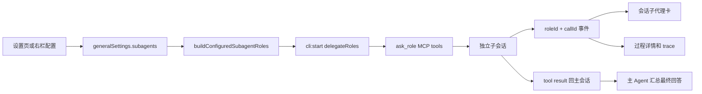

# 子代理管理与会话呈现

## 背景

个人会话原有 delegate 能力只能在自动模式下注入一个匿名 `subagent`，角色选择、模型覆盖和运行状态都缺少直接界面。当前实现参考 Kun，将代理目录、右侧工具栏和会话任务卡收敛为一条可配置链路。

## 领域概念

- **基础代理**：Kun 原始的 8 个稳定角色，始终可委派。
- **扩展代理**：其余 37 个专项角色；先打开扩展总开关，再逐项启用。
- **角色覆盖**：用户只保存 Agent、model、effort、追加提示词和启用态等差异；名称、描述、策略和分类由代码目录提供。
- **主会话**：保留原生会话上下文并负责最终回答；每轮自行判断是否委派、选择哪些角色以及调用多少次。
- **子会话**：收到自包含任务，独立执行，不能继续递归委派。
- **运行护栏**：`maxParallel` 控制并行槽位，满额后 FIFO 排队；`maxChildRuns` 限制一轮主会话可创建的子任务总数。

## 流程

## 关键实现

- `packages/core/personal/subagents.ts` 是目录和设置归一化真源，角色列表从 Kun 同步为 45 项。
- `packages/views/cortex-desktop/personal/settings/SubagentSettingsSection.tsx` 与右栏复用同一个编辑器；没有“启用编排”开关，产品默认向主模型提供委派工具。
- `packages/core/personal/delegate-orchestration.ts` 将启用目录解析为 `RoleConfig[]`；关闭“使用现有代理”时保留原匿名角色行为。
- `apps/desktop/src/main/ipc/cli.ts` 在子会话创建时应用角色级 `agent`、`model`、`effort` 和 `systemPrompt` 覆盖；`readOnly` 角色会强制使用原生 `plan/read-only` 权限，不能继承主会话的写权限。
- delegate host 为每一次调用生成 `subagentCallId`。同一角色重复或并行委派时，卡片、实时预览和完整过程都按该 ID 隔离，不会混入主 Agent 或另一次调用的事件。
- delegate host 以 `maxParallel` 管理 FIFO 并行槽，以 `maxChildRuns` 管理本轮总任务数；不再硬编码“每个角色最多 3 次”。
- `packages/core/personal/messages.ts` 把带 `roleId` 和 `subagentCallId` 的事件折叠为持久化 `subagentCard`；完整 reasoning/tool/text 仍进入瞬态过程流。
- 卡片的“预览”使用锚定浮层展示最近活动和当前结论；“查看过程”打开按调用过滤的 transcript，可查看工具输入、输出、思考与统计。预览与结论展开互斥，进入完整过程时自动关闭预览。
- 异常退出时，落盘中的运行卡归一为失败，避免重启后永久显示“进行中”。

## 边界

- 子代理不继承主会话文本历史；主 Agent 必须把任务和必要材料写进 `task`。
- 子代理没有 delegate 工具，避免递归资源放大。
- 普通会话默认提供已启用角色目录，模型可以调用 0 个、1 个或多个；显式 `@角色` 仍优先并收窄为用户点名角色。
- 模型覆盖是可选值；空值沿用所选 Agent 的默认配置。
- renderer 刷新后，delegate 的 `stage=subagent` 事件会恢复卡片语义，不会误折叠成圆桌角色消息。
- 完整过程是会话内的瞬态运行数据，不写入聊天记录；历史卡片会保留状态和结论，但应用重启后不承诺恢复原始工具输入/输出。
