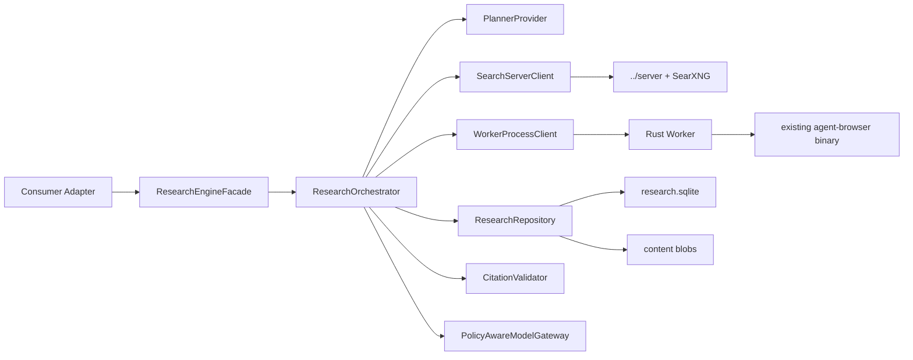
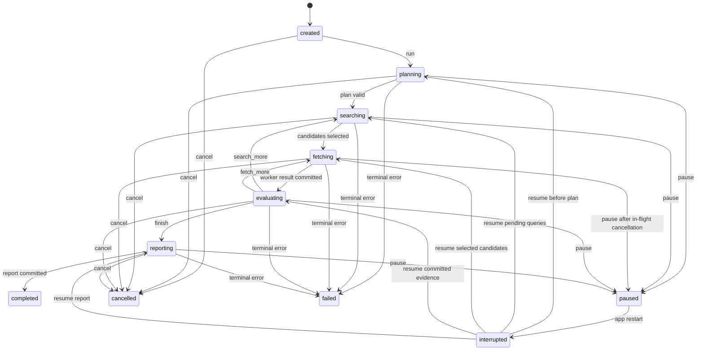

# Cortex Research Engine 开发规格

## 1. 文档目的

本文把 `docs/plans/cortex-research-engine-architecture.md` 的架构方向转成可实现、可测试、可分阶段交付的开发合同。

Cortex Research Engine（下称 CRE）不是一个仅供 Deep Research 使用的功能页，而是 Cortex Desktop 的底层信息智能能力。普通会话、AI Slides、写作、Coding Agent、知识库和 Memory 都通过同一组能力获得、验证和复用信息。

本文同时收口架构评审发现的关键问题：

- 明确云模型调用造成的数据出站，不再承诺所有正文天然留在本地；
- 隔离公共网页、登录网页、本地文件、企业知识和 Memory；
- 为 `agent-browser` 降级路径设置强制网络域名与动作策略；
- 复用独立 Go Server 的 JWT/PAT/Workspace 鉴权，不在安装包内携带共享密钥；
- 使用真实跨仓目录 `../server`；
- 统一 Session 非终态与恢复语义；
- 保持 Electron main 为本地持久化唯一写者；
- 定义 Knowledge 到现有 Memory 的候选、审批和 provenance 适配。

当本文与原架构文档冲突时，以本文为实现合同。

## 2. 当前仓库事实

### 2.1 代码仓边界

```text
/Users/mike/source/ai/cortex-org/cortex-desktop/
├── cortex-work/      # 当前仓库：Electron、Web、共享 TypeScript packages
└── server/           # 独立 Go Server 仓库
```

Go Server 已从 `cortex-work` 移出，不能在当前仓库重新创建 `server/`。

### 2.2 可复用能力

| 现有能力 | 当前位置 | CRE 处理方式 |
| --- | --- | --- |
| Agent Browser 二进制准备、打包和运行时检查 | `apps/desktop/scripts/prepare-agent-browser.mjs`、`resources/agent-browser/`、`capabilities/agent-browser/` | 复用现有二进制和健康检查；Worker 仅增加受限 Adapter |
| 内嵌浏览器安全闸门 | `apps/desktop/src/main/browser/`、`capabilities/browser/` | 复用 URL/IP 判断纯逻辑；Research Browser 使用独立无状态 session |
| 文档/PDF 抽取 | `apps/desktop/src/main/capabilities/doc-extract/`、`ipc/writing-pdf.ts` | 首版复用测试语料和契约经验；最终重型提取归 Worker |
| 写作本地检索 | `apps/desktop/src/main/ipc/writing-retrieval*.ts` | 保持现有行为，增加 CRE Adapter，验证后再迁移真源 |
| AI Slides 生成前研究 | `apps/desktop/src/main/capabilities/slides/` | Research 角色改为 CRE consumer，不重复抓取/证据逻辑 |
| 用户 Memory | `packages/core/memory/`、`apps/desktop/src/main/memory/` | 不直接覆盖 `manual/auto`；先形成候选，经审批后通过适配器写入 |
| 日志脱敏 | `apps/desktop/src/main/log/` | 所有查询、URL、正文和凭据日志复用统一 redact 规则 |

## 3. 产品边界

### 3.1 目标

1. 提供统一的 Discovery、Retrieval、Extraction、Understanding、Evidence、Knowledge 和 Memory 接口。
2. 支持低延迟单轮检索和多轮 Deep Research。
3. 所有对用户可见的事实引用都能回溯到本地保存的证据片段。
4. 搜索发现集中在服务端；正文处理默认在本地。
5. 不使用收费通用搜索 API；首版使用自建 SearXNG。
6. 任务可取消、可恢复，Worker 崩溃不丢 Session。
7. 所有跨进程、跨仓和模型数据出站都有明确契约与审计字段。

### 3.2 非目标

- 首版不建立全互联网自有索引。
- 首版不实现任意网页交互、登录表单填写或验证码绕过。
- 首版不让 Research Worker 直接写 SQLite、Memory 或用户产物。
- 首版不自动把研究结论写入全局 Memory。
- 首版不以向量数据库替代全文索引。
- 首版不删除现有写作检索、Slides Research 或文档抽取路径；迁移必须分消费者完成。
- 首版不将网页脚本、HTML 指令或模型生成 URL 视为可信事实。

## 4. 术语与能力模型

| 名称 | 定义 |
| --- | --- |
| Consumer | 调用 CRE 的产品能力，如 chat、slides、writing、coding、deep research |
| Source | URL、本地文件、企业文档或已有知识对象 |
| Candidate | 只含标题、摘要和 URL 的待验证线索 |
| Document | 已获取并解析、带内容 Hash 的来源快照 |
| EvidenceChunk | 可定位到 Document 的证据片段 |
| Claim | 消费方产物中的一项事实性陈述 |
| KnowledgeItem | 从一个或多个 EvidenceChunk 归纳出的可复用知识对象 |
| MemoryCandidate | 可写入长期 Memory、但尚未被用户批准的候选 |
| Trust Zone | 来源信任和数据敏感度边界 |
| Data Egress | 查询、正文、证据或 Memory 离开本机进入服务端/模型供应商 |

能力分层：

```text
Discovery
  ↓
Retrieval
  ↓
Extraction
  ↓
Understanding
  ↓
Evidence
  ↓
Knowledge
  ↓
Memory Candidate
```

## 5. 核心技术决策

### KTD1：Electron main 是控制层和唯一持久化写者

- Planner、Orchestrator、Session、预算、模型调用、SQLite 和引用校验位于 main。
- renderer 只能经 preload 的窄面 API 调用。
- Rust Worker 只接受请求并返回结果，不直接打开或写入 CRE SQLite。
- Worker 退出后 main 可重新拉起并重试未提交的 operation。

### KTD2：Go Search Server 位于独立 `../server`

- Hosted 模式在现有 Go Server 增加 workspace-scoped route。
- SearXNG、Redis 和搜索部署配置归 `../server/docker/research-search/`。
- Desktop 仓库只保存客户端、协议 schema 和本地 Worker。

### KTD3：搜索结果只是线索

- Search Server 不抓取正文，不生成最终引用。
- 搜索摘要不得直接进入最终 Claim。
- 只有成功生成 Document 和 EvidenceChunk 的来源才能成为引用。

### KTD4：公共与私有数据分阶段处理

- Public Web 阶段不能读取 Memory、本地文件或企业知识正文。
- Private Enrichment 阶段不启用外部搜索和具备写/发送能力的工具。
- 跨阶段只传递结构化 ClaimDraft、EvidenceRef 和缺口描述。
- 公共网页内容始终标记为不可信数据，不解释为模型指令。

### KTD5：模型数据出站必须显式

每次 Session 固定一个 `ModelDataPolicy`：

```ts
export type ModelDataPolicy =
  | "local_only"       // 只允许本地模型；任何正文不得发送云模型
  | "metadata_only"    // 云模型只接收标题、摘要、域名和统计
  | "evidence_allowed" // 用户允许证据片段发送给所选模型供应商
```

- UI 在首次使用或策略变化时显示模型供应商和可能出站的数据类型。
- `local_only` 无可用本地模型时失败并提示，不静默回退云模型。
- 本地文件、登录网页和 Memory 默认不继承 `evidence_allowed`，需来源级授权。

### KTD6：Search Server 复用现有认证

Hosted 模式：

- 使用现有 `middleware.Auth` 支持的 JWT/PAT；
- 路由使用 workspace membership 校验；
- 限流键至少包含 user ID、workspace ID 和客户端 IP；
- 审计记录 user/workspace、查询 Hash、结果量、时延和状态，不记录完整查询。

Self-hosted 模式：

- 用户在设置页手工配置自己生成的独立 token；
- token 使用 Electron `safeStorage` 保存，只由 main 解密；
- token 不随安装包分发，不允许全体客户端共享默认 key。

### KTD7：Research Browser 必须使用独立安全配置

Worker 调用已有 `agent-browser` 二进制时必须：

- 使用一次性 `--session` 和独立 `--namespace`；
- 设置 `--restore-save never`，不得复用默认 profile/Cookie；
- 设置 `--allowed-domains`；限制顶层导航、子资源、WebSocket 和 EventSource；
- 设置 `--content-boundaries` 和 `--max-output`；
- 使用静态 action policy 禁止 `eval`、上传、下载、认证、剪贴板和持久化存储；
- 默认 headless；登录态抓取另设用户可见且需批准的流程，不属于首版。

Rust HTTP Fetcher 与 Browser Adapter 各自执行 URL、DNS、IP、重定向和响应大小策略，不能假设另一层已经校验。

### KTD8：Session 使用明确非终态恢复

```ts
export type ResearchSessionStatus =
  | "created"
  | "planning"
  | "searching"
  | "fetching"
  | "evaluating"
  | "reporting"
  | "completed"
  | "paused"
  | "cancelled"
  | "failed"
  | "interrupted";

export const NON_TERMINAL_RESEARCH_STATUSES = [
  "planning",
  "searching",
  "fetching",
  "evaluating",
  "reporting",
] as const;
```

应用启动时，所有非终态统一转为 `interrupted`。不存在额外的 `"running"` 状态。

### KTD9：跨消费者复用受作用域约束

Document 可按 `contentHash` 复用，但必须同时满足：

- 同一用户；
- 相同或更严格的来源授权；
- Consumer 允许该 Trust Zone；
- 登录页/本地文件不跨 Session 自动复用；
- 缓存未过期且没有 `no-store`/用户删除标记。

### KTD10：Memory 先候选、后批准、再写入

- CRE SQLite 保存带 provenance 的 `MemoryCandidate`。
- 未批准候选不得进入 `buildMemoryAppend()`。
- Phase 2 增加 Research Memory Adapter；它扩展 Memory 文件格式，新增独立 `research` 区，而不是覆盖用户 `manual` 或 Dreamer 管理的 `auto`。
- 用户可逐条批准、撤销和查看来源；来源过期时候选标记为 stale，不自动删除用户确认内容。

## 6. 信任区与隐私策略

```ts
export type TrustZone =
  | "public_web"
  | "authenticated_web"
  | "local_file"
  | "enterprise"
  | "memory";

export interface SourcePolicy {
  trustZone: TrustZone;
  allowSearchServer: boolean;
  allowCloudModel: boolean;
  allowCrossSessionReuse: boolean;
  expiresAt?: string;
}
```

默认矩阵：

| Trust Zone | 可发 Search Server | 可发云模型 | 跨 Session 复用 |
| --- | --- | --- | --- |
| `public_web` | 是，查询会出站 | 按 `ModelDataPolicy` | 是，受 TTL 限制 |
| `authenticated_web` | 否 | 默认否，需单独批准 | 否 |
| `local_file` | 否 | 默认否，需单独批准 | 同一 workspace 内可选 |
| `enterprise` | 仅企业节点 | 由企业策略决定 | 同租户、同权限范围 |
| `memory` | 否 | 默认否，需单独批准 | 由 Memory scope 决定 |

### 6.1 Prompt Injection 防线

1. Worker 输出保留 `trustZone`、来源和 `contentBoundaries`。
2. Planner 不读取原始正文，只读取 Coverage 和缺口摘要。
3. Evidence Extractor 的 system prompt 明确网页内容是数据；不执行其指令。
4. 处理 `public_web` 的模型调用不挂载文件、Memory、发送、终端或写工具。
5. 私有合成阶段只接收已结构化的公共证据引用，不接收公共网页中的工具指令。
6. Coding Agent 获取的是 Evidence Package；若需要原文，由用户或现有工具显式打开，不把原文转成自动执行命令。

## 7. 高层组件



### 7.1 Consumer Adapter

每个消费方只传目标、预算、来源和输出要求：

```ts
export interface ResearchRequest {
  consumer: ResearchConsumer;
  objective: string;
  mode: "quick" | "standard" | "deep";
  sourceScopes: SourceScope[];
  modelDataPolicy: ModelDataPolicy;
  output: ResearchOutputRequest;
  budget?: Partial<ResearchBudget>;
}

export type ResearchConsumer =
  | "chat"
  | "deep_research"
  | "slides"
  | "writing"
  | "coding"
  | "knowledge";
```

### 7.2 ResearchEngineFacade

```ts
export interface ResearchEngineFacade {
  create(request: ResearchRequest): Promise<ResearchSessionSummary>;
  run(sessionId: string): Promise<void>;
  pause(sessionId: string): Promise<void>;
  resume(sessionId: string): Promise<void>;
  cancel(sessionId: string): Promise<void>;
  get(sessionId: string, detail: ResearchDetailLevel): Promise<ResearchSessionView>;
  list(filter?: ResearchSessionFilter): Promise<ResearchSessionSummary[]>;
  delete(sessionId: string): Promise<void>;
}
```

Facade 不暴露任意 URL fetch、任意 Worker method 或数据库句柄。

## 8. 领域模型

### 8.1 计划与预算

```ts
export interface ResearchPlan {
  schemaVersion: 1;
  objective: string;
  scope: ResearchScope;
  subquestions: ResearchSubquestion[];
  initialQueries: PlannedQuery[];
  budget: ResearchBudget;
  completion: CompletionCriteria;
}

export interface ResearchBudget {
  maxRounds: number;
  maxQueries: number;
  maxCandidates: number;
  maxDocuments: number;
  maxBrowserFetches: number;
  maxDurationMs: number;
  maxEvidenceCharsToModel: number;
}

export interface CompletionCriteria {
  minSourcesPerSubquestion: number;
  minIndependentDomains: number;
  requirePrimarySource: boolean;
  requireContradiction: boolean;
  minimumRelevance: number;
}
```

默认预算：

| 模式 | 轮数 | 查询 | 文档 | Browser | 总时长 |
| --- | ---: | ---: | ---: | ---: | ---: |
| quick | 1 | 4 | 8 | 1 | 90 秒 |
| standard | 3 | 16 | 24 | 5 | 10 分钟 |
| deep | 5 | 32 | 50 | 10 | 30 分钟 |

所有用户覆盖值仍要经过硬上限夹取。

### 8.2 Candidate、Document 与 Evidence

```ts
export interface SearchCandidate {
  candidateId: string;
  queryId: string;
  title: string;
  url: string;
  canonicalUrl?: string;
  snippet?: string;
  domain: string;
  engines: string[];
  sourceType?: SourceType;
  publishedAt?: string;
  serverScore: number;
  trustZone: "public_web";
}

export interface ResearchDocument {
  documentId: string;
  candidateId?: string;
  source: SourceRef;
  title: string;
  canonicalUrl?: string;
  contentHash: string;
  simhash?: string;
  mediaType: string;
  fetchMethod: "http" | "browser" | "pdf" | "local_file";
  fetchedAt: string;
  publishedAt?: string;
  contentRef: string;
  textLength: number;
  duplicateOf?: string;
  policy: SourcePolicy;
}

export interface EvidenceChunk {
  chunkId: string;
  documentId: string;
  page?: number;
  startOffset?: number;
  endOffset?: number;
  headingPath?: string[];
  text: string;
  textHash: string;
  objectiveScore: number;
  subquestionScores: Record<string, number>;
  trustZone: TrustZone;
}

export interface CitationRef {
  chunkId: string;
  documentId: string;
  title: string;
  url?: string;
  page?: number;
  retrievedAt: string;
  textHash: string;
}
```

### 8.3 Knowledge 与 Memory

```ts
export interface KnowledgeItem {
  knowledgeId: string;
  subject: string;
  statement: string;
  confidence: "low" | "medium" | "high";
  citationChunkIds: string[];
  trustZones: TrustZone[];
  validFrom?: string;
  validUntil?: string;
  createdAt: string;
  updatedAt: string;
}

export interface MemoryCandidate {
  candidateId: string;
  knowledgeId: string;
  scope: "profile" | "preferences" | "projects";
  text: string;
  citationChunkIds: string[];
  status: "pending" | "approved" | "rejected" | "revoked" | "stale";
  approvedAt?: string;
  createdAt: string;
}
```

## 9. Session 状态机



### 9.1 原子提交边界

每轮使用 `operationId`：

1. main 持久化 pending operation；
2. 调 Search Server 或 Worker；
3. 校验响应大小、schema 和 request ID；
4. 在一个 SQLite transaction 中写 round/result/evidence/budget；
5. 标记 operation committed；
6. 崩溃恢复时只重试未 committed operation。

Worker 返回后不能先修改内存状态再异步落盘。

## 10. Planner 与 Orchestrator

### 10.1 Initial Planner

输入：

- 用户目标；
- Consumer、语言和时间范围；
- 允许的数据源；
- 硬预算；
- ModelDataPolicy。

输出严格匹配 `ResearchPlan` schema。模型不得生成 URL。

Plan Validator 必须：

- 裁剪预算；
- 去除重复查询；
- 验证 query → subquestion 归属；
- 验证 domain allow/block list；
- 拒绝空子问题、空查询和未知枚举；
- 将模型给出的 URL 字段丢弃。

### 10.2 Coverage

```ts
export interface CoverageReport {
  subquestionId: string;
  status: "missing" | "weak" | "sufficient";
  sourceCount: number;
  independentDomainCount: number;
  primarySourceCount: number;
  contradictionCount: number;
  averageRelevance: number;
  bestChunkIds: string[];
  missing: string[];
}
```

同一重复簇只算一个独立来源；同一组织的镜像域名可配置为同一 authority group。

### 10.3 Gap Planner

Gap Planner 只接收：

- Coverage；
- 已执行查询文本和结果统计；
- 剩余预算；
- 缺口摘要。

它不接收完整网页正文、Memory 或本地文件。输出：

```ts
export type PlannerDecision =
  | { action: "search_more"; reason: string; queries: PlannedQuery[] }
  | { action: "fetch_more"; reason: string; candidateIds: string[] }
  | { action: "finish"; reason: string };
```

### 10.4 Report Generator

- 只接收允许出站的 EvidenceChunk；
- 无外部网络、终端、文件写入、消息发送或 Browser 工具；
- 输出引用只能是已知 `chunkId`；
- Citation Validator 删除未知 ID，并将无有效引用的事实段标记为 unsupported；
- unsupported 内容不能在最终报告中表现为确定事实。

## 11. Search Server 规格（独立 `../server`）

### 11.1 Hosted 路由

```http
POST /api/workspaces/{id}/research/search/batch
Authorization: Bearer <JWT-or-PAT>
Content-Type: application/json
X-Client-Platform: desktop
X-Client-Version: <version>
```

路由挂在现有 protected API group，并使用：

```go
r.Use(middleware.Auth(queries, patCache))
r.Use(middleware.RequireWorkspaceMemberFromURL(queries, "id"))
```

### 11.2 请求

```json
{
  "request_id": "req_01",
  "research_session_id": "research_01",
  "queries": [
    {
      "query_id": "q_01",
      "text": "open source desktop AI agent",
      "language": "en",
      "categories": ["general"],
      "time_range": "year",
      "domain_allowlist": [],
      "domain_blocklist": [],
      "limit": 15
    }
  ]
}
```

硬限制：

- 单请求最多 8 个查询；
- 单查询 UTF-8 最多 512 字符；
- 每查询最多 20 条结果；
- body 最多 64 KiB；
- 总超时 20 秒；
- Provider 并发和查询并发分别限额。

### 11.3 响应与局部失败

```json
{
  "request_id": "req_01",
  "results": [
    {
      "query_id": "q_01",
      "items": [],
      "errors": [
        {
          "provider": "searxng-news",
          "code": "timeout"
        }
      ]
    }
  ],
  "stats": {
    "provider_count": 3,
    "raw_result_count": 70,
    "returned_result_count": 15,
    "cache_hit": false,
    "duration_ms": 820
  }
}
```

只要至少一个 Provider 成功，HTTP 返回 200 并携带局部错误；全部失败返回 503。

### 11.4 缓存与日志

- Cache key 使用规范查询的 HMAC，不把完整查询直接作为 Redis key；
- news TTL 15 分钟，general TTL 6 小时，technical TTL 24 小时；
- 日志只记录 query HMAC、字符数、语言、Provider、数量、状态和耗时；
- 不记录标题、摘要和完整 URL query string；
- URL 返回前删除已知 tracking 参数。

## 12. Rust Research Worker 规格

### 12.1 进程协议

stdin/stdout 使用 JSONL；stdout 只允许协议消息，日志走 stderr。

首个请求必须是：

```json
{
  "type": "request",
  "id": "hello_01",
  "method": "hello",
  "params": {
    "protocol_version": 1,
    "desktop_version": "0.1.48"
  }
}
```

Worker 返回自己的版本、支持的 method、最大协议版本和 Browser 可用状态。版本不兼容时 main 不继续发送业务请求。

业务 method：

```text
hello
doctor
fetch_prepare
rerank
cancel
shutdown
```

### 12.2 `fetch_prepare`

输入只包含：

- objective 和子问题；
- SearchCandidate；
- 已知 Document 指纹；
- SourcePolicy；
- 资源限制；
- main 解析出的 `agent-browser` 二进制绝对路径。

输出：

- Documents；
- EvidenceChunks；
- DuplicateClusters；
- 每 URL 的失败分类；
- 实际 HTTP/Browser 次数和字节数。

### 12.3 网络安全

HTTP Fetcher：

- 只允许 HTTP/HTTPS；
- 拒绝 URL userinfo；
- 默认只允许 80/443；
- DNS 结果中任一地址属于 loopback/private/link-local/reserved 时拒绝；
- 每次 redirect 重新执行完整策略；
- 固定连接到本次已验证地址，防 DNS rebinding；
- 禁用环境代理；
- HTML/Text 最大 10 MiB，PDF 最大 30 MiB；
- 全局并发 6，每域并发 2，单请求超时 20 秒。

Browser Adapter：

```text
agent-browser
  --session <random>
  --namespace cortex-research-<session>
  --restore-save never
  --allowed-domains <validated-domains>
  --content-boundaries
  --max-output 200000
  --action-policy <generated-read-only-policy>
  --json
```

Browser 一次请求结束后主动 `close`，清理临时 namespace 和 profile。首版不允许 `--profile`、`--state`、`--restore` 或 `--auto-connect`。

### 12.4 内容处理

```text
HTTP/Browser/PDF
  → media type detection
  → metadata extraction
  → readable text
  → normalized text
  → SHA-256
  → SimHash
  → duplicate cluster
  → chunk
  → lexical score
```

Worker 不做最终 Claim 判断，不调用模型，不写数据库。

## 13. Desktop 本地存储

### 13.1 路径

```text
<userData>/research/
├── research.sqlite
├── blobs/
│   └── <sha256>.zst
├── browser-policy/
└── tmp/
```

临时文件只能位于 `tmp/`，启动时清理超过 24 小时且不属于 active operation 的文件。

### 13.2 SQLite

Electron 39 的 main runtime 使用 `node:sqlite`，避免再引入一个原生 npm addon。由于仓库测试 Node 可能低于 Electron 内嵌 Node：

- `ResearchRepository` 依赖注入 `SqliteDriver`；
- 普通 Vitest 使用 fake/in-memory adapter；
- 真 SQLite 集成测试使用 `ELECTRON_RUN_AS_NODE=1` 执行；
- `node:sqlite` 只在 main 的 runtime adapter 中动态导入。

核心表：

```text
schema_migrations
research_sessions
research_plans
research_subquestions
research_rounds
research_operations
research_queries
search_candidates
research_documents
document_chunks
duplicate_clusters
coverage_reports
research_reports
citation_links
knowledge_items
memory_candidates
```

外键开启，schema migration 全部在 transaction 中执行。数据库损坏时 fail closed，先复制损坏文件再重建；不静默覆盖。

## 14. Memory 适配

### 14.1 Phase 1

- 只生成 `MemoryCandidate` 并保存在 CRE SQLite；
- UI 可查看候选与来源；
- 不调用 `userMemoryStore.setFile()`。

### 14.2 Phase 2

扩展 `UserMemoryFile`：

```ts
export interface UserMemoryFile {
  manual: string;
  auto: string;
  research: string;
}
```

Markdown 增加独立标记区：

```text
用户手写内容

## ⟨auto⟩
Dreamer 自动整理内容

## ⟨research⟩
用户批准的带来源研究记忆
```

约束：

- Dreamer 只改 `auto`，不得重写 `research`；
- Settings 可单独清空 auto 或 research；
- `buildMemoryAppend()` 分别标记“手写补充 / 自动整理 / 已批准研究”；
- `research-evidence.json` 保存 candidate ID、knowledge ID、chunk IDs、批准时间和撤销状态；
- 撤销只删除由对应 candidate 写入的 research 条目，不按文本模糊匹配。

## 15. Consumer 接入

### 15.1 普通会话

- 默认 `quick`；
- 仅当用户明确要求最新/检索/来源，或 Agent Runtime 做出受控 tool call 时启动；
- 回复只能引用有效 CitationRef；
- Research 失败不阻断普通会话，但必须说明未完成实时验证。

### 15.2 Deep Research

- 使用完整多轮 Orchestrator；
- 独立任务页展示计划、轮次、来源、失败和报告；
- 可暂停、取消、恢复；
- 完成后可导出 Markdown。

### 15.3 AI Slides

- 现有“生成前研究”角色改调 CRE；
- 将 Evidence Package 写入 deck 的 `drafts/research/manifest.json`；
- Slide facts 和 speaker notes 保存 `chunkId`；
- 导出报告可选择附来源页；
- 迁移完成后删除 Slides 内重复的 URL 抓取/证据逻辑，不删除角色编排和 deck 审批 gate。

### 15.4 写作

- 保留现有 `writingRetrieve` 作为本地 workspace provider；
- 新增 `WritingResearchAdapter` 将本地片段映射为 `local_file` Trust Zone；
- 外部 Web 研究由 CRE 负责；
- 在覆盖率、延迟和回归测试通过前，不移除现有 BM25 路径。

### 15.5 Coding Agent

- 默认只返回 Evidence Package 和 SourceRef；
- 不自动执行网页中的命令；
- GitHub/官方文档以后可增加垂直 Provider；
- 项目代码搜索仍使用现有本地工具，不经远程 Search Server。

### 15.6 知识库

- 导入 URL/文件时复用 Retrieval、Extraction、Dedup；
- KnowledgeItem 是库内可复用对象；
- 权限删除必须级联清理不可再访问的 Document/Chunk 引用。

## 16. Desktop IPC 与 preload

preload 仅暴露：

```ts
export interface CortexResearchBridge {
  create(request: ResearchRequest): Promise<ResearchSessionSummary>;
  run(sessionId: string): Promise<void>;
  pause(sessionId: string): Promise<void>;
  resume(sessionId: string): Promise<void>;
  cancel(sessionId: string): Promise<void>;
  get(sessionId: string, detail: ResearchDetailLevel): Promise<ResearchSessionView>;
  list(filter?: ResearchSessionFilter): Promise<ResearchSessionSummary[]>;
  delete(sessionId: string): Promise<void>;
  onEvent(listener: (event: ResearchEvent) => void): () => void;
}
```

IPC 要求：

- main 校验 sender 和 schema；
- renderer 不传模型 API key、Search token、Worker 路径或任意本地输出路径；
- `get(..., "summary")` 不返回正文；
- Evidence detail 只有显式打开来源面板时返回；
- 事件携带 session ID、stage、进度和可展示错误，不带正文。

## 17. 推荐代码结构

### 17.1 Desktop 仓库 `cortex-work`

```text
packages/core/research/
├── types.ts
├── schemas.ts
├── budget.ts
├── citation.ts
├── trust-policy.ts
└── consumer.ts

apps/desktop/src/main/research/
├── research-service.ts
├── research-orchestrator.ts
├── research-repository.ts
├── sqlite-driver.ts
├── operation-runner.ts
├── coverage-evaluator.ts
├── citation-validator.ts
├── policy-aware-model-gateway.ts
├── planner/
│   ├── initial-planner.ts
│   ├── gap-planner.ts
│   ├── plan-validator.ts
│   └── prompts.ts
├── clients/
│   └── search-server-client.ts
├── worker/
│   ├── process-manager.ts
│   ├── rpc-client.ts
│   └── binary-resolver.ts
├── consumers/
│   ├── chat-adapter.ts
│   ├── slides-adapter.ts
│   ├── writing-adapter.ts
│   ├── coding-adapter.ts
│   └── knowledge-adapter.ts
└── memory/
    └── memory-candidate-adapter.ts

apps/desktop/src/main/ipc/research.ts
apps/desktop/src/preload/research-bridge.ts

tools/research-worker/
├── Cargo.toml
├── src/
│   ├── ipc/
│   ├── security/
│   ├── fetch/
│   ├── browser/
│   ├── extract/
│   ├── document/
│   ├── dedup/
│   └── ranking/
└── tests/

apps/desktop/resources/research-worker/
├── mac-arm64/
├── mac-x64/
└── win-x64/
```

### 17.2 Go Server 仓库 `../server`

```text
../server/internal/handler/research_search.go
../server/internal/service/researchsearch/
├── service.go
├── aggregator.go
├── normalizer.go
├── deduplicator.go
└── policy.go
../server/internal/service/researchsearch/providers/searxng/
../server/docker/research-search/
├── docker-compose.yml
├── searxng/
└── redis/
```

## 18. 实现单元

### U0：协议与安全 spike

- 锁定 TypeScript/JSON Schema/Rust/Go 的字段与版本；
- 验证 Electron 39 `node:sqlite` 真机运行；
- 验证 `agent-browser --allowed-domains` 同时拦截导航、子资源和 WebSocket；
- 验证 `ELECTRON_RUN_AS_NODE` SQLite 集成测试；
- 输出协议 fixtures，四端解析同一份样例。

### U1：Core 类型与纯逻辑

- Research 类型、Zod schema、预算夹取、Trust Zone、状态机、引用校验；
- 纯函数表驱动测试。

### U2：Go Search Server

- Hosted auth/workspace route；
- SearXNG Provider、聚合、缓存、限流和局部失败；
- 独立 server 仓库完成 Go tests。

### U3：Rust Worker HTTP 闭环

- JSONL hello/doctor/fetch_prepare/cancel；
- URL/DNS/redirect guard；
- HTML/Text/PDF、chunk、SHA-256、SimHash；
- 不含 Browser。

### U4：Electron Worker 与 Repository

- Worker 打包、resolve、spawn、RPC、取消和重启；
- SQLite schema、operation transaction、启动恢复；
- main 单一写者。

### U5：单轮 CRE Facade

- Search Client → Candidate Selector → Worker → Evidence → Citation；
- 支持 chat quick consumer；
- 不含 LLM 多轮 Planner。

### U6：安全 Browser 降级

- 复用现有 agent-browser binary；
- 生成只读 action policy；
- allowed domains、namespace、cleanup、预算；
- SSRF 和资源限制测试。

### U7：多轮 Planner

- Initial Planner、Gap Planner、Coverage、停止策略；
- PolicyAwareModelGateway；
- Prompt Injection trust boundary。

### U8：Deep Research UI

- 创建、运行、暂停、取消、恢复、来源、报告；
- renderer 不获取密钥或默认完整正文。

### U9：跨消费者迁移

- Slides → CRE；
- Writing local provider → CRE Adapter；
- Coding/Knowledge Adapter；
- 每个 consumer 独立 feature flag 与回滚。

### U10：Knowledge 与 Memory

- KnowledgeItem、候选 UI；
- Phase 2 Memory research 区、provenance sidecar、批准/撤销。

## 19. 验收标准

### 19.1 功能

1. quick 模式能从 Search Server 获取候选，本地抓取并返回至少一个有效引用。
2. standard 模式能执行至少两轮并根据 Coverage 生成补充查询。
3. 取消 Search、HTTP Fetch、Browser 和模型调用后，Session 最终进入 `cancelled`。
4. 应用在 searching/fetching/reporting 任一阶段退出，重启后 Session 进入 `interrupted` 并可恢复。
5. Worker 被强制结束后 main 能重启 Worker，已提交 evidence 不丢失。
6. 模型生成未知 `chunkId` 时 Citation Validator 拒绝它。

### 19.2 安全

1. `localhost`、RFC1918、link-local、IPv6 loopback、十进制/十六进制 IPv4 变体均被 HTTP Fetcher 拒绝。
2. 公网 URL 30x 跳私网被拒绝。
3. Browser 页面导航、子资源、fetch、WebSocket 到非 allowlist 域均被拦截。
4. Public Web 内容不能获得 Memory、本地文件、终端、发送和写工具。
5. `local_only` 策略下没有任何证据请求到达远程模型 mock server。
6. Hosted Search 无 JWT/PAT 返回 401；非 workspace member 返回 403。
7. 打包产物不包含共享 Search API Key。

### 19.3 隐私

1. 查询完整文本不出现在 Go/Node 日志或 Redis key。
2. renderer 的 Session summary 不含正文、Search token 或模型凭据。
3. 本地文件和 Memory 未批准时不进入远程模型请求。
4. 用户删除 Session 后，其未被其他授权对象引用的 blob 可被 GC。

### 19.4 性能基线

- 8 个 batch queries 的 Search Server P95 ≤ 20 秒；
- 10 个普通 HTML 的本地 HTTP 抓取 P95 ≤ 60 秒；
- Worker 空闲 RSS 目标 ≤ 40 MiB，不含 Chromium；
- Browser 并发默认 1，最多 2；
- 1000 个 Document 元数据的 Session list/get summary 不读取 blob 正文。

### 19.5 打包

- macOS arm64/x64 和 Windows x64 均携带匹配架构的 Research Worker；
- Worker 具有可执行权限并通过 `hello/doctor`；
- 复用的 agent-browser 路径在打包态可解析；
- Worker、agent-browser、SQLite 和 blob 路径均位于 asar 外的受控位置；
- 不复用其他架构的二进制。

## 20. 验证命令

Desktop 仓库：

```bash
pnpm --filter @cortex-work/core test
pnpm --filter @cortex-work/desktop test
pnpm --filter @cortex-work/desktop typecheck
pnpm lint
pnpm build

cd tools/research-worker
cargo fmt --all -- --check
cargo clippy --all-targets --all-features -- -D warnings
cargo test --all-targets --all-features
```

Go Server 仓库：

```bash
cd /Users/mike/source/ai/cortex-org/cortex-desktop/server
go test ./...
go vet ./...
```

真实窗口、Electron renderer 自动点击和完整 GUI E2E 按当前仓库规则需用户明确授权后执行；默认验证先覆盖纯逻辑、IPC、子进程、协议 fixtures、打包目录和无窗口集成测试。

## 21. 发布与回滚

Feature flags：

```text
researchEngine.enabled
researchEngine.deepResearchEnabled
researchEngine.chatEnabled
researchEngine.slidesEnabled
researchEngine.writingEnabled
researchEngine.memoryEnabled
```

发布顺序：

1. 先部署向后兼容的 Search Server route；
2. Desktop 发布 Worker + CRE，但默认仅内部 quick consumer；
3. 开启 Deep Research；
4. 按 Slides、Writing、Coding、Knowledge 顺序迁移；
5. 最后启用 Memory Candidate。

回滚要求：

- Server 保留至少两个 Desktop 版本的 API 兼容；
- Worker 与 Desktop 同包发布，协议不兼容时禁用 CRE，不降级到未知行为；
- 每个 Consumer 可单独关闭并回退原路径；
- 数据 migration 只前进，旧版本忽略新表，不删除原消费者数据。

## 22. 完成定义

CRE 第一阶段完成必须同时满足：

- Search Server、Electron main 和 Rust Worker 的真实链路通过；
- 至少 chat quick 和 Deep Research 两个 Consumer 使用同一 Evidence/Citation 基础能力；
- 公共/私有 Trust Zone、模型出站和 Browser SSRF 有自动化测试；
- 所有非终态可恢复；
- 引用不能由模型伪造；
- 代码落在真实 Desktop/Server 仓边界；
- 现有 Agent Browser、Slides、Writing Retrieval 和 Memory 有明确复用或迁移路径；
- 文档中的验收命令与 CI 均已执行并记录结果。
