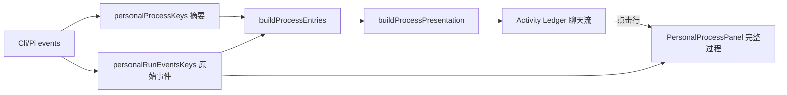
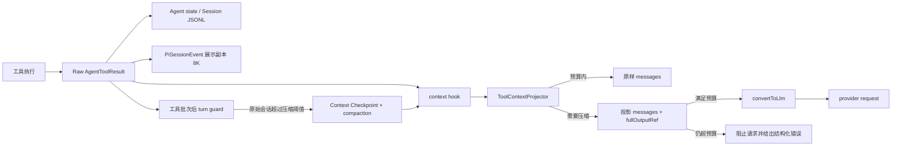

# 会话过程精简与工具上下文预算实施规格

## 1. 文档目的

本文定义 Cortex Desktop 个人会话中两项相互关联、但必须分层实现的改造：

1. 将聊天流里的 reasoning、读取文件和命令执行收敛为 Codex 风格的紧凑活动台账；
2. 在不影响完整过程回看和工具可调用性的前提下，减少回送给 Pi 模型的低价值、重复和过大的工具结果，并在最终回答前保留明确的输出预算。

本文是实现合同。后续任务拆分、代码评审、测试与验收以本文为准；不能把“视觉折叠”误当成“模型上下文减少”，也不能以减少 token 为由删除失败信息、破坏工具调用配对或让模型失去按需读取完整结果的能力。

## 2. 结论与关键产品决策

本规格预先确定以下决策，实施时不再重复讨论：

- 保持 Cortex 现有字体、色彩和整体布局，只借鉴 Codex 的信息层级，不复制其视觉皮肤。
- 聊天流只展示“本轮摘要 + 紧凑动作列表”；原始 input、output、完整命令和 reasoning 继续进入现有完整过程面板。
- 运行中默认展开动作列表，运行完成后默认折叠为一行；失败项保持可见，但不再内联渲染大块黑色终端。
- UI 精简覆盖使用统一过程事件的 Claude、Codex 和 Pi 会话；模型上下文优化首版只作用于 Pi gateway 会话，因为 Claude/Codex 的原生上下文由外部运行时管理。
- 不新增用户设置开关。预算保护属于运行正确性，不应要求用户理解或配置。
- 不修改会话 token 统计口径。Pi 一轮用户请求可能包含多次模型调用，输入/输出继续按 run 聚合。
- 不删除原始工具结果。模型请求使用投影副本，内存过程、会话 JSONL、详情面板和历史归档继续遵守各自既有容量规则。
- `stopReason="length"` 不再当作无提示的普通成功；必须显式标记“回复已截断”，并在可恢复时自动压缩续接。

## 3. 当前事实与问题证据

### 3.1 过程 UI 当前结构

当前过程展示已经拥有正确的数据分层：

- `personalProcessKeys.detail(sessionId)` 提供 reasoning、`agentLog`、`stageTitle` 等过程摘要；
- `personalRunEventsKeys` 提供原始工具 start/end、input、output 和时间；
- `buildProcessEntries()` 只让原始事件补全摘要条目的详情，不让原始事件直接决定列表结构；
- `ConversationProcessTimeline` 运行中自动展开、结束后自动折叠；
- `PersonalProcessPanel` / `AgentTranscriptDialog` 承担完整过程回看。

问题不在数据缺失，而在聊天流内联层级过深：

```text
整轮折叠
  └─ 阶段折叠
      └─ 单工具胶囊
          └─ 黑色终端块
              ├─ 命令
              ├─ input JSON
              ├─ output 预览
              ├─ 查看完整输出
              └─ exit 状态
```

这让用户在阅读最终回答前被大量实现细节打断。`read`、`ls` 等低风险成功调用尤其没有必要在聊天流展示原始正文。

### 3.2 UI 副本与模型上下文不是同一份预算

当前存在三套不同上限：

| 数据用途 | 当前上限 | 实际影响 |
| --- | ---: | --- |
| Pi `read` / `bash` 工具结果 | 2,000 行或 50KB | 会进入下一次模型请求，真实消耗上下文 |
| `PiSessionEvent.tool-end.output` 展示副本 | 8,000 字符 | 只影响 renderer 内存和详情展示 |
| 历史过程归档 | output 4,000 字符、input 2,000 字符、reasoning 2,000 字符 | 只影响 `*.process.json` 体积 |

因此删除 `ToolTerminal` 或把工具行收起不会减少模型 token。上下文优化必须发生在 Pi 的 `context` hook / `convertToLlm` 之前。

### 3.3 已复现的上下文耗尽

本机 `mlx-community/Qwen3.5-35B-A3B-4bit` 会话中：

- Cortex 模型元数据声明 `contextWindow=40000`、`maxTokens=4096`；
- 同一 run 连续执行 12 次工具调用，prompt 从 11,344 增长到 38,943；
- `pi-ai` 在请求前预留 4,096 safety tokens，把最后一次 `max_tokens` 夹取到 1；
- 最终消息为 `stopReason="length"`、`output=1`，正文只剩“现在”；
- UI 显示的“输出 1,639 tokens”是 13 次模型调用的 run 聚合值，统计本身正确。

这证明当前问题不是流式丢包，而是工具结果在单次多工具 run 内持续累积，同时自动压缩只在 `agent_end` 后检查，无法保护最终回答预算。

## 4. 范围

### 4.1 本期范围

| 能力 | Claude | Codex | Pi / Cortex |
| --- | --- | --- | --- |
| 紧凑过程摘要 | 是 | 是 | 是 |
| 读取文件聚合 | 是 | 是 | 是 |
| 命令/工具紧凑行 | 是 | 是 | 是 |
| 完整过程面板聚焦 | 是 | 是 | 是 |
| `length` 截断提示 | 按现有统一事件可用部分 | 按现有统一事件可用部分 | 完整支持 |
| 模型可见工具结果投影 | 否 | 否 | 是 |
| 单次 run 内预算检查点 | 否 | 否 | 是 |

### 4.2 非目标

- 不重做 `AgentTranscriptDialog` 的 Trajectory 可视化。
- 不改变工具审批、权限模式、MCP 调用、取消、超时和错误传播语义。
- 不减少已注册工具数量，不撤销 deferred tools 的同轮发现与调用能力。
- 不修改 Claude/Codex 外部 CLI 或 app-server 的原生会话上下文。
- 不用额外 LLM 请求生成过程摘要；所有 UI 文案都从已有事件确定性派生。
- 不自动概括用户消息、assistant 正文、系统提示词或 compaction summary。
- 不隐藏失败、截断、取消、审批拒绝等影响任务结果的信息。
- 不新增独立“上下文优化”设置页、状态栏或用户操作步骤。

## 5. 领域概念

| 概念 | 定义 |
| --- | --- |
| Process Entry | 当前 `reasoning`、`stage` 或单次工具调用的内部过程条目 |
| Activity Row | 聊天流实际展示的一行用户可读活动，可由一个或多个 Process Entry 聚合而来 |
| Activity Ledger | 某一轮展开后的紧凑动作列表，是聊天流唯一的过程明细形态 |
| Full Process | 现有完整过程面板中的原始事件、input、output、时序和诊断数据 |
| Raw Tool Result | 工具执行产生并进入 Agent 状态/会话 JSONL 的原始结果 |
| Tool Context Projection | 仅供下一次模型请求使用的工具结果副本；允许去重、裁剪和外置引用 |
| Context Budget | 当前模型窗口中可供下一次请求使用的 token 预算 |
| Answer Reserve | 为最终 assistant 正文保留的输出预算 |
| Safety Reserve | 为 tokenizer 估算误差、动态工具 schema 和 provider 差异保留的安全预算 |
| Context Checkpoint | 单次 run 内工具批次结束后主动停止内部 loop、压缩并继续的恢复点 |

## 6. 用户体验规格

### 6.1 信息层级

过程展示固定为三层：

1. **整轮摘要**：是否仍在运行、总耗时、读取文件数、命令数和其他工具数；
2. **活动台账**：紧凑的文件、命令、工具和状态行；
3. **完整过程**：点击动作或“查看完整过程”后进入现有面板。

聊天流不得再出现第四层内联终端。

### 6.2 运行中形态

```text
▾ 正在处理 · 读取 3 个文件 · 运行 1 条命令

  ◌ 读取 README.md、CONTEXT.md、CLAUDE.md
  ✓ 运行 ls -la /Users/mike/source/ai/cortex
  ◌ 分析项目结构

  查看完整过程
```

规则：

- 整轮运行时自动展开；用户手动收起后，本轮内不再被流式更新强行打开。
- 新活动追加到列表尾部，不重建已有行，不改变已有行 key。
- 当前活动使用唯一的 live 视觉提示；不同时让标题、图标、边框和背景都动画。
- reasoning 只显示“正在分析…”等状态行，不在聊天流展开内部完整正文。
- 单项耗时小于 1 秒时不显示；整轮总耗时始终可以显示。

### 6.3 完成形态

```text
› 已处理 1:34 · 读取 3 个文件 · 运行 1 条命令
```

规则：

- 正常完成后自动折叠为一行。
- 展开后显示活动台账，但每一行仍保持紧凑，不恢复黑色终端。
- 历史过程归档采用同一呈现逻辑；没有实时原始事件时，动作点击只显示归档中已有的截断详情。

### 6.4 失败与截断形态

失败整轮：

```text
▾ 处理失败 · 读取 2 个文件 · 1 条命令失败

  ✓ 读取 package.json、pnpm-lock.yaml
  ✕ 运行 pnpm typecheck
    TypeScript 编译失败，查看完整错误
```

截断回复：

```text
回复因上下文或输出上限被截断。已保留当前内容。
[继续生成]
```

规则：

- 失败阶段和失败动作默认保持可见。
- 聊天流只显示一行错误摘要；stderr、stack、input 和完整 output 进入详情面板。
- `stopReason="length"` 不得显示为普通成功。
- 如果系统已经进入自动压缩续接，显示“正在压缩上下文并继续”，不显示可重复点击的“继续生成”。
- 自动恢复失败后才显示手动“继续生成”。

### 6.5 活动聚合规则

#### 读取文件

- 连续的 `read`、`Read`、文件读取 MCP 调用合并为一个 Activity Row。
- 路径优先显示相对当前 `cwd` 的相对路径；工作区之外保留绝对路径。
- 同一路径在同一阶段重复读取只显示一次；状态取最后一次调用结果。
- 1–3 个文件直接列名；超过 3 个显示前 3 个加“等 N 个文件”。
- 读取失败的文件不得并入成功行，单独显示失败项。

示例：

```text
读取 README.md、CONTEXT.md、CLAUDE.md
读取 src/main.ts 等 8 个文件
无法读取 docs/missing.md
```

#### 命令

- `bash` 每次调用默认单独一行，保留用户可识别的命令正文。
- 命令超过一行时折叠为空格分隔的单行；显示宽度超限使用中间或尾部省略，不修改完整详情。
- 仅由安全只读列表组成、且命令前缀相同的连续调用可聚合，例如多次 `git status`；首版不聚合任意 shell 命令，避免掩盖副作用。
- 成功无输出不显示 `(no output)`；状态图标已经表达成功。

#### 其他工具

- 工具显示用户可理解的动作名称，不能直接暴露 MCP 内部前缀。
- `todo_write` 只展示最新任务状态变化，不重复列出整表快照。
- `tool_search` 作为内部能力发现步骤默认不进入聊天流；完整过程面板仍保留。
- 审批、askquestion、artifact、subagent 等有独立业务卡片的能力，不在活动台账重复展示完整内容，只保留必要状态。

#### Reasoning

- 连续 reasoning 合并为一行状态，不逐 token 生成 Activity Row。
- 运行中最多显示最新一个简短状态；完成后默认不展示 reasoning 正文。
- 完整 reasoning 是否可见继续沿用完整过程面板的现有策略，本规格不改变其持久化和隐私边界。

### 6.6 交互

- 点击整轮摘要：展开/收起活动台账。
- 点击普通 Activity Row：打开完整过程面板并聚焦对应 `runId + toolCallId`。
- 点击聚合读取行：打开完整过程面板并聚焦该组第一次调用，面板内仍可查看组内所有调用。
- 点击失败行：打开详情面板的 output/error 页签。
- “查看完整过程”继续作为整轮入口。
- `Enter` / `Space` 激活按钮；焦点样式沿用 `--pcm-accent`。
- 面板关闭后焦点返回原 Activity Row。

### 6.7 视觉与动效

本次不新建设计系统：

- 颜色继续使用 `--pcm-text-*`、`--pcm-meta-*`、`--pcm-accent`、`--pcm-danger`、`--pcm-success`；
- 正文和动作标签使用现有界面字体；只有命令和路径片段使用 `var(--mono)`；
- 活动台账不使用卡片边框、胶囊背景和大块深色终端；结构由缩进、状态图标和现有时间线轨道表达；
- 唯一保留的显著动效是当前运行项的 spinner 或 live shine，不能两者叠加；
- `prefers-reduced-motion: reduce` 下禁用 spinner 旋转、shine 和列表展开位移动画；
- 320px 可用宽度下摘要与命令必须正确省略，不能产生横向滚动。

本功能的识别性元素是“轻量活动台账”：它把 Cortex 的真实 Agent 行为显示成可扫描记录，而不是一组通用终端卡片。

## 7. 工具上下文预算规格

### 7.1 核心不变量

1. 原始工具结果只生成一次，仍进入 Agent 状态、事件流和会话持久化。
2. 模型请求获得的是投影副本；投影不得原地修改原始 `AgentMessage[]`。
3. 不删除或重排 `assistant.toolCall` 与 `toolResult`，保持 `toolCallId`、`toolName`、`isError`、时间和消息顺序。
4. 低于预算时返回原消息，不能为了“看起来省 token”常态损失信息。
5. 优先压缩旧的成功结果；最新结果、错误结果和用户明确要求的文件片段拥有更高保留级别。
6. 每个被压缩结果都要给模型明确说明：保留了什么、删掉了什么、如何读取剩余内容。
7. 完整输出引用必须是本机会话级、权限为 `0600`、可清理的临时文件；不得把内容写日志。
8. 投影失败必须 fail-open 到原消息并记录无正文的诊断，不能因优化模块异常中断会话。
9. 预算无法满足时不得继续发送 `max_tokens=1` 的请求；进入 Context Checkpoint 或显式截断失败路径。

### 7.2 预算公式

对当前模型：

```text
contextWindow         = model.contextWindow
answerReserve         = clamp(model.maxTokens, 1024, 8192)
safetyReserve         = 4096
requestInputBudget    = contextWindow - answerReserve - safetyReserve
```

解释：

- `answerReserve` 至少 1,024，最大保留 8,192，避免极大 `model.maxTokens` 把全部窗口预留为空；
- `safetyReserve=4096` 与当前 `pi-ai` 的 `CONTEXT_SAFETY_TOKENS` 对齐；
- 当 `contextWindow <= answerReserve + safetyReserve` 时视为模型配置非法，`pi:open` 直接响亮失败；
- 上述预算只决定是否需要投影，不替代 provider 自身的 tokenizer 与最终限制。

预算估算优先使用 `ExtensionContext.getContextUsage()`：

- 有已完成模型调用时，它基于最近的真实 usage 加尾部消息估算；
- 刚压缩后 usage 未知时，使用 system prompt 字符数、消息字符数和工具 schema 字符数的保守估算；
- 所有估算向上取整并计入 safety reserve。

### 7.3 投影触发

```text
estimatedInput <= requestInputBudget
  → 原样返回，不做任何压缩

estimatedInput > requestInputBudget
  → 计算至少需要释放的 token
  → 按优先级投影 toolResult
  → 重新估算
  → 仍超限则标记 budgetExhausted，禁止发送本次 provider request
```

投影优先级从先压缩到后压缩：

1. 已有等价副本的重复成功结果；
2. 最新工具批次之前的成功结果；
3. 大型 bash/MCP/搜索结果；
4. 大型 read 结果；
5. 最新工具批次的成功结果；
6. 错误结果。

用户消息、assistant 正文、compaction summary 和未完成的工具调用不参与本模块裁剪。

### 7.4 单结果软上限

```text
perResultSoftLimit = clamp(floor(contextWindow * 0.08), 1024, 8192)
errorMinimum        = 1024
latestReadMinimum   = 2048
```

软上限不是无条件截断线；只有总上下文超过 `requestInputBudget` 时才使用。若只压缩旧结果已足够，最新结果保持完整。

### 7.5 各工具投影规则

#### read

- 保留实际请求的路径、offset、limit 和当前返回行区间。
- 需要裁剪时保留头部完整行，不截断半行。
- 尾部追加：总行数、当前显示范围和下一次 `offset`。
- 原文件仍存在时不复制到临时目录；模型可继续调用 `read` 精确读取。
- 同一 `path + contentHash + offset + limit` 的重复结果替换为稳定引用：

```text
[Unchanged file result: README.md, same content as previous read, sha256=<short>]
```

- 内容 hash 只用于当前会话内去重，不写用户日志，不进入 UI。

#### bash

- 成功且无 stdout/stderr：只保留 `(no output)` 或 `exit 0` 语义，不扩写。
- 成功长输出：保留头部摘要和尾部结果；目录列表、构建日志等优先保留尾部状态。
- 失败长输出：保留 exit code、stderr 尾部和最后一个非空错误段。
- 超过投影预算且没有现成 `fullOutputPath` 时，把完整正文写入会话临时文件，并把路径放入投影结果。
- 不自动重跑命令获取输出；命令可能有副作用。

#### grep / find / ls / glob

- 保留匹配/条目数量、前若干项和可继续查询的参数。
- 单条 grep 匹配继续遵守当前 500 字符上限。
- `ls -la` 是用户显式命令时保留原输出语义；内建 `ls` 可只保留名称和类型。
- 结果排序保持原顺序，不能因压缩改变“最近/最相关”的含义。

#### edit / write

- 保留目标路径、成功/失败状态和工具原生变更摘要。
- 如果工具结果回显整份新文件，只保留 diff/行数/字节数摘要；模型已经知道写入内容，不需要再次接收完整副本。
- 失败时保留冲突位置、校验错误和恢复建议。

#### todo_write

- 历史快照只保留最后一次完整清单；更早快照替换为状态变化摘要。
- 不改变 renderer 的任务清单卡片和归档快照。

#### MCP 与未知工具

- 不尝试理解未知业务 JSON。
- 先保留 `isError`、tool name 和 content 类型；文本使用 head+tail 策略。
- 图片块不在本期压缩；继续交给现有 `blockImages` 和模型模态能力处理。
- 结构化结果序列化失败时保持原结果并记录 projection failure 计数。

### 7.6 完整输出外置

新增会话级临时目录：

```text
${os.tmpdir()}/cortex-tool-context/<sessionHash>/
├── <toolCallHash>.txt
└── manifest.json
```

约束：

- 目录和文件权限 `0700/0600`；
- 文件名只使用 hash，不包含用户路径、命令、模型名或 Secret；
- 相同 toolCallId + content hash 幂等复用；
- `session_shutdown`、`PiInProcSession.stop()` 和 worker 退出时尽力清理；
- 崩溃残留由下次 worker 启动清理超过 24 小时的目录；
- manifest 只记录 hash、字节数、创建时间，不记录正文；
- 日志只记录 before/after token 估算和条数，绝不记录正文或临时文件内容。

## 8. 单次 run 内 Context Checkpoint

### 8.1 触发条件

满足以下全部条件时，在工具批次结束后、下一次 provider request 之前触发：

- 当前 assistant 以 `toolUse` 结束且已经产生 tool results；
- 按“最近真实 usage + 本批 tool results”估算的原始会话上下文超过
  `contextWindow - compaction.reserveTokens`；
- 当前没有自动压缩或 retry 正在进行；
- 本次 run 尚未执行过 Context Checkpoint，防止无限循环。

Context Checkpoint 使用原始会话状态判断，不使用模型投影后的副本。投影解决“本次请求带了多少低价值
tool result”，checkpoint 解决“长驻会话本身是否已到应压缩阈值”，两者不能互相替代。

### 8.2 行为

```text
工具批次结束
  → 标记 context-checkpoint
  → 内部 agent loop 以“将继续”状态结束
  → renderer 收到 result(willRetry=true)，不收尾当前 run
  → AgentSession 自动 compaction
  → compaction 成功后 agent.continue()
  → 最终回答继续写入同一 UI run
```

压缩失败时：

- 当前 run 以失败结束；
- UI 显示“上下文压缩失败，未能继续生成”；
- 保留已经完成的工具过程；
- 不发送只剩 1 token 的 provider request。

### 8.3 `@earendil-works` 最小依赖变更

当前 `pi-agent-core` 的低层 loop 已有 `shouldStopAfterTurn`，但 `Agent` / SDK 未完整暴露，且 `AgentSession._willRetryAfterAgentEnd()` 只识别 retryable error。需要在 fork 中完成以下最小改动并发布新版本：

1. `pi-agent-core`
   - `AgentOptions` 增加 `shouldStopAfterTurn`；
   - `Agent.createLoopConfig()` 原样转发；
   - 因 turn guard 停止时，`agent_end` 携带结构化原因 `reason:"context-checkpoint"`。
2. `pi-coding-agent`
   - `CreateAgentSessionOptions` 暴露同一回调；
   - `AgentSession._willRetryAfterAgentEnd()` 对 `context-checkpoint` 返回 true；
   - `_checkCompaction()` 使用“最近真实 usage + 尾部 toolResult 估算”，不能只取最后 assistant 的直接 usage；
   - compaction 成功后复用现有 `agent.continue()`；失败只尝试一次。
3. Cortex Desktop
   - 升级 `@earendil-works/pi-ai` / `pi-coding-agent` 到同一版本；
   - 打包验证继续确认三包只在运行时动态 import，不能被 Rollup 打入 CJS chunk；
   - 禁止直接修改 `node_modules` 或引入长期 `pnpm patch`。若上游版本暂不可发布，短期 patch 必须带删除条件和跟踪 issue。

## 9. 目标架构

### 9.1 展示链路



### 9.2 模型上下文链路



关键原则：展示链和模型上下文链共享同一个 Raw Tool Result 真源，但之后完全分开。UI 不读取投影内容，模型也不读取 renderer 的 8K 展示副本。

## 10. 模块与接口设计

### 10.1 Process Presentation Module

位置：`packages/views/cortex-desktop/personal/chat/processTimeline.ts`

在现有纯逻辑模块中增加一个深接口，不新建平行 formatter 集合：

```ts
export type ProcessActivityRow =
  | {
      kind: "reasoning";
      key: string;
      label: string;
      status: "running" | "done";
    }
  | {
      kind: "read-group";
      key: string;
      labels: string[];
      count: number;
      callIds: string[];
      status: "running" | "done" | "failed";
    }
  | {
      kind: "command" | "tool";
      key: string;
      label: string;
      callId?: string;
      status: "running" | "done" | "failed";
      durationMs?: number;
    };

export interface ProcessPresentation {
  stages: Array<{
    key: string;
    label?: string;
    rows: ProcessActivityRow[];
    running: boolean;
    failed: boolean;
  }>;
  summary: {
    steps: number;
    files: number;
    commands: number;
    tools: number;
    failed: number;
    running: boolean;
  };
}

export function buildProcessPresentation(
  stages: ProcessStage[],
  options: { cwd?: string },
): ProcessPresentation;
```

该接口隐藏路径相对化、读取聚合、重复去除、工具分类、状态折叠和文案数据准备。组件只负责 i18n 与渲染，不得再次判断工具名。

### 10.2 Process Panel Focus Interface

位置：`packages/core/store/personal.ts`

```ts
export interface ProcessPanelTarget {
  sessionId: string;
  runId?: string;
  toolCallId?: string;
  initialTab?: "overview" | "input" | "output" | "error";
}

requestOpenProcessPanel(target: ProcessPanelTarget): void;
```

迁移规则：

- 现有 `requestOpenProcessPanel(sessionId)` 调用点统一改为对象参数；
- store 只保存一次性 UI 请求，不持久化；
- `PersonalProcessPanel` 打开后消费 target 并让 `AgentTranscriptDialog` 聚焦；
- 目标不存在或已被事件环形裁剪时，退回整轮 overview，不报错。

### 10.3 Tool Context Projector Module

位置：`apps/desktop/src/main/agents/pi-inproc/tool-context.ts`

外部接口保持小而完整：

```ts
export interface ToolContextProjectionReport {
  estimatedBefore: number | null;
  estimatedAfter: number | null;
  projectedResults: number;
  deduplicatedResults: number;
  externalizedResults: number;
  budgetExhausted: boolean;
}

export interface ToolContextProjector {
  project(input: {
    messages: AgentMessage[];
    model: Model | undefined;
    usage: ContextUsage | undefined;
    systemPrompt: string;
  }): Promise<{
    messages: AgentMessage[];
    report: ToolContextProjectionReport;
  }>;
  dispose(): Promise<void>;
}

export function createToolContextExtension(options?: {
  onReport?: (report: ToolContextProjectionReport) => void;
}): InlineExtension;
```

`createToolContextExtension()` 是生产调用方唯一需要了解的接口。token 估算、工具识别、结果配对、去重、外置存储和清理都是模块内部实现。

内部使用两个 adapter：

- `FileToolOutputStore`：生产环境，写 `0600` 临时文件；
- `MemoryToolOutputStore`：测试环境，不触碰真实文件系统。

这是本地可替换 seam；adapter 不进入外部接口。

### 10.4 接入位置

- `PiNativeHooksOptions` 增加主进程内部布尔值 `enableToolContextProjection`，缺省 false；
- gateway worker 的 `buildWorkerDeps()` 权威传入 true，renderer 和 `PiOpenRequest` 不能关闭；
- `createPiNativeHooks()` 仅在该值为 true 时注册 `createToolContextExtension()`；
- context hook 在每次 LLM call 前执行，只返回投影后的 `messages`；
- `session_shutdown` 调用 projector `dispose()`；
- worker `buildWorkerDeps()` 不复制投影规则，只负责把 extension factory 交给 runtime；
- oneshot 首版保持现状；它没有长驻会话历史，后续只有在出现真实工具结果膨胀证据时再启用同一 option。

## 11. 事件契约变更

### 11.1 Pi result

`PiSessionEvent` 的 result 扩展为：

```ts
type PiSessionResultEvent = {
  type: "result";
  willRetry: boolean;
  usage?: TurnTokenUsage;
  stopReason?: "stop" | "length" | "context-checkpoint";
  truncated?: boolean;
};
```

映射规则：

| 原始事件 | 归一化结果 |
| --- | --- |
| `message_end stop` | `result{willRetry:false,stopReason:"stop"}` |
| `message_end length` 且无 toolCall | `result{willRetry:false,stopReason:"length",truncated:true}` |
| `message_end length` 且含 toolCall | 不提前收尾，等待 `agent_end` 从最后 assistant 消息派生 truncated result |
| `agent_end context-checkpoint` | `result{willRetry:true,stopReason:"context-checkpoint"}` |
| 普通 `agent_end` | 保持现有 result 兜底 |

`message_end` 仍不附带 usage，避免与随后 `turn_end` 双计。

### 11.2 Renderer 行为

- `willRetry=true`：保留 run，不归档、不清过程、不结束统计；
- `truncated=true`：完成当前 run，但追加可持久化的截断提示；
- 自动压缩后成功：截断前的临时提示不保留；
- 语音朗读不朗读截断提示和内部 checkpoint 文案；
- TTS 只读最终完整 assistant 正文。

## 12. 实施文件清单

### 12.1 UI 与纯逻辑

| 文件 | 改动 |
| --- | --- |
| `packages/views/cortex-desktop/personal/chat/processTimeline.ts` | 增加 Activity Row 聚合与摘要纯逻辑 |
| `packages/views/cortex-desktop/personal/chat/ConversationProcessTimeline.tsx` | 删除内联 `ToolTerminal`；渲染活动台账；动作打开详情 |
| `packages/views/cortex-desktop/cortex-desktop.css` | 删除终端块/工具胶囊样式；新增轻量台账行和响应式规则 |
| `packages/core/store/personal.ts` | `ProcessPanelTarget` 与聚焦请求 |
| `packages/views/cortex-desktop/personal/chat/PersonalProcessPanel.tsx` | 消费聚焦目标 |
| `packages/views/cortex-desktop/personal/chat/AgentTranscriptDialog.tsx` | 支持初始 run/tool/tab 聚焦 |
| `packages/core/i18n/resources/zh-Hans/chat.json` | 新摘要、失败与截断文案 |
| `packages/core/i18n/resources/en/chat.json` | 英文镜像文案 |

### 12.2 Pi 上下文

| 文件 | 改动 |
| --- | --- |
| `apps/desktop/src/main/agents/pi-inproc/tool-context.ts` | 新增深模块：投影、预算、去重、外置与清理 |
| `apps/desktop/src/main/agents/pi-inproc/tool-context.test.ts` | 模块接口级测试 |
| `apps/desktop/src/main/agents/pi-inproc/native-hooks.ts` | 注入 Tool Context extension |
| `apps/desktop/src/worker/pi-host/capabilities.ts` | 只在需要时补注释/依赖接线，不复制规则 |
| `apps/desktop/src/main/agents/pi-inproc/rpc-shared.ts` | `length/context-checkpoint` 事件归一化 |
| `packages/core/desktop/types.ts` | Pi result 契约镜像 |
| `packages/core/personal/messages.ts` | 截断提示、checkpoint 续跑和最终收尾 |

### 12.3 依赖与构建

| 文件 | 改动 |
| --- | --- |
| `apps/desktop/package.json` | 升级配套 `@earendil-works/pi-ai` / `pi-coding-agent` |
| `pnpm-lock.yaml` | 锁定新版本与单实例依赖图 |
| `apps/desktop/scripts/verify-pi-inprocess.mjs` | 增加 context checkpoint 真 loop 探针 |
| `apps/desktop/scripts/verify-pi-ai-packaging.mjs` | 确认新版本及依赖闭包进入 asar、worker 可真实加载 |

### 12.4 文档

- 更新 `docs/conversation-process-timeline.md`：活动台账、详情分层和折叠语义；
- 更新 `docs/pi-deferred-tool-loading.md`：强调 schema 延迟加载与 tool result 投影是两套独立预算；
- 更新 `docs/module-map.md`：加入 `tool-context.ts`；
- 不新增用户帮助页：行为自动生效，没有新增操作步骤。

## 13. 分阶段实施

### 阶段 A：过程 UI 精简

1. 为 `buildProcessPresentation()` 写纯逻辑测试；
2. 实现 read 聚合、路径相对化、命令/工具分类；
3. `ConversationProcessTimeline` 改为活动台账；
4. 删除内联 `ToolTerminal` 及专用 CSS；
5. 扩展 process panel 聚焦接口；
6. 更新中英文文案和开发文档。

阶段验收：聊天流不再出现黑色终端块，完整过程面板的数据和入口不变。

### 阶段 B：Pi 工具结果投影

1. 实现 `ToolContextProjector` 纯规则和内存 output store；
2. 增加文件 output store、权限和生命周期清理；
3. 通过 InlineExtension `context` hook 接入；
4. 增加 read/bash/grep/write/edit/todo/unknown 工具策略；
5. 增加 projection report 与脱敏诊断；
6. 用真实 38,943-token trace 夹具验证投影后仍有完整输出预算。

阶段验收：低于预算零变化；超预算时 provider request 的 `maxTokens` 不低于 1,024，优先达到模型配置的完整 `maxTokens`。

### 阶段 C：单 run Context Checkpoint

1. 在 `@earendil-works` fork 完成最小接口变更；
2. 发布并升级配套包版本；
3. Cortex 注入 turn guard；
4. `result.willRetry` 与 renderer 续跑状态对齐；
5. 增加自动压缩成功、失败和一次重试上限测试；
6. 跑开发态与打包态真实 worker 探针。

阶段验收：工具批次使原始会话超过压缩阈值时自动压缩续接，用户不会看到“现在”式 1-token 假成功。

### 阶段 D：截断语义与收口

1. 映射 `length → truncated`；
2. 增加截断提示和继续入口；
3. 校准 TTS、过程归档和 token 统计；
4. 完成全链回归、文档和构建验证。

## 14. 测试规格

测试聚焦合同和失败路径，不追求无意义覆盖率。

### 14.1 `processTimeline.test.ts`

- 连续 read 按路径去重并聚合；
- 工作区内路径相对化，工作区外保留绝对路径；
- 读取失败从成功组拆出；
- reasoning 连续增量只形成一个 Activity Row；
- bash 保持稳定顺序和 key；
- `tool_search` 不进入活动台账；
- 归档缺原始 invocation 时仍能生成可读摘要；
- 运行态变化不重建已存在行。

### 14.2 组件测试

- 运行中整轮默认展开，完成后默认折叠；
- 用户手动状态不被同一运行态内的流式更新覆盖；
- DOM 中不存在 `.pw-conversation-process-term`；
- read 组显示文件名而非原始文件正文；
- 失败行默认可见并可打开 error 详情；
- 点击行传出正确 `sessionId/runId/toolCallId/initialTab`；
- `prefers-reduced-motion` 下无强制动画；
- 320px 宽度无横向溢出。

### 14.3 `tool-context.test.ts`

- 预算内返回同一 messages 引用或逐项相同内容，projection report 为 0；
- 50KB read 在超预算时按完整行裁剪并给出 offset；
- 重复 read 使用 path + hash 去重；
- bash 成功无输出保持极短；
- bash 长成功输出保留头尾并生成 `0600` fullOutputRef；
- bash 失败保留 exit code 和 stderr 尾部；
- write/edit 不回显整份文件；
- unknown MCP 工具走通用 head+tail，不破坏 JSON 序列化失败路径；
- 图片块、toolCallId、toolName、isError 和消息顺序不变；
- 原始 input 数组和内容对象不被修改；
- 多次 project 幂等，不重复写同一临时文件；
- dispose 删除会话目录；清理失败不影响会话；
- 投影内部异常 fail-open，且日志无正文。

### 14.4 真实 agent loop 集成测试

使用 fake provider 记录每次请求：

1. 模型先调用 read/bash；
2. 工具返回大型结果；
3. 下一次 provider request 收到投影内容；
4. 工具仍能在同一回合继续调用；
5. 最终请求保留至少 1,024 token，目标情况下保留完整 4,096；
6. output token 统计仍是所有模型调用之和；
7. checkpoint 场景只压缩一次并自动继续；
8. checkpoint 失败响亮结束，不进入无限 retry。

### 14.5 截断契约测试

- `message_end stop` 正常成功；
- `message_end length` 产 `truncated=true`；
- `message_end` usage 不重复累计；
- checkpoint 的 `agent_end` 产 `willRetry=true`，renderer 不收尾；
- 最终成功后只归档一次过程、只落一条 turn usage；
- TTS 不朗读内部恢复提示。

## 15. 验收标准

### 15.1 UI

- [ ] 聊天流不显示大块黑色终端、input JSON 或完整工具 output。
- [ ] 运行中只显示一层紧凑活动台账；完成后折叠成一行摘要。
- [ ] 连续读取文件被聚合，文件路径可读且尽量相对工作区。
- [ ] 失败项无需展开整轮即可看见，并能一键进入完整错误详情。
- [ ] 完整过程面板仍能查看原始 input/output、耗时和事件时序。
- [ ] 历史过程归档采用相同表现，没有实时事件也不报错。
- [ ] 键盘、焦点返回、缩窄布局和 reduced motion 可用。

### 15.2 上下文

- [ ] 预算内工具结果逐字不变。
- [ ] 预算外只投影模型副本，原始 session/事件/详情数据不变。
- [ ] 单条工具结果不再默认向 40K 模型塞入最多 50KB 正文。
- [ ] 模型可通过 offset 或 fullOutputRef 按需获取被省略内容。
- [ ] 精确重放 Qwen 会话 trace 时，最后请求不再是 `max_tokens=1`。
- [ ] 工具批次后原始会话估算超过 compaction 阈值时自动 checkpoint + compaction + continue。
- [ ] 投影后仍超预算时阻止 provider request，并给出结构化错误而不是发送 1-token 请求。
- [ ] checkpoint 最多一次，失败可观察且不无限循环。
- [ ] deferred tools、审批、MCP、取消和错误语义不变。

### 15.3 统计与持久化

- [ ] 输入/输出 token 继续按 run 聚合，多次模型调用不漏计、不双计。
- [ ] process archive 上限保持 30 轮、60 调用、4K output、2K input、2K reasoning。
- [ ] 临时 full output 文件不进入 Git、用户文档目录或应用日志。
- [ ] 正常退出清理临时目录，崩溃残留可在下次启动清理。

## 16. 观测与诊断

每次真正发生投影时记录一条结构化 trace：

```ts
{
  phase: "context-project",
  estimatedBefore: number | null,
  estimatedAfter: number | null,
  inputBudget: number,
  projectedResults: number,
  deduplicatedResults: number,
  externalizedResults: number,
  budgetExhausted: boolean,
}
```

规则：

- 不记录 message、命令、路径、tool output、hash 全值或临时文件正文；
- 正常预算内不打日志，避免每个 provider request 产生噪声；
- checkpoint、projection failure、cleanup failure 使用 warn；
- dev trace 可查看计数，正式日志只保留失败和恢复结果；
- 不新增遥测上传。

## 17. 失败恢复

| 失败 | 行为 |
| --- | --- |
| UI presentation 构建异常 | 退回现有未聚合工具行，但仍不渲染原始终端 |
| Context projector 异常 | fail-open 使用原消息，记录无正文诊断 |
| 临时文件写入失败 | 使用内存中的 head+tail 投影，并明确“完整输出不可用” |
| token 估算未知 | 使用保守字符估算和 4,096 safety reserve |
| checkpoint compaction 失败 | 结束当前 run，显示明确错误，不发送 1-token 请求 |
| 完整过程聚焦目标丢失 | 打开整轮 overview |
| worker 崩溃 | 走现有 crashed 扇出；下次启动清理过期临时目录 |

## 18. 兼容与迁移

- 没有持久化 schema 变更；旧 `*.process.json` 直接由新 presentation 逻辑读取。
- `ProcessPanelTarget` 是瞬态 Zustand 状态，不做迁移。
- Pi result 新字段均为 optional，旧 renderer 可忽略；同一 Electron 包内 main/renderer 同步发布。
- 模型上下文投影不回写 JSONL，因此关闭新 extension 即可恢复旧请求语义。
- 回滚 UI 不影响上下文模块；回滚上下文模块不影响 UI。
- 上游 Pi 包必须保持版本对齐，不能只升级 `pi-coding-agent` 而让 `pi-ai` / transitive `pi-agent-core` 出现多实例。

## 19. 发布与回滚

建议拆成两个可独立回滚的提交：

1. `feat(chat): 精简会话过程展示`
2. `feat(pi): 增加工具上下文预算保护`

Context Checkpoint 如依赖新 Pi 包，可再独立一个提交：

3. `fix(pi): 在工具轮之间自动压缩上下文`

回滚顺序：

- UI 有问题只回滚提交 1；
- 模型质量回归先关闭/回滚 Tool Context extension，不回滚完整过程面板；
- 新 Pi 包出现运行时或打包问题时回滚提交 3 和依赖版本，提交 2 的纯投影可在旧包 context hook 上继续工作；
- 不使用远端 feature flag；当前功能本地运行且 main/renderer 同版本发布，Git 回滚已足够。

## 20. 验证命令

实现后至少执行：

```bash
pnpm --filter @cortex-work/views exec vitest run \
  cortex-desktop/personal/chat/processTimeline.test.ts \
  cortex-desktop/ChatArea.test.tsx \
  cortex-desktop/personal/chat/PersonalProcessPanel.test.tsx

pnpm --filter @cortex-work/desktop exec vitest run \
  src/main/agents/pi-inproc/tool-context.test.ts \
  src/main/agents/pi-inproc/deferred-tools.integration.test.ts \
  src/main/agents/pi-inproc/native-hooks.test.ts \
  src/main/agents/pi-events.contract.test.ts

pnpm --filter @cortex-work/desktop typecheck
pnpm typecheck
pnpm lint
pnpm --filter @cortex-work/desktop build:pi-host
node apps/desktop/scripts/verify-pi-inprocess.mjs
```

打包相关依赖发生变化时额外执行：

```bash
pnpm --filter @cortex-work/desktop build
pnpm --filter @cortex-work/desktop dist:dir
node apps/desktop/scripts/verify-pi-ai-packaging.mjs
```

命令需按仓库实际 Vitest 路径修正，禁止多传额外 `run` 导致意外跑整库后误判结果。

## 21. Definition of Done

- [ ] 阶段 A–D 的必需行为全部落地，或未落地阶段在交付说明中明确标为不在本次范围。
- [ ] 所有新增接口有同步、准确的 zh-Hans 注释，说明输入、输出、失败和不修改原始消息的不变量。
- [ ] 无新增 `TODO`、伪实现、无依据硬编码或长期 node_modules patch。
- [ ] UI、模型投影、checkpoint、截断、统计和清理的核心失败路径均有简单测试。
- [ ] `docs/conversation-process-timeline.md`、`docs/pi-deferred-tool-loading.md`、`docs/module-map.md` 同步更新。
- [ ] Desktop focused tests、typecheck、lint、pi-host build 和真实 runtime probe 通过。
- [ ] 如升级 Pi 包，开发态和打包态都完成真实 worker 加载与工具调用验证。
- [ ] 最终以本机 Qwen trace 或等价 fixture 证明：工具结果可回看、模型仍可继续调用工具、最终回答不再因 1-token 预算静默截断。
