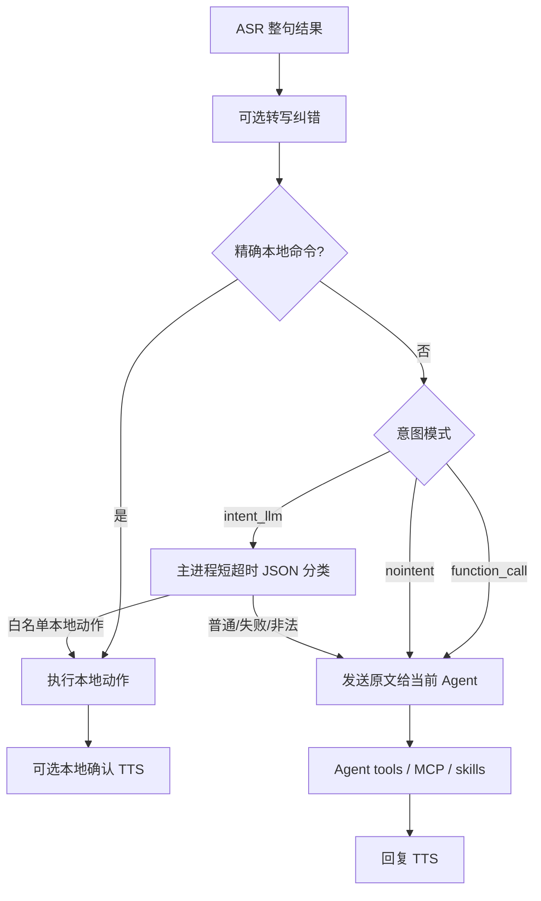

# 语音助手意图理解

## 业务背景

语音助手不能把所有转写都无条件当成聊天消息。例如“退下”“退下吧”或“退出语音助手”应该关闭语音球，“新建对话”应该切到空白上下文；但“怎么退出语音助手”只是问题，不能误执行退出。该能力参考 xiaozhi-server 的混合意图架构，调研证据见 [xiaozhi-server 语音意图识别调研](./xiaozhi-voice-intent-research.md)。

## 领域概念

| 概念 | 含义 |
| --- | --- |
| `function_call` | 默认模式。只本地处理完整匹配的控制句；其余文本直接进入现有 Agent，由 tools/MCP/skills 理解通用任务，不增加前置模型延迟。自然口语变体（「好吧那你退下吧」）由下方「语音控制 function tool」在 Agent 轮内兜住。 |
| 语音控制 function tool | `voice_exit_assistant` / `voice_new_conversation` / `voice_enable_screen_context` / `voice_disable_screen_context`（后两个仅 macOS）。以 MCP 工具**常驻**注入聊天路径（pi RPC 桥接 + claude/codex builtinServers；常驻是因为 pi 工具集 open 时冻结，而语音常在会话已开后才激活），LLM 理解自然口语后主动调用；执行面经 `dispatchVoiceAssistantIntentAction` 验语音激活态——普通打字轮误调只得到可读错误、零副作用。动作以 `VoiceAssistantCommand{type:"intentAction"}` 回主窗口控制器执行；退出走状态机 `exitAfterReply` 事件给在途 agent 轮打 `exitAfterSpeech` 标记，本轮回复（agent 自己的告别语）播完后才关语音球。实现：`capabilities/voice-intent/assistant-tools.ts`。 |
| `intent_llm` | 在 Agent 前增加一次最多 5 秒的严格 JSON 分类，只识别语音助手本地动作。 |
| `nointent` | 不使用模型分类；与 xiaozhi 一致，安全的精确控制命令仍可用。 |
| `continue_chat` | 不执行本地动作，原始转写继续进入 Agent。也是所有失败的统一回退。 |
| 本地动作 | `exit_assistant`、`new_conversation`、`enable_screen_context`、`disable_screen_context`。 |

## 核心规则

1. 本地精确命令按去空白、去标点后的整句相等判断，不使用包含匹配。
1a. **拼音模糊 fast-path**（`source: "direct_fuzzy"`，`voiceSettings.commandFuzzyMatch` 默认开）：精确匹配 miss 后、三模式分流前，对归一化 ≤10 字且不含疑问触发词（怎么/如何/为什么/吗/呢…）的短句做拼音容错——① 无声调全拼串精确相等（覆盖「腿下」→「退下」类同音错字）；② 音节数相同且恰一个近音替换（声母或韵母相同）。刻意不允许音节插入/删除：「推一下」与「退下」编辑距离恰为 1，允许即误退出（负例单测固化）。指令模板与否决表在 `packages/core/personal/voice-commands.ts`（两端单一事实源），匹配器在 `apps/desktop/src/main/capabilities/voice-intent/fuzzy.ts`。
2. 疑问句、引用句、复合任务和未知函数必须返回 `continue_chat`，不能因为包含“退出”而关闭助手。
3. `function_call` 模式不做第二次 LLM 调用。Cortex 已有 Agent 工具链，不复制 xiaozhi 的插件注册表。
4. `intent_llm` 只接受白名单 `function_call` JSON；Markdown fence 可兼容，任何其它输出 fail-open。
5. Provider Catalog 引用由主进程解析，renderer 不读取模型密钥。专用模型未配置时跟随全局默认模型。
6. 本地动作不伪造用户/助手聊天消息。新建对话和屏幕上下文切换只朗读简短确认；退出先进入带 `exitAfterSpeech` 的 speaking 状态，只有观察到本轮 TTS 真起播后的停止信号才经主进程把共享 overlay 切回宠物模式。播放期间后台麦克风用 AEC + Silero 连续人声确认监听插话；语音、点击或快捷键打断都先切 listening 再停止 TTS，取消待退出标记，避免同步的停止事件误关窗口。

## 业务流程

## 关键实现

- `apps/desktop/src/main/capabilities/voice-intent/understand.ts`：精确命令、提示词、白名单解析、模型选择与 fail-open。
- `apps/desktop/src/main/capabilities/voice-intent/assistant-tools.ts`：语音控制 function tool（MCP host + 执行面门控；动作下发器由 `ipc/voice-assistant.ts` 在 register 阶段经 setter 装配，避免 electron 窗口链进 cli/pi-session 单测）。
- `apps/desktop/src/main/ipc/voice-assistant.ts`：仅允许主窗口调用 `voiceAssistant:understandIntent`。
- `packages/views/cortex-desktop/personal/voice-assistant/VoiceAssistantController.tsx`：在纠错后、会话发送前执行本地动作。
- `packages/core/desktop/types.ts` 与 `apps/desktop/src/main/ipc/types.ts`：`VoiceIntentMode`、结果类型与持久化字段镜像。
- `SpeechSettingsSection.tsx`：模式和专用模型设置。

## 失败与隐私边界

- 模型未配置、认证失败、超时、断网、截断或非法 JSON 都继续普通聊天。
- 分类器不记录原始转写，也不把文本写入日志；IPC 入口拒绝 overlay 或其它窗口调用。
- 选择 `intent_llm` 会把转写文本发送给所选模型供应商。默认 `function_call` 没有这次额外请求。
