# 语音唤醒（Wake Word / KWS）

## 业务背景

参考 xiaozhi 的混合推理架构：唤醒词检测是纯端侧能力（<200ms 级），让用户免热键、免点击，
喊一声就唤起语音助手。默认关闭——常驻开麦是隐私敏感行为，必须由用户显式开启。

## 架构

```mermaid
flowchart LR
  Mic[麦克风 AEC/NS/AGC] --> Cap[capture.ts 重采样 16kHz/1280 样本步]
  Cap --> Gate[能量前置门]
  Gate --> Mel[melspectrogram.onnx]
  Mel --> Emb[embedding_model.onnx 76 帧滑窗]
  Emb --> Cls[hey_jarvis.onnx 16 embedding 滑窗]
  Cls --> Judge[阈值 + 连续 2 帧确认]
  Judge -->|kws:hit 分数| Main[主进程 wake-word.ts]
  Main -->|冷却 2s + suspend| VA[voiceAssistant activate wakeword]
```

- **运行位置：常驻 kws 隐藏窗口**（`apps/desktop/src/main/kws-window.ts`）。否决主窗口
  （closeToTray 后定时器被节流到秒级，且生命周期耦合）与主进程 native（需新原生依赖且丢
  Chromium AEC——AEC 是防 TTS 播报自唤醒的第一道防线）。窗口创建即关背景节流，
  `render-process-gone` 退避重建最多 3 次后标 degraded。
- **模型：openWakeWord 三级 ONNX**，合计 ~3.6MB，`scripts/prepare-kws-models.mjs` 按固定
  release tag + SHA-256 下载到 `resources/kws/`（gitignored），构建期 `kwsAssetsPlugin`
  拷进 `out/renderer/kws/` 随包。打包态经 `cortex-kws://assets/` 只读协议供给；
  onnxruntime-web 的 wasm 复用 `cortex-vad://` 里那份（版本经 package.json pin 1.27.0
  与 vad-web 传递依赖对齐，**升级任一侧必须同步检查**）。
- **判定**：灵敏度→阈值 low/medium/high = 0.7/0.5/0.35；概率 ≥ 阈值且连续 2 帧确认；
  主进程侧命中后 2s 冷却。能量门（RMS < 0.0012 且无 1.5s 惯性）时跳过 embedding/classifier，
  melspec 照跑保持滑窗连续，静音房间 CPU 趋近 0。
- **命中链路**：`kws:hit`（sender 校验）→ suspend 识别 → `activate("wakeword")` 复用热键
  激活路径（含前台 pid 冻结、overlay 切 voice 模式）。语音助手任何入口激活都会 suspend
  KWS（TTS 播报中喊唤醒词不得二次触发），deactivate 时 resume。
- **suspend 语义：停推理不放流**——保持 getUserMedia track 打开，避免设备重新上电延迟；
  macOS 橙点在监听期间常亮，本身就是系统级"正在监听"指示。

## 设置与持久化

- `voiceSettings.wakeWord: WakeWordSettings { enabled; wordId: "hey-jarvis"; sensitivity }`，
  双镜像 `packages/core/desktop/types.ts` ⇄ `apps/desktop/src/main/ipc/types.ts`。
- 设置页（`SpeechSettingsSection.tsx`）改动即持久化 + 经 `bridge.wakeWordConfigure` 热应用；
  app 启动时 `index.ts` 读持久化状态决定是否自启 kws 窗口。

## 隐私边界

- 默认关闭；开启文案明示「麦克风持续在本机内存中分析，音频不落盘、不上传」。
- kws 窗口零落盘、零文本日志；跨 IPC 只有概率分数与状态枚举（`preload/kws.ts` 窄桥，
  音频永不过桥）；`kws:get-config`/`kws:hit`/`kws:state` 全部校验 sender 是 kws 窗口。

## 已知限制与后续

- P1 仅预训练英文词 "hey jarvis"（openWakeWord 训练管线英语中心）；正式产品词
  （"Hey Cortex"，英文音系可自训练）与真中文词（路线：中文 TTS 合成数据自训练 /
  sherpa-onnx 拼音 KWS）在 P2 评估，见计划文档。
- 模型缺失（未跑 prepare 脚本）或 wasm 初始化失败 → kws 窗口上报 degraded，不重试轰炸。
- 验收线：误唤醒 <1 次 / 4h 环境音；唤醒率 ≥90% @1m；常驻功耗 <3% 单核。

## 维护清单

- 升级 `@ricky0123/vad-web` 或 `onnxruntime-web` 时同步检查两者 wasm 版本一致性。
- 新增唤醒词：模型进 `prepare-kws-models.mjs` 清单 + `KWS_MODELS`（vite）+
  `WORD_MODEL_BY_ID`（renderer）+ `WakeWordSettings.wordId` union（双镜像）。
