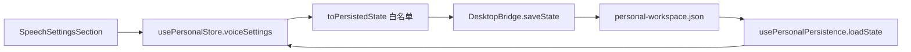
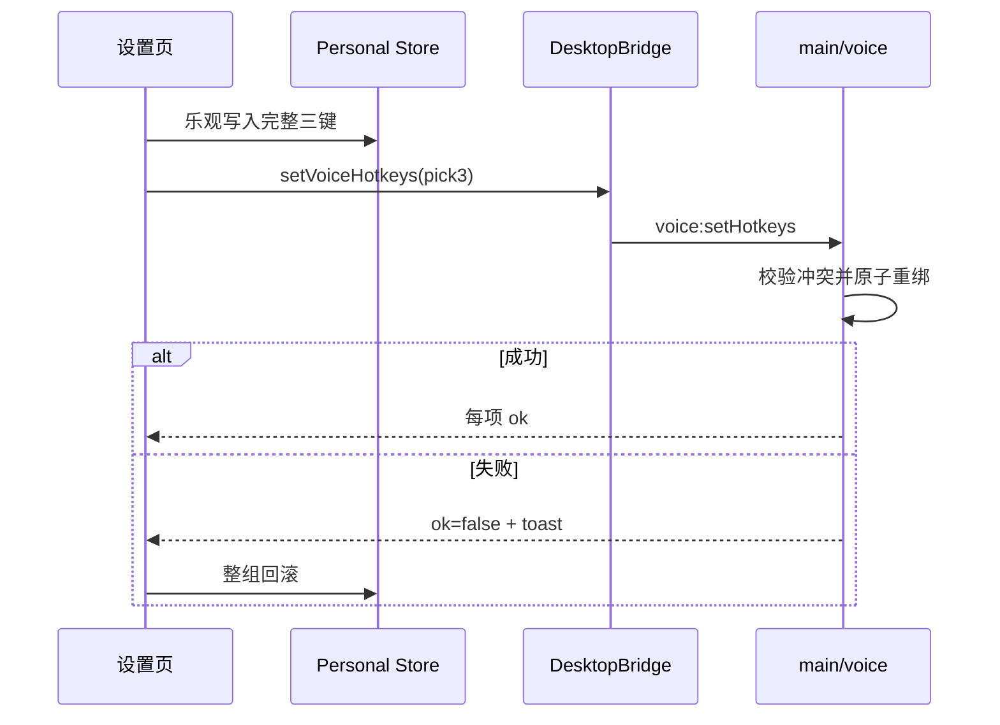

# 语音功能领域说明

## 背景与范围

Cortex Desktop 的语音能力由统一的「设置 → 语音」分区管理，包含三项协作能力：

- 语音聊天：从独立浮层录音，转写整段语音后交给聊天 Agent，再用现有 TTS 朗读回复。
- 系统级听写：以切换或按住快捷键录音，将识别结果安全地写回当前应用的光标位置。
- 语音识别与播报：本地 SenseVoiceSmall、云端 ASR 与现有 TTS 引擎配置。

桌面优先目标是 macOS。非 macOS 或不具备桌面 bridge 的环境仍可查看通用 TTS/ASR 配置，但不会展示依赖系统级快捷键、辅助功能或前台应用截图的控制项。

## 领域概念

| 概念 | 说明 | 真源 |
|---|---|---|
| `VoiceSettings` | 麦克风、语音聊天与听写的交互偏好；不包含 TTS/ASR 引擎参数 | `core/desktop/types.ts` 与 `main/ipc/types.ts` 镜像 |
| `ttsSettings` | 自动朗读、系统语音、Edge TTS 或 OpenAI 兼容 TTS 引擎配置 | `store/personal.ts` |
| `asrSettings` | SenseVoiceSmall / 云端转写服务、语言与模型配置 | `store/personal.ts` |
| 语音词典 | 专有名词的转写 prompt 偏置列表；不是文本替换规则 | `VoiceSettings.dictationDictionary` |
| 语音聊天键 | 调起或提交语音聊天的全局快捷键 | `VoiceSettings.chatHotkey` |
| 听写切换键 / 按住键 | 前者走 Electron `globalShortcut`，后者依赖 helper 的按键抬起事件 | `VoiceSettings` |
| 意图模式 | `function_call` 复用 Agent 工具链、`intent_llm` 独立分类、`nointent` 关闭模型分类 | `VoiceSettings.intentMode` |

`VoiceSettings` 的交互开关与快捷键默认关闭或为空：空 `micDeviceId` 使用系统默认麦克风，三项空快捷键都表示禁用，词典为空；意图模式默认 `function_call`，复用已有 Agent 工具链且不增加串行分类请求。`defaultVoiceSettings()` 必须每次返回新对象，避免数组在 store 实例之间共享。

## 设置与持久化

设置页由 `SpeechSettingsSection.tsx` 组装四块内容：常规麦克风、语音聊天（含既有 TTS 面板）、听写和模型管理（复用 `SttSettingsSection`）。旧 tab id `voice` 与 `stt` 会在 `SettingsMenu` 中归一化为 `speech`，但不会再显示两个旧入口。

持久化路径如下：

`voiceSettings` 是持久化切片，故 `saveUrgency` 将其变更纳入节流保存。hydrate 遇到旧存档缺少该字段时，必须回落 `defaultVoiceSettings()`，而不是保留 `undefined`。

`ttsSettings` 缺失时回落 `DEFAULT_TTS_SETTINGS`，因此新用户默认使用 `zh-CN-XiaoxiaoNeural` 的 Edge TTS；已有 `personal-workspace.json` 中保存的引擎配置不会被迁移或覆盖。

## 跨进程契约

`VoiceSettings` 与 `PersistedState.voiceSettings?` 是双镜像契约：任何字段变化都必须同时修改：

- `packages/core/desktop/types.ts`
- `apps/desktop/src/main/ipc/types.ts`

主窗口只通过可选的 `DesktopBridge.setVoiceHotkeys()` 下发三项快捷键。UI 先乐观更新持久化状态，再将完整的三键组合原子下发；若任一注册失败，整体回滚到旧组合并显示失败提示，保证 UI 与系统实际注册结果一致。

## 关键实现与边界

### Edge TTS

Edge TTS 是无需 API Key 的在线神经网络语音。renderer 仅通过 `DesktopBridge.ttsSynthesizeEdge()` 与 `listEdgeTtsVoices()` 请求；WebSocket、微软的防重放签名和版本协商均留在主进程 `capabilities/edge-tts/`，避免暴露服务细节并绕开 renderer 的网络限制。它返回完整 MP3，播放层按句分块预取，不能复用只支持 WAV PCM 的流式播放器。

自动朗读、聊天手动朗读和语音聊天浮层会在 Edge 失败时静默回落系统语音；设置页试听不回落，直接显示错误以便用户排查。Edge 依赖网络且为非公开接口，系统语音始终保留为离线方案。

维护时首先检查 `capabilities/edge-tts/client.ts` 的 `SEC_MS_GEC_VERSIONS`：微软会提高可接受的 Chromium 版本下限，候选值全部收到 HTTP 403 时应更新该列表。`Sec-MS-GEC` 同时依赖本机五分钟时间窗口；设备时钟偏移超过五分钟也会导致 403。

### 麦克风设备

浏览器在未获授权前通常不会提供设备标签。设置页先尝试 `getUserMedia({ audio: true })`，立即停止临时轨道，再调用 `enumerateDevices()`；授权被拒或旧 WebView 不支持枚举时，仍保留「系统默认」回退。无标签设备显示「麦克风 n」，避免空白选项。

### 听写词典与转写

词典条目在 UI 侧去重、去首尾空白、单条限长，随后由听写控制器拼为有限长度的 prompt。在线转写链路将 prompt 透传给服务端；SenseVoiceSmall GGUF 本地链路不支持提示词偏置。词典只能影响支持 prompt 的模型偏好，不能保证纠正所有识别错误，也不能代替用户原始口述内容。

本地识别的协议、生命周期与失败边界见 [SenseVoiceSmall 本地语音识别](./sensevoice-asr.md)。

语音助手在转写纠错后、发送 Agent 前执行本地意图理解。默认 `function_call` 不增加一次前置 LLM 调用；精确退出、新建对话与屏幕上下文命令本地执行，其余原文继续进入现有 Agent 工具链。可选 `intent_llm` 的分类、白名单和 fail-open 规则见 [语音助手意图理解](./voice-intent.md)。

Silero VAD 是声学噪声的第一道防线。人声起始阈值采用 `0.60`，结束阈值采用 `0.45`，比旧 `0.50/0.35` 更能拒绝风扇等模糊稳定声，同时保持 300ms 最短语音以保留正常短发声。少数漏网噪声仍可能被 ASR 解码成“.”，因此语音助手在 LLM 纠错之前和之后各执行一次确定性文本门控：只静默丢弃纯标点和纯符号；“啊”“嗯”“um”、“停”“退出”等任何含词汇内容的短输入都必须保留。该门控只作用于连续语音助手，不改变用户主动提交的系统听写内容。

### 系统级听写

听写栏必须是 `focusable:false` 且以 `showInactive` 显示，避免录音时抢走目标应用焦点。控制器在提交前校验前台应用 pid；转写期间用户切换了应用时，结果必须丢弃而非注入错误窗口。文本注入复用 helper 的 paste 能力，敏感听写内容走 stdin，不能放进进程 argv。

### 语音聊天

语音助手采用支持插话的连续状态机：`idle → listening → transcribing → thinking → speaking → listening`。进入 `speaking` 后控制器并行打开同一条录音、PCM 与 VAD 链，但在真人声确认前不把音频送入 ASR。Chromium `echoCancellation + noiseSuppression + autoGainControl` 先消除扬声器参考音；Silero 在播放期改用更保守的 `0.80/0.65` 概率滞回，并等待约 240ms 的连续人声确认。确认后先把状态切到 listening，再停止 TTS，恢复普通 `0.60/0.45` 概率阈值，并把 320ms PCM 前滚并入用户句子。本句的最短语音仍保持 240ms，不能中途恢复到 300ms：`vad-web` 会在句末按当前最短帧数二次校验，提前提高会让刚好够短的“停”“等等”被反向判成 `VADMisfire` 而不提交 ASR；下一轮新监听才恢复普通 300ms。在线 ASR 与本地降级路径都只把这段用户 PCM 封装成 WAV，不发送整段 TTS 播放期音轨。这样短插话不会被起音确认或句末复核吃掉，单帧回声、风扇和爆音也不会直接打断。

TTS 更新“最近朗读”元数据时会先产生一个 `isSpeaking=false` 快照，状态机仍须先观察到本轮 `isSpeaking=true`，后续 `false` 才能视为真正播完。若播放期麦克风已经就绪，正常播完直接进入 listening 并沿用该流，高门槛保持到下一次真人声确认，从而隔离扬声器和蓝牙尾音；若开麦、AEC 或 VAD 初始化失败，则无感降级到原来的 650ms 尾音等待后重开麦克风。等待期间若发生错误、退出或手动操作，代际与阶段守卫不得复活旧轮次。

退出意图不应无提示关窗：控制器先朗读“好的，我先退下了”，沿用同一 TTS 起播闭锁，确认语真正播完后才调用主进程 deactivate。确认播放期间，无论语音插话、点击球体、麦克风按钮还是快捷键打断，都必须先把状态切到 listening，再调用 `stopSpeaking()`；这会取消 `exitAfterSpeech`，也让同步到达的旧 TTS 停止事件因阶段不匹配而失效。退出确认正常播完时先释放后台麦克风和本地 ASR stream，再关闭共享 overlay。

语音球浮层只镜像主窗口控制器状态，不能写 `personal-workspace.json`，防止与主窗口的全量保存竞争。可选屏幕上下文会在浮层抢焦前冻结原前台应用的 pid，并由 helper 截取该窗口，不能在提交时重新读取前台应用而误截 Cortex 浮层；屏幕录制和麦克风权限失败时要保留无截图/无录音的明确降级提示。

### 权限与平台

- macOS 辅助功能权限是按住听写和光标注入的前提。
- 麦克风权限用于设备标签、语音聊天和听写录音。
- 屏幕录制权限只在启用语音聊天屏幕上下文时需要。
- 切换听写和语音聊天键使用 `globalShortcut`，因此可作为辅助功能权限不可用时的降级入口；按住听写不能降级为无权限可用。

## 测试与维护清单

- 为 `voiceSettings` 添加 hydrate、setter、`toPersistedState` 与 `saveUrgency` 覆盖。
- 设置测试应断言只存在 `speech` 入口、旧 tab 可归一化、模型管理仍渲染已有 ASR 表单。
- 修改设置资源后运行 `pnpm i18n:types`，同步 `resources.d.ts`。
- 新增语音 IPC、浮层或 helper 能力时更新 `docs/module-map.md`；独立窗口同时更新其窗口清单。
